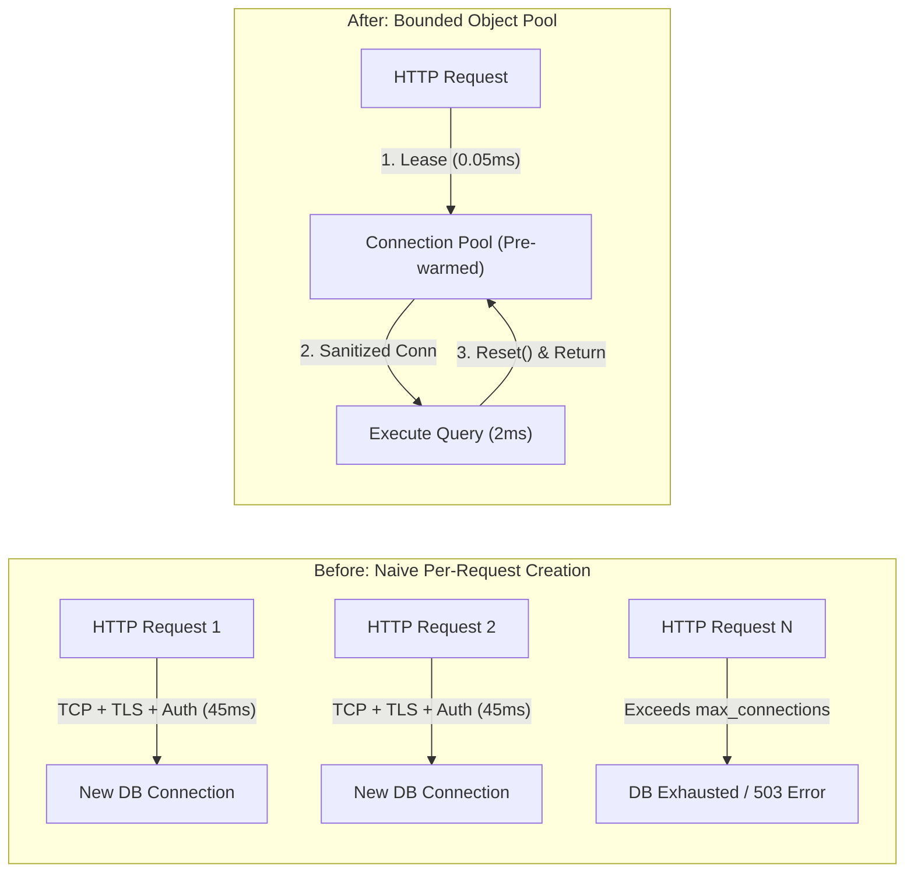
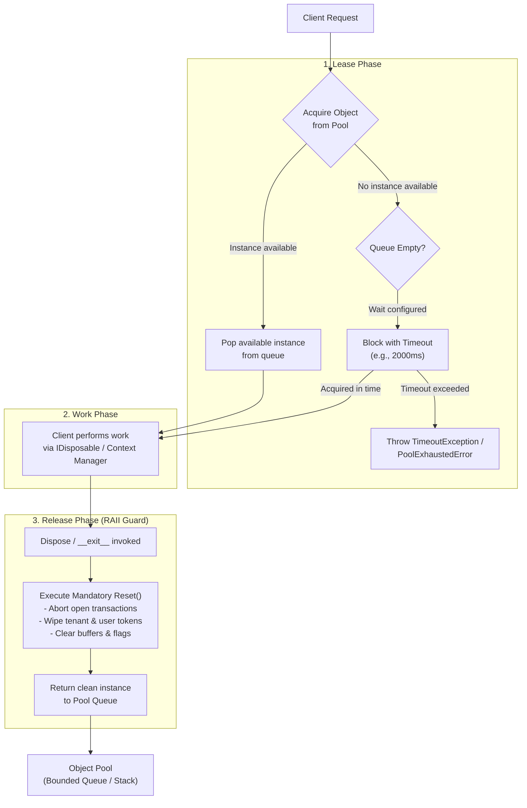

# Lesson 07: Object Pool

> **Prerequisites:** [Prototype](../06-prototype/README.md) and [Track 25 Overview](../README.md).  
> **Estimated Reading Time:** 20 minutes  
> **Target Audience:** Engineers preparing for LLD, OOP, C#, or Python technical screening and architecture rounds.

> [!NOTE]
> **In one line:** **Object Pool** reuses expensive objects (connections, buffers, threads) instead of creating and destroying them — the price is you must reset state and always return them.

> [!TIP]
> **The One Rule of the Object Pool Pattern:** Pool objects only when creation involves **heavy unmanaged OS resources, rate-limited network sockets, or massive heap allocations causing GC pauses**; pooling lightweight managed objects is a performance antipattern that increases GC pressure through lock contention and reference lifetime inflation. Always enforce automatic return and mandatory sanitization before re-leasing.

---

## 1. Why This Matters: The Interview Trap

"When would you design an Object Pool, why is pooling ordinary C# or Python objects considered an anti-pattern today, and what happens when an object is returned to the pool in a dirty state?"

Junior candidates frequently treat object pooling as a universal performance silver bullet:
> *"An Object Pool maintains a set of pre-initialized objects. Instead of creating and destroying objects with `new`, you rent one from the pool and return it when finished. This saves memory and prevents the garbage collector from running."*

This answer immediately signals to senior interviewers a lack of understanding of **modern managed runtimes (CLR and CPython)**:

1. **The Allocation Pessimization Trap:** In modern .NET, allocating a short-lived object in Gen 0 is essentially free—it requires bumping an allocation pointer by a few bytes, taking roughly 5 to 10 nanoseconds. Conversely, acquiring and returning an object from a thread-safe pool requires atomic synchronization operations (`Interlocked`, CAS loops, or mutexes) that frequently take 30 to 100 nanoseconds. Pooling small, pure-managed objects actually **slows down your application** and creates lock contention under high concurrency.
2. **The Lifetime Inflation Hazard:** The garbage collector is optimized for the **Generational Hypothesis**: objects either die almost instantly (Gen 0) or live for a very long time (Gen 2). Pooling artificially promotes objects to Gen 2, forcing them to remain on the heap indefinitely and increasing overall process memory footprint.
3. **When Pooling Is Actually Mandatory:**
   - **Heavy OS Resources:** Database connections, TCP sockets, SSL/TLS handshakes, and OS threads. Establishing a TCP connection requires a 3-way handshake; establishing a TLS session requires multiple round-trips; authenticating a database connection requires process spawning or credential checks.
   - **Large Object Heap (LOH) Buffers:** In .NET, allocating byte arrays $\ge 85,000$ bytes lands directly on the Large Object Heap. The LOH is not compacted by default, leading to severe virtual address space fragmentation and full Gen 2 GC pauses. Reusing large buffers via `ArrayPool<byte>.Shared` is critical.
4. **The Catastrophic "Dirty State" Failure:** If an object is returned without being thoroughly sanitized, residual state bleeds into subsequent operations. In multi-tenant systems, failing to reset user context or uncommitted database transactions causes **cross-tenant data contamination and security breaches**.

### Object Lifecycle Strategies Comparison

| Lifecycle Strategy | Creation Cost | Synchronization Cost | Thread Safety | Ideal Use Case |
| :--- | :--- | :--- | :--- | :--- |
| **Direct Heap Allocation (`new`)** | **Extremely Low** (Gen 0 bump pointer) | **Zero** (thread-local allocation context) | N/A (thread-confined) | Short-lived DTOs, domain models, string formatting, request payloads. |
| **Object Pool** | Amortized across requests | **Moderate to High** (concurrent queue or spinlock) | Managed by Pool | Heavy sockets, DB connections, massive byte buffers (`ArrayPool<T>`). |
| **ThreadLocal (`ThreadStatic`)** | Low (one per thread) | **Zero** after thread initialization | Safe (isolated per thread) | Reusable scratchpads, cryptographic formatters, regex matchers. |
| **Singleton** | Paid once at startup | **Low** after initialization | Requires thread-safe members | Stateless application services, configuration providers, DI root engines. |

---

## 1A. The Visual Story: Problem -> Analogy -> Solution

### The Problem (Why Naive Code Explodes)

Imagine an e-commerce checkout API handling 2,000 requests per second. Every incoming request naively opens a fresh PostgreSQL connection (`new DbConnection()`), runs a 2 ms query, and closes it. Each new connection triggers a **TCP 3-way handshake, TLS negotiation, and database authentication**, taking ~45 ms and spawning a backend worker process on the database server. Under a traffic spike, connection creation consumes 95% of CPU time, the database hits `max_connections = 100` in milliseconds, and requests cascade into `503 Service Unavailable`—all because expensive OS/network resources are created and destroyed on every request instead of being reused.

### Real-World Analogy

Think of a **university library checkout desk** for rare reference books (or a bowling alley shoe counter). Instead of printing and binding a brand-new $200 textbook every time a student needs to look up one formula for 5 minutes—and shredding it afterward—the library keeps a bounded shelf of **20 pre-purchased copies**. A student checks out a copy, uses it, and returns it to the desk. Before putting it back on the shelf, the librarian erases any sticky notes or pencil marks (**state sanitization**) so the next student receives a clean book. If all 20 copies are checked out, the 21st student waits in a short queue (with a timeout) rather than bankrupting the library.

### Visual Problem -> Solution Diagram



### Applicability & Pattern Relations

- **Use when:** Object initialization is orders of magnitude more expensive than usage (DB connections, TCP/gRPC channels, TLS sessions, thread pools).
- **Use when:** The underlying resource has a hard external cap (e.g., database `max_connections`) and you need bounded concurrency with backpressure.
- **Use when:** Allocating large buffers ($\ge 85\text{ KB}$ in .NET LOH) causes frequent stop-the-world GC pauses under high throughput.
- **Relations with Other Patterns:** Often implemented as a **Singleton** (one shared pool per resource type) or managed by a DI container; **Flyweight** shares immutable state across many callers simultaneously, whereas **Object Pool** lends *mutable* exclusive-access objects one caller at a time; **Prototype** can be used inside the pool to clone pre-configured template objects.

---

## 2. Visual Mental Model / Taxonomic Comparison

An Object Pool acts as a reservoir of scarce resources. To prevent resource starvation and state contamination, the acquisition and release lifecycle must follow a strict RAII (Resource Acquisition Is Initialization) flow.



### Pool Exhaustion Strategies

| Strategy | Behavior Under Load Spike | Latency Impact | Risk |
| :--- | :--- | :--- | :--- |
| **Block with Timeout** | Thread waits up to $N$ milliseconds for a returning resource. | Bounded latency increase under queue backlog. | Cascading timeouts if downstream dependencies stall. |
| **Dynamic Growth (Burst)** | Pool dynamically spawns new instances beyond max limit. | Fast response time. | Downstream overload (e.g., crashing the database with too many open connections). |
| **Fail Fast** | Immediately throws `PoolExhaustedException`. | Zero waiting latency. | Dropped user requests during transient spikes. |

---

## 3. Code Implementation

In the following example, we implement a thread-safe, bounded `ConnectionPool` simulating expensive database connections. The implementation enforces **RAII leasing** (ensuring automatic release even if an exception occurs) and **mandatory state sanitization** (wiping session user tokens and rolling back uncommitted transactions before returning).

````carousel
```python
import queue
from typing import Optional


class DatabaseConnection:
    """Simulates an expensive database connection holding a physical socket."""

    def __init__(self, conn_id: int) -> None:
        self.conn_id = conn_id
        self.in_transaction = False
        self.active_session_user: Optional[str] = None

    def execute(self, sql: str, user: str) -> str:
        self.active_session_user = user
        self.in_transaction = True
        return f"[Conn-{self.conn_id}] Executed '{sql}' for user '{self.active_session_user}'"

    def reset(self) -> None:
        """Sanitizes dirty state before returning to the pool."""
        self.in_transaction = False
        self.active_session_user = None

    def __repr__(self) -> str:
        return f"DatabaseConnection(id={self.conn_id}, in_transaction={self.in_transaction}, user={self.active_session_user})"


class ConnectionLease:
    """RAII Context Manager ensuring safe, automatic return to the pool."""

    def __init__(self, pool: "ConnectionPool", connection: DatabaseConnection) -> None:
        self._pool = pool
        self._connection: Optional[DatabaseConnection] = connection

    def __enter__(self) -> DatabaseConnection:
        if self._connection is None:
            raise RuntimeError("Lease already closed.")
        return self._connection

    def __exit__(self, exc_type, exc_val, exc_tb) -> None:
        if self._connection is not None:
            self._pool.release(self._connection)
            self._connection = None


class ConnectionPool:
    """Thread-safe bounded object pool."""

    def __init__(self, capacity: int) -> None:
        self._capacity = capacity
        self._pool: queue.Queue[DatabaseConnection] = queue.Queue(maxsize=capacity)
        for i in range(1, capacity + 1):
            self._pool.put(DatabaseConnection(conn_id=i))

    def acquire(self, timeout: float = 2.0) -> ConnectionLease:
        try:
            conn = self._pool.get(timeout=timeout)
            return ConnectionLease(self, conn)
        except queue.Empty:
            raise TimeoutError("Connection pool exhausted: request timed out.")

    def release(self, conn: DatabaseConnection) -> None:
        # Mandatory sanitization: wipe dirty state before making available again
        conn.reset()
        self._pool.put(conn)

    @property
    def available_count(self) -> int:
        return self._pool.qsize()


def main() -> None:
    pool = ConnectionPool(capacity=2)
    print(f"Initial available connections: {pool.available_count}")

    # 1. Acquire first connection and execute query
    with pool.acquire() as conn1:
        res1 = conn1.execute("SELECT * FROM users", user="Alice")
        print(res1)
        print(f"Inside lease: Available in pool = {pool.available_count}")

    # conn1 is automatically returned and sanitized upon exiting context manager
    print(f"After release: Available in pool = {pool.available_count}")

    # 2. Acquire again; verify the connection was completely sanitized
    with pool.acquire() as conn_reused:
        print(f"Reacquired clean connection: {conn_reused}")
        res2 = conn_reused.execute("UPDATE accounts SET balance = 500", user="Bob")
        print(res2)

    print(f"Final available in pool: {pool.available_count}")


if __name__ == "__main__":
    main()
```
<!-- slide -->
```csharp
using System;
using System.Collections.Concurrent;

namespace ObjectPoolDemo;

public class DatabaseConnection
{
    public int ConnId { get; }
    public bool InTransaction { get; private set; }
    public string? ActiveSessionUser { get; private set; }

    public DatabaseConnection(int connId)
    {
        ConnId = connId;
        InTransaction = false;
        ActiveSessionUser = null;
    }

    public string Execute(string sql, string user)
    {
        ActiveSessionUser = user;
        InTransaction = true;
        return $"[Conn-{ConnId}] Executed '{sql}' for user '{ActiveSessionUser}'";
    }

    public void Reset()
    {
        InTransaction = false;
        ActiveSessionUser = null;
    }

    public override string ToString() =>
        $"DatabaseConnection(id={ConnId}, in_transaction={InTransaction}, user={ActiveSessionUser ?? "None"})";
}

public sealed class ConnectionLease : IDisposable
{
    private readonly ConnectionPool _pool;
    private DatabaseConnection? _connection;

    public DatabaseConnection Connection =>
        _connection ?? throw new ObjectDisposedException(nameof(ConnectionLease));

    public ConnectionLease(ConnectionPool pool, DatabaseConnection connection)
    {
        _pool = pool;
        _connection = connection;
    }

    public void Dispose()
    {
        if (_connection != null)
        {
            _pool.Release(_connection);
            _connection = null;
        }
    }
}

public class ConnectionPool
{
    private readonly int _capacity;
    private readonly ConcurrentQueue<DatabaseConnection> _pool = new();

    public int AvailableCount => _pool.Count;

    public ConnectionPool(int capacity)
    {
        _capacity = capacity;
        for (int i = 1; i <= capacity; i++)
        {
            _pool.Enqueue(new DatabaseConnection(i));
        }
    }

    public ConnectionLease Acquire()
    {
        if (_pool.TryDequeue(out var conn))
        {
            return new ConnectionLease(this, conn);
        }
        throw new TimeoutException("Connection pool exhausted: request timed out.");
    }

    public void Release(DatabaseConnection conn)
    {
        // Mandatory sanitization: wipe dirty state before making available again
        conn.Reset();
        _pool.Enqueue(conn);
    }
}

public static class Program
{
    public static void Main()
    {
        var pool = new ConnectionPool(capacity: 2);
        Console.WriteLine($"Initial available connections: {pool.AvailableCount}");

        // 1. Acquire first connection and execute query
        using (var lease1 = pool.Acquire())
        {
            var res1 = lease1.Connection.Execute("SELECT * FROM users", user: "Alice");
            Console.WriteLine(res1);
            Console.WriteLine($"Inside lease: Available in pool = {pool.AvailableCount}");
        }

        // conn1 is automatically returned and sanitized upon exiting using block
        Console.WriteLine($"After release: Available in pool = {pool.AvailableCount}");

        // 2. Acquire again; verify the connection was completely sanitized
        using (var lease2 = pool.Acquire())
        {
            Console.WriteLine($"Reacquired clean connection: {lease2.Connection}");
            var res2 = lease2.Connection.Execute("UPDATE accounts SET balance = 500", user: "Bob");
            Console.WriteLine(res2);
        }

        Console.WriteLine($"Final available in pool: {pool.AvailableCount}");
    }
}
```
````

**Expected Output (Both Languages):**
```text
Initial available connections: 2
[Conn-1] Executed 'SELECT * FROM users' for user 'Alice'
Inside lease: Available in pool = 1
After release: Available in pool = 2
Reacquired clean connection: DatabaseConnection(id=2, in_transaction=False, user=None)
[Conn-2] Executed 'UPDATE accounts SET balance = 500' for user 'Bob'
Final available in pool: 2
```

---

## 3A. Where It Is Used, Why It Exists & Progressive Buildup

### Where It Is Used (Real-World Systems & LLD Interviews)

| Domain / Ecosystem | Concrete Real-World Usage | LLD Interview Problem Where You Use It |
| :--- | :--- | :--- |
| **.NET / C#** | `System.Buffers.ArrayPool<T>.Shared` (LOH avoidance in Kestrel), `Microsoft.Extensions.ObjectPool.ObjectPool<T>`, `Npgsql` / `SqlClient` connection pools, `IHttpClientFactory` handler pooling. | Design a zero-allocation byte-buffer pool for a high-throughput TCP/WebSocket server. |
| **Python** | `SQLAlchemy.pool.QueuePool`, `asyncpg.create_pool()`, `urllib3.HTTPConnectionPool`, `multiprocessing.Pool`. | Design a bounded worker/browser-tab pool for an async PDF/screenshot rendering service. |
| **Go** | `sync.Pool` (per-P lock-free cache for temporary buffers), `database/sql.DB` (`SetMaxOpenConns` / `SetMaxIdleConns`), `pgxpool.Pool`. | Design a concurrent gRPC/HTTP connection pool with health checks and wait timeouts. |
| **TypeScript / Node.js** | `pg.Pool` (`node-postgres`), `generic-pool` (backing Sequelize, Knex, and Puppeteer pools), `undici.Pool` (HTTP/1.1 socket pool). | Design a rate-limited third-party API client or headless browser pool with leak protection. |

### Why It Is Used — The Step-by-Step Buildup (Before -> Pain -> Pattern)

#### Stage 0: Naive Code (Create & Destroy Per Request)
```python
class ExpensiveDbConn:
    def __init__(self, conn_id: int) -> None:
        self.conn_id = conn_id
        self.tenant: str | None = None
        # Simulates TCP + TLS + DB auth handshake (~30-50ms in production)

    def query(self, sql: str) -> str:
        return f"[Conn-{self.conn_id} tenant={self.tenant}] {sql}"

    def close(self) -> None:
        pass  # Tears down socket


def handle_request(tenant: str, sql: str) -> str:
    conn = ExpensiveDbConn(conn_id=1)  # New connection every single request
    conn.tenant = tenant
    result = conn.query(sql)
    conn.close()
    return result
```

#### What Breaks as Requirements Arrive
- **Requirement 2 (1,000 req/s burst traffic, DB `max_connections = 50`):** Every request pays the 40 ms handshake penalty, and 1,000 concurrent requests open 1,000 sockets—crashing PostgreSQL with `FATAL: remaining connection slots are reserved`.
- **Requirement 3 (Multi-tenant isolation & exception safety):** If you naively keep a global `list` of connections and `pop()`/`append()` manually:
  1. An exception inside `query()` skips `append()`, **leaking** the connection until the pool starves.
  2. Returning a connection without clearing `conn.tenant` leaks `tenant_A`'s session context into `tenant_B`'s next query.

#### Step-by-Step Refactoring to Object Pool
1. **Bound & Queue:** Pre-size a thread-safe `Queue(maxsize=N)` and block with a `timeout` when exhausted.
2. **Enforce RAII Leasing:** Wrap acquisition in a `@contextmanager` (`with pool.lease() as conn:`) so `finally:` guarantees return even on exceptions.
3. **Mandate Sanitization:** Call `conn.reset()` inside `finally:` before putting the instance back into the queue.

### Progressive Real-World Examples

#### Example A: Simple Core — Reusable Scratch Buffer Pool
Avoids allocating and garbage-collecting large byte arrays on hot serialization paths.

```python
from contextlib import contextmanager
from queue import Empty, Queue
from typing import Iterator


class ByteBufferPool:
    def __init__(self, pool_size: int, buffer_bytes: int) -> None:
        self._pool: Queue[bytearray] = Queue(maxsize=pool_size)
        for _ in range(pool_size):
            self._pool.put(bytearray(buffer_bytes))

    @contextmanager
    def rent(self, timeout: float = 0.5) -> Iterator[bytearray]:
        try:
            buf = self._pool.get(timeout=timeout)
        except Empty as exc:
            raise TimeoutError("Buffer pool exhausted") from exc
        try:
            yield buf
        finally:
            buf[:] = b"\x00" * len(buf)  # Scrub sensitive bytes before reuse
            self._pool.put(buf)


pool = ByteBufferPool(pool_size=2, buffer_bytes=1024)
with pool.rent() as buf:
    buf[:5] = b"hello"
    assert buf[:5] == b"hello"
with pool.rent() as clean_buf:
    assert clean_buf[:5] == b"\x00\x00\x00\x00\x00"
```

#### Example B: Production Backend — HTTP Socket Pool with Health Check & Eviction
If a pooled socket becomes corrupted or half-closed (`is_healthy == False`), returning it would poison the next request. The pool must **evict** broken instances and **replenish** with a fresh one.

```python
from contextlib import contextmanager
from queue import Queue
from typing import Iterator


class UpstreamSocket:
    def __init__(self, sock_id: int) -> None:
        self.sock_id = sock_id
        self.healthy = True
        self.headers_dirty = False

    def reset(self) -> None:
        self.headers_dirty = False


class ResilientSocketPool:
    def __init__(self, size: int) -> None:
        self._next_id = 1
        self._queue: Queue[UpstreamSocket] = Queue(maxsize=size)
        for _ in range(size):
            self._queue.put(self._create())

    def _create(self) -> UpstreamSocket:
        sock = UpstreamSocket(self._next_id)
        self._next_id += 1
        return sock

    @contextmanager
    def acquire(self, timeout: float = 1.0) -> Iterator[UpstreamSocket]:
        sock = self._queue.get(timeout=timeout)
        try:
            yield sock
        finally:
            if sock.healthy:
                sock.reset()
                self._queue.put(sock)
            else:
                # Evict poisoned socket and replenish capacity
                self._queue.put(self._create())


sock_pool = ResilientSocketPool(size=1)
with sock_pool.acquire() as s1:
    s1.healthy = False  # Simulate broken pipe
with sock_pool.acquire() as s2:
    assert s2.sock_id == 2 and s2.healthy
```

#### Example C: Classic LLD Interview Problem — Bounded Headless Browser Pool for PDF Export
Headless Chromium tabs consume ~150 MB RAM each. An interview-grade pool caps concurrency, scrubs cookies/session storage on return, and exposes observability metrics (`in_use`, `available`).

```python
from contextlib import contextmanager
from dataclasses import dataclass, field
from queue import Empty, Queue
from typing import Iterator


@dataclass
class BrowserTab:
    tab_id: int
    cookies: dict[str, str] = field(default_factory=dict)
    current_url: str = "about:blank"

    def render_pdf(self, url: str) -> str:
        self.current_url = url
        return f"PDF<{url}> via tab-{self.tab_id}"

    def reset(self) -> None:
        self.cookies.clear()
        self.current_url = "about:blank"


class BrowserTabPool:
    def __init__(self, max_tabs: int) -> None:
        self.max_tabs = max_tabs
        self._idle: Queue[BrowserTab] = Queue(maxsize=max_tabs)
        for i in range(1, max_tabs + 1):
            self._idle.put(BrowserTab(tab_id=i))

    def stats(self) -> dict[str, int]:
        available = self._idle.qsize()
        return {"available": available, "in_use": self.max_tabs - available}

    @contextmanager
    def lease(self, timeout: float = 2.0) -> Iterator[BrowserTab]:
        try:
            tab = self._idle.get(timeout=timeout)
        except Empty as exc:
            raise TimeoutError("All headless browser tabs are busy") from exc
        try:
            yield tab
        finally:
            tab.reset()
            self._idle.put(tab)


tabs = BrowserTabPool(max_tabs=2)
with tabs.lease() as tab:
    tab.cookies["session"] = "secret-jwt"
    assert "tab-1" in tab.render_pdf("https://app.example.com/invoice/42")
    assert tabs.stats() == {"available": 1, "in_use": 1}
assert tabs.stats() == {"available": 2, "in_use": 0}
```

---

## 4. Where You Already Use It

- **In .NET:**
  - `System.Buffers.ArrayPool<T>.Shared`: High-performance buffer pool renting byte/char arrays from size-bucketed slabs. Used extensively throughout ASP.NET Core Kestrel, JSON parsing, and cryptographic streams to eliminate Large Object Heap allocations.
  - `Microsoft.Extensions.ObjectPool.ObjectPool<T>`: General-purpose generic object pool abstraction parameterized with an `IPooledObjectPolicy<T>`. Powers internal string builder pooling (`StringBuilderPooledObjectPolicy`).
  - **ADO.NET Connection Pooling (`Microsoft.Data.SqlClient`, `Npgsql`):** Physical TCP sockets are pooled per distinct connection string (`Pooling=true; Max Pool Size=100;`). Calling `conn.Dispose()` or closing a connection does **not** terminate the network socket; it simply resets state via `sp_reset_connection` and returns the connection to the internal pool.
  - `System.Threading.ThreadPool`: Avoids spawning and tearing down kernel-level OS threads ($1\text{ MB}$ stack allocation and context switch overhead) by managing a pool of persistent worker threads.

- **In Python:**
  - `urllib3.connectionpool.HTTPConnectionPool` / `requests.Session`: Maintains persistent HTTP/1.1 keep-alive TCP sockets per host/port, avoiding redundant TCP 3-way handshakes and TLS negotiations on subsequent web requests.
  - `SQLAlchemy.pool.QueuePool`: The standard bounded connection pool for relational database engines (PostgreSQL, MySQL, SQLite), ensuring applications do not overwhelm backend databases with thousands of concurrent connections.
  - `multiprocessing.Pool`: Manages pools of worker operating system processes to circumvent the Global Interpreter Lock (GIL) for parallel CPU-bound compute tasks.
  - `asyncpg.create_pool()`: High-performance asynchronous PostgreSQL client managing a pool of persistent async connection streams.

---

## 5. Pitfalls and When Not to Use It

1. **State Bleed and Security Vulnerabilities:**
   - If an object is not thoroughly scrubbed before re-leasing, residual state leaks into the next request. For example, if a pooled database connection has an uncommitted transaction (`BEGIN TRANSACTION`), the next request using that connection executes within that uncommitted transaction, causing cross-tenant data corruption or deadlocks.
2. **Pool Starvation and Connection Leaks:**
   - If application code acquires an object from the pool but fails to return it due to unhandled exceptions or missing `using` / `try...finally` guards, the pool steadily leaks instances. Eventually, all connections are orphaned, the pool is starved, and subsequent requests block indefinitely, freezing the entire application.
3. **Lock Contention on High-Concurrency Pipelines:**
   - When hundreds of concurrent threads contend for a single synchronized pool queue, the overhead of lock acquisition, CAS retries, and context switches can exceed the actual execution time of the business logic. Modern implementations mitigate this via **thread-local caching** (e.g., each thread holds 1 local instance before hitting the global pool).
4. **Use-After-Return Bugs:**
   - A critical bug occurs when caller code retains a reference to a pooled object after returning it (`pool.Release(obj)`), and later reads or mutates it while another worker thread is actively using it. Defend against this by setting local references to `null` immediately after disposal.

---

## 6. Exercises & Practical Drills

### Drill 1: Zero-Allocation Lease Struct in C#
How can you optimize the `ConnectionLease` wrapper in C# so that creating the lease itself does not allocate an object on the managed heap?

<details>
<summary>Answer</summary>

Make `ConnectionLease` a `ref struct` implementing `IDisposable`:

```csharp
public readonly ref struct ValueConnectionLease
{
    private readonly ConnectionPool _pool;
    public DatabaseConnection Connection { get; }

    public ValueConnectionLease(ConnectionPool pool, DatabaseConnection connection)
    {
        _pool = pool;
        Connection = connection;
    }

    public void Dispose()
    {
        _pool.Release(Connection);
    }
}
```

Because `ref struct` instances are allocated exclusively on the stack and cannot be boxed or placed on the managed heap, invoking `using var lease = pool.Acquire();` incurs **zero GC allocations**.
</details>

### Drill 2: Implementing a Reset Policy (`IPooledObjectPolicy`)
In ASP.NET Core, how does `Microsoft.Extensions.ObjectPool` formalize sanitization so the pool itself remains decoupled from concrete object reset logic?

<details>
<summary>Answer</summary>

It defines the `IPooledObjectPolicy<T>` contract:

```csharp
public interface IPooledObjectPolicy<T>
{
    T Create();
    bool Return(T obj); // Returns true if clean and reusable, false if corrupted (evicts from pool)
}

public class StringBuilderPooledPolicy : IPooledObjectPolicy<StringBuilder>
{
    public int InitialCapacity { get; set; } = 100;
    public int MaximumRetainedCapacity { get; set; } = 4096;

    public StringBuilder Create() => new StringBuilder(InitialCapacity);

    public bool Return(StringBuilder obj)
    {
        if (obj.Capacity > MaximumRetainedCapacity)
            return false; // Evict overly ballooned buffers to reclaim memory!

        obj.Clear();
        return true;
    }
}
```

Notice the crucial check: if a builder grew to $50\text{ MB}$, the policy discards it rather than holding bloated memory forever in Gen 2.
</details>

### Drill 3: Defensive Reset Verification
How can you catch use-after-return bugs during unit testing or debug builds?

<details>
<summary>Answer</summary>

Add an `_isDisposed` or `_generation` tracking token inside the pooled object:

```python
class DebugDatabaseConnection:
    def __init__(self, conn_id: int):
        self.conn_id = conn_id
        self._is_rented = False

    def mark_rented(self):
        self._is_rented = True

    def mark_returned(self):
        self._is_rented = False

    def execute(self, sql: str):
        if not self._is_rented:
            raise RuntimeError("Attempted to execute query on an unrented or returned connection!")
        ...
```

If any thread attempts to use the connection after it was released, an immediate exception is raised, pinpointing the offending call stack.
</details>

---

## 7. Interview Questions & Model Answers

<details>
<summary><strong>1. What is an object pool and when is it worth it? [BASIC]</strong></summary>

An Object Pool is a creational design pattern that manages a cache of pre-initialized, reusable objects, allowing clients to rent an object, perform work, and return it to the pool rather than continuously allocating and deallocating memory.

In modern garbage-collected runtimes like .NET or Python, object pooling is **only worth the architectural complexity and synchronization overhead** under two specific conditions:
1. **The object encapsulates scarce, expensive unmanaged OS resources:** Examples include physical TCP sockets, TLS sessions, database connection handles, and worker threads. The latency to negotiate handshakes or spawn processes dwarfs the pool synchronization cost.
2. **The object is a massive memory buffer that causes GC fragmentation:** In .NET, allocating byte arrays $\ge 85\text{ KB}$ places them on the Large Object Heap (LOH), which triggers expensive Gen 2 garbage collections. Reusing buffers via `ArrayPool<T>` prevents memory fragmentation.

Pooling small, ordinary domain objects (like DTOs or string builders) is an antipattern because Gen 0 pointer-bump allocations are orders of magnitude faster than synchronized pool access, and pooling artificially promotes short-lived memory into Gen 2.

</details>

<details>
<summary><strong>2. How does database connection pooling work? [BASIC]</strong></summary>

Database connection pooling works by maintaining a persistent pool of authenticated physical TCP sockets connected to the database server across application requests:
1. **Configuration & Sizing:** When an application starts, the driver (e.g., ADO.NET or SQLAlchemy) parses the connection string and creates a pool with defined boundaries (e.g., `Min Pool Size=5`, `Max Pool Size=100`).
2. **Acquisition:** When client code calls `connection.Open()`, the driver intercepts the call. Instead of initiating a new network handshake, it checks the pool. If an idle physical connection exists, it is marked as active and returned immediately (sub-millisecond latency). If the pool is empty and below capacity, a new connection is spawned; if at capacity, the thread blocks up to a configured timeout.
3. **Release & Sanitization:** When the client finishes and calls `connection.Close()` or `connection.Dispose()`, the driver **does not sever the TCP socket**. Instead, it executes an internal reset command (such as `sp_reset_connection` in SQL Server or `DISCARD ALL` in PostgreSQL) to rollback uncommitted transactions, clear temporary tables, and wipe session parameters, then returns the socket to the idle queue for the next caller.

</details>

<details>
<summary><strong>3. What goes wrong if an object is returned to the pool in a dirty state? [TRICKY]</strong></summary>

Returning an object to a pool in a dirty state causes **state contamination**, resulting in severe security vulnerabilities, data corruption, and non-deterministic application bugs:
1. **Cross-Tenant Data and Security Breaches:** If an object maintains authenticated user identities, claims, or tenancy identifiers, a subsequent request from a different tenant renting that object can inherit the prior tenant's credentials or access rights.
2. **Transaction Poisoning:** In database connection pools, if a connection is returned with an uncommitted transaction (`BEGIN TRANSACTION` without `COMMIT` or `ROLLBACK`), the subsequent query executed by an unrelated handler runs within that open transaction. If either handler fails or aborts, locks propagate unexpectedly, leading to widespread database deadlocks.
3. **Memory Leaks and Buffer Overflows:** If pooled collections (like `StringBuilder` or byte arrays) are not cleared or truncated, they retain references to large strings or payloads from prior requests, causing ongoing Gen 2 memory bloat.

To prevent these failures, pools must mandate an explicit reset policy (`Reset()` / `Clear()`) that executes automatically inside the return hook before any instance is placed back into the available pool queue.

</details>

<details>
<summary><strong>4. What happens if a caller keeps using an object after returning it to the pool? [TRICKY]</strong></summary>

Another caller may be using the same instance at the same time, so you get corrupted state that is very hard to debug. Return in `finally`/`with`, and never keep references past release.

</details>

<details>
<summary><strong>5. The pool is empty and 500 requests arrive. What are the options? [SCENARIO]</strong></summary>

Block with a timeout, fail fast with an error, or grow up to a hard maximum. Unbounded growth defeats the pool's purpose; blocking forever causes cascading timeouts.

</details>

<details>
<summary><strong>6. Why not pool every object? [BASIC]</strong></summary>

Allocation is cheap in managed runtimes and pooling adds complexity, locking and reset bugs. Pool only objects that are expensive to create and measured to matter.

</details>

---

## Try it

Run this: borrow/return reuses the same object, and `reset` prevents dirty state. Then redraw it in [LLD Studio](/tools/lld-studio/); the [track hub](../README.md) has the pattern-choice drills.

```python
from queue import SimpleQueue
from contextlib import contextmanager

class Conn:
    def __init__(self): self.dirty = False
    def reset(self): self.dirty = False

pool = SimpleQueue()
pool.put(Conn())

@contextmanager
def borrow():
    c = pool.get()
    try: yield c
    finally:
        c.reset(); pool.put(c)           # always returned, always clean

with borrow() as a: a.dirty = True
with borrow() as b: assert not b.dirty
assert a is b
```

---

## One-page cheat sheet

```text
POOL  acquire() -> use -> release()   (try/finally or `with`)
Worth it only when create cost >> reuse cost (DB conn, big buffer, thread)
Must: reset state on return | cap size | handle exhaustion (block/timeout/fail)
Bugs: leaks (never returned), dirty reuse, use-after-return, unbounded growth
.NET: ArrayPool<T>, ObjectPool<T>, ADO.NET connection pool, ThreadPool
Cheap objects: just allocate - GC is fast
```

---

## 8. Sources & Further Reading

- [Microsoft Learn: ObjectPool<T> Class](https://learn.microsoft.com/en-us/dotnet/api/microsoft.extensions.objectpool.objectpool-1)
- [Microsoft Learn: ArrayPool<T> Class](https://learn.microsoft.com/en-us/dotnet/api/system.buffers.arraypool-1)
- [Microsoft Learn: SQL Server Connection Pooling (ADO.NET)](https://learn.microsoft.com/en-us/dotnet/framework/data/adonet/sql-server-connection-pooling)
- [SQLAlchemy Documentation: Connection Pooling](https://docs.sqlalchemy.org/en/20/core/pooling.html)
- [Urllib3 Documentation: Connection Pools](https://urllib3.readthedocs.io/en/stable/reference/urllib3.connectionpool.html)
- [Refactoring.Guru: Object Pool Pattern](https://refactoring.guru/design-patterns/object-pool)

---

Previous: [Prototype](../06-prototype/README.md) · Next: [Adapter](../08-adapter/README.md)
