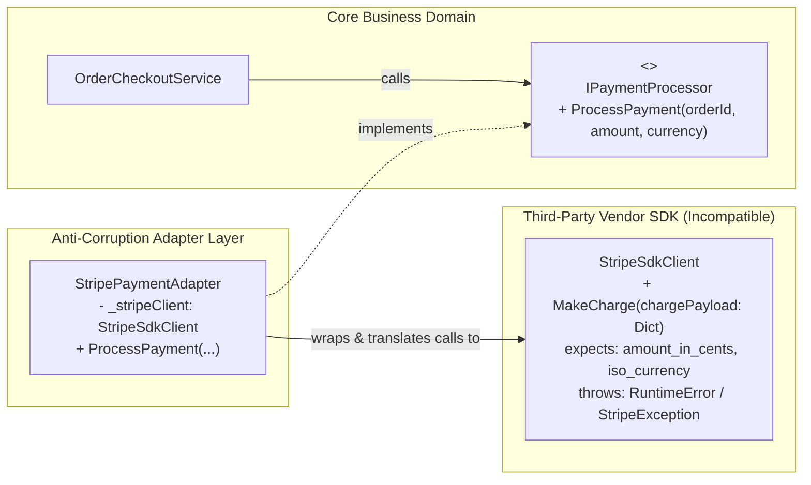

# Lesson 08: Adapter

> **Prerequisites:** [Object Pool](../07-object-pool/README.md) and [Track 25 Overview](../README.md).  
> **Estimated Reading Time:** 18 minutes  
> **Target Audience:** Engineers preparing for LLD, OOP, C#, or Python technical screening and architecture rounds.

> [!NOTE]
> **In one line:** **Adapter** converts one interface into the one your code expects, so you can use an incompatible class (often third-party) without changing it or your callers.

> [!TIP]
> **The One Rule of the Adapter Pattern:** Use an Adapter to **bridge incompatible interfaces without modifying existing source code**, translating foreign schemas, parameter conventions, and method signatures into the exact contract your domain expects. An Adapter changes the **interface**, whereas a Decorator enhances **behavior**, and a Facade simplifies an entire **subsystem**.

---

## 1. Why This Matters: The Interview Trap

"Why not just invoke third-party SDKs—such as Stripe, Twilio, or AWS S3—directly inside your controllers and application services? Why bother writing a wrapper class?"

Junior candidates frequently treat the Adapter pattern as an academic exercise:
> *"An Adapter converts the interface of a class into another interface clients expect. You use it when you have two incompatible classes and you need them to work together."*

Interviewers want to see **architectural maturity**: an understanding of the **Anti-Corruption Layer (ACL)** from Domain-Driven Design, defensive boundary modeling, and test isolation. In high-stakes backend systems, directly coupling business logic to external SDKs introduces major failure modes:

1. **Vendor Lock-in and API Drift:** Third-party vendors regularly update SDK major versions, deprecate endpoints, or alter parameter requirements. If 40 services directly call `StripeClient.Charges.Create()`, a single SDK migration cascades across the entire codebase. An Adapter confines the third-party dependency to a single file.
2. **Untestable Code (The Mocking Nightmare):** Third-party SDKs often feature sealed classes, static singletons, deeply nested response payloads, or read-only internal constructors that cannot be easily mocked in unit tests. Wrapping the SDK behind your own interface (e.g., `IPaymentProcessor`) allows you to inject lightweight in-memory mocks during unit testing.
3. **Leaking Third-Party Domain Concepts (Primitive Obsession & Schema Incompatibility):** Stripe expects payments in integer cents (`5000` for \$50.00) and ISO strings; your domain models currency as `decimal` or a `Money` value object. If your internal handlers manipulate raw cents or foreign error codes, third-party concepts contaminate your core business domain. The Adapter serves as an Anti-Corruption Layer that translates data types, validates schemas, and maps third-party exceptions to domain-specific error results.

### The Wrapper Family: Adapter vs. Facade vs. Decorator vs. Proxy

Candidates often mix up structural patterns that wrap an underlying object. Use this comparison table to articulate clear boundaries:

| Pattern | Does it change the interface? | Key Intent | Typical Relationship |
| :--- | :--- | :--- | :--- |
| **Adapter** | **Yes** (converts Interface A to Interface B) | Makes incompatible interfaces work together. | Wraps an existing, incompatible adaptee. |
| **Facade** | **Yes** (creates a new, simplified interface) | Provides a simplified, high-level doorway to a complex subsystem of many classes. | Wraps multiple subsystem classes. |
| **Decorator** | **No** (implements the *same* interface as the target) | Dynamically adds responsibilities or behavior (e.g., logging, caching, metrics). | Wraps an object conforming to the same interface. |
| **Proxy** | **No** (implements the *same* interface as the target) | Controls access, manages lazy loading, or handles network boundaries. | Controls access to the underlying subject. |

---

## 2. Visual Mental Model / Taxonomic Comparison

In the Adapter pattern, the **Client** depends strictly on a domain-owned abstraction (the **Target Interface**). The **Adapter** implements this interface by wrapping an instance of the third-party or legacy class (the **Adaptee**) and translating method calls, parameters, and exceptions.



### Object Adapter vs. Class Adapter

There are two classical variations of the Adapter pattern:

| Dimension | Object Adapter (Composition) | Class Adapter (Inheritance) |
| :--- | :--- | :--- |
| **Mechanism** | The Adapter holds a private reference to the Adaptee instance (**Composition**). | The Adapter inherits from both the Target interface and the Adaptee class (**Multiple Inheritance**). |
| **Language Support** | Supported in all OOP languages (C#, Python, Java, Go). | Only possible in languages with multiple class inheritance (Python, C++). **Impossible in C# or Java**. |
| **Flexibility** | High. Can adapt an adaptee and any of its subclasses polymorphically. | Low. Statically bound to a single concrete adaptee class. |
| **Production Consensus** | **Industry standard**. Adheres to the principle *"Favor composition over inheritance"*. | Rarely used; creates tight coupling to internal adaptee base class state. |

---

## 3. Code Implementation

In this scenario, an e-commerce platform needs to process payments through a third-party payment vendor (`StripeSdkClient`). The vendor SDK is incompatible with the internal domain:
- The internal domain expects a clean contract: `ProcessPayment(orderId, amount, currency)` returning a `PaymentResult` object.
- The external SDK expects a raw dictionary with `amount_in_cents` (integer), lower-case ISO currency strings, and throws vendor-specific runtime exceptions on failure.

The `StripePaymentAdapter` encapsulates all translation, handles unit conversions, and catches vendor exceptions so external failures never crash the internal checkout pipeline.

````carousel
```python
from typing import Any, Dict


# 1. Internal domain model representing the result of a payment operation
class PaymentResult:
    """Internal domain result representing a processed payment."""

    def __init__(self, success: bool, transaction_id: str, message: str) -> None:
        self.success: bool = success
        self.transaction_id: str = transaction_id
        self.message: str = message

    def __repr__(self) -> str:
        status = "SUCCESS" if self.success else "FAILED"
        return f"PaymentResult({status}, TxId={self.transaction_id}, Msg='{self.message}')"


# 2. Target Interface expected by internal checkout domain
class PaymentProcessor:
    def process_payment(
        self, order_id: str, amount: float, currency: str
    ) -> PaymentResult:
        raise NotImplementedError


# 3. Adaptee: Incompatible third-party vendor SDK
class StripeSdkClient:
    """Simulates third-party vendor SDK with incompatible signatures and models."""

    def make_charge(self, charge_payload: Dict[str, Any]) -> Dict[str, Any]:
        amount_cents = charge_payload.get("amount_in_cents", 0)
        curr = charge_payload.get("iso_currency", "usd")
        ref = charge_payload.get("metadata_ref", "")

        # Simulate vendor decline rule
        if amount_cents > 100_000:
            raise RuntimeError(
                f"Stripe rejected charge: limit exceeded for {ref}"
            )

        return {
            "id": f"ch_{ref}_stripe",
            "paid": True,
            "currency": curr,
            "captured_cents": amount_cents,
        }


# 4. Adapter: Implements domain contract, encapsulates and adapts vendor SDK
class StripePaymentAdapter(PaymentProcessor):
    def __init__(self, stripe_client: StripeSdkClient) -> None:
        self._stripe_client = stripe_client

    def process_payment(
        self, order_id: str, amount: float, currency: str
    ) -> PaymentResult:
        # Convert domain representation (decimal dollars) to vendor schema (integer cents)
        amount_in_cents = int(round(amount * 100))
        payload = {
            "amount_in_cents": amount_in_cents,
            "iso_currency": currency.lower(),
            "metadata_ref": order_id,
        }

        # Anti-Corruption Layer: Catch vendor-specific errors, map to domain model
        try:
            response = self._stripe_client.make_charge(payload)
            return PaymentResult(
                success=response.get("paid", False),
                transaction_id=response.get("id", ""),
                message="Payment processed successfully via Stripe Adapter.",
            )
        except RuntimeError as err:
            return PaymentResult(
                success=False,
                transaction_id="N/A",
                message=f"Vendor payment failure: {str(err)}",
            )


if __name__ == "__main__":
    sdk = StripeSdkClient()
    processor: PaymentProcessor = StripePaymentAdapter(sdk)

    # 1. Normal checkout payment ($49.99)
    res1 = processor.process_payment("ORD-901", 49.99, "USD")
    print(res1)

    # 2. High amount ($1,500.00) triggers adapter error mapping
    res2 = processor.process_payment("ORD-902", 1500.00, "USD")
    print(res2)
```

<!-- slide -->

```csharp
using System;
using System.Collections.Generic;

// 1. Internal domain model representing the result of a payment operation
public sealed class PaymentResult
{
    public bool Success { get; }
    public string TransactionId { get; }
    public string Message { get; }

    public PaymentResult(bool success, string transactionId, string message)
    {
        Success = success;
        TransactionId = transactionId;
        Message = message;
    }

    public override string ToString()
    {
        string status = Success ? "SUCCESS" : "FAILED";
        return $"PaymentResult({status}, TxId={TransactionId}, Msg='{Message}')";
    }
}

// 2. Target Interface expected by internal checkout domain
public interface IPaymentProcessor
{
    PaymentResult ProcessPayment(string orderId, decimal amount, string currency);
}

// 3. Adaptee: Incompatible third-party vendor SDK
public sealed class StripeSdkClient
{
    public Dictionary<string, object> MakeCharge(Dictionary<string, object> chargePayload)
    {
        long amountCents = Convert.ToInt64(chargePayload["amount_in_cents"]);
        string curr = (string)chargePayload["iso_currency"];
        string @ref = (string)chargePayload["metadata_ref"];

        // Simulate vendor decline rule
        if (amountCents > 100_000)
        {
            throw new InvalidOperationException($"Stripe rejected charge: limit exceeded for {@ref}");
        }

        return new Dictionary<string, object>
        {
            ["id"] = $"ch_{@ref}_stripe",
            ["paid"] = true,
            ["currency"] = curr,
            ["captured_cents"] = amountCents
        };
    }
}

// 4. Adapter: Implements domain contract, encapsulates and adapts vendor SDK
public sealed class StripePaymentAdapter : IPaymentProcessor
{
    private readonly StripeSdkClient _stripeClient;

    public StripePaymentAdapter(StripeSdkClient stripeClient)
    {
        _stripeClient = stripeClient ?? throw new ArgumentNullException(nameof(stripeClient));
    }

    public PaymentResult ProcessPayment(string orderId, decimal amount, string currency)
    {
        // Convert domain representation (decimal dollars) to vendor schema (integer cents)
        long amountInCents = (long)Math.Round(amount * 100m, MidpointRounding.AwayFromZero);
        var payload = new Dictionary<string, object>
        {
            ["amount_in_cents"] = amountInCents,
            ["iso_currency"] = currency.ToLowerInvariant(),
            ["metadata_ref"] = orderId
        };

        // Anti-Corruption Layer: Catch vendor-specific errors, map to domain model
        try
        {
            var response = _stripeClient.MakeCharge(payload);
            return new PaymentResult(
                success: (bool)response["paid"],
                transactionId: (string)response["id"],
                message: "Payment processed successfully via Stripe Adapter."
            );
        }
        catch (InvalidOperationException ex)
        {
            return new PaymentResult(
                success: false,
                transactionId: "N/A",
                message: $"Vendor payment failure: {ex.Message}"
            );
        }
    }
}

public class Program
{
    public static void Main()
    {
        var sdk = new StripeSdkClient();
        IPaymentProcessor processor = new StripePaymentAdapter(sdk);

        // 1. Normal checkout payment ($49.99)
        var res1 = processor.ProcessPayment("ORD-901", 49.99m, "USD");
        Console.WriteLine(res1);

        // 2. High amount ($1,500.00) triggers adapter error mapping
        var res2 = processor.ProcessPayment("ORD-902", 1500.00m, "USD");
        Console.WriteLine(res2);
    }
}
```
````

**Expected Output (Both Languages):**
```text
PaymentResult(SUCCESS, TxId=ch_ORD-901_stripe, Msg='Payment processed successfully via Stripe Adapter.')
PaymentResult(FAILED, TxId=N/A, Msg='Vendor payment failure: Stripe rejected charge: limit exceeded for ORD-902')
```

---

## 4. Where You Already Use It

Modern frameworks rely on adapters to maintain backward compatibility, bridge asynchronous/synchronous worlds, and standardize I/O streams:

- **In .NET / C#:**
  - `StreamReader` and `StreamWriter`: A `Stream` operates strictly on raw bytes (`byte[]`). A `StreamReader` adapts the byte stream into a character-based `TextReader`, handling encodings (UTF-8, ASCII) and line buffers transparently.
  - `SqlDataAdapter` (ADO.NET): Adapts database queries and rowsets retrieved via `SqlCommand` into in-memory `DataSet` and `DataTable` objects.
  - `HttpClientHandler` / `HttpMessageHandler`: Adapts lower-level OS socket and TLS communication into high-level `HttpRequestMessage` and `HttpResponseMessage` pipelines.
  - ASP.NET Core `ActionOutputFormatterAdapter`: Translates arbitrary controller action return types into HTTP JSON or XML response payloads.

- **In Python:**
  - `io.TextIOWrapper`: Adapts raw binary byte streams (such as `io.BufferedReader` or raw socket handles) into Unicode text streams supporting `.readline()` and character encodings.
  - `logging.LoggerAdapter`: Wraps a standard Python `logging.Logger` to automatically inject contextual metadata (such as `request_id` or `tenant_id`) into every log message without altering the logging interface.
  - WSGI-to-ASGI Adapters (`asgiref.wsgi.WsgiToAsgi` or `a2wsgi`): Adapts legacy synchronous WSGI applications (like Flask or Django 2) to run smoothly inside modern asynchronous ASGI servers (like Uvicorn or Hypercorn).

---

## 5. Pitfalls and When Not to Use It

1. **The Leaky Adapter Trap (Unhandled Vendor Exceptions):**
   - The most common defect in adapter implementations is failing to catch SDK-specific exceptions. If `StripePaymentAdapter` lets a raw `Stripe.StripeException` propagate up to `OrderService`, the abstraction is broken. The domain is now coupled to the vendor SDK type system. Always catch vendor exceptions inside the adapter and translate them to domain results or internal exceptions.
2. **Adapting Interfaces You Own:**
   - If both classes are internal to your codebase and under your control, do not write an adapter to reconcile their differences. Refactor the classes to share a clean, common interface directly. Adapters are for boundaries you cannot change (third-party SDKs, external APIs, legacy code).
3. **Bloated "Two-Way" Adapters:**
   - Attempting to make an adapter bidirectional—so that System A can call System B and System B can call System A through the same class—creates sprawling, tangled dependencies. Build dedicated, unidirectional adapters for each integration boundary.
4. **Performance Overhead on Hot Paths:**
   - If adapting high-throughput message streams requires converting millions of large JSON payloads into domain objects and back every second, naive reflection-based or memory-allocating adapters can cause severe garbage collection pauses. Optimize adapters on hot paths with zero-allocation buffers or streaming serializers.

---

## 6. Exercises & Practical Drills

### Exercise 1: Spot the Architecture Violation
Examine this adapter implementation:

```csharp
public class AwsS3StorageAdapter : IFileStorage
{
    private readonly AmazonS3Client _s3Client;

    public AwsS3StorageAdapter(AmazonS3Client s3Client) => _s3Client = s3Client;

    public async Task SaveFileAsync(string path, byte[] content)
    {
        var putRequest = new PutObjectRequest { BucketName = "my-bucket", Key = path, InputStream = new MemoryStream(content) };
        await _s3Client.PutObjectAsync(putRequest); // What is wrong here?
    }
}
```

What crucial architectural responsibility is missing from `SaveFileAsync`?

<details>
<summary>Answer</summary>

**Two major issues:**
1. **Leaking Third-Party Exceptions:** If the AWS network call fails or credentials expire, AWS-specific exceptions (`AmazonS3Exception`) will bubble directly up to the calling domain service. The adapter fails as an Anti-Corruption Layer. It should catch `AmazonS3Exception` and wrap or translate it into an internal domain exception (e.g., `StorageUnavailableException`).
2. **Hardcoded Infrastructure Configuration:** The bucket name `"my-bucket"` is hardcoded inside the adapter rather than injected via configuration options (`IOptions<StorageSettings>`).
</details>

### Exercise 2: Class Adapter vs. Object Adapter in Python
Python supports multiple inheritance. When, if ever, would you choose a Class Adapter over an Object Adapter in Python?

<details>
<summary>Answer</summary>

A Class Adapter in Python inherits from both the target interface and the adaptee class:

```python
class StripeClassAdapter(PaymentProcessor, StripeSdkClient):

  def process_payment(
      self, order_id: str, amount: float, currency: str
  ) -> PaymentResult:
    # Directly invokes inherited self.make_charge()
    ...
```

While syntactically concise, Class Adapters are almost universally discouraged in modern backend architectures:
- They tightly couple the adapter to the concrete internal implementation and lifecycle of `StripeSdkClient`.
- They expose all public methods of `StripeSdkClient` directly on the adapter, polluting the domain namespace.
- You cannot adapt polymorphic subclasses of the adaptee dynamically.

Stick to the **Object Adapter** pattern using composition.
</details>

---

## 7. Interview Questions & Model Answers

<details>
<summary><strong>1. What is the Adapter pattern? Give a real example. [BASIC]</strong></summary>

The Adapter pattern is a structural design pattern that converts the interface of an existing class into another interface that clients expect, enabling classes with incompatible contracts to collaborate without modifying their source code.

A standard enterprise example is payment processing. Our internal checkout domain defines an `IPaymentGateway` interface with a clean method `ProcessPayment(orderId, amount, currency)`. However, when integrating third-party SDKs like Stripe, PayPal, or Adyen, each vendor provides proprietary SDK classes with completely different method signatures, payload formats (such as expecting amounts in integer cents instead of decimal dollars), and custom status codes. We build a `StripePaymentAdapter` that implements `IPaymentGateway`, wraps the vendor SDK, translates domain arguments into vendor parameters, executes the call, and maps vendor-specific responses and exceptions back into unified domain results.

</details>

<details>
<summary><strong>2. What is the difference between Adapter and Facade? [BASIC]</strong></summary>

While both patterns wrap underlying classes, their intent and interface contracts are fundamentally different:
- **Intent:** An **Adapter** solves **incompatibility**. Its goal is to make an existing class fit an *already established target interface*. A **Facade** solves **complexity**. Its goal is to provide a *simplified, high-level interface* over a complex subsystem consisting of many interdependent classes.
- **Interface Contract:** An Adapter typically implements an existing interface specified by the client or domain. A Facade defines a *brand new, higher-level interface* tailored for convenience.
- **Wrapping Cardinality:** An Adapter typically wraps a single adaptee (or a primary component) to alter its interface. A Facade typically coordinates multiple subsystem components (e.g., an `OrderFacade` coordinating Inventory, Payment, Shipping, and EmailNotification services).

</details>

<details>
<summary><strong>3. Why wrap a third-party library behind your own interface? [BASIC]</strong></summary>

Wrapping a third-party library behind an internal interface establishes an **Anti-Corruption Layer (ACL)**, which provides four vital architectural benefits:
1. **Protection from Vendor Churn:** If the vendor releases breaking changes, changes its SDK method signatures, or if our business decides to switch vendors (e.g., migrating from SendGrid to AWS SES), only the single adapter class needs to change. The rest of the codebase remains untouched.
2. **Unit Testability:** Third-party SDKs are notoriously difficult to mock due to sealed types, static calls, and non-virtual members. By programming our domain services against our own interface (e.g., `IEmailSender`), we can inject fast in-memory mocks during unit testing without spinning up external dependencies.
3. **Encapsulation of Failure Modes:** Third-party SDKs throw vendor-specific exceptions. Wrapping the SDK ensures that foreign exceptions are caught and translated into internal domain models or domain exceptions, preventing external types from polluting our core domain.
4. **Domain Schema Consistency:** External libraries rarely match internal domain terminology or types. The wrapper handles unit conversions (e.g., cents to dollars, epoch timestamps to UTC `DateTimeOffset`) at the boundary.

</details>

<details>
<summary><strong>4. You must integrate two payment providers with different SDKs. How? [SCENARIO]</strong></summary>

Define your own `IPaymentGateway`, write one adapter per SDK, and let the checkout depend only on the interface. Swapping or adding a provider adds an adapter and touches no business code.

</details>

<details>
<summary><strong>5. Where does an Adapter turn into the wrong tool? [TRICKY]</strong></summary>

When it starts adding rules, caching or retries (that is Decorator/Proxy), or when it hides a whole subsystem behind a simpler API (that is Facade). An adapter should only translate.

</details>

<details>
<summary><strong>6. Give a .NET or Python example of an adapter. [SCENARIO]</strong></summary>

`StreamReader` adapts a `Stream` to a text-reading interface; Python's `io.TextIOWrapper` adapts a binary buffer to text.

</details>

---

## Try it

Run this: the legacy class keeps its API, callers only see `Logger.log`. Then redraw it in [LLD Studio](/tools/lld-studio/); the [track hub](../README.md) has the pattern-choice drills.

```python
class LegacyPrinter:
    def print_text(self, s): return f"[legacy] {s}"

class Logger:                                    # target interface
    def log(self, msg): raise NotImplementedError

class PrinterAdapter(Logger):
    def __init__(self, p): self._p = p
    def log(self, msg): return self._p.print_text(msg)

assert PrinterAdapter(LegacyPrinter()).log("hi") == "[legacy] hi"
```

---

## One-page cheat sheet

```text
ADAPTER   wrap X so it looks like interface Y   (Client -> Target <- Adapter -> Adaptee)
Object adapter (composition) preferred over class adapter (inheritance)
Use: 3rd-party SDK, legacy code, different data shapes
Adapter changes the INTERFACE | Decorator adds BEHAVIOUR | Facade SIMPLIFIES
Own the interface: app depends on IPaymentGateway, adapter wraps Stripe
Smell: adapter that also adds business logic
```

---

## 8. Sources & Further Reading

- [Microsoft Learn: Anti-Corruption Layer pattern](https://learn.microsoft.com/en-us/azure/architecture/patterns/anti-corruption-layer)
- [Microsoft Learn: Common I/O Tasks (StreamReader/StreamWriter)](https://learn.microsoft.com/en-us/dotnet/standard/io/how-to-read-text-from-a-file)
- [Python Documentation: io — Core tools for working with streams](https://docs.python.org/3/library/io.html)
- [Martin Fowler: Gateway / Anti-Corruption Layer](https://martinfowler.com/eaaCatalog/gateway.html)
- [Refactoring.Guru: Adapter Pattern](https://refactoring.guru/design-patterns/adapter)

---

Previous: [Object Pool](../07-object-pool/README.md) · Next: [Bridge](../09-bridge/README.md)
