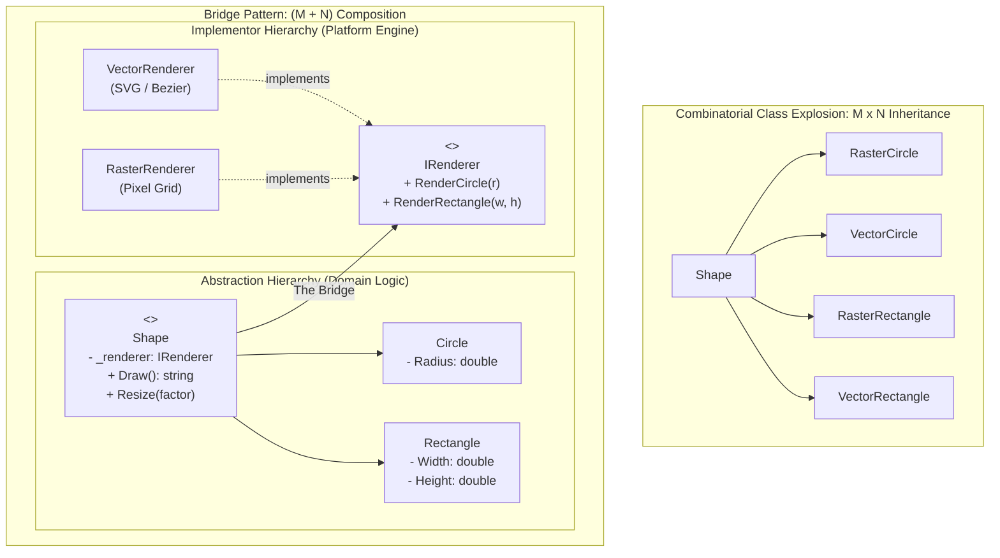

# Lesson 09: Bridge

> **Prerequisites:** [Adapter](../08-adapter/README.md) and [Track 25 Overview](../README.md).  
> **Estimated Reading Time:** 18 minutes  
> **Target Audience:** Engineers preparing for LLD, OOP, C#, or Python technical screening and architecture rounds.

> [!NOTE]
> **In one line:** **Bridge** splits an abstraction from its implementation so the two hierarchies vary independently — it prevents the M×N class explosion (e.g. 3 shapes × 4 renderers).

> [!TIP]
> **The One Rule of the Bridge Pattern:** Use the Bridge pattern to **decouple an abstraction from its implementation so that both can vary independently**, transforming a multiplicative $M \times N$ combinatorial class explosion into an additive $M + N$ composition structure. Design Bridge **up front** to handle orthogonal dimensions of change; use Adapter **after the fact** to resolve interface incompatibility.

---

## 1. Why This Matters: The Interview Trap

"What problem does the Bridge pattern solve, how does it prevent a combinatorial class explosion, and how do you differentiate Bridge from Adapter during a system architecture round?"

Junior candidates typically provide vague, textbook answers:
> *"Bridge connects two things together using an interface. It is just like the Adapter pattern because both use composition and wrap another object."*

This response fails to demonstrate understanding of **orthogonal dimensions of change, software evolution, and architectural intent**. An interviewer asks about the Bridge pattern to evaluate whether you can structure multi-platform, highly extensible systems without succumbing to inheritance bloat:

1. **The Combinatorial Class Explosion ($M \times N$ Trap):**
   Imagine building a vector graphics suite. You have $M$ shapes (`Circle`, `Rectangle`, `Triangle`) and $N$ platform rendering engines (`RasterRenderer`, `VectorRenderer`, `DirectXRenderer`). If you rely on inheritance to combine them, you must create a subclass for every single permutation:
   - `RasterCircle`, `VectorCircle`, `DirectXCircle`
   - `RasterRectangle`, `VectorRectangle`, `DirectXRectangle`
   - `RasterTriangle`, `VectorTriangle`, `DirectXTriangle`
   
   This creates $M \times N = 9$ classes. If you add 2 new shapes and 2 new renderers, your class count balloons to $5 \times 5 = 25$ classes. Maintenance becomes an unmitigated disaster.
2. **The Bridge Decoupling Solution ($M + N$):**
   Bridge breaks the hierarchy into two independent, parallel dimensions:
   - **The Abstraction Hierarchy:** High-level domain concepts (`Shape`, `Circle`, `Rectangle`).
   - **The Implementor Hierarchy:** Low-level execution primitives (`IRenderer`, `VectorRenderer`, `RasterRenderer`).
   
   The `Shape` class holds a reference (the **Bridge**) to an `IRenderer`. Now, adding a new shape requires only 1 class. Adding a new renderer requires only 1 class. Total classes: $M + N = 5 + 5 = 10$ instead of 25.
3. **Bridge vs. Adapter (The Classic Mix-up):**
   - **Bridge is proactive (designed up front):** You know beforehand that an abstraction and its platform implementation will evolve separately, so you split them into two orthogonal hierarchies.
   - **Adapter is retroactive (fitted after the fact):** You have two existing, independently developed, incompatible interfaces, and you write a wrapper class so they can collaborate without changing existing code.

### Structural Pattern Taxonomy: Bridge vs. Adapter vs. Strategy vs. Facade

| Pattern | Design Timing | Interface Intent | Hierarchy Structure |
| :--- | :--- | :--- | :--- |
| **Bridge** | **Up front** (proactive architecture) | Separates high-level control operations from low-level execution primitives. | **Two parallel hierarchies** connected via a composition reference. |
| **Adapter** | **After the fact** (retroactive integration) | Changes/converts an incompatible interface to match a client's target interface. | Wraps an existing, unmodifiable class (Adaptee). |
| **Strategy** | Up front or refactored | Swaps interchangeable algorithms or business calculations within an entity. | Single abstraction holding interchangeable algorithm implementations. |
| **Facade** | After the fact or up front | Simplifies access by providing a unified high-level doorway to a complex subsystem. | Single class coordinating multiple subsystem classes. |

---

## 2. Visual Mental Model / Taxonomic Comparison

The diagram below contrasts the naive subclassing approach (which leads to a combinatorial explosion) with the decoupled Bridge architecture.



### Class Explosion Comparison Matrix

| Shapes ($M$) | Renderers ($N$) | Naive Inheritance Classes ($M \times N$) | Bridge Pattern Classes ($M + N$) | Class Reduction |
| :--- | :--- | :--- | :--- | :--- |
| 3 | 2 | $3 \times 2 = 6$ | $3 + 2 = 5$ | 1 fewer class |
| 5 | 4 | $5 \times 4 = 20$ | $5 + 4 = 9$ | **55% reduction** |
| 10 | 6 | $10 \times 6 = 60$ | $10 + 6 = 16$ | **73% reduction** |
| 20 | 10 | $20 \times 10 = 200$ | $20 + 10 = 30$ | **85% reduction** |

---

## 3. Code Implementation

In the following example, we build a cross-platform graphics subsystem. The **Abstraction Hierarchy** defines mathematical domain shapes (`Shape`, `Circle`, `Rectangle`), while the **Implementor Hierarchy** defines low-level platform rendering primitives (`Renderer`, `VectorRenderer`, `RasterRenderer`). The abstraction delegates drawing primitives across the bridge without knowing platform implementation details.

````carousel
```python
from abc import ABC, abstractmethod
from typing import List


# ========================================================
# IMPLEMENTOR HIERARCHY (Platform Rendering Engine)
# ========================================================
class Renderer(ABC):
    """The Implementor interface defining low-level platform rendering primitives."""

    @abstractmethod
    def render_circle(self, radius: float) -> str:
        pass

    @abstractmethod
    def render_rectangle(self, width: float, height: float) -> str:
        pass


class VectorRenderer(Renderer):
    """Concrete Implementor: Renders shapes as vector SVG commands."""

    def render_circle(self, radius: float) -> str:
        return f"[Vector] Drawing <circle r='{radius:.1f}' /> as mathematical Bezier curves."

    def render_rectangle(self, width: float, height: float) -> str:
        return f"[Vector] Drawing <rect width='{width:.1f}' height='{height:.1f}' /> with vector paths."


class RasterRenderer(Renderer):
    """Concrete Implementor: Renders shapes as raster pixel buffers."""

    def render_circle(self, radius: float) -> str:
        return f"[Raster] Plotting pixels for circle radius {radius:.1f} using midpoint algorithm."

    def render_rectangle(self, width: float, height: float) -> str:
        return f"[Raster] Filling pixel grid for rectangle {width:.1f}x{height:.1f} into frame buffer."


# ========================================================
# ABSTRACTION HIERARCHY (Domain Concepts)
# ========================================================
class Shape(ABC):
    """The Abstraction: Maintains a reference (Bridge) to the Implementor."""

    def __init__(self, renderer: Renderer) -> None:
        self._renderer = renderer

    @abstractmethod
    def draw(self) -> str:
        pass

    @abstractmethod
    def resize(self, factor: float) -> None:
        pass


class Circle(Shape):
    """Refined Abstraction."""

    def __init__(self, radius: float, renderer: Renderer) -> None:
        super().__init__(renderer)
        self.radius = radius

    def draw(self) -> str:
        return self._renderer.render_circle(self.radius)

    def resize(self, factor: float) -> None:
        self.radius *= factor


class Rectangle(Shape):
    """Refined Abstraction."""

    def __init__(self, width: float, height: float, renderer: Renderer) -> None:
        super().__init__(renderer)
        self.width = width
        self.height = height

    def draw(self) -> str:
        return self._renderer.render_rectangle(self.width, self.height)

    def resize(self, factor: float) -> None:
        self.width *= factor
        self.height *= factor


def main() -> None:
    # Renderers (Implementors)
    vector = VectorRenderer()
    raster = RasterRenderer()

    # Shapes (Abstractions) composed across Renderers via the Bridge
    shapes: List[Shape] = [
        Circle(5.0, vector),
        Circle(5.0, raster),
        Rectangle(10.0, 4.0, vector),
        Rectangle(10.0, 4.0, raster),
    ]

    for shape in shapes:
        print(shape.draw())

    print("\n--- After Resizing Circle (2x) ---")
    circle = shapes[0]
    circle.resize(2.0)
    print(circle.draw())


if __name__ == "__main__":
    main()
```
<!-- slide -->
```csharp
using System;
using System.Collections.Generic;

namespace BridgeDemo;

// ========================================================
// IMPLEMENTOR HIERARCHY (Platform Rendering Engine)
// ========================================================
public interface IRenderer
{
    string RenderCircle(double radius);
    string RenderRectangle(double width, double height);
}

public class VectorRenderer : IRenderer
{
    public string RenderCircle(double radius) =>
        $"[Vector] Drawing <circle r='{radius:F1}' /> as mathematical Bezier curves.";

    public string RenderRectangle(double width, double height) =>
        $"[Vector] Drawing <rect width='{width:F1}' height='{height:F1}' /> with vector paths.";
}

public class RasterRenderer : IRenderer
{
    public string RenderCircle(double radius) =>
        $"[Raster] Plotting pixels for circle radius {radius:F1} using midpoint algorithm.";

    public string RenderRectangle(double width, double height) =>
        $"[Raster] Filling pixel grid for rectangle {width:F1}x{height:F1} into frame buffer.";
}

// ========================================================
// ABSTRACTION HIERARCHY (Domain Concepts)
// ========================================================
public abstract class Shape
{
    // The Bridge: Reference to the Implementor interface
    protected readonly IRenderer Renderer;

    protected Shape(IRenderer renderer)
    {
        Renderer = renderer;
    }

    public abstract string Draw();
    public abstract void Resize(double factor);
}

public class Circle : Shape
{
    public double Radius { get; private set; }

    public Circle(double radius, IRenderer renderer) : base(renderer)
    {
        Radius = radius;
    }

    public override string Draw() => Renderer.RenderCircle(Radius);

    public override void Resize(double factor) => Radius *= factor;
}

public class Rectangle : Shape
{
    public double Width { get; private set; }
    public double Height { get; private set; }

    public Rectangle(double width, double height, IRenderer renderer) : base(renderer)
    {
        Width = width;
        Height = height;
    }

    public override string Draw() => Renderer.RenderRectangle(Width, Height);

    public override void Resize(double factor)
    {
        Width *= factor;
        Height *= factor;
    }
}

public static class Program
{
    public static void Main()
    {
        // Renderers (Implementors)
        IRenderer vector = new VectorRenderer();
        IRenderer raster = new RasterRenderer();

        // Shapes (Abstractions) composed across Renderers via the Bridge
        var shapes = new List<Shape>
        {
            new Circle(5.0, vector),
            new Circle(5.0, raster),
            new Rectangle(10.0, 4.0, vector),
            new Rectangle(10.0, 4.0, raster)
        };

        foreach (var shape in shapes)
        {
            Console.WriteLine(shape.Draw());
        }

        Console.WriteLine("\n--- After Resizing Circle (2x) ---");
        var circle = shapes[0];
        circle.Resize(2.0);
        Console.WriteLine(circle.Draw());
    }
}
```
````

**Expected Output (Both Languages):**
```text
[Vector] Drawing <circle r='5.0' /> as mathematical Bezier curves.
[Raster] Plotting pixels for circle radius 5.0 using midpoint algorithm.
[Vector] Drawing <rect width='10.0' height='4.0' /> with vector paths.
[Raster] Filling pixel grid for rectangle 10.0x4.0 into frame buffer.

--- After Resizing Circle (2x) ---
[Vector] Drawing <circle r='10.0' /> as mathematical Bezier curves.
```

---

## 3A. Where It Is Used, Why It Exists & Progressive Buildup

### Where It Is Used (Real-World Systems & LLD Interviews)

| Domain / Ecosystem | Concrete Real-World Usage | LLD Interview Problem Where You Use It |
| :--- | :--- | :--- |
| **.NET / C#** | `ILogger` (Abstraction) vs `ILoggerProvider` (Implementor), EF Core `DbContext` vs `SqlServer`/`Npgsql` SQL generators, `DbConnection` vs native drivers. | Design a cross-platform Notification Engine (`Urgent`, `Digest`, `Promo` × `Email`, `SMS`, `Push`, `Slack`). |
| **Python** | `logging.Logger` vs `logging.Handler` (`StreamHandler`, `SocketHandler`), PEP 249 DB-API vs `psycopg2`/`sqlite3`, `PyQt` vs OS windowing. | Design a Universal Remote Control (`BasicRemote`, `VoiceRemote` × `TV`, `Projector`, `Soundbar`). |
| **Go** | `log/slog.Logger` vs `slog.Handler` (`JSONHandler`, `TextHandler`), `database/sql` vs `pgx`/`go-sql-driver`. | Design a Multi-Cloud Infrastructure Provisioner (`WebTier`, `WorkerPool` × `AWS`, `GCP`, `Azure`). |
| **TypeScript / Node.js** | React Reconciler vs Renderers (`react-dom`, `react-native`), Knex/Drizzle Query Builder vs Dialect Drivers, Winston Logger vs Transports. | Design a Report Exporter (`InvoiceReport`, `AuditReport` × `PDF`, `CSV`, `HTML`). |

### Why It Is Used — The Step-by-Step Buildup (Before -> Pain -> Pattern)

#### Stage 0: Naive Code ($M \times N$ Inheritance Explosion)
```python
class UrgentEmailNotification:
    def send(self, msg: str) -> str:
        return f"[EMAIL][URGENT] {msg.upper()}"


class UrgentSmsNotification:
    def send(self, msg: str) -> str:
        return f"[SMS][URGENT] {msg.upper()}"


class DigestEmailNotification:
    def send(self, msg: str) -> str:
        return f"[EMAIL][DIGEST] {msg}"


class DigestSmsNotification:
    def send(self, msg: str) -> str:
        return f"[SMS][DIGEST] {msg}"
```

#### What Breaks as Requirements Arrive
- **Requirement 2 (Add `SecurityAlert`, `Promo` message types AND `Slack`, `Push` channels):** You now have $4 \text{ types} \times 4 \text{ channels} = 16$ classes. Adding one more channel forces 4 new classes.
- **Requirement 3 (Add `[P1]` prefix + retry metadata to all `Urgent` notifications):** You must hunt down and edit `UrgentEmailNotification`, `UrgentSmsNotification`, `UrgentSlackNotification`, and `UrgentPushNotification` separately.

#### Step-by-Step Refactoring to Bridge
1. **Extract the Implementor Hierarchy:** Define `DeliveryChannel` (`EmailChannel`, `SmsChannel`, `SlackChannel`) for low-level transport.
2. **Build the Abstraction Hierarchy:** Define `Notification` holding `self._channel: DeliveryChannel`, with subclasses `UrgentNotification` and `DigestNotification` owning message formatting.
3. **Compose at Runtime:** `UrgentNotification(SlackChannel())` gives $M + N$ classes instead of $M \times N$.

### Progressive Real-World Examples

#### Example A: Simple Core — Universal Remote × Device Bridge
Separates remote control capabilities (`Remote`, `MuteableRemote`) from hardware devices (`TV`, `SmartSpeaker`).

```python
from typing import Protocol


class Device(Protocol):
    def set_volume(self, level: int) -> None: ...
    def get_volume(self) -> int: ...


class TV:
    def __init__(self) -> None:
        self._vol = 20

    def set_volume(self, level: int) -> None:
        self._vol = max(0, min(100, level))

    def get_volume(self) -> int:
        return self._vol


class Remote:
    def __init__(self, device: Device) -> None:
        self._device = device

    def volume_up(self) -> int:
        self._device.set_volume(self._device.get_volume() + 10)
        return self._device.get_volume()


class MuteableRemote(Remote):
    def mute(self) -> int:
        self._device.set_volume(0)
        return self._device.get_volume()


remote = MuteableRemote(TV())
assert remote.volume_up() == 30
assert remote.mute() == 0
```

#### Example B: Production Backend — Telemetry Event × Sink Bridge
Decouples domain telemetry formatting (`AuditEvent`, `MetricEvent`) from output sinks (`InMemorySink`, `JsonLineSink`).

```python
import json
from abc import ABC, abstractmethod
from typing import Protocol


class TelemetrySink(Protocol):
    def write(self, kind: str, payload: dict[str, object]) -> None: ...


class InMemorySink:
    def __init__(self) -> None:
        self.lines: list[str] = []

    def write(self, kind: str, payload: dict[str, object]) -> None:
        self.lines.append(f"{kind}:{json.dumps(payload, sort_keys=True)}")


class TelemetryEvent(ABC):
    def __init__(self, sink: TelemetrySink) -> None:
        self._sink = sink

    @abstractmethod
    def emit(self) -> None: ...


class AuditEvent(TelemetryEvent):
    def __init__(self, sink: TelemetrySink, actor: str, action: str) -> None:
        super().__init__(sink)
        self.actor = actor
        self.action = action

    def emit(self) -> None:
        self._sink.write("AUDIT", {"actor": self.actor, "action": self.action})


sink = InMemorySink()
AuditEvent(sink, actor="alice", action="DELETE_KEY").emit()
assert sink.lines == ['AUDIT:{"action": "DELETE_KEY", "actor": "alice"}']
```

#### Example C: Classic LLD Interview Problem — Multi-Channel Notification Engine
Solves the classic $M \times N$ notification problem: message urgency/formatting varies independently from delivery channels.

```python
from abc import ABC, abstractmethod
from typing import Protocol


class DeliveryChannel(Protocol):
    def deliver(self, subject: str, body: str) -> str: ...


class EmailChannel:
    def deliver(self, subject: str, body: str) -> str:
        return f"EMAIL({subject}): {body}"


class SlackChannel:
    def deliver(self, subject: str, body: str) -> str:
        return f"SLACK(#alerts) *{subject}* - {body}"


class Notification(ABC):
    def __init__(self, channel: DeliveryChannel) -> None:
        self._channel = channel

    @abstractmethod
    def notify(self, message: str) -> str: ...


class UrgentNotification(Notification):
    def notify(self, message: str) -> str:
        return self._channel.deliver("P1-URGENT", message.upper())


class DigestNotification(Notification):
    def notify(self, message: str) -> str:
        return self._channel.deliver("Daily Digest", message)


assert UrgentNotification(SlackChannel()).notify("db down") == "SLACK(#alerts) *P1-URGENT* - DB DOWN"
assert DigestNotification(EmailChannel()).notify("3 jobs ok") == "EMAIL(Daily Digest): 3 jobs ok"
```

---

## 4. Where You Already Use It

- **In .NET:**
  - `Microsoft.Extensions.Logging.ILogger` vs. `ILoggerProvider`: The application interacts with `ILogger` (high-level abstraction exposing `LogInformation`, `LogError`, scopes), while logging providers (`ConsoleLoggerProvider`, `EventLogLoggerProvider`, `AzureBlobLoggerProvider`) implement low-level writing sinks. Both hierarchies evolve independently without breaking each other.
  - **Entity Framework Core Database Providers:** High-level abstractions like `DbContext`, `DbSet<T>`, and LINQ query expression trees are completely decoupled from relational SQL generators (`SqlServerQuerySqlGenerator`, `NpgsqlQuerySqlGenerator`, `SqliteQuerySqlGenerator`). Adding a new database provider requires implementing the low-level provider interface, without changing any EF Core query abstractions.
  - `System.Data.Common.DbConnection` and `DbCommand`: Client code operates against generic database abstractions, while concrete drivers (`SqlConnection`, `NpgsqlConnection`, `OracleConnection`) bridge the operations to native wire protocols.

- **In Python:**
  - **Python Database API Specification (PEP 249):** The Python standard specifies abstract `Connection` and `Cursor` interfaces. Concrete driver packages (`psycopg2`, `sqlite3`, `mysqlclient`) implement the low-level C-bindings and socket wire protocols across the bridge.
  - `logging.Logger` vs. `logging.Handler`: Applications call `logger.info("message")` on `Logger` (the abstraction), which delegates through an internal bridge to one or more `Handler` instances (`StreamHandler`, `SocketHandler`, `SysLogHandler`).
  - **GUI Toolkits (`wxPython`, `PyQt`, `tkinter`):** The cross-platform GUI framework exposes high-level abstractions (`Button`, `Window`, `Canvas`) which bridge down to native OS window managers (Win32 API on Windows, Cocoa on macOS, X11/Wayland on Linux).

---

## 5. Pitfalls and When Not to Use It

1. **Premature Over-Engineering on Single-Dimension Hierarchies:**
   - If your application only has one platform implementation and there is no foreseeable requirement to support multiple platforms or renderers, splitting code into Abstraction and Implementor hierarchies introduces unnecessary indirection, interfaces, and boilerplate.
2. **Confusing Bridge with Strategy:**
   - Both patterns leverage composition, but their architectural scopes differ:
     - **Strategy** encapsulates interchangeable algorithms within a single domain entity (e.g., swapping a sorting algorithm or tax calculation).
     - **Bridge** splits an entire domain concept into **two distinct, independently evolving class hierarchies** (e.g., Domain Entities on one side, Platform Drivers on the other).
3. **Leaking Implementor Primitives into the Abstraction:**
   - If `Shape` needs to know whether the renderer uses DirectX memory buffers or SVG string tags, the abstraction has leaked. The Implementor interface must provide primitive operations that are generic enough to accommodate all present and future implementations.
4. **Indirection Performance Overhead:**
   - Every operation must jump across an interface boundary and virtual dispatch table. In extreme high-frequency trading loops or real-time 3D game rendering loops executing 60 million draw calls per second, direct static dispatch or branch-free inlining may be preferred.

---

## 6. Exercises & Practical Drills

### Drill 1: The Combinatorial Math Calculation
An enterprise messaging platform supports 4 message types: `AlertMessage`, `WelcomeMessage`, `InvoiceMessage`, and `SecurityReportMessage`. It delivers messages across 5 channels: `Email`, `SMS`, `Slack`, `PushNotification`, and `WhatsApp`.

1. How many classes are required using naive inheritance?
2. How many classes are required using the Bridge pattern?

<details>
<summary>Answer</summary>

1. **Naive Inheritance ($M \times N$):**  
   Each message type must be subclassed for every delivery channel:  
   $$4 \times 5 = 20\text{ concrete classes (plus the base class = 21)}.$$
2. **Bridge Pattern ($M + N$):**  
   - Message Abstraction hierarchy: 1 abstract base `Message` + 4 concrete subclasses = 5 classes.
   - Message Sender Implementor hierarchy: 1 interface `IMessageTransport` + 5 concrete sender classes = 6 classes.  
   $$\text{Total classes} = 5 + 6 = 11\text{ classes}.$$

The Bridge pattern achieves a **45% reduction in total classes** while eliminating duplicate code across channels.
</details>

### Drill 2: Adding a 3D Canvas Renderer
Extend the lesson code by adding a `SvgFileRenderer` implementor. Do you need to modify `Circle` or `Rectangle`?

<details>
<summary>Answer</summary>

No! Neither `Circle` nor `Rectangle` changes. You only create a new class implementing the implementor interface:

```csharp
public class SvgFileRenderer : IRenderer
{
    private readonly string _filePath;
    public SvgFileRenderer(string filePath) => _filePath = filePath;

    public string RenderCircle(double radius) =>
        $"[SVG File: {_filePath}] <circle r='{radius}' fill='blue' />";

    public string RenderRectangle(double width, double height) =>
        $"[SVG File: {_filePath}] <rect width='{width}' height='{height}' fill='red' />";
}
```

You can now immediately invoke `new Circle(5.0, new SvgFileRenderer("output.svg")).Draw();`. The Open/Closed Principle is preserved.
</details>

### Drill 3: Bridge vs. Adapter Decision Drill
During a system architecture interview, you are asked:  
*"We have an existing internal billing system with an `IInvoiceGenerator` interface, and we just acquired a legacy accounting package that has an incompatible `LegacyBillPrinter` class. Would you use Bridge or Adapter?"*

<details>
<summary>Answer</summary>

Use the **Adapter Pattern**.

**Rationale:**
- This is a **retrospective / retroactive** integration problem between two existing, incompatible classes.
- You are not designing two parallel, evolving hierarchies up front; you are wrapping a legacy, unmodifiable class (`LegacyBillPrinter`) so that it conforms to your established domain interface (`IInvoiceGenerator`).
</details>

---

## 7. Interview Questions & Model Answers

<details>
<summary><strong>1. What problem does the Bridge pattern solve? [BASIC]</strong></summary>

The Bridge pattern solves the **combinatorial class explosion** that occurs when a domain concept has two independent, orthogonal dimensions of variation—typically categorized as an **Abstraction** (high-level business rules or domain entities) and an **Implementation** (low-level platform execution, hardware interfaces, or persistence drivers).

If you combine these two dimensions using standard class inheritance, you require $M \times N$ classes (for example, $M$ shapes times $N$ rendering engines). Adding a new shape or a new renderer requires creating multiple redundant subclasses.

The Bridge pattern replaces this inheritance explosion with composition: it splits the domain into two separate, parallel class hierarchies. The Abstraction hierarchy maintains a reference—the bridge—to the Implementor interface. As a result, extending the domain requires only $M + N$ classes, allowing the abstraction and the implementation to vary and evolve completely independently without modifying existing code.

</details>

<details>
<summary><strong>2. What is the difference between Bridge and Adapter? [BASIC]</strong></summary>

While both Bridge and Adapter use object composition to delegate calls across an interface boundary, their architectural intent and lifecycle timing are fundamentally different:

1. **Design Timing:**
   - **Bridge is designed up front (proactively):** You design a Bridge at the architectural phase before code is written, intentionally separating high-level domain abstractions from low-level platform implementations so both can evolve independently.
   - **Adapter is applied after the fact (retroactively):** You use an Adapter to make two existing, incompatible interfaces collaborate without altering their source code, commonly when integrating third-party SDKs or legacy systems.
2. **Hierarchy Cardinality:**
   - **Bridge manages two parallel hierarchies:** It links an Abstraction hierarchy ($M$ classes) to an Implementor hierarchy ($N$ classes).
   - **Adapter typically manages a single target:** It wraps a single concrete adaptee to translate its interface to match a client's target interface.
3. **Interface Intent:**
   - **Bridge** separates abstraction from implementation (the abstraction often provides higher-level control methods while the implementor provides primitive building blocks).
   - **Adapter** changes an interface to match an existing contract.

</details>

<details>
<summary><strong>3. You have Email/SMS/Push notifications, each in Urgent and Digest flavours. How do you avoid 6 classes? [SCENARIO]</strong></summary>

Make `Notification` (Urgent, Digest) the abstraction and `Channel` (Email, SMS, Push) the implementor, and give the notification a channel. You write 2 + 3 classes, and combinations are free.

</details>

<details>
<summary><strong>4. Bridge and Strategy have the same shape. How do you tell them apart? [TRICKY]</strong></summary>

Strategy swaps one *algorithm* inside a single class. Bridge separates two whole *hierarchies* (what it is vs how it's done) that both keep growing. Intent and scale differ, not the UML.

</details>

<details>
<summary><strong>5. What is the "M×N explosion"? [BASIC]</strong></summary>

With inheritance only, every combination of two varying dimensions needs its own subclass (3 shapes × 4 renderers = 12 classes). Bridge turns that into 3 + 4 classes plus composition.

</details>

<details>
<summary><strong>6. Bridge vs Adapter in one sentence? [BASIC]</strong></summary>

Bridge is designed up front to let abstraction and implementation vary; Adapter is applied later to make an existing incompatible class fit.

</details>

---

## Try it

Run this: 2 shapes × 2 renderers is 4 combinations, but only 4 classes (not 4 subclasses of each). Then redraw it in [LLD Studio](/tools/lld-studio/); the [track hub](../README.md) has the pattern-choice drills.

```python
class SvgRenderer:
    def circle(self, r): return f"<circle r={r}/>"
class AsciiRenderer:
    def circle(self, r): return f"O({r})"

class Circle:                                    # abstraction holds a bridge to implementation
    def __init__(self, r, renderer): self.r, self.renderer = r, renderer
    def draw(self): return self.renderer.circle(self.r)

assert Circle(2, SvgRenderer()).draw() == "<circle r=2/>"
assert Circle(2, AsciiRenderer()).draw() == "O(2)"
```

---

## One-page cheat sheet

```text
BRIDGE   Abstraction --has-a--> Implementor   (two hierarchies, one link)
Problem: Shape x Renderer, Notification x Channel -> M*N subclasses
Fix: composition; pick either side independently, even at runtime
Designed UP FRONT | Adapter is a retrofit AFTER the fact
Looks like Strategy; difference is intent (structure of 2 hierarchies vs 1 algorithm)
.NET/Py: ILogger sinks, DB drivers, GUI toolkits
```

---

## 8. Sources & Further Reading

- [Microsoft Learn: Logging in .NET (ILogger and ILoggerProvider)](https://learn.microsoft.com/en-us/dotnet/core/extensions/logging)
- [Microsoft Learn: Entity Framework Core Database Providers](https://learn.microsoft.com/en-us/ef/core/providers/)
- [Python PEP 249: Python Database API Specification v2.0](https://peps.python.org/pep-0249/)
- [Gamma, Helm, Johnson, Vlissides: Design Patterns (Addison-Wesley, 1994)](https://en.wikipedia.org/wiki/Design_Patterns)
- [Refactoring.Guru: Bridge Pattern](https://refactoring.guru/design-patterns/bridge)

---

Previous: [Adapter](../08-adapter/README.md) · Next: [Composite](../10-composite/README.md)
