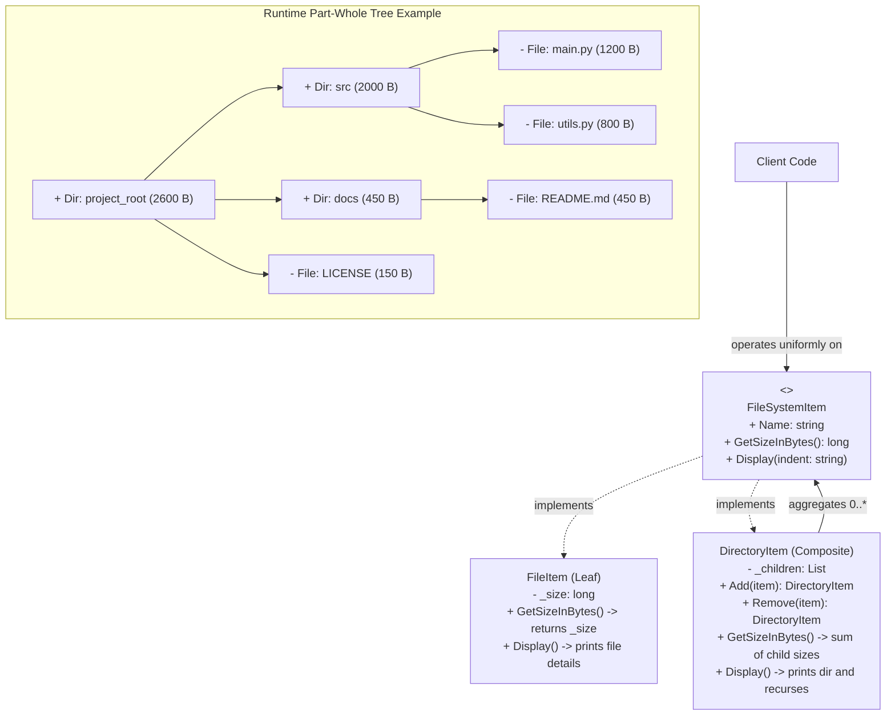

# Lesson 10: Composite

> **Prerequisites:** [Bridge](../09-bridge/README.md) and [Track 25 Overview](../README.md).  
> **Estimated Reading Time:** 18 minutes  
> **Target Audience:** Engineers preparing for LLD, OOP, C#, or Python technical screening and architecture rounds.

> [!TIP]
> **The One Rule of the Composite Pattern:** Treat individual leaf objects and composite tree branches **identically through a single shared interface**, eliminating conditional type checks (`if (item is Directory)`) when traversing, calculating, or operating on hierarchical part-whole structures.

---

## 1. Why This Matters: The Interview Trap

"How would you design a hierarchical file system, an enterprise organization chart, or a UI component tree where containers can hold both items and other nested containers, without polluting client code with `instanceof` or recursive type checks?"

Junior candidates typically respond with data-structure terminology:
> *"The Composite pattern is used for trees. You have a Component interface, Leaf classes, and a Composite class. The composite holds a list of children and loops over them."*

Interviewers push past this elementary definition to test your grasp of **polymorphism, interface design trade-offs, and failure modes**:

1. **Eliminating Type-Checking Branching Logic:** Without the Composite pattern, client code that computes total file sizes or renders UI elements becomes cluttered with cascading conditionals:
   ```csharp
   // Brittle, anti-pattern approach:
   foreach (var item in items) {
       if (item is Directory dir) totalSize += dir.CalculateDirSize();
       else if (item is File file) totalSize += file.GetSize();
   }
   ```
   If a new container type is introduced (e.g., `ArchiveItem` or `SymlinkItem`), every traversal loop across the system must be updated, violating the **Open/Closed Principle**. The Composite pattern enables clients to call `item.GetSize()` uniformly across all nodes.
2. **The Transparency vs. Type Safety Trade-Off:** The single most critical architectural debate in the Composite pattern is: *Where should child-management methods (`Add`, `Remove`, `GetChildren`) live?*
   - **Transparency (Uniformity):** Declare `Add()` and `Remove()` on the root `Component` interface. The client can treat every object identically without casting. However, this violates the **Interface Segregation Principle** and **Liskov Substitution Principle**: calling `file.Add(other)` makes no semantic sense and must throw a runtime exception (e.g., `NotSupportedException`).
   - **Type Safety:** Declare `Add()` and `Remove()` *only* on the concrete `Composite` class. Leaves remain pure and cannot be called with invalid operations, but clients lose uniform treatment when assembling or modifying the tree, as they must cast or hold explicit references to `Composite`.
   In modern backend architectures, **Type Safety is overwhelmingly preferred**.

### Structural Comparison: Composite vs. Decorator vs. Iterator vs. Visitor

| Pattern | Structural Shape | Primary Intent | Does it modify child nodes? |
| :--- | :--- | :--- | :--- |
| **Composite** | **Hierarchical Tree (Part-Whole)** | Treat single items (leaves) and collections of items (composites) uniformly. | Aggregates results across children recursively. |
| **Decorator** | **Linear Chain (Wrapping)** | Add dynamic behavior to an individual object without inheritance. | Wraps a single child conforming to the same interface. |
| **Iterator** | **Sequential Traversal** | Provide uniform sequential access to elements of an aggregate without exposing its underlying representation. | Traverses nodes one by one. |
| **Visitor** | **External Operation Carrier** | Execute new operations over an existing object structure without changing the structure classes. | Visits nodes polymorphically via double-dispatch. |

---

## 2. Visual Mental Model / Taxonomic Comparison

A Composite tree consists of:
- **Component:** The common abstraction declaring operations common to both simple and complex objects.
- **Leaf:** Basic building blocks that contain no children (e.g., `FileItem`).
- **Composite:** Complex containers that store child components and delegate work to them recursively (e.g., `DirectoryItem`).



### Component Roles in the Hierarchy

| Role | Has Children? | Implementation of Base Operations | Example |
| :--- | :--- | :--- | :--- |
| **Component** | Abstract | Declares common interface for the entire hierarchy. | `FileSystemItem` |
| **Leaf** | No | Performs the actual work directly (terminal operation). | `FileItem`, `Button`, `IndividualEmployee` |
| **Composite** | **Yes** | Dispatches work recursively to all children and aggregates the results. | `DirectoryItem`, `Panel`, `DepartmentManager` |

---

## 3. Code Implementation

In the following implementation, we model a hierarchical file system. The client can calculate total disk size or print the entire tree hierarchy starting from any arbitrary node (a single file or a deeply nested folder) without ever inspecting concrete runtime types.

````carousel
```python
from abc import ABC, abstractmethod
from typing import List


# 1. Component interface declaring operations shared by leaves and composites
class FileSystemItem(ABC):

  def __init__(self, name: str) -> None:
    self.name: str = name

  @abstractmethod
  def get_size_in_bytes(self) -> int:
    """Calculates total size in bytes recursively."""
    pass

  @abstractmethod
  def display(self, indent: str = "") -> None:
    """Renders hierarchy representation."""
    pass


# 2. Leaf: Represents terminal elements with no child items
class FileItem(FileSystemItem):

  def __init__(self, name: str, size_in_bytes: int) -> None:
    super().__init__(name)
    self._size: int = size_in_bytes

  def get_size_in_bytes(self) -> int:
    return self._size

  def display(self, indent: str = "") -> None:
    print(f"{indent}- File: {self.name} ({self._size} B)")


# 3. Composite: Represents branch elements containing children
class DirectoryItem(FileSystemItem):

  def __init__(self, name: str) -> None:
    super().__init__(name)
    self._children: List[FileSystemItem] = []

  # Type-safe child management on the Composite
  def add(self, item: FileSystemItem) -> "DirectoryItem":
    self._children.append(item)
    return self

  def remove(self, item: FileSystemItem) -> "DirectoryItem":
    self._children.remove(item)
    return self

  def get_size_in_bytes(self) -> int:
    # Uniform recursive aggregation without branching on concrete types
    return sum(child.get_size_in_bytes() for child in self._children)

  def display(self, indent: str = "") -> None:
    print(f"{indent}+ Dir: {self.name} ({self.get_size_in_bytes()} B)")
    for child in self._children:
      child.display(indent + "  ")


if __name__ == "__main__":
  # Build tree structure
  root = DirectoryItem("project_root")
  src = DirectoryItem("src")
  docs = DirectoryItem("docs")

  main_py = FileItem("main.py", 1200)
  utils_py = FileItem("utils.py", 800)
  readme = FileItem("README.md", 450)
  license_file = FileItem("LICENSE", 150)

  src.add(main_py).add(utils_py)
  docs.add(readme)
  root.add(src).add(docs).add(license_file)

  # Uniform operation on root composite
  root.display()
  print(f"Total Size: {root.get_size_in_bytes()} bytes")
```

<!-- slide -->

```csharp
using System;
using System.Collections.Generic;
using System.Linq;

// 1. Component interface declaring operations shared by leaves and composites
public interface IFileSystemItem
{
    string Name { get; }
    long GetSizeInBytes();
    void Display(string indent = "");
}

// 2. Leaf: Represents terminal elements with no child items
public sealed class FileItem : IFileSystemItem
{
    public string Name { get; }
    private readonly long _size;

    public FileItem(string name, long sizeInBytes)
    {
        Name = name;
        _size = sizeInBytes;
    }

    public long GetSizeInBytes() => _size;

    public void Display(string indent = "")
    {
        Console.WriteLine($"{indent}- File: {Name} ({_size} B)");
    }
}

// 3. Composite: Represents branch elements containing children
public sealed class DirectoryItem : IFileSystemItem
{
    public string Name { get; }
    private readonly List<IFileSystemItem> _children = new();

    public DirectoryItem(string name)
    {
        Name = name;
    }

    // Type-safe child management on the Composite
    public DirectoryItem Add(IFileSystemItem item)
    {
        _children.Add(item);
        return this;
    }

    public DirectoryItem Remove(IFileSystemItem item)
    {
        _children.Remove(item);
        return this;
    }

    public long GetSizeInBytes()
    {
        // Uniform recursive aggregation without branching on concrete types
        return _children.Sum(child => child.GetSizeInBytes());
    }

    public void Display(string indent = "")
    {
        Console.WriteLine($"{indent}+ Dir: {Name} ({GetSizeInBytes()} B)");
        foreach (var child in _children)
        {
            child.Display(indent + "  ");
        }
    }
}

public class Program
{
    public static void Main()
    {
        // Build tree structure
        var root = new DirectoryItem("project_root");
        var src = new DirectoryItem("src");
        var docs = new DirectoryItem("docs");

        var mainCs = new FileItem("main.py", 1200);
        var utilsCs = new FileItem("utils.py", 800);
        var readme = new FileItem("README.md", 450);
        var license = new FileItem("LICENSE", 150);

        src.Add(mainCs).Add(utilsCs);
        docs.Add(readme);
        root.Add(src).Add(docs).Add(license);

        // Uniform operation on root composite
        root.Display();
        Console.WriteLine($"Total Size: {root.GetSizeInBytes()} bytes");
    }
}
```
````

**Expected Output (Both Languages):**
```text
+ Dir: project_root (2600 B)
  + Dir: src (2000 B)
    - File: main.py (1200 B)
    - File: utils.py (800 B)
  + Dir: docs (450 B)
    - File: README.md (450 B)
  - File: LICENSE (150 B)
Total Size: 2600 bytes
```

---

## 4. Where You Already Use It

Hierarchical part-whole trees are ubiquitous across production frameworks:

- **In .NET & C#:**
  - **WPF & WinForms UI Component Hierarchy:** `UIElement` / `FrameworkElement` and `Control`: A `Panel` or `Grid` (Composite) derives from `UIElement`, just like a `Button` or `TextBlock` (Leaf). A `Grid` contains a collection of `UIElement` children, allowing the layout engine to invoke `.Measure()` and `.Arrange()` recursively down the entire visual tree.
  - **ASP.NET Core View Engines (`CompositeViewEngine`):** Implements `IViewEngine` and aggregates multiple view engines (e.g., Razor view engine, custom template engines). When a controller returns a view, the pipeline queries `CompositeViewEngine.FindView()`, which iterates its child engines transparently.
  - **ASP.NET Core Metadata Providers (`ICompositeMetadataDetailsProvider`):** Coordinates multiple display, binding, and validation metadata providers into a unified pipeline.
  - **Composite Validation:** Enterprise validation architectures frequently use a `CompositeValidator<T>` that implements `IValidator<T>` and encapsulates a collection of individual rule validators (`EmailValidator`, `PasswordStrengthValidator`), executing all of them in a single call.

- **In Python:**
  - **XML / HTML DOM Parsers (`xml.etree.ElementTree`):** Every node in an `ElementTree` is an `Element`. An element has a tag, text, and attributes (Leaf data), and can also contain a list of sub-elements (Composite). Calling `.findall()` or `.iter()` operates identically on roots, branches, or leaves.
  - **Deep Learning Neural Networks (`torch.nn.Sequential` & `torch.nn.Module`):** In PyTorch, custom neural networks derive from `nn.Module`. A module can contain leaf layers (`nn.Linear`, `nn.Conv2d`) or composite containers (`nn.Sequential`). Invoking `model(inputs)` runs the forward pass recursively across the entire tree of layers.
  - **GUI Toolkits (`tkinter.Widget`):** Frames and windows contain widgets and other nested frames, rendering recursively.

---

## 5. Pitfalls and When Not to Use It

1. **Stack Overflow on Deep Hierarchies (Recursion Limits):**
   - Naive recursive implementations (`GetSizeInBytes()`) consume call-stack frames proportional to tree depth. In systems with 10,000+ nested directories or deeply nested ASTs, this causes stack overflow crashes.
   - *Fix:* For arbitrarily deep trees, use an **iterative traversal** with an explicit heap-allocated `Stack<T>` or `Queue<T>`.
2. **Cyclic Reference Traps (Infinite Recursion):**
   - If a directory contains a symbolic link pointing to one of its ancestor directories, or an organization chart has a cyclical managerial reference (Employee A reports to B, who reports to A), recursive traversals enter an infinite loop until memory is exhausted.
   - *Fix:* Maintain a `HashSet<T>` of visited node IDs or enforce strict Directed Acyclic Graph (DAG) validation upon child addition.
3. **Violating LSP with "Transparency":**
   - Placing `Add(item)` on the root `Component` interface forces leaf objects to implement a method they cannot support. Throwing `NotSupportedException` breaks the Liskov Substitution Principle because leaves cannot truly substitute for components in child-management contexts. Favor **Type Safety** by placing child manipulation methods exclusively on composites.
4. **Caching Invalidation Complexity:**
   - In large trees, caching aggregated values (e.g., caching folder size to avoid calculating millions of child files on every query) requires cache-invalidation signals bubbling up the tree whenever a leaf changes. If a leaf file is updated, every parent directory up to the root must invalidate its cached total.

---

## 6. Exercises & Practical Drills

### Exercise 1: Build a Composite Validator
Design a `CompositeValidator<T>` in C# or Python that implements `IValidator<T>` and aggregates multiple individual validators. If any child validator fails, the composite returns failure and aggregates all error messages.

<details>
<summary>Answer</summary>

```csharp
public interface IValidator<T>
{
    ValidationResult Validate(T entity);
}

public class ValidationResult
{
    public bool IsValid => Errors.Count == 0;
    public List<string> Errors { get; } = new();
}

public class CompositeValidator<T> : IValidator<T>
{
    private readonly List<IValidator<T>> _validators = new();

    public CompositeValidator<T> Add(IValidator<T> validator)
    {
        _validators.Add(validator);
        return this;
    }

    public ValidationResult Validate(T entity)
    {
        var aggregated = new ValidationResult();
        foreach (var validator in _validators)
        {
            var result = validator.Validate(entity);
            if (!result.IsValid)
            {
                aggregated.Errors.AddRange(result.Errors);
            }
        }
        return aggregated;
    }
}
```

The client can register individual rules (`NotEmptyRule`, `EmailFormatRule`, `AgeThresholdRule`) or nest another `CompositeValidator` without the caller ever knowing how many rules exist.
</details>

### Exercise 2: Cycle Detection Guard
How do you protect a composite directory tree against cyclic references (e.g., when a user attempts to add an ancestor folder as a child of its own subfolder)?

<details>
<summary>Answer</summary>

Before adding a child inside `DirectoryItem.Add(FileSystemItem item)`, verify that `item` is not equal to `this` and that `this` does not exist anywhere within `item`'s descendant hierarchy:

```python
def add(self, item: FileSystemItem) -> "DirectoryItem":
  if item is self:
    raise ValueError("Cannot add a composite to itself.")

  # If item is a Directory, check if 'self' is in its subtree
  if isinstance(item, DirectoryItem) and item.contains_descendant(self):
    raise ValueError("Cyclic reference detected: Cannot add ancestor as child.")

  self._children.append(item)
  return self


def contains_descendant(self, target: FileSystemItem) -> bool:
  for child in self._children:
    if child is target:
      return True
    if (
        isinstance(child, DirectoryItem)
        and child.contains_descendant(target)
    ):
      return True
  return False
```
</details>

---

## 7. Interview Questions & Model Answers

> [!interview]
> **Question 1: What is the Composite pattern?**  
> **Strong Answer:**  
> "The Composite pattern is a structural design pattern that composes objects into tree structures to represent **part-whole hierarchies**, allowing client code to treat individual leaf objects and composite collections of objects **identically**.
> 
> It consists of three primary components:
> 1. A **Component** interface declaring common operations (e.g., `GetSize()`, `Render()`, `Execute()`).
> 2. **Leaf** classes that represent terminal nodes containing business data and no children.
> 3. **Composite** classes that maintain a collection of child components and implement operations by delegating work recursively across their children.
> 
> The major architectural benefit is that it eliminates conditional branching logic (`if (node is Folder) ... else ...`) in client applications, adhering to the Open/Closed Principle."

> [!interview]
> **Question 2: Give an example of a Composite in a real system.**  
> **Strong Answer:**  
> "A classic real-world example is an **enterprise file system**:
> - The component interface is `IFileSystemItem` with methods `GetSize()` and `PrintHierarchy()`.
> - The leaf is `FileItem`, holding raw file byte size. Its `GetSize()` simply returns its own size.
> - The composite is `DirectoryItem`, holding a collection of `IFileSystemItem` instances (which can be either files or other directories). Its `GetSize()` recursively sums the sizes of all its children.
> 
> Other prominent production examples include:
> 1. **UI Component Frameworks (WPF / DOM):** A `Container` or `Panel` holds buttons, text fields, and nested sub-panels, rendering the entire tree via uniform layout operations.
> 2. **Organization Hierarchies:** An `Employee` interface implemented by `IndividualContributor` (leaf) and `Manager` (composite holding a team), calculating total department payroll uniformly.
> 3. **Composite Validators:** In backend request pipelines, combining multiple independent validation rules into a single `CompositeValidator` that executes all sub-validators polymorphically."

---

## 8. Sources & Further Reading

- [Microsoft Learn: WPF Visual Tree Architecture](https://learn.microsoft.com/en-us/dotnet/desktop/wpf/advanced/wpf-architecture)
- [Microsoft Learn: View Compilation and Custom View Engines in ASP.NET Core](https://learn.microsoft.com/en-us/aspnet/core/mvc/views/overview)
- [Python Documentation: ElementTree XML API](https://docs.python.org/3/library/xml.etree.elementtree.html)
- [Refactoring.Guru: Composite Pattern](https://refactoring.guru/design-patterns/composite)
- [Erich Gamma, Richard Helm, Ralph Johnson, John Vlissides: Design Patterns (GoF)](https://en.wikipedia.org/wiki/Design_Patterns)

---

Previous: [Bridge](../09-bridge/README.md) · Next: [Decorator (and Why It Is Not the Same as a Python @decorator)](../11-decorator/README.md)
