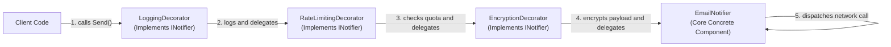
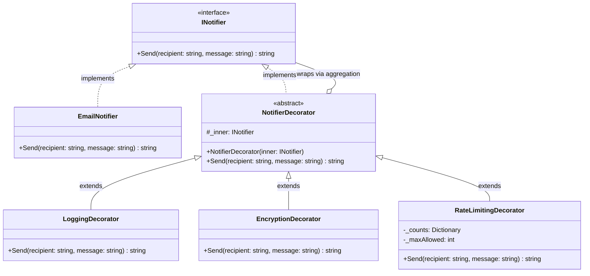

# Lesson 11: Decorator (and Why It Is Not the Same as a Python @decorator)

> **Prerequisites:** [Composite](../10-composite/README.md) and [Track 25 Overview](../README.md).  
> **Estimated Reading Time:** 18 minutes  
> **Target Audience:** Engineers preparing for LLD, OOP, C#, or Python technical screening and architecture rounds.

> [!NOTE]
> **In one line:** **Decorator** wraps an object with the same interface to add behaviour (logging, caching, retries) at runtime and stackably — without subclassing or touching the original.

> [!TIP]
> **The One Rule of the Decorator Pattern:** A Decorator **wraps** an instance while **conforming to the exact same interface** as the wrapped object, dynamically adding behavior before or after delegating work. If it changes the interface, it is an **Adapter**; if it controls object lifecycle and access, it is a **Proxy**; if it is merely a Python `@decorator` function, it is syntactic sugar for callable wrapping, not the object-oriented GoF structural pattern.

---

## 1. Why This Matters: The Interview Trap

"What is the Decorator pattern?" and "Is a Python `@decorator` the Decorator pattern?" are two of the most effective filter questions in backend interviews.

### The Interview Trap

Candidates commonly reply:
> *"The Decorator pattern lets you add features to an object without changing it. Yes, Python's `@decorator` is an example—like when you write `@staticmethod` or `@timer` over a function to decorate it."*

This is an immediate red flag for interviewers. It conflates a **language-level metaprogramming syntactic feature** (first-class function wrapping) with an **object-oriented structural design pattern** (polymorphic object composition).

A senior engineer answers with taxonomic precision:

> *"The **GoF Decorator pattern** is an object-oriented structural pattern where a decorator class implements the exact same interface as the component it wraps. It holds a reference to that interface and delegates incoming calls while adding behavior before or after delegation. This enables dynamic runtime stacking of orthogonal responsibilities (such as logging, caching, and encryption) without subclass explosion.*  
>  
> *A **Python `@decorator`**, by contrast, is language-level syntactic sugar for a higher-order callable transform: `@dec def f()` is simply `f = dec(f)`. While both share the conceptual metaphor of wrapping an entity to augment behavior, the GoF pattern relies on subtype polymorphism, interface contracts, and runtime instance composition. A Python decorator operates at definition/import time, typically works on bare functions or classes, and has no requirement to maintain an OOP interface contract."*

### The Combinatorial Explosion Problem (Decorator vs. Inheritance)

Why do we need the Decorator pattern? Consider an e-commerce `OrderRepository` that persists orders to a database. As business requirements grow, we need:
1. In-memory caching
2. Audit logging
3. Encryption at rest

If we rely on **inheritance**, we face a catastrophic subclass explosion:

```text
OrderRepository (Base)
├── CachingOrderRepository
├── LoggingOrderRepository
├── EncryptingOrderRepository
├── CachingLoggingOrderRepository
├── CachingEncryptingOrderRepository
├── LoggingEncryptingOrderRepository
└── CachingLoggingEncryptingOrderRepository
```

For $N$ optional orthogonal features, inheritance demands up to $2^N$ subclasses. If you add a fourth feature (e.g., Metrics/Telemetry), you must write and maintain 16 classes. If you swap the underlying database from SQL to MongoDB, you must duplicate all 16 combinations.

With the **Decorator pattern**, each responsibility is an isolated class that implements the shared `IOrderRepository` interface. You have exactly $N$ decorator classes and 1 base class ($O(N)$ maintenance cost). At runtime, you compose only what you need:

```csharp
IOrderRepository repo = new LoggingOrderRepository(
    new CachingOrderRepository(
        new EncryptingOrderRepository(
            new SqlOrderRepository()
        )
    )
);
```

---

## 2. Visual Mental Model / Taxonomic Comparison

### The Decorator Composition Pipeline

In the GoF Decorator pattern, wrappers nest like Russian nesting dolls (matryoshka). The client treats the outermost wrapper identically to the innermost core component because every layer conforms to the shared interface `INotifier`.



### Class Diagram: GoF Structural Topology



### Comparison Matrix: GoF Decorator vs. Python `@decorator` vs. Inheritance

| Dimension | GoF Decorator Pattern | Python `@decorator` Syntax | Classical Inheritance |
| :--- | :--- | :--- | :--- |
| **Primary Mechanism** | Object aggregation & interface implementation | Higher-order callable transformation (`func = wrap(func)`) | Class derivation (`class Child extends Parent`) |
| **Binding Time** | **Runtime**: can compose dynamically per tenant, request, or environment | **Definition/Import time**: bound when module or function is loaded | **Compile / Class-construction time**: fixed in code |
| **Type Contract** | **Strict**: Decorator IS-A Component (`implements IComponent`) | **Duck typing**: Can return any callable; signature may drift without `functools.wraps` | **Strict**: Subclass IS-A Superclass |
| **Combinatorial Scalability** | **Linear ($O(N)$)**: Combine $N$ features in arbitrary orders at runtime | **Linear ($O(N)$)**: Compose decorators via `@dec1 \n @dec2` | **Exponential ($O(2^N)$)**: Explosion of hybrid classes |
| **Applicability** | Object instances with shared public contracts | Callables (functions, methods, classes) | Concrete or abstract classes |
| **State Retention** | Per-instance state stored inside decorator fields | Closed-over variables inside function closure or wrapper attributes | Fields inherited by instance |

---

## 3. Code Implementation: The Secure Notification Pipeline

Let us implement a secure, audit-logged, rate-limited notification pipeline.

- Core Component: `EmailNotifier`
- Base Decorator: `NotifierDecorator` (implements `INotifier`, aggregates `INotifier`)
- Concrete Decorator 1: `LoggingDecorator` (audit logs before and after delegation)
- Concrete Decorator 2: `EncryptionDecorator` (encrypts the message payload into Base64 ciphertext)
- Concrete Decorator 3: `RateLimitingDecorator` (tracks per-recipient quotas, dropping requests once exceeded)

````carousel
```python
import base64
from abc import ABC, abstractmethod


# 1. COMPONENT CONTRACT
class INotifier(ABC):

  @abstractmethod
  def send(self, recipient: str, message: str) -> str:
    """Dispatches a notification and returns a status receipt."""
    pass


# 2. CONCRETE COMPONENT
class EmailNotifier(INotifier):

  def send(self, recipient: str, message: str) -> str:
    return f"Email dispatched to {recipient}: {message}"


# 3. BASE DECORATOR (Maintains aggregation and polymorphic contract)
class NotifierDecorator(INotifier):

  def __init__(self, inner: INotifier) -> None:
    self._inner: INotifier = inner

  def send(self, recipient: str, message: str) -> str:
    # Default forwarding implementation
    return self._inner.send(recipient, message)


# 4. CONCRETE DECORATOR: Logging
class LoggingDecorator(NotifierDecorator):

  def send(self, recipient: str, message: str) -> str:
    print(f"[LOG] Outgoing notification initiated for: {recipient}")
    result = self._inner.send(recipient, message)
    print(f"[LOG] Outgoing notification completed for: {recipient}")
    return result


# 5. CONCRETE DECORATOR: Encryption
class EncryptionDecorator(NotifierDecorator):

  def send(self, recipient: str, message: str) -> str:
    encoded = base64.b64encode(message.encode("utf-8")).decode("utf-8")
    encrypted_message = f"[ENC:{encoded}]"
    return self._inner.send(recipient, encrypted_message)


# 6. CONCRETE DECORATOR: Rate Limiting
class RateLimitingDecorator(NotifierDecorator):

  def __init__(self, inner: INotifier, max_allowed: int = 2) -> None:
    super().__init__(inner)
    self._max_allowed: int = max_allowed
    self._counts: dict[str, int] = {}

  def send(self, recipient: str, message: str) -> str:
    current_count = self._counts.get(recipient, 0)
    if current_count >= self._max_allowed:
      return f"[RATE LIMIT EXCEEDED] Dropped message for {recipient}"

    self._counts[recipient] = current_count + 1
    return self._inner.send(recipient, message)


# --- CONTRAST: Python Syntactic @decorator (Higher-Order Function) ---
# Notice that this does NOT require INotifier, OOP composition, or interfaces:
def timing_decorator(func):
  import time

  def wrapper(*args, **kwargs):
    start = time.perf_counter()
    res = func(*args, **kwargs)
    elapsed = time.perf_counter() - start
    return res

  return wrapper


if __name__ == "__main__":
  # Runtime Composition: Logging -> RateLimiting -> Encryption -> Email
  notifier: INotifier = LoggingDecorator(
      RateLimitingDecorator(
          EncryptionDecorator(EmailNotifier()), max_allowed=2
      )
  )

  print(notifier.send("alice@example.com", "System alert: CPU at 95%"))
  print(notifier.send("alice@example.com", "System alert: Disk at 90%"))
  print(notifier.send("alice@example.com", "System alert: Memory at 98%"))
```
<!-- slide -->
```csharp
using System;
using System.Collections.Generic;
using System.Text;

// 1. COMPONENT CONTRACT
public interface INotifier
{
    string Send(string recipient, string message);
}

// 2. CONCRETE COMPONENT
public class EmailNotifier : INotifier
{
    public string Send(string recipient, string message)
    {
        return $"Email dispatched to {recipient}: {message}";
    }
}

// 3. BASE DECORATOR (Maintains aggregation and polymorphic contract)
public abstract class NotifierDecorator : INotifier
{
    protected readonly INotifier _inner;

    protected NotifierDecorator(INotifier inner)
    {
        _inner = inner ?? throw new ArgumentNullException(nameof(inner));
    }

    public virtual string Send(string recipient, string message)
    {
        // Default forwarding implementation
        return _inner.Send(recipient, message);
    }
}

// 4. CONCRETE DECORATOR: Logging
public class LoggingDecorator : NotifierDecorator
{
    public LoggingDecorator(INotifier inner) : base(inner) { }

    public override string Send(string recipient, string message)
    {
        Console.WriteLine($"[LOG] Outgoing notification initiated for: {recipient}");
        string result = _inner.Send(recipient, message);
        Console.WriteLine($"[LOG] Outgoing notification completed for: {recipient}");
        return result;
    }
}

// 5. CONCRETE DECORATOR: Encryption
public class EncryptionDecorator : NotifierDecorator
{
    public EncryptionDecorator(INotifier inner) : base(inner) { }

    public override string Send(string recipient, string message)
    {
        string encoded = Convert.ToBase64String(Encoding.UTF8.GetBytes(message));
        string encryptedMessage = $"[ENC:{encoded}]";
        return _inner.Send(recipient, encryptedMessage);
    }
}

// 6. CONCRETE DECORATOR: Rate Limiting
public class RateLimitingDecorator : NotifierDecorator
{
    private readonly int _maxAllowed;
    private readonly Dictionary<string, int> _counts = new();

    public RateLimitingDecorator(INotifier inner, int maxAllowed = 2) : base(inner)
    {
        _maxAllowed = maxAllowed;
    }

    public override string Send(string recipient, string message)
    {
        _counts.TryGetValue(recipient, out int currentCount);
        if (currentCount >= _maxAllowed)
        {
            return $"[RATE LIMIT EXCEEDED] Dropped message for {recipient}";
        }

        _counts[recipient] = currentCount + 1;
        return _inner.Send(recipient, message);
    }
}

public class Program
{
    public static void Main()
    {
        // Runtime Composition: Logging -> RateLimiting -> Encryption -> Email
        INotifier notifier = new LoggingDecorator(
            new RateLimitingDecorator(
                new EncryptionDecorator(new EmailNotifier()),
                maxAllowed: 2
            )
        );

        Console.WriteLine(notifier.Send("alice@example.com", "System alert: CPU at 95%"));
        Console.WriteLine(notifier.Send("alice@example.com", "System alert: Disk at 90%"));
        Console.WriteLine(notifier.Send("alice@example.com", "System alert: Memory at 98%"));
    }
}
```
````

**Expected Output (Both Languages):**

```text
[LOG] Outgoing notification initiated for: alice@example.com
[LOG] Outgoing notification completed for: alice@example.com
Email dispatched to alice@example.com: [ENC:U3lzdGVtIGFsZXJ0OiBDUFUgYXQgOTUl]
[LOG] Outgoing notification initiated for: alice@example.com
[LOG] Outgoing notification completed for: alice@example.com
Email dispatched to alice@example.com: [ENC:U3lzdGVtIGFsZXJ0OiBEaXNrIGF0IDkwJQ==]
[LOG] Outgoing notification initiated for: alice@example.com
[LOG] Outgoing notification completed for: alice@example.com
[RATE LIMIT EXCEEDED] Dropped message for alice@example.com
```

---

## 3A. Where It Is Used, Why It Exists & Progressive Buildup

### Where It Is Used (Real-World Systems & LLD Interviews)

| Domain / Ecosystem | Concrete Real-World Usage | LLD Interview Problem Where You Use It |
| :--- | :--- | :--- |
| **.NET / C#** | `System.IO.Stream` (`GZipStream(CryptoStream(FileStream))`), `HttpClient` `DelegatingHandler`, Scrutor `services.Decorate<IService, CachingDecorator>()`. | Design a Caching + Retry + Telemetry `IOrderRepository` pipeline. |
| **Python** | `io` module (`TextIOWrapper(BufferedReader(FileIO))`), WSGI/ASGI middleware wrappers, `httpx` custom transports. | Design a composable Data Stream Pipeline (Compress -> Encrypt -> Checksum). |
| **Go** | `http.Handler` middleware (`WithLogging(WithAuth(mux))`), `io.Reader`/`io.Writer` (`gzip.NewWriter`, `bufio.NewWriter`, `io.LimitReader`). | Design an HTTP API Gateway Middleware Chain (RateLimit -> Auth -> Metrics). |
| **TypeScript / Node.js** | Express/Koa/Hono middleware, `node:stream` `Transform` chains, Fetch/Axios wrapper clients. | Design a Coffee/Pizza Ordering System or Multi-Layer Repository Decorator. |

### Why It Is Used — The Step-by-Step Buildup (Before -> Pain -> Pattern)

#### Stage 0: Naive Code ($2^N$ Subclass Explosion)
```python
class UserRepo:
    def get_user(self, uid: str) -> str:
        return f"db_user:{uid}"


class CachedUserRepo(UserRepo):
    def get_user(self, uid: str) -> str:
        return f"cached({super().get_user(uid)})"


class LoggedUserRepo(UserRepo):
    def get_user(self, uid: str) -> str:
        return f"logged({super().get_user(uid)})"


class CachedAndLoggedUserRepo(UserRepo):
    # Must duplicate caching + logging logic together!
    pass
```

#### What Breaks as Requirements Arrive
- **Requirement 2 (Add `Retry` and `Metrics`):** 4 optional features require up to $2^4 = 16$ subclasses. Swapping `SqlUserRepo` for `PostgresUserRepo` doubles it to 32.
- **Requirement 3 (Per-tenant runtime composition):** Enterprise tenants need `Logging -> Caching -> Retry -> Repo`, while free-tier tenants need `Caching -> Repo`. Static inheritance cannot assemble or reorder layers at runtime.

#### Step-by-Step Refactoring to Decorator
1. **Share One Interface:** Define `UserRepo` (`Protocol`/ABC) with `get_user(uid: str) -> str`.
2. **Wrap via Composition:** Each decorator (`CachingRepo`, `RetryingRepo`) implements `UserRepo` and holds `self._inner: UserRepo`.
3. **Stack Dynamically:** Compose any combination in $O(N)$ classes at runtime.

### Progressive Real-World Examples

#### Example A: Simple Core — Composable Beverage Pricing
Adds toppings dynamically without creating `EspressoWithMilkAndCaramel` subclasses.

```python
from typing import Protocol


class Beverage(Protocol):
    def cost_cents(self) -> int: ...
    def description(self) -> str: ...


class Espresso:
    def cost_cents(self) -> int:
        return 300

    def description(self) -> str:
        return "Espresso"


class MilkDecorator:
    def __init__(self, inner: Beverage) -> None:
        self._inner = inner

    def cost_cents(self) -> int:
        return self._inner.cost_cents() + 50

    def description(self) -> str:
        return f"{self._inner.description()} + Milk"


class CaramelDecorator:
    def __init__(self, inner: Beverage) -> None:
        self._inner = inner

    def cost_cents(self) -> int:
        return self._inner.cost_cents() + 75

    def description(self) -> str:
        return f"{self._inner.description()} + Caramel"


drink: Beverage = CaramelDecorator(MilkDecorator(Espresso()))
assert drink.cost_cents() == 425
assert drink.description() == "Espresso + Milk + Caramel"
```

#### Example B: Production Backend — HTTP Handler Middleware Stack
Every layer implements the exact same `HttpHandler` interface, adding auth and audit logging around the core route handler.

```python
from typing import Protocol


class HttpHandler(Protocol):
    def handle(self, req: dict[str, str]) -> tuple[int, str]: ...


class OrdersHandler:
    def handle(self, req: dict[str, str]) -> tuple[int, str]:
        return 200, f"orders for {req.get('user', 'anon')}"


class AuthMiddleware:
    def __init__(self, inner: HttpHandler) -> None:
        self._inner = inner

    def handle(self, req: dict[str, str]) -> tuple[int, str]:
        if req.get("token") != "valid-jwt":
            return 401, "Unauthorized"
        return self._inner.handle(req)


class AuditLogMiddleware:
    def __init__(self, inner: HttpHandler, logs: list[str]) -> None:
        self._inner = inner
        self._logs = logs

    def handle(self, req: dict[str, str]) -> tuple[int, str]:
        status, body = self._inner.handle(req)
        self._logs.append(f"path={req.get('path')} status={status}")
        return status, body


audit_logs: list[str] = []
pipeline: HttpHandler = AuditLogMiddleware(AuthMiddleware(OrdersHandler()), audit_logs)
assert pipeline.handle({"path": "/orders", "token": "bad"}) == (401, "Unauthorized")
assert pipeline.handle({"path": "/orders", "token": "valid-jwt", "user": "alice"}) == (200, "orders for alice")
assert audit_logs == ["path=/orders status=401", "path=/orders status=200"]
```

#### Example C: Classic LLD Interview Problem — Resilient Caching & Retrying Repository
Stacks a read-through cache outside a transient-fault-retrying repository so temporary DB blips are retried once, and subsequent reads hit the cache.

```python
from typing import Protocol


class KeyValueRepo(Protocol):
    def get(self, key: str) -> str: ...


class FlakyDbRepo:
    def __init__(self) -> None:
        self.calls = 0

    def get(self, key: str) -> str:
        self.calls += 1
        if self.calls == 1:
            raise ConnectionError("Transient DB timeout")
        return f"value:{key}"


class RetryingRepo:
    def __init__(self, inner: KeyValueRepo, max_attempts: int = 3) -> None:
        self._inner = inner
        self._max_attempts = max_attempts

    def get(self, key: str) -> str:
        for attempt in range(self._max_attempts):
            try:
                return self._inner.get(key)
            except ConnectionError:
                if attempt == self._max_attempts - 1:
                    raise
        raise RuntimeError("Unreachable")


class CachingRepo:
    def __init__(self, inner: KeyValueRepo) -> None:
        self._inner = inner
        self._cache: dict[str, str] = {}

    def get(self, key: str) -> str:
        if key not in self._cache:
            self._cache[key] = self._inner.get(key)
        return self._cache[key]


db = FlakyDbRepo()
repo: KeyValueRepo = CachingRepo(RetryingRepo(db, max_attempts=2))
assert repo.get("user:42") == "value:user:42"  # 1st attempt fails, 2nd succeeds
assert repo.get("user:42") == "value:user:42"  # Served from cache (no extra DB call)
assert db.calls == 2
```

---

## 4. Where You Already Use It

### In .NET / C#

1. **`System.IO.Stream` (The Canonical Example):**
   - The abstract base class `Stream` defines `Read()`, `Write()`, `Flush()`, and `Seek()`.
   - Core components: `FileStream`, `MemoryStream`, `NetworkStream`.
   - Decorators: `BufferedStream` (adds buffer chunking), `GZipStream` / `DeflateStream` (compresses bytes on the fly), `CryptoStream` (encrypts bytes with an algorithm).
   - You can chain them transparently:
     ```csharp
     using Stream file = File.Create("archive.enc");
     using Stream buffered = new BufferedStream(file);
     using Stream crypto = new CryptoStream(buffered, encryptor, CryptoStreamMode.Write);
     using Stream zip = new GZipStream(crypto, CompressionLevel.Optimal);
     zip.Write(payloadBytes);
     ```
2. **ASP.NET Core `DelegatingHandler`:**
   - In `System.Net.Http`, `HttpClient` pipelines use `DelegatingHandler` (which wraps `HttpMessageHandler`). Middleware handlers like retry policies (`Polly`), auth token injection, and telemetry logging are GoF Decorators over HTTP requests.
3. **Dependency Injection with Scrutor or Keyed Services:**
   - Decorating domain services without touching business code:
     ```csharp
     // Using Scrutor
     services.AddScoped<IOrderService, OrderService>();
     services.Decorate<IOrderService, CachingOrderServiceDecorator>();
     services.Decorate<IOrderService, TelemetryOrderServiceDecorator>();
     ```

### In Python

1. **Standard Library `io` Module:**
   - Python's standard `open()` creates a chain of GoF Decorators:
     - `io.FileIO`: Raw byte operating system file descriptor.
     - `io.BufferedReader` / `io.BufferedWriter`: GoF Decorator adding buffering over `FileIO`.
     - `io.TextIOWrapper`: GoF Decorator adding character encoding/decoding and newline translation over `BufferedReader`.
2. **WSGI / ASGI Middleware:**
   - In frameworks like Flask, Django, or FastAPI, WSGI/ASGI middleware is an architectural Decorator. An application callable `app(environ, start_response)` is wrapped by middleware objects that conform to the exact same callable signature.

---

## 5. Pitfalls and When Not to Use It

1. **The Self-Invocation / Identity Trap (`this` / `self` Problem):**
   - If a client calls `decorator.MethodA()`, the decorator executes added logic and delegates to `inner.MethodA()`.
   - However, if `inner.MethodA()` internally calls `this.MethodB()`, that call executes on the *inner* object directly, completely bypassing any decorator wrapping `MethodB()`.
   - *Fix:* Decorators should wrap coarse-grained, boundary interfaces. Never assume internal self-invocations will trigger decorator logic.
2. **Order Sensitivity Hazards:**
   - The order of decorators in the chain matters intensely:
     - `LoggingDecorator(EncryptionDecorator(Notifier))` logs the *ciphertext* payload.
     - `EncryptionDecorator(LoggingDecorator(Notifier))` logs the *plaintext* payload.
   - Getting the pipeline order wrong can leak sensitive PII to logs or attempt to decrypt data before it has been decompressed.
3. **Interface Bloat:**
   - If an interface has 25 methods, the base decorator must faithfully forward all 25 methods. If a new method is added to the interface, every manual decorator must be updated unless a solid base forwarding class is maintained.
4. **Debugging and Stack Trace Depth:**
   - A call stack passing through 8 decorators creates 16+ extra frames. Inspecting the raw inner component requires unwrapping fields (`_inner._inner._inner`), complicating debugging in production crash dumps.

---

## 6. Exercises & Practical Drills

### Exercise 1: Spot the Antipattern and Refactor

A developer designed the following classes for an API client:
- `ApiClient`
- `AuthenticatedApiClient` (inherits `ApiClient`)
- `RetryingApiClient` (inherits `ApiClient`)
- `AuthenticatedRetryingApiClient` (inherits `AuthenticatedApiClient`)
- `CachingAuthenticatedRetryingApiClient` (inherits `AuthenticatedRetryingApiClient`)

Why is this design unsustainable, and what interface contract would you establish to refactor it into Decorators?

<details>
<summary>Answer</summary>

**Why it is unsustainable:**
This is classic **combinatorial subclass explosion**. Adding another concern (such as `RateLimitingApiClient` or `LoggingApiClient`) would require $2^N$ combinations. Furthermore, if you want retries *without* authentication, you must create `RetryingApiClient`, duplicating the retry logic implemented in `AuthenticatedRetryingApiClient`.

**Refactoring:**
1. Define a shared interface:
   ```csharp
   public interface IApiClient
   {
       Task<HttpResponseMessage> SendAsync(HttpRequestMessage request);
   }
   ```
2. Implement `HttpApiClient` as the core component.
3. Implement `AuthDecorator`, `RetryDecorator`, `CachingDecorator`, and `LoggingDecorator` as separate classes deriving from `ApiClientDecorator : IApiClient`.
4. Compose at startup:
   ```csharp
   IApiClient client = new LoggingDecorator(
       new RetryDecorator(
           new AuthDecorator(
               new HttpApiClient()
           )
       )
   );
   ```
</details>

### Exercise 2: Diagnose the Order Bug

Consider this chain:
```python
pipeline = CompressionDecorator(EncryptionDecorator(FileStorage()))
```
When reading a file back via:
```python
read_pipeline = CompressionDecorator(EncryptionDecorator(FileStorage()))
```
The application crashes with `DecompressionError: Invalid header byte`. Why did this happen?

<details>
<summary>Answer</summary>

When writing, the data was encrypted first, then compressed:
`Plaintext -> Encrypt -> Ciphertext -> Compress -> Disk`
Encrypted data has high entropy (near-maximum randomness) and cannot be effectively compressed.

More importantly, when reading back from disk:
The read pipeline must apply operations in the **exact reverse order**:
1. Decompress from disk back to ciphertext.
2. Decrypt ciphertext back to plaintext.

If the read pipeline attempts to decompress before decrypting when writing did the opposite, or if the write pipeline compressed unencrypted data and encrypted second, the read pipeline's layers must mirror the inverse of the write pipeline.
</details>

---

## 7. Interview Questions & Model Answers

<details>
<summary><strong>1. What is the Decorator pattern? [BASIC]</strong></summary>

The Decorator pattern is a Gang of Four structural design pattern that dynamically attaches additional responsibilities to an object at runtime. The decorator implements the exact same interface as the object it wraps and maintains a reference to that interface. When a method is called on the decorator, it can execute custom logic before or after delegating the call to the wrapped component.

It provides a flexible, composable alternative to subclassing. Instead of statically compiling separate classes for every conceivable combination of behaviors, you write isolated single-responsibility decorators and stack them at runtime as needed.

</details>

<details>
<summary><strong>2. Is a Python `@decorator` the Decorator pattern? [BASIC]</strong></summary>

Strictly speaking, no. While they share the high-level intent of wrapping code to augment behavior, their mechanisms and design paradigms are fundamentally different:

1. **Mechanism:** A Python `@decorator` is language-level syntactic sugar for higher-order functions: `@dec def f()` translates to `f = dec(f)`. It operates primarily on bare functions, methods, or classes at definition time using closures. The GoF Decorator is an object-oriented pattern based on subtyping, where a wrapper object shares an interface with its inner instance and delegates at runtime.
2. **Interface Contract:** The GoF Decorator guarantees polymorphic substitutability: any client expecting `INotifier` can accept a decorated `INotifier`. A Python `@decorator` can return any object or callable and does not enforce an object-oriented contract unless specifically designed to do so.

In short, the Python `@decorator` is a functional metaprogramming construct, whereas the GoF Decorator is an object-oriented structural composition pattern.

</details>

<details>
<summary><strong>3. Give a .NET example of the Decorator pattern. [SCENARIO]</strong></summary>

The canonical .NET example is `System.IO.Stream`.

`Stream` is an abstract base class defining core I/O operations (`Read`, `Write`). Concrete components like `FileStream` or `MemoryStream` provide raw byte reading and writing.

Classes like `BufferedStream`, `GZipStream`, `DeflateStream`, and `CryptoStream` are classic GoF Decorators: they derive from `Stream` and take an inner `Stream` in their constructors. When you call `Write()` on a `GZipStream`, it compresses the incoming byte buffer and forwards the compressed bytes to the inner stream (such as a `FileStream`). Because every decorator conforms to `Stream`, you can nest them seamlessly: `new CryptoStream(new GZipStream(new FileStream(...)))`.

</details>

<details>
<summary><strong>4. Decorator or inheritance: which and why? [SCENARIO]</strong></summary>

Use **Decorator** when you need to combine multiple independent, optional responsibilities dynamically at runtime, or when subclassing would cause a combinatorial explosion of classes. Decorator adheres to the Single Responsibility and Open/Closed principles: each decorator handles one concern (e.g., caching, logging, metrics), and you can introduce new behaviors without modifying existing classes or creating $2^N$ hybrid subclasses.

Use **Inheritance** when there is a true, immutable 'is-a' conceptual relationship, when you want to share foundational base-class mechanics across closely related subtypes, and when the specialization hierarchy is static and shallow. If the behaviors you are adding can be mixed and matched in arbitrary orders and permutations, inheritance quickly breaks down and Decorator is the superior architectural choice.

</details>

<details>
<summary><strong>5. You need logging, retry and caching around an `IOrderRepository`. How? [SCENARIO]</strong></summary>

Write one decorator per concern, each implementing `IOrderRepository` and wrapping another. Compose them in the DI container (`Logging(Retry(Cache(Sql)))`); the consumers see only the interface.

</details>

<details>
<summary><strong>6. Does decorator order matter? [TRICKY]</strong></summary>

Yes. `Cache(Auth(x))` serves cached data without an auth check; `Auth(Cache(x))` checks auth first. Retry outside logging logs every attempt; inside it logs once. State the order and why.

</details>

---

## Try it

Run this: wrappers stack, and each one only knows the shared interface. Then redraw it in [LLD Studio](/tools/lld-studio/); the [track hub](../README.md) has the pattern-choice drills.

```python
class Coffee:
    def cost(self): return 50
class Milk:
    def __init__(self, inner): self.inner = inner
    def cost(self): return self.inner.cost() + 10
class Sugar:
    def __init__(self, inner): self.inner = inner
    def cost(self): return self.inner.cost() + 5

assert Sugar(Milk(Coffee())).cost() == 65
```

---

## One-page cheat sheet

```text
DECORATOR  Wrapper implements X AND holds an X   (same interface, delegate + add)
Stackable: A(B(C(core))) -- order matters (cache then auth? auth then cache?)
Avoids subclass explosion (Coffee x Milk x Sugar combos)
Python @decorator wraps FUNCTIONS - similar idea, not the same pattern
.NET: Stream wrappers (BufferedStream, GZipStream), Scrutor .Decorate<>
Decorator ADDS behaviour | Proxy CONTROLS access | Adapter CHANGES interface
Pitfall: identity/equality changes, long chains hard to debug
```

---

## 8. Sources & Further Reading

- Gamma, Helm, Johnson, Vlissides (Gang of Four). *Design Patterns: Elements of Reusable Object-Oriented Software*. Addison-Wesley.
- [Microsoft Learn: System.IO.Stream Class](https://learn.microsoft.com/en-us/dotnet/api/system.io.stream)
- [Microsoft Learn: CryptoStream Class](https://learn.microsoft.com/en-us/dotnet/api/system.security.cryptography.cryptostream)
- [Python Documentation: io — Core tools for working with streams](https://docs.python.org/3/library/io.html)
- [PEP 318: Decorators for Functions and Methods](https://peps.python.org/pep-0318/)
- [Refactoring.Guru: Decorator Design Pattern](https://refactoring.guru/design-patterns/decorator)

---

Previous: [Composite](../10-composite/README.md) · Next: [Facade](../12-facade/README.md)
