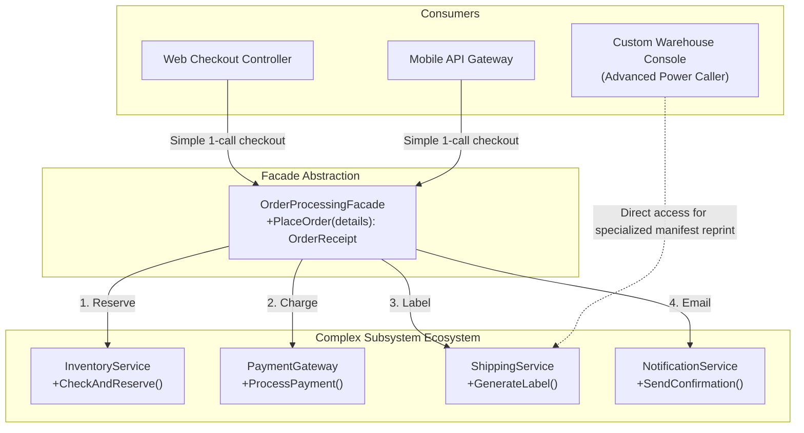

# Lesson 12: Facade

> **Prerequisites:** [Decorator (and Why It Is Not the Same as a Python @decorator)](../11-decorator/README.md) and [Track 25 Overview](../README.md).  
> **Estimated Reading Time:** 16 minutes  
> **Target Audience:** Engineers preparing for LLD, OOP, C#, or Python technical screening and architecture rounds.

> [!NOTE]
> **In one line:** **Facade** gives a complex subsystem one simple entry point (`checkout()` instead of 5 service calls) — it hides complexity but does not forbid direct access.

> [!TIP]
> **The One Rule of the Facade Pattern:** A Facade provides a **simplified, high-level doorway** to a complex subsystem to reduce cognitive load and coupling—it does **not** encapsulate or hide the subsystem classes from callers who genuinely need fine-grained control, nor does it adapt incompatible interfaces. If a facade starts accumulating state, domain business logic, and dozens of unrelated methods, it has degenerated into a God Object antipattern.

---

## 1. Why This Matters: The Interview Trap

"What is the Facade pattern, and how does it differ from Adapter and Mediator?" is a standard architectural question used to probe a candidate's understanding of structural boundaries and coupling.

### The Interview Trap

Candidates often give superficial definitions:
> *"A Facade hides complex code behind a wrapper class, like a service class that calls several repositories."*

Interviewers probe deeper: *"If it's just a wrapper, isn't that an Adapter? And if it coordinates multiple classes, isn't it a Mediator? What stops your Facade from becoming a monolithic God Object?"*

A senior engineer answers with precise taxonomic distinctions:

> *"The **Facade pattern** provides a unified, higher-level interface to a subsystem of classes, libraries, or frameworks. Its sole purpose is **convenience and reduced cognitive load**: it makes the 80% common use case trivial by orchestrating low-level components behind one entry point, while deliberately leaving the underlying subsystem accessible for power callers who need the remaining 20% of specialized behavior.*  
>  
> *It differs from related patterns across clear architectural dimensions:*  
> - ***Facade vs. Adapter:*** An **Adapter** wraps *one existing interface* to match an *existing target contract* that a client already expects (one-to-one, enabling polymorphism between incompatible types). A **Facade** invents a *brand-new, simplified interface* over *multiple subsystem classes* (one-to-many, reducing complexity).  
> - ***Facade vs. Mediator:*** A **Mediator** centralizes bidirectional, peer-to-peer communication among colleague objects so they don't know about each other. A **Facade** provides unidirectional orchestration from client down to subsystem; the subsystem components typically have no awareness of the facade's existence.*  
> - ***Facade vs. God Object:*** A clean Facade is a **thin orchestrator**: it delegates work to specialized domain services without owning business validation, state machines, or calculation logic itself. When a facade accumulates business rules and direct database writes, it rots into an anti-architectural God Object."*

### Subsystem Chaos Without a Facade

Consider an e-commerce order checkout flow. To fulfill an order, the system must interact with four separate domain subsystems:
1. `InventoryService`: Verify stock and place reservations.
2. `PaymentGateway`: Authorize transaction, handle 3D Secure, charge cards.
3. `ShippingService`: Calculate freight weight, generate carrier manifests, produce tracking barcodes.
4. `NotificationService`: Render email/SMS templates and dispatch confirmations.

Without a Facade, every consuming endpoint (web controller, mobile GraphQL resolver, CLI administrative tool, background replenishment queue) must inject all four subsystems, remember their strict execution order, handle partial failures, and duplicate orchestrations. A change to the shipping manifest protocol breaks every client across the company.

With a Facade, clients call a single method: `orderProcessingFacade.PlaceOrder(...)`.

---

## 2. Visual Mental Model / Taxonomic Comparison

### Subsystem Orchestration Architecture

A Facade presents a streamlined doorway. Crucially, the underlying subsystem classes remain accessible for advanced workflows that require custom configuration.



### Decision Matrix: Facade vs. Adapter vs. Mediator vs. Proxy

| Architectural Dimension | Facade | Adapter | Mediator | Proxy |
| :--- | :--- | :--- | :--- | :--- |
| **Primary Intent** | Provide a simplified high-level interface over a subsystem | Convert an existing incompatible interface into an expected contract | Coordinate complex peer-to-peer communication between components | Control access, lifecycle, or remote execution of a target |
| **Interface Design** | Brand-new, high-level simplified interface | Conforms to an existing target contract | Defines communication protocol for colleagues | Exact same interface as real subject |
| **Cardinality** | One facade to **many** subsystem classes | One adapter to **one** adaptee | One mediator to **many** peers (bidirectional) | One proxy to **one** real subject |
| **Subsystem Knowledge** | Subsystem does **not** know about the Facade | Adaptee does **not** know about the Adapter | Colleagues **know and call** the Mediator | Real subject does **not** know about the Proxy |
| **Subsystem Accessibility** | Subsystem classes remain **publicly accessible** | Adaptee is typically hidden behind the adapter | Colleagues communicate **only** via mediator | Target is typically accessed **only** through proxy |

---

## 3. Code Implementation: The Order Processing Facade

Let us build an order fulfillment pipeline:
- Subsystem Components: `InventoryService`, `PaymentGateway`, `ShippingService`, `NotificationService`.
- Unified Entry Point: `OrderProcessingFacade` orchestrating validation, payment, carrier labeling, and notifications into a single atomic call.

````carousel
```python
from dataclasses import dataclass


# 1. SUBSYSTEM CONTRACT & DATA TRANSFER OBJECTS
@dataclass(frozen=True)
class OrderReceipt:
  order_id: str
  item_id: str
  tracking_code: str
  status: str


# 2. COMPLEX SUBSYSTEM CLASSES
class InventoryService:

  def check_and_reserve(self, item_id: str, quantity: int) -> bool:
    print(f"[Inventory] Reserved {quantity} unit(s) of '{item_id}'")
    return True


class PaymentGateway:

  def process_payment(self, account_id: str, amount: float) -> str:
    transaction_id = f"TXN-{account_id[:4].upper()}-99"
    print(
        f"[Payment] Charged ${amount:.2f} to {account_id} (Ref:"
        f" {transaction_id})"
    )
    return transaction_id


class ShippingService:

  def generate_label(self, order_id: str, address: str) -> str:
    tracking = f"TRACK-{order_id.replace('ORD-', '')}-EXP"
    print(f"[Shipping] Label generated for {address} (Tracking: {tracking})")
    return tracking


class NotificationService:

  def send_order_confirmation(
      self, email: str, order_id: str, tracking: str
  ) -> None:
    print(
        f"[Notification] Confirmation email sent to {email} for Order"
        f" {order_id} (Tracking: {tracking})"
    )


# 3. THE FACADE
class OrderProcessingFacade:
  """Unified simplified interface orchestrating the checkout subsystem."""

  def __init__(self) -> None:
    self._inventory = InventoryService()
    self._payment = PaymentGateway()
    self._shipping = ShippingService()
    self._notification = NotificationService()

  def place_order(
      self,
      order_id: str,
      item_id: str,
      quantity: int,
      amount: float,
      customer_account: str,
      shipping_address: str,
      customer_email: str,
  ) -> OrderReceipt:
    print(f"=== Initiating Order Processing: {order_id} ===")

    # Step 1: Reserve inventory
    if not self._inventory.check_and_reserve(item_id, quantity):
      return OrderReceipt(order_id, item_id, "", "FAILED_OUT_OF_STOCK")

    # Step 2: Charge payment
    _txn = self._payment.process_payment(customer_account, amount)

    # Step 3: Create shipping manifest
    tracking = self._shipping.generate_label(order_id, shipping_address)

    # Step 4: Dispatch confirmation
    self._notification.send_order_confirmation(
        customer_email, order_id, tracking
    )

    print(f"=== Order {order_id} Processed Successfully ===")
    return OrderReceipt(order_id, item_id, tracking, "COMPLETED")


if __name__ == "__main__":
  facade = OrderProcessingFacade()
  receipt = facade.place_order(
      order_id="ORD-501",
      item_id="SKU-MECHANICAL-KEYBOARD",
      quantity=1,
      amount=129.99,
      customer_account="acct_alice_42",
      shipping_address="742 Evergreen Terrace, Springfield",
      customer_email="alice@example.com",
  )
  print(
      f"Final Receipt: Order={receipt.order_id}, Status={receipt.status},"
      f" Tracking={receipt.tracking_code}"
  )
```
<!-- slide -->
```csharp
using System;

// 1. SUBSYSTEM CONTRACT & DATA TRANSFER OBJECTS
public record OrderReceipt(string OrderId, string ItemId, string TrackingCode, string Status);

// 2. COMPLEX SUBSYSTEM CLASSES
public class InventoryService
{
    public bool CheckAndReserve(string itemId, int quantity)
    {
        Console.WriteLine($"[Inventory] Reserved {quantity} unit(s) of '{itemId}'");
        return true;
    }
}

public class PaymentGateway
{
    public string ProcessPayment(string accountId, decimal amount)
    {
        string transactionId = $"TXN-{accountId[..4].ToUpper()}-99";
        Console.WriteLine($"[Payment] Charged ${amount:F2} to {accountId} (Ref: {transactionId})");
        return transactionId;
    }
}

public class ShippingService
{
    public string GenerateLabel(string orderId, string address)
    {
        string tracking = $"TRACK-{orderId.Replace("ORD-", "")}-EXP";
        Console.WriteLine($"[Shipping] Label generated for {address} (Tracking: {tracking})");
        return tracking;
    }
}

public class NotificationService
{
    public void SendOrderConfirmation(string email, string orderId, string tracking)
    {
        Console.WriteLine($"[Notification] Confirmation email sent to {email} for Order {orderId} (Tracking: {tracking})");
    }
}

// 3. THE FACADE
public class OrderProcessingFacade
{
    private readonly InventoryService _inventory;
    private readonly PaymentGateway _payment;
    private readonly ShippingService _shipping;
    private readonly NotificationService _notification;

    public OrderProcessingFacade()
    {
        _inventory = new InventoryService();
        _payment = new PaymentGateway();
        _shipping = new ShippingService();
        _notification = new NotificationService();
    }

    /// <summary>
    /// Unified simplified interface orchestrating the checkout subsystem.
    /// </summary>
    public OrderReceipt PlaceOrder(
        string orderId,
        string itemId,
        int quantity,
        decimal amount,
        string customerAccount,
        string shippingAddress,
        string customerEmail)
    {
        Console.WriteLine($"=== Initiating Order Processing: {orderId} ===");

        // Step 1: Reserve inventory
        if (!_inventory.CheckAndReserve(itemId, quantity))
        {
            return new OrderReceipt(orderId, itemId, string.Empty, "FAILED_OUT_OF_STOCK");
        }

        // Step 2: Charge payment
        _payment.ProcessPayment(customerAccount, amount);

        // Step 3: Create shipping manifest
        string tracking = _shipping.GenerateLabel(orderId, shippingAddress);

        // Step 4: Dispatch confirmation
        _notification.SendOrderConfirmation(customerEmail, orderId, tracking);

        Console.WriteLine($"=== Order {orderId} Processed Successfully ===");
        return new OrderReceipt(orderId, itemId, tracking, "COMPLETED");
    }
}

public class Program
{
    public static void Main()
    {
        var facade = new OrderProcessingFacade();
        OrderReceipt receipt = facade.PlaceOrder(
            orderId: "ORD-501",
            itemId: "SKU-MECHANICAL-KEYBOARD",
            quantity: 1,
            amount: 129.99m,
            customerAccount: "acct_alice_42",
            shippingAddress: "742 Evergreen Terrace, Springfield",
            customerEmail: "alice@example.com"
        );

        Console.WriteLine($"Final Receipt: Order={receipt.OrderId}, Status={receipt.Status}, Tracking={receipt.TrackingCode}");
    }
}
```
````

**Expected Output (Both Languages):**

```text
=== Initiating Order Processing: ORD-501 ===
[Inventory] Reserved 1 unit(s) of 'SKU-MECHANICAL-KEYBOARD'
[Payment] Charged $129.99 to acct_alice_42 (Ref: TXN-ACCT-99)
[Shipping] Label generated for 742 Evergreen Terrace, Springfield (Tracking: TRACK-501-EXP)
[Notification] Confirmation email sent to alice@example.com for Order ORD-501 (Tracking: TRACK-501-EXP)
=== Order ORD-501 Processed Successfully ===
Final Receipt: Order=ORD-501, Status=COMPLETED, Tracking=TRACK-501-EXP
```

---

## 4. Where You Already Use It

### In .NET / C#

1. **`System.Net.Http.HttpClient`:**
   - Underneath `HttpClient` is an extensive subsystem: `HttpMessageHandler`, `SocketsHttpHandler`, DNS resolution cache, TLS/SSL handshake negotiation, socket connection pooling, HTTP/1.1 chunking, and HTTP/2 multiplexing.
   - Calling `await client.GetStringAsync("https://api.github.com")` is a classic Facade invocation. Callers do not manage sockets or TLS buffers unless customizing handler chains.
2. **EF Core `DbContext`:**
   - `DbContext` acts as a high-level Facade over the Entity Framework Core internal subsystem: SQL statement generation, database connection pooling, change tracking graphs (`ChangeTracker`), transaction coordination, and identity resolution.
3. **ASP.NET Core `WebApplicationBuilder` and `WebApplication`:**
   - Instead of manually setting up `IConfigurationRoot`, `IServiceCollection`, `IHostEnvironment`, Kestrel server options, and routing endpoints, the minimal API facade `var app = builder.Build()` unites them into a cohesive builder interface.

### In Python

1. **The `requests` Library:**
   - Python's standard library `urllib.request` requires manual cookiejar management, header encoding, redirect following, and connection pooling. Kenneth Reitz built `requests` as a clean Facade over `urllib3`:
     ```python
     response = requests.get("https://api.github.com")
     ```
   - It hides multi-part MIME decoding, authentication state, and keep-alive sockets behind clean functions.
2. **`shutil` Module:**
   - High-level file operations such as `shutil.copytree("src", "dst")` or `shutil.rmtree("tmp")` act as facades over POSIX/Win32 recursive filesystem traversals (`os.listdir`, `os.stat`, `os.chmod`, `os.unlink`, `os.rmdir`).
3. **`pathlib.Path`:**
   - Provides a unified object-oriented facade over scattered operating system filesystem operations in `os`, `os.path`, and `glob`.

---

## 5. Pitfalls and When Not to Use It

1. **The "God Object" Antipattern:**
   - The primary failure mode of a Facade is mission creep. A developer starts with a simple `OrderFacade`. Over time, team members add tax calculations, discount validation, database queries, and auditing directly inside the facade.
   - *Result:* The facade becomes a 3,000-line monolithic God Object that violates Single Responsibility.
   - *Remedy:* Keep the facade thin. A Facade orchestrates; it does not calculate or execute domain rules. If a facade grows too large, decompose it into focused domain facades (e.g., `CheckoutFacade`, `ReturnFulfillmentFacade`).
2. **Leaky Subsystem Exceptions:**
   - If the subsystem throws `StripeCardDeclinedException` or `MySqlDeadlockException`, and the Facade lets those raw exceptions bubble straight up to callers, the abstraction is leaky. Callers are forced to maintain dependency references to the low-level subsystem libraries just to write `catch` blocks.
   - *Remedy:* The facade should catch subsystem-specific exceptions and wrap or translate them into high-level domain exceptions (`OrderPlacementFailedException`) or structured result types.
3. **Premature Facades (Useless Indirection):**
   - Wrapping a single, simple class with another class that has identical method signatures adds zero architectural value. A facade is justified only when a subsystem is genuinely complex, composed of multiple coordinating classes.
4. **Treating Facades as Impenetrable Walls:**
   - Unlike encapsulation boundaries that strictly forbid direct access to private members, a Facade is a *friendly shortcut*, not a prison. If an advanced caller legitimately needs low-level control (e.g., streaming large file buffers directly through the underlying socket), forcing them through the simplified facade degrades performance.

---

## 6. Exercises & Practical Drills

### Exercise 1: Identify the Pattern by Architectural Signature

Given the following three class signatures in an image-processing pipeline, classify each as either a **Facade**, an **Adapter**, or a **Decorator**:

```csharp
// Type A
public class ResilientImageUploader : IImageUploader
{
    private readonly IImageUploader _inner;
    public ResilientImageUploader(IImageUploader inner) => _inner = inner;
    public async Task UploadAsync(Image image) { /* retries */ await _inner.UploadAsync(image); }
}

// Type B
public class CloudinaryAdapter : IImageUploader
{
    private readonly CloudinarySdkClient _sdk;
    public CloudinaryAdapter(CloudinarySdkClient sdk) => _sdk = sdk;
    public async Task UploadAsync(Image image) { await _sdk.RawUpload(image.ToBytes()); }
}

// Type C
public class MediaPublishingPipeline
{
    private readonly ImageCompressor _compressor;
    private readonly Watermarker _watermarker;
    private readonly IImageUploader _uploader;
    public async Task<string> PublishAvatarAsync(byte[] raw) { /* coordinates all 3 */ }
}
```

<details>
<summary>Answer</summary>

- **Type A is a Decorator:** It implements `IImageUploader`, wraps another `IImageUploader`, and adds retry behavior dynamically without changing the interface.
- **Type B is an Adapter:** It implements the expected `IImageUploader` interface by translating calls to an incompatible third-party SDK client (`CloudinarySdkClient`).
- **Type C is a Facade:** It invents a simplified high-level method `PublishAvatarAsync` that orchestrates multiple disparate subsystem services (`ImageCompressor`, `Watermarker`, `IImageUploader`).
</details>

### Exercise 2: Diagnose the God Object Code Smell

Review this class definition:
```csharp
public class SuperBillingFacade
{
    public void ChargeSubscription() { ... }
    public decimal CalculateVatTax(string country) { ... } // 150 lines of tax rules
    public void GeneratePdfInvoice() { ... } // 300 lines of PDF rendering
    public void SendSmsAlert() { ... }
    public void ReconcileStripeWebhook() { ... }
    public bool ValidateCreditCardLuhn(string number) { ... }
}
```
Explain why this facade has become an antipattern, and outline how to decompose it.

<details>
<summary>Answer</summary>

**Why it is an antipattern:**
`SuperBillingFacade` has violated the Single Responsibility Principle and transformed into a **God Object**. Instead of delegating to independent subsystem components, it is implementing complex domain logic (VAT tax calculations, Luhn algorithm validation, low-level PDF byte rendering) directly inside itself. It knows everything and does everything.

**Decomposition Plan:**
1. Extract independent domain services:
   - `TaxEngine`: handles VAT calculation rules.
   - `CardValidator`: handles checksums and payment formatting.
   - `InvoicePdfGenerator`: handles document layout and PDF generation.
   - `PaymentGateway`: handles webhook reconciliation and external transactions.
2. Split the monolithic facade into focused, high-level use-case orchestrators:
   - `SubscriptionBillingFacade`: orchestrates billing renewal (delegates to `TaxEngine`, `PaymentGateway`, and `InvoicePdfGenerator`).
   - `CustomerNotificationFacade`: coordinates SMS and email dispatch.
</details>

---

## 7. Interview Questions & Model Answers

<details>
<summary><strong>1. What is the Facade pattern? [BASIC]</strong></summary>

The Facade pattern is a Gang of Four structural design pattern that provides a unified, simplified high-level interface over a complex subsystem of classes, libraries, or frameworks.

Its primary goal is to minimize cognitive load and loose coupling: instead of forcing client applications to understand, instantiate, and choreograph a multitude of interdependent subsystem classes, the facade exposes a handful of coarse-grained, intention-revealing methods. Crucially, the facade does not encapsulate the subsystem entirely; advanced callers who need fine-grained control can still bypass the facade and interact with subsystem components directly.

</details>

<details>
<summary><strong>2. What is the difference between Facade and Adapter? [BASIC]</strong></summary>

While both patterns wrap other classes, their intent and structure differ fundamentally:

1. **Intent:** An **Adapter** exists to achieve *compatibility* between two existing, incompatible interfaces. A **Facade** exists to achieve *simplicity* by providing an easy entry point over a complicated subsystem.
2. **Interface Creation:** An Adapter conforms to an *existing, predetermined interface* that a client already uses. A Facade defines a *brand-new, high-level interface* tailored to common workflows.
3. **Cardinality:** An Adapter typically wraps a single object (one-to-one) to convert its interface. A Facade orchestrates an entire ecosystem of multiple classes and services (one-to-many).

</details>

<details>
<summary><strong>3. When is Facade a code smell? [SCENARIO]</strong></summary>

A Facade becomes a code smell when it mutates into a **monolithic God Object**.

This happens when engineers treat the facade not as a thin orchestrator, but as a repository for core business logic, validation algorithms, state mutations, and direct database queries. Signs of a decaying facade include classes with dozens of unrelated methods, thousands of lines of code, and direct dependencies on every infrastructure concern in the project.

Another common code smell is the **Pass-Through Facade**, where a facade simply wraps a single class with an identical method signature, introducing useless boilerplate without reducing complexity or orchestrating subsystems.

</details>

<details>
<summary><strong>4. A controller calls 6 services in sequence to place an order. What do you do? [SCENARIO]</strong></summary>

Introduce an `OrderService` (facade) that owns the sequence, and let the controller call one method. The controller becomes thin and the workflow is testable in one place.

</details>

<details>
<summary><strong>5. Is a Facade the same as an API Gateway? [TRICKY]</strong></summary>

Same idea at a different scale. A facade is an in-process class simplifying a subsystem; a gateway is a network-level facade over many services. Both reduce what clients must know.

</details>

<details>
<summary><strong>6. Does a Facade stop clients from using the subsystem directly? [BASIC]</strong></summary>

No. It offers a convenient path, but the subsystem stays public for advanced uses. If you must forbid direct use, that is encapsulation/module boundaries, not the pattern itself.

</details>

---

## Try it

Run this: the facade is the only thing the caller touches. Then redraw it in [LLD Studio](/tools/lld-studio/); the [track hub](../README.md) has the pattern-choice drills.

```python
class Inventory:
    def reserve(self, sku): return True
class Payment:
    def charge(self, amt): return True
class Shipping:
    def schedule(self, sku): return "ship-1"

class OrderFacade:
    def __init__(self): self.i, self.p, self.s = Inventory(), Payment(), Shipping()
    def place(self, sku, amt):
        if self.i.reserve(sku) and self.p.charge(amt):
            return self.s.schedule(sku)

assert OrderFacade().place("A1", 99) == "ship-1"
```

---

## One-page cheat sheet

```text
FACADE  one simple API over a messy subsystem (Client -> Facade -> A,B,C)
Goal: fewer dependencies for callers, one seam you can mock in tests
Does NOT hide subsystem classes - power users can still use them
Facade SIMPLIFIES | Adapter TRANSLATES | Mediator COORDINATES peers
.NET: HttpClient, ILogger, File.ReadAllText, ASP.NET `app.MapGet`
Smell: god-facade that grows every method; facade with business rules
Application services often are facades
```

---

## 8. Sources & Further Reading

- Gamma, Helm, Johnson, Vlissides (Gang of Four). *Design Patterns: Elements of Reusable Object-Oriented Software*. Addison-Wesley.
- [Martin Fowler: Gateway / Facade Patterns](https://martinfowler.com/eaaCatalog/gateway.html)
- [Microsoft Learn: HttpClient Class](https://learn.microsoft.com/en-us/dotnet/api/system.net.http.httpclient)
- [Python Requests: HTTP for Humans](https://requests.readthedocs.io/en/latest/)
- [Refactoring.Guru: Facade Design Pattern](https://refactoring.guru/design-patterns/facade)

---

Previous: [Decorator (and Why It Is Not the Same as a Python @decorator)](../11-decorator/README.md) · Next: [Flyweight](../13-flyweight/README.md)
