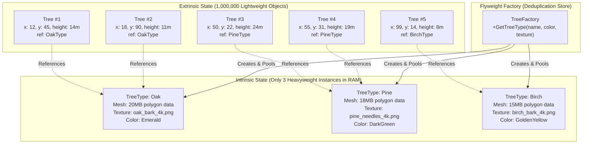

# Lesson 13: Flyweight

> **Prerequisites:** [Facade](../12-facade/README.md) and [Track 25 Overview](../README.md).  
> **Estimated Reading Time:** 17 minutes  
> **Target Audience:** Engineers preparing for LLD, OOP, C#, or Python technical screening and architecture rounds.

> [!NOTE]
> **In one line:** **Flyweight** saves memory by sharing the *intrinsic* (immutable, repeated) state across many objects and passing the *extrinsic* (per-use) state in from outside.

> [!TIP]
> **The One Rule of the Flyweight Pattern:** Separate invariant, shareable state (**intrinsic**) from variable, contextual state (**extrinsic**). A flyweight object stores *only* intrinsic state and remains strictly immutable; callers pass the extrinsic context into methods at invocation time. If a flyweight ever mutates its internal state or directly owns context-dependent coordinates, it corrupts reference sharing across all consumers.

---

## 1. Why This Matters: The Interview Trap

"What is the Flyweight pattern, and how does it differ from a Cache or Singleton?" is an architectural question designed to test whether an engineer understands memory layout, object allocation costs, and the boundary between object identity and execution context.

### The Interview Trap

Candidates often give superficial, hand-waving answers:
> *"Flyweight is just caching objects in a dictionary so you don't instantiate new ones every time, like keeping game sprites in a hash table."*

Interviewers immediately counter:
*"If it's just a dictionary cache, why did the Gang of Four give it a distinct name? How does it differ from an Object Pool or a Singleton? What happens if two threads render different game entities that share the same Flyweight at different coordinates at the exact same millisecond?"*

A senior engineer answers with crisp architectural precision:

> *"The **Flyweight pattern** is a structural optimization pattern whose sole purpose is **minimizing memory consumption and garbage collection pressure** when an application must support millions of fine-grained objects.*  
>  
> *It achieves this by bifurcating an object's state into two distinct categories:*  
> 1. ***Intrinsic State:*** *Heavyweight, invariant, context-independent data that does not change across instances (e.g., textures, geometry meshes, font metrics, sound clips). This state lives inside immutable, shared Flyweight instances.*  
> 2. ***Extrinsic State:*** *Lightweight, context-dependent data that varies per occurrence (e.g., coordinates $(x, y)$, current velocity, health, scale, selection range). This state is stored outside the flyweight—either in tiny context wrapper objects or passed dynamically into flyweight methods by the caller.*  
>  
> *Taxonomic distinctions clarify why Flyweight is not just 'caching':*  
> - ***Flyweight vs. Singleton:*** *A Singleton enforces exactly **one instance** per application or DI container. A Flyweight system manages **many flyweight instances** (one per unique intrinsic combination, such as 5 tree types or 26 alphabet glyphs).*  
> - ***Flyweight vs. Object Pool:*** *An **Object Pool** loans mutable instances for **exclusive use** by one consumer at a time; when finished, the consumer returns it to the pool. A **Flyweight** is shared **concurrently and non-exclusively** across thousands of consumers simultaneously because it is strictly immutable.*  
> - ***Flyweight vs. General Cache:*** *A cache typically stores entire computation results or complete standalone domain models. A flyweight is an incomplete structural slice of an object that cannot function without external context passed in at runtime."*

### Memory Explosion Without Flyweight

Consider a massive open-world video game rendering an ancient forest with 1,000,000 trees. Each naive `Tree` object contains:
- Mesh 3D geometry buffer (2 MB)
- 4K bark and leaf textures (16 MB)
- Shading parameters and audio wind rustle clips (2 MB)
- Coordinates `(x, y, z)` and scale (32 bytes)

If you instantiate 1,000,000 naive `Tree` objects:
$$\text{Memory} \approx 1{,}000{,}000 \times 20\text{ MB} = 20{,}000{,}000\text{ MB} = 20\text{ TB RAM}$$

The machine crashes immediately with an out-of-memory exception.

With the **Flyweight pattern**, the 20 MB of mesh, texture, and audio data is encapsulated in a single immutable `TreeType` flyweight. If the forest contains only 4 tree species (Oak, Pine, Birch, Willow):
- 4 `TreeType` flyweights = $4 \times 20\text{ MB} = 80\text{ MB}$
- 1,000,000 `Tree` contexts holding only `(x, y, z, scale)` and a 64-bit reference pointer = $1{,}000{,}000 \times 40\text{ bytes} \approx 40\text{ MB}$
- **Total Memory:** $\approx 120\text{ MB}$ (a $99.999\%$ memory reduction).

---

## 2. Visual Mental Model / Taxonomic Comparison

### Flyweight Memory Sharing Architecture

Flyweights are created and managed by a centralized factory. Client contexts hold coordinates and a reference pointer to the shared flyweight.



### Decision Matrix: Flyweight vs. Object Pool vs. Singleton vs. Prototype vs. Value Object

| Architectural Dimension | Flyweight | Object Pool | Singleton | Prototype | Value Object (DDD) |
| :--- | :--- | :--- | :--- | :--- | :--- |
| **Primary Intent** | Reduce memory by sharing immutable intrinsic state | Reduce allocation latency by reusing expensive mutable objects | Ensure exactly one global instance exists | Create new objects by cloning a template | Encapsulate descriptive values without identity |
| **Cardinality** | One instance per unique intrinsic state permutation | Fixed pool of $N$ interchangeable instances | Exactly one instance per application/process | Unbounded new clones | Unbounded immutable values |
| **Mutability** | **Strictly Immutable** | **Mutable** (reset between checkouts) | Mutable or Immutable | Mutable after cloning | **Strictly Immutable** |
| **Sharing Model** | **Concurrent & non-exclusive** (thousands share at once) | **Exclusive checkout** (one consumer at a time) | **Concurrent access** | Independent distinct instances | Independent instances compared by value |
| **Context State** | Extrinsic state passed into methods | State re-initialized on lease | State owned by singleton | State owned by clone | State encapsulated entirely |

---

## 3. Code Implementation: The Forest Landscape Renderer

Let us build a landscape forest simulation:
- **Flyweight:** `TreeType` holding intrinsic species data (`Name`, `Color`, `Texture`).
- **Flyweight Factory:** `TreeFactory` ensuring identical intrinsic combinations return the identical heap reference.
- **Context:** `Tree` holding extrinsic coordinates (`x`, `y`, `height`) and delegating rendering to the flyweight.
- **Client:** `Forest` managing millions of trees across terrain coordinates.

````carousel
```python
from typing import Dict, List


class TreeType:
    """Flyweight: Stores intrinsic state shared across thousands of trees.
    
    This class must remain strictly immutable after construction.
    """
    def __init__(self, name: str, color: str, texture: str) -> None:
        self.name = name
        self.color = color
        self.texture = texture

    def render(self, x: int, y: int, height: float, wind_sway: float) -> None:
        """Draw tree using intrinsic state combined with extrinsic context."""
        effective_sway = round(wind_sway * (height / 10.0), 2)
        print(f"[{self.name}] Color: {self.color}, Texture: {self.texture} -> "
              f"Position: ({x}, {y}), Height: {height:.1f}m, Sway: {effective_sway:+.2f}deg")


class TreeFactory:
    """Flyweight Factory: Ensures identical intrinsic states share references."""
    _tree_types: Dict[str, TreeType] = {}

    @classmethod
    def get_tree_type(cls, name: str, color: str, texture: str) -> TreeType:
        key = f"{name}_{color}_{texture}"
        if key not in cls._tree_types:
            print(f"Factory: Creating new TreeType flyweight: {key}")
            cls._tree_types[key] = TreeType(name, color, texture)
        return cls._tree_types[key]

    @classmethod
    def total_flyweights(cls) -> int:
        return len(cls._tree_types)


class Tree:
    """Context: Stores extrinsic state (coordinates, height) with reference to flyweight."""
    def __init__(self, x: int, y: int, height: float, tree_type: TreeType) -> None:
        self.x = x
        self.y = y
        self.height = height
        self.tree_type = tree_type

    def render(self, wind_sway: float) -> None:
        self.tree_type.render(self.x, self.y, self.height, wind_sway)


class Forest:
    """Client: Manages thousands of tree contexts."""
    def __init__(self) -> None:
        self._trees: List[Tree] = []

    def plant_tree(self, x: int, y: int, height: float, name: str, color: str, texture: str) -> None:
        tree_type = TreeFactory.get_tree_type(name, color, texture)
        tree = Tree(x, y, height, tree_type)
        self._trees.append(tree)

    def render(self, wind_sway: float) -> None:
        for tree in self._trees:
            tree.render(wind_sway)

    def stats(self) -> None:
        print(f"Total trees planted: {len(self._trees)}")
        print(f"Unique TreeType flyweights in memory: {TreeFactory.total_flyweights()}")


if __name__ == "__main__":
    forest = Forest()

    # Planting trees across the landscape
    forest.plant_tree(10, 20, 15.0, "Oak", "ForestGreen", "oak_4k.png")
    forest.plant_tree(15, 25, 12.5, "Oak", "ForestGreen", "oak_4k.png")
    forest.plant_tree(50, 80, 22.0, "Pine", "DarkSlate", "pine_4k.png")
    forest.plant_tree(55, 85, 18.0, "Pine", "DarkSlate", "pine_4k.png")
    forest.plant_tree(100, 200, 8.5, "Birch", "GoldenYellow", "birch_4k.png")
    forest.plant_tree(105, 205, 9.0, "Birch", "GoldenYellow", "birch_4k.png")

    print("\n--- Rendering Forest at Wind Sway 2.5 deg ---")
    forest.render(2.5)

    print("\n--- Memory Allocation Statistics ---")
    forest.stats()
```
<!-- slide -->
```csharp
using System;
using System.Collections.Concurrent;
using System.Collections.Generic;

namespace FlyweightDemo;

/// <summary>
/// Flyweight: Stores intrinsic, immutable state shared across thousands of trees.
/// </summary>
public sealed class TreeType
{
    public string Name { get; }
    public string Color { get; }
    public string Texture { get; }

    public TreeType(string name, string color, string texture)
    {
        Name = name;
        Color = color;
        Texture = texture;
    }

    public void Render(int x, int y, double height, double windSway)
    {
        double effectiveSway = Math.Round(windSway * (height / 10.0), 2);
        Console.WriteLine($"[{Name}] Color: {Color}, Texture: {Texture} -> " +
                          $"Position: ({x}, {y}), Height: {height:F1}m, Sway: {effectiveSway:+0.00;-0.00;+0.00}deg");
    }
}

/// <summary>
/// Flyweight Factory: Ensures identical intrinsic states share references.
/// Thread-safe via ConcurrentDictionary.
/// </summary>
public static class TreeFactory
{
    private static readonly ConcurrentDictionary<string, TreeType> TreeTypes = new();

    public static TreeType GetTreeType(string name, string color, string texture)
    {
        string key = $"{name}_{color}_{texture}";
        return TreeTypes.GetOrAdd(key, k =>
        {
            Console.WriteLine($"Factory: Creating new TreeType flyweight: {k}");
            return new TreeType(name, color, texture);
        });
    }

    public static int TotalFlyweights => TreeTypes.Count;
}

/// <summary>
/// Context: Stores extrinsic state (coordinates, height) with reference to flyweight.
/// </summary>
public sealed class Tree
{
    private readonly int _x;
    private readonly int _y;
    private readonly double _height;
    private readonly TreeType _treeType;

    public Tree(int x, int y, double height, TreeType treeType)
    {
        _x = x;
        _y = y;
        _height = height;
        _treeType = treeType;
    }

    public void Render(double windSway)
    {
        _treeType.Render(_x, _y, _height, windSway);
    }
}

/// <summary>
/// Client: Manages thousands of tree contexts.
/// </summary>
public sealed class Forest
{
    private readonly List<Tree> _trees = new();

    public void PlantTree(int x, int y, double height, string name, string color, string texture)
    {
        TreeType treeType = TreeFactory.GetTreeType(name, color, texture);
        _trees.Add(new Tree(x, y, height, treeType));
    }

    public void Render(double windSway)
    {
        foreach (var tree in _trees)
        {
            tree.Render(windSway);
        }
    }

    public void Stats()
    {
        Console.WriteLine($"Total trees planted: {_trees.Count}");
        Console.WriteLine($"Unique TreeType flyweights in memory: {TreeFactory.TotalFlyweights}");
    }
}

public static class Program
{
    public static void Main()
    {
        var forest = new Forest();

        // Planting trees across the landscape
        forest.PlantTree(10, 20, 15.0, "Oak", "ForestGreen", "oak_4k.png");
        forest.PlantTree(15, 25, 12.5, "Oak", "ForestGreen", "oak_4k.png");
        forest.PlantTree(50, 80, 22.0, "Pine", "DarkSlate", "pine_4k.png");
        forest.PlantTree(55, 85, 18.0, "Pine", "DarkSlate", "pine_4k.png");
        forest.PlantTree(100, 200, 8.5, "Birch", "GoldenYellow", "birch_4k.png");
        forest.PlantTree(105, 205, 9.0, "Birch", "GoldenYellow", "birch_4k.png");

        Console.WriteLine("\n--- Rendering Forest at Wind Sway 2.5 deg ---");
        forest.Render(2.5);

        Console.WriteLine("\n--- Memory Allocation Statistics ---");
        forest.Stats();
    }
}
```
````

**Expected Output (Both Languages):**
```text
Factory: Creating new TreeType flyweight: Oak_ForestGreen_oak_4k.png
Factory: Creating new TreeType flyweight: Pine_DarkSlate_pine_4k.png
Factory: Creating new TreeType flyweight: Birch_GoldenYellow_birch_4k.png

--- Rendering Forest at Wind Sway 2.5 deg ---
[Oak] Color: ForestGreen, Texture: oak_4k.png -> Position: (10, 20), Height: 15.0m, Sway: +3.75deg
[Oak] Color: ForestGreen, Texture: oak_4k.png -> Position: (15, 25), Height: 12.5m, Sway: +3.12deg
[Pine] Color: DarkSlate, Texture: pine_4k.png -> Position: (50, 80), Height: 22.0m, Sway: +5.50deg
[Pine] Color: DarkSlate, Texture: pine_4k.png -> Position: (55, 85), Height: 18.0m, Sway: +4.50deg
[Birch] Color: GoldenYellow, Texture: birch_4k.png -> Position: (100, 200), Height: 8.5m, Sway: +2.12deg
[Birch] Color: GoldenYellow, Texture: birch_4k.png -> Position: (105, 205), Height: 9.0m, Sway: +2.25deg

--- Memory Allocation Statistics ---
Total trees planted: 6
Unique TreeType flyweights in memory: 3
```

---

## 4. Where You Already Use It

Flyweight is deeply embedded into modern runtimes, compilers, and rendering engines.

### 1. String Interning in .NET and Python
Strings are immutable reference types. Runtimes maintain an internal lookup table (an intern pool) to ensure identical string values share one heap allocation:

- **.NET CLR String Intern Pool:**
  - Literals declared in source code are automatically interned by the compiler into the assembly metadata table.
  - At runtime, `string.Intern(str)` queries the CLR intern table; if found, it returns the reference to the canonical interned string.
  - `string.IsInterned(str)` checks if a string is already registered without adding it.
  ```csharp
  string s1 = "hello_world";
  string s2 = new string("hello_world".ToCharArray());
  Console.WriteLine(object.ReferenceEquals(s1, s2)); // False (different heap objects)

  string s3 = string.Intern(s2);
  Console.WriteLine(object.ReferenceEquals(s1, s3)); // True (shares same flyweight)
  ```

- **Python String & Constant Interning:**
  - Python automatically interns string literals that resemble valid Python identifiers (ASCII letters, digits, underscores) during compilation into code object constants (`co_consts`).
  - Runtime strings can be explicitly interned using `sys.intern(s)` to speed up dictionary lookups (pointer equality check `is` instead of full byte-by-byte string comparison `==`).
  ```python
  import sys

  s1 = "backend_roadmap"
  s2 = "".join(["backend_", "roadmap"])
  print(s1 is s2)  # May be False depending on runtime allocation

  s3 = sys.intern(s2)
  print(s1 is s3)  # True (canonical flyweight reference)
  ```

### 2. Python Small-Integer Caching
CPython pre-allocates an array of integer objects for values in the range $[-5, 256]$ at startup. Any calculation or assignment resulting in an integer within this range returns a pointer to this pre-allocated flyweight array:
```python
x = 256
y = 256
print(x is y)  # True: exact same object reference

a = 257
b = 257
print(a is b)  # False: separate heap allocations (in interactive REPL)
```

### 3. .NET Canonical Singletons & Caches
- `Array.Empty<T>()`: Returns a single cached 0-length array allocation per type `T` rather than allocating a new empty array on the heap.
- `Task.CompletedTask`: A cached, pre-completed `Task` reference used across async methods to avoid heap allocation overhead when returning synchronously.
- `Task.FromResult<bool>(true)`: Runtimes cache the `Task<bool>` for `true` and `false`.

### 4. DirectWrite & Skia Text Shaping Engines
When rendering an entire book or web page with 500,000 characters, layout engines do not create 500,000 font glyph curves. The vector path, Bézier control points, and kerning metrics for each letter character ('A', 'e', 'g') are stored once as a flyweight. The rendering engine passes the $(x, y)$ screen coordinates, color, and font size as extrinsic state.

---

## 5. Pitfalls and When Not to Use It

### 1. Mutating Intrinsic State (Shared State Corruption)
The most catastrophic failure mode of the Flyweight pattern occurs when a developer adds a mutable setter to the Flyweight class. Because the Flyweight instance is shared across hundreds of thousands of independent contexts, changing a field on one instance changes it across the entire application simultaneously.
> **Rule:** Flyweight classes must be strictly immutable (`readonly` properties in C#, `@dataclass(frozen=True)` or private attributes without setters in Python).

### 2. Thread-Safety in the Flyweight Factory
In a multi-threaded application, multiple threads concurrently requesting a previously unseen flyweight key can cause a race condition, creating duplicate flyweight instances or corrupting the backing dictionary.
- In .NET: Always use `ConcurrentDictionary<TKey, TValue>` with `GetOrAdd()`, or `Lazy<T>`.
- In Python: Use a `threading.Lock` around dictionary mutations if flyweights are dynamically generated across thread pools.

### 3. Increased CPU Overhead vs. Memory Savings
Flyweight trades **CPU time for memory space**. Every operation requires:
1. Looking up or dereferencing the flyweight pointer.
2. Passing extrinsic parameters across method invocation boundaries.
3. Calculating composite values on the fly.

If your dataset easily fits within RAM (e.g., only 500 objects), introducing Flyweight adds unnecessary cognitive complexity and indirection without measurable benefit.

### 4. Poor CPU Cache Locality
Modern CPUs achieve peak throughput when sequential data resides contiguously in L1/L2 hardware cache lines (Data-Oriented Design / Struct-of-Arrays). Dereferencing references to shared flyweights scattered across heap memory can trigger CPU cache misses. In performance-critical game engines, developers often store coordinates in contiguous flat arrays (`float[] xs`, `float[] ys`) rather than OOP context wrappers.

---

## 6. Exercises & Practical Drills

### Exercise 1: Identify Intrinsic vs. Extrinsic State

You are designing a collaborative cloud document editor (like Google Docs) capable of displaying documents with 200,000 characters. Classify each of the following attributes as **Intrinsic (Flyweight)** or **Extrinsic (Context)**:

1. Unicode character code (`'A'`, `'#'`)
2. Screen coordinate `(x, y)`
3. Font typeface name (`"Roboto"`, `"Times New Roman"`)
4. Font style flags (`Bold`, `Italic`)
5. Character selection / highlight status (`is_selected: bool`)
6. Vector glyph outline curves (Bézier spline control points)
7. Line number and page index

<details>
<summary>Answer</summary>

- **Intrinsic (Flyweight):**
  - **1. Unicode character code:** Invariant across all identical letters.
  - **3. Font typeface name:** Shared across thousands of characters.
  - **4. Font style flags:** Invariant combination (`Roboto-Bold-12pt`).
  - **6. Vector glyph outline curves:** Heavyweight vector geometry, identical for every 'A' in that font.

- **Extrinsic (Context):**
  - **2. Screen coordinate `(x, y)`:** Unique to each letter's location on the page.
  - **5. Character selection / highlight status:** Changes dynamically based on user cursor drags.
  - **7. Line number and page index:** Specific to where that character flows in the current layout.
</details>

### Exercise 2: Diagnose the Concurrency Race Condition

Review the following Flyweight Factory implementation:

```csharp
public class TextFormatFactory
{
    private static readonly Dictionary<string, TextFormat> _cache = new();

    public static TextFormat GetFormat(string font, int size, bool bold)
    {
        string key = $"{font}_{size}_{bold}";
        if (!_cache.ContainsKey(key))
        {
            _cache[key] = new TextFormat(font, size, bold); // Point of failure
        }
        return _cache[key];
    }
}
```

Identify two concurrency bugs in this code under high-volume multi-threaded document parsing, and explain how to fix them.

<details>
<summary>Answer</summary>

**Bugs:**
1. **`Dictionary<TKey, TValue>` is not thread-safe for writes:** Concurrent calls to `_cache[key] = ...` can corrupt the internal bucket linked-lists of the dictionary, leading to infinite loops or `NullReferenceException` during reads.
2. **Check-then-Act Race Condition (Time-of-Check to Time-of-Use):** Between the `!_cache.ContainsKey(key)` check and the assignment, Thread 2 can preempt Thread 1 and create a format. Thread 1 resumes and creates a *second duplicate* instance, violating flyweight identity.

**Fix:**
Replace `Dictionary` with `ConcurrentDictionary<string, TextFormat>` and use `GetOrAdd`:
```csharp
public static class TextFormatFactory
{
    private static readonly ConcurrentDictionary<string, TextFormat> _cache = new();

    public static TextFormat GetFormat(string font, int size, bool bold)
    {
        string key = $"{font}_{size}_{bold}";
        return _cache.GetOrAdd(key, k => new TextFormat(font, size, bold));
    }
}
```
</details>

---

## 7. Interview Questions & Model Answers

<details>
<summary><strong>1. What is the Flyweight pattern? [BASIC]</strong></summary>

The Flyweight pattern is a Gang of Four structural design pattern whose primary purpose is to reduce memory footprint and garbage collection overhead by sharing common, invariant state across massive quantities of fine-grained objects.

It works by dividing an object's state into two parts:
1. **Intrinsic state:** Heavy, immutable, context-free data that is identical across multiple instances (such as textures, font metrics, or sprite definitions). This data is stored once inside the Flyweight object.
2. **Extrinsic state:** Light, context-dependent data that varies per occurrence (such as screen coordinates, velocity, or user selection status). This data is retained by client context objects or passed as parameters directly into the flyweight's methods.

A centralized Flyweight Factory manages the lifecycle of flyweights, caching created instances in a lookup table so that requests for existing intrinsic states return existing heap references rather than allocating new memory.

</details>

<details>
<summary><strong>2. What is string interning? [BASIC]</strong></summary>

String interning is a runtime-level implementation of the Flyweight pattern applied to immutable strings.

Because strings are immutable reference types, creating duplicate strings with identical character sequences wastes memory and slows down equality comparisons. Runtimes like the .NET CLR and Python's CPython maintain an internal hash table known as the String Intern Pool.

When a string is interned:
1. The runtime checks if an identical character array already exists in the intern pool.
2. If it does, the runtime discards the duplicate and returns a reference to the existing canonical string.
3. If it does not, the string is registered into the pool and retained for the process lifetime.

This provides two major performance advantages: it eliminates duplicate string heap allocations, and it enables $O(1)$ reference equality comparisons (`object.ReferenceEquals` in C#, `is` in Python) instead of $O(N)$ character-by-character scans.

</details>

<details>
<summary><strong>3. How does Flyweight differ from Object Pooling and Singleton? [BASIC]</strong></summary>

While all three patterns manage object instances to optimize performance, their structural constraints and usage semantics differ fundamentally:

1. **Flyweight vs. Object Pool:** An Object Pool manages a collection of **mutable** objects loaned out for **exclusive** use by one consumer at a time (e.g., database connections, network sockets, thread pool workers). The consumer mutates the pooled object and returns it when done. A Flyweight is **strictly immutable** and shared **concurrently and non-exclusively** by thousands of callers simultaneously without checking it out or returning it.
2. **Flyweight vs. Singleton:** A Singleton enforces that **exactly one** instance of a type exists in the entire application or DI container. A Flyweight system manages **multiple** distinct instances—one for every unique combination of intrinsic attributes (e.g., five tree species, ten particle types, or 128 ASCII glyph formats).
3. **Context Ownership:** Singletons and Pooled objects own all of their state. Flyweights own only intrinsic state and require callers to inject extrinsic contextual state at runtime.

</details>

<details>
<summary><strong>4. A map renders 2 million tiles but only 20 tile types exist. What do you do? [SCENARIO]</strong></summary>

Store 20 shared `TileType` flyweights (sprite, walkable) and keep only `(x, y, type_ref)` per tile. Memory drops from millions of sprites to millions of small references.

</details>

<details>
<summary><strong>5. Why must flyweights be immutable? [TRICKY]</strong></summary>

They are shared by many clients, so a mutation by one would silently change them all. Anything that varies per use must be passed in (extrinsic), not stored.

</details>

<details>
<summary><strong>6. Flyweight vs Object Pool? [BASIC]</strong></summary>

Flyweight shares one immutable instance among many users at once. A pool lends an exclusive mutable instance to one user at a time and takes it back.

</details>

---

## Try it

Run this: 1,000 glyphs reuse just a few shared style objects. Then redraw it in [LLD Studio](/tools/lld-studio/); the [track hub](../README.md) has the pattern-choice drills.

```python
class Style:                                     # intrinsic, immutable, shared
    def __init__(self, font, size): self.font, self.size = font, size

_cache = {}
def style(font, size):
    return _cache.setdefault((font, size), Style(font, size))

glyphs = [("a", style("Arial", 12), i) for i in range(1000)]   # (char, shared, x-position)
assert len({id(g[1]) for g in glyphs}) == 1
assert style("Arial", 12) is style("Arial", 12)
```

---

## One-page cheat sheet

```text
FLYWEIGHT  shared immutable INTRINSIC state + caller-supplied EXTRINSIC state
Factory/cache hands out shared instances (key -> flyweight)
Wins: memory when millions of similar objects (glyphs, tiles, particles)
Needs: immutability, thread safety on the cache
String interning = built-in flyweight (sys.intern, string.Intern)
Flyweight (share data) | Pool (reuse then release) | Singleton (exactly one)
Measure first: premature optimisation otherwise
```

---

## 8. Sources & Further Reading

- Gamma, E., Helm, R., Johnson, R., & Vlissides, J. (1994). *Design Patterns: Elements of Reusable Object-Oriented Software*. Addison-Wesley.
- [Microsoft Learn: String.Intern Method (System)](https://learn.microsoft.com/en-us/dotnet/api/system.string.intern)
- [Microsoft Learn: String.IsInterned Method (System)](https://learn.microsoft.com/en-us/dotnet/api/system.string.isinterned)
- [Python 3 Documentation: sys.intern()](https://docs.python.org/3/library/sys.html#sys.intern)
- [CPython Internal Source: Objects/longobject.c (Small Integer Cache)](https://github.com/python/cpython/blob/main/Objects/longobject.c)
- [Refactoring.Guru: Flyweight Design Pattern](https://refactoring.guru/design-patterns/flyweight)

---

Previous: [Facade](../12-facade/README.md) · Next: [Proxy](../14-proxy/README.md)
