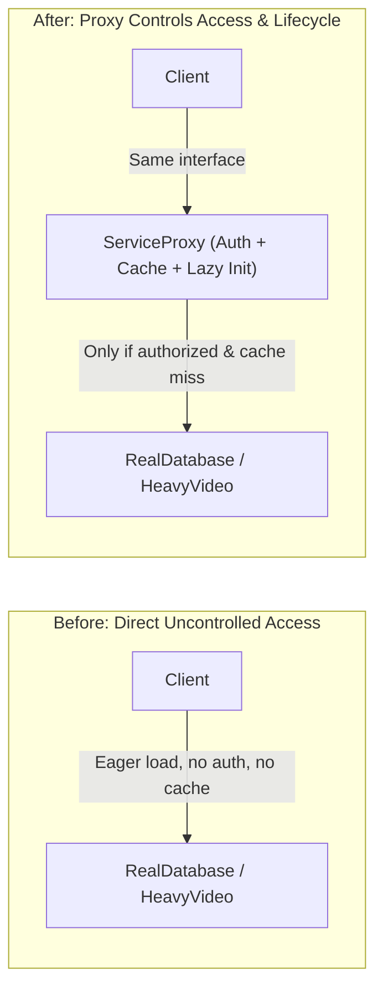
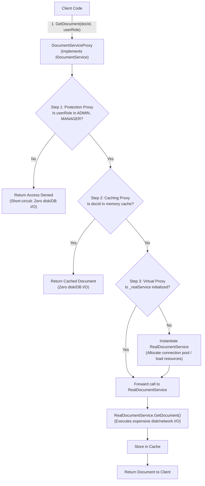

# Lesson 14: Proxy

> **Prerequisites:** [Flyweight](../13-flyweight/README.md) and [Track 25 Overview](../README.md).  
> **Estimated Reading Time:** 18 minutes  
> **Target Audience:** Engineers preparing for LLD, OOP, C#, or Python technical screening and architecture rounds.

> [!NOTE]
> **In one line:** **Proxy** is a stand-in with the same interface that *controls access* to the real object — lazy loading (virtual), access checks (protection), remote calls (remote), caching.

> [!TIP]
> **The One Rule of the Proxy Pattern:** A Proxy is a **surrogate or placeholder** that implements the **exact same interface** as the target object to **control access** to it (such as lazy instantiation, role-based authorization, memoized caching, or network boundary serialization). While a **Decorator** enhances an already existing object provided by the caller, a **Proxy** controls *whether, when, and how* the real subject is created and accessed.

---

## 1. Why This Matters: The Interview Trap

"What is the Proxy pattern, how does it differ from a Decorator, and how do ORMs use it for lazy loading?" is one of the most frequent senior architecture interview questions.

### The Interview Trap

Candidates often reduce Proxy to:
> *"A Proxy is a wrapper class that sits in front of another object to do caching, logging, or security checks. It's essentially the same as a Decorator."*

This response immediately triggers deeper probing from interviewers. Saying a Proxy is "the same as a Decorator" demonstrates a failure to grasp **object lifecycle control and architectural intent**.

A senior engineer answers with precision:

> *"While both Proxy and Decorator implement the exact same interface as the wrapped subject, their **architectural intent and lifecycle ownership** are fundamentally different:*  
>  
> - ***Lifecycle Ownership:*** A **Decorator** is given an *already instantiated* object by the client; it never controls *if* or *when* the core object exists. Its sole purpose is additive behavior. A **Proxy** *controls the lifecycle and access* to the real subject. The real subject might not even exist yet (Virtual Proxy instantiates it on demand), might exist on a remote server across an RPC boundary (Remote Proxy), or access might be denied entirely without the real subject ever being called (Protection Proxy).*  
> - ***Relationship with the Client:*** With a Decorator, the client consciously composes layers: `new Logging(new Encrypting(new Service()))`. With a Proxy, the client typically doesn't know (or care) that a surrogate is involved; the client simply requests an `IDocumentService` and receives a proxy that transparently defers disk reads or enforces security.*  
> - ***ORMs and Lazy Loading:*** Frameworks like EF Core and SQLAlchemy substitute database entities with dynamic proxies (subclasses generated at runtime). When your code accesses a navigation property like `order.Customer.Name`, the proxy's getter intercepts execution, discovers that the customer reference is uninitialized, fires a SQL `SELECT` to fetch the record just in time, attaches the data, and returns the property transparently.*  
> - ***The Failure Mode:*** The biggest trap of proxy-based lazy loading is the **N+1 query disaster**: iterating through $N$ records and touching a proxy property produces 1 initial query plus $N$ individual network round-trips to the database."*

---

## 1A. The Visual Story: Problem -> Analogy -> Solution

### The Problem (Why Naive Code Explodes)

Suppose your dashboard lists 500 high-resolution 4K medical scans or gigabyte-sized video files, and your service eagerly instantiates every `HeavyVideoFile` and opens a database connection on startup—even though the user only clicks on 2 of them. Startup takes 45 seconds, RAM spikes immediately, and worse: because callers talk directly to the real database service, there is no central gatekeeper to enforce role-based access checks or cache repeated reads.

### Real-World Analogy

Think of a **credit card** as a proxy for **cash in your bank vault**. Both implement the exact same "pay at checkout" interface. However, you don't carry a suitcase of physical bills everywhere: the credit card acts as a stand-in that verifies your identity (PIN/fraud check), logs the purchase, and only settles with the real bank vault when the transaction is actually authorized.

### Visual Problem -> Solution Diagram



### Applicability & Pattern Relations

- **Use when** you need **lazy initialization** (Virtual Proxy) so heavyweight objects are only created when actually used.
- **Use when** you need **access control** (Protection Proxy), **caching** (Caching Proxy), or **audit logging** without modifying the real service's code.
- **Use when** you want **location transparency** (Remote Proxy) so calling a remote gRPC/RPC service looks like a local method call.
- **Relations with Other Patterns:**
  - **Decorator:** Receives an *already created* object from the caller to add behavior; **Proxy** *owns and controls* the lifecycle (creation, deferral, or rejection) of the real subject.
  - **Adapter:** Changes the interface to match what the client expects; **Proxy** keeps the *exact same* interface.
  - **Facade:** Simplifies *many* subsystem classes behind a new interface; **Proxy** stands in for *one* subject with the same interface.

---

## 2. Visual Mental Model / Taxonomic Comparison

### The Multi-Faceted Proxy Workflow

A single Proxy can combine multiple protective responsibilities before touching the expensive, heavy subject.



### Taxonomy: The 5 Primary Kinds of Proxies

| Proxy Type | Core Purpose | Concrete Production Scenario |
| :--- | :--- | :--- |
| **Virtual Proxy** | **Lazy Initialization**: Defers the creation of expensive objects (heavy memory, large I/O, slow startup) until first invoked. | ORM navigation properties (EF Core / Hibernate / SQLAlchemy); High-resolution image placeholders in UI grids. |
| **Protection Proxy** | **Access Control**: Validates user credentials, role permissions (RBAC), or tenancy boundaries before permitting execution. | Healthcare record service verifying doctor credentials; Multi-tenant data segregation layer. |
| **Remote Proxy** | **Location Transparency**: Marshals method arguments across process or network boundaries (IPC, gRPC, RPC). | gRPC client stubs generated from `.proto` files; WCF service channels. |
| **Caching Proxy** | **Memoization**: Stores idempotent results in local memory or Redis to eliminate redundant computation or external calls. | API rate-limiting gateway caching HTTP `GET` responses; Database query caching proxies. |
| **Smart Reference Proxy** | **Bookkeeping & Auditing**: Executes administrative bookkeeping whenever an object is referenced. | Reference-counting smart pointers (`std::shared_ptr`); Thread-synchronization locks; Access audit loggers. |

### Comparison Matrix: Proxy vs. Decorator vs. Adapter vs. Facade

| Dimension | Proxy | Decorator | Adapter | Facade |
| :--- | :--- | :--- | :--- | :--- |
| **Interface Match** | **Exact same** interface as real subject | **Exact same** interface as component | Converts to an **expected existing** interface | Brand-new **simplified** high-level interface |
| **Lifecycle Ownership** | **Controls** creation, deferral, or rejection of subject | **Receives** already existing subject from caller | Wraps existing adaptee passed into it | Instantiates or aggregates entire subsystem |
| **Primary Intent** | Access control, lifecycle, caching, network boundary | Dynamically add features/responsibilities | Interface compatibility and translation | Complexity reduction and convenience |
| **Client Knowledge** | Often transparent (client thinks it's the real thing) | Explicit composition by client | Explicit wrapping by client or DI container | Explicitly invoked as the high-level doorway |

---

## 3. Code Implementation: The Transparent Document Gateway

Let us build a comprehensive Document Service illustrating three proxy archetypes in one:
1. **Protection Proxy:** Blocks unauthorized roles before touching resources.
2. **Virtual Proxy:** Defers the heavy connection initialization of `RealDocumentService` until the first authorized request.
3. **Caching Proxy:** Memoizes retrieved document content in memory to eliminate redundant disk reads.

````carousel
```python
from abc import ABC, abstractmethod
from typing import Optional


# 1. SHARED SUBJECT CONTRACT
class IDocumentService(ABC):

  @abstractmethod
  def get_document(self, doc_id: str, user_role: str) -> str:
    """Retrieves document contents based on user authorization."""
    pass


# 2. REAL SUBJECT (Heavy, resource-intensive, expensive)
class RealDocumentService(IDocumentService):

  def __init__(self) -> None:
    # Simulates expensive connection setup, memory buffers, or cold-start overhead
    print("[RealDocumentService] Initialized heavy storage connection.")

  def get_document(self, doc_id: str, user_role: str) -> str:
    print(
        f"[Disk I/O] Loading document '{doc_id}' from encrypted disk"
        " storage..."
    )
    return f"Contents of {doc_id}: Classified System Architecture Specs"


# 3. PROXY (Combines Protection, Virtual, and Caching Proxies)
class DocumentServiceProxy(IDocumentService):

  def __init__(self) -> None:
    # Notice: RealDocumentService is NOT initialized at proxy instantiation time!
    self._real_service: Optional[RealDocumentService] = None
    self._cache: dict[str, str] = {}

  def get_document(self, doc_id: str, user_role: str) -> str:
    # 1. PROTECTION PROXY: Verify authorization before doing anything
    if user_role not in ("ADMIN", "MANAGER"):
      print(
          f"[Security] Access DENIED for role '{user_role}' requesting"
          f" '{doc_id}'"
      )
      return f"Error: Unauthorized access to {doc_id}"

    # 2. CACHING PROXY: Serve from cache if already retrieved
    if doc_id in self._cache:
      print(f"[Cache] HIT for document '{doc_id}'")
      return self._cache[doc_id]

    # 3. VIRTUAL PROXY: Defer heavy initialization until first authorized, uncached call
    if self._real_service is None:
      print("[Virtual Proxy] Instantiating RealDocumentService on demand...")
      self._real_service = RealDocumentService()

    # 4. Delegate to real subject and cache result
    content = self._real_service.get_document(doc_id, user_role)
    self._cache[doc_id] = content
    return content


if __name__ == "__main__":
  proxy: IDocumentService = DocumentServiceProxy()

  print("--- Request 1: Unauthorized Guest ---")
  print(proxy.get_document("DOC-101", "GUEST"))

  print("\n--- Request 2: Authorized Manager (Cache Miss, Lazy Load) ---")
  print(proxy.get_document("DOC-101", "MANAGER"))

  print("\n--- Request 3: Authorized Admin (Cache Hit) ---")
  print(proxy.get_document("DOC-101", "ADMIN"))
```
<!-- slide -->
```csharp
using System;
using System.Collections.Generic;

// 1. SHARED SUBJECT CONTRACT
public interface IDocumentService
{
    string GetDocument(string docId, string userRole);
}

// 2. REAL SUBJECT (Heavy, resource-intensive, expensive)
public class RealDocumentService : IDocumentService
{
    public RealDocumentService()
    {
        // Simulates expensive connection setup, memory buffers, or cold-start overhead
        Console.WriteLine("[RealDocumentService] Initialized heavy storage connection.");
    }

    public string GetDocument(string docId, string userRole)
    {
        Console.WriteLine($"[Disk I/O] Loading document '{docId}' from encrypted disk storage...");
        return $"Contents of {docId}: Classified System Architecture Specs";
    }
}

// 3. PROXY (Combines Protection, Virtual, and Caching Proxies)
public class DocumentServiceProxy : IDocumentService
{
    // Notice: RealDocumentService is NOT initialized at proxy instantiation time!
    private RealDocumentService? _realService;
    private readonly Dictionary<string, string> _cache = new();

    public string GetDocument(string docId, string userRole)
    {
        // 1. PROTECTION PROXY: Verify authorization before doing anything
        if (userRole != "ADMIN" && userRole != "MANAGER")
        {
            Console.WriteLine($"[Security] Access DENIED for role '{userRole}' requesting '{docId}'");
            return $"Error: Unauthorized access to {docId}";
        }

        // 2. CACHING PROXY: Serve from cache if already retrieved
        if (_cache.TryGetValue(docId, out string? cachedContent))
        {
            Console.WriteLine($"[Cache] HIT for document '{docId}'");
            return cachedContent;
        }

        // 3. VIRTUAL PROXY: Defer heavy initialization until first authorized, uncached call
        if (_realService == null)
        {
            Console.WriteLine("[Virtual Proxy] Instantiating RealDocumentService on demand...");
            _realService = new RealDocumentService();
        }

        // 4. Delegate to real subject and cache result
        string content = _realService.GetDocument(docId, userRole);
        _cache[docId] = content;
        return content;
    }
}

public class Program
{
    public static void Main()
    {
        IDocumentService proxy = new DocumentServiceProxy();

        Console.WriteLine("--- Request 1: Unauthorized Guest ---");
        Console.WriteLine(proxy.GetDocument("DOC-101", "GUEST"));

        Console.WriteLine("\n--- Request 2: Authorized Manager (Cache Miss, Lazy Load) ---");
        Console.WriteLine(proxy.GetDocument("DOC-101", "MANAGER"));

        Console.WriteLine("\n--- Request 3: Authorized Admin (Cache Hit) ---");
        Console.WriteLine(proxy.GetDocument("DOC-101", "ADMIN"));
    }
}
```
````

**Expected Output (Both Languages):**

```text
--- Request 1: Unauthorized Guest ---
[Security] Access DENIED for role 'GUEST' requesting 'DOC-101'
Error: Unauthorized access to DOC-101

--- Request 2: Authorized Manager (Cache Miss, Lazy Load) ---
[Virtual Proxy] Instantiating RealDocumentService on demand...
[RealDocumentService] Initialized heavy storage connection.
[Disk I/O] Loading document 'DOC-101' from encrypted disk storage...
Contents of DOC-101: Classified System Architecture Specs

--- Request 3: Authorized Admin (Cache Hit) ---
[Cache] HIT for document 'DOC-101'
Contents of DOC-101: Classified System Architecture Specs
```

---

## 3A. Where It Is Used, Why It Exists & Progressive Buildup

### Where It Is Used (Real-World Systems & LLD Interviews)

| Domain / Ecosystem | Concrete Real-World Usage | LLD Interview Problem Where You Use It |
| :--- | :--- | :--- |
| **.NET** | EF Core `UseLazyLoadingProxies()`, Castle DynamicProxy / Moq, gRPC `ClientBase<T>`, `DispatchProxy` | Rate-Limiting API Gateway, Lazy-Loading Media Gallery |
| **Python** | `unittest.mock.MagicMock`, SQLAlchemy `lazy="select"`, `weakref.proxy`, `multiprocessing.managers` | RBAC Document Vault, Caching Query Proxy |
| **Go** | `net/http/httputil.ReverseProxy`, gRPC `ClientConn` stubs, generated mock/interceptor wrappers | Reverse Proxy / Load Balancer, Circuit-Breaking RPC Client |
| **TypeScript** | ES6 `new Proxy(target, handler)`, Vue 3 reactivity system, MobX observables, tRPC client proxies | Reactive State Store, Permission-Guarded Admin Service |

### Why It Is Used — The Step-by-Step Buildup (Before -> Pain -> Pattern)

#### Stage 0: Naive Code (Direct Instantiation & Unchecked Access)
A report controller directly instantiates and calls a heavy database-backed report generator:

```python
class HeavyReportGenerator:
    def __init__(self, db_dsn: str) -> None:
        self._conn = f"Connected({db_dsn})"  # Expensive startup

    def generate(self, report_id: str, user_role: str) -> str:
        return f"Financial Report {report_id}"

def handle_request(report_id: str, role: str) -> str:
    svc = HeavyReportGenerator("postgres://prod-db")
    return svc.generate(report_id, role)
```

#### What Breaks as Requirements Grow
- **Requirement 2 arrives ("Only `FINANCE` or `ADMIN` roles may view financial reports; reject others with zero DB connections opened"):** In Stage 0, `HeavyReportGenerator(...)` already opens the DB connection before checking permissions, or every caller has to duplicate `if role not in ...` checks before instantiating `HeavyReportGenerator`.
- **Requirement 3 arrives ("Repeated requests for the same `report_id` within 60s must not hit the database, and callers must not change"):** Adding caching and lazy connection creation directly inside `HeavyReportGenerator` violates Single Responsibility and mixes infrastructure concerns (auth, TTL cache, lazy init) into core report generation.

#### Step-by-Step Refactoring into Proxy
1. **Extract a shared interface** (`ReportService`) implemented by both `HeavyReportGenerator` and `ReportServiceProxy`.
2. **Move lifecycle ownership into the Proxy:** `ReportServiceProxy` holds `None` initially instead of opening a DB connection on startup (Virtual Proxy).
3. **Gate and memoize in `generate()`:** Check `role` first (Protection Proxy), check the in-memory cache second (Caching Proxy), and only instantiate `HeavyReportGenerator` on the first authorized cache miss.

### Progressive Real-World Examples (More & More Typical Use Cases)

#### Example A: Simple Core — Virtual Proxy for Lazy Image Loading
A gallery loads 500 image thumbnails; high-resolution bitmaps are only decoded from disk when `render()` is actually called:

```python
class HighResImage:
    def __init__(self, path: str) -> None:
        self._path = path
        self._pixels = f"<loaded 24MB from {path}>"

    def render(self) -> str:
        return self._pixels

class LazyImageProxy:
    def __init__(self, path: str) -> None:
        self._path = path
        self._real: HighResImage | None = None

    def render(self) -> str:
        if self._real is None:
            self._real = HighResImage(self._path)
        return self._real.render()
```

#### Example B: Production Backend — Rate-Limiting & Caching Proxy for External APIs
In a backend service calling a costly third-party geolocation or LLM API, a proxy enforces per-tenant rate limits and caches identical lookups behind the same `GeoClient` interface:

```python
import time

class CachingRateLimitGeoProxy:
    def __init__(self, real_client, max_rpm: int = 60) -> None:
        self._real = real_client
        self._max_rpm = max_rpm
        self._cache: dict[str, str] = {}
        self._calls: list[float] = []

    def lookup_city(self, ip: str) -> str:
        if ip in self._cache:
            return self._cache[ip]
        now = time.monotonic()
        self._calls = [t for t in self._calls if now - t < 60.0]
        if len(self._calls) >= self._max_rpm:
            raise RuntimeError("429 Too Many Requests: upstream quota protected")
        self._calls.append(now)
        self._cache[ip] = self._real.lookup_city(ip)
        return self._cache[ip]
```

#### Example C: Classic LLD Interview Problem — Protection + Audit Proxy for a Banking Vault
In a "Design a Banking System / Role-Based File Vault" LLD interview, interviewers ask how to enforce RBAC and immutable audit trails without modifying the legacy `AccountLedger` class:

```python
class AccountLedger:
    def withdraw(self, account_id: str, amount: float, actor_role: str) -> str:
        return f"Withdrew ${amount:.2f} from {account_id}"

class ProtectedLedgerProxy:
    def __init__(self, ledger: AccountLedger, audit_log: list[str]) -> None:
        self._ledger = ledger
        self._audit = audit_log

    def withdraw(self, account_id: str, amount: float, actor_role: str) -> str:
        if actor_role not in ("TELLER", "MANAGER"):
            self._audit.append(f"DENIED:{actor_role}:{account_id}:{amount}")
            raise PermissionError("Insufficient privileges for withdrawal")
        if amount > 10_000 and actor_role != "MANAGER":
            raise PermissionError("Manager approval required above $10,000")
        result = self._ledger.withdraw(account_id, amount, actor_role)
        self._audit.append(f"OK:{actor_role}:{account_id}:{amount}")
        return result
```

---

## 4. Where You Already Use It

### In .NET / C#

1. **Entity Framework Core Lazy-Loading Proxies:**
   - Package: `Microsoft.EntityFrameworkCore.Proxies`.
   - When configured with `options.UseLazyLoadingProxies()`, EF Core emits runtime dynamic proxy subclasses (using Castle.Core) for every entity with `virtual` navigation properties:
     ```csharp
     public class Order
     {
         public int Id { get; set; }
         public virtual Customer Customer { get; set; } // Intercepted by Virtual Proxy!
     }
     ```
   - When you access `order.Customer`, the proxy intercepts the getter, executes SQL to fetch the customer if null, and populates it seamlessly.
2. **Castle DynamicProxy (Interceptors and Mocking):**
   - The engine powering mocking libraries like **Moq** (`Mock<T>.Object`), AOP interception, and Autofac dynamic decorators. It emits proxy classes that intercept method calls via `IInterceptor`.
3. **gRPC and WCF Client Stubs:**
   - Generated client classes (e.g., `BillingServiceClient`) act as **Remote Proxies**: they implement the service contract interface locally, but serialize requests into Protobuf and send them over HTTP/2 sockets.

### In Python

1. **`unittest.mock.MagicMock`:**
   - Python's standard mocking framework uses dynamic proxies driven by `__getattr__` and `__call__`. Any method called on a `MagicMock` is dynamically recorded and intercepted without a real implementation existing.
2. **SQLAlchemy Lazy Relationships:**
   - Specifying `relationship("Address", lazy="select")` instructs SQLAlchemy to wrap the relationship in an instrumentation descriptor (proxy) that triggers an SQL query upon attribute access.
3. **`multiprocessing.managers.SyncManager` / `BaseProxy`:**
   - Used for inter-process communication (IPC). When sharing a list or dictionary across OS process boundaries (`manager.list()`), Python returns a proxy object that marshals calls across IPC pipes to the manager process holding the real collection.
4. **`weakref.proxy`:**
   - Creates a weak reference proxy that acts like the referent object without preventing garbage collection. If the referent is collected, any subsequent proxy access raises `ReferenceError`.

---

## 5. Pitfalls and When Not to Use It

1. **The N+1 Query Disaster:**
   - The primary hazard of Virtual Proxies in data layers:
     ```python
     # 1 query to fetch 100 orders
     orders = db.query(Order).limit(100).all()

     # Each iteration accesses order.customer (Virtual Proxy), firing 100 extra queries!
     for order in orders:
       print(order.customer.name)  # Total: 101 database round-trips!
```
   - *Fix:* Use **eager loading** (`.Include(o => o.Customer)` in EF Core or `joinedload(Order.customer)` in SQLAlchemy) to fetch related entities in a single `JOIN`.
2. **Reference Equality Breaks (`proxy != realSubject`):**
   - In languages like C# and Java, `object.ReferenceEquals(proxy, realSubject)` evaluates to `false`. Code that relies on pointer equality or checks `GetType()` instead of checking interface types will fail unexpectedly.
3. **Serialization and JSON Disasters:**
   - Passing an ORM dynamic proxy directly to `System.Text.Json` or `json.dumps()` frequently triggers infinite recursion (circular navigation properties) or crashes trying to serialize database connection handles attached to the proxy interceptor.
   - *Fix:* Always project entities into clean DTOs (Data Transfer Objects) before serialization.
4. **Concurrency and Double-Checked Locking in Virtual Proxies:**
   - In multi-threaded environments, if two threads invoke `proxy.GetDocument()` simultaneously while `_realService` is null, both may attempt to instantiate the heavy resource concurrently. Virtual proxies in production must use double-checked locking or `Lazy<T>`.

---

## 6. Exercises & Practical Drills

### Exercise 1: Proxy or Decorator?

Examine the following two class definitions and classify each as either a **Proxy** or a **Decorator**, explaining your reasoning:

```csharp
// Class A
public class MeteredPaymentService : IPaymentService
{
    private readonly IPaymentService _service;
    private readonly IMetricsClient _metrics;

    public MeteredPaymentService(IPaymentService service, IMetricsClient metrics)
    {
        _service = service;
        _metrics = metrics;
    }

    public async Task ProcessAsync(decimal amount)
    {
        var timer = Stopwatch.StartNew();
        await _service.ProcessAsync(amount);
        _metrics.Record("payment_duration_ms", timer.ElapsedMilliseconds);
    }
}

// Class B
public class LazyPaymentService : IPaymentService
{
    private IPaymentService? _realService;
    private readonly string _connectionString;

    public LazyPaymentService(string connectionString)
    {
        _connectionString = connectionString;
    }

    public async Task ProcessAsync(decimal amount)
    {
        _realService ??= new HeavyPaymentService(_connectionString);
        await _realService.ProcessAsync(amount);
    }
}
```

<details>
<summary>Answer</summary>

- **Class A is a Decorator:** It accepts an already instantiated `IPaymentService` instance in its constructor and adds an orthogonal cross-cutting behavior (metrics collection). It does not govern access or manage the lifetime of the service.
- **Class B is a Proxy (Virtual Proxy):** It does not accept an existing service instance in its constructor; instead, it accepts configuration (`connectionString`) and completely manages the creation and lifecycle of the `HeavyPaymentService`, deferring its instantiation until `ProcessAsync` is invoked for the first time.
</details>

### Exercise 2: Diagnose and Fix the N+1 Lazy Loading Trap

You discover the following endpoint taking 3.5 seconds to return 200 orders:

```csharp
// C# / EF Core
[HttpGet("recent")]
public IActionResult GetRecentOrders()
{
    // Lazy loading is enabled globally
    var orders = _context.Orders.OrderByDescending(o => o.CreatedAt).Take(200).ToList();

    var results = orders.Select(o => new
    {
        OrderId = o.Id,
        CustomerName = o.Customer.FullName, // Virtual proxy triggers SQL query per order!
        ShippingCity = o.ShippingAddress.City // Another virtual proxy query!
    }).ToList();

    return Ok(results);
}
```
Explain the query execution pattern and rewrite the query using eager loading to eliminate the N+1 problem.

<details>
<summary>Answer</summary>

**Execution Pattern:**
1 query to fetch the 200 `Orders`, followed by 200 queries to fetch each `Customer`, plus 200 queries to fetch each `ShippingAddress`. Total: $1 + 200 + 200 = 401$ separate database network round-trips!

**Fix (Eager Loading with `Include`):**
```csharp
[HttpGet("recent")]
public IActionResult GetRecentOrders()
{
    var results = _context.Orders
        .OrderByDescending(o => o.CreatedAt)
        .Take(200)
        .Select(o => new
        {
            OrderId = o.Id,
            CustomerName = o.Customer.FullName,
            ShippingCity = o.ShippingAddress.City
        })
        .ToList();

    return Ok(results);
}
```
*Note:* Using `.Select(...)` directly into an anonymous projection generates a single SQL query with the appropriate `LEFT JOIN`s, bypassing the entity tracking and lazy-loading proxy layer completely. Alternatively, `.Include(o => o.Customer).Include(o => o.ShippingAddress)` loads the entities eagerly.
</details>

---

## 7. Interview Questions & Model Answers

<details>
<summary><strong>1. What is the Proxy pattern? [BASIC]</strong></summary>

The Proxy pattern is a Gang of Four structural design pattern that provides a surrogate, placeholder, or control object for another target object. The proxy implements the exact same interface as the real subject, allowing it to seamlessly substitute for the subject in client code.

Its primary purpose is **access control and lifecycle management**. Rather than directly executing the target's logic, the proxy intercepts invocations to enforce security rules (Protection Proxy), delay expensive instantiation until first use (Virtual Proxy), cache idempotent responses (Caching Proxy), or marshal calls across network and IPC boundaries (Remote Proxy).

</details>

<details>
<summary><strong>2. What is the difference between Proxy and Decorator? [BASIC]</strong></summary>

While both Proxy and Decorator implement the exact same interface as the wrapped object, their intent and lifecycle responsibilities differ fundamentally:

1. **Lifecycle Management:** A **Decorator** is passed an *already instantiated* object by the client; it enhances that object with new behavior but never controls whether the object exists. A **Proxy** controls the *lifecycle and access* of the real subject—it can instantiate the real subject lazily on demand, reject access entirely, or manage communication with a subject that lives on another server.
2. **Intent:** Decorator is about *extending functionality* dynamically (such as adding encryption or logging to a stream). Proxy is about *controlling access* (such as lazy loading, RBAC authorization, or caching).
3. **Client Awareness:** A client explicitly composes decorators in layers, whereas a client is typically oblivious that it is talking to a proxy instead of the real subject.

</details>

<details>
<summary><strong>3. How does lazy loading use a proxy? [BASIC]</strong></summary>

Lazy loading relies on a **Virtual Proxy**. In ORMs like Entity Framework Core or SQLAlchemy, entity relationship properties (such as `order.Customer` or `order.Items`) are not populated during the initial query. Instead, the framework attaches a dynamic proxy subclass that overrides the property getters.

When the application code reads `order.Customer.Name`, the proxy interceptor checks if the backing field is null. If it has not been loaded, the proxy intercepts execution, queries the database (`SELECT * FROM Customers WHERE Id = @id`), populates the reference, and then returns the value. To the consumer, it appears as a standard object graph access, but the expensive I/O was deferred until the exact moment of access. The major architectural hazard of this approach is the N+1 query problem, which must be countered with eager loading.

</details>

<details>
<summary><strong>4. What kinds of proxies exist? [BASIC]</strong></summary>

There are five primary types of proxies:
1. **Virtual Proxy:** Defers the instantiation of a resource-heavy or slow-loading object until it is actually accessed (e.g., ORM lazy loading, high-res image placeholders).
2. **Protection Proxy:** Enforces authorization, authentication, and role-based access control (RBAC) before delegating requests to sensitive operations.
3. **Remote Proxy:** Acts as a local ambassador for an object that exists in a different address space, process, or remote server, marshalling parameters and handling network transport (e.g., gRPC client stubs, WCF channels).
4. **Caching Proxy:** Intercepts requests to return memoized results from local memory or distributed caches, short-circuiting expensive backend computations.
5. **Smart Reference Proxy:** Performs bookkeeping actions when an object is accessed, such as reference counting, audit logging, or acquiring thread-safety locks.

</details>

<details>
<summary><strong>5. Your admin-only service must reject others without changing its code. How? [SCENARIO]</strong></summary>

Wrap it in a protection proxy implementing the same interface; it checks the caller's role and either delegates or throws. The real service stays focused on business logic.

</details>

<details>
<summary><strong>6. How can a lazy-loading proxy hurt performance? [TRICKY]</strong></summary>

Each first access to an unloaded relation triggers a query, so iterating 100 entities can fire 100 queries (the N+1 problem), and access outside the session/context fails. Prefer explicit eager loading where you know you need the data.

</details>

---

## Try it

Run this lazy-loading proxy: the expensive object is only built on first use. Then redraw it in [LLD Studio](/tools/lld-studio/); the [track hub](../README.md) has the pattern-choice drills.

```python
class RealImage:
    loaded = 0
    def __init__(self): RealImage.loaded += 1
    def show(self): return "image"

class LazyImage:
    def __init__(self): self._real = None
    def show(self):
        if self._real is None: self._real = RealImage()
        return self._real.show()

img = LazyImage()
assert RealImage.loaded == 0              # nothing loaded yet
img.show(); img.show()
assert RealImage.loaded == 1
```

---

## One-page cheat sheet

```text
PROXY  same interface as the real subject, controls access to it
Virtual   lazy creation (ORM lazy-loading entities)
Protection  auth / permission check before delegating
Remote    local object that calls over the network (gRPC/WCF stub)
Caching / logging / rate-limit proxies
Proxy CONTROLS access | Decorator ADDS behaviour (often client-composed)
Python: __getattr__ proxies; C#: DispatchProxy, Castle DynamicProxy, EF lazy proxies
Pitfalls: surprise latency, N+1 via lazy proxies, identity (proxy != real)
```

---

## 8. Sources & Further Reading

- Gamma, Helm, Johnson, Vlissides (Gang of Four). *Design Patterns: Elements of Reusable Object-Oriented Software*. Addison-Wesley.
- [Microsoft Learn: Entity Framework Core Lazy Loading](https://learn.microsoft.com/en-us/ef/core/querying/related-data/lazy)
- [Castle Project: Castle DynamicProxy Overview](https://github.com/castleproject/Core/blob/master/docs/dynamicproxy.md)
- [Python Documentation: weakref — Weak references](https://docs.python.org/3/library/weakref.html#weakref.proxy)
- [Python Documentation: multiprocessing.managers](https://docs.python.org/3/library/multiprocessing.html#managers)
- [Refactoring.Guru: Proxy Design Pattern](https://refactoring.guru/design-patterns/proxy)

---

Previous: [Flyweight](../13-flyweight/README.md) · Next: [Strategy](../15-strategy/README.md)
