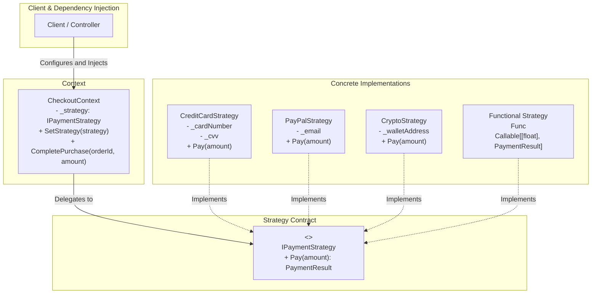

# Lesson 15: Strategy

> **Prerequisites:** [Proxy](../14-proxy/README.md) and [Track 25 Overview](../README.md).  
> **Estimated Reading Time:** 18 minutes  
> **Target Audience:** Engineers preparing for LLD, OOP, C#, or Python technical screening and architecture rounds.

> [!NOTE]
> **In one line:** **Strategy** puts interchangeable algorithms behind one interface and injects the choice, so adding a rule means adding a class — not another `if` branch.

> [!TIP]
> **The One Rule of Strategy:** Prefer composition over conditional branching: encapsulate varying algorithms behind a shared interface and inject them into a context object. If adding a new business rule requires adding an `else if` or `case` branch to existing core code, you are violating the Open/Closed Principle and need a Strategy.

---

## 1. Why This Matters: The Interview Trap

"How would you eliminate a massive `switch` or `if/else` block that handles payment methods, tax calculations, or discount tiers?" is one of the most common system design and refactoring questions in backend engineering interviews.

Junior candidates frequently fall into one of two traps:
1. **The Cosmetic Fix:** *"I'd use a C# pattern matching switch expression or dictionary lookup in Python so the code is only 15 lines instead of 50."*
2. **The Over-Engineering Dogma:** *"I will create an abstract factory, a strategy hierarchy, and a mediator because the Gang of Four says conditional statements are bad."*

Interviewers look for **architectural trade-offs and domain velocity**:

| Dimension | Conditional Branching (`switch` / `if-elif`) | Strategy Pattern |
| :--- | :--- | :--- |
| **Open/Closed Principle** | **Violated:** Every new algorithm requires editing, re-testing, and redeploying the core context class. | **Respected:** New algorithms are introduced as isolated, self-contained classes or functions without touching existing callers. |
| **Single Responsibility** | **Violated:** The context class coordinates execution *and* knows the granular formulas of 12 distinct business rules. | **Respected:** The context delegates execution; each strategy class encapsulates only its own algorithm. |
| **Blast Radius** | High: A bug or merge conflict in European VAT calculation can break US Sales Tax calculation. | Zero: Algorithms are physically isolated in separate compilation units or modules. |
| **Runtime Swapping** | Impossible or awkward: Behavior is statically baked into the method logic. | First-class: Context can swap strategies dynamically on the fly based on runtime config, user tier, or payload. |
| **Testing** | Requires combinatorial integration tests with many input flags. | Strategies can be unit tested in pure isolation; context can be tested with a lightweight mock/stub strategy. |

When you explain Strategy, articulate it not as "a way to avoid `if` statements," but as **decoupling an algorithmic family from the client that uses it so both can vary independently**.

---

## 2. Visual Mental Model / Taxonomic Comparison

In the Strategy pattern, the **Context** maintains a reference to a generic **Strategy Contract**. At runtime, concrete implementations are injected into the context. The context remains completely agnostic to whether the payment is processed via credit card, PayPal, crypto, or a courtesy coupon voucher.



### Taxonomic Comparison: Strategy vs. Other Behavioral Patterns

Engineers frequently confuse Strategy with State, Template Method, and Command:

| Pattern | Primary Intent | Who Triggers the Variant? | Coupling Mechanism | Knowledge of Siblings |
| :--- | :--- | :--- | :--- | :--- |
| **Strategy** | Vary *how* an operation is performed (interchangeable algorithms). | **External client** or DI injector selects the strategy. | Composition (interface injection). | Strategies do not know about other strategies. |
| **State** | Vary *what* an object does based on its internal lifecycle state. | **Internal transitions** triggered by events or states themselves. | Composition (context holds current state). | Concrete states often know about and instantiate sibling states. |
| **Template Method** | Fix the invariant steps of an algorithm, allow customization of individual sub-steps. | Fixed compile-time inheritance hierarchy. | Inheritance (base class calls abstract/virtual hooks). | Derived classes override hooks, bound at compile time. |
| **Command** | Encapsulate a request with state for queuing, logging, or undo/redo. | Invoker triggers the encapsulated operation. | Composition (object represents an action over time). | Commands wrap receivers; execute independent lifecycle operations. |

---

## 3. Code Implementation

Here is a complete, production-grade checkout pipeline. It supports both classical class-based strategies (with encapsulated state such as card numbers and wallet addresses) and lightweight functional strategies (delegates / callables) for stateless algorithms.

````carousel
```python
from abc import ABC, abstractmethod
from dataclasses import dataclass
from typing import Callable, Union


@dataclass(frozen=True)
class PaymentResult:
  success: bool
  transaction_id: str
  message: str


# --- Object-Oriented Strategy Contract ---
class PaymentStrategy(ABC):

  @abstractmethod
  def pay(self, amount: float) -> PaymentResult:
    """Encapsulates the payment execution algorithm."""
    pass


class CreditCardStrategy(PaymentStrategy):

  def __init__(self, card_number: str, cvv: str) -> None:
    self._card_number = card_number
    self._cvv = cvv

  def pay(self, amount: float) -> PaymentResult:
    masked = f"****-****-****-{self._card_number[-4:]}"
    return PaymentResult(
        success=True,
        transaction_id=f"CC-{self._card_number[-4:]}-8821",
        message=f"Charged ${amount:.2f} to Credit Card {masked}",
    )


class PayPalStrategy(PaymentStrategy):

  def __init__(self, email: str) -> None:
    self._email = email

  def pay(self, amount: float) -> PaymentResult:
    return PaymentResult(
        success=True,
        transaction_id="PP-7742",
        message=f"Charged ${amount:.2f} via PayPal account {self._email}",
    )


class CryptoStrategy(PaymentStrategy):

  def __init__(self, wallet_address: str) -> None:
    self._wallet_address = wallet_address

  def pay(self, amount: float) -> PaymentResult:
    short_addr = f"{self._wallet_address[:6]}...{self._wallet_address[-4:]}"
    return PaymentResult(
        success=True,
        transaction_id=f"ETH-{self._wallet_address[-6:]}",
        message=f"Transferred ${amount:.2f} ETH to wallet {short_addr}",
    )


# --- Functional Strategy (Callable) ---
PaymentFunction = Callable[[float], PaymentResult]


def promo_coupon_strategy(amount: float) -> PaymentResult:
  return PaymentResult(
      success=True,
      transaction_id="COUPON-100PCT",
      message=f"Applied 100% courtesy discount voucher for ${amount:.2f}",
  )


# --- Context ---
class CheckoutContext:

  def __init__(
      self, payment_strategy: Union[PaymentStrategy, PaymentFunction]
  ) -> None:
    self._strategy = payment_strategy

  def set_strategy(
      self, payment_strategy: Union[PaymentStrategy, PaymentFunction]
  ) -> None:
    """Allows dynamic runtime strategy swapping."""
    self._strategy = payment_strategy

  def complete_purchase(self, order_id: str, amount: float) -> PaymentResult:
    print(f"Processing Order #{order_id} for ${amount:.2f}...")
    if callable(self._strategy) and not isinstance(
        self._strategy, PaymentStrategy
    ):
      result = self._strategy(amount)
    else:
      result = self._strategy.pay(amount)

    status = "SUCCESS" if result.success else "FAILED"
    print(f"Status: {status} | {result.message}")
    return result


if __name__ == "__main__":
  # 1. Using object-oriented strategies
  cart = CheckoutContext(CreditCardStrategy("4111222233339876", "123"))
  cart.complete_purchase("ORD-101", 149.99)

  # 2. Swapping strategy at runtime
  cart.set_strategy(PayPalStrategy("sarah.connor@cyberdyne.com"))
  cart.complete_purchase("ORD-102", 49.50)

  cart.set_strategy(CryptoStrategy("0x71C849491d9006b5278D82C4d2f8Fa91eD01bA4a"))
  cart.complete_purchase("ORD-103", 1250.00)

  # 3. Using a functional / lambda strategy without a full class
  cart.set_strategy(promo_coupon_strategy)
  cart.complete_purchase("ORD-104", 35.00)
```
<!-- slide -->
```csharp
using System;

public record PaymentResult(bool Success, string TransactionId, string Message);

// --- Object-Oriented Strategy Contract ---
public interface IPaymentStrategy
{
    PaymentResult Pay(decimal amount);
}

public class CreditCardStrategy : IPaymentStrategy
{
    private readonly string _cardNumber;
    private readonly string _cvv;

    public CreditCardStrategy(string cardNumber, string cvv)
    {
        _cardNumber = cardNumber;
        _cvv = cvv;
    }

    public PaymentResult Pay(decimal amount)
    {
        string masked = $"****-****-****-{_cardNumber[^4..]}";
        return new PaymentResult(
            true,
            $"CC-{_cardNumber[^4..]}-8821",
            $"Charged ${amount:F2} to Credit Card {masked}"
        );
    }
}

public class PayPalStrategy : IPaymentStrategy
{
    private readonly string _email;

    public PayPalStrategy(string email)
    {
        _email = email;
    }

    public PaymentResult Pay(decimal amount)
    {
        return new PaymentResult(
            true,
            "PP-7742",
            $"Charged ${amount:F2} via PayPal account {_email}"
        );
    }
}

public class CryptoStrategy : IPaymentStrategy
{
    private readonly string _walletAddress;

    public CryptoStrategy(string walletAddress)
    {
        _walletAddress = walletAddress;
    }

    public PaymentResult Pay(decimal amount)
    {
        string shortAddr = $"{_walletAddress[..6]}...{_walletAddress[^4..]}";
        return new PaymentResult(
            true,
            $"ETH-{_walletAddress[^6..]}",
            $"Transferred ${amount:F2} ETH to wallet {shortAddr}"
        );
    }
}

// --- Context ---
public class CheckoutContext
{
    private Func<decimal, PaymentResult> _paymentInvoker = null!;

    // Supports OO Strategy
    public CheckoutContext(IPaymentStrategy strategy)
    {
        SetStrategy(strategy);
    }

    // Supports Functional / Delegate Strategy directly
    public CheckoutContext(Func<decimal, PaymentResult> strategyFunc)
    {
        SetStrategy(strategyFunc);
    }

    public void SetStrategy(IPaymentStrategy strategy)
    {
        ArgumentNullException.ThrowIfNull(strategy);
        _paymentInvoker = strategy.Pay;
    }

    public void SetStrategy(Func<decimal, PaymentResult> strategyFunc)
    {
        _paymentInvoker = strategyFunc ?? throw new ArgumentNullException(nameof(strategyFunc));
    }

    public PaymentResult CompletePurchase(string orderId, decimal amount)
    {
        Console.WriteLine($"Processing Order #{orderId} for ${amount:F2}...");
        PaymentResult result = _paymentInvoker(amount);
        string status = result.Success ? "SUCCESS" : "FAILED";
        Console.WriteLine($"Status: {status} | {result.Message}");
        return result;
    }
}

public class Program
{
    public static void Main()
    {
        // 1. Using object-oriented strategies
        var cart = new CheckoutContext(new CreditCardStrategy("4111222233339876", "123"));
        cart.CompletePurchase("ORD-101", 149.99m);

        // 2. Swapping strategy at runtime
        cart.SetStrategy(new PayPalStrategy("sarah.connor@cyberdyne.com"));
        cart.CompletePurchase("ORD-102", 49.50m);

        cart.SetStrategy(new CryptoStrategy("0x71C849491d9006b5278D82C4d2f8Fa91eD01bA4a"));
        cart.CompletePurchase("ORD-103", 1250.00m);

        // 3. Using a functional / delegate strategy without a full class
        cart.SetStrategy(amount => new PaymentResult(
            true,
            "COUPON-100PCT",
            $"Applied 100% courtesy discount voucher for ${amount:F2}"
        ));
        cart.CompletePurchase("ORD-104", 35.00m);
    }
}
```
````

**Expected Output (Both Languages):**

```text
Processing Order #ORD-101 for $149.99...
Status: SUCCESS | Charged $149.99 to Credit Card ****-****-****-9876
Processing Order #ORD-102 for $49.50...
Status: SUCCESS | Charged $49.50 via PayPal account sarah.connor@cyberdyne.com
Processing Order #ORD-103 for $1250.00...
Status: SUCCESS | Transferred $1250.00 ETH to wallet 0x71C8...bA4a
Processing Order #ORD-104 for $35.00...
Status: SUCCESS | Applied 100% courtesy discount voucher for $35.00
```

---

## 3A. Where It Is Used, Why It Exists & Progressive Buildup

### Where It Is Used (Real-World Systems & LLD Interviews)

| Domain / Ecosystem | Concrete Real-World Usage | LLD Interview Problem Where You Use It |
| :--- | :--- | :--- |
| **.NET** | `IComparer<T>`, `JsonNamingPolicy`, ASP.NET `IAuthenticationHandler`, Polly retry policies | Parking Lot Fee Calculator, Payment Gateway Router |
| **Python** | `sorted(key=...)`, `collections.defaultdict(factory)`, `json.dump(default=...)`, `logging.Formatter` | Ride-Sharing Surge Pricing (Uber), E-Commerce Tax/Discount Engine |
| **Go** | `sort.Slice` comparator, `http.Handler` / `RoundTripper`, `compress` encoders | Load Balancer Routing (Round-Robin / Least-Conn), Compression Pipeline |
| **TypeScript** | `Array.prototype.sort(compareFn)`, Passport.js auth strategies, ESLint/Prettier formatters | Notification Channel Dispatcher, Game AI Behavior Switching |

### Why It Is Used — The Step-by-Step Buildup (Before -> Pain -> Pattern)

#### Stage 0: Naive Code (Growing `if/elif` Inside Core Business Logic)
A shipping calculator starts with two flat rules:

```python
def calculate_shipping(carrier: str, weight_kg: float) -> float:
    if carrier == "STANDARD":
        return 5.0 + weight_kg * 1.2
    elif carrier == "EXPRESS":
        return 15.0 + weight_kg * 2.5
    raise ValueError(f"Unknown carrier: {carrier}")
```

#### What Breaks as Requirements Grow
- **Requirement 2 arrives ("Add International Freight with customs zones, Hazmat surcharge, and Overnight Air"):** `calculate_shipping` swells to 150 lines with nested `if`s and carrier-specific API clients. Every team editing a carrier rule causes merge conflicts in the same function.
- **Requirement 3 arrives ("Enterprise tenants get custom negotiated rate tables loaded at runtime"):** Hardcoded `if/elif` branches cannot be swapped or injected per tenant without modifying and redeploying the core shipping module—violating the Open/Closed Principle.

#### Step-by-Step Refactoring into Strategy
1. **Define a unified Strategy contract** (`ShippingStrategy` / `Callable[[float], float]`).
2. **Isolate each carrier algorithm** into its own class or function (`StandardShipping`, `ExpressShipping`, `InternationalFreight`).
3. **Inject the strategy** into `ShippingCalculator` via constructor or a `dict[str, ShippingStrategy]` registry so adding a new carrier requires zero edits to `ShippingCalculator`.

### Progressive Real-World Examples (More & More Typical Use Cases)

#### Example A: Simple Core — Pluggable Retry Backoff Policies
A network client accepts a backoff strategy function so callers can choose constant, linear, or exponential backoff without changing the retry loop:

```python
from typing import Callable

BackoffStrategy = Callable[[int], float]

def constant_backoff(attempt: int) -> float:
    return 1.0

def exponential_backoff(attempt: int) -> float:
    return float(2 ** attempt)

def next_delay(attempt: int, policy: BackoffStrategy = exponential_backoff) -> float:
    return policy(attempt)
```

#### Example B: Production Backend — Load Balancer Routing Strategies
An API gateway or service mesh swaps load-balancing algorithms (`RoundRobin`, `LeastConnections`, `WeightedRandom`) at runtime via config without touching request forwarding logic:

```python
from abc import ABC, abstractmethod

class RoutingStrategy(ABC):
    @abstractmethod
    def select_host(self, hosts: list[str], active_conns: dict[str, int]) -> str:
        pass

class RoundRobinStrategy(RoutingStrategy):
    def __init__(self) -> None:
        self._idx = 0

    def select_host(self, hosts: list[str], active_conns: dict[str, int]) -> str:
        host = hosts[self._idx % len(hosts)]
        self._idx += 1
        return host

class LeastConnectionsStrategy(RoutingStrategy):
    def select_host(self, hosts: list[str], active_conns: dict[str, int]) -> str:
        return min(hosts, key=lambda h: active_conns.get(h, 0))
```

#### Example C: Classic LLD Interview Problem — Parking Lot Dynamic Pricing
In a "Design a Parking Lot" LLD interview, `ParkingTicketService` delegates fee computation to an injected `PricingStrategy` (Hourly, Flat Weekend, EV-Charging Tier) so new vehicle or membership rules never break existing billing:

```python
from abc import ABC, abstractmethod

class PricingStrategy(ABC):
    @abstractmethod
    def calculate_fee(self, hours: float) -> float:
        pass

class HourlyPricing(PricingStrategy):
    def __init__(self, rate_per_hour: float) -> None:
        self._rate = rate_per_hour

    def calculate_fee(self, hours: float) -> float:
        return round(max(1.0, hours) * self._rate, 2)

class WeekendFlatPricing(PricingStrategy):
    def calculate_fee(self, hours: float) -> float:
        return 15.00 if hours <= 12 else 25.00

class ParkingCheckout:
    def __init__(self, pricing: PricingStrategy) -> None:
        self._pricing = pricing

    def bill(self, hours: float) -> float:
        return self._pricing.calculate_fee(hours)
```

---

## 4. Where You Already Use It

The Strategy pattern is woven deeply into modern standard libraries and backend frameworks:

### In .NET / C#
- **`IComparer<T>` and `IEqualityComparer<T>`:** `Array.Sort(items, comparer)` and `Enumerable.OrderBy(x => x, comparer)` accept an algorithmic strategy for ordering or deduplicating elements.
- **ASP.NET Core Authentication Schemes:** Authentication handlers implement `IAuthenticationHandler`. Whether your endpoint authenticates using JWT Bearer tokens, cookies, or OpenID Connect, the ASP.NET runtime delegates to the registered scheme strategy.
- **ASP.NET Core Middleware:** Each middleware component `Func<HttpContext, RequestDelegate, Task>` acts as an interchangeable processing strategy within the HTTP request pipeline.
- **`System.Text.Json.JsonNamingPolicy`:** `JsonNamingPolicy.CamelCase`, `JsonNamingPolicy.KebabCaseLower`, and custom naming policies implement strategy classes that determine how property names are formatted.

### In Python
- **`sorted()` and `list.sort(key=...)`:** The `key` parameter accepts a callable function that acts as an extraction and sorting strategy (e.g., `key=lambda x: x.created_at`).
- **`collections.defaultdict(default_factory)`:** The `default_factory` is a strategy function invoked when a missing key is accessed (e.g., `list`, `int`, or custom callable).
- **`json.dump(..., default=custom_serializer)`:** The `default` callable is a serialization strategy called whenever an unsupported type is encountered.
- **`logging.setFormatter()` and `logging.Filter`:** Python loggers accept different formatting and filtering strategies attached to handlers.

---

## 5. Pitfalls and When Not to Use It

1. **Class Proliferation for Trivial Logic:**
   - *Problem:* Creating 10 classes (`AddTenPercentDiscount`, `AddTwentyPercentDiscount`, `FreeShippingStrategy`) where each class is just a one-line return statement.
   - *Fix:* In modern C# and Python, use first-class functions or delegates (`Func<decimal, decimal>` or `Callable[[float], float]`). Store them in a dictionary keyed by enum/string. Avoid full boilerplate classes when the algorithm requires no state.

2. **Communication Overhead Between Context and Strategy:**
   - *Problem:* The strategy interface needs data from the context. If you pass the entire `Context` object into `strategy.Execute(this)`, you create tight bidirectional coupling. If you pass 15 individual primitive arguments, the parameter list bloats and changes break the strategy interface contract.
   - *Fix:* Pass a dedicated, immutable Parameter Object or Request DTO (e.g., `PaymentRequest` containing amount, currency, and customer ID).

3. **Client Awareness Leakage:**
   - *Problem:* The client must understand the differences between strategies in order to instantiate the correct one, leaking business rules back into the controller or caller.
   - *Fix:* Pair the Strategy pattern with a **Factory** or register strategies keyed by an identifier in the Dependency Injection container (e.g., keyed services in .NET 8+ `builder.Services.AddKeyedScoped<IPaymentStrategy, PayPalStrategy>("paypal")`).

4. **Thread-Safety with Stateful Strategies:**
   - *Problem:* If a strategy is registered as a Singleton in DI or shared across concurrent worker threads, but retains mutable internal state (e.g., an internal transaction counter or cached token), concurrent executions will corrupt state.
   - *Fix:* Keep strategy instances completely stateless and pure, or register them with Transient/Scoped lifetime.

---

## 6. Exercises & Practical Drills

### Drill 1: Refactoring a Growing Switch to Strategies
Review the following discount calculation method:
```csharp
public decimal CalculateDiscount(string customerTier, decimal cartTotal)
{
    switch (customerTier.ToUpperInvariant())
    {
        case "REGULAR":
            return cartTotal > 100m ? cartTotal * 0.05m : 0m;
        case "VIP":
            return cartTotal * 0.15m;
        case "EMPLOYEE":
            return cartTotal * 0.30m;
        default:
            return 0m;
    }
}
```
**Challenge:** How would you refactor this to support adding seasonal promotional tiers without modifying this class?

<details>
<summary>Answer</summary>

Define a strategy contract:
```csharp
public interface IDiscountStrategy
{
    decimal CalculateDiscount(decimal cartTotal);
}
```
Implement concrete strategies (`RegularDiscountStrategy`, `VipDiscountStrategy`, `EmployeeDiscountStrategy`). Register them in a dictionary or DI keyed service registry:
```csharp
public class DiscountService
{
    private readonly IReadOnlyDictionary<string, IDiscountStrategy> _strategies;

    public DiscountService(IReadOnlyDictionary<string, IDiscountStrategy> strategies)
    {
        _strategies = strategies;
    }

    public decimal GetDiscount(string tier, decimal total)
    {
        return _strategies.TryGetValue(tier, out var strategy)
            ? strategy.CalculateDiscount(total)
            : 0m;
    }
}
```
Adding a new tier (e.g., `BlackFridayDiscountStrategy`) now requires registering a new class without modifying `DiscountService`.
</details>

### Drill 2: Strategy vs. State Identification
In an order management system:
1. Handling whether an order is `Created`, `Paid`, `Shipped`, or `Cancelled`.
2. Calculating the tax applicable to an order based on customer jurisdiction (`NewYorkTax`, `CaliforniaTax`, `VATTax`).

Which should use the Strategy pattern, which should use the State pattern, and why?

<details>
<summary>Answer</summary>

- **Order Status (`Created`, `Paid`, `Shipped`):** Use the **State Pattern**. The order transitions sequentially through lifecycles based on internal domain events (e.g., a payment succeeds, causing transition from `Created` to `Paid`). State changes alter the available operations (e.g., cannot ship an order that has not been paid).
- **Tax Calculation (`NewYorkTax`, `VATTax`):** Use the **Strategy Pattern**. The algorithm is selected once from the outside based on the customer's shipping address. The order does not "transition" from California tax to VAT tax over its lifecycle; it delegates a pure computational calculation to an interchangeable calculation strategy.
</details>

---

## 7. Interview Questions & Model Answers

<details>
<summary><strong>1. What is the Strategy pattern? Give an example. [BASIC]</strong></summary>

The Strategy pattern is a behavioral design pattern that defines a family of algorithms, encapsulates each one inside a separate class, and makes them interchangeable at runtime. It allows the algorithm to vary independently from the context or clients that use it.

A canonical example is an e-commerce **Payment Processing Engine**. The checkout service acts as the context, maintaining a reference to an `IPaymentStrategy` contract with a `Pay(amount)` method. Concrete implementations include `CreditCardStrategy`, `PayPalStrategy`, and `CryptoStrategy`. When a customer checks out, the client or DI container injects the appropriate strategy based on the customer's selection. Other daily examples include tax calculation across differing jurisdictions, compression algorithms (`Gzip`, `Bzip2`, `Zstandard`), and sorting algorithms.

</details>

<details>
<summary><strong>2. How does Strategy help with the Open/Closed principle? [BASIC]</strong></summary>

Without the Strategy pattern, selecting an algorithm typically relies on hardcoded `switch` or `if/elif` blocks within the context class. Every time product management introduces a new rule—such as supporting Apple Pay or a new regional tax calculation—the developer must open, modify, and re-test the core context class. This directly violates the Open/Closed Principle: the class is open to modification rather than closed.

With the Strategy pattern, the context class depends exclusively on an abstraction (`IPaymentStrategy`). To introduce Apple Pay, we simply create a new `ApplePayStrategy` class implementing the interface and register it. The existing context class, test suites, and other payment strategies remain 100% untouched and re-compiled safely. The system is open for extension, but closed for modification.

</details>

<details>
<summary><strong>3. What is the difference between Strategy and State? [BASIC]</strong></summary>

While both patterns share almost identical UML class diagrams—a context class holding a reference to an interface and delegating execution to it—they differ fundamentally in **intent, selection, and lifecycle transitions**:

1. **Intent & Selection:** Strategy is about *how* a specific task is done. The strategy is typically chosen from the outside by the client or dependency injection at initialization. State is about *what* an object can do based on its internal condition; the object changes its behavior automatically as its state changes.
2. **Awareness of Siblings:** Strategy classes are completely isolated and independent; `CreditCardStrategy` has zero knowledge of `PayPalStrategy`. In contrast, concrete State classes frequently know about each other and explicitly trigger transitions from one state to the next (e.g., `DraftState` transitions the document to `ModerationState`).
3. **Frequency of Change:** A Strategy usually remains constant for the duration of a specific operation or request, whereas an object's State changes continuously across its lifecycle.

</details>

<details>
<summary><strong>4. Can a strategy just be a function? [BASIC]</strong></summary>

Yes, absolutely. In modern programming languages with first-class functions, a strategy does not need to be a formal class unless it needs to hold private state or manage its own complex dependencies.

In **Python**, any callable function or lambda matches the strategy contract. For instance, the built-in `sorted(data, key=lambda x: x.age)` uses a lambda function as a comparison strategy.

In **C#**, a delegate such as `Func<TInput, TResult>` or `Action<T>` frequently replaces single-method strategy interfaces. For example, instead of declaring an `IDiscountStrategy` interface with one `decimal Apply(decimal total)` method, a service can simply take a `Func<decimal, decimal>` parameter. This eliminates boilerplate class definitions while retaining runtime substitutability and testability.

</details>

<details>
<summary><strong>5. Shipping cost depends on carrier, weight and country, and rules change monthly. Design it. [SCENARIO]</strong></summary>

An `IShippingCost` strategy per carrier, selected by a registry keyed on carrier. Weight/country rules live inside each strategy or compose smaller ones. Adding a carrier is one new class plus a registration.

</details>

<details>
<summary><strong>6. Where does the code that *picks* the strategy live, and doesn't that just move the switch? [TRICKY]</strong></summary>

Yes, one selection point remains, but it is a registry/DI lookup in one place (composition root) instead of conditionals scattered through business logic, and new strategies don't touch it.

</details>

---

## Try it

Run this: the discount rule is data, not a branch inside `checkout`. Then redraw it in [LLD Studio](/tools/lld-studio/); the [track hub](../README.md) has the pattern-choice drills.

```python
def no_discount(t): return t
def ten_percent(t): return t * 0.9
def flat_50(t): return max(0, t - 50)

def checkout(total, discount=no_discount):
    return discount(total)

assert checkout(200) == 200
assert checkout(200, ten_percent) == 180
assert checkout(200, flat_50) == 150
```

---

## One-page cheat sheet

```text
STRATEGY  Context --has-a--> IStrategy { run() } <- ConcreteA | ConcreteB
Trigger: if/elif or switch that grows with each new rule
Python/C#: a function / Func<> is a strategy (class only if it holds state)
Choose at: construction (DI), per call, or via registry/config
Strategy: picked from outside, siblings unaware | State: object switches itself
.NET: IComparer<T>, keyed DI services | Python: sorted(key=...)
Don't: strategy for 2 stable cases that never change
```

---

## 8. Sources & Further Reading

- [Microsoft Learn: Choose the right sorting algorithm / IComparer](https://learn.microsoft.com/en-us/dotnet/api/system.collections.generic.icomparer-1)
- [Microsoft Learn: Dependency Injection in ASP.NET Core - Keyed Services](https://learn.microsoft.com/en-us/dotnet/core/extensions/dependency-injection#keyed-services)
- [Python 3 Documentation: Sorting HOW TO (Key Functions as Strategies)](https://docs.python.org/3/howto/sorting.html)
- [Martin Fowler: Strategy Pattern](https://martinfowler.com/bliki/StrategyPattern.html)
- [Refactoring.Guru: Strategy Design Pattern](https://refactoring.guru/design-patterns/strategy)

---

Previous: [Proxy](../14-proxy/README.md) · Next: [Observer (Events, Delegates and Callbacks)](../16-observer/README.md)
