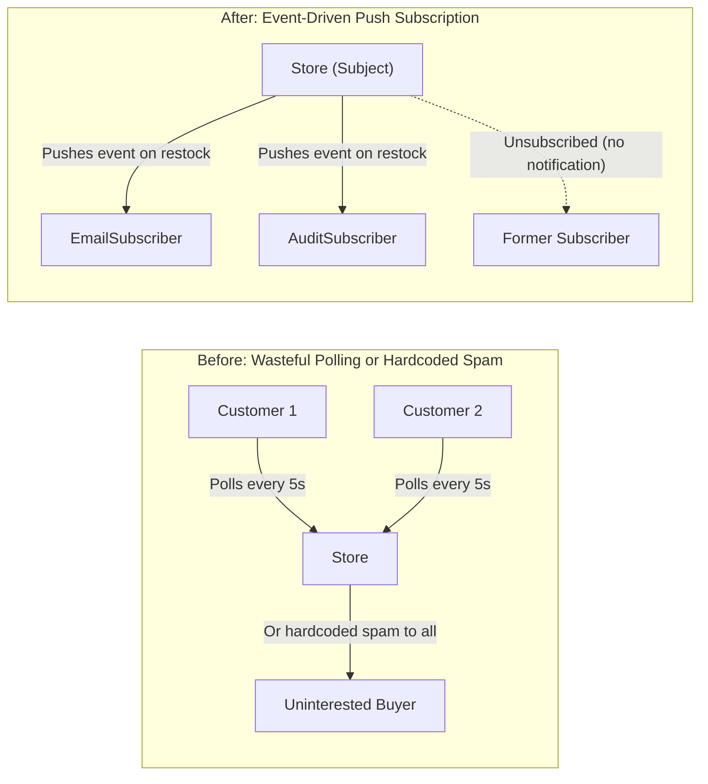
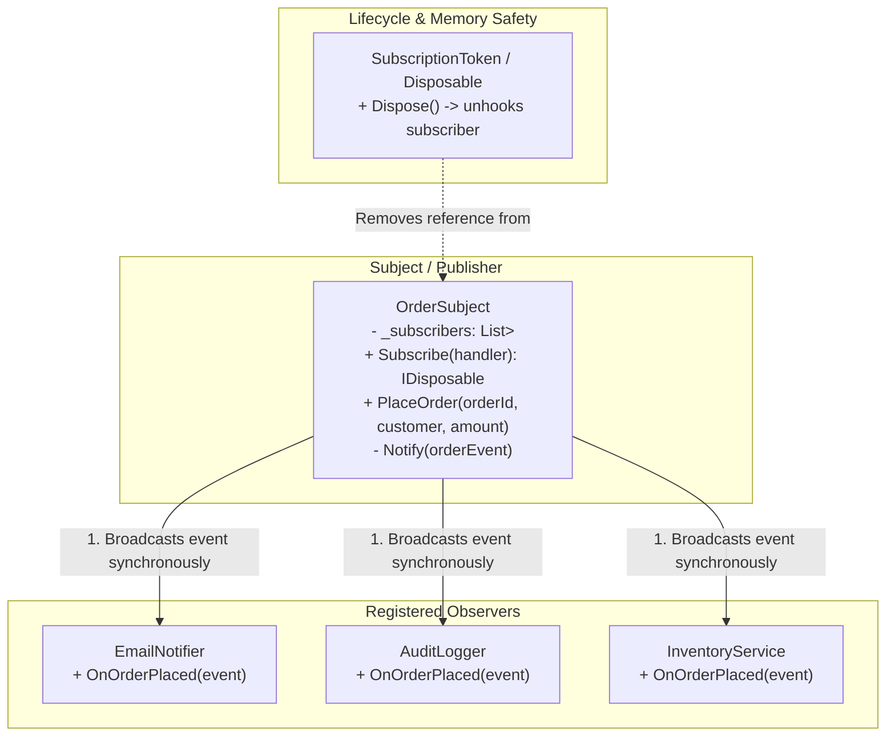

# Lesson 16: Observer (Events, Delegates and Callbacks)

> **Prerequisites:** [Strategy](../15-strategy/README.md) and [Track 25 Overview](../README.md).  
> **Estimated Reading Time:** 18 minutes  
> **Target Audience:** Engineers preparing for LLD, OOP, C#, or Python technical screening and architecture rounds.

> [!NOTE]
> **In one line:** **Observer** lets a subject notify any number of subscribers when something changes without knowing who they are — the basis of events, UI bindings and pub/sub.

> [!TIP]
> **The One Rule of Observer:** Prefer push notifications over pull polling: decouple the subject from its observers so multiple independent consumers can react to state changes without the subject knowing their concrete types or count. Always provide a clean unsubscription mechanism to prevent the lapsed listener memory leak.

---

## 1. Why This Matters: The Interview Trap

"How do you notify multiple downstream subsystems—such as an audit logger, an email notifier, an inventory service, and a real-time analytics dashboard—when an order is placed without tightly coupling the order service to every one of them?"

Junior engineers usually fall into one of two traps:
1. **The Polling Trap:** *"Each downstream service can run a timer loop every 500ms to poll the database and check if new orders exist."* (This creates immense database contention, CPU waste, and high notification latency.)
2. **The Direct Spaghetti Coupling:** *"The `OrderService` constructor takes `EmailService`, `AuditService`, `InventoryService`, `SlackNotifier`, and `DataWarehouseSync`, calling them one by one."* (Adding a sixth consumer requires modifying the constructor and methods of `OrderService`, completely breaking the Open/Closed Principle and Single Responsibility Principle.)

Senior candidates explain **the Push Model and decoupled observation**:
- The **Subject** (or Publisher) maintains a collection of registered subscribers conforming to a contract or delegate signature.
- When state transitions occur, the subject broadcasts the event to all registered observers.
- The subject has zero compile-time or runtime knowledge of *who* is listening or *what* they do in response.

However, interviewers will immediately probe for the senior trap: **the Lapsed Listener Problem**. If you don't unhook an observer from a long-lived publisher, the garbage collector cannot collect the subscriber, leading to massive memory leaks in production.

---

## 1A. The Visual Story: Problem -> Analogy -> Solution

### The Problem (Why Naive Code Explodes)

Imagine a popular electronics store expecting a restock of a limited-edition GPU. Without Observer, you get one of two broken extremes: either hundreds of customers drive to the store every 5 minutes to ask *"Is it in stock yet?"* (wasteful polling that floods the store's staff/database), or the store blasts an email to *every* customer in its database—even people who only bought USB cables—whenever any item arrives (spam and hardcoded coupling).

### Real-World Analogy

Think of a **magazine or newsletter subscription**. Instead of walking to the newsstand every morning to check whether a new issue has been printed, you subscribe once. Whenever the publisher releases a new issue, it pushes copies *only* to active subscribers—and you can cancel your subscription anytime so the publisher stops delivering to your mailbox.

### Visual Problem -> Solution Diagram



### Applicability & Pattern Relations

- **Use when** a state change in one object must automatically notify an unknown or dynamic number of other objects without hardcoding their types.
- **Use when** objects need to observe a publisher only temporarily (subscribe during a screen/session lifecycle, then unsubscribe).
- **Use when** you want to replace expensive polling loops with low-latency in-process push notifications.
- **Relations with Other Patterns:**
  - **Mediator:** Eliminates direct dependencies by routing *many-to-many* peer calls through a central hub; **Observer** is a *one-to-many* broadcast where observers register dynamically with a subject.
  - **Chain of Responsibility:** Passes a request sequentially until *one* handler processes it; **Observer** broadcasts an event to *all* active subscribers simultaneously.
  - **Pub/Sub Broker:** The distributed, cross-process evolution of Observer (using Kafka, RabbitMQ, or Redis) with durable queues and async retries.

---

## 2. Visual Mental Model / Taxonomic Comparison

In the Observer pattern, the **Subject** maintains a list of observer callbacks or interface references. Observers register at runtime via `Subscribe()` and can deregister at any time.



### Taxonomic Comparison: Observer vs. Mediator vs. Pub/Sub Broker

Candidates often conflate these three communication patterns:

| Dimension | Observer Pattern | Mediator Pattern | Publish/Subscribe (Message Broker) |
| :--- | :--- | :--- | :--- |
| **Communication Style** | One-to-many broadcast (Subject $\to$ Observers). | Many-to-many orchestration (Colleagues $\leftrightarrow$ Mediator). | Many-to-many asynchronous message streaming. |
| **Process Boundary** | Strictly **in-process**, in-memory memory addresses. | Strictly **in-process**, in-memory references. | **Distributed / cross-process** across networks (Kafka, RabbitMQ, Redis). |
| **Coupling** | Subject knows observer contract; observers know subject event structure. | Colleagues know only the Mediator; mediator knows all colleagues. | **Zero coupling:** Publishers and subscribers do not know each other; broker routes messages. |
| **Timing & Execution** | **Synchronous by default:** Subject blocks until all observers finish. | **Synchronous by default:** Mediator coordinates immediate calls. | **Asynchronous:** Guaranteed delivery, persistent queues, retry policies, backpressure. |
| **Failure Mode** | An exception in Observer 1 can abort notifications to Observer 2. | Single point of failure inside complex mediator monolith. | Network partitions, serialization overhead, out-of-order delivery. |

---

## 3. Code Implementation

The following implementation demonstrates an `OrderSubject` that notifies multiple observers when a purchase occurs. It features an idiomatic unsubscription token (`IDisposable` in C#, callable unhook in Python) and exception-isolated dispatching so a failing observer cannot crash the subject or starve sibling observers.

````carousel
```python
from dataclasses import dataclass
from typing import Callable, List


@dataclass(frozen=True)
class OrderEvent:
  order_id: str
  customer: str
  total_amount: float


# --- Concrete Observers ---
class EmailNotifier:

  def on_order_placed(self, event: OrderEvent) -> None:
    print(
        f"[EmailNotifier] Confirmation email sent to {event.customer} for"
        f" order #{event.order_id}"
    )


class AuditLogger:

  def on_order_placed(self, event: OrderEvent) -> None:
    print(
        f"[AuditLogger] Audit record created: Order #{event.order_id}, Total:"
        f" ${event.total_amount:.2f}"
    )


class InventoryService:

  def on_order_placed(self, event: OrderEvent) -> None:
    print(f"[InventoryService] Inventory reserved for order #{event.order_id}")


# --- Subject with Subscription Token / Unsubscribe Support ---
class OrderSubject:

  def __init__(self) -> None:
    # Maintains registered callback handlers
    self._subscribers: List[Callable[[OrderEvent], None]] = []

  def subscribe(
      self, callback: Callable[[OrderEvent], None]
  ) -> Callable[[], None]:
    """Subscribes an observer and returns an unsubscription disposable function."""
    self._subscribers.append(callback)

    def unsubscribe() -> None:
      if callback in self._subscribers:
        self._subscribers.remove(callback)

    return unsubscribe

  def place_order(self, order_id: str, customer: str, amount: float) -> None:
    print(
        f"\n--- Order #{order_id} placed (${amount:.2f}) - Notifying Observers"
        " ---"
    )
    event = OrderEvent(order_id, customer, amount)
    self._notify(event)

  def _notify(self, event: OrderEvent) -> None:
    # Iterate over a snapshot copy to allow safe mutation/unsubscription during iteration
    for subscriber in list(self._subscribers):
      try:
        subscriber(event)
      except Exception as ex:
        print(f"[Error] Subscriber failed: {ex}")


if __name__ == "__main__":
  subject = OrderSubject()

  email_service = EmailNotifier()
  audit_service = AuditLogger()
  inventory_service = InventoryService()

  # Subscribe observers and retain unsubscribe disposables
  unsub_email = subject.subscribe(email_service.on_order_placed)
  unsub_audit = subject.subscribe(audit_service.on_order_placed)
  unsub_inventory = subject.subscribe(inventory_service.on_order_placed)

  # First event: all 3 observers notified
  subject.place_order("1001", "Alice", 129.50)

  # Unsubscribe email notifications (e.g., customer opted out)
  print("\n[Action] Unsubscribing EmailNotifier...")
  unsub_email()

  # Second event: only Audit and Inventory notified
  subject.place_order("1002", "Bob", 450.00)
```
<!-- slide -->
```csharp
using System;
using System.Collections.Generic;

public record OrderEvent(string OrderId, string Customer, decimal TotalAmount);

// --- Concrete Observers ---
public class EmailNotifier
{
    public void OnOrderPlaced(OrderEvent e)
    {
        Console.WriteLine($"[EmailNotifier] Confirmation email sent to {e.Customer} for order #{e.OrderId}");
    }
}

public class AuditLogger
{
    public void OnOrderPlaced(OrderEvent e)
    {
        Console.WriteLine($"[AuditLogger] Audit record created: Order #{e.OrderId}, Total: ${e.TotalAmount:F2}");
    }
}

public class InventoryService
{
    public void OnOrderPlaced(OrderEvent e)
    {
        Console.WriteLine($"[InventoryService] Inventory reserved for order #{e.OrderId}");
    }
}

// --- Subject with Event and IDisposable Subscription Token ---
public class OrderSubject
{
    // C# native multicast delegate event
    public event Action<OrderEvent>? OrderPlaced;

    // Subscription helper returning IDisposable to cleanly prevent lapsed-listener leaks
    public IDisposable Subscribe(Action<OrderEvent> handler)
    {
        OrderPlaced += handler;
        return new SubscriptionToken(() => OrderPlaced -= handler);
    }

    public void PlaceOrder(string orderId, string customer, decimal amount)
    {
        Console.WriteLine($"\n--- Order #{orderId} placed (${amount:F2}) - Notifying Observers ---");
        var orderEvent = new OrderEvent(orderId, customer, amount);
        Notify(orderEvent);
    }

    private void Notify(OrderEvent orderEvent)
    {
        if (OrderPlaced == null) return;

        // Safely invoke each delegate separately to isolate exceptions
        foreach (Action<OrderEvent> handler in OrderPlaced.GetInvocationList())
        {
            try
            {
                handler(orderEvent);
            }
            catch (Exception ex)
            {
                Console.WriteLine($"[Error] Subscriber failed: {ex.Message}");
            }
        }
    }

    private sealed class SubscriptionToken : IDisposable
    {
        private Action? _unsubscribe;

        public SubscriptionToken(Action unsubscribe)
        {
            _unsubscribe = unsubscribe;
        }

        public void Dispose()
        {
            _unsubscribe?.Invoke();
            _unsubscribe = null;
        }
    }
}

public class Program
{
    public static void Main()
    {
        var subject = new OrderSubject();

        var emailService = new EmailNotifier();
        var auditService = new AuditLogger();
        var inventoryService = new InventoryService();

        // Subscribe observers and retain unsubscribe disposables
        IDisposable unsubEmail = subject.Subscribe(emailService.OnOrderPlaced);
        IDisposable unsubAudit = subject.Subscribe(auditService.OnOrderPlaced);
        IDisposable unsubInventory = subject.Subscribe(inventoryService.OnOrderPlaced);

        // First event: all 3 observers notified
        subject.PlaceOrder("1001", "Alice", 129.50m);

        // Unsubscribe email notifications (e.g., customer opted out)
        Console.WriteLine("\n[Action] Unsubscribing EmailNotifier...");
        unsubEmail.Dispose();

        // Second event: only Audit and Inventory notified
        subject.PlaceOrder("1002", "Bob", 450.00m);
    }
}
```
````

**Expected Output (Both Languages):**

```text
--- Order #1001 placed ($129.50) - Notifying Observers ---
[EmailNotifier] Confirmation email sent to Alice for order #1001
[AuditLogger] Audit record created: Order #1001, Total: $129.50
[InventoryService] Inventory reserved for order #1001

[Action] Unsubscribing EmailNotifier...

--- Order #1002 placed ($450.00) - Notifying Observers ---
[AuditLogger] Audit record created: Order #1002, Total: $450.00
[InventoryService] Inventory reserved for order #1002
```

---

## 3A. Where It Is Used, Why It Exists & Progressive Buildup

### Where It Is Used (Real-World Systems & LLD Interviews)

| Domain / Ecosystem | Concrete Real-World Usage | LLD Interview Problem Where You Use It |
| :--- | :--- | :--- |
| **.NET** | `event EventHandler<T>`, `INotifyPropertyChanged`, Rx.NET `IObservable<T>`, `FileSystemWatcher` | Stock Price Ticker, Real-Time Order Status Tracker |
| **Python** | `logging.Handler`, `django.dispatch.Signal`, `asyncio.Future.add_done_callback`, PyQt signals | Pub/Sub Notification Hub, Auction Bidding System |
| **Go** | Channel fan-out broadcasters, `os/signal.Notify`, Kubernetes informers (`ResourceEventHandler`) | Distributed Config Watcher, Live Sports Scoreboard |
| **TypeScript** | DOM `addEventListener`, Node `EventEmitter`, RxJS `Subject` / `BehaviorSubject`, Redux `store.subscribe` | Collaborative Dashboard, Chat Room Presence System |

### Why It Is Used — The Step-by-Step Buildup (Before -> Pain -> Pattern)

#### Stage 0: Naive Code (Hardcoded Direct Calls in the Producer)
An `AuctionItem` service directly calls the two downstream services it knows about when a new bid arrives:

```python
class AuctionItem:
    def __init__(self, email_svc, audit_svc) -> None:
        self._email = email_svc
        self._audit = audit_svc
        self.highest_bid = 0.0

    def place_bid(self, bidder: str, amount: float) -> None:
        if amount > self.highest_bid:
            self.highest_bid = amount
            self._email.notify_outbid(bidder, amount)
            self._audit.log_bid(bidder, amount)
```

#### What Breaks as Requirements Grow
- **Requirement 2 arrives ("Add WebSocket Live UI Ticker, Fraud Detector, and Mobile Push Notifications"):** `AuctionItem` must now accept 5 constructor dependencies and call all 5 inside `place_bid()`. Every new feature forces edits to the core auction domain class, and unit-testing `AuctionItem` requires mocking 5 unrelated services.
- **Requirement 3 arrives ("Bidders can subscribe/unsubscribe from SMS alerts per item at runtime, and a failing WebSocket push must not block fraud logging"):** Hardcoded dependencies cannot be dynamically attached/detached per user, and an uncaught exception in `WebSocketTicker` aborts `AuditLogger`.

#### Step-by-Step Refactoring into Observer
1. **Invert the dependency:** `AuctionItem` no longer imports `EmailService` or `AuditService`; it holds a list of generic subscriber callbacks (`Callable[[BidEvent], None]`).
2. **Expose `subscribe()` returning an `unsubscribe()` token** so short-lived listeners (like WebSocket connections) clean up on disconnect and avoid the lapsed-listener memory leak.
3. **Iterate over a snapshot copy with per-handler `try/except`** so one failing or self-unsubscribing observer never breaks sibling observers.

### Progressive Real-World Examples (More & More Typical Use Cases)

#### Example A: Simple Core — In-Memory Temperature Sensor Alerting
A sensor broadcasts readings to any number of independent thresholds or loggers without knowing their types:

```python
class TemperatureSensor:
    def __init__(self) -> None:
        self._listeners: list = []

    def subscribe(self, fn) -> None:
        self._listeners.append(fn)

    def set_reading(self, celsius: float) -> None:
        for fn in list(self._listeners):
            fn(celsius)

alerts = []
sensor = TemperatureSensor()
sensor.subscribe(lambda c: alerts.append(f"HIGH:{c}") if c > 80 else None)
sensor.set_reading(85.0)
assert alerts == ["HIGH:85.0"]
```

#### Example B: Production Backend — Typed In-Process Domain Event Bus
In modular monoliths, services publish domain events (`UserRegistered`, `InvoicePaid`) to an in-process `DomainEventBus` that isolates exceptions and supports clean unsubscription:

```python
from collections import defaultdict
from dataclasses import dataclass
from typing import Callable, Type

@dataclass(frozen=True)
class UserRegistered:
    user_id: str
    email: str

class DomainEventBus:
    def __init__(self) -> None:
        self._handlers: dict[Type, list[Callable]] = defaultdict(list)

    def subscribe(self, event_type: Type, handler: Callable) -> Callable[[], None]:
        self._handlers[event_type].append(handler)
        return lambda: self._handlers[event_type].remove(handler)

    def publish(self, event: object) -> list[Exception]:
        errors: list[Exception] = []
        for handler in list(self._handlers[type(event)]):
            try:
                handler(event)
            except Exception as exc:
                errors.append(exc)
        return errors
```

#### Example C: Classic LLD Interview Problem — Stock Ticker / "Notify Me" Back-in-Stock System
In a "Design Amazon Notify-Me / Stock Market Ticker" LLD interview, `StockTicker` notifies only subscribers watching a specific symbol when its price crosses a threshold or stock becomes available:

```python
from collections import defaultdict
from typing import Callable

class StockExchangeSubject:
    def __init__(self) -> None:
        self._watchers: dict[str, list] = defaultdict(list)

    def watch(self, symbol: str, callback) -> Callable[[], None]:
        self._watchers[symbol].append(callback)
        return lambda: self._watchers[symbol].remove(callback)

    def update_price(self, symbol: str, new_price: float) -> None:
        for cb in list(self._watchers[symbol]):
            cb(symbol, new_price)
```

---

## 4. Where You Already Use It

Modern frameworks rely on the Observer pattern as a core building block:

### In .NET / C#
- **`event` Keyword & Delegates:** C# provides native syntax for the pattern. `event EventHandler<TEventArgs>` uses a thread-safe `MulticastDelegate` under the hood.
- **`INotifyPropertyChanged`:** The standard interface for UI and data-binding frameworks (WPF, .NET MAUI, Blazor). Whenever a property changes, views update automatically.
- **`IObservable<T>` and `IObserver<T>` (Reactive Extensions / Rx.NET):** Push-based sequence stream processing where observers subscribe to streams of data, errors, and completion signals.
- **`System.IO.FileSystemWatcher`:** Fires events (`Created`, `Changed`, `Deleted`, `Renamed`) when files are modified on disk.
- **`Microsoft.Extensions.Hosting.IHostApplicationLifetime`:** Exposes cancellation tokens and events (`ApplicationStarted`, `ApplicationStopping`, `ApplicationStopped`) for background service lifecycles.

### In Python
- **`logging.Handler`:** A `Logger` acts as a subject; whenever `logger.info()` is called, all attached handlers (`StreamHandler`, `FileHandler`, `SysLogHandler`) observe and process the `LogRecord`.
- **UI Toolkits (`tkinter`, `PyQt`, `PySide`):** Widgets emit signals when clicked, and callback slots observe the events.
- **`django.dispatch.Signal`:** Django signals (e.g., `post_save`, `pre_delete`) notify independent apps when database models change.
- **Asyncio Event Loops & Futures:** Calling `future.add_done_callback(fn)` registers an observer function to execute when a coroutine or task completes.

---

## 5. Pitfalls and When Not to Use It

1. **The Lapsed Listener Problem (Memory Leak):**
   - *Problem:* When an observer subscribes to an event on a publisher (`publisher.Event += observer.Handler`), the publisher holds a **strong reference** to the observer via the delegate's `.Target` property. If the publisher is long-lived (e.g., a singleton cache or application service) and the observer is short-lived (e.g., a scoped web request handler or UI window), the observer **cannot be garbage collected**. Memory leaks occur and grow over time.
   - *Fix:* Always unregister listeners (`-=`), implement `IDisposable` with unsubscription tokens, or use weak reference event patterns (such as `WeakEventManager` or Python's `weakref.ref`).

2. **Synchronous Blocking and Latency Spikes:**
   - *Problem:* By default, delegate invocation is synchronous. If the publisher iterates through 10 observers and Observer 4 makes a slow blocking HTTP call or database query, the publisher thread is blocked for seconds.
   - *Fix:* Observers must offload expensive operations to asynchronous tasks (`Task.Run` or worker queues), or use message brokers for out-of-process Pub/Sub.

3. **Exception Starvation in Multicast Delegates:**
   - *Problem:* In C#, invoking `MyEvent?.Invoke()` directly causes the runtime to iterate through the invocation list. If Observer 1 throws an unhandled exception, execution immediately terminates; Observers 2, 3, and 4 will **never execute**.
   - *Fix:* Use `MyEvent.GetInvocationList()` and iterate through delegates with explicit `try/catch` blocks (as shown in Section 3).

4. **Cascading / Re-Entrant Notification Loops:**
   - *Problem:* Observer A receives an event and updates a property on the Subject, which triggers another notification to Observer A. This results in stack overflow or an infinite CPU spike.
   - *Fix:* Suppress notifications while dispatching, or ensure events are strictly fired on distinct state boundaries with dirty-checking.

---

## 6. Exercises & Practical Drills

### Drill 1: The Lapsed Listener Memory Leak
Consider the following C# code in an ASP.NET Core web API:
```csharp
public class OrderController : ControllerBase
{
    private readonly GlobalMarketTicker _ticker; // Injected as Singleton

    public OrderController(GlobalMarketTicker ticker)
    {
        _ticker = ticker;
        _ticker.PriceChanged += OnPriceChanged;
    }

    private void OnPriceChanged(decimal price) => Console.WriteLine($"Price: {price}");
}
```
What critical memory problem exists in this design, and how should it be resolved?

<details>
<summary>Answer</summary>

**Problem:** `OrderController` is created as a short-lived scoped/transient object for every incoming HTTP request. However, `GlobalMarketTicker` is a long-lived **Singleton**. When the controller attaches `_ticker.PriceChanged += OnPriceChanged;`, the singleton `_ticker`'s multicast delegate retains a strong reference to the `OrderController` instance via `OnPriceChanged.Target`. The controller is never garbage collected after the HTTP request finishes. After 100,000 requests, 100,000 dead controller instances remain pinned in memory, causing an `OutOfMemoryException`.

**Fix:** Scoped/transient services should not subscribe to singleton events directly. If necessary, use a `WeakReference` handler, or implement `IDisposable` on the controller (or action filter) to ensure `_ticker.PriceChanged -= OnPriceChanged;` is invoked in `Dispose()`.
</details>

### Drill 2: Robust Multicast Invocation
Given a Python subject:
```python
def notify(self, data):
  for cb in self.callbacks:
    cb(data)
```
What two bugs can occur if:
1. `cb(data)` raises an exception?
2. `cb(data)` invokes `self.unsubscribe(cb)` during its execution?

<details>
<summary>Answer</summary>

1. **Exception abortion:** If one callback raises an exception, the loop terminates immediately, starving all subsequent callbacks.
2. **Collection modification during iteration (`RuntimeError`):** In Python, mutating a list (`remove()`) while iterating directly over it will skip elements or raise `RuntimeError: list changed size during iteration`.

**Fix:**
```python
def notify(self, data):
  # 1. Iterate over a shallow copy list(self.callbacks)
  for cb in list(self.callbacks):
    try:
      cb(data)
    except Exception as ex:
      logging.exception("Observer failed")
```
</details>

---

## 7. Interview Questions & Model Answers

<details>
<summary><strong>1. What is the Observer pattern? [BASIC]</strong></summary>

The Observer pattern is a behavioral design pattern that defines a one-to-many dependency between objects. When one object (the subject or publisher) changes its state, all its registered dependents (observers or subscribers) are automatically notified and updated.

The key architectural benefit is **loose coupling**: the subject does not need to know the concrete classes of the observers, how many observers exist, or what actions they take upon notification. It only relies on a shared observer interface or delegate signature. This enables new observers to be attached or removed dynamically at runtime without modifying the subject, directly adhering to the Open/Closed Principle.

</details>

<details>
<summary><strong>2. How do C# events implement the Observer pattern? [BASIC]</strong></summary>

C# provides language-level support for the Observer pattern through **delegates and events**.

Under the hood:
1. A delegate type (such as `Action<T>` or `EventHandler<TEventArgs>`) acts as the observer contract.
2. The `event` keyword encapsulates a private `MulticastDelegate` field within the subject class, exposing public `add` (`+=`) and `remove` (`-=`) accessor methods while preventing external callers from clearing the list or firing the event directly.
3. When an event is raised (`MyEvent?.Invoke(this, args)`), the underlying `MulticastDelegate` iterates through its internal linked list of subscriber delegates, invoking each method pointer synchronously. C# also supports decoupling through `IObservable<T>` and `IObserver<T>` in System.Reactive (Rx.NET).

</details>

<details>
<summary><strong>3. How can an event handler cause a memory leak? [TRICKY]</strong></summary>

This is known as the **Lapsed Listener Problem**.

When an observer subscribes to an event on a subject via `subject.MyEvent += observer.OnEvent;`, the subject's internal multicast delegate holds an invocation list where each entry stores two references: a pointer to the method and a **strong reference to the target object instance** (`observer`).

If the subject has a longer lifecycle than the observer—such as a singleton service, static event, or long-running UI root holding a reference to a transient child window or scoped service—the observer remains reachable through the subject's delegate chain. As a result, the garbage collector cannot reclaim the observer, causing severe memory leaks. To fix this, subscribers must explicitly unsubscribe (`-=`), use `IDisposable` unsubscription tokens, or utilize weak reference event patterns.

</details>

<details>
<summary><strong>4. What is the difference between Observer and Pub/Sub? [BASIC]</strong></summary>

Although both patterns enable event-driven architectures, they operate at fundamentally different architectural boundaries:

1. **Process Boundary:** The **Observer pattern** is strictly **in-process and in-memory**. The subject directly stores memory references or pointers to the observer objects. **Pub/Sub (Publish-Subscribe)** typically involves an **external message broker** (such as Kafka, RabbitMQ, or AWS SNS/SQS) spanning multiple processes, containers, or network nodes.
2. **Degree of Coupling:** In Observer, the subject and observer share the same memory space; an unhandled exception or slow operation in an observer directly impacts the subject thread. In Pub/Sub, the publisher and subscriber have **complete zero-knowledge decoupling**; they only share a serialized message schema (JSON, Protobuf), and messages are delivered asynchronously with persistent buffers and retries.
3. **Component Topography:** Observer has two main participants (Subject and Observer). Pub/Sub introduces a third independent participant (the Message Broker or Event Bus) that manages routing, filtering, topic subscriptions, and backpressure.

</details>

<details>
<summary><strong>5. A handler throws inside `notify`. What should happen to the other subscribers? [SCENARIO]</strong></summary>

Decide explicitly: either isolate (catch/log per handler so others still run) or fail fast. Letting one bad subscriber silently stop the rest is the usual bug.

</details>

<details>
<summary><strong>6. Can a handler unsubscribe itself while the subject is iterating? [TRICKY]</strong></summary>

Mutating the list during iteration breaks it (skipped items or an exception). Iterate over a copy/snapshot, as in the example above, or defer removals.

</details>

---

## Try it

Run this: subscribers register, the subject only calls `notify`. Then redraw it in [LLD Studio](/tools/lld-studio/); the [track hub](../README.md) has the pattern-choice drills.

```python
class Subject:
    def __init__(self): self._subs = []
    def subscribe(self, fn): self._subs.append(fn)
    def unsubscribe(self, fn): self._subs.remove(fn)
    def emit(self, v):
        for fn in list(self._subs): fn(v)        # copy: safe if a handler unsubscribes

seen = []
s = Subject(); s.subscribe(seen.append); s.emit(1)
s.unsubscribe(seen.append); s.emit(2)
assert seen == [1]
```

---

## One-page cheat sheet

```text
OBSERVER  Subject.subscribe(o) / notify() -> o.update(data)
Decouples: subject doesn't know concrete listeners
C#: event + delegate (+= / -=)   Py: callbacks, signals, observable lists
Leaks: long-lived subject holds short-lived subscriber -> ALWAYS unsubscribe
Push (data in notify) vs pull (observer asks subject)
Observer = in-process, direct | Pub/Sub = broker in the middle, async
Pitfalls: ordering, exceptions in a handler, re-entrancy, threading
```

---

## 8. Sources & Further Reading

- [Microsoft Learn: Standard .NET Event Patterns](https://learn.microsoft.com/en-us/dotnet/standard/events/)
- [Microsoft Learn: IObserver<T> and IObservable<T> Interfaces](https://learn.microsoft.com/en-us/dotnet/api/system.iobserver-1)
- [Microsoft Learn: Handle the Lapsed Listener Leak with WeakEventManager](https://learn.microsoft.com/en-us/dotnet/desktop/wpf/advanced/weak-event-patterns)
- [Python 3 Documentation: weakref Module](https://docs.python.org/3/library/weakref.html)
- [Refactoring.Guru: Observer Design Pattern](https://refactoring.guru/design-patterns/observer)

---

Previous: [Strategy](../15-strategy/README.md) · Next: [Command](../17-command/README.md)
