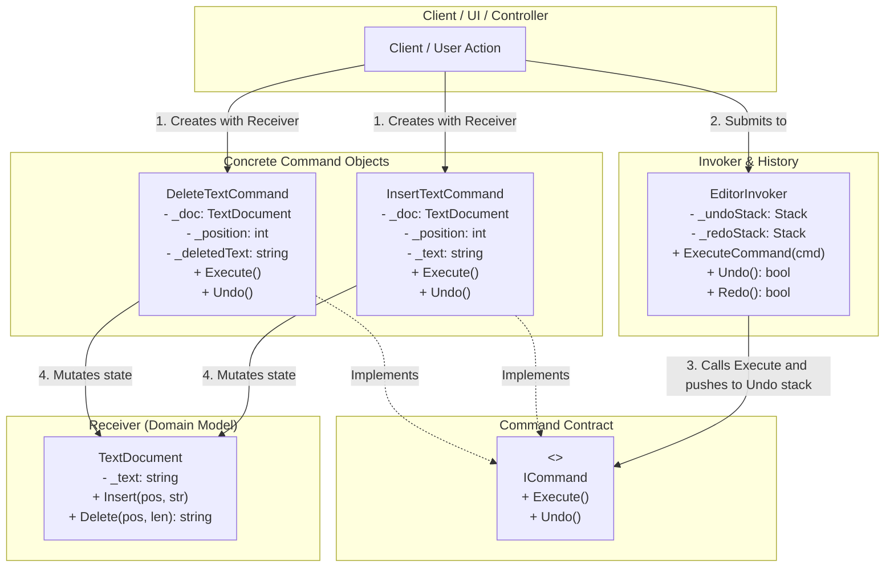

# Lesson 17: Command

> **Prerequisites:** [Observer (Events, Delegates and Callbacks)](../16-observer/README.md) and [Track 25 Overview](../README.md).  
> **Estimated Reading Time:** 18 minutes  
> **Target Audience:** Engineers preparing for LLD, OOP, C#, or Python technical screening and architecture rounds.

> [!NOTE]
> **In one line:** **Command** turns a request into an object (`execute`, optionally `undo`) so you can queue it, log it, retry it, or reverse it later.

> [!TIP]
> **The One Rule of Command:** Reify requests into first-class objects: decouple the object invoking the operation from the object that knows how to perform it. By turning an action into an object with `Execute()` and `Undo()`, you transform ephemeral method calls into serializable, schedulable, queueable, and reversible units of work.

---

## 1. Why This Matters: The Interview Trap

"How would you design an interactive rich-text editor or transactional ledger that supports multi-level Undo and Redo, or a reliable background job processing engine?"

Junior candidates often suggest:
1. **The Full-State Snapshot Anti-Pattern:** *"Every time the user types or clicks a button, I take a complete snapshot of the entire document or database and push it into a list."* (For large documents or enterprise databases, copying the full state on every keystroke causes immediate $O(N \times M)$ memory exhaustion and devastating performance degradation.)
2. **The Direct Invocation Coupling:** *"The button or API controller directly invokes the receiver's private methods."* (This couples the invoker permanently to a specific receiver, preventing queuing, logging, macro recording, or transactional rollbacks.)

A senior engineer answers with **the Command Pattern**:
- An action is encapsulated as a standalone object implementing a uniform interface (`Execute()` and `Undo()`).
- The command retains the receiver reference and the specific delta/parameters required to perform and reverse the action.
- An **Invoker / History Manager** maintains two stacks: `_undoStack` and `_redoStack`.
- The invoker knows nothing about *what* the command does; it merely orchestrates invocation and stack transitions.

Furthermore, this same pattern underpins modern architectural foundations: **CQRS (Command Query Responsibility Segregation)**, distributed transaction sagas, and asynchronous job schedulers (Hangfire, Celery).

---

## 2. Visual Mental Model / Taxonomic Comparison

The Command pattern cleanly separates four distinct responsibilities:
1. **Client:** Instantiates the Receiver and configures the Command.
2. **Invoker:** Triggers the Command and manages the history stacks.
3. **Command Contract:** Defines `Execute()` and `Undo()`.
4. **Receiver:** Performs the actual business logic or state modification.



### Taxonomic Comparison: Command vs. Strategy vs. Memento

Engineers often confuse Command with Strategy and Memento:

| Dimension | Command Pattern | Strategy Pattern | Memento Pattern |
| :--- | :--- | :--- | :--- |
| **Core Intent** | Encapsulate an **action or request** as an object over time (undo, queue, schedule). | Encapsulate an **interchangeable algorithm** to swap behavior from the outside. | Capture and externalize an object's **internal state snapshot** without violating encapsulation. |
| **Statefulness** | **Stateful:** Stores parameters, receiver reference, and execution delta for undo. | **Stateless:** Generally pure algorithms without request-specific state. | **Pure State:** Holds raw snapshot data, with zero business logic or execution methods. |
| **Reversibility** | **First-class:** Built-in `Undo()` operation. | Not applicable (algorithms compute results, they do not undo). | **Restorative:** Restores state by reassigning the captured snapshot back to the originator. |
| **Typical Lifetime** | Long-lived: Resides in history stacks, message queues, or event logs. | Short-lived / Singleton: Injected once into Context or reused indefinitely. | Ephemeral: Held in a caretaker stack until discarded or restored. |

---

## 3. Code Implementation

The following complete implementation demonstrates an interactive Text Document Editor featuring multi-level `Undo` and `Redo`. 

Notice how `DeleteTextCommand` dynamically captures the deleted substring during `Execute()`, allowing it to restore the exact deleted characters during `Undo()` without storing full document snapshots.

````carousel
```python
from abc import ABC, abstractmethod
from typing import List


# --- Receiver: The Domain Entity ---
class TextDocument:

  def __init__(self) -> None:
    self._text: str = ""

  @property
  def text(self) -> str:
    return self._text

  def insert(self, position: int, content: str) -> None:
    position = max(0, min(position, len(self._text)))
    self._text = self._text[:position] + content + self._text[position:]

  def delete(self, position: int, length: int) -> str:
    position = max(0, min(position, len(self._text)))
    deleted_content = self._text[position : position + length]
    self._text = self._text[:position] + self._text[position + length :]
    return deleted_content


# --- Command Interface ---
class ICommand(ABC):

  @abstractmethod
  def execute(self) -> None:
    pass

  @abstractmethod
  def undo(self) -> None:
    pass


# --- Concrete Commands ---
class InsertTextCommand(ICommand):

  def __init__(
      self, document: TextDocument, position: int, text_to_insert: str
  ) -> None:
    self._document = document
    self._position = position
    self._text_to_insert = text_to_insert

  def execute(self) -> None:
    self._document.insert(self._position, self._text_to_insert)

  def undo(self) -> None:
    self._document.delete(self._position, len(self._text_to_insert))


class DeleteTextCommand(ICommand):

  def __init__(self, document: TextDocument, position: int, length: int) -> None:
    self._document = document
    self._position = position
    self._length = length
    self._deleted_text = ""  # Captured dynamically during execute to allow exact undo

  def execute(self) -> None:
    self._deleted_text = self._document.delete(self._position, self._length)

  def undo(self) -> None:
    self._document.insert(self._position, self._deleted_text)


# --- Invoker: Command History Manager ---
class EditorInvoker:

  def __init__(self, document: TextDocument) -> None:
    self._document = document
    self._undo_stack: List[ICommand] = []
    self._redo_stack: List[ICommand] = []

  def execute_command(self, command: ICommand) -> None:
    command.execute()
    self._undo_stack.append(command)
    self._redo_stack.clear()  # Clear redo history upon new command
    self._print_state(f"Executed: {command.__class__.__name__}")

  def undo(self) -> bool:
    if not self._undo_stack:
      print("Nothing to undo.")
      return False
    command = self._undo_stack.pop()
    command.undo()
    self._redo_stack.append(command)
    self._print_state(f"Undo: {command.__class__.__name__}")
    return True

  def redo(self) -> bool:
    if not self._redo_stack:
      print("Nothing to redo.")
      return False
    command = self._redo_stack.pop()
    command.execute()
    self._undo_stack.append(command)
    self._print_state(f"Redo: {command.__class__.__name__}")
    return True

  def _print_state(self, action: str) -> None:
    print(f"[{action}] Document content: '{self._document.text}'")


if __name__ == "__main__":
  doc = TextDocument()
  editor = EditorInvoker(doc)

  # Execute commands
  editor.execute_command(InsertTextCommand(doc, 0, "Hello"))
  editor.execute_command(InsertTextCommand(doc, 5, " World"))
  editor.execute_command(InsertTextCommand(doc, 11, "!"))

  # Undo two actions
  editor.undo()
  editor.undo()

  # Redo one action
  editor.redo()

  # New operation invalidates redo stack
  editor.execute_command(InsertTextCommand(doc, 11, " Universe!"))
  editor.execute_command(DeleteTextCommand(doc, 6, 9))
  editor.undo()
```
<!-- slide -->
```csharp
using System;
using System.Collections.Generic;

// --- Receiver: The Domain Entity ---
public class TextDocument
{
    private string _text = string.Empty;

    public string Text => _text;

    public void Insert(int position, string content)
    {
        position = Math.Clamp(position, 0, _text.Length);
        _text = _text.Insert(position, content);
    }

    public string Delete(int position, int length)
    {
        position = Math.Clamp(position, 0, _text.Length);
        int validLength = Math.Min(length, _text.Length - position);
        string deletedContent = _text.Substring(position, validLength);
        _text = _text.Remove(position, validLength);
        return deletedContent;
    }
}

// --- Command Interface ---
public interface ICommand
{
    void Execute();
    void Undo();
}

// --- Concrete Commands ---
public class InsertTextCommand : ICommand
{
    private readonly TextDocument _document;
    private readonly int _position;
    private readonly string _textToInsert;

    public InsertTextCommand(TextDocument document, int position, string textToInsert)
    {
        _document = document;
        _position = position;
        _textToInsert = textToInsert;
    }

    public void Execute()
    {
        _document.Insert(_position, _textToInsert);
    }

    public void Undo()
    {
        _document.Delete(_position, _textToInsert.Length);
    }
}

public class DeleteTextCommand : ICommand
{
    private readonly TextDocument _document;
    private readonly int _position;
    private readonly int _length;
    private string _deletedText = string.Empty; // Captured dynamically during execute to allow exact undo

    public DeleteTextCommand(TextDocument document, int position, int length)
    {
        _document = document;
        _position = position;
        _length = length;
    }

    public void Execute()
    {
        _deletedText = _document.Delete(_position, _length);
    }

    public void Undo()
    {
        _document.Insert(_position, _deletedText);
    }
}

// --- Invoker: Command History Manager ---
public class EditorInvoker
{
    private readonly TextDocument _document;
    private readonly Stack<ICommand> _undoStack = new();
    private readonly Stack<ICommand> _redoStack = new();

    public EditorInvoker(TextDocument document)
    {
        _document = document;
    }

    public void ExecuteCommand(ICommand command)
    {
        command.Execute();
        _undoStack.Push(command);
        _redoStack.Clear(); // Clear redo history upon new command
        PrintState($"Executed: {command.GetType().Name}");
    }

    public bool Undo()
    {
        if (_undoStack.Count == 0)
        {
            Console.WriteLine("Nothing to undo.");
            return false;
        }

        ICommand command = _undoStack.Pop();
        command.Undo();
        _redoStack.Push(command);
        PrintState($"Undo: {command.GetType().Name}");
        return true;
    }

    public bool Redo()
    {
        if (_redoStack.Count == 0)
        {
            Console.WriteLine("Nothing to redo.");
            return false;
        }

        ICommand command = _redoStack.Pop();
        command.Execute();
        _undoStack.Push(command);
        PrintState($"Redo: {command.GetType().Name}");
        return true;
    }

    private void PrintState(string action)
    {
        Console.WriteLine($"[{action}] Document content: '{_document.Text}'");
    }
}

public class Program
{
    public static void Main()
    {
        var doc = new TextDocument();
        var editor = new EditorInvoker(doc);

        // Execute commands
        editor.ExecuteCommand(new InsertTextCommand(doc, 0, "Hello"));
        editor.ExecuteCommand(new InsertTextCommand(doc, 5, " World"));
        editor.ExecuteCommand(new InsertTextCommand(doc, 11, "!"));

        // Undo two actions
        editor.Undo();
        editor.Undo();

        // Redo one action
        editor.Redo();

        // New operation invalidates redo stack
        editor.ExecuteCommand(new InsertTextCommand(doc, 11, " Universe!"));
        editor.ExecuteCommand(new DeleteTextCommand(doc, 6, 9));
        editor.Undo();
    }
}
```
````

**Expected Output (Both Languages):**

```text
[Executed: InsertTextCommand] Document content: 'Hello'
[Executed: InsertTextCommand] Document content: 'Hello World'
[Executed: InsertTextCommand] Document content: 'Hello World!'
[Undo: InsertTextCommand] Document content: 'Hello World'
[Undo: InsertTextCommand] Document content: 'Hello'
[Redo: InsertTextCommand] Document content: 'Hello World'
[Executed: InsertTextCommand] Document content: 'Hello World Universe!'
[Executed: DeleteTextCommand] Document content: 'Hello verse!'
[Undo: DeleteTextCommand] Document content: 'Hello World Universe!'
```

---

## 4. Where You Already Use It

The Command pattern is present throughout enterprise backend and client architectures:

### In .NET / C#
- **`System.Windows.Input.ICommand` (WPF / .NET MAUI / Avalonia):** Powers MVVM UI bindings. Views bind buttons to ViewModel commands via `Execute(parameter)` and `CanExecute(parameter)`.
- **CQRS and MediatR:** In CQRS, requests that mutate state are modeled as Command classes (e.g., `CreateOrderCommand : IRequest<OrderResponse>`). The command contains serializable payload data and is handled by a dedicated `IRequestHandler<CreateOrderCommand, OrderResponse>`.
- **EF Core Database Migrations:** Every migration step (`migrationBuilder.CreateTable`, `migrationBuilder.DropColumn`) is a command. The `Up()` method executes the command, while the `Down()` method is the exact `Undo()` counterpart.
- **Hangfire and Quartz.NET:** Background job runners serialize method calls, target types, and arguments into JSON command payloads stored in SQL Server or Redis, executing them asynchronously on background worker threads.

### In Python
- **Celery & Redis Queue (RQ):** Asynchronous task definitions (`@app.task def process_video(id)`) produce task signature command objects (`process_video.delay(id)`). The command is serialized, pushed to RabbitMQ/Redis, and consumed by distributed worker pools.
- **CLI Frameworks (`Click`, `argparse`):** Commands are modeled as discrete callable handlers associated with subcommands (e.g., `git commit`, `git checkout`).
- **Django Migrations:** Django migration operations (`migrations.CreateModel`, `migrations.AddField`) encapsulate forward state mutation and reverse un-application logic.

---

## 5. Pitfalls and When Not to Use It

1. **Command Class Explosion:**
   - *Problem:* Creating a full class for every single primitive interaction in a simple application leads to hundreds of tiny boilerplate files.
   - *Fix:* For lightweight actions without undo requirements, use lambda delegates (`Action` or `Callable`). Reserve formal command classes for operations that require history stacks, queuing, authorization, or compensation logic.

2. **Unbounded History Stack Memory Bloat:**
   - *Problem:* In long-running document editors or desktop apps, an unbounded `Stack<ICommand>` retains references to every edited delta and deleted asset. If an author writes for 8 hours, gigabytes of dead memory are trapped.
   - *Fix:* Enforce a maximum history limit using a bounded ring buffer or deque (e.g., limit history to the last 50 commands).

3. **State Drift & External Concurrency:**
   - *Problem:* If Command A modifies row 10, then an external background process or concurrent user modifies row 10, invoking `CommandA.Undo()` can overwrite the concurrent update, corrupting data.
   - *Fix:* Use optimistic concurrency control (row versioning / timestamps). Verify the expected baseline state before applying `Undo()`.

4. **Irreversible Real-World Side Effects:**
   - *Problem:* Attempting to implement `Undo()` for non-reversible operations like sending an SMS, charging a payment card, or dispatching a webhook.
   - *Fix:* In distributed microservices, use **Compensating Transactions (Saga Pattern)** rather than naive undo. You cannot "un-send" an email; you send a follow-up correction email. You cannot "un-charge" a credit card; you issue a refund transaction.

---

## 6. Exercises & Practical Drills

### Drill 1: Bounding the History Stack
In a high-throughput image or document processing application, an editor can easily execute 10,000 commands per session. If `_undoStack` is an ordinary `Stack<ICommand>` or `list`, memory usage grows indefinitely.

How would you implement a bounded history stack that retains at most $K$ commands?

<details>
<summary>Answer</summary>

Replace the standard unbounded stack with a **Double-Ended Queue (Deque)**:
- In **Python**: Use `collections.deque(maxlen=K)`. When the maximum length is reached, pushing an item to the right automatically evicts the oldest item from the left in $O(1)$ time.
- In **C#**: Use a custom `CircularBuffer<T>` or `LinkedList<T>` with a capacity guard:
```csharp
public class BoundedStack<T>
{
    private readonly LinkedList<T> _list = new();
    private readonly int _capacity;

    public BoundedStack(int capacity) => _capacity = capacity;

    public void Push(T item)
    {
        if (_list.Count >= _capacity)
            _list.RemoveFirst(); // Evict oldest
        _list.AddLast(item);
    }

    public T Pop()
    {
        if (_list.Count == 0) throw new InvalidOperationException();
        T val = _list.Last!.Value;
        _list.RemoveLast();
        return val;
    }
}
```
</details>

### Drill 2: Undo vs. Compensating Transaction
A customer clicks "Book Flight". The system:
1. Reserves seat 12B in the airline inventory.
2. Charges the customer's credit card \$350.
3. Generates a PDF boarding pass.

If step 3 fails, can the command pattern's in-memory `Undo()` cleanly reverse steps 1 and 2 in a distributed system?

<details>
<summary>Answer</summary>

No. In a distributed multi-service architecture, in-memory command `Undo()` is insufficient because:
- The payment gateway has already processed the authorization/capture externally; it cannot be "rolled back" like an in-memory string.
- Network calls can fail during undo itself.

Instead, distributed systems use the **Saga Pattern with Compensating Commands**:
- For Step 2: Dispatch a `RefundPaymentCommand` with the transaction ID.
- For Step 1: Dispatch a `ReleaseSeatReservationCommand`.
Each compensating command must be **idempotent**, persisted in a message broker or outbox table, and retried until confirmed.
</details>

---

## 7. Interview Questions & Model Answers

<details>
<summary><strong>1. What is the Command pattern? [BASIC]</strong></summary>

The Command pattern is a behavioral design pattern that turns a request into a stand-alone object containing all information about the request: the target receiver, the method to call, and the method arguments.

By encapsulating requests as objects, it decouples the object that invokes the operation (such as a UI button, scheduler, or HTTP controller) from the receiver that performs the actual business logic. This parameterization enables advanced operational capabilities that standard method calls cannot provide: queuing requests, scheduling delayed execution, logging transaction history for crash recovery (Write-Ahead Logging), and implementing multi-level Undo/Redo mechanisms through an `Undo()` method.

</details>

<details>
<summary><strong>2. How would you implement undo? [SCENARIO]</strong></summary>

Undo is implemented by pairing the Command pattern with a **dual-stack History Manager** (an Undo stack and a Redo stack):

1. The command interface exposes two symmetrical methods: `Execute()` and `Undo()`.
2. Each concrete command captures the necessary delta or prior state during execution (for example, `DeleteCommand` stores the exact text it deleted).
3. When a command executes, the invoker pushes it onto the `_undoStack` and clears the `_redoStack`.
4. When the user requests **Undo**, the invoker pops the most recent command from `_undoStack`, calls its `Undo()` method to reverse the mutation, and pushes it onto `_redoStack`.
5. When the user requests **Redo**, the invoker pops from `_redoStack`, calls `Execute()`, and pushes it back onto `_undoStack`.
6. To prevent unbounded memory consumption, the undo stack should be backed by a bounded ring buffer or deque with a fixed capacity.

</details>

<details>
<summary><strong>3. Where is the Command pattern used in real systems? [SCENARIO]</strong></summary>

The Command pattern is ubiquitous across modern enterprise architectures:

1. **CQRS Architectures (MediatR / Axon):** In Command Query Responsibility Segregation, write operations are modeled as discrete Command objects (e.g., `RegisterUserCommand`). Handlers process commands independently from queries, providing clean transaction boundaries and authorization pipelines.
2. **Desktop and Web GUIs:** In WPF, .NET MAUI, and web applications, buttons and hotkeys bind to `ICommand` instances, allowing buttons to enable or disable automatically via `CanExecute()` without coupling to UI components.
3. **Asynchronous Job & Task Queues (Hangfire, Celery, Quartz.NET):** When a worker schedules a job, the task arguments and execution path are serialized into a command payload and placed on a Redis or RabbitMQ queue. Worker nodes dequeue the command and invoke `Execute()`.
4. **Database Migration Engines (EF Core, Flyway):** Database migrations represent schema changes as forward commands (`Up()`) and reverse undo commands (`Down()`).

</details>

<details>
<summary><strong>4. How would you build a job queue with retries using Command? [SCENARIO]</strong></summary>

Each job is a command object with `execute()` and serialisable data. A worker pulls from the queue, runs it, and on failure re-enqueues with a retry count and backoff. Because it is an object it can be persisted and logged.

</details>

<details>
<summary><strong>5. How do you undo something that is not reversible, like sending an email? [TRICKY]</strong></summary>

You can't truly undo it; model a *compensating* action (send a correction) or mark the command non-undoable and disable undo for it. Be honest about which commands are reversible.

</details>

<details>
<summary><strong>6. Command vs Strategy? [BASIC]</strong></summary>

Strategy changes *how* a single operation is done. Command packages *an operation to be done* (with its arguments and receiver) so it can be passed around, queued or undone.

</details>

---

## Try it

Run this: every command knows how to undo itself, and a stack gives you Ctrl+Z. Then redraw it in [LLD Studio](/tools/lld-studio/); the [track hub](../README.md) has the pattern-choice drills.

```python
class Doc: text = ""

class Append:
    def __init__(self, doc, s): self.doc, self.s = doc, s
    def do(self): self.doc.text += self.s
    def undo(self): self.doc.text = self.doc.text[:-len(self.s)]

d, history = Doc(), []
for s in ("a", "b"):
    c = Append(d, s); c.do(); history.append(c)
assert d.text == "ab"
history.pop().undo()
assert d.text == "a"
```

---

## One-page cheat sheet

```text
COMMAND  Invoker -> Command { execute(), undo() } -> Receiver
Request becomes an OBJECT: store, queue, log, serialise, retry, undo
Undo: keep a history stack (+ redo stack); command stores what it needs to revert
Macro command = list of commands | Transaction = all-or-nothing batch
.NET: ICommand (WPF), MediatR requests | Py: callables + partial
Command (request as object) | Strategy (swap algorithm) | Memento (state snapshot)
Pitfalls: command bloat, non-reversible side effects (emails)
```

---

## 8. Sources & Further Reading

- [Microsoft Learn: ICommand Interface in .NET](https://learn.microsoft.com/en-us/dotnet/api/system.windows.input.icommand)
- [Martin Fowler: Command Query Responsibility Segregation (CQRS)](https://martinfowler.com/bliki/CQRS.html)
- [Refactoring.Guru: Command Design Pattern](https://refactoring.guru/design-patterns/command)
- [Python Celery Documentation: Tasks and Canvas Workflows](https://docs.celeryq.dev/en/stable/userguide/tasks.html)

---

Previous: [Observer (Events, Delegates and Callbacks)](../16-observer/README.md) · Next: [Template Method](../18-template-method/README.md)
