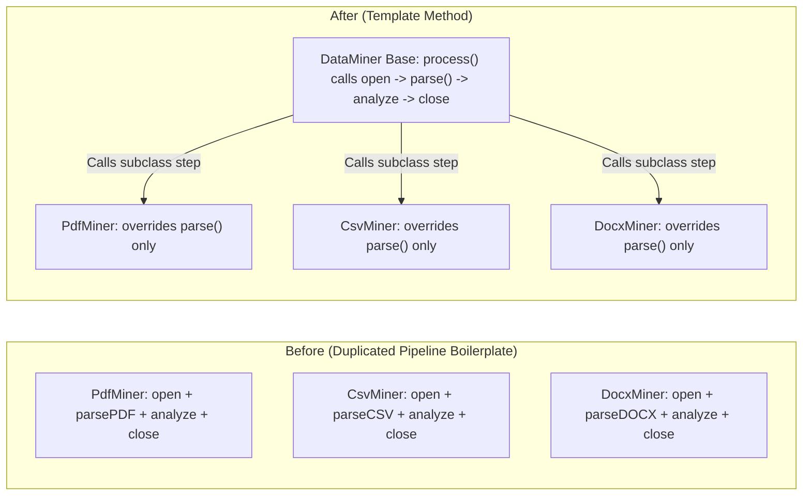
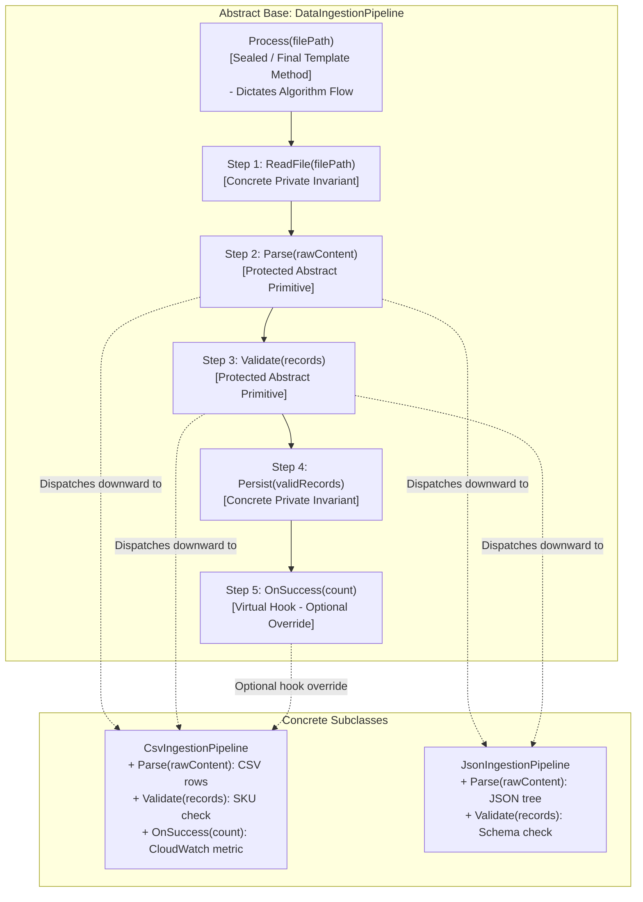

# Lesson 18: Template Method

> **Prerequisites:** [Command](../17-command/README.md) and [Track 25 Overview](../README.md).  
> **Estimated Reading Time:** 18 minutes  
> **Target Audience:** Engineers preparing for LLD, OOP, C#, or Python technical screening and architecture rounds.

> [!NOTE]
> **In one line:** **Template Method** fixes the skeleton of an algorithm in a base class and lets subclasses fill in specific steps — the base class calls the subclass (the "Hollywood principle").

> [!TIP]
> **The One Rule of Template Method:** Invert control using the Hollywood Principle ("Don't call us, we'll call you"): fix the invariant execution skeleton in a non-overridable base method and let subclasses plug into abstract primitive steps and optional hooks. Never let subclasses override the skeleton itself.

---

## 1. Why This Matters: The Interview Trap

"You have multiple data ingestion or document parsing pipelines (e.g., CSV, JSON, XML). All of them follow the exact same lifecycle: open resource $\to$ parse payload $\to$ validate business rules $\to$ persist to database $\to$ publish audit metrics. How do you design this so engineers can add new formats without copying the lifecycle skeleton?"

Junior candidates frequently offer one of two flawed answers:
1. **The Copy-Paste Base Class:** *"I make an abstract class with a virtual `Process()` method, and each format overrides `Process()` and writes its own steps."*  
   **The Trap:** Overriding `Process()` leads to catastrophic drift. One developer forgets to call `Validate()`, another forgets to emit audit metrics, and a third runs validation before parsing. The core business invariants of your architecture are completely destroyed.
2. **The Procedural Monster:** *"I write one giant procedural function with a `switch(fileFormat)` block inside each step."* (Violates Single Responsibility and Open/Closed principles; every new format risks breaking existing ones.)

A senior engineer explains **the Template Method Pattern**:
- The base class defines the **Template Method** (marked `final` in Python, non-virtual or `sealed` in C#) which sets the rigid, immutable sequence of steps.
- Common invariant steps (e.g., opening files, database transactions) are implemented privately in the base class.
- Variable steps are declared as **protected abstract primitives** that derived classes *must* implement (e.g., `_parse()`, `_validate()`).
- Optional extension points are declared as **virtual hooks** with default no-op behavior (e.g., `_on_success()`).
- The base class calls the derived class methods, inverting the traditional flow of control.

---

## 1A. The Visual Story: Problem -> Analogy -> Solution

### The Problem (Why Naive Code Explodes)

Imagine you are building a data-mining tool that extracts insights from **PDF**, **CSV**, and **DOCX** files. You write three separate classes: `PdfMiner`, `CsvMiner`, and `DocxMiner`. All three open a file, extract raw bytes, parse records, run the exact same analytics engine, persist results, and close the file handle. Within weeks, 80% of the boilerplate—error handling, file cleanup, metrics emission—is copy-pasted across all three classes. When a security patch requires changing how files are opened or audited, you have to hunt down and update every single miner class.

### Real-World Analogy

Think of a **standardized house blueprint** used by a construction company. Every house follows the exact same construction sequence: *pour foundation -> frame walls -> install roof -> wire plumbing -> paint interior*. The blueprint fixes this order so nobody puts the roof on before pouring the foundation. However, individual buyers can customize specific steps—choosing a flat or pitched roof, or hardwood vs. tile flooring—without altering the core building sequence.

### Visual Problem -> Solution Diagram



### Applicability & Pattern Relations

**Use Template Method when:**
- Multiple classes share the exact same algorithmic skeleton and differ only in specific sub-steps.
- You must enforce an invariant execution order (e.g., always validate and audit before persisting) so subclasses cannot skip critical steps.
- You want to eliminate duplicated boilerplate across sibling implementations by pulling invariant logic into a base class.

**Relations with Other Patterns:**
- **Factory Method:** Often acts as a specialized step inside a Template Method to let subclasses decide which helper object to instantiate.
- **Strategy:** Strategy uses composition to swap the *entire* algorithm at runtime, whereas Template Method uses inheritance to vary *parts* of an algorithm at compile time.
- **Observer / Hooks:** Virtual hook methods in Template Method provide lightweight extension points similar to lifecycle callbacks.

---

## 2. Visual Mental Model / Taxonomic Comparison

In the Template Method pattern, control is inverted: the base class method drives the algorithm, calling downward into primitive steps and hooks implemented by derived classes.



### Taxonomic Comparison: Template Method vs. Strategy vs. Factory Method

Candidates are often asked to distinguish between Template Method and Strategy:

| Dimension | Template Method Pattern | Strategy Pattern | Factory Method Pattern |
| :--- | :--- | :--- | :--- |
| **Coupling Mechanism** | **Inheritance:** Subclass extends an abstract base class. | **Composition:** Context holds a reference to an interface. | **Inheritance:** Subclass overrides a creation method. |
| **Binding Time** | **Compile-Time:** Static hierarchy determined at class definition. | **Runtime:** Dynamic; strategies can be swapped on the fly. | **Compile-Time / Dynamic:** Decided via object instantiation. |
| **Granularity of Variation** | **Sub-step variation:** Only specific primitive steps change; the algorithm skeleton is fixed. | **Entire algorithm variation:** The entire algorithmic implementation is replaced wholesale. | **Object creation variation:** Only the creation of the product is overridden. |
| **Control Flow** | **Hollywood Principle:** Base class controls flow and calls derived methods ("Don't call us, we'll call you"). | Context delegates work to the injected strategy object. | Client calls creator method, which delegates instantiation to subclass. |

---

## 3. Code Implementation

The following complete implementation shows a data ingestion pipeline. The template method `process()` is locked down (`@final` in Python, non-virtual in C#), guaranteeing that reading, parsing, validation, persistence, and metric hooks always execute in the exact prescribed order.

````carousel
```python
from abc import ABC, abstractmethod
from typing import Any, Dict, List, final


class DataIngestionPipeline(ABC):

  @final
  def process(self, file_path: str) -> int:
    """The Template Method: Defines the invariant algorithmic skeleton.

    Marked @final to prevent subclasses from altering the execution order.
    """
    print(f"\n[Pipeline] Starting ingestion for: '{file_path}'")
    raw_content = self._read_file(file_path)
    records = self._parse(raw_content)
    valid_records = self._validate(records)
    self._persist(valid_records)
    self._on_success(len(valid_records))
    print(f"[Pipeline] Successfully ingested {len(valid_records)} records.")
    return len(valid_records)

  # --- Concrete Invariant Steps ---
  def _read_file(self, file_path: str) -> str:
    print(f"[Step 1: Read] Opening and buffering '{file_path}'")
    # Simulated content read
    return "raw_payload_data"

  def _persist(self, records: List[Dict[str, Any]]) -> None:
    print(f"[Step 4: Persist] Writing {len(records)} records into Database")

  # --- Abstract Primitive Steps (Must be implemented by subclasses) ---
  @abstractmethod
  def _parse(self, raw_content: str) -> List[Dict[str, Any]]:
    """Subclasses parse raw payload into structured dictionary records."""
    pass

  @abstractmethod
  def _validate(
      self, records: List[Dict[str, Any]]
  ) -> List[Dict[str, Any]]:
    """Subclasses apply domain-specific validation rules."""
    pass

  # --- Virtual Hook (Optional override with sensible default) ---
  def _on_success(self, count: int) -> None:
    """Hook: Optional post-processing action."""
    pass


# --- Concrete Subclasses ---
class CsvIngestionPipeline(DataIngestionPipeline):

  def _parse(self, raw_content: str) -> List[Dict[str, Any]]:
    print("[Step 2: Parse] Splitting CSV rows and headers")
    return [{"id": 1, "sku": "WIDGET-A"}, {"id": 2, "sku": "WIDGET-B"}]

  def _validate(
      self, records: List[Dict[str, Any]]
  ) -> List[Dict[str, Any]]:
    print("[Step 3: Validate] Verifying SKU alphanumeric format")
    return [r for r in records if "sku" in r]

  def _on_success(self, count: int) -> None:
    print(f"[Hook: Metric] Publishing CloudWatch metric: ingested_csv={count}")


class JsonIngestionPipeline(DataIngestionPipeline):

  def _parse(self, raw_content: str) -> List[Dict[str, Any]]:
    print("[Step 2: Parse] Deserializing JSON document tree")
    return [{"id": 101, "sku": "GADGET-X", "valid": True}]

  def _validate(
      self, records: List[Dict[str, Any]]
  ) -> List[Dict[str, Any]]:
    print("[Step 3: Validate] Validating JSON schema properties")
    return [r for r in records if r.get("valid") is True]

  # Does not override _on_success, uses default base hook


if __name__ == "__main__":
  csv_pipeline = CsvIngestionPipeline()
  csv_pipeline.process("data/inventory.csv")

  json_pipeline = JsonIngestionPipeline()
  json_pipeline.process("data/orders.json")
```
<!-- slide -->
```csharp
using System;
using System.Collections.Generic;
using System.Linq;

public record IngestionRecord(int Id, string Sku, bool IsValid = true);

public abstract class DataIngestionPipeline
{
    // The Template Method: Defines the invariant algorithmic skeleton.
    // Non-virtual so subclasses cannot alter execution flow.
    public int Process(string filePath)
    {
        Console.WriteLine($"\n[Pipeline] Starting ingestion for: '{filePath}'");
        string rawContent = ReadFile(filePath);
        IReadOnlyList<IngestionRecord> records = Parse(rawContent);
        IReadOnlyList<IngestionRecord> validRecords = Validate(records);
        Persist(validRecords);
        OnSuccess(validRecords.Count);
        Console.WriteLine($"[Pipeline] Successfully ingested {validRecords.Count} records.");
        return validRecords.Count;
    }

    // --- Concrete Invariant Steps ---
    private string ReadFile(string filePath)
    {
        Console.WriteLine($"[Step 1: Read] Opening and buffering '{filePath}'");
        return "raw_payload_data";
    }

    private void Persist(IReadOnlyList<IngestionRecord> records)
    {
        Console.WriteLine($"[Step 4: Persist] Writing {records.Count} records into Database");
    }

    // --- Abstract Primitive Steps (Must be implemented by subclasses) ---
    protected abstract IReadOnlyList<IngestionRecord> Parse(string rawContent);
    protected abstract IReadOnlyList<IngestionRecord> Validate(IReadOnlyList<IngestionRecord> records);

    // --- Virtual Hook (Optional override with sensible default) ---
    protected virtual void OnSuccess(int count)
    {
        // Default hook does nothing
    }
}

// --- Concrete Subclasses ---
public class CsvIngestionPipeline : DataIngestionPipeline
{
    protected override IReadOnlyList<IngestionRecord> Parse(string rawContent)
    {
        Console.WriteLine("[Step 2: Parse] Splitting CSV rows and headers");
        return new List<IngestionRecord>
        {
            new IngestionRecord(1, "WIDGET-A"),
            new IngestionRecord(2, "WIDGET-B")
        };
    }

    protected override IReadOnlyList<IngestionRecord> Validate(IReadOnlyList<IngestionRecord> records)
    {
        Console.WriteLine("[Step 3: Validate] Verifying SKU alphanumeric format");
        return records.Where(r => !string.IsNullOrEmpty(r.Sku)).ToList();
    }

    protected override void OnSuccess(int count)
    {
        Console.WriteLine($"[Hook: Metric] Publishing CloudWatch metric: ingested_csv={count}");
    }
}

public class JsonIngestionPipeline : DataIngestionPipeline
{
    protected override IReadOnlyList<IngestionRecord> Parse(string rawContent)
    {
        Console.WriteLine("[Step 2: Parse] Deserializing JSON document tree");
        return new List<IngestionRecord>
        {
            new IngestionRecord(101, "GADGET-X", true)
        };
    }

    protected override IReadOnlyList<IngestionRecord> Validate(IReadOnlyList<IngestionRecord> records)
    {
        Console.WriteLine("[Step 3: Validate] Validating JSON schema properties");
        return records.Where(r => r.IsValid).ToList();
    }

    // Does not override OnSuccess, uses default base hook
}

public class Program
{
    public static void Main()
    {
        var csvPipeline = new CsvIngestionPipeline();
        csvPipeline.Process("data/inventory.csv");

        var jsonPipeline = new JsonIngestionPipeline();
        jsonPipeline.Process("data/orders.json");
    }
}
```
````

**Expected Output (Both Languages):**

```text
[Pipeline] Starting ingestion for: 'data/inventory.csv'
[Step 1: Read] Opening and buffering 'data/inventory.csv'
[Step 2: Parse] Splitting CSV rows and headers
[Step 3: Validate] Verifying SKU alphanumeric format
[Step 4: Persist] Writing 2 records into Database
[Hook: Metric] Publishing CloudWatch metric: ingested_csv=2
[Pipeline] Successfully ingested 2 records.

[Pipeline] Starting ingestion for: 'data/orders.json'
[Step 1: Read] Opening and buffering 'data/orders.json'
[Step 2: Parse] Deserializing JSON document tree
[Step 3: Validate] Validating JSON schema properties
[Step 4: Persist] Writing 1 records into Database
[Pipeline] Successfully ingested 1 records.
```

---

## 3A. Where It Is Used, Why It Exists & Progressive Buildup

### Where It Is Used (Real-World Systems & LLD Interviews)

| Domain / Ecosystem | Concrete Real-World Usage | LLD Interview Problem Where You Use It |
| :--- | :--- | :--- |
| **.NET / C#** | `AuthenticationHandler<TOptions>.HandleAuthenticateOnceAsync()`, `BackgroundService.StartAsync()` $\to$ `ExecuteAsync()`, `System.IO.Stream.Read()`, `IDisposable` pattern | Multi-Format Data Ingestion / ETL Pipeline |
| **Python** | `unittest.TestCase` (`setUp` $\to$ `runTest` $\to$ `tearDown`), Django `ListView` / `DetailView` (`get_queryset`, `get_context_data`), `http.server.BaseHTTPRequestHandler` | Report Generator (CSV / PDF / HTML) |
| **Go** | `sort.Interface` (`Len`, `Less`, `Swap` called by `sort.Sort`), `http.Handler` wrapper skeletons, custom `testing.M` setup/teardown harnesses | Order Checkout / Payment Settlement Lifecycle |
| **TypeScript / Node.js** | Angular / React class component lifecycles (`ngOnInit`, `componentDidMount`), NestJS `CanActivate` / `PipeTransform` base classes, Jest `beforeEach` / `afterEach` | Custom Auth Provider Pipeline (JWT / OAuth / API Key) |

### Why It Is Used — The Step-by-Step Buildup (Before -> Pain -> Pattern)

#### Stage 0: Naive Code (Duplicated Lifecycle per Class)
Suppose you start with two report exporters, `CsvExporter` and `JsonExporter`:

```python
class CsvExporter:
  def export(self, rows: list[dict]) -> str:
    # 1. Validate
    if not rows:
      raise ValueError("No rows")
    # 2. Format (varies)
    body = "\n".join(",".join(map(str, r.values())) for r in rows)
    # 3. Audit
    return f"[AUDIT:csv:{len(rows)}]\n{body}"


class JsonExporter:
  def export(self, rows: list[dict]) -> str:
    if not rows:
      raise ValueError("No rows")
    import json
    body = json.dumps(rows)
    return f"[AUDIT:json:{len(rows)}]\n{body}"
```

#### What Breaks as Requirements Grow
- **Requirement 2 arrives ("Every export must redact PII fields before formatting and emit a telemetry event even if formatting fails"):** You now have to copy-paste `redact_pii()` and a `try/finally` telemetry block into `CsvExporter.export()`, `JsonExporter.export()`, and every future exporter. A new engineer adding `ParquetExporter` forgets `redact_pii()`—creating a compliance incident.
- **Requirement 3 arrives ("Some exporters need an optional post-export compression step"):** Duplicating `if compress:` across every exporter bloats every class and violates DRY and Open/Closed.

#### Step-by-Step Refactoring into Template Method
1. **Lock the skeleton in the base class:** Move `export()` into `BaseExporter` and decorate it with `@final` so subclasses cannot reorder or skip validation, PII redaction, or telemetry.
2. **Keep invariants private/concrete:** `_validate()` and `_redact_pii()` live once in `BaseExporter`.
3. **Expose abstract primitives and optional hooks:** `_format()` is `@abstractmethod` (subclasses *must* implement it), while `_post_process()` is a virtual hook with a default no-op.

### Progressive Real-World Examples

#### Example A (Simple Core): Report Generator with Required Step & Optional Hook
```python
from abc import ABC, abstractmethod
from typing import final


class ReportGenerator(ABC):
  @final
  def generate(self, title: str, items: list[str]) -> str:
    header = f"=== {title.upper()} ==="
    body = self._format_body(items)
    footer = self._format_footer(len(items))
    return "\n".join(part for part in (header, body, footer) if part)

  @abstractmethod
  def _format_body(self, items: list[str]) -> str: ...

  def _format_footer(self, count: int) -> str:
    return ""  # Optional hook


class MarkdownReport(ReportGenerator):
  def _format_body(self, items: list[str]) -> str:
    return "\n".join(f"- {item}" for item in items)


class AuditedTextReport(ReportGenerator):
  def _format_body(self, items: list[str]) -> str:
    return "\n".join(f"* {item}" for item in items)

  def _format_footer(self, count: int) -> str:
    return f"Total items: {count}"


assert "=== SALES ===" in MarkdownReport().generate("sales", ["A", "B"])
assert "Total items: 2" in AuditedTextReport().generate("sales", ["A", "B"])
```

#### Example B (Production Backend): Pluggable Authentication Handler Lifecycle
Mirroring ASP.NET Core's `AuthenticationHandler<TOptions>`, the base class guarantees header extraction, failure handling, and audit logging, while subclasses only implement token verification:

```python
from abc import ABC, abstractmethod
from dataclasses import dataclass
from typing import final


@dataclass
class AuthResult:
  authenticated: bool
  subject: str | None = None
  reason: str | None = None


class BaseAuthHandler(ABC):
  def __init__(self) -> None:
    self.audit_events: list[str] = []

  @final
  def authenticate(self, headers: dict[str, str]) -> AuthResult:
    raw_token = self._extract_credential(headers)
    if not raw_token:
      result = AuthResult(False, reason="missing_credential")
    else:
      result = self._verify_credential(raw_token)
    self._on_audit(result)
    return result

  @abstractmethod
  def _extract_credential(self, headers: dict[str, str]) -> str | None: ...

  @abstractmethod
  def _verify_credential(self, token: str) -> AuthResult: ...

  def _on_audit(self, result: AuthResult) -> None:
    status = "ALLOW" if result.authenticated else f"DENY:{result.reason}"
    self.audit_events.append(status)


class ApiKeyAuthHandler(BaseAuthHandler):
  def __init__(self, valid_keys: dict[str, str]) -> None:
    super().__init__()
    self._valid_keys = valid_keys

  def _extract_credential(self, headers: dict[str, str]) -> str | None:
    return headers.get("X-API-Key")

  def _verify_credential(self, token: str) -> AuthResult:
    owner = self._valid_keys.get(token)
    return AuthResult(True, subject=owner) if owner else AuthResult(False, reason="invalid_key")


handler = ApiKeyAuthHandler({"k-123": "svc-billing"})
assert handler.authenticate({"X-API-Key": "k-123"}).subject == "svc-billing"
assert not handler.authenticate({}).authenticated
assert handler.audit_events == ["ALLOW", "DENY:missing_credential"]
```

#### Example C (Classic LLD Interview Problem): Order Fulfillment & Settlement Pipeline
In an e-commerce LLD interview, physical goods, digital downloads, and gift cards share the exact same checkout invariants (`validate_cart` $\to$ `reserve_or_provision` $\to$ `charge_payment` $\to$ `send_confirmation`), with only provisioning and optional shipping differing:

```python
from abc import ABC, abstractmethod
from typing import final


class OrderCheckoutTemplate(ABC):
  @final
  def checkout(self, order_id: str, amount: float) -> list[str]:
    trace: list[str] = []
    if amount <= 0:
      raise ValueError("Order amount must be positive")
    trace.append(self._reserve_inventory(order_id))
    trace.append(f"charged:{amount:.2f}")
    trace.append(self._deliver(order_id))
    trace.append("receipt_sent")
    return trace

  @abstractmethod
  def _reserve_inventory(self, order_id: str) -> str: ...

  @abstractmethod
  def _deliver(self, order_id: str) -> str: ...


class PhysicalOrderCheckout(OrderCheckoutTemplate):
  def _reserve_inventory(self, order_id: str) -> str:
    return f"warehouse_picked:{order_id}"

  def _deliver(self, order_id: str) -> str:
    return f"carrier_label_created:{order_id}"


class DigitalOrderCheckout(OrderCheckoutTemplate):
  def _reserve_inventory(self, order_id: str) -> str:
    return f"license_key_allocated:{order_id}"

  def _deliver(self, order_id: str) -> str:
    return f"download_link_emailed:{order_id}"


assert PhysicalOrderCheckout().checkout("ORD-1", 49.99) == [
    "warehouse_picked:ORD-1", "charged:49.99", "carrier_label_created:ORD-1", "receipt_sent"
]
assert DigitalOrderCheckout().checkout("ORD-2", 19.99) == [
    "license_key_allocated:ORD-2", "charged:19.99", "download_link_emailed:ORD-2", "receipt_sent"
]
```

---

## 4. Where You Already Use It

The Template Method pattern is the primary structural backbone for frameworks that expose lifecycle extension points:

### In .NET / C#
- **`AuthenticationHandler<TOptions>` in ASP.NET Core:** Base class provides the entire OAuth, Cookie, or JWT authentication skeleton (`InitializeAsync()`, `HandleAuthenticateOnceAsync()`). Developers only override primitive abstract steps such as `HandleAuthenticateAsync()` and `HandleChallengeAsync()`.
- **`BackgroundService` (Worker Services):** Implements `IHostedService.StartAsync()` to set up cancellation tokens and thread scheduling, calling the abstract primitive `ExecuteAsync(CancellationToken stoppingToken)`.
- **`System.IO.Stream`:** Non-virtual template methods like `Read(byte[], int, int)` check invariants (buffer bounds, null checks) and then invoke primitive abstract/virtual methods like `ReadCore()` or `ReadAsync()`.
- **`DbContext.OnModelCreating(ModelBuilder)` in EF Core:** EF Core's model construction lifecycle calls virtual configuration hooks.
- **The Standard `IDisposable` Pattern:** `Dispose()` template method sets GC suppression flags and calls `protected virtual void Dispose(bool disposing)`.

### In Python
- **`unittest.TestCase`:** The test runner defines the template lifecycle: `setUp()`, `runTest()`, and `tearDown()`. Developers only implement the specific test body and optional hooks.
- **`http.server.BaseHTTPRequestHandler`:** Base handles socket connections, HTTP header parsing, and dispatching to overridable hooks `do_GET()`, `do_POST()`.
- **Django Class-Based Generic Views (`ListView`, `DetailView`):** The `get()` template method orchestrates querying and rendering by invoking overridable steps `get_queryset()`, `get_context_data()`, and `render_to_response()`.

---

## 5. Pitfalls and When Not to Use It

1. **The Fragile Base Class Problem:**
   - *Problem:* Subclasses are tightly coupled to the base class implementation. If the base class template method adds a new mandatory primitive abstract step (`_sanitize()`), every single existing subclass across your codebase breaks compilation.
   - *Fix:* When evolving existing pipelines, provide new steps as **virtual hooks with default implementations** rather than abstract methods.

2. **Accidentally Permitting Template Method Overrides:**
   - *Problem:* If the base class author marks the template method `virtual` instead of leaving it non-virtual (or `sealed`), derived class authors can override the entire workflow, destroying invariant validations and audit guarantees.
   - *Fix:* In C#, make the template method non-virtual or `sealed override`. In Python, use `@typing.final` on the template method.

3. **Liskov Substitution Principle (LSP) Violations:**
   - *Problem:* A subclass overrides `_validate()` and throws `NotSupportedException` because that file format cannot be validated. This violates LSP and breaks callers who rely on the base contract.
   - *Fix:* If a step is truly optional or fundamentally inapplicable to certain formats, model the behavior using **Strategy composition** rather than forcing inheritance.

4. **Rigidity vs. Runtime Composition:**
   - *Problem:* You cannot change an algorithm step at runtime (e.g., swapping from in-memory parsing to streaming parsing based on file size) because inheritance hierarchies are fixed at compile time.
   - *Fix:* If steps must vary dynamically at runtime, replace the template hooks with injected Strategy objects.

---

## 6. Exercises & Practical Drills

### Drill 1: Template Method vs. Strategy Selection
Analyze the following two requirements:
1. Building a reporting service where reports (PDF, Excel, HTML) follow identical stages: `FetchData()`, `FormatRows()`, `RenderHeaders()`, `ExportToDisk()`.
2. Building an order processing system where tax calculation formulas change dynamically based on the customer's state or country code during checkout.

Which pattern fits each scenario, and why?

<details>
<summary>Answer</summary>

1. **Scenario 1 (Reports):** Use **Template Method**. The overall algorithm sequence (`Fetch` $\to$ `Format` $\to$ `Headers` $\to$ `Export`) is fixed and shared across all formats. Subclasses only need to supply the concrete formatting and rendering primitives.
2. **Scenario 2 (Tax Calculation):** Use **Strategy**. The tax calculation is chosen dynamically at runtime based on customer input. It does not share a multi-step algorithmic skeleton with common base code, and using inheritance would create a rigid class hierarchy that cannot be swapped dynamically.
</details>

### Drill 2: Enforcing Invariant Protection
Review this C# base class:
```csharp
public abstract class ETLJob
{
    public virtual void Run()
    {
        Extract();
        Transform();
        Load();
    }

    protected abstract void Extract();
    protected abstract void Transform();
    protected abstract void Load();
}
```
What subtle architectural flaw exists in `Run()`, and how do you remediate it?

<details>
<summary>Answer</summary>

**Flaw:** `Run()` is marked `virtual`. Any derived class can override `Run()` completely:
```csharp
public class RogueJob : ETLJob
{
    public override void Run()
    {
        // Forgot to call Extract() and Load()!
        Console.WriteLine("Did something unexpected");
    }
}
```
This destroys the entire invariant flow that the Template Method pattern is meant to protect.

**Remediation:** Remove the `virtual` keyword from `Run()`. In C#, non-virtual methods cannot be overridden, ensuring that the base class always controls algorithm execution. Subclasses are strictly constrained to providing implementations for `Extract()`, `Transform()`, and `Load()`.
</details>

---

## 7. Interview Questions & Model Answers

<details>
<summary><strong>1. What is the Template Method pattern? [BASIC]</strong></summary>

The Template Method pattern is a behavioral design pattern that defines the skeleton of an algorithm in a base class method, deferring some steps to subclasses without altering the overall algorithm structure.

The template method itself is marked non-virtual or final so that its execution sequence cannot be overridden. Inside this skeleton, the base class invokes common invariant methods (implemented in the base class), abstract primitive methods (which subclasses are required to implement), and optional virtual hooks (which subclasses may optionally override). It embodies the **Hollywood Principle** ('Don't call us, we'll call you'): the low-level subclasses do not call the high-level base class; instead, the high-level base class controls the flow and calls downward into the subclasses.

</details>

<details>
<summary><strong>2. What is the difference between Template Method and Strategy? [BASIC]</strong></summary>

While both patterns allow behavior to vary, they differ fundamentally across three architectural dimensions:

1. **Mechanism (Inheritance vs. Composition):** Template Method relies on **class inheritance**; algorithm steps are defined in derived classes. Strategy relies on **object composition**; the context delegates algorithm execution to an injected strategy interface.
2. **Granularity:** Template Method modifies **individual primitive steps** within an algorithm while keeping the overall algorithmic skeleton invariant. Strategy modifies or replaces the **entire algorithm wholesale**.
3. **Binding Time:** Template Method is bound **statically at compile time** via the class hierarchy. Strategy is bound **dynamically at runtime**, allowing strategies to be switched on the fly based on configuration or input.

</details>

<details>
<summary><strong>3. Give an example from daily engineering. [SCENARIO]</strong></summary>

A classic daily engineering example is **`AuthenticationHandler<TOptions>` in ASP.NET Core**.

When you implement custom authentication (like an API key or HMAC signature handler), you inherit from `AuthenticationHandler<TOptions>`. The base framework class defines the entire template method lifecycle: initializing options, checking for authorization scheme names, handling challenges, and caching authentication results. Developers never touch or override the outer pipeline; they only implement one abstract primitive method: `Task<AuthenticateResult> HandleAuthenticateAsync()`.

Another ubiquitous example is a **Data Ingestion ETL Pipeline**: the base class `DataIngestionPipeline` defines the template method `Process(file)` which sequentially executes: `OpenFile()` $\to$ `Parse()` $\to$ `Validate()` $\to$ `Persist()` $\to$ `OnSuccess()`. Subclasses like `CsvPipeline` and `JsonPipeline` only implement `Parse()` and `Validate()`, guaranteeing that file buffering, persistence transactions, and telemetry metrics cannot be bypassed.

</details>

<details>
<summary><strong>4. Three importers (CSV, JSON, XML) share validate → parse → save. How do you design them? [SCENARIO]</strong></summary>

A base `Importer.run()` that fixes the order, with `parse()` abstract and `validate()`/`save()` shared. Each format subclass implements only `parse()`.

</details>

<details>
<summary><strong>5. Why is Template Method called a violation of composition-over-inheritance? [TRICKY]</strong></summary>

It uses inheritance, so subclasses are coupled to the base's step order and internals (fragile base class). If you need to vary at runtime or combine variations, switch to Strategy objects.

</details>

<details>
<summary><strong>6. What is a hook method? [BASIC]</strong></summary>

An optional step with a default (often empty) implementation in the base class that subclasses *may* override to customise behaviour without being forced to.

</details>

---

## Try it

Run this: the base owns the order of steps; subclasses only supply the varying ones. Then redraw it in [LLD Studio](/tools/lld-studio/); the [track hub](../README.md) has the pattern-choice drills.

```python
class Report:
    def generate(self):                          # the template (do not override)
        return [self.header(), self.body(), "footer"]
    def header(self): return "header"
    def body(self): raise NotImplementedError    # required hook

class Sales(Report):
    def body(self): return "sales"

assert Sales().generate() == ["header", "sales", "footer"]
```

---

## One-page cheat sheet

```text
TEMPLATE METHOD  base.run() { step1(); step2() <abstract>; step3() <hook> }
Invariant order in the base; variation in overridable steps
Abstract step = must implement | Hook = optional override
Hollywood principle: "don't call us, we'll call you"
Template (inheritance, compile-time) | Strategy (composition, runtime)
C#: protected virtual / abstract | Py: ABC + hooks | frameworks: Controller lifecycle, unittest setUp/tearDown
Risks: fragile base class, deep hierarchies; prefer Strategy if it varies at runtime
```

---

## 8. Sources & Further Reading

- [Microsoft Learn: AuthenticationHandler<TOptions> Class](https://learn.microsoft.com/en-us/dotnet/api/microsoft.aspnetcore.authentication.authenticationhandler-1)
- [Microsoft Learn: BackgroundService Class in .NET](https://learn.microsoft.com/en-us/dotnet/api/microsoft.extensions.hosting.backgroundservice)
- [Python 3 Documentation: unittest — Unit testing framework](https://docs.python.org/3/library/unittest.html)
- [Python 3 Documentation: typing.final](https://docs.python.org/3/library/typing.html#typing.final)
- [Refactoring.Guru: Template Method Design Pattern](https://refactoring.guru/design-patterns/template-method)

---

Previous: [Command](../17-command/README.md) · Next: [State](../19-state/README.md)
