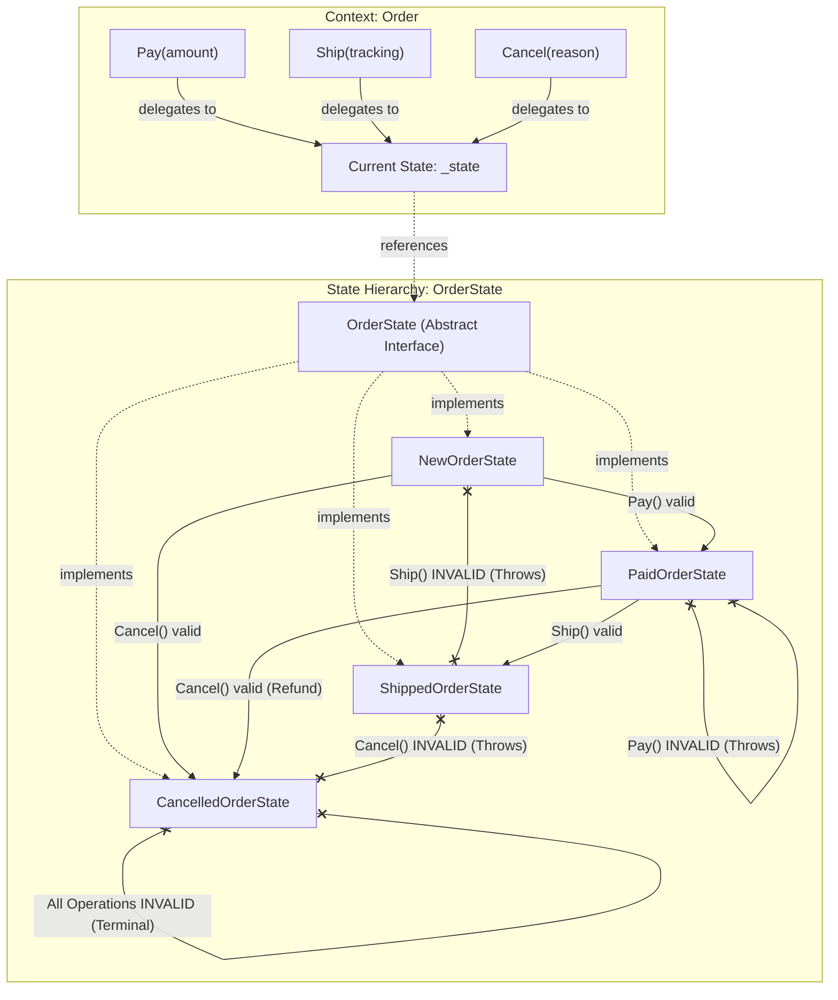

# Lesson 19: State

> **Prerequisites:** [Template Method](../18-template-method/README.md) and [Track 25 Overview](../README.md).  
> **Estimated Reading Time:** 18 minutes  
> **Target Audience:** Engineers preparing for LLD, OOP, C#, or Python technical screening and architecture rounds.

> [!NOTE]
> **In one line:** **State** lets an object change behaviour when its internal state changes by delegating to a state object — replacing giant `if status == ...` blocks with one class per state.

> [!TIP]
> **The One Rule of the State Pattern:** State encapsulates state-dependent behavior and transitions into discrete polymorphic classes, allowing an object's behavior to vary dynamically as its state changes without monolithic `switch` or `if/elif` statements. If a state machine has rich behavior coupled to each state, use the State pattern; if states are dumb data flags with static transitions, use an enum or lookup table.

---

## 1. Why This Matters: The Interview Trap

"How would you design an order processing system where an order can be created, paid, shipped, or cancelled?" is a classic system modeling interview question.

Junior candidates immediately reach for a status enum and conditional branching:

```csharp
// The Junior Trap: The Exploding If/Else Monolith
public void ShipOrder(Order order, string trackingNumber)
{
    if (order.Status == OrderStatus.New)
        throw new InvalidOperationException("Cannot ship unpaid order.");
    else if (order.Status == OrderStatus.Paid)
    {
        order.TrackingNumber = trackingNumber;
        order.Status = OrderStatus.Shipped;
    }
    else if (order.Status == OrderStatus.Shipped)
        throw new InvalidOperationException("Already shipped.");
    else if (order.Status == OrderStatus.Cancelled)
        throw new InvalidOperationException("Cannot ship cancelled order.");
}
```

Interviewers spot the fatal flaws immediately:
1. **Violation of the Open/Closed Principle:** Adding a new state (e.g., `PartiallyRefunded`, `AwaitingPickup`, `OnHold`) forces you to modify every single method in the `Order` class (`Pay`, `Ship`, `Cancel`, `Refund`, `Return`).
2. **Scattered Invariants:** Business rules governing valid and invalid transitions are fractured across dozens of conditional branches, making bugs like shipping an unpaid order or refunding an already returned item easy to introduce.
3. **High Cyclomatic Complexity:** Methods quickly swell to hundreds of lines with nested conditional checks.

A senior engineer answers with **the State Pattern**:
> "I model each state as an autonomous polymorphic class conforming to an `OrderState` abstraction. The `Order` context delegates its state-dependent operations (`Pay`, `Ship`, `Cancel`) to its current `OrderState` instance. Valid transitions instantiate and set the next state on the context; invalid transitions throw domain exceptions directly. This localizes all rules for a given state within a single class and allows adding new states without modifying existing ones."

### State vs. Strategy vs. Transition Table

Candidates frequently confuse the State and Strategy patterns because their UML class diagrams look identical. Here is the architectural distinction:

| Dimension | State Pattern | Strategy Pattern | Transition Table (Enum / FSM) |
| :--- | :--- | :--- | :--- |
| **Primary Intent** | Alter object behavior as internal state mutates over time. | Interchange interchangeable algorithms or policies. | Validate state graph transitions for passive data models. |
| **Coupling to Context** | **High:** States know the Context and actively mutate the Context's current state. | **Zero / Low:** Strategy executes independently; caller chooses the strategy. | **None:** Context is mutated by an external service or lookup dictionary. |
| **Lifecycle & Transitions** | Dynamic: transitions happen continuously during the entity's lifecycle. | Static: typically set once at initialization (e.g., via DI) and rarely swapped. | Deterministic lookup: `(CurrentState, Trigger) -> NextState`. |
| **Where Logic Lives** | Inside concrete state classes. | Inside concrete strategy classes. | In an external transition matrix or workflow engine. |
| **Failure Mode** | Class explosion if states have trivial or non-existent behavior. | Misused when behavior needs to evolve during runtime. | Anemic domain model if transition actions need complex domain logic. |

---

## 2. Visual Mental Model / Taxonomic Comparison

In the State pattern, the `Order` context holds a reference to an `OrderState`. When a client calls `order.Ship()`, the context delegates to `_state.Ship(this)`.



### Transition Matrix for E-Commerce Order

| Current State | `Pay(amount)` | `Ship(trackingId)` | `Cancel(reason)` |
| :--- | :--- | :--- | :--- |
| **`New`** | Transition to `Paid` | ❌ InvalidOperationException | Transition to `Cancelled` |
| **`Paid`** | ❌ InvalidOperationException | Transition to `Shipped` | Transition to `Cancelled` (Refund) |
| **`Shipped`** | ❌ InvalidOperationException | ❌ InvalidOperationException | ❌ InvalidOperationException |
| **`Cancelled`** | ❌ InvalidOperationException | ❌ InvalidOperationException | ❌ InvalidOperationException |

---

## 3. Code Implementation

The following implementation models an e-commerce order workflow. Notice how:
1. Invalid operations throw explicit domain exceptions caught cleanly by the caller.
2. The `Order` context exposes a package-private/internal `TransitionTo` method used exclusively by state classes.
3. State classes encapsulate domain business rules (e.g., cannot ship unpaid goods; cannot cancel shipped goods).

````carousel
```python
from __future__ import annotations
from abc import ABC, abstractmethod


class InvalidStateTransitionError(Exception):
  """Raised when an operation is invalid for the current order state."""

  pass


class OrderState(ABC):
  """Abstract State contract: defines all operations the context supports."""

  @property
  @abstractmethod
  def name(self) -> str:
    """Friendly state name for telemetry and diagnostics."""
    pass

  @abstractmethod
  def pay(self, order: Order, amount: float) -> None:
    pass

  @abstractmethod
  def ship(self, order: Order, tracking_id: str) -> None:
    pass

  @abstractmethod
  def cancel(self, order: Order, reason: str) -> None:
    pass


class Order:
  """Context: Maintains a reference to concrete state and delegates operations."""

  def __init__(self, order_id: str, total_amount: float) -> None:
    self.order_id: str = order_id
    self.total_amount: float = total_amount
    self._state: OrderState = NewOrderState()

  @property
  def state_name(self) -> str:
    return self._state.name

  def transition_to(self, new_state: OrderState) -> None:
    """State transition hook invoked by concrete states."""
    self._state = new_state

  def pay(self, amount: float) -> None:
    self._state.pay(self, amount)

  def ship(self, tracking_id: str) -> None:
    self._state.ship(self, tracking_id)

  def cancel(self, reason: str) -> None:
    self._state.cancel(self, reason)


class NewOrderState(OrderState):
  """Order has been created but not yet paid."""

  @property
  def name(self) -> str:
    return "New"

  def pay(self, order: Order, amount: float) -> None:
    if amount < order.total_amount:
      raise InvalidStateTransitionError(
          f"Insufficient payment: received ${amount:.2f}, required"
          f" ${order.total_amount:.2f}."
      )
    print(
        f"[Order {order.order_id}] Payment of ${amount:.2f} accepted."
        " Transitioning to Paid."
    )
    order.transition_to(PaidOrderState())

  def ship(self, order: Order, tracking_id: str) -> None:
    raise InvalidStateTransitionError(
        f"Cannot ship order in New state. Order must be paid first."
    )

  def cancel(self, order: Order, reason: str) -> None:
    print(
        f"[Order {order.order_id}] Order cancelled: {reason}. Transitioning to"
        " Cancelled."
    )
    order.transition_to(CancelledOrderState())


class PaidOrderState(OrderState):
  """Order has been paid; awaiting fulfillment or cancellation with refund."""

  @property
  def name(self) -> str:
    return "Paid"

  def pay(self, order: Order, amount: float) -> None:
    raise InvalidStateTransitionError("Order is already paid.")

  def ship(self, order: Order, tracking_id: str) -> None:
    print(
        f"[Order {order.order_id}] Order shipped with tracking {tracking_id}."
        " Transitioning to Shipped."
    )
    order.transition_to(ShippedOrderState())

  def cancel(self, order: Order, reason: str) -> None:
    print(
        f"[Order {order.order_id}] Order cancelled after payment. Refund of"
        f" ${order.total_amount:.2f} issued. Transitioning to Cancelled."
    )
    order.transition_to(CancelledOrderState())


class ShippedOrderState(OrderState):
  """Order has been shipped and is in transit; terminal business state."""

  @property
  def name(self) -> str:
    return "Shipped"

  def pay(self, order: Order, amount: float) -> None:
    raise InvalidStateTransitionError("Order is already paid and shipped.")

  def ship(self, order: Order, tracking_id: str) -> None:
    raise InvalidStateTransitionError("Order is already shipped.")

  def cancel(self, order: Order, reason: str) -> None:
    raise InvalidStateTransitionError(
        "Cannot cancel order in Shipped state. Items are already in transit."
    )


class CancelledOrderState(OrderState):
  """Terminal state: order is closed."""

  @property
  def name(self) -> str:
    return "Cancelled"

  def pay(self, order: Order, amount: float) -> None:
    raise InvalidStateTransitionError(
        "Cannot pay for order in Cancelled state."
    )

  def ship(self, order: Order, tracking_id: str) -> None:
    raise InvalidStateTransitionError(
        "Cannot ship order in Cancelled state."
    )

  def cancel(self, order: Order, reason: str) -> None:
    raise InvalidStateTransitionError("Order is already cancelled.")


# Demonstration
if __name__ == "__main__":
  # Scenario 1: Standard lifecycle with invalid attempts
  order1 = Order("ORD-101", 250.00)
  print(f"[Order {order1.order_id}] Current State: {order1.state_name}")

  try:
    order1.ship("TRK-999")
  except InvalidStateTransitionError as ex:
    print(f"[Order {order1.order_id}] Error: {ex}")

  order1.pay(250.00)
  print(f"[Order {order1.order_id}] Current State: {order1.state_name}")

  try:
    order1.pay(250.00)
  except InvalidStateTransitionError as ex:
    print(f"[Order {order1.order_id}] Error: {ex}")

  order1.ship("TRK-999")
  print(f"[Order {order1.order_id}] Current State: {order1.state_name}")

  try:
    order1.cancel("Customer changed mind")
  except InvalidStateTransitionError as ex:
    print(f"[Order {order1.order_id}] Error: {ex}")

  print()

  # Scenario 2: Cancellation before payment
  order2 = Order("ORD-102", 100.00)
  print(f"[Order {order2.order_id}] Current State: {order2.state_name}")

  order2.cancel("Duplicate order")
  print(f"[Order {order2.order_id}] Current State: {order2.state_name}")

  try:
    order2.pay(100.00)
  except InvalidStateTransitionError as ex:
    print(f"[Order {order2.order_id}] Error: {ex}")
```
<!-- slide -->
```csharp
using System;

// Custom domain exception for invalid state operations
public class InvalidStateTransitionException : InvalidOperationException
{
    public InvalidStateTransitionException(string message) : base(message) { }
}

// Abstract State Interface
public abstract class OrderState
{
    public abstract string Name { get; }
    public abstract void Pay(Order order, decimal amount);
    public abstract void Ship(Order order, string trackingId);
    public abstract void Cancel(Order order, string reason);
}

// Context: Maintains current state reference
public class Order
{
    public string OrderId { get; }
    public decimal TotalAmount { get; }
    private OrderState _state;

    public string StateName => _state.Name;

    public Order(string orderId, decimal totalAmount)
    {
        OrderId = orderId;
        TotalAmount = totalAmount;
        _state = new NewOrderState();
    }

    internal void TransitionTo(OrderState newState)
    {
        _state = newState;
    }

    public void Pay(decimal amount) => _state.Pay(this, amount);
    public void Ship(string trackingId) => _state.Ship(this, trackingId);
    public void Cancel(string reason) => _state.Cancel(this, reason);
}

// Concrete State: New
public class NewOrderState : OrderState
{
    public override string Name => "New";

    public override void Pay(Order order, decimal amount)
    {
        if (amount < order.TotalAmount)
            throw new InvalidStateTransitionException($"Insufficient payment: received ${amount:F2}, required ${order.TotalAmount:F2}.");

        Console.WriteLine($"[Order {order.OrderId}] Payment of ${amount:F2} accepted. Transitioning to Paid.");
        order.TransitionTo(new PaidOrderState());
    }

    public override void Ship(Order order, string trackingId)
    {
        throw new InvalidStateTransitionException("Cannot ship order in New state. Order must be paid first.");
    }

    public override void Cancel(Order order, string reason)
    {
        Console.WriteLine($"[Order {order.OrderId}] Order cancelled: {reason}. Transitioning to Cancelled.");
        order.TransitionTo(new CancelledOrderState());
    }
}

// Concrete State: Paid
public class PaidOrderState : OrderState
{
    public override string Name => "Paid";

    public override void Pay(Order order, decimal amount)
    {
        throw new InvalidStateTransitionException("Order is already paid.");
    }

    public override void Ship(Order order, string trackingId)
    {
        Console.WriteLine($"[Order {order.OrderId}] Order shipped with tracking {trackingId}. Transitioning to Shipped.");
        order.TransitionTo(new ShippedOrderState());
    }

    public override void Cancel(Order order, string reason)
    {
        Console.WriteLine($"[Order {order.OrderId}] Order cancelled after payment. Refund of ${order.TotalAmount:F2} issued. Transitioning to Cancelled.");
        order.TransitionTo(new CancelledOrderState());
    }
}

// Concrete State: Shipped
public class ShippedOrderState : OrderState
{
    public override string Name => "Shipped";

    public override void Pay(Order order, decimal amount)
    {
        throw new InvalidStateTransitionException("Order is already paid and shipped.");
    }

    public override void Ship(Order order, string trackingId)
    {
        throw new InvalidStateTransitionException("Order is already shipped.");
    }

    public override void Cancel(Order order, string reason)
    {
        throw new InvalidStateTransitionException("Cannot cancel order in Shipped state. Items are already in transit.");
    }
}

// Concrete State: Cancelled
public class CancelledOrderState : OrderState
{
    public override string Name => "Cancelled";

    public override void Pay(Order order, decimal amount)
    {
        throw new InvalidStateTransitionException("Cannot pay for order in Cancelled state.");
    }

    public override void Ship(Order order, string trackingId)
    {
        throw new InvalidStateTransitionException("Cannot ship order in Cancelled state.");
    }

    public override void Cancel(Order order, string reason)
    {
        throw new InvalidStateTransitionException("Order is already cancelled.");
    }
}

// Demonstration
public class Program
{
    public static void Main()
    {
        // Scenario 1: Standard lifecycle with invalid attempts
        var order1 = new Order("ORD-101", 250.00m);
        Console.WriteLine($"[Order {order1.OrderId}] Current State: {order1.StateName}");

        try
        {
            order1.Ship("TRK-999");
        }
        catch (InvalidStateTransitionException ex)
        {
            Console.WriteLine($"[Order {order1.OrderId}] Error: {ex.Message}");
        }

        order1.Pay(250.00m);
        Console.WriteLine($"[Order {order1.OrderId}] Current State: {order1.StateName}");

        try
        {
            order1.Pay(250.00m);
        }
        catch (InvalidStateTransitionException ex)
        {
            Console.WriteLine($"[Order {order1.OrderId}] Error: {ex.Message}");
        }

        order1.Ship("TRK-999");
        Console.WriteLine($"[Order {order1.OrderId}] Current State: {order1.StateName}");

        try
        {
            order1.Cancel("Customer changed mind");
        }
        catch (InvalidStateTransitionException ex)
        {
            Console.WriteLine($"[Order {order1.OrderId}] Error: {ex.Message}");
        }

        Console.WriteLine();

        // Scenario 2: Cancellation before payment
        var order2 = new Order("ORD-102", 100.00m);
        Console.WriteLine($"[Order {order2.OrderId}] Current State: {order2.StateName}");

        order2.Cancel("Duplicate order");
        Console.WriteLine($"[Order {order2.OrderId}] Current State: {order2.StateName}");

        try
        {
            order2.Pay(100.00m);
        }
        catch (InvalidStateTransitionException ex)
        {
            Console.WriteLine($"[Order {order2.OrderId}] Error: {ex.Message}");
        }
    }
}
```
````

**Expected Output (Both Languages):**

```text
[Order ORD-101] Current State: New
[Order ORD-101] Error: Cannot ship order in New state. Order must be paid first.
[Order ORD-101] Payment of $250.00 accepted. Transitioning to Paid.
[Order ORD-101] Current State: Paid
[Order ORD-101] Error: Order is already paid.
[Order ORD-101] Order shipped with tracking TRK-999. Transitioning to Shipped.
[Order ORD-101] Current State: Shipped
[Order ORD-101] Error: Cannot cancel order in Shipped state. Items are already in transit.

[Order ORD-102] Current State: New
[Order ORD-102] Order cancelled: Duplicate order. Transitioning to Cancelled.
[Order ORD-102] Current State: Cancelled
[Order ORD-102] Error: Cannot pay for order in Cancelled state.
```

---

## 3A. Where It Is Used, Why It Exists & Progressive Buildup

### Where It Is Used (Real-World Systems & LLD Interviews)

| Domain / Ecosystem | Concrete Real-World Usage | LLD Interview Problem Where You Use It |
| :--- | :--- | :--- |
| **.NET / C#** | `System.Threading.Tasks.TaskStatus`, EF Core `EntityState` (`Added`, `Modified`, `Deleted`), `Stateless` workflow library, Polly `CircuitBreakerState` | Vending Machine / ATM Controller |
| **Python** | `asyncio.Future` (`PENDING` / `CANCELLED` / `FINISHED`), `inspect.getgeneratorstate()`, `django-fsm` model transitions | E-Commerce Order Lifecycle (`New` $\to$ `Paid` $\to$ `Shipped`) |
| **Go** | `net/http` `ConnState` (`StateNew`, `StateActive`, `StateIdle`, `StateClosed`), `gobreaker` Circuit Breaker, Raft node roles (`Follower`, `Candidate`, `Leader`) | Distributed Circuit Breaker (`Closed` / `Open` / `HalfOpen`) |
| **TypeScript / Node.js** | XState finite state machines, WebSocket `readyState` (`CONNECTING`, `OPEN`, `CLOSING`, `CLOSED`), Promise states (`pending`, `fulfilled`, `rejected`) | Document Approval / Elevator / Traffic Light Controller |

### Why It Is Used — The Step-by-Step Buildup (Before -> Pain -> Pattern)

#### Stage 0: Naive Code (String/Enum Flags + `if/elif` Everywhere)
Consider a backend **Circuit Breaker** protecting a payment gateway:

```python
class NaiveCircuitBreaker:
  def __init__(self, failure_threshold: int = 3) -> None:
    self.state = "CLOSED"
    self.failures = 0
    self.threshold = failure_threshold

  def allow_request(self) -> bool:
    if self.state == "CLOSED":
      return True
    elif self.state == "OPEN":
      return False
    return False

  def record_failure(self) -> None:
    if self.state == "CLOSED":
      self.failures += 1
      if self.failures >= self.threshold:
        self.state = "OPEN"
```

#### What Breaks as Requirements Grow
- **Requirement 2 arrives ("Add a `HALF_OPEN` state after a cooldown period that allows exactly 1 probe request, transitioning to `CLOSED` on success or back to `OPEN` on failure"):** Now you must edit `allow_request()`, `record_success()`, `record_failure()`, and add a `tick()` method—each with another `elif self.state == "HALF_OPEN":` branch. Forgetting one branch in `record_success()` leaves the breaker stuck in `HALF_OPEN` forever.
- **Requirement 3 arrives ("Add a `FORCED_OPEN` maintenance state where automatic cooldowns must NOT transition to `HALF_OPEN`"):** Every conditional matrix across 5 methods grows quadratically ($N \text{ states} \times M \text{ operations}$).

#### Step-by-Step Refactoring into State
1. **Define a `BreakerState` contract:** Expose `allow_request(ctx)`, `on_success(ctx)`, and `on_failure(ctx)`.
2. **Isolate each state's rules into its own class:** `ClosedState`, `OpenState`, `HalfOpenState`, and `ForcedOpenState` each own only their valid behavior and outgoing transitions.
3. **Delegate from the Context:** `CircuitBreaker` holds `_state` and delegates every call to `self._state.<op>(self)`. Adding `ForcedOpenState` requires zero edits to `ClosedState` or `HalfOpenState`.

### Progressive Real-World Examples

#### Example A (Simple Core): Document Editorial Workflow
```python
from __future__ import annotations
from abc import ABC, abstractmethod


class DocState(ABC):
  @abstractmethod
  def edit(self, doc: Document, text: str) -> None: ...
  @abstractmethod
  def submit(self, doc: Document) -> None: ...
  @abstractmethod
  def approve(self, doc: Document) -> None: ...


class Document:
  def __init__(self) -> None:
    self.content = ""
    self.state: DocState = DraftState()

  def edit(self, text: str) -> None: self.state.edit(self, text)
  def submit(self) -> None: self.state.submit(self)
  def approve(self) -> None: self.state.approve(self)


class DraftState(DocState):
  def edit(self, doc: Document, text: str) -> None: doc.content = text
  def submit(self, doc: Document) -> None: doc.state = ReviewState()
  def approve(self, doc: Document) -> None: raise RuntimeError("Submit before approving")


class ReviewState(DocState):
  def edit(self, doc: Document, text: str) -> None: raise RuntimeError("Locked in review")
  def submit(self, doc: Document) -> None: raise RuntimeError("Already in review")
  def approve(self, doc: Document) -> None: doc.state = PublishedState()


class PublishedState(DocState):
  def edit(self, doc: Document, text: str) -> None: raise RuntimeError("Published docs are immutable")
  def submit(self, doc: Document) -> None: raise RuntimeError("Already published")
  def approve(self, doc: Document) -> None: raise RuntimeError("Already published")


doc = Document()
doc.edit("v1")
doc.submit()
doc.approve()
assert isinstance(doc.state, PublishedState) and doc.content == "v1"
```

#### Example B (Production Backend): Resilience Circuit Breaker
In microservices, a Circuit Breaker prevents cascading failures when a downstream dependency degrades:

```python
from __future__ import annotations
from abc import ABC, abstractmethod


class BreakerState(ABC):
  @abstractmethod
  def allow_request(self, cb: CircuitBreaker) -> bool: ...
  @abstractmethod
  def on_success(self, cb: CircuitBreaker) -> None: ...
  @abstractmethod
  def on_failure(self, cb: CircuitBreaker) -> None: ...


class ClosedState(BreakerState):
  def allow_request(self, cb: CircuitBreaker) -> bool: return True

  def on_success(self, cb: CircuitBreaker) -> None: cb.failures = 0

  def on_failure(self, cb: CircuitBreaker) -> None:
    cb.failures += 1
    if cb.failures >= cb.failure_threshold:
      cb.transition_to(OpenState())


class OpenState(BreakerState):
  def allow_request(self, cb: CircuitBreaker) -> bool:
    if cb.cooldown_elapsed:
      cb.transition_to(HalfOpenState())
      return True
    return False

  def on_success(self, cb: CircuitBreaker) -> None: pass
  def on_failure(self, cb: CircuitBreaker) -> None: pass


class HalfOpenState(BreakerState):
  def allow_request(self, cb: CircuitBreaker) -> bool: return True

  def on_success(self, cb: CircuitBreaker) -> None:
    cb.failures = 0
    cb.transition_to(ClosedState())

  def on_failure(self, cb: CircuitBreaker) -> None:
    cb.transition_to(OpenState())


class CircuitBreaker:
  def __init__(self, failure_threshold: int = 2) -> None:
    self.failure_threshold = failure_threshold
    self.failures = 0
    self.cooldown_elapsed = False
    self._state: BreakerState = ClosedState()

  def transition_to(self, state: BreakerState) -> None:
    self._state = state

  def allow_request(self) -> bool: return self._state.allow_request(self)
  def on_success(self) -> None: self._state.on_success(self)
  def on_failure(self) -> None: self._state.on_failure(self)


cb = CircuitBreaker(failure_threshold=2)
cb.on_failure()
cb.on_failure()
assert not cb.allow_request()  # Open blocks traffic
cb.cooldown_elapsed = True
assert cb.allow_request()      # Transitions to HalfOpen and allows probe
cb.on_success()
assert isinstance(cb._state, ClosedState)
```

#### Example C (Classic LLD Interview Problem): Vending Machine
The Vending Machine is one of the most frequently asked State pattern LLD interview problems because every action (`insert_coin`, `select_item`, `dispense`, `eject`) behaves differently depending on the current state:

```python
from __future__ import annotations
from abc import ABC, abstractmethod


class VendingState(ABC):
  @abstractmethod
  def insert_coin(self, vm: VendingMachine, amount: int) -> None: ...
  @abstractmethod
  def select_item(self, vm: VendingMachine, price: int) -> str: ...
  @abstractmethod
  def eject_coin(self, vm: VendingMachine) -> int: ...


class IdleState(VendingState):
  def insert_coin(self, vm: VendingMachine, amount: int) -> None:
    vm.balance += amount
    vm.state = HasMoneyState()

  def select_item(self, vm: VendingMachine, price: int) -> str:
    raise RuntimeError("Insert coin first")

  def eject_coin(self, vm: VendingMachine) -> int:
    return 0


class HasMoneyState(VendingState):
  def insert_coin(self, vm: VendingMachine, amount: int) -> None:
    vm.balance += amount

  def select_item(self, vm: VendingMachine, price: int) -> str:
    if vm.balance < price:
      raise RuntimeError("Insufficient balance")
    if vm.stock <= 0:
      vm.state = SoldOutState()
      raise RuntimeError("Out of stock")
    vm.balance -= price
    vm.stock -= 1
    vm.state = IdleState() if vm.stock > 0 else SoldOutState()
    return "DISPENSED"

  def eject_coin(self, vm: VendingMachine) -> int:
    refund, vm.balance = vm.balance, 0
    vm.state = IdleState()
    return refund


class SoldOutState(VendingState):
  def insert_coin(self, vm: VendingMachine, amount: int) -> None:
    raise RuntimeError("Machine sold out")

  def select_item(self, vm: VendingMachine, price: int) -> str:
    raise RuntimeError("Machine sold out")

  def eject_coin(self, vm: VendingMachine) -> int:
    return 0


class VendingMachine:
  def __init__(self, stock: int = 1) -> None:
    self.stock = stock
    self.balance = 0
    self.state: VendingState = IdleState() if stock > 0 else SoldOutState()

  def insert_coin(self, amount: int) -> None: self.state.insert_coin(self, amount)
  def select_item(self, price: int) -> str: return self.state.select_item(self, price)
  def eject_coin(self) -> int: return self.state.eject_coin(self)


vm = VendingMachine(stock=1)
vm.insert_coin(5)
assert vm.select_item(5) == "DISPENSED"
assert isinstance(vm.state, SoldOutState)
```

---

## 4. Where You Already Use It

State machines and stateful objects are foundational across modern backend frameworks:

- **In .NET / C#:**
  - `System.Threading.Tasks.Task`: An async task transitions through discrete states: `Created` $\to$ `WaitingForActivation` $\to$ `WaitingToRun` $\to$ `Running` $\to$ `RanToCompletion` (or `Faulted` / `Canceled`). Methods like `.Start()` or `.Wait()` exhibit radically different behavior depending on the current task state.
  - **Entity Framework Core (`EntityEntry.State`):** EF Core tracks every entity via an `EntityState` (`Detached`, `Unchanged`, `Deleted`, `Modified`, `Added`). Calling `DbContext.SaveChanges()` invokes completely different SQL generation logic (`INSERT`, `UPDATE`, `DELETE`, or no-op) based on that state.
  - **Stateless library (`Stateless` NuGet):** The de facto standard library in .NET for creating hierarchical state machines in business workflows.

- **In Python:**
  - `asyncio.Future` and `Task`: A future begins in `PENDING`, transitions to `CANCELLED` or `FINISHED`. Calling `.result()` or `.set_result()` behaves according to the internal state (e.g., calling `.set_result()` on a finished future raises `InvalidStateError`).
  - **Generator States (`inspect.getgeneratorstate`):** A generator transitions through `GEN_CREATED`, `GEN_RUNNING`, `GEN_SUSPENDED`, and `GEN_CLOSED`. Yielding pauses execution, while `StopIteration` transitions it permanently to `GEN_CLOSED`.
  - **Django FSM (`django-fsm`):** Widely used in Python production backends to turn Django model status fields into formal finite state machines with transition decorators and authorization guards.

---

## 5. Pitfalls and When Not to Use It

1. **State Explosion for Anemic Workflows:**
   - If your entity has 10 states but each state has *no distinct behavior* (it is purely a status tag saved in a database column for UI display), creating 10 individual classes is pure overengineering.
   - *Fix:* Use an enum with a static dictionary or state transition table `IDictionary<(State, Trigger), State>`. Use the State pattern only when state changes *behavior*, not just data.

2. **Database Persistence Impedance Mismatch:**
   - Concrete state classes are in-memory objects. Relational databases store strings or integers (`status = 'PAID'`). Reconstructing an entity from EF Core or SQLAlchemy requires a factory or mapping layer to re-hydrate the correct `OrderState` subclass.
   - *Fix:* Store an enum or string in the database column, and use a factory method (`OrderStateFactory.Create(order.Status)`) in the entity constructor or ORM post-load hook to instantiate the matching state instance.

3. **Concurrency and Race Conditions:**
   - In distributed backend services, two concurrent HTTP requests might attempt to transition an order at the same microsecond (e.g., payment webhook arrives while the user clicks cancel). If transitions are not guarded by optimistic concurrency checks (e.g., `row_version` or database transactions with `SELECT ... FOR UPDATE`), double-transitions will occur.
   - *Fix:* Combine the in-memory State pattern with database optimistic concurrency tokens (`xmin` in PostgreSQL, `RowVersion` / `[Timestamp]` in EF Core).

4. **Circular Reference Memory Leaks:**
   - In the classic GoF implementation, `Order` references `OrderState`, and `OrderState` receives `Order` in every method call. If state objects retain persistent references to the `Order` context inside instance fields, circular reference cycles can complicate garbage collection in languages without generational cycle collectors.
   - *Fix:* Pass `Order` as a method argument (`state.Ship(order)`), rather than storing `Order` as a persistent field inside `OrderState`. Keep state instances stateless or singletons if possible.

---

## 6. Exercises & Practical Drills

### Drill 1: Identify the Anti-Pattern
Examine the following class:
```csharp
public class VendingMachine
{
    public string State = "IDLE"; // "IDLE", "HAS_MONEY", "DISPENSING", "SOLD_OUT"

    public void InsertCoin(decimal amount)
    {
        if (State == "IDLE") { State = "HAS_MONEY"; }
        else if (State == "HAS_MONEY") { /* add money */ }
        else if (State == "DISPENSING") { throw new Exception("Wait for dispense"); }
        else if (State == "SOLD_OUT") { throw new Exception("Sold out"); }
    }
}
```
What happens when you need to add an `EJECT_MONEY` action or a `MAINTENANCE_MODE` state?

<details>
<summary>Answer</summary>

**Failure Modes:**
1. Every new action (`EjectCoin`, `SelectProduct`, `Restock`) requires adding another method containing a massive `if (State == ...)` branch for all existing states.
2. Every new state (`MAINTENANCE_MODE`) requires finding and updating every existing action method across the class.
3. Stringly-typed state (`"IDLE"`) is vulnerable to typos (`"Idle"`, `"HAS_MOENY"`), producing silent runtime bugs without compiler warnings.

**Remediation:**
Introduce an abstract `VendingMachineState` with methods `InsertCoin()`, `EjectCoin()`, `SelectProduct()`, `Dispense()`. Create concrete classes: `IdleState`, `HasMoneyState`, `DispensingState`, `SoldOutState`, `MaintenanceState`. The machine simply delegates to `_state.InsertCoin(this, amount)`.
</details>

### Drill 2: Stateless Singletons vs. Allocating States
In our `Order` implementation, each transition allocates a new state object: `order.TransitionTo(new PaidOrderState())`. Under high throughput (100,000 orders/sec), this triggers high GC allocation pressure. How can you optimize the State pattern to allocate zero objects during transitions?

<details>
<summary>Answer</summary>

If concrete state classes hold **no instance fields** (they only contain transition logic and operate solely on parameters passed through `Order`), they are completely **stateless**.

You can declare state instances as static singletons:
```csharp
public static class OrderStates
{
    public static readonly OrderState New = new NewOrderState();
    public static readonly OrderState Paid = new PaidOrderState();
    public static readonly OrderState Shipped = new ShippedOrderState();
    public static readonly OrderState Cancelled = new CancelledOrderState();
}

// In transitions:
order.TransitionTo(OrderStates.Paid);
```
In Python:
```python
class OrderStates:
  NEW = NewOrderState()
  PAID = PaidOrderState()
  SHIPPED = ShippedOrderState()
  CANCELLED = CancelledOrderState()


# In transitions:
order.transition_to(OrderStates.PAID)
```
This reduces heap allocations during state transitions to **zero**, entirely eliminating GC pressure.
</details>

---

## 7. Interview Questions & Model Answers

<details>
<summary><strong>1. What is the State pattern? [BASIC]</strong></summary>

The State pattern is a behavioral design pattern that allows an object to alter its behavior when its internal state changes, appearing to the caller as though the object changed its class.

Instead of using massive `switch` or `if/else` statements that check flags on every method invocation, the context object delegates all state-dependent behavior to an instance of a concrete state class conforming to a common state interface. When a state transition occurs, the context swaps its current state object for another. This satisfies the Open/Closed Principle by encapsulating state-specific rules and transition logic inside dedicated, cohesive classes.

</details>

<details>
<summary><strong>2. What is the difference between State and Strategy? [BASIC]</strong></summary>

While State and Strategy share virtually identical UML class diagrams, their architectural intent and coupling are fundamentally different:

1. **Intent & Dynamic Mutation:** The **State pattern** models an object whose behavior changes dynamically over time as its internal state progresses through a lifecycle (e.g., an Order transitioning from `New` $\to$ `Paid` $\to$ `Shipped`). The **Strategy pattern** encapsulates interchangeable algorithms or policies (e.g., `CreditCardPayment` vs. `PayPalPayment`), and the strategy chosen at construction rarely changes during the object's lifetime.
2. **Awareness of Context & Other Options:** State classes are tightly coupled to the Context; they accept the context as a parameter and actively invoke `context.TransitionTo(nextState)`. They know about other states in the transition graph. In contrast, Strategy classes are completely decoupled: a strategy does not know about other strategies or drive changes on the context; it simply executes its algorithm and returns a result.

</details>

<details>
<summary><strong>3. How would you model order status changes? [SCENARIO]</strong></summary>

I evaluate order status changes based on whether the states have behavior or are passive data:

1. **If states drive distinct domain behavior:** I model it using the State pattern. I create an abstract `OrderState` with operations like `Pay(amount)`, `Ship(trackingNumber)`, and `Cancel(reason)`. Concrete classes—`NewOrderState`, `PaidOrderState`, `ShippedOrderState`, and `CancelledOrderState`—implement valid transitions and throw domain exceptions (such as `InvalidStateTransitionException` or `InvalidOperationException`) on illegal transitions (e.g., shipping an unpaid order or cancelling a shipped order).
2. **If states are passive data persisted to a database:** I model it as an enum with an immutable state transition table `Dictionary<(OrderStatus, OrderTrigger), OrderStatus>`. This avoids class bloat when states contain no distinct logic beyond validation guards.
3. **Persistence & Concurrency:** In production, I combine this with optimistic concurrency control (a database version timestamp) so concurrent requests cannot execute conflicting state transitions simultaneously.

</details>

<details>
<summary><strong>4. How would you model order statuses with rules like "cannot cancel after shipping"? [SCENARIO]</strong></summary>

One state class per status exposing only the allowed operations; `Shipped.cancel()` raises/returns an error while `Paid.cancel()` transitions to `Cancelled`. The rules sit with the state they belong to.

</details>

<details>
<summary><strong>5. When is a State class hierarchy overkill? [TRICKY]</strong></summary>

With 3–4 states and simple transitions, an enum plus a transition table (`dict[(state, event)] -> state`) is shorter and easier to audit. Use classes when behaviour per state is rich.

</details>

<details>
<summary><strong>6. Who owns the transition logic: the context or the states? [SCENARIO]</strong></summary>

Typically the states (they return or set the next state), keeping the context small. A transition table is an alternative that centralises it.

</details>

---

## Try it

Run this: each state knows its own legal transitions, illegal ones fail loudly. Then redraw it in [LLD Studio](/tools/lld-studio/); the [track hub](../README.md) has the pattern-choice drills.

```python
class Draft:
    def submit(self): return Review()
class Review:
    def submit(self): raise RuntimeError("already submitted")
    def approve(self): return Published()
class Published: pass

state = Draft().submit()
assert isinstance(state, Review)
state = state.approve()
assert isinstance(state, Published)
try: Review().submit()
except RuntimeError: pass
else: raise AssertionError
```

---

## One-page cheat sheet

```text
STATE  Context.state -> IState { handle() } ; state objects trigger transitions
Replace: status enum + switch/if in every method
Each state: allowed actions + next state (the state machine lives in the classes)
State knows siblings (transitions) | Strategy doesn't
Simple machines: table-driven dict[(state, event)] -> next is enough
Order lifecycle: Draft -> Paid -> Shipped -> Delivered | Cancelled
Test: illegal transitions throw, every state has a test
```

---

## 8. Sources & Further Reading

- Gamma, E., Helm, R., Johnson, R., & Vlissides, J. (1994). *Design Patterns: Elements of Reusable Object-Oriented Software*. Addison-Wesley (The State Pattern, pp. 305–313).
- [Microsoft Learn: State Machine in .NET Workflows](https://learn.microsoft.com/en-us/dotnet/framework/windows-workflow-foundation/state-machine-workflows)
- [Stateless Library (.NET State Machines)](https://github.com/dotnet-state-machine/stateless)
- [Refactoring.Guru: State Pattern](https://refactoring.guru/design-patterns/state)
- [Martin Fowler: State Machine Design Pattern](https://martinfowler.com/books/dsl.html)

---

Previous: [Template Method](../18-template-method/README.md) · Next: [Chain of Responsibility and the Middleware Pipeline](../20-chain-of-responsibility-and-middleware/README.md)
