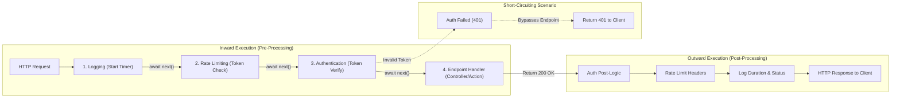
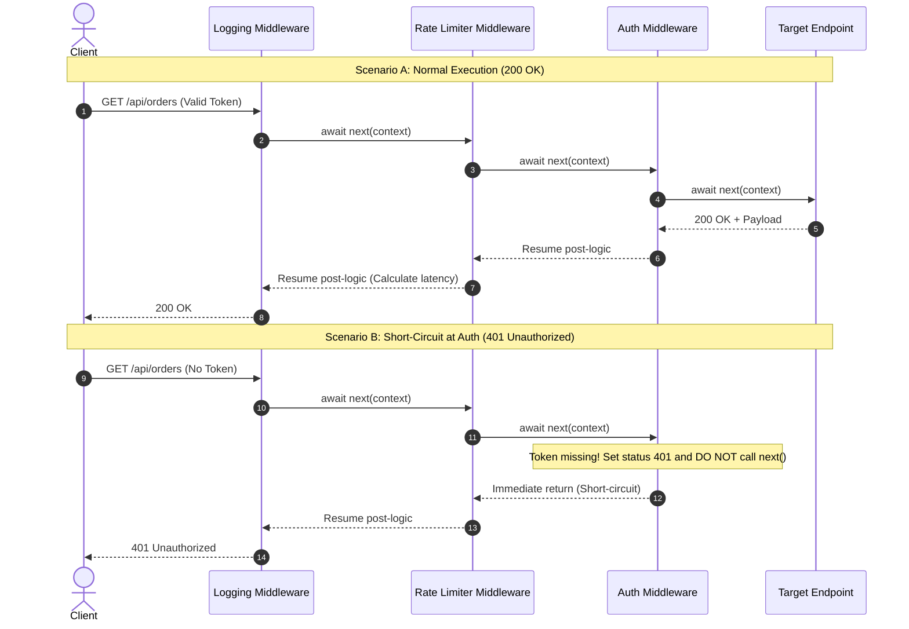

# Lesson 20: Chain of Responsibility and the Middleware Pipeline

> **Prerequisites:** [State](../19-state/README.md) and [Track 25 Overview](../README.md).  
> **Estimated Reading Time:** 18 minutes  
> **Target Audience:** Engineers preparing for LLD, OOP, C#, or Python technical screening and architecture rounds.

> [!NOTE]
> **In one line:** **Chain of Responsibility** passes a request along a line of handlers, each deciding to handle it, change it, or forward it — that is exactly how ASP.NET Core middleware works.

> [!TIP]
> **The One Rule of Chain of Responsibility & Middleware:** Chain of Responsibility decouples the request sender from concrete handlers by composing handlers into a pipeline where each node either handles the request, forwards it to the next delegate (`await next()`), or short-circuits the pipeline entirely. In modern backend architectures, this is the "Russian doll" middleware pattern executing two-way onion-layered processing (pre-processing on the way in, post-processing on the way out).

---

## 1. Why This Matters: The Interview Trap

"What is the Chain of Responsibility pattern, and where do you use it in enterprise systems?" is a ubiquitous senior backend interview question.

Junior candidates almost always recite the classic 1994 Gang of Four textbook example:
> *"It's a linked list of handler objects. When a request comes in, the first handler checks if it can handle it with an if statement. If yes, it handles it and stops; if no, it calls `next.Handle()`. An example is a corporate expense approval chain where a Manager approves up to \$1,000, a Director approves up to \$10,000, and a VP approves up to \$100,000."*

Interviewers consider this a weak answer because pure sequential approval chains represent only a tiny fraction of modern software.

A senior engineer connects the pattern directly to **backend web architectures**:
> "The classic GoF pattern is unidirectional and terminal: exactly one handler processes the request and halts. In modern distributed systems, Chain of Responsibility has evolved into the **Middleware Pipeline** (found in ASP.NET Core, Express, FastAPI, and Django).  
> 
> Here, handlers form an intercepting pipeline using delegates (`RequestDelegate next`). Every middleware executes two-way logic: pre-processing on the inward journey, awaiting `next(context)` to delegate to downstream handlers, and post-processing on the outward journey. Crucially, any handler can **short-circuit** the pipeline—such as authentication failing with a 401, a rate limiter rejecting with 429, or a response cache serving 200 directly from memory—preventing downstream execution entirely."

### Classic Chain vs. Onion Middleware vs. Decorator

| Dimension | Classic GoF Chain | Onion Middleware (ASP.NET Core / ASGI) | Decorator Pattern |
| :--- | :--- | :--- | :--- |
| **Execution Direction** | **Unidirectional:** Passes forward until consumed or dropped. | **Bidirectional:** Inward journey (pre-logic) $\to$ Endpoint $\to$ Outward journey (post-logic). | **Transparent Wrapping:** Augments behavior without altering invocation interface. |
| **Handling Mandate** | Exactly one handler handles the request (or none). | Multiple handlers process the request collaboratively. | All decorators in the chain execute their augmentation. |
| **Termination** | First matching handler terminates execution. | Terminal endpoint terminates forward pass; any middleware can short-circuit early. | No short-circuiting; outermost decorator forwards to inner target. |
| **Coupling Mechanism** | Concrete handler base class holding `_nextHandler`. | Delegating function closure: `Func<HttpContext, RequestDelegate, Task>`. | Implements the identical domain interface as the wrapped subject. |
| **Typical Use Cases** | Multi-level approval workflows, event dispatchers. | HTTP request pipelines, exception handling, auth, rate limiting. | Adding caching, logging, or retry logic to a repository interface. |

---

## 2. Visual Mental Model / Taxonomic Comparison

Modern middleware uses a nested "Russian Doll" architecture. When an HTTP request enters the pipeline, it traverses inward through every middleware until it reaches the routing endpoint. The response then travels backward through each layer in reverse order.



### The Anatomy of Short-Circuiting

A handler short-circuits by **omitting the call to `next()`**:



---

## 3. Code Implementation

The following implementation models a real-world asynchronous HTTP middleware pipeline supporting:
1. Two-way processing (inward pre-logic and outward post-logic).
2. Short-circuiting on authentication failures (HTTP 401).
3. Short-circuiting on rate limit exhaustion (HTTP 429).
4. Reversible execution chain identical to ASP.NET Core `IApplicationBuilder` and Python ASGI pipelines.

````carousel
```python
from __future__ import annotations
import asyncio
from typing import Awaitable, Callable, Dict, List, Optional


class HttpContext:
  """Encapsulates HTTP request, response, and ambient session state."""

  def __init__(
      self,
      path: str,
      method: str = "GET",
      headers: Optional[Dict[str, str]] = None,
  ) -> None:
    self.path: str = path
    self.method: str = method
    self.headers: Dict[str, str] = headers or {}
    self.user: Optional[str] = None
    self.response_status: int = 200
    self.response_body: str = ""


# RequestDelegate matches ASP.NET Core: takes context, returns awaitable Task
RequestDelegate = Callable[[HttpContext], Awaitable[None]]
MiddlewareFunc = Callable[[HttpContext, RequestDelegate], Awaitable[None]]


class PipelineBuilder:
  """Builds a Russian-doll pipeline of delegating middleware functions."""

  def __init__(self) -> None:
    self._components: List[
        Callable[[RequestDelegate], RequestDelegate]
    ] = []

  def use(self, middleware: MiddlewareFunc) -> PipelineBuilder:
    def component_adapter(nxt: RequestDelegate) -> RequestDelegate:
      return lambda ctx: middleware(ctx, nxt)

    self._components.append(component_adapter)
    return self

  def build(self, terminal_endpoint: RequestDelegate) -> RequestDelegate:
    app = terminal_endpoint
    # Wrap in reverse order so first registered middleware is the outermost layer
    for component in reversed(self._components):
      app = component(app)
    return app


# 1. Logging Middleware: Demonstrates inward pre-logic and outward post-logic
async def logging_middleware(ctx: HttpContext, next_delegate: RequestDelegate) -> None:
  print(f"[Logging] --> INCOMING: {ctx.method} {ctx.path}")
  await next_delegate(ctx)
  print(
      f"[Logging] <-- OUTGOING: {ctx.response_status} (Processed successfully)"
  )


# 2. Rate Limiter Middleware: Demonstrates stateful throttling and short-circuiting
class RateLimiterMiddleware:

  def __init__(self, max_requests: int = 2) -> None:
    self._max_requests: int = max_requests
    self._current_requests: int = 0

  async def __call__(
      self, ctx: HttpContext, next_delegate: RequestDelegate
  ) -> None:
    if self._current_requests >= self._max_requests:
      print(
          "[RateLimiter] 429 Too Many Requests: Rate limit exceeded."
          " Short-circuiting."
      )
      ctx.response_status = 429
      ctx.response_body = "Rate limit exceeded"
      return  # Short-circuit: next_delegate is NOT called!

    self._current_requests += 1
    print("[RateLimiter] Request allowed.")
    await next_delegate(ctx)


# 3. Authentication Middleware: Validates Bearer token or short-circuits
async def auth_middleware(ctx: HttpContext, next_delegate: RequestDelegate) -> None:
  auth_header = ctx.headers.get("Authorization", "")
  if auth_header == "Bearer secret-token":
    ctx.user = "alice"
    print(f"[Auth] Authenticated as {ctx.user}.")
    await next_delegate(ctx)
  else:
    print("[Auth] Unauthorized: Missing or invalid Bearer token. Short-circuiting.")
    ctx.response_status = 401
    ctx.response_body = "Unauthorized"
    return  # Short-circuit: unauthenticated request halted immediately


# 4. Terminal Endpoint: Target business logic
async def orders_endpoint(ctx: HttpContext) -> None:
  print("[Endpoint] Executing orders endpoint.")
  ctx.response_status = 200
  ctx.response_body = '{"order_id": "ORD-101", "status": "created"}'


# Execution Harness
async def main() -> None:
  rate_limiter = RateLimiterMiddleware(max_requests=2)

  pipeline = (
      PipelineBuilder()
      .use(logging_middleware)
      .use(rate_limiter)
      .use(auth_middleware)
      .build(orders_endpoint)
  )

  print("=== Request 1: Valid Request ===")
  req1 = HttpContext(
      path="/api/orders", headers={"Authorization": "Bearer secret-token"}
  )
  await pipeline(req1)
  print()

  print("=== Request 2: Unauthenticated Request ===")
  req2 = HttpContext(path="/api/orders", headers={})
  await pipeline(req2)
  print()

  print("=== Request 3: Rate Limited Request ===")
  req3 = HttpContext(
      path="/api/orders", headers={"Authorization": "Bearer secret-token"}
  )
  await pipeline(req3)


if __name__ == "__main__":
  asyncio.run(main())
```
<!-- slide -->
```csharp
using System;
using System.Collections.Generic;
using System.Threading.Tasks;

// Ambient Context representing HTTP state
public class HttpContext
{
    public string Path { get; }
    public string Method { get; }
    public Dictionary<string, string> Headers { get; } = new(StringComparer.OrdinalIgnoreCase);
    public string? User { get; set; }
    public int ResponseStatus { get; set; } = 200;
    public string ResponseBody { get; set; } = string.Empty;

    public HttpContext(string path, string method = "GET")
    {
        Path = path;
        Method = method;
    }
}

// RequestDelegate matches ASP.NET Core RequestDelegate
public delegate Task RequestDelegate(HttpContext context);

public class PipelineBuilder
{
    private readonly List<Func<RequestDelegate, RequestDelegate>> _components = new();

    public PipelineBuilder Use(Func<HttpContext, RequestDelegate, Task> middleware)
    {
        _components.Add(next => context => middleware(context, next));
        return this;
    }

    public RequestDelegate Build(RequestDelegate terminalEndpoint)
    {
        RequestDelegate app = terminalEndpoint;
        // Compose in reverse order so the first registered component is the outermost layer
        for (int i = _components.Count - 1; i >= 0; i--)
        {
            app = _components[i](app);
        }
        return app;
    }
}

// Concrete Stateful Middleware: Rate Limiter
public class RateLimiterMiddleware
{
    private readonly int _maxRequests;
    private int _currentRequests;

    public RateLimiterMiddleware(int maxRequests = 2)
    {
        _maxRequests = maxRequests;
    }

    public async Task InvokeAsync(HttpContext context, RequestDelegate next)
    {
        if (_currentRequests >= _maxRequests)
        {
            Console.WriteLine("[RateLimiter] 429 Too Many Requests: Rate limit exceeded. Short-circuiting.");
            context.ResponseStatus = 429;
            context.ResponseBody = "Rate limit exceeded";
            return; // Short-circuit: next is NOT invoked!
        }

        _currentRequests++;
        Console.WriteLine("[RateLimiter] Request allowed.");
        await next(context);
    }
}

public class Program
{
    // 1. Logging Middleware: Inward pre-logic and outward post-logic
    public static async Task LoggingMiddleware(HttpContext context, RequestDelegate next)
    {
        Console.WriteLine($"[Logging] --> INCOMING: {context.Method} {context.Path}");
        await next(context);
        Console.WriteLine($"[Logging] <-- OUTGOING: {context.ResponseStatus} (Processed successfully)");
    }

    // 2. Authentication Middleware: Token verification and short-circuiting
    public static async Task AuthMiddleware(HttpContext context, RequestDelegate next)
    {
        context.Headers.TryGetValue("Authorization", out var authHeader);
        if (authHeader == "Bearer secret-token")
        {
            context.User = "alice";
            Console.WriteLine($"[Auth] Authenticated as {context.User}.");
            await next(context);
        }
        else
        {
            Console.WriteLine("[Auth] Unauthorized: Missing or invalid Bearer token. Short-circuiting.");
            context.ResponseStatus = 401;
            context.ResponseBody = "Unauthorized";
            return; // Short-circuit: execution halts immediately
        }
    }

    // 3. Terminal Endpoint
    public static Task OrdersEndpoint(HttpContext context)
    {
        Console.WriteLine("[Endpoint] Executing orders endpoint.");
        context.ResponseStatus = 200;
        context.ResponseBody = "{\"order_id\": \"ORD-101\", \"status\": \"created\"}";
        return Task.CompletedTask;
    }

    public static async Task Main()
    {
        var rateLimiter = new RateLimiterMiddleware(maxRequests: 2);

        var pipeline = new PipelineBuilder()
            .Use(LoggingMiddleware)
            .Use(rateLimiter.InvokeAsync)
            .Use(AuthMiddleware)
            .Build(OrdersEndpoint);

        Console.WriteLine("=== Request 1: Valid Request ===");
        var req1 = new HttpContext("/api/orders");
        req1.Headers["Authorization"] = "Bearer secret-token";
        await pipeline(req1);
        Console.WriteLine();

        Console.WriteLine("=== Request 2: Unauthenticated Request ===");
        var req2 = new HttpContext("/api/orders");
        await pipeline(req2);
        Console.WriteLine();

        Console.WriteLine("=== Request 3: Rate Limited Request ===");
        var req3 = new HttpContext("/api/orders");
        req3.Headers["Authorization"] = "Bearer secret-token";
        await pipeline(req3);
    }
}
```
````

**Expected Output (Both Languages):**

```text
=== Request 1: Valid Request ===
[Logging] --> INCOMING: GET /api/orders
[RateLimiter] Request allowed.
[Auth] Authenticated as alice.
[Endpoint] Executing orders endpoint.
[Logging] <-- OUTGOING: 200 OK (Processed successfully)

=== Request 2: Unauthenticated Request ===
[Logging] --> INCOMING: GET /api/orders
[RateLimiter] Request allowed.
[Auth] Unauthorized: Missing or invalid Bearer token. Short-circuiting.
[Logging] <-- OUTGOING: 401 (Processed successfully)

=== Request 3: Rate Limited Request ===
[Logging] --> INCOMING: GET /api/orders
[RateLimiter] 429 Too Many Requests: Rate limit exceeded. Short-circuiting.
[Logging] <-- OUTGOING: 429 (Processed successfully)
```

---

## 3A. Where It Is Used, Why It Exists & Progressive Buildup

### Where It Is Used (Real-World Systems & LLD Interviews)

| Domain / Ecosystem | Concrete Real-World Usage | LLD Interview Problem Where You Use It |
| :--- | :--- | :--- |
| **.NET / C#** | ASP.NET Core `RequestDelegate` (`UseExceptionHandler`, `UseAuthentication`, `UseRouting`), `HttpClient` `DelegatingHandler` (Polly retries), MediatR `IPipelineBehavior` | HTTP Middleware Pipeline (Auth, Rate Limit, Cache, Logging) |
| **Python** | FastAPI / Starlette ASGI middleware, Django `MiddlewareMixin` (`__call__`), WSGI wrappers, `logging` handler propagation | Multi-Level Expense Approval / Support Ticket Escalation |
| **Go** | `net/http` `func(http.Handler) http.Handler` (`chi`, `gin`, `echo` middleware chains), `grpc.UnaryServerInterceptor` chains | ATM Cash Dispenser (Note Denomination Chain) |
| **TypeScript / Node.js** | Express / Koa `(req, res, next)` & `(ctx, next)` onion middleware, NestJS `NestMiddleware`, Redux `applyMiddleware` | Request Validation & Sanitization Pipeline |

### Why It Is Used — The Step-by-Step Buildup (Before -> Pain -> Pattern)

#### Stage 0: Naive Code (Monolithic Request Handler)
Imagine writing an API endpoint handler that validates rate limits, authentication, and business logic inline:

```python
def handle_order_request(req: dict) -> dict:
  if req.get("ip_count", 0) > 100:
    return {"status": 429, "body": "Rate limit exceeded"}
  if req.get("token") != "secret":
    return {"status": 401, "body": "Unauthorized"}
  # Business logic
  return {"status": 200, "body": "Order created"}
```

#### What Breaks as Requirements Grow
- **Requirement 2 arrives ("Log total latency for *every* response—including 429 and 401—and catch unhandled exceptions globally"):** With early `return` statements scattered throughout `handle_order_request()`, you must duplicate timing/logging before every single `return`, and wrap the whole body in `try/except`.
- **Requirement 3 arrives ("`/health` must skip auth, `/orders` needs response caching, and `/admin` needs IP allowlisting"):** You end up with nested `if req["path"] != "/health":` flags everywhere, coupling cross-cutting infrastructure concerns directly to business endpoints.

#### Step-by-Step Refactoring into Chain of Responsibility / Middleware
1. **Standardize the link signature:** Every handler accepts `(req, next_fn)` and returns a response.
2. **Allow short-circuiting or forwarding:** Auth returns `401` immediately without calling `next_fn(req)`; otherwise it delegates via `return next_fn(req)`.
3. **Wrap with onion post-processing:** Timing and exception-handling middleware wrap `next_fn(req)` in `try/finally`, guaranteeing they execute on both the inward and outward journeys regardless of which downstream link short-circuits.

### Progressive Real-World Examples

#### Example A (Simple Core): Classic GoF Expense Approval Chain
In the classic unidirectional GoF form, each handler decides whether it can approve the amount or forward to its `next_handler`:

```python
from __future__ import annotations
from typing import Optional


class Approver:
  def __init__(self, name: str, limit: float, nxt: Optional[Approver] = None) -> None:
    self.name = name
    self.limit = limit
    self.nxt = nxt

  def approve(self, amount: float) -> str:
    if amount <= self.limit:
      return f"Approved by {self.name} (${amount:.0f})"
    if self.nxt is not None:
      return self.nxt.approve(amount)
    return f"Rejected: ${amount:.0f} exceeds all approval limits"


chain = Approver("Manager", 1_000, Approver("Director", 10_000, Approver("CFO", 50_000)))
assert chain.approve(500) == "Approved by Manager ($500)"
assert chain.approve(5_000) == "Approved by Director ($5000)"
assert chain.approve(100_000).startswith("Rejected")
```

#### Example B (Production Backend): Synchronous Onion Middleware with Exception & Timing Layers
Notice how `exception_middleware` catches errors from *any* downstream handler and `timing_middleware` records duration even when `auth_middleware` short-circuits:

```python
import time
from typing import Callable


Handler = Callable[[dict], dict]
Middleware = Callable[[dict, Handler], dict]


def compose(middlewares: list[Middleware], endpoint: Handler) -> Handler:
  app = endpoint
  for mw in reversed(middlewares):
    nxt = app
    app = lambda req, m=mw, n=nxt: m(req, n)
  return app


def exception_middleware(req: dict, nxt: Handler) -> dict:
  try:
    return nxt(req)
  except Exception as ex:
    return {"status": 500, "body": f"Internal Error: {ex}"}


def timing_middleware(req: dict, nxt: Handler) -> dict:
  start = time.perf_counter()
  res = nxt(req)
  res["duration_ms"] = round((time.perf_counter() - start) * 1000, 3)
  return res


def auth_middleware(req: dict, nxt: Handler) -> dict:
  if req.get("token") != "valid":
    return {"status": 401, "body": "Unauthorized"}  # Short-circuit
  return nxt(req)


def crashy_endpoint(req: dict) -> dict:
  if req.get("crash"):
    raise RuntimeError("DB connection lost")
  return {"status": 200, "body": "OK"}


app = compose([exception_middleware, timing_middleware, auth_middleware], crashy_endpoint)
assert app({"token": "bad"})["status"] == 401
assert "duration_ms" in app({"token": "bad"})
assert app({"token": "valid", "crash": True})["status"] == 500
assert app({"token": "valid"})["status"] == 200
```

#### Example C (Classic LLD Interview Problem): ATM Cash Dispenser Chain
A favorite LLD interview problem: an ATM dispenses cash using the largest available denominations (`$100` $\to$ `$50` $\to$ `$20`), where each dispenser calculates how many notes it can issue and passes the remaining amount down the chain:

```python
from __future__ import annotations
from typing import Optional


class NoteDispenser:
  def __init__(self, denomination: int, count: int, nxt: Optional[NoteDispenser] = None) -> None:
    self.denomination = denomination
    self.count = count
    self.nxt = nxt

  def dispense(self, amount: int, plan: Optional[dict[int, int]] = None) -> dict[int, int]:
    plan = {} if plan is None else plan
    if amount >= self.denomination and self.count > 0:
      notes = min(amount // self.denomination, self.count)
      plan[self.denomination] = notes
      amount -= notes * self.denomination

    if amount == 0:
      return plan
    if self.nxt is not None:
      return self.nxt.dispense(amount, plan)
    raise ValueError(f"Cannot dispense remaining ${amount} with available notes")


atm = NoteDispenser(100, 2, NoteDispenser(50, 3, NoteDispenser(20, 5)))
assert atm.dispense(270) == {100: 2, 50: 1, 20: 1}
```

---

## 4. Where You Already Use It

Every modern HTTP runtime executes Chain of Responsibility at its core:

- **In .NET / ASP.NET Core:**
  - `IApplicationBuilder.Use()` and `app.Run()`: ASP.NET Core's entire HTTP request processing is built on `RequestDelegate`. Standard middleware components include:
    - `UseExceptionHandler()`: Catches unhandled exceptions from inner pipeline handlers and transforms them into RFC 7807 problem details.
    - `UseRouting()` and `UseEndpoints()`: Matches URL routes and dispatches to MVC controllers or Minimal API endpoints.
    - `UseAuthentication()` and `UseAuthorization()`: Hydrates `ClaimsPrincipal` and verifies role/policy requirements, short-circuiting with 401 or 403.
  - `DelegatingHandler` in `IHttpClientFactory`: Outgoing HTTP requests from `HttpClient` pass through an outbound Chain of Responsibility for automatic retries (Polly), telemetry, and header propagation.

- **In Python:**
  - **ASGI (Asynchronous Server Gateway Interface):** Used by FastAPI, Starlette, and Quart. Middleware components are callables: `async def app(scope, receive, send)` that wrap downstream ASGI applications.
  - **WSGI (PEP 3333):** Used by Flask and Django. Middleware is an outer callable taking `environ` and `start_response`, passing them down to an inner callable.
  - **Django Middleware:** Classes implementing `__call__(self, request)` that process `request` before calling `self.get_response(request)` and process `response` afterward.

---

## 5. Pitfalls and When Not to Use It

1. **The Silent Hang (Forgetting `await next()`):**
   - If a middleware neither writes a response nor invokes `await next(context)`, the request completes prematurely with an empty body or hangs indefinitely if an upstream handler awaits a signal.
   - *Fix:* Ensure all conditional branches either invoke `await next(context)` or populate a complete response payload with an explicit HTTP status code.

2. **Pipeline Order Sensitivity:**
   - Order in middleware registration is critical. If you register `UseAuthorization()` before `UseAuthentication()`, the authorization middleware checks `context.User` before the authentication middleware has hydrated it from the JWT bearer token, rejecting every request with 401.
   - If CORS middleware is placed after authentication, 401 responses returned by authentication will lack CORS headers (`Access-Control-Allow-Origin`), causing web browsers to report a cryptic CORS error instead of an unauthorized error.

3. **Captive Dependencies in Singleton Middleware:**
   - In ASP.NET Core, middleware instantiated via `app.UseMiddleware<T>()` is registered as a **Singleton** by default. If your middleware injects an EF Core `DbContext` (which is **Scoped**) into its constructor, EF Core creates a *Captive Dependency*, holding onto a single database context across concurrent requests and triggering `InvalidOperationException: A second operation was started on this context instance before a previous operation completed`.
   - *Fix:* Inject Scoped dependencies into the `InvokeAsync(HttpContext context, MyDbContext dbContext)` method directly, not into the middleware constructor.

4. **Exception Masking:**
   - Wrapping `await next(context)` in a broad `try/catch` block without rethrowing or setting a standardized error response masks critical infrastructure failures (e.g., database connection timeouts), causing upstream metrics to show false healthy 200 OK statuses.

---

## 6. Exercises & Practical Drills

### Drill 1: Diagnose the Browser CORS Bug
A web application's frontend fails with:
`Cross-Origin Request Blocked: The Same Origin Policy disallows reading the remote resource at https://api.acme.com/orders (Reason: CORS header 'Access-Control-Allow-Origin' missing).`

The backend configuration in `Program.cs` is:
```csharp
app.UseAuthentication();
app.UseAuthorization();
app.UseCors("AllowFrontend");
app.MapControllers();
```
Why does this happen, and how do you fix it?

<details>
<summary>Answer</summary>

**Root Cause:**
`UseCors` is registered **after** `UseAuthentication` and `UseAuthorization`. When an unauthenticated request arrives, `UseAuthentication` short-circuits the pipeline and returns a 401 Unauthorized immediately. Because the pipeline short-circuited before reaching `UseCors`, the `Access-Control-Allow-Origin` response header is never attached to the 401 response. The browser detects missing CORS headers and blocks the response, hiding the true 401 status behind a CORS error.

**Remediation:**
Register `UseCors` before authentication:
```csharp
app.UseCors("AllowFrontend"); // 1. Set CORS headers first (on both success and failure paths)
app.UseAuthentication(); // 2. Authenticate
app.UseAuthorization(); // 3. Authorize
app.MapControllers(); // 4. Execute endpoint
```
</details>

### Drill 2: Implement an In-Memory Response Caching Middleware
Design a lightweight caching middleware that returns cached responses for `GET` requests without invoking downstream handlers.

<details>
<summary>Answer</summary>

```csharp
public class ResponseCacheMiddleware
{
    private static readonly ConcurrentDictionary<string, string> _cache = new();

    public static async Task InvokeAsync(HttpContext context, RequestDelegate next)
    {
        if (context.Method == "GET" && _cache.TryGetValue(context.Path, out var cachedBody))
        {
            // Short-circuit: serve directly from cache
            context.ResponseStatus = 200;
            context.ResponseBody = cachedBody;
            context.Headers["X-Cache"] = "HIT";
            return;
        }

        // Cache miss: execute downstream pipeline
        context.Headers["X-Cache"] = "MISS";
        await next(context);

        if (context.ResponseStatus == 200 && context.Method == "GET")
        {
            _cache[context.Path] = context.ResponseBody;
        }
    }
}
```
</details>

---

## 7. Interview Questions & Model Answers

<details>
<summary><strong>1. What is the Chain of Responsibility pattern? [BASIC]</strong></summary>

Chain of Responsibility is a behavioral design pattern that decouples the sender of a request from its potential receivers by organizing handlers into a sequential pipeline. When a request is issued, it travels along the chain where each handler decides whether to process the request, pass it to the next handler in the sequence, or short-circuit execution.

In classical GoF theory, it is used for sequential single-receiver scenarios (such as an expense approval hierarchy where exactly one manager approves). In modern cloud and web engineering, it is universally used as the foundation for HTTP middleware and filter pipelines, where handlers cooperatively process requests on the way in and responses on the way out.

</details>

<details>
<summary><strong>2. How is ASP.NET Core middleware an example of it? [SCENARIO]</strong></summary>

ASP.NET Core's HTTP pipeline is an asynchronous, bidirectional implementation of the Chain of Responsibility pattern structured around the `RequestDelegate` delegate (`Func<HttpContext, Task>`).

Each middleware receives the ambient `HttpContext` and a delegate pointing to the next component (`RequestDelegate next`). Middleware components are composed in reverse registration order, forming a nested 'Russian doll' pipeline. When a request arrives, each middleware can:
1. Perform pre-processing (e.g., parsing headers, starting timers, validating JWTs).
2. Invoke `await next(context)` to hand execution over to the next middleware or terminal endpoint.
3. Perform post-processing on the response as execution unwinds back up the stack (e.g., calculating request duration, compressing the response body, catching unhandled exceptions).

</details>

<details>
<summary><strong>3. What happens if a handler does not call the next one? [TRICKY]</strong></summary>

When a handler omits the call to `next()`, it **short-circuits** the pipeline. Downstream middleware components and the target endpoint are completely bypassed, and execution immediately begins unwinding back through the post-processing phase of upstream middleware.

Short-circuiting is a deliberate, essential feature used for:
- **Security:** Authentication or authorization middleware halting unauthenticated or forbidden requests with HTTP 401 or 403.
- **Throttling:** Rate-limiting middleware returning HTTP 429 when client quotas are exhausted.
- **Performance:** Static file middleware returning a CSS/image asset or a caching middleware returning an HTTP 200/304 directly without executing costly business logic or database queries.

However, an accidental short-circuit (forgetting to await `next()`) is a critical bug that results in blank responses or silent hangs.

</details>

<details>
<summary><strong>4. Design an expense approval flow: <1k manager, <10k director, else CFO. [SCENARIO]</strong></summary>

Handlers `Manager → Director → CFO`; each checks its limit and approves or forwards. Changing limits or inserting a new level is configuration of the chain, not a rewrite of an `if/else`.

</details>

<details>
<summary><strong>5. What if no handler in the chain handles the request? [TRICKY]</strong></summary>

It must not vanish: add a terminal handler that returns an explicit error/default (like middleware's 404), or throw. Silent fall-through is the classic bug.

</details>

<details>
<summary><strong>6. Chain of Responsibility vs Decorator? [BASIC]</strong></summary>

A decorator always delegates and adds behaviour. A chain link may stop the request. Middleware blends both: it wraps the next link and can short-circuit.

</details>

---

## Try it

Run this: each handler either short-circuits or calls the next one. Then redraw it in [LLD Studio](/tools/lld-studio/); the [track hub](../README.md) has the pattern-choice drills.

```python
def auth(req, nxt):
    if not req.get("user"): return "401"
    return nxt(req)
def log(req, nxt):
    req.setdefault("log", []).append("seen")
    return nxt(req)
def endpoint(req): return "200"

def build(handlers, last):
    def run(i):
        return last if i == len(handlers) else (lambda r: handlers[i](r, run(i + 1)))
    return run(0)

app = build([log, auth], endpoint)
assert app({"user": "a"}) == "200"
assert app({}) == "401"
```

---

## One-page cheat sheet

```text
CHAIN  Handler.handle(req) { do work; if not done -> next.handle(req) }
Each link: handle | modify | short-circuit (stop) | pass on
Order is behaviour: auth before cache, logging first
Linear and decoupled: sender doesn't know who handles
ASP.NET middleware = chain around `next(context)` (before + after next)
Also: logging levels, approval flows, validation pipelines, DOM event bubbling
Pitfall: forgetting next() -> request silently dropped; unhandled at end of chain
```

---

## 8. Sources & Further Reading

- [Microsoft Learn: ASP.NET Core Middleware Fundamentals](https://learn.microsoft.com/en-us/aspnet/core/fundamentals/middleware/)
- [Microsoft Learn: Write Custom ASP.NET Core Middleware](https://learn.microsoft.com/en-us/aspnet/core/fundamentals/middleware/write)
- [ASGI (Asynchronous Server Gateway Interface) Specification](https://asgi.readthedocs.io/en/latest/)
- [PEP 3333: Python Web Server Gateway Interface v1.0.1](https://peps.python.org/pep-3333/)
- [Refactoring.Guru: Chain of Responsibility](https://refactoring.guru/design-patterns/chain-of-responsibility)

---

Previous: [State](../19-state/README.md) · Next: [Iterator (IEnumerable and Generators)](../21-iterator/README.md)
