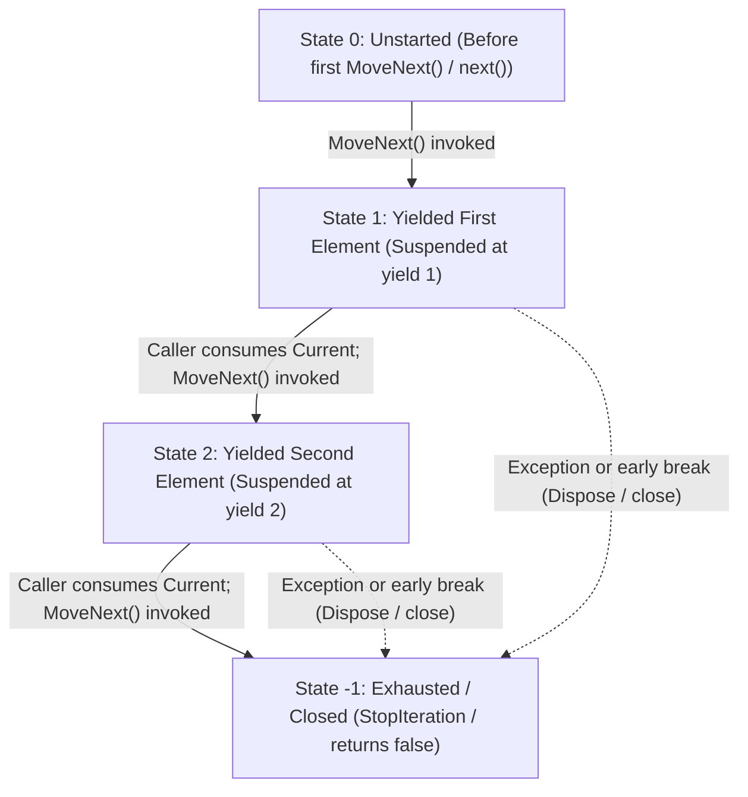
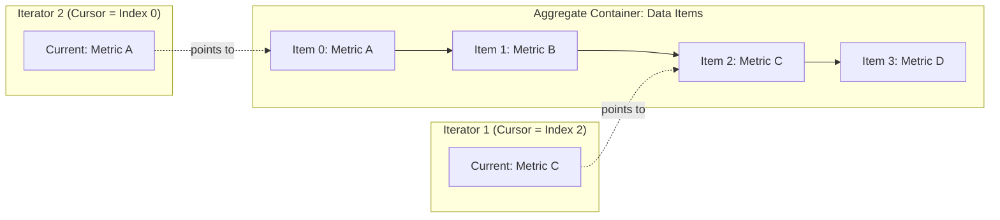

# Lesson 21: Iterator (IEnumerable and Generators)

> **Prerequisites:** [Chain of Responsibility and the Middleware Pipeline](../20-chain-of-responsibility-and-middleware/README.md) and [Track 25 Overview](../README.md).  
> **Estimated Reading Time:** 18 minutes  
> **Target Audience:** Engineers preparing for LLD, OOP, C#, or Python technical screening and architecture rounds.

> [!NOTE]
> **In one line:** **Iterator** gives sequential access to a collection without exposing its internals — in Python that is `__iter__`/`__next__` (or a generator), in C# `IEnumerable` and `yield return`.

> [!TIP]
> **The One Rule of Iterator & Generators:** The Iterator pattern decouples aggregate traversal algorithms from underlying data structures, enabling lazy sequential evaluation without exposing memory layout. In modern languages, manual iterator classes are obsolete: the compiler transforms `yield return` in C# and `yield` in Python into an explicit finite state machine with zero manual cursor bookkeeping.

---

## 1. Why This Matters: The Interview Trap

"What is the Iterator pattern, how does `yield return` work under the hood in C#, and how does Python distinguish between an iterable and an iterator?" is a fixture of senior backend and language-internals interviews.

Junior candidates frequently fail this question by answering with surface syntax:
> *"Iterator is just using a `foreach` or `for-in` loop over a collection. In C#, `yield return` returns items one by one instead of creating a list. In Python, iterable and iterator are basically the same thing—anything you can loop over."*

Interviewers probe deeper and find gaps in memory mechanics and state machine compilation:
- They don't understand that `yield return` is syntactic sugar: the compiler synthesizes an entire hidden closure class implementing `IEnumerator<T>` with a switch-case state machine.
- They conflate an **Iterable** (the container holding data) with an **Iterator** (the stateful moving cursor).
- They fall victim to **multiple enumeration bugs**, causing database queries or remote HTTP calls to fire multiple times inadvertently.

A senior engineer provides a precise, architectural breakdown:
> "The Iterator pattern separates traversal responsibility from collection storage. This allows multiple clients to traverse the same collection simultaneously at independent offsets without modifying the underlying data structure.  
> 
> In C#, `yield return` creates a compiler-generated state machine implementing `IEnumerator<T>` and `IDisposable`. Execution is strictly lazy: code before a `yield return` does not execute until `MoveNext()` is invoked.  
> 
> In Python, the language formalizes this via the Iterator Protocol: an **Iterable** implements `__iter__()` returning a new iterator, whereas an **Iterator** implements `__next__()` (advancing state or raising `StopIteration`) and `__iter__()` returning `self`. An iterator is consumed once and cannot be reset."

### Iterable vs. Iterator vs. Generator vs. Eager Collection

| Dimension | Eager Collection (`List`, `Array`) | Iterable (`IEnumerable`, `__iter__`) | Iterator (`IEnumerator`, `__next__`) | Generator (`yield return`, `yield`) |
| :--- | :--- | :--- | :--- | :--- |
| **Memory Allocation** | $O(N)$: Entire dataset materialized in memory upfront. | $O(1)$ to $O(N)$: Defines capability to produce an iterator. | $O(1)$: Holds only current cursor position and references. | $O(1)$: Compiler-generated state machine holding local variables. |
| **Evaluation Strategy** | Immediate (Eager). | Lazy (deferred until iteration begins). | Step-by-step on demand (`MoveNext()`). | Lazy streaming: pauses at `yield`, resumes on next request. |
| **Multiple Traversals** | Yes, repeatable indefinitely. | Yes: calling `GetEnumerator()` / `iter()` yields a fresh cursor. | **No:** Consumed once. Once exhausted, cannot be reset. | **No:** Once generator loop finishes, it is permanently closed. |
| **Underlying Mechanism** | Continuous heap buffer or linked nodes. | Interface / Abstract Base Class. | Stateful class with `.Current` and `.MoveNext()`. | Compiler-generated state machine class / frame suspension. |

---

## 2. Visual Mental Model / Taxonomic Comparison

When you write a generator or `yield return` method, the compiler rewrites your sequential code into a **State Machine**.



### Multiple Independent Iterators on One Aggregate

The primary design benefit of the Iterator pattern is that traversal state is decoupled from aggregate state. Two iterators can walk the same collection at completely different speeds:



---

## 3. Code Implementation

The following implementation demonstrates:
1. Lazy streaming: page 2 of a remote report is **never fetched** until page 1 is fully consumed.
2. Two independent iterators concurrently advancing across the same stream without state collision.
3. Contrast between manual iterator protocol implementation and modern `yield` generators.

````carousel
```python
from __future__ import annotations
from typing import Iterator, List


class PaginatedReport:
  """Aggregate container holding chunked report data."""

  def __init__(self, pages: List[List[str]]) -> None:
    self._pages: List[List[str]] = pages

  # Modern Generator implementation using yield
  def stream_metrics(self) -> Iterator[str]:
    """Generates metrics lazily.

    Remote pages are only fetched when the consumer demands them.
    """
    for page_idx, page in enumerate(self._pages, start=1):
      print(f"[DataFetch] Fetching page {page_idx} from remote service...")
      for item in page:
        yield item

  # Explicit Python Iterator Protocol implementation
  def __iter__(self) -> ManualMetricIterator:
    return ManualMetricIterator(self._pages)


class ManualMetricIterator:
  """Manual stateful Iterator cursor satisfying Python's Iterator Protocol."""

  def __init__(self, pages: List[List[str]]) -> None:
    self._pages: List[List[str]] = pages
    self._page_idx: int = 0
    self._item_idx: int = 0

  def __iter__(self) -> ManualMetricIterator:
    # An iterator must return itself from __iter__()
    return self

  def __next__(self) -> str:
    while self._page_idx < len(self._pages):
      current_page = self._pages[self._page_idx]
      if self._item_idx < len(current_page):
        value = current_page[self._item_idx]
        self._item_idx += 1
        return value
      # Advance to next page
      self._page_idx += 1
      self._item_idx = 0

    # Exhausted: signal end of iteration
    raise StopIteration


# Demonstration
if __name__ == "__main__":
  data = [["Metric A", "Metric B"], ["Metric C", "Metric D"]]
  report = PaginatedReport(data)

  print("=== Drill 1: Lazy Streaming with Yield ===")
  # Consumer processes items one by one; Page 2 is fetched only after Metric B
  for item in report.stream_metrics():
    print(f"Streamed: {item}")
  print()

  print("=== Drill 2: Two Independent Iterators ===")
  # Two iterators advancing independently across the same report
  iter1 = report.stream_metrics()
  iter2 = report.stream_metrics()

  print(f"Iterator 1 step: {next(iter1)}")
  print(f"Iterator 2 step: {next(iter2)}")
  print(f"Iterator 1 step: {next(iter1)}")
  print(f"Iterator 2 step: {next(iter2)}")
```
<!-- slide -->
```csharp
using System;
using System.Collections;
using System.Collections.Generic;

// Aggregate container implementing IEnumerable<string>
public class PaginatedReport : IEnumerable<string>
{
    private readonly List<List<string>> _pages;

    public PaginatedReport(List<List<string>> pages)
    {
        _pages = pages;
    }

    // Modern Generator implementation using yield return
    // The C# compiler rewrites this into a private state machine class implementing IEnumerator<string>
    public IEnumerator<string> GetEnumerator()
    {
        for (int i = 0; i < _pages.Count; i++)
        {
            Console.WriteLine($"[DataFetch] Fetching page {i + 1} from remote service...");
            foreach (var item in _pages[i])
            {
                yield return item;
            }
        }
    }

    // Explicit non-generic interface implementation for backward compatibility
    IEnumerator IEnumerable.GetEnumerator() => GetEnumerator();
}

// Manual Iterator cursor demonstrating what the compiler synthesizes behind yield return
public class ManualMetricEnumerator : IEnumerator<string>
{
    private readonly List<List<string>> _pages;
    private int _pageIndex = 0;
    private int _itemIndex = -1;
    private string _current = string.Empty;

    public ManualMetricEnumerator(List<List<string>> pages)
    {
        _pages = pages;
    }

    public string Current => _current;
    object IEnumerator.Current => Current;

    public bool MoveNext()
    {
        while (_pageIndex < _pages.Count)
        {
            _itemIndex++;
            if (_itemIndex < _pages[_pageIndex].Count)
            {
                _current = _pages[_pageIndex][_itemIndex];
                return true;
            }
            _pageIndex++;
            _itemIndex = -1;
        }
        return false;
    }

    public void Reset() => throw new NotSupportedException();
    public void Dispose() { }
}

public class Program
{
    public static void Main()
    {
        var data = new List<List<string>>
        {
            new() { "Metric A", "Metric B" },
            new() { "Metric C", "Metric D" }
        };

        var report = new PaginatedReport(data);

        Console.WriteLine("=== Drill 1: Lazy Streaming with Yield ===");
        // foreach invokes GetEnumerator(), calls MoveNext(), reads Current, and disposes enumerator
        foreach (var item in report)
        {
            Console.WriteLine($"Streamed: {item}");
        }
        Console.WriteLine();

        Console.WriteLine("=== Drill 2: Two Independent Iterators ===");
        // Two independent enumerator instances traversing the same underlying dataset
        using var iter1 = report.GetEnumerator();
        using var iter2 = report.GetEnumerator();

        if (iter1.MoveNext()) Console.WriteLine($"Iterator 1 step: {iter1.Current}");
        if (iter2.MoveNext()) Console.WriteLine($"Iterator 2 step: {iter2.Current}");
        if (iter1.MoveNext()) Console.WriteLine($"Iterator 1 step: {iter1.Current}");
        if (iter2.MoveNext()) Console.WriteLine($"Iterator 2 step: {iter2.Current}");
    }
}
```
````

**Expected Output (Both Languages):**

```text
=== Drill 1: Lazy Streaming with Yield ===
[DataFetch] Fetching page 1 from remote service...
Streamed: Metric A
Streamed: Metric B
[DataFetch] Fetching page 2 from remote service...
Streamed: Metric C
Streamed: Metric D

=== Drill 2: Two Independent Iterators ===
[DataFetch] Fetching page 1 from remote service...
Iterator 1 step: Metric A
[DataFetch] Fetching page 1 from remote service...
Iterator 2 step: Metric A
Iterator 1 step: Metric B
Iterator 2 step: Metric B
```

---

## 3A. Where It Is Used, Why It Exists & Progressive Buildup

### Where It Is Used (Real-World Systems & LLD Interviews)

| Domain / Ecosystem | Concrete Real-World Usage | LLD Interview Problem Where You Use It |
| :--- | :--- | :--- |
| **.NET (C#)** | `IEnumerable<T>`, `IAsyncEnumerable<T>`, `yield return`, LINQ deferred pipelines, EF Core `AsAsyncEnumerable()` | Streaming SQL/gRPC export pipeline without materializing full result sets |
| **Python** | `__iter__` / `__next__`, generators (`yield`), `itertools`, `csv.reader`, Django `QuerySet.iterator()` | 50 GB log file processor, lazy ETL pipeline, custom collection traversal |
| **Go** | `iter.Seq[T]` / `iter.Seq2[K, V]` (Go 1.23+), `bufio.Scanner.Scan()`, `database/sql` `Rows.Next()` | Rate-limited batch consumer, streaming database row scanner |
| **TypeScript** | `Symbol.iterator`, `Symbol.asyncIterator`, `function*` / `async function*`, `for await...of` | Infinite-scroll social feed, multi-source paginated API merger |

### Why It Is Used — The Step-by-Step Buildup (Before -> Pain -> Pattern)

#### Stage 0: Naive Code (Eager Materialization & Exposed Internals)
Imagine an audit service that fetches paginated logs from a remote store and returns them to callers:

```python
def fetch_all_audit_logs(total_pages: int) -> list[dict]:
    results = []
    for page in range(1, total_pages + 1):
        # Simulates network I/O for every page upfront
        batch = [{"id": f"{page}-{i}", "level": "ERROR" if i == 0 else "INFO"} for i in range(100)]
        results.extend(batch)
    return results


# Caller only wants the first 2 errors
logs = fetch_all_audit_logs(total_pages=10_000)
errors = [log for log in logs if log["level"] == "ERROR"][:2]
```

#### What Breaks as Requirements Arrive
1. **Requirement 2 — Scale to 10 million rows (Memory & Latency):** `fetch_all_audit_logs(10_000)` allocates 1,000,000 dictionaries in RAM and fires 10,000 network round-trips *before* the caller inspects a single item. In production, this triggers an Out-Of-Memory (OOM) kill and multi-second Time-To-First-Byte (TTFB).
2. **Requirement 3 — Early Termination & Multiple Traversal Policies:** The caller only needed 2 errors and stopped. With an eager list, 9,998 pages were wasted. Worse, if callers also need reverse order or filtered traversal over a tree/graph, exposing `self._pages` or `self._nodes` couples every caller to the internal storage layout.

#### Step-by-Step Refactor Into the Pattern
1. **Step 1 (Extract the Cursor):** Move traversal state (`_page`, `_index`) out of the container into an Iterator object exposing `__next__()`. Now multiple callers can iterate independently at their own pace.
2. **Step 2 (Yield for Lazy State Machine):** Replace manual cursor fields with a generator (`yield`). Execution pauses after each item; Page 2 is never fetched if the caller breaks on Page 1, keeping memory at $O(1)$ per item (or $O(\text{page\_size})$).

### Progressive Real-World Examples

#### Example A (Simple Core): Reusable Iterable Producing Independent Iterators
Separating the **Iterable** (`WordCollection`) from the **Iterator** ensures `for` loops can traverse the same collection multiple times or in parallel without exhausting a shared cursor.

```python
from typing import Iterator


class WordCollection:
    """Iterable: creates a fresh iterator on every iter() call."""

    def __init__(self, words: list[str], reverse: bool = False) -> None:
        self._words = words
        self._reverse = reverse

    def __iter__(self) -> Iterator[str]:
        indices = range(len(self._words) - 1, -1, -1) if self._reverse else range(len(self._words))
        for idx in indices:
            yield self._words[idx]


sentence = WordCollection(["Iterator", "decouples", "traversal"], reverse=True)
print(list(sentence))  # ['traversal', 'decouples', 'Iterator']
print(list(sentence))  # Repeatable: ['traversal', 'decouples', 'Iterator']
```

#### Example B (Production Backend): Cursor-Based Paginated API Streamer
In backend services, external APIs (Stripe, GitHub, DynamoDB) return a `next_cursor` token per page. Wrapping this in an async or sync generator hides pagination mechanics from business logic and stops network calls immediately on `break`.

```python
from typing import Callable, Iterator, Optional, Tuple


def stream_cursor_api(
    fetch_page: Callable[[Optional[str]], Tuple[list[dict], Optional[str]]]
) -> Iterator[dict]:
    """Lazily yields records across cursor-paginated API responses."""
    cursor: Optional[str] = None
    while True:
        items, cursor = fetch_page(cursor)
        for item in items:
            yield item
        if cursor is None:
            break


def mock_stripe_charges(cursor: Optional[str]) -> Tuple[list[dict], Optional[str]]:
    pages = {
        None: ([{"id": "ch_1", "amount": 50}, {"id": "ch_2", "amount": 120}], "cur_2"),
        "cur_2": ([{"id": "ch_3", "amount": 300}], None),
    }
    print(f"[HTTP GET] /v1/charges?cursor={cursor}")
    return pages[cursor]


# Stops after finding the first charge > $100; page 'cur_2' is never requested
for charge in stream_cursor_api(mock_stripe_charges):
    if charge["amount"] > 100:
        print(f"Found target charge: {charge['id']}")
        break
```

#### Example C (Classic LLD Interview Problem): Binary Search Tree In-Order Iterator ($O(H)$ Space)
A classic interview question: *"Implement `BSTIterator` with `next()` and `has_next()` in $O(1)$ average time and $O(H)$ memory (where $H$ is tree height), without flattening the entire tree into an array."*

```python
from typing import Optional


class TreeNode:
    def __init__(self, val: int, left: Optional["TreeNode"] = None, right: Optional["TreeNode"] = None) -> None:
        self.val = val
        self.left = left
        self.right = right


class BSTIterator:
    """Controlled-recursion iterator using an explicit O(H) stack."""

    def __init__(self, root: Optional[TreeNode]) -> None:
        self._stack: list[TreeNode] = []
        self._push_left(root)

    def _push_left(self, node: Optional[TreeNode]) -> None:
        while node is not None:
            self._stack.append(node)
            node = node.left

    def has_next(self) -> bool:
        return len(self._stack) > 0

    def next(self) -> int:
        if not self.has_next():
            raise StopIteration("BSTIterator exhausted")
        node = self._stack.pop()
        self._push_left(node.right)
        return node.val


# Tree:     7
#         /   \
#        3     15
#             /  \
#            9    20
bst = TreeNode(7, TreeNode(3), TreeNode(15, TreeNode(9), TreeNode(20)))
it = BSTIterator(bst)
sorted_vals = []
while it.has_next():
    sorted_vals.append(it.next())
assert sorted_vals == [3, 7, 9, 15, 20]
```

---

## 4. Where You Already Use It

The Iterator pattern is the most deeply integrated pattern in modern language ecosystems:

- **In .NET / C#:**
  - `IEnumerable<T>` & `IEnumerator<T>`: The universal contract for collections. The C# `foreach` loop does not require `IEnumerable<T>` by inheritance—it uses pattern matching to bind to any type with a public `GetEnumerator()` method returning an object with `MoveNext()` and `Current` (duck typing).
  - **Language Integrated Query (LINQ):** Operators like `.Where()`, `.Select()`, `.Take()`, and `.Zip()` are all implemented as `yield return` iterator methods. Chaining LINQ queries builds an evaluation pipeline with zero intermediate list allocations.
  - `IAsyncEnumerable<T>`: Introduced in C# 8 for asynchronous pull-based streams. Enables `await foreach` over streaming data from gRPC, SignalR, or EF Core (`context.Orders.AsAsyncEnumerable()`).

- **In Python:**
  - **The Iterator Protocol:** Builtins `iter()` and `next()` underpin `for` loops, list comprehensions `[x for x in data]`, dictionary comprehensions, and generator expressions `(x for x in data)`.
  - `itertools` module: Provides ultra-fast C-implemented iterator combinators like `itertools.islice()`, `itertools.chain()`, and `itertools.groupby()`.
  - `collections.abc.Iterable` and `Iterator`: Abstract base classes for type hints and runtime validation (`isinstance(obj, collections.abc.Iterable)`).

---

## 5. Pitfalls and When Not to Use It

1. **The Multiple Enumeration Trap (Compiler Warning `CA1851` in .NET):**
   - When an `IEnumerable<T>` or generator encapsulates a non-trivial data producer (e.g., executing a SQL query via EF Core or reading lines from an HTTP socket), iterating over it more than once executes the producer multiple times:
     ```csharp
     public void ProcessUsers(IEnumerable<User> users)
     {
         if (!users.Any()) return; // First enumeration (Executes SQL SELECT COUNT)
         foreach (var u in users) { ... } // Second enumeration (Executes SQL SELECT again!)
     }
     ```
   - In Python, iterating over a consumed generator a second time silently yields **zero items** without throwing an error!
   - *Fix:* If an enumerable will be read multiple times, eagerly materialize it into a collection first (`.ToList()` in C#, `list(generator)` in Python).

2. **Modifying Collection During Iteration:**
   - Mutating a collection while an iterator is actively walking it corrupts index pointers. In .NET, standard collections increment an internal `_version` counter; if `_version` changes during `MoveNext()`, it throws `InvalidOperationException: Collection was modified; enumeration operation may not execute`.
   - In Python, mutating a dictionary during iteration throws `RuntimeError: dictionary changed size during iteration`.

3. **Leaking Unmanaged Resources on Early Exit:**
   - If a generator opens a file or database transaction inside a `using` / `with` block and the caller breaks out of the loop early, the generator state machine must be properly disposed.
   - In C#, `foreach` guarantees this by generating a `finally` block that calls `((IDisposable)enumerator).Dispose()`.
   - In Python, generator objects provide `.close()` which raises a `GeneratorExit` inside the generator frame, triggering `finally` blocks.

4. **Iterators are Not Thread-Safe:**
   - An iterator is a stateful cursor with mutable position pointers (`_pageIdx`, `_itemIdx`). Never share a single `IEnumerator` or generator instance across multiple concurrent threads. Each thread must call `GetEnumerator()` or `iter()` to obtain its own isolated cursor.

---

## 6. Exercises & Practical Drills

### Drill 1: Fix the Multiple Enumeration Performance Bug
Review this Python data pipeline:
```python
def fetch_audit_logs() -> Iterator[dict]:
  print("Connecting to DB and streaming logs...")
  for i in range(100):
    yield {"id": i, "status": "active" if i % 2 == 0 else "failed"}


def audit_summary(logs: Iterator[dict]) -> dict:
  total_count = sum(1 for _ in logs)
  failed_count = sum(1 for log in logs if log["status"] == "failed")
  return {"total": total_count, "failed": failed_count}
```
What is the bug when running `audit_summary(fetch_audit_logs())`, and how do you fix it?

<details>
<summary>Answer</summary>

**Bug:**
The generator `logs` is completely exhausted by `sum(1 for _ in logs)`. When the second line `sum(1 for log in logs if ...)` runs, the iterator is already empty (`StopIteration` on first call). As a result, `failed_count` is calculated as `0`, resulting in incorrect metrics.

**Fix:**
Materialize the generator once before multiple passes:
```python
def audit_summary(logs_stream: Iterator[dict]) -> dict:
  logs = list(logs_stream)  # Materialize once
  total_count = len(logs)
  failed_count = sum(1 for log in logs if log["status"] == "failed")
  return {"total": total_count, "failed": failed_count}
```
Or compute both metrics in a **single pass**:
```python
def audit_summary(logs: Iterator[dict]) -> dict:
  total = 0
  failed = 0
  for log in logs:
    total += 1
    if log["status"] == "failed":
      failed += 1
  return {"total": total, "failed": failed}
```
The single-pass solution retains $O(1)$ memory consumption without materializing 100,000 objects!
</details>

### Drill 2: Implement a Lazy Batching Iterator
Implement an extension method or generator `Batch<T>(IEnumerable<T> source, int size)` that groups elements into chunks of `size` without loading the entire source into memory upfront.

<details>
<summary>Answer</summary>

**C# Implementation (`yield return`):**
```csharp
public static class EnumerableExtensions
{
    public static IEnumerable<List<T>> Batch<T>(this IEnumerable<T> source, int size)
    {
        if (size <= 0) throw new ArgumentOutOfRangeException(nameof(size));

        using var enumerator = source.GetEnumerator();
        while (enumerator.MoveNext())
        {
            var chunk = new List<T>(size) { enumerator.Current };
            while (chunk.Count < size && enumerator.MoveNext())
            {
                chunk.Add(enumerator.Current);
            }
            yield return chunk;
        }
    }
}
```

**Python Implementation (`yield`):**
```python
from itertools import islice
from typing import Iterable, Iterator, List, TypeVar

T = TypeVar("T")


def batch(source: Iterable[T], size: int) -> Iterator[List[T]]:
  if size <= 0:
    raise ValueError("Size must be positive")
  it = iter(source)
  while chunk := list(islice(it, size)):
    yield chunk
```
</details>

---

## 7. Interview Questions & Model Answers

<details>
<summary><strong>1. What is the Iterator pattern? [BASIC]</strong></summary>

The Iterator pattern is a behavioral design pattern that provides a standard mechanism to traverse elements of an aggregate data structure sequentially without exposing its internal representation, memory organization, or data structure mechanics (whether an array, linked list, balanced binary tree, or unbuffered network stream).

The core architectural benefit is separation of concerns: the collection is solely responsible for data storage, while traversal state—such as cursor offsets and boundary validations—is isolated inside independent iterator objects. This allows multiple consumers to traverse the same collection at different rates simultaneously without data races or coupling.

</details>

<details>
<summary><strong>2. How does `yield return` work in C#? [BASIC]</strong></summary>

In C#, `yield return` is syntactic sugar where the Roslyn compiler synthesizes a hidden, nested state machine class implementing `IEnumerator<T>`, `IEnumerable<T>`, and `IDisposable`.

The compiler extracts your local variables into fields on this state machine and maps your execution path into a switch-case statement keyed by an internal integer state (`_state`). When the method is first called, no user code runs; it simply instantiates the state machine.

Each time the consumer calls `MoveNext()`, the state machine jumps to the current state, executes instructions up to the next `yield return`, assigns the yielded value to the `Current` property, updates `_state`, and returns `true`. When execution hits `yield break` or the method exits, it sets `_state = -1` and returns `false`. Any `finally` blocks or `using` statements are translated into the state machine's `Dispose()` method, ensuring resource cleanup even on early iteration exits.

</details>

<details>
<summary><strong>3. What is the difference between an iterable and an iterator in Python? [BASIC]</strong></summary>

In Python, the difference is defined by the **Iterator Protocol**:

1. An **Iterable** is any object that represents a data container or stream and implements `__iter__()`, which returns a new iterator. Examples include `list`, `dict`, `set`, `tuple`, and `str`. An iterable can produce multiple independent iterators and can be traversed repeatedly.
2. An **Iterator** is a stateful cursor object representing a single traversal stream. It implements both `__next__()` and `__iter__()` (which returns `self`). Calling `next(it)` advances the cursor, yields the next value, and raises `StopIteration` when the sequence is exhausted.

Crucially, an iterator maintains internal state and is **consumed once**: once it raises `StopIteration`, subsequent calls to `next()` continue to raise `StopIteration`. You cannot reset an iterator; you must request a new one from the original iterable.

</details>

<details>
<summary><strong>4. You must process a 50 GB file line by line. How does Iterator help? [SCENARIO]</strong></summary>

Expose lines as a lazy iterator/generator (`for line in f`, or `yield return`). Only one line is in memory at a time; the consumer pulls the next one when ready.

</details>

<details>
<summary><strong>5. Why does iterating the same generator twice give nothing the second time? [TRICKY]</strong></summary>

A generator is its own iterator and is exhausted after one pass. Call the generator function again for a new iterator, or materialise to a list/implement `__iter__` to return a fresh iterator each time.

</details>

<details>
<summary><strong>6. What happens if you modify a list while iterating over it? [TRICKY]</strong></summary>

In Python, elements may be skipped; in C# `List<T>` throws `InvalidOperationException`. Iterate over a copy or collect changes and apply after the loop.

</details>

---

## Try it

Run this: a generator is a lazy iterator in four lines. Then redraw it in [LLD Studio](/tools/lld-studio/); the [track hub](../README.md) has the pattern-choice drills.

```python
def countdown(n):
    while n > 0:
        yield n
        n -= 1

it = countdown(3)
assert next(it) == 3
assert list(it) == [2, 1]          # iterator is consumed
assert list(it) == []              # ...and exhausted
assert list(countdown(2)) == [2, 1]  # a fresh call gives a fresh iterator
```

---

## One-page cheat sheet

```text
ITERATOR  Iterable.__iter__() -> Iterator.__next__() ; StopIteration ends
Iterable (can start iteration) != Iterator (the cursor, single-use)
Generators / yield: lazy, O(1) memory, state kept between yields
C#: IEnumerable<T> / IEnumerator<T> / yield return ; foreach = pattern
LINQ is deferred: runs when enumerated (and re-runs each time!)
Pitfalls: modifying while iterating, multiple enumeration, exhausted iterators
Different traversals = different iterators over the same collection
```

---

## 8. Sources & Further Reading

- [Microsoft Learn: Iterators and the `yield` statement](https://learn.microsoft.com/en-us/dotnet/csharp/iterators)
- [Microsoft Learn: Behind the scenes of `yield return` state machines](https://learn.microsoft.com/en-us/dotnet/csharp/language-reference/statements/yield)
- [Python Documentation: The Iterator Protocol](https://docs.python.org/3/c-api/iter.html)
- [PEP 255: Simple Generators](https://peps.python.org/pep-0255/)
- [Refactoring.Guru: Iterator Pattern](https://refactoring.guru/design-patterns/iterator)

---

Previous: [Chain of Responsibility and the Middleware Pipeline](../20-chain-of-responsibility-and-middleware/README.md) · Next: [Mediator](../22-mediator/README.md)
