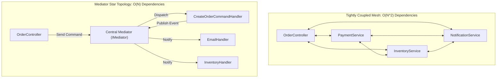
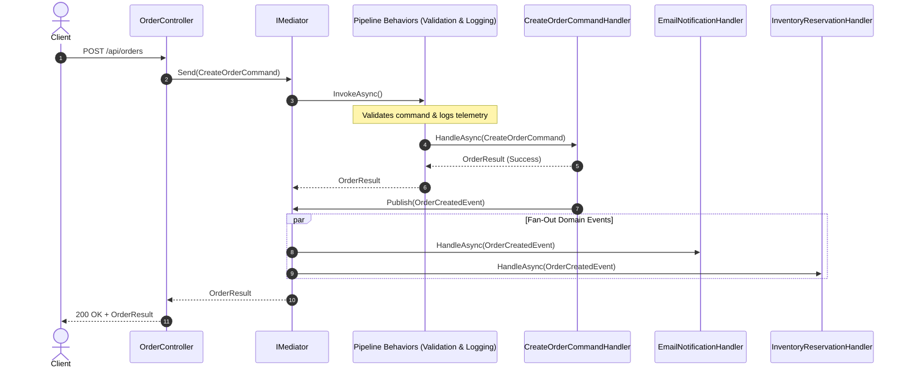

# Lesson 22: Mediator

> **Prerequisites:** [Iterator (IEnumerable and Generators)](../21-iterator/README.md) and [Track 25 Overview](../README.md).  
> **Estimated Reading Time:** 18 minutes  
> **Target Audience:** Engineers preparing for LLD, OOP, C#, or Python technical screening and architecture rounds.

> [!NOTE]
> **In one line:** **Mediator** centralises how a set of objects talk to each other so they only know the mediator, turning a tangle of N×N references into N spokes — at the risk of a god-object hub.

> [!TIP]
> **The One Rule of the Mediator Pattern:** Mediator transforms an unmaintainable $O(N^2)$ mesh of direct dependencies between interacting components into an $O(N)$ star topology by routing all inter-component communication through a centralized coordinator. In enterprise .NET and Python backends, this pattern is the industry standard for implementing in-process CQRS (Command Query Responsibility Segregation) pipelines and domain event dispatching.

---

## 1. Why This Matters: The Interview Trap

"What is the Mediator pattern, why is `MediatR` so widely used in ASP.NET Core applications, and how does Mediator differ from Observer?" is a signature architecture interview question.

Junior candidates frequently reduce Mediator to a simple middleman:
> *"Mediator is just a helper class that calls methods on other classes. You use `MediatR` in C# controllers so you don't have to inject ten services into your constructor. And Mediator and Observer are basically the same thing because both send messages."*

Interviewers mark this as superficial because it fails to grasp **topological decoupling**, **CQRS dispatching**, and **in-process pipeline behaviors**.

A senior engineer answers with **structural topology and architectural separation**:
> "Without a mediator, $N$ collaborating components must reference each other directly, creating a tightly coupled $O(N^2)$ mesh where modifying one component breaks multiple others. Mediator replaces this mesh with a **star topology (hub-and-spoke)**: components (Colleagues) only know the Mediator, and the Mediator coordinates interactions.  
> 
> In modern .NET backends, the `MediatR` library leverages this pattern to implement **in-process CQRS**. HTTP controllers inject a single `IMediator` interface and issue commands or queries (`_mediator.Send(new CreateOrderCommand(...))`). The mediator resolves the single matching handler via DI.  
> 
> Crucially, this decouples presentation from domain logic and introduces cross-cutting pipeline behaviors (`IPipelineBehavior`) for validation, logging, and transactions. Furthermore, for 1-to-many broadcasts (domain events), `_mediator.Publish()` dispatches notifications to multiple decoupled handlers."

### Mediator vs. Observer vs. Facade vs. Message Broker

| Dimension | Mediator Pattern | Observer Pattern | Facade Pattern | Message Broker (RabbitMQ/Kafka) |
| :--- | :--- | :--- | :--- | :--- |
| **Communication Flow** | **Bi-directional / Multi-way:** Coordinates back-and-forth orchestration between colleagues. | **One-way broadcast:** Subject notifies listeners that an event occurred. | **Unidirectional downward:** High-level interface delegating to subsystems. | **Asynchronous broadcast:** Decoupled event publishing across network boundaries. |
| **Topology** | **Star topology:** Hub-and-spoke with a centralized coordinator. | **Publisher-Subscriber:** Direct reference list held inside the Subject. | **Entryway wrapper:** Single interface masking complex subsystem internals. | **Distributed queue / log:** Durable topics and consumer groups. |
| **Participant Coupling** | Colleagues know the Mediator; Mediator knows colleagues (or resolves via DI). | Subject does not know who observers are; observers implement `IObserver`. | Caller knows the Facade; subsystem classes do not know the Facade. | Producers and consumers share only serialized schemas (Avro/JSON). |
| **Execution Context** | In-process, synchronous or asynchronous memory dispatch. | In-process synchronous memory callbacks. | In-process direct method invocations. | **Out-of-process**, distributed network boundary. |
| **Typical Use Cases** | `MediatR` CQRS dispatch, UI dialog orchestration. | C# `event` / `EventHandler`, property change notifications (`INotifyPropertyChanged`). | Hiding complex legacy SDKs or multi-step library calls. | Inter-service microservice events, reliable asynchronous jobs. |

---

## 2. Visual Mental Model / Taxonomic Comparison

### Mesh Coupling vs. Star Topology



### The In-Process CQRS Dispatch Pipeline

When an API controller issues a command, the Mediator routes it through cross-cutting pipeline behaviors before reaching the domain handler, and subsequently fans out domain events:



---

## 3. Code Implementation

The following implementation models an in-process CQRS Mediator pipeline in Python and C#. It supports:
1. `IRequest<TResponse>`: 1-to-1 command dispatch returning a strongly-typed result.
2. `INotification`: 1-to-many domain event publishing executing multiple side-effects independently.
3. Clean separation between presentation (controller), application command handlers, and domain event handlers.

````carousel
```python
from __future__ import annotations
import asyncio
from dataclasses import dataclass
from typing import Any, Awaitable, Callable, Dict, List, Type


# 1. Base Contracts
class IRequest:
  """Marker interface for CQRS commands and queries returning a response."""

  pass


class INotification:
  """Marker interface for domain events broadcast to multiple handlers."""

  pass


# 2. Concrete Mediator
class SimpleMediator:
  """In-process mediator resolving 1-to-1 requests and 1-to-many notifications."""

  def __init__(self) -> None:
    self._request_handlers: Dict[
        Type[IRequest], Callable[[Any], Awaitable[Any]]
    ] = {}
    self._notification_handlers: Dict[
        Type[INotification], List[Callable[[Any], Awaitable[None]]]
    ] = {}

  def register_request_handler(
      self,
      request_type: Type[IRequest],
      handler: Callable[[Any], Awaitable[Any]],
  ) -> None:
    self._request_handlers[request_type] = handler

  def register_notification_handler(
      self,
      notification_type: Type[INotification],
      handler: Callable[[Any], Awaitable[None]],
  ) -> None:
    if notification_type not in self._notification_handlers:
      self._notification_handlers[notification_type] = []
    self._notification_handlers[notification_type].append(handler)

  async def send(self, request: IRequest) -> Any:
    req_type = type(request)
    if req_type not in self._request_handlers:
      raise ValueError(f"No handler registered for {req_type.__name__}")
    return await self._request_handlers[req_type](request)

  async def publish(self, notification: INotification) -> None:
    notif_type = type(notification)
    handlers = self._notification_handlers.get(notif_type, [])
    for handler in handlers:
      await handler(notification)


# 3. Domain Commands, Results, and Notifications
@dataclass
class CreateOrderCommand(IRequest):
  order_id: str
  amount: float
  customer_email: str


@dataclass
class OrderResult:
  order_id: str
  success: bool
  message: str


@dataclass
class OrderCreatedEvent(INotification):
  order_id: str
  customer_email: str


# 4. Handlers
class OrderCommandHandler:

  def __init__(self, mediator: SimpleMediator) -> None:
    self._mediator = mediator

  async def handle(self, command: CreateOrderCommand) -> OrderResult:
    print(
        f"[OrderHandler] Processing Order {command.order_id} for"
        f" ${command.amount:.2f}..."
    )

    # Publish 1-to-many domain event via mediator
    event = OrderCreatedEvent(command.order_id, command.customer_email)
    await self._mediator.publish(event)

    return OrderResult(
        order_id=command.order_id,
        success=True,
        message="Order confirmed successfully",
    )


async def handle_email_notification(event: OrderCreatedEvent) -> None:
  print(
      f"[EmailHandler] Sending confirmation email to {event.customer_email} for"
      f" Order {event.order_id}."
  )


async def handle_inventory_reservation(event: OrderCreatedEvent) -> None:
  print(f"[InventoryHandler] Reserving inventory for Order {event.order_id}.")


# Demonstration
async def main() -> None:
  mediator = SimpleMediator()

  # Registration (typically handled by DI container scanning assemblies)
  order_handler = OrderCommandHandler(mediator)
  mediator.register_request_handler(CreateOrderCommand, order_handler.handle)
  mediator.register_notification_handler(
      OrderCreatedEvent, handle_email_notification
  )
  mediator.register_notification_handler(
      OrderCreatedEvent, handle_inventory_reservation
  )

  print("=== Dispatching Command via Mediator ===")
  # Caller only knows the command and IMediator; zero coupling to handler classes
  command = CreateOrderCommand(
      order_id="ORD-5501", amount=149.99, customer_email="alice@example.com"
  )
  result: OrderResult = await mediator.send(command)

  print(
      f"[Controller] Result received: Success={result.success},"
      f" Message='{result.message}'"
  )


if __name__ == "__main__":
  asyncio.run(main())
```
<!-- slide -->
```csharp
using System;
using System.Collections.Generic;
using System.Threading.Tasks;

// 1. Base Contracts
public interface IRequest<TResponse> { }
public interface INotification { }

public interface IRequestHandler<in TRequest, TResponse> where TRequest : IRequest<TResponse>
{
    Task<TResponse> HandleAsync(TRequest request);
}

public interface INotificationHandler<in TNotification> where TNotification : INotification
{
    Task HandleAsync(TNotification notification);
}

public interface IMediator
{
    Task<TResponse> SendAsync<TResponse>(IRequest<TResponse> request);
    Task PublishAsync<TNotification>(TNotification notification) where TNotification : INotification;
}

// 2. Concrete In-Process Mediator
public class SimpleMediator : IMediator
{
    private readonly Dictionary<Type, Func<object, Task<object>>> _requestHandlers = new();
    private readonly Dictionary<Type, List<Func<object, Task>>> _notificationHandlers = new();

    public void RegisterRequestHandler<TRequest, TResponse>(IRequestHandler<TRequest, TResponse> handler)
        where TRequest : IRequest<TResponse>
    {
        _requestHandlers[typeof(TRequest)] = async req => (await handler.HandleAsync((TRequest)req))!;
    }

    public void RegisterNotificationHandler<TNotification>(INotificationHandler<TNotification> handler)
        where TNotification : INotification
    {
        if (!_notificationHandlers.ContainsKey(typeof(TNotification)))
        {
            _notificationHandlers[typeof(TNotification)] = new List<Func<object, Task>>();
        }
        _notificationHandlers[typeof(TNotification)].Add(notif => handler.HandleAsync((TNotification)notif));
    }

    public async Task<TResponse> SendAsync<TResponse>(IRequest<TResponse> request)
    {
        var type = request.GetType();
        if (!_requestHandlers.TryGetValue(type, out var handler))
            throw new InvalidOperationException($"No handler registered for {type.Name}");

        var result = await handler(request);
        return (TResponse)result;
    }

    public async Task PublishAsync<TNotification>(TNotification notification) where TNotification : INotification
    {
        var type = notification.GetType();
        if (_notificationHandlers.TryGetValue(type, out var handlers))
        {
            foreach (var handler in handlers)
            {
                await handler(notification);
            }
        }
    }
}

// 3. Domain Commands, Results, and Notifications
public record CreateOrderCommand(string OrderId, decimal Amount, string CustomerEmail) : IRequest<OrderResult>;
public record OrderResult(string OrderId, bool Success, string Message);
public record OrderCreatedEvent(string OrderId, string CustomerEmail) : INotification;

// 4. Handlers
public class CreateOrderCommandHandler : IRequestHandler<CreateOrderCommand, OrderResult>
{
    private readonly IMediator _mediator;

    public CreateOrderCommandHandler(IMediator mediator)
    {
        _mediator = mediator;
    }

    public async Task<OrderResult> HandleAsync(CreateOrderCommand request)
    {
        Console.WriteLine($"[OrderHandler] Processing Order {request.OrderId} for ${request.Amount:F2}...");

        // Publish 1-to-many domain event via mediator
        await _mediator.PublishAsync(new OrderCreatedEvent(request.OrderId, request.CustomerEmail));

        return new OrderResult(request.OrderId, true, "Order confirmed successfully");
    }
}

public class EmailConfirmationHandler : INotificationHandler<OrderCreatedEvent>
{
    public Task HandleAsync(OrderCreatedEvent notification)
    {
        Console.WriteLine($"[EmailHandler] Sending confirmation email to {notification.CustomerEmail} for Order {notification.OrderId}.");
        return Task.CompletedTask;
    }
}

public class InventoryReservationHandler : INotificationHandler<OrderCreatedEvent>
{
    public Task HandleAsync(OrderCreatedEvent notification)
    {
        Console.WriteLine($"[InventoryHandler] Reserving inventory for Order {notification.OrderId}.");
        return Task.CompletedTask;
    }
}

// Demonstration
public class Program
{
    public static async Task Main()
    {
        var mediator = new SimpleMediator();

        // Registration (typically handled automatically by DI container scanning assemblies)
        mediator.RegisterRequestHandler<CreateOrderCommand, OrderResult>(new CreateOrderCommandHandler(mediator));
        mediator.RegisterNotificationHandler(new EmailConfirmationHandler());
        mediator.RegisterNotificationHandler(new InventoryReservationHandler());

        Console.WriteLine("=== Dispatching Command via Mediator ===");
        // Controller only knows CreateOrderCommand and IMediator; zero direct reference to handlers
        var command = new CreateOrderCommand("ORD-5501", 149.99m, "alice@example.com");
        var result = await mediator.SendAsync(command);

        Console.WriteLine($"[Controller] Result received: Success={result.Success}, Message='{result.Message}'");
    }
}
```
````

**Expected Output (Both Languages):**

```text
=== Dispatching Command via Mediator ===
[OrderHandler] Processing Order ORD-5501 for $149.99...
[EmailHandler] Sending confirmation email to alice@example.com for Order ORD-5501.
[InventoryHandler] Reserving inventory for Order ORD-5501.
[Controller] Result received: Success=True, Message='Order confirmed successfully'
```

---

## 3A. Where It Is Used, Why It Exists & Progressive Buildup

### Where It Is Used (Real-World Systems & LLD Interviews)

| Domain / Ecosystem | Concrete Real-World Usage | LLD Interview Problem Where You Use It |
| :--- | :--- | :--- |
| **.NET (C#)** | `MediatR` (`Send`, `Publish`), `IPipelineBehavior<TReq, TRes>`, `CommunityToolkit.Mvvm` `WeakReferenceMessenger` | In-process CQRS order pipeline, decoupled ViewModel messaging |
| **Python** | `django.dispatch.Signal`, `blinker` event hub, PyQt/Tkinter dialog controllers, Airflow DAG orchestration | Chat room / Slack workspace, Smart Home automation hub |
| **Go** | `go-mediatr` CQRS bus, WebSocket `Hub` goroutine coordinating client channels | Real-time multiplayer lobby / chat hub, Air Traffic Control (ATC) |
| **TypeScript** | NestJS `@nestjs/cqrs` (`CommandBus`, `EventBus`), NgRx Effects, complex form-state coordinators | Multi-step checkout wizard, dynamic form-field dependency manager |

### Why It Is Used — The Step-by-Step Buildup (Before -> Pain -> Pattern)

#### Stage 0: Naive Code ($O(N^2)$ Mesh of Direct References)
Consider a checkout form where toggling a "Business Purchase" checkbox enables a VAT ID field and disables the Submit button until VAT is filled:

```python
class VatInput:
    def __init__(self, submit_btn: "SubmitButton") -> None:
        self.enabled = False
        self.value = ""
        self.submit_btn = submit_btn

    def set_text(self, text: str) -> None:
        self.value = text
        # Tightly coupled to SubmitButton!
        self.submit_btn.enabled = bool(self.value) if self.enabled else True


class BusinessCheckbox:
    def __init__(self, vat_input: VatInput, submit_btn: "SubmitButton") -> None:
        self.checked = False
        self.vat_input = vat_input
        self.submit_btn = submit_btn

    def toggle(self) -> None:
        self.checked = not self.checked
        self.vat_input.enabled = self.checked
        self.submit_btn.enabled = not self.checked or bool(self.vat_input.value)


class SubmitButton:
    def __init__(self) -> None:
        self.enabled = True
```

#### What Breaks as Requirements Arrive
1. **Requirement 2 — Add a `CountryDropdown` & `CouponInput`:** Every new widget must be injected into existing widgets' constructors. With 6 controls, you risk $6 \times 5 = 30$ bidirectional references and circular initialization bugs (`A` needs `B` which needs `A`).
2. **Requirement 3 — Reuse & Isolated Testing:** You cannot reuse `BusinessCheckbox` in a profile settings page because its constructor demands `VatInput` and `SubmitButton`. Validation rules are scattered across 4 classes.

#### Step-by-Step Refactor Into the Pattern
1. **Step 1 (Introduce `FormMediator`):** Give every widget a single reference to `mediator: FormMediator` and have widgets emit `self._mediator.notify(self, "toggled")` instead of calling peers.
2. **Step 2 (Centralize Coordination):** Move the cross-widget `if/else` rules into `CheckoutFormMediator.notify()`. Widgets become dumb, reusable components; interaction rules live in one testable hub.

### Progressive Real-World Examples

#### Example A (Simple Core): Checkout Form Widget Coordinator
Widgets only know `FormMediator`. Adding a new rule (e.g., disabling submit when VAT is empty) requires editing only `CheckoutFormMediator`.

```python
from typing import Optional, Protocol


class FormMediator(Protocol):
    def notify(self, sender: object, event: str) -> None: ...


class Widget:
    def __init__(self, mediator: Optional[FormMediator] = None) -> None:
        self._mediator = mediator

    def set_mediator(self, mediator: FormMediator) -> None:
        self._mediator = mediator


class BusinessCheckbox(Widget):
    def __init__(self) -> None:
        super().__init__()
        self.checked = False

    def toggle(self) -> None:
        self.checked = not self.checked
        if self._mediator:
            self._mediator.notify(self, "toggle")


class VatInput(Widget):
    def __init__(self) -> None:
        super().__init__()
        self.enabled = False
        self.value = ""

    def set_text(self, value: str) -> None:
        self.value = value
        if self._mediator:
            self._mediator.notify(self, "text_changed")


class SubmitButton(Widget):
    def __init__(self) -> None:
        super().__init__()
        self.enabled = True


class CheckoutFormMediator:
    def __init__(self, checkbox: BusinessCheckbox, vat: VatInput, submit: SubmitButton) -> None:
        self._checkbox = checkbox
        self._vat = vat
        self._submit = submit
        for w in (checkbox, vat, submit):
            w.set_mediator(self)

    def notify(self, sender: object, event: str) -> None:
        if sender is self._checkbox and event == "toggle":
            self._vat.enabled = self._checkbox.checked
        self._submit.enabled = (not self._checkbox.checked) or bool(self._vat.value.strip())


cb, vat, btn = BusinessCheckbox(), VatInput(), SubmitButton()
CheckoutFormMediator(cb, vat, btn)
cb.toggle()
assert vat.enabled is True and btn.enabled is False
vat.set_text("DE123456789")
assert btn.enabled is True
```

#### Example B (Production Backend): CQRS Mediator with Pipeline Behaviors
In production backends (like `MediatR` in .NET or NestJS CQRS), the Mediator wraps command execution in **pipeline behaviors** (logging, validation, metrics) so handlers stay focused purely on domain logic.

```python
from dataclasses import dataclass
from typing import Any, Callable, Dict, List, Type


@dataclass
class TransferFundsCommand:
    from_account: str
    to_account: str
    amount: float


class PipelineMediator:
    def __init__(self) -> None:
        self._handlers: Dict[Type[Any], Callable[[Any], Any]] = {}
        self._behaviors: List[Callable[[Any, Callable[[Any], Any]], Any]] = []

    def register(self, cmd_type: Type[Any], handler: Callable[[Any], Any]) -> None:
        self._handlers[cmd_type] = handler

    def add_behavior(self, behavior: Callable[[Any, Callable[[Any], Any]], Any]) -> None:
        self._behaviors.append(behavior)

    def send(self, command: Any) -> Any:
        handler = self._handlers[type(command)]
        # Build middleware chain around the handler
        next_fn: Callable[[Any], Any] = handler
        for behavior in reversed(self._behaviors):
            current_next = next_fn
            next_fn = lambda cmd, b=behavior, nxt=current_next: b(cmd, nxt)
        return next_fn(command)


def validation_behavior(cmd: Any, next_fn: Callable[[Any], Any]) -> Any:
    if hasattr(cmd, "amount") and cmd.amount <= 0:
        raise ValueError("Transfer amount must be positive")
    return next_fn(cmd)


def audit_behavior(cmd: Any, next_fn: Callable[[Any], Any]) -> Any:
    print(f"[AUDIT] Executing {type(cmd).__name__}")
    return next_fn(cmd)


mediator = PipelineMediator()
mediator.add_behavior(audit_behavior)
mediator.add_behavior(validation_behavior)
mediator.register(TransferFundsCommand, lambda c: f"Transferred ${c.amount:.2f} to {c.to_account}")

print(mediator.send(TransferFundsCommand("ACC-1", "ACC-2", 250.0)))
```

#### Example C (Classic LLD Interview Problem): Air Traffic Control (ATC) Tower
Airplanes never communicate directly with each other to negotiate runway access. All clearance requests go through `ATCTower`, which owns runway state and holding queues.

```python
from collections import deque
from typing import Deque, Optional


class ATCTower:
    """Mediator coordinating runway access across independent flights."""

    def __init__(self) -> None:
        self._runway_occupied_by: Optional[str] = None
        self._holding_queue: Deque["Flight"] = deque()

    def request_landing(self, flight: "Flight") -> None:
        if self._runway_occupied_by is None:
            self._runway_occupied_by = flight.call_sign
            flight.receive_clearance(f"Cleared to land on Runway 1")
        else:
            self._holding_queue.append(flight)
            flight.receive_clearance(f"Hold pattern (Runway busy with {self._runway_occupied_by})")

    def notify_runway_cleared(self, flight: "Flight") -> None:
        if self._runway_occupied_by == flight.call_sign:
            self._runway_occupied_by = None
            if self._holding_queue:
                next_flight = self._holding_queue.popleft()
                self.request_landing(next_flight)


class Flight:
    def __init__(self, call_sign: str, tower: ATCTower) -> None:
        self.call_sign = call_sign
        self._tower = tower
        self.last_instruction = ""

    def land(self) -> None:
        self._tower.request_landing(self)

    def clear_runway(self) -> None:
        self._tower.notify_runway_cleared(self)

    def receive_clearance(self, msg: str) -> None:
        self.last_instruction = msg


tower = ATCTower()
f1, f2 = Flight("UA-101", tower), Flight("DL-202", tower)
f1.land()
f2.land()
assert "Cleared to land" in f1.last_instruction
assert "Hold pattern" in f2.last_instruction
f1.clear_runway()
assert "Cleared to land" in f2.last_instruction
```

---

## 4. Where You Already Use It

- **In .NET / C#:**
  - `MediatR` library (Jimmy Bogard): The dominant implementation in .NET. It powers CQRS architecture, Clean Architecture, and Vertical Slice Architecture across thousands of production enterprise APIs.
  - `IPipelineBehavior<TRequest, TResponse>`: Cross-cutting decorator pipeline inside MediatR. Executes FluentValidation rules, starts OpenTelemetry spans, and wraps database transactions around command execution automatically.
  - `WeakReferenceMessenger` in CommunityToolkit.Mvvm: Used in WPF, WinUI, and .NET MAUI to allow decoupled communication between ViewModels without creating strong-reference memory leaks.

- **In Python:**
  - **GUI Frameworks (`PyQt`, `Tkinter`):** Dialog windows use a central controller/mediator to coordinate interactions between widgets (e.g., when a user checks a checkbox, the mediator enables a text field and changes the submit button color).
  - **Django Signals (`django.dispatch.dispatcher`):** Provides an in-process mediator allowing disparate Django applications to send and receive notifications when models save (`post_save`), delete (`post_delete`), or when users authenticate.
  - **Airflow DAG Orchestration:** Airflow coordinates dependencies and data passing between individual task operators via XComs and central scheduler mediation.

---

## 5. Pitfalls and When Not to Use It

1. **The "God Object" Antipattern:**
   - A mediator that begins accumulating domain logic, state validation, and business calculations quickly turns into an unmaintainable God Object.
   - *Fix:* Keep the Mediator **strictly a dispatcher**. The mediator should only resolve handlers and forward messages; all business rules must remain inside domain handlers and aggregate entities.

2. **Obscured Control Flow ("Spaghetti in a Box"):**
   - In a traditional codebase, pressing "Go to Definition" on `_orderService.CreateOrder()` immediately takes you to the executing code. With MediatR, `_mediator.Send(command)` takes you to the library's `IMediator` interface. Junior engineers struggle to trace which handler executes, especially when multiple pipeline behaviors and notification handlers are registered.
   - *Fix:* Use consistent naming conventions (`CreateOrderCommand` $\to$ `CreateOrderCommandHandler`), or use modern IDE plugins (like JetBrains Rider's MediatR navigation gutter icons).

3. **Overengineering Simple CRUD:**
   - For an endpoint that simply executes `context.Users.FindAsync(id)`, introducing a `GetUserQuery`, `GetUserQueryHandler`, `GetUserDto`, and mediator pipeline adds unnecessary file ceremony and boilerplate.
   - *Fix:* Direct service/repository injection is cleaner and faster for simple CRUD. Reserve Mediator for complex domain commands, CQRS architectures, or multi-step domain workflows.

4. **Performance Overhead on Micro-Hotpaths:**
   - Every `_mediator.Send()` allocates a command object, traverses dictionary lookups, resolves Scoped handlers from the DI container, and wraps execution in async task state machines. In ultra-low-latency financial trading or high-throughput microservices (100k+ req/sec), this allocation overhead creates measurable GC pressure compared to direct method invocation.

---

## 6. Exercises & Practical Drills

### Drill 1: Identify the Boundary: MediatR vs. Direct Service Injection
Review this ASP.NET Core controller:
```csharp
[ApiController]
[Route("api/users")]
public class UsersController : ControllerBase
{
    private readonly IMediator _mediator;

    public UsersController(IMediator mediator) => _mediator = mediator;

    [HttpGet("{id}")]
    public async Task<IActionResult> GetUser(int id)
    {
        var user = await _mediator.Send(new GetUserByIdQuery(id));
        return Ok(user);
    }
}
```
Is using MediatR here beneficial or is it an antipattern? How do you justify the architectural decision?

<details>
<summary>Answer</summary>

**Evaluation:**
- **If the application is built on Vertical Slice Architecture or strict CQRS:** Using MediatR here maintains architectural uniformity across the entire API. It enables global pipeline behaviors (e.g., query caching, tenant scoping, and authorization checks) to execute automatically without modifying the controller.
- **If the application is a standard layered/CRUD application:** This is an antipattern known as **Indirection for the sake of Indirection**. Creating a separate query class and handler just to read a user by primary key adds boilerplate and cognitive friction with zero architectural benefit over injecting `IUserRepository` or `DbContext` directly.

**Rule of Thumb:** Use MediatR when commands/queries require rich pipeline validation, domain event dispatching, or distinct vertical slices. Avoid it for passive CRUD pass-throughs.
</details>

### Drill 2: Observer or Mediator?
You are designing an Air Traffic Control (ATC) system. Multiple airplanes need to coordinate landing on Runways 1 and 2. 
- Airplane A cannot land while Airplane B is on Runway 1.
- When Airplane B clears the runway, Airplane A should be cleared to land.
Should you model this using **Observer** or **Mediator**?

<details>
<summary>Answer</summary>

**Model as Mediator.**

**Rationale:**
If you model this with Observer, every Airplane would need to subscribe to every other Airplane's events. Airplane A would need to monitor Airplane B, C, and D to decide whether it can land. This produces an $O(N^2)$ dependency mesh and forces complex runway clearance logic into individual airplanes.

With **Mediator**:
The Air Traffic Control Tower acts as the **Mediator**. Airplanes only talk to the Tower (`tower.RequestLanding(airplaneA)`). The Tower maintains the state of the runways, coordinates holding patterns, checks spacing, and instructs individual airplanes when to land. The airplanes remain completely decoupled from each other.
</details>

---

## 7. Interview Questions & Model Answers

<details>
<summary><strong>1. What is the Mediator pattern? [BASIC]</strong></summary>

The Mediator pattern is a behavioral design pattern that restricts direct communication between a set of collaborating objects (Colleagues) by forcing all communication to flow through a centralized mediator object.

Without a mediator, components reference one another directly, resulting in an unmaintainable $O(N^2)$ dependency mesh. The mediator pattern flattens this into an $O(N)$ star topology: each component depends only on the mediator abstraction. The mediator encapsulates the interaction rules and coordination logic, allowing components to be modified, tested, and reused in complete isolation from one another.

</details>

<details>
<summary><strong>2. What does `MediatR` do in .NET? [BASIC]</strong></summary>

In .NET, `MediatR` is an in-process messaging library authored by Jimmy Bogard that implements the Mediator pattern to support Command Query Responsibility Segregation (CQRS) and vertical slice architectures.

It provides three primary capabilities:
1. **Request/Response Dispatching (`Send`):** Maps a command or query (`IRequest<TResponse>`) to a single dedicated handler (`IRequestHandler<TRequest, TResponse>`), completely decoupling API controllers from domain service implementations.
2. **Domain Event Broadcasting (`Publish`):** Dispatches a notification (`INotification`) to zero or more handlers (`INotificationHandler<TNotification>`), enabling side-effects (like sending confirmation emails or invalidating caches) to execute without coupling to the primary command handler.
3. **Pipeline Behaviors (`IPipelineBehavior`):** Acts as an in-process middleware chain wrapping request handlers. This enables cross-cutting concerns like validation (FluentValidation), logging, performance metrics, and database transaction management to execute transparently around handlers.

</details>

<details>
<summary><strong>3. What is the difference between Mediator and Observer? [BASIC]</strong></summary>

While both patterns facilitate decoupled messaging, they differ fundamentally in intent, topology, and communication flow:

1. **Communication Flow:** The **Observer pattern** is strictly **unidirectional (one-way)** broadcast. A Subject notifies a list of anonymous observers that a state change occurred; the Subject neither knows who is listening nor expects any response. The **Mediator pattern** coordinates **bidirectional or multi-way** communication. It often facilitates request-response workflows (1-to-1) and orchestrates complex multi-step sequences among collaborating peers.
2. **Topology & Knowledge:** Observer establishes a distributed 1-to-many relationship where subscribers register themselves directly with the Subject. Mediator establishes a centralized star topology (hub-and-spoke) where colleagues talk only to the mediator, and the mediator directs how colleagues collaborate.

In practice, a Mediator often *uses* the Observer pattern internally to broadcast domain notifications to multiple event handlers.

</details>

<details>
<summary><strong>4. A form has 10 controls that enable/disable each other. How do you tame it? [SCENARIO]</strong></summary>

Introduce a form mediator; controls raise events to it and it updates the others. Each control stays reusable and the interaction rules are in one testable class.

</details>

<details>
<summary><strong>5. What is the biggest danger of Mediator? [TRICKY]</strong></summary>

It collects all interaction logic and grows into a God object. Split into several mediators by feature or use small request/handler pairs (as MediatR does).

</details>

<details>
<summary><strong>6. Mediator vs Observer? [BASIC]</strong></summary>

Observer broadcasts from one subject to unknown subscribers. Mediator is a two-way hub that *decides* who talks to whom and applies the coordination rules.

</details>

---

## Try it

Run this: colleagues never reference each other, only the room. Then redraw it in [LLD Studio](/tools/lld-studio/); the [track hub](../README.md) has the pattern-choice drills.

```python
class ChatRoom:
    def __init__(self): self.users = []
    def join(self, u): self.users.append(u); u.room = self
    def send(self, sender, msg):
        for u in self.users:
            if u is not sender: u.inbox.append(msg)

class User:
    def __init__(self): self.inbox, self.room = [], None
    def say(self, msg): self.room.send(self, msg)

room, a, b = ChatRoom(), User(), User()
room.join(a); room.join(b); a.say("hi")
assert b.inbox == ["hi"] and a.inbox == []
```

---

## One-page cheat sheet

```text
MEDIATOR  Colleague <-> Mediator <-> Colleague   (no colleague-to-colleague refs)
Turns many-to-many into one-to-many; logic of interaction lives in one place
Use: chat room, form controls enabling each other, air-traffic control, MediatR
MediatR: Send(request) -> one handler | Publish(notification) -> many
Mediator = coordinate peers | Observer = broadcast | Facade = simplify subsystem
Risk: mediator becomes a God object with all the logic
Keep handlers small; one request type -> one handler
```

---

## 8. Sources & Further Reading

- [MediatR Official Documentation & GitHub](https://github.com/jbogard/MediatR)
- [Microsoft Learn: CQRS and Mediator Pattern in Microservices](https://learn.microsoft.com/en-us/dotnet/architecture/microservices/microservice-ddd-cqrs-patterns/microservice-application-layer-implementation-web-api)
- [Martin Fowler: CQRS Architecture](https://martinfowler.com/bliki/CQRS.html)
- [Refactoring.Guru: Mediator Pattern](https://refactoring.guru/design-patterns/mediator)
- Gamma, E., Helm, R., Johnson, R., & Vlissides, J. (1994). *Design Patterns: Elements of Reusable Object-Oriented Software*. Addison-Wesley (The Mediator Pattern, pp. 273–282).

---

Previous: [Iterator (IEnumerable and Generators)](../21-iterator/README.md) · Next: [Memento](../23-memento/README.md)
