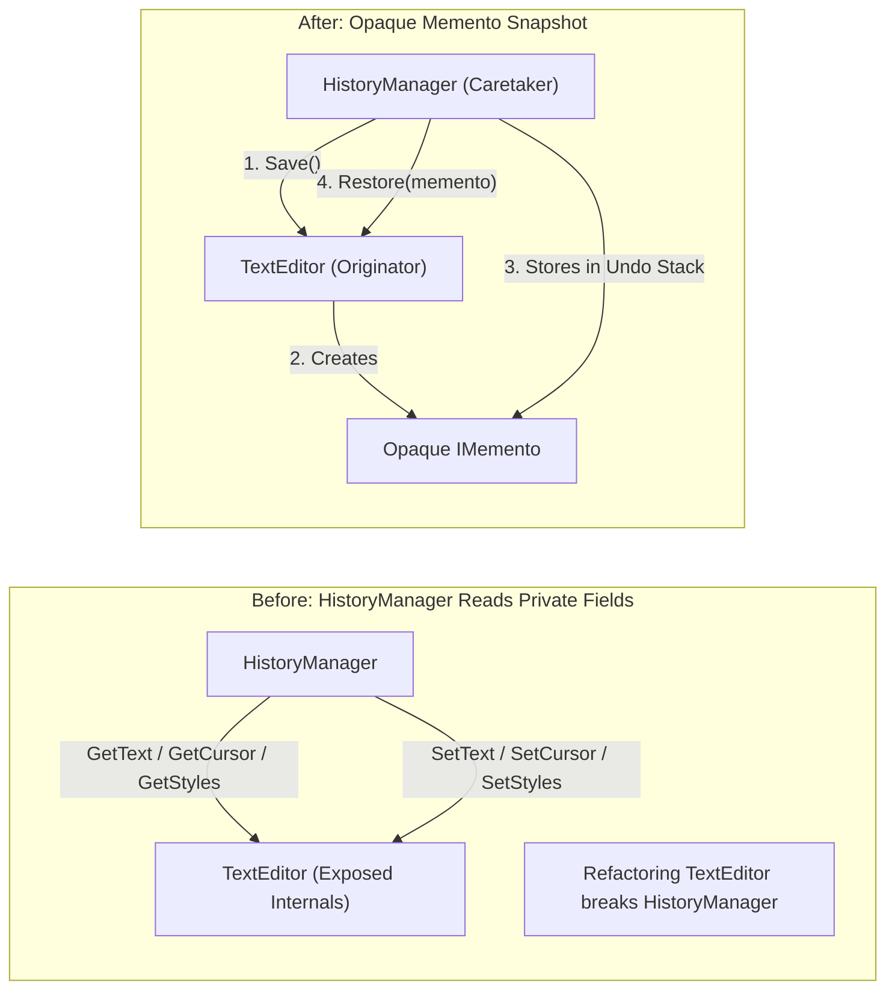
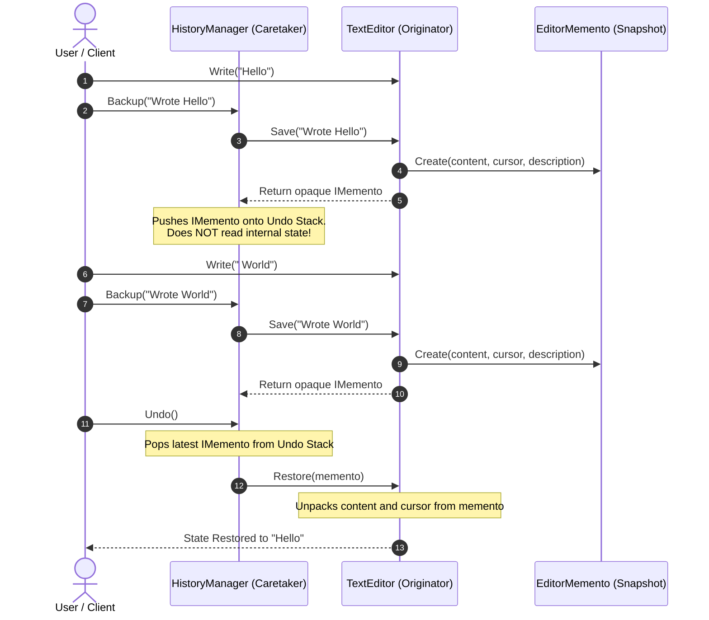

# Lesson 23: Memento

> **Prerequisites:** [Mediator](../22-mediator/README.md) and [Track 25 Overview](../README.md).  
> **Estimated Reading Time:** 17 minutes  
> **Target Audience:** Engineers preparing for LLD, OOP, C#, or Python technical screening and architecture rounds.

> [!NOTE]
> **In one line:** **Memento** captures an object's internal state in an opaque snapshot so it can be restored later (undo, checkpoints) without breaking encapsulation.

> [!TIP]
> **The One Rule of the Memento Pattern:** A memento must remain an **opaque black box** to all external classes (including the Caretaker); only the Originator that created the memento may inspect, unpack, or restore its internal snapshot. If the Caretaker or any other consumer reads, mutates, or couples to the memento's private state fields, encapsulation is shattered and the pattern degenerates into a leaky data bag.

---

## 1. Why This Matters: The Interview Trap

"How would you design an undo/redo mechanism for a rich text editor or a financial transaction system without breaking encapsulation?" is a premier object-oriented design question. It evaluates whether a candidate understands the tension between **encapsulation** (hiding private state) and **checkpointing** (capturing state snapshots).

### The Interview Trap

Candidates frequently propose breaking encapsulation to save history:
> *"I will create a HistoryManager class. When the user edits text, the HistoryManager calls `editor.GetText()` and `editor.GetCursor()`, stores them in a tuple or struct on a stack, and when the user clicks Undo, the manager calls `editor.SetText()` and `editor.SetCursor()`."*

The interviewer immediately exposes the architectural flaws:
1. *"What if the editor's internal state includes 15 private fields, such as undo-tree nodes, active spellcheck spans, IME composition buffers, and font style maps? Does `HistoryManager` now need getters and setters for all 15 private fields?"*
2. *"If you expose setters for internal state, what stops any arbitrary component in the system from mutating the editor's private state directly?"*
3. *"If you change the internal data structure of the editor from a string to a Rope or Piece Table, why should the `HistoryManager` have to be rewritten?"*

A senior engineer answers with strict behavioral decoupling:

> *"The **Memento pattern** solves this dilemma by capturing a snapshot of an object's internal state so that it can be restored later, **without violating encapsulation**.*  
>  
> *It establishes three rigidly defined roles:*  
> 1. ***Originator:*** *The domain object that owns the state (e.g., `TextEditor`). It alone knows how to serialize its internal state into a memento and unpack a memento to restore itself.*  
> 2. ***Memento:*** *An immutable value object representing the snapshot. To the outside world, it is an opaque token (exposing at most non-sensitive metadata like a timestamp or description). To the Originator, its internal state is fully accessible.*  
> 3. ***Caretaker:*** *The history manager (e.g., `UndoRedoManager`). It stores a stack of mementos and decides **when** to save or restore snapshots, but it **never reads, writes, or inspects** the snapshot data.*  
>  
> *When deciding how to implement undo/redo, senior architects weigh two primary approaches:*  
> - ***Memento (State Snapshot):*** *Saves the full or delta state before mutations. Trivial to implement, deterministic, immune to floating-point drift or non-commutative operation bugs, but consumes memory proportional to the state size.*  
> - ***Command (Inverse Operations):*** *Stores executable command objects with an `Unexecute()` method (e.g., `InsertTextCommand.Unexecute()` deletes the inserted range). Minimal memory footprint, but complex to maintain and vulnerable to state desynchronization if an inverse operation has rounding errors or external side effects."*

---

## 1A. The Visual Story: Problem -> Analogy -> Solution

### The Problem (Why Naive Code Explodes)

Imagine adding `Ctrl+Z` (Undo) to a rich document editor or a financial ledger. A naive implementation has the `HistoryManager` copy every field of `TextEditor` before each edit:

1. **Encapsulation shatters:** To save and restore state, `TextEditor` must expose public getters and setters for every internal field—`TextBuffer`, `CursorRow`, `CursorCol`, `SelectionRange`, `SpellcheckCache`, `FontStyleMap`. Now *any* class in the codebase can mutate the editor's private invariants directly.
2. **Brittle coupling:** The day you refactor `TextEditor`'s internal representation from a `string` to a **Piece Table** or **Rope**, `HistoryManager` fails to compile because all the fields it was reading no longer exist.
3. **Accidental corruption:** If the snapshot is just a plain mutable struct exposed to `HistoryManager`, a bug in the undo stack could accidentally mutate a historical checkpoint in-place.

### Real-World Analogy

Think of a **Video Game Checkpoint Save File**:

- **The Game Engine (Originator):** Knows every private detail of your session—exact XYZ coordinates, boss phase, inventory durability, quest flags, and RNG seed.
- **The `.sav` File (Memento):** When you hit a checkpoint, the engine packs all that state into an **opaque binary save file**.
- **The Memory Card / Save Slot Manager (Caretaker):** Your console's save manager can list save slots by timestamp, store them, delete them, or hand a `.sav` file back to the engine when you click "Load Game"—but the save manager **cannot open or edit** your health points inside the `.sav` file.

### Visual Problem -> Solution Diagram



### Applicability & Pattern Relations

**Use when:**
- You need to produce snapshots of an object's state to restore it later (Undo/Redo, transaction rollback, game checkpoints).
- Direct access to the object's fields/getters/setters would violate encapsulation and expose implementation details.

**Relations with Other Patterns:**
- **Command:** **Command** and **Memento** are frequently combined for Undo/Redo—Command executes the operation, while Memento captures the pre-operation state snapshot when writing an inverse `Unexecute()` is too complex or error-prone.
- **Iterator:** Memento can capture an Iterator's current traversal position so you can roll back or bookmark an iteration.
- **Prototype:** Sometimes used as a simpler alternative to Memento when the object's state is simple enough that cloning the entire object (`Clone()`) is acceptable and encapsulation boundaries are relaxed.

---

## 2. Visual Mental Model / Taxonomic Comparison

### Memento Interaction Sequence

The Caretaker requests a snapshot from the Originator and pushes it onto an undo stack. When undo is triggered, the Caretaker pops the opaque memento and passes it back to the Originator. The Caretaker never examines the payload.



### Decision Matrix: Memento vs. Command vs. State vs. Prototype

| Architectural Dimension | Memento | Command | State | Prototype |
| :--- | :--- | :--- | :--- | :--- |
| **Primary Intent** | Capture and restore private state snapshots without breaking encapsulation | Encapsulate a request/action as an object with undo/redo execution | Alter object behavior when its internal state changes | Create new objects by cloning an existing prototype |
| **Undo Mechanism** | Restores state by overwriting fields with a previous snapshot | Executes an inverse action (`Unexecute()` or inverse method) | Not designed for undo; transitions between finite state machines | Not applicable; produces distinct new instances |
| **Memory Footprint** | Higher (stores snapshots or state deltas over time) | Low (stores only command parameters and inverse logic) | Minimal (only current state object is active) | Moderate (independent clone allocations) |
| **Encapsulation Level** | **Strictly Preserved** (snapshot payload is private to Originator) | Preserved if commands interact with public interface | Preserved via polymorphic state interfaces | Bypassed if cloning requires reading private fields |
| **Complexity Focus** | Managing memory limits and deep copy lifecycle | Writing robust inverse logic for every mutation operation | Implementing behavior transitions cleanly | Cloning circular reference graphs correctly |

---

## 3. Code Implementation: The Text Editor Undo/Redo Engine

Let us build an undo/redo engine:
- **Originator (`TextEditor`):** Owns private text buffer and cursor coordinates. Implements `Save()` and `Restore()`.
- **Memento (`EditorMemento` / `IMemento`):** Immutable snapshot holding internal text and cursor state. In C#, `EditorMemento` is a private nested class behind an opaque `IMemento` interface.
- **Caretaker (`HistoryManager`):** Manages undo and redo stacks without ever inspecting editor internals.

````carousel
```python
from __future__ import annotations
from typing import List, Optional


class EditorMemento:
    """Memento: Opaque snapshot storing the Originator's private state.
    
    The Caretaker only sees metadata; only the Originator unpacks the private state.
    """
    def __init__(self, content: str, cursor_pos: int, description: str) -> None:
        self._content = content
        self._cursor_pos = cursor_pos
        self._description = description

    @property
    def description(self) -> str:
        """Public metadata for caretaker history display."""
        return self._description

    # Private getters intended strictly for the Originator
    @property
    def _state_content(self) -> str:
        return self._content

    @property
    def _state_cursor_pos(self) -> int:
        return self._cursor_pos


class TextEditor:
    """Originator: The entity whose state needs checkpointing and restoration."""
    def __init__(self) -> None:
        self._content: str = ""
        self._cursor_pos: int = 0

    def write(self, text: str) -> None:
        self._content = (
            self._content[:self._cursor_pos] +
            text +
            self._content[self._cursor_pos:]
        )
        self._cursor_pos += len(text)

    def delete(self, count: int) -> None:
        start = max(0, self._cursor_pos - count)
        self._content = self._content[:start] + self._content[self._cursor_pos:]
        self._cursor_pos = start

    def save(self, description: str) -> EditorMemento:
        """Create an opaque snapshot of current internal state."""
        return EditorMemento(self._content, self._cursor_pos, description)

    def restore(self, memento: EditorMemento) -> None:
        """Restore internal state from an opaque snapshot."""
        self._content = memento._state_content
        self._cursor_pos = memento._state_cursor_pos

    def __repr__(self) -> str:
        return f'TextEditor(content="{self._content}", cursor={self._cursor_pos})'


class HistoryManager:
    """Caretaker: Tracks snapshots without ever reading or modifying their contents."""
    def __init__(self, editor: TextEditor) -> None:
        self._editor = editor
        self._undo_stack: List[EditorMemento] = []
        self._redo_stack: List[EditorMemento] = []

    def backup(self, description: str) -> None:
        self._undo_stack.append(self._editor.save(description))
        self._redo_stack.clear()

    def undo(self) -> bool:
        if not self._undo_stack:
            return False
        
        # Save current state to redo stack before restoring past state
        memento = self._undo_stack.pop()
        self._redo_stack.append(self._editor.save(f"Before undo: {memento.description}"))
        self._editor.restore(memento)
        return True

    def redo(self) -> bool:
        if not self._redo_stack:
            return False
            
        memento = self._redo_stack.pop()
        self._undo_stack.append(self._editor.save(f"Before redo: {memento.description}"))
        self._editor.restore(memento)
        return True

    def print_history(self) -> None:
        print("Undo Stack:")
        for idx, m in enumerate(self._undo_stack):
            print(f"  [{idx}] {m.description}")


if __name__ == "__main__":
    editor = TextEditor()
    history = HistoryManager(editor)

    print("--- 1. Initial Edits ---")
    editor.write("Hello")
    history.backup("Wrote 'Hello'")
    print(editor)

    editor.write(" World")
    history.backup("Wrote ' World'")
    print(editor)

    editor.write("! Welcome to LLD.")
    print(editor)

    print("\n--- 2. Performing Undo ---")
    history.undo()
    print(f"After 1st Undo: {editor}")

    history.undo()
    print(f"After 2nd Undo: {editor}")

    print("\n--- 3. Performing Redo ---")
    history.redo()
    print(f"After 1st Redo: {editor}")

    print("\n--- 4. New Mutation Invalids Redo ---")
    editor.write(" Everyone")
    history.backup("Wrote ' Everyone'")
    print(editor)
    print(f"Redo available: {history.redo()}")
    print(editor)
```
<!-- slide -->
```csharp
using System;
using System.Collections.Generic;

namespace MementoDemo;

/// <summary>
/// Opaque Memento interface visible to the Caretaker.
/// Exposes only non-sensitive metadata.
/// </summary>
public interface IMemento
{
    string Description { get; }
}

/// <summary>
/// Originator: Owns internal editing state.
/// Produces and consumes concrete memento snapshots.
/// </summary>
public sealed class TextEditor
{
    private string _content = string.Empty;
    private int _cursorPos = 0;

    /// <summary>
    /// Private inner class: Only TextEditor can instantiate or inspect private fields.
    /// External callers (including HistoryManager) only hold references to IMemento.
    /// </summary>
    private sealed class EditorMemento : IMemento
    {
        public string Content { get; }
        public int CursorPos { get; }
        public string Description { get; }

        public EditorMemento(string content, int cursorPos, string description)
        {
            Content = content;
            CursorPos = cursorPos;
            Description = description;
        }
    }

    public void Write(string text)
    {
        _content = _content.Insert(_cursorPos, text);
        _cursorPos += text.Length;
    }

    public void Delete(int count)
    {
        int start = Math.Max(0, _cursorPos - count);
        int deleteLength = _cursorPos - start;
        _content = _content.Remove(start, deleteLength);
        _cursorPos = start;
    }

    public IMemento Save(string description)
    {
        return new EditorMemento(_content, _cursorPos, description);
    }

    public void Restore(IMemento memento)
    {
        if (memento is not EditorMemento concrete)
        {
            throw new InvalidOperationException("Unknown memento implementation.");
        }

        _content = concrete.Content;
        _cursorPos = concrete.CursorPos;
    }

    public override string ToString()
    {
        return $"TextEditor(content=\"{_content}\", cursor={_cursorPos})";
    }
}

/// <summary>
/// Caretaker: Manages undo and redo stacks of opaque IMemento tokens.
/// Does not know or inspect editor internal state.
/// </summary>
public sealed class HistoryManager
{
    private readonly TextEditor _editor;
    private readonly Stack<IMemento> _undoStack = new();
    private readonly Stack<IMemento> _redoStack = new();

    public HistoryManager(TextEditor editor)
    {
        _editor = editor;
    }

    public void Backup(string description)
    {
        _undoStack.Push(_editor.Save(description));
        _redoStack.Clear();
    }

    public bool Undo()
    {
        if (_undoStack.Count == 0)
        {
            return false;
        }

        IMemento memento = _undoStack.Pop();
        _redoStack.Push(_editor.Save($"Before undo: {memento.Description}"));
        _editor.Restore(memento);
        return true;
    }

    public bool Redo()
    {
        if (_redoStack.Count == 0)
        {
            return false;
        }

        IMemento memento = _redoStack.Pop();
        _undoStack.Push(_editor.Save($"Before redo: {memento.Description}"));
        _editor.Restore(memento);
        return true;
    }
}

public static class Program
{
    public static void Main()
    {
        var editor = new TextEditor();
        var history = new HistoryManager(editor);

        Console.WriteLine("--- 1. Initial Edits ---");
        editor.Write("Hello");
        history.Backup("Wrote 'Hello'");
        Console.WriteLine(editor);

        editor.Write(" World");
        history.Backup("Wrote ' World'");
        Console.WriteLine(editor);

        editor.Write("! Welcome to LLD.");
        Console.WriteLine(editor);

        Console.WriteLine("\n--- 2. Performing Undo ---");
        history.Undo();
        Console.WriteLine($"After 1st Undo: {editor}");

        history.Undo();
        Console.WriteLine($"After 2nd Undo: {editor}");

        Console.WriteLine("\n--- 3. Performing Redo ---");
        history.Redo();
        Console.WriteLine($"After 1st Redo: {editor}");

        Console.WriteLine("\n--- 4. New Mutation Invalids Redo ---");
        editor.Write(" Everyone");
        history.Backup("Wrote ' Everyone'");
        Console.WriteLine(editor);
        Console.WriteLine($"Redo available: {history.Redo()}");
        Console.WriteLine(editor);
    }
}
```
````

**Expected Output (Both Languages):**
```text
--- 1. Initial Edits ---
TextEditor(content="Hello", cursor=5)
TextEditor(content="Hello World", cursor=11)
TextEditor(content="Hello World! Welcome to LLD.", cursor=28)

--- 2. Performing Undo ---
After 1st Undo: TextEditor(content="Hello World", cursor=11)
After 2nd Undo: TextEditor(content="Hello", cursor=5)

--- 3. Performing Redo ---
After 1st Redo: TextEditor(content="Hello World", cursor=11)

--- 4. New Mutation Invalids Redo ---
TextEditor(content="Hello World Everyone", cursor=20)
Redo available: False
TextEditor(content="Hello World Everyone", cursor=20)
```

---

## 3A. Where It Is Used, Why It Exists & Progressive Buildup

### Where It Is Used (Real-World Systems & LLD Interviews)

| Domain / Ecosystem | Concrete Real-World Usage | LLD Interview Problem Where You Use It |
| :--- | :--- | :--- |
| **.NET (C#)** | `IEditableObject` (`BeginEdit`/`CancelEdit`/`EndEdit`), EF Core `ChangeTracker` (`OriginalValues` snapshot) | Rich text / diagram editor Undo-Redo, DataGrid row edit rollback |
| **Python** | PyTorch `model.state_dict()` epoch checkpoints, `copy.deepcopy` workflow snapshots | Game Save/Load manager, ML training recovery checkpoint |
| **Go** | Raft / Etcd / BadgerDB state-machine snapshots, immutable struct value copies | In-memory transactional KV store (`SAVEPOINT` / `ROLLBACK`) |
| **TypeScript** | Redux DevTools time-travel debugging, Immer structural-sharing snapshots | Collaborative canvas (Figma-lite) history, multi-step wizard rollback |

### Why It Is Used — The Step-by-Step Buildup (Before -> Pain -> Pattern)

#### Stage 0: Naive Code (Leaky Getters/Setters & Shallow-Copy Bug)
Suppose we build a document editor and let `NaiveHistory` read and write the editor's fields directly:

```python
class NaiveEditor:
    def __init__(self) -> None:
        self.text = ""
        self.styles: dict[str, str] = {"font": "Arial", "size": "12"}


class NaiveHistory:
    def __init__(self) -> None:
        self.snapshots: list[tuple[str, dict[str, str]]] = []

    def save(self, editor: NaiveEditor) -> None:
        # Bug 1: Coupled to editor's internal fields
        # Bug 2: Shallow reference to mutable dict!
        self.snapshots.append((editor.text, editor.styles))

    def undo(self, editor: NaiveEditor) -> None:
        editor.text, editor.styles = self.snapshots.pop()
```

#### What Breaks as Requirements Arrive
1. **Requirement 2 — Internal Refactoring (`text` -> `Rope` / add `cursor`):** If `NaiveEditor` changes its internal representation or adds 5 new private fields (`_cursor`, `_selection`, `_ime_buffer`), `NaiveHistory` breaks and must be rewritten.
2. **Requirement 3 — Mutable Nested State (Silent Corruption):** Because `editor.styles` is a mutable `dict`, changing `editor.styles["font"] = "Mono"` after `save()` **silently mutates the saved snapshot**! Calling `undo()` restores the new font instead of `"Arial"`.

#### Step-by-Step Refactor Into the Pattern
1. **Step 1 (Encapsulate Snapshot Creation):** Move snapshot creation (`save()`) and restoration (`restore(memento)`) *inside* `Editor` (the Originator), using `copy.deepcopy` or immutable types so mutable child objects are isolated.
2. **Step 2 (Make Memento Opaque to Caretaker):** `HistoryManager` (the Caretaker) stores `Memento` objects in a stack without ever inspecting or constructing their internal fields.

### Progressive Real-World Examples

#### Example A (Simple Core): RPG Game Save/Load Checkpoint
`Player` owns private health, coordinates, and a mutable `inventory` list. Creating a `PlayerMemento` deep-copies the inventory so later pickups never corrupt old save slots.

```python
import copy
from dataclasses import dataclass


@dataclass(frozen=True)
class PlayerMemento:
    """Immutable snapshot; Caretaker stores it without reading internal fields."""
    _hp: int
    _level: int
    _inventory: tuple[str, ...]
    label: str


class Player:
    def __init__(self) -> None:
        self._hp = 100
        self._level = 1
        self._inventory: list[str] = ["Wooden Sword"]

    def take_damage(self, dmg: int) -> None:
        self._hp = max(0, self._hp - dmg)

    def loot(self, item: str) -> None:
        self._inventory.append(item)

    def save(self, label: str) -> PlayerMemento:
        return PlayerMemento(self._hp, self._level, tuple(self._inventory), label)

    def restore(self, m: PlayerMemento) -> None:
        self._hp = m._hp
        self._level = m._level
        self._inventory = list(m._inventory)

    def status(self) -> str:
        return f"HP={self._hp}, Inventory={self._inventory}"


hero = Player()
checkpoint = hero.save("Before Boss Fight")
hero.loot("Dragon Shield")
hero.take_damage(90)
hero.restore(checkpoint)
assert hero.status() == "HP=100, Inventory=['Wooden Sword']"
```

#### Example B (Production Backend): In-Memory KV Store with `SAVEPOINT` & `ROLLBACK`
Database engines and transactional caches use Memento-style snapshots to support nested savepoints: if step 3 of a batch fails, only changes after the savepoint are rolled back.

```python
import copy
from typing import Any, Dict


class StoreMemento:
    def __init__(self, name: str, data: Dict[str, Any]) -> None:
        self.name = name
        self._data = copy.deepcopy(data)


class TransactionalKVStore:
    def __init__(self) -> None:
        self._store: Dict[str, Any] = {}
        self._savepoints: list[StoreMemento] = []

    def set(self, key: str, value: Any) -> None:
        self._store[key] = value

    def get(self, key: str) -> Any:
        return self._store.get(key)

    def savepoint(self, name: str) -> None:
        self._savepoints.append(StoreMemento(name, self._store))

    def rollback_to(self, name: str) -> None:
        while self._savepoints:
            snap = self._savepoints.pop()
            if snap.name == name:
                self._store = copy.deepcopy(snap._data)
                return
        raise KeyError(f"Savepoint '{name}' not found")


db = TransactionalKVStore()
db.set("balance:alice", 500)
db.savepoint("sp1")
db.set("balance:alice", 0)
db.set("balance:bob", 500)
db.rollback_to("sp1")
assert db.get("balance:alice") == 500 and db.get("balance:bob") is None
```

#### Example C (Classic LLD Interview Problem): Bounded Canvas Editor with Undo/Redo
In a Figma-like vector canvas interview problem, unbounded undo stacks cause OOM crashes. Using `collections.deque(maxlen=N)` bounds memory while preserving full encapsulation.

```python
import copy
from collections import deque
from typing import Deque, Dict


class CanvasMemento:
    def __init__(self, shapes: Dict[str, dict]) -> None:
        self._shapes = copy.deepcopy(shapes)


class VectorCanvas:
    def __init__(self) -> None:
        self._shapes: Dict[str, dict] = {}

    def add_shape(self, shape_id: str, x: int, y: int) -> None:
        self._shapes[shape_id] = {"x": x, "y": y}

    def move_shape(self, shape_id: str, dx: int, dy: int) -> None:
        self._shapes[shape_id]["x"] += dx
        self._shapes[shape_id]["y"] += dy

    def save(self) -> CanvasMemento:
        return CanvasMemento(self._shapes)

    def restore(self, memento: CanvasMemento) -> None:
        self._shapes = copy.deepcopy(memento._shapes)

    def snapshot_view(self) -> Dict[str, dict]:
        return copy.deepcopy(self._shapes)


class BoundedHistory:
    def __init__(self, canvas: VectorCanvas, max_steps: int = 50) -> None:
        self._canvas = canvas
        self._undo: Deque[CanvasMemento] = deque(maxlen=max_steps)
        self._redo: Deque[CanvasMemento] = deque(maxlen=max_steps)

    def checkpoint(self) -> None:
        self._undo.append(self._canvas.save())
        self._redo.clear()

    def undo(self) -> bool:
        if not self._undo:
            return False
        self._redo.append(self._canvas.save())
        self._canvas.restore(self._undo.pop())
        return True

    def redo(self) -> bool:
        if not self._redo:
            return False
        self._undo.append(self._canvas.save())
        self._canvas.restore(self._redo.pop())
        return True


canvas = VectorCanvas()
hist = BoundedHistory(canvas, max_steps=10)
hist.checkpoint()
canvas.add_shape("rect1", 0, 0)
hist.checkpoint()
canvas.move_shape("rect1", 25, 40)
assert hist.undo() is True
assert canvas.snapshot_view()["rect1"] == {"x": 0, "y": 0}
assert hist.redo() is True
assert canvas.snapshot_view()["rect1"] == {"x": 25, "y": 40}
```

---

## 4. Where You Already Use It

The Memento pattern is fundamental across database engines, UI frameworks, and version control tools:

### 1. .NET `IEditableObject` Interface
In Windows Forms, WPF, and data-binding libraries, the `System.ComponentModel.IEditableObject` interface is a direct implementation of the Memento pattern:
- `BeginEdit()`: The object creates an internal memento snapshot of its current property values.
- `CancelEdit()`: Discards changes by restoring the internal state from the snapshot.
- `EndEdit()`: Commits current values and discards the snapshot.

The data grid controller acts as the Caretaker; it calls these three lifecycle methods without knowing what fields exist on the customer or invoice model.

### 2. Entity Framework Core Change Tracking
When an entity is attached to a `DbContext`, EF Core captures an internal snapshot of the entity's property values (`entry.OriginalValues`). When `SaveChanges()` is called, EF Core compares the current entity values against this internal memento snapshot to detect which columns were modified and generate optimized `UPDATE` SQL queries with minimal payload.

### 3. Git Internals and Version Control Systems
In Git, a commit is essentially an immutable Memento snapshot:
- **Originator:** The working directory and index tree.
- **Memento:** The Git Commit / Tree Object (immutable SHA-1/SHA-256 hash containing directory blobs).
- **Caretaker:** The Git CLI / reflog (`git checkout <sha>`, `git reset --hard HEAD~1`), which swaps the working tree to match historical memento snapshots.

### 4. Machine Learning Checkpointing (PyTorch / TensorFlow)
In deep learning training loops, model weights are saved at periodic epochs via `torch.save(model.state_dict(), "checkpoint.pt")`. The state dictionary acts as an opaque memento. If training destabilizes or diverges, the training orchestrator (Caretaker) restores the weights via `model.load_state_dict(checkpoint)`.

---

## 5. Pitfalls and When Not to Use It

### 1. Memory Exhaustion from Deep Snapshots
If the Originator contains a large object graph (e.g., a 200 MB in-memory CAD drawing or audio buffer), storing 50 historical mementos consumes 10 GB of RAM.
- **Mitigation:**
  1. Enforce a **bounded history stack** (e.g., maximum 20 undo steps using a circular buffer / deque).
  2. Implement **incremental delta compression** (record only the modified attributes or diffs rather than full deep copies).

### 2. Shallow Copy Hazards
If an Originator holds references to mutable nested objects (such as lists, dictionaries, or child entities) and creates a memento using a shallow copy, mutating the child object in the active editor inadvertently mutates the historical snapshot as well!
> **Rule:** Mementos must capture a **deep copy** of mutable child state or store immutable snapshots.

### 3. Serialization Overhead
Some implementations serialize state to JSON or binary streams to create mementos. While this guarantees deep isolation, serializing and deserializing large graphs on every keystroke causes CPU spikes, frame drops, and garbage collection pauses. In-memory structural immutability or specialized delta records are far more efficient for real-time applications.

---

## 6. Exercises & Practical Drills

### Exercise 1: Memento vs. Command for Undo

You are designing an interactive drawing application (like Figma or Photoshop). For each of the following user actions, determine whether an **Undo mechanism based on Command** or **Undo based on Memento** is the superior architectural choice, and explain why:

1. Translating a vector rectangle from $(10, 20)$ to $(30, 40)$.
2. Applying a complex non-linear Gaussian Blur and chromatic aberration filter to a 4K bitmap image layer.
3. Adding a new text box to the canvas.

<details>
<summary>Answer</summary>

1. **Translating a vector rectangle: Command.**  
   Translating an object is mathematically reversible with trivial inverse logic: `Unexecute()` simply adds $(-20, -20)$ to the coordinates. Storing an entire canvas snapshot for a coordinate shift is a massive waste of memory.
2. **Applying a Gaussian blur filter to a 4K bitmap: Memento.**  
   A Gaussian blur is an irreversible, lossy mathematical convolution; you cannot mathematically compute an "un-blur" matrix to restore original pixel frequencies. You must store a snapshot of the raw pixel buffer (memento) before the destructive filter is applied.
3. **Adding a new text box: Command.**  
   The inverse operation of "Add element $E$" is simply "Remove element $E$ from canvas collection". A Command object requires only a reference to the element ID.
</details>

### Exercise 2: Encapsulation Breach Audit

Examine this Python class design:

```python
class DocumentMemento:
    def __init__(self, text: str, margins: dict, header_tags: list) -> None:
        self.text = text
        self.margins = margins
        self.header_tags = header_tags


class DocumentHistory:
    def __init__(self) -> None:
        self._history = []

    def save(self, doc) -> None:
        m = DocumentMemento(doc.text, doc.margins, doc.header_tags)
        self._history.append(m)

    def print_last_saved_text(self) -> None:
        print(self._history[-1].text)
```

Identify two serious design flaws in this implementation.

<details>
<summary>Answer</summary>

1. **Encapsulation Breach:** `DocumentMemento` has public fields, and `DocumentHistory` (the Caretaker) inspects them directly (`self._history[-1].text`). The Caretaker is tightly coupled to the internal schema of `Document`. If `Document` changes how headers or margins are represented, `DocumentHistory` breaks.
2. **Originator Role Usurpation:** `DocumentHistory.save` is directly extracting internal attributes from `doc` to instantiate the memento. The **Originator itself** (`doc`) must be responsible for creating its own memento via a `save()` method. The Caretaker should never construct the snapshot.
3. **Shallow Reference Bug:** `margins` and `header_tags` are mutable dictionary and list references passed directly into `DocumentMemento`. Any subsequent mutation on `doc.margins` will mutate the historical snapshot.
</details>

---

## 7. Interview Questions & Model Answers

<details>
<summary><strong>1. What is the Memento pattern? [BASIC]</strong></summary>

The Memento pattern is a Gang of Four behavioral design pattern that allows an application to capture and externalize an object's internal state snapshot so that the object can be restored to that state later, all without violating the principle of encapsulation.

The pattern decouples the state lifecycle into three distinct roles:
1. **Originator:** The domain object that owns the state. It alone creates memento snapshots containing its private data and restores its state when supplied with a memento.
2. **Memento:** An immutable object holding the state snapshot. It exposes a 'narrow interface' to the outside world (only metadata like timestamps) and a 'wide interface' to the Originator, preserving encapsulation.
3. **Caretaker:** The orchestrator (such as an undo manager or transaction coordinator) that schedules snapshots and maintains undo/redo stacks. Crucially, the Caretaker treats mementos as opaque tokens and never inspects or mutates their internal contents.

</details>

<details>
<summary><strong>2. How would you implement undo with a memento? [SCENARIO]</strong></summary>

To implement undo with a memento:
1. The **Originator** exposes two methods: `CreateMemento()` which returns an opaque snapshot of its current state, and `RestoreMemento(memento)` which unpacks the snapshot into its private fields.
2. The **Caretaker** maintains two LIFO data structures: an `UndoStack` and a `RedoStack`.
3. Before any state mutation occurs, the Caretaker asks the Originator for a snapshot and pushes it onto the `UndoStack`, while clearing the `RedoStack`.
4. When an **Undo** request arrives: the Caretaker pops the top snapshot from the `UndoStack`, captures the current state and pushes it onto the `RedoStack`, and invokes `Originator.RestoreMemento(snapshot)`.
5. For **Redo**, the reverse occurs: pop from `RedoStack`, push current state onto `UndoStack`, and restore.
To prevent memory exhaustion, the Caretaker should enforce a bounded capacity (e.g., maximum 50 entries using a circular buffer) and evict oldest snapshots.

</details>

<details>
<summary><strong>3. How does Memento compare to Command for implementing undo/redo? [BASIC]</strong></summary>

Memento and Command represent two fundamentally different philosophies for undo/redo:

1. **Mechanism:**
   - **Memento** is **state-based**: it captures snapshots of the object's data at specific moments. Undo simply restores the previous snapshot.
   - **Command** is **behavior-based**: it captures the user's action and implements an inverse method (`Unexecute()`) that programmatically reverses the mutation.
2. **Memory Footprint:**
   - Memento consumes significant memory because each snapshot stores state data (full or delta copies).
   - Command consumes minimal memory because it only stores the operation parameters (e.g., 'Delete character at index 5').
3. **Complexity & Reliability:**
   - Memento is simpler and virtually immune to synchronization bugs, floating-point drift, or non-commutative operation errors. It is essential for irreversible lossy operations (e.g., image convolution filters).
   - Command requires writing error-free inverse logic for every single action in the application, which becomes complex for multi-entity cascades.

In enterprise systems, architects often combine both: Command orchestrates the undoable workflow, while individual commands use Mementos to snapshot entities prior to execution.

</details>

<details>
<summary><strong>4. A text editor needs 100-level undo for 10 MB documents. Memento naive copies are too big. What now? [SCENARIO]</strong></summary>

Cap the stack, snapshot only on meaningful boundaries, or store deltas (diffs/commands) instead of full copies. Persistent/immutable structures also share unchanged parts between snapshots.

</details>

<details>
<summary><strong>5. Why can a Memento snapshot silently be wrong? [TRICKY]</strong></summary>

If it stores references to mutable nested objects (a shallow copy), later edits change the "saved" state too. The snapshot must be immutable or a deep copy.

</details>

<details>
<summary><strong>6. When would you choose Command-undo over Memento? [SCENARIO]</strong></summary>

When operations are small and reversible and full state is large (reverse the action cheaply). Use Memento when reversing is hard or the state is small and easy to copy.

</details>

---

## Try it

Run this: the editor hands out snapshots; only it can read them back. Then redraw it in [LLD Studio](/tools/lld-studio/); the [track hub](../README.md) has the pattern-choice drills.

```python
class Editor:
    def __init__(self): self.text = ""
    def save(self): return self.text                 # memento (immutable str)
    def restore(self, m): self.text = m

e, stack = Editor(), []
e.text = "v1"; stack.append(e.save())
e.text = "v2"; stack.append(e.save())
e.text = "oops"
e.restore(stack.pop()); assert e.text == "v2"
e.restore(stack.pop()); assert e.text == "v1"
```

---

## One-page cheat sheet

```text
MEMENTO  Originator.save() -> Memento ; Originator.restore(Memento) ; Caretaker holds them
Snapshot is opaque and immutable; caretaker never inspects it
Undo/redo, checkpoints, transaction rollback, game saves
Command-undo (reverse the ACTION) | Memento (restore the STATE) - often combined
Cost: memory for every snapshot -> cap history, store diffs, or use persistent data
Python: copy.deepcopy / dataclasses.replace | C#: record `with`, serialise
Pitfall: snapshots holding live references (shallow copy bug)
```

---

## 8. Sources & Further Reading

- Gamma, E., Helm, R., Johnson, R., & Vlissides, J. (1994). *Design Patterns: Elements of Reusable Object-Oriented Software*. Addison-Wesley.
- [Microsoft Learn: IEditableObject Interface (System.ComponentModel)](https://learn.microsoft.com/en-us/dotnet/api/system.componentmodel.ieditableobject)
- [Microsoft Learn: EF Core Change Tracking Snapshots](https://learn.microsoft.com/en-us/ef/core/change-tracking/)
- [Refactoring.Guru: Memento Design Pattern](https://refactoring.guru/design-patterns/memento)

---

Previous: [Mediator](../22-mediator/README.md) · Next: [Visitor](../24-visitor/README.md)
