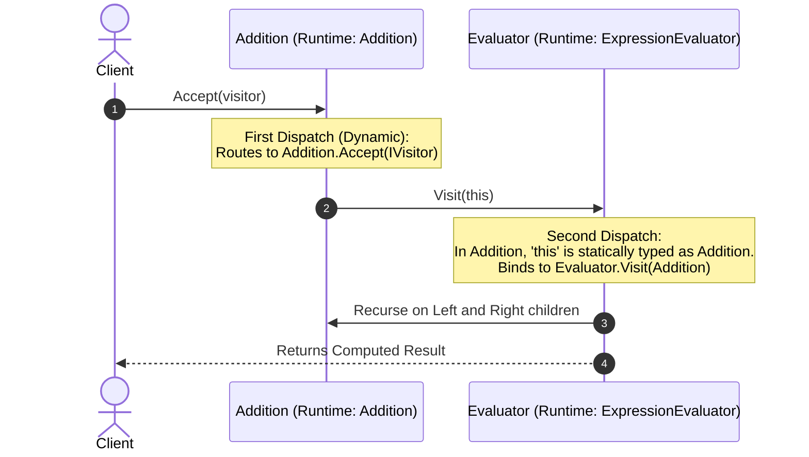
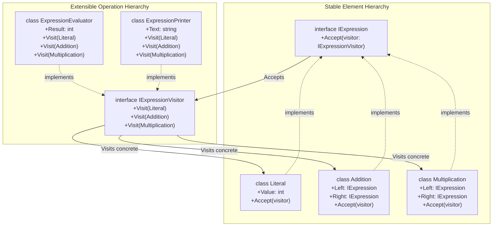

# Lesson 24: Visitor

> **Prerequisites:** [Memento](../23-memento/README.md) and [Track 25 Overview](../README.md).  
> **Estimated Reading Time:** 18 minutes  
> **Target Audience:** Engineers preparing for LLD, OOP, C#, or Python technical screening and architecture rounds.

> [!TIP]
> **The One Rule of the Visitor Pattern:** Use Visitor when your object structure (class hierarchy) is **stable and rarely changes**, but you frequently need to define **new operations** over that structure without polluting the element classes. Visitor achieves this via **double dispatch**—the element routes to the visitor based on its runtime type (`element.Accept(visitor)`), and the visitor routes based on the element type (`visitor.Visit(this)`). If your class hierarchy changes frequently, Visitor is an architectural antipattern: adding a single new element class forces recompilation and method additions across every visitor in the codebase (the Expression Problem).

---

## 1. Why This Matters: The Interview Trap

"What is the Visitor pattern, and what is double dispatch?" is one of the most revealing questions in technical interviews. It probes whether a candidate truly understands runtime dynamic dispatch, static method overloading, compiler type systems, and the trade-offs of the classic **Expression Problem**.

### The Interview Trap

Candidates often reduce Visitor to a superficial buzzword:
> *"Visitor lets you separate an algorithm from the object structure by visiting each node in a collection."*

The interviewer immediately pounces:
*"Why can't I just put a virtual method on the base class? Or better yet, why can't I just write a loop with `if (element is Literal l) ... else if (element is Addition a) ...`? Why do we need the awkward `Accept(visitor)` call that immediately turns around and calls `visitor.Visit(this)`? What is double dispatch, and why can't standard languages like C# or Java do it natively?"*

A senior engineer answers with compiler-level clarity:

> *"Most mainstream object-oriented languages (C#, Java, C++, Python) support **single dispatch**: when you call `receiver.Method(arg)`, the runtime chooses which implementation to invoke based solely on the dynamic runtime type of the **receiver** (`receiver`). The type of the argument (`arg`) is resolved at **compile-time** based on its static type declaration.*  
>  
> *If you have a collection of `IExpression` elements containing `Literal` and `Addition`, and a visitor interface with overloaded methods `Visit(Literal)` and `Visit(Addition)`, writing `visitor.Visit(element)` **fails to compile** in statically typed languages because the compiler only knows `element` as `IExpression`.  
>  
> ***Double Dispatch** solves this by using two polymorphic dispatches in sequence:*  
> 1. ***First Dispatch (Dynamic):*** *The client invokes `element.Accept(visitor)`. Because `Accept` is virtual/abstract on `IExpression`, the runtime resolves the concrete runtime type of the element (e.g., `Literal`).*  
> 2. ***Second Dispatch (Static / Dynamic):*** *Inside `Literal.Accept`, the keyword `this` has the static type `Literal`. Invoking `visitor.Visit(this)` allows the compiler to bind directly to `Visit(Literal)`. On the visitor side, polymorphism resolves the active visitor algorithm (e.g., `ExpressionEvaluator` vs. `ExpressionPrinter`).*  
>  
> *Through these two hops, the runtime selects the operation based on **both** the runtime type of the visitor AND the runtime type of the element."*

### The Expression Problem: Architectural Trade-Off

The Visitor pattern represents one specific side of the fundamental **Expression Problem**:

| Architectural Approach | Adding New Data Types (Classes) | Adding New Operations (Behaviors) |
| :--- | :--- | :--- |
| **Traditional OOP (Virtual Methods on Interface)** | **Trivial:** Create a new subclass implementing existing methods. | **Painful:** Adding a method to the interface requires modifying every existing subclass. |
| **Visitor Pattern (Double Dispatch)** | **Painful:** Adding a new element class requires updating `IVisitor` and every existing visitor class. | **Trivial:** Create a new Visitor class without modifying a single line of existing element code. |
| **Modern Functional Pattern Matching (`match` / `switch`)** | **Painful:** Must update all pattern matching expressions across handlers. | **Trivial:** Write a new function or extension method containing a exhaustive pattern match. |

---

## 2. Visual Mental Model / Taxonomic Comparison

### The Double Dispatch Handshake

The client never directly binds the element to the operation. The execution dances between the element and the visitor.



### Class Structure: Element Hierarchy vs. Visitor Hierarchy



---

## 3. Code Implementation: The Arithmetic Expression Tree

Let us build an Abstract Syntax Tree (AST) evaluator and pretty-printer using the Visitor pattern:
- **Element Hierarchy:** `Literal`, `Addition`, `Multiplication`.
- **Visitor Interface:** `ExpressionVisitor` (`IExpressionVisitor`).
- **Concrete Visitors:**
  - `ExpressionEvaluator`: Calculates the numeric value of the tree.
  - `ExpressionPrinter`: Formats the tree into fully parenthesized infix notation.

````carousel
```python
from abc import ABC, abstractmethod


# =====================================================================
# 1. Visitor Interface & Element Hierarchy
# =====================================================================

class ExpressionVisitor(ABC):
    """Visitor Interface: Declares visit methods for every concrete element."""
    @abstractmethod
    def visit_literal(self, element: "Literal") -> None:
        pass

    @abstractmethod
    def visit_addition(self, element: "Addition") -> None:
        pass

    @abstractmethod
    def visit_multiplication(self, element: "Multiplication") -> None:
        pass


class Expression(ABC):
    """Element Interface: Accepts visitors via Double Dispatch."""
    @abstractmethod
    def accept(self, visitor: ExpressionVisitor) -> None:
        pass


class Literal(Expression):
    def __init__(self, value: int) -> None:
        self.value = value

    def accept(self, visitor: ExpressionVisitor) -> None:
        # First dispatch lands here dynamically;
        # Second dispatch routes to visit_literal.
        visitor.visit_literal(self)


class Addition(Expression):
    def __init__(self, left: Expression, right: Expression) -> None:
        self.left = left
        self.right = right

    def accept(self, visitor: ExpressionVisitor) -> None:
        visitor.visit_addition(self)


class Multiplication(Expression):
    def __init__(self, left: Expression, right: Expression) -> None:
        self.left = left
        self.right = right

    def accept(self, visitor: ExpressionVisitor) -> None:
        visitor.visit_multiplication(self)


# =====================================================================
# 2. Concrete Visitors (New Operations without changing AST classes)
# =====================================================================

class ExpressionEvaluator(ExpressionVisitor):
    """Operation 1: Evaluates the arithmetic expression tree to a scalar integer."""
    def __init__(self) -> None:
        self._result: int = 0

    @property
    def result(self) -> int:
        return self._result

    def visit_literal(self, element: Literal) -> None:
        self._result = element.value

    def visit_addition(self, element: Addition) -> None:
        element.left.accept(self)
        left_val = self._result
        element.right.accept(self)
        right_val = self._result
        self._result = left_val + right_val

    def visit_multiplication(self, element: Multiplication) -> None:
        element.left.accept(self)
        left_val = self._result
        element.right.accept(self)
        right_val = self._result
        self._result = left_val * right_val


class ExpressionPrinter(ExpressionVisitor):
    """Operation 2: Pretty-prints the expression tree in infix notation."""
    def __init__(self) -> None:
        self._buffer: list[str] = []

    @property
    def text(self) -> str:
        return "".join(self._buffer)

    def visit_literal(self, element: Literal) -> None:
        self._buffer.append(str(element.value))

    def visit_addition(self, element: Addition) -> None:
        self._buffer.append("(")
        element.left.accept(self)
        self._buffer.append(" + ")
        element.right.accept(self)
        self._buffer.append(")")

    def visit_multiplication(self, element: Multiplication) -> None:
        self._buffer.append("(")
        element.left.accept(self)
        self._buffer.append(" * ")
        element.right.accept(self)
        self._buffer.append(")")


if __name__ == "__main__":
    # Build AST for: ((3 + 5) * 8)
    expr: Expression = Multiplication(
        Addition(Literal(3), Literal(5)),
        Literal(8)
    )

    printer = ExpressionPrinter()
    expr.accept(printer)
    print(f"Expression: {printer.text}")

    evaluator = ExpressionEvaluator()
    expr.accept(evaluator)
    print(f"Evaluated Result: {evaluator.result}")
```
<!-- slide -->
```csharp
using System;
using System.Text;

namespace VisitorDemo;

// =====================================================================
// 1. Visitor Interface & Element Hierarchy
// =====================================================================

public interface IExpressionVisitor
{
    void Visit(Literal element);
    void Visit(Addition element);
    void Visit(Multiplication element);
}

public interface IExpression
{
    void Accept(IExpressionVisitor visitor);
}

public sealed class Literal : IExpression
{
    public int Value { get; }

    public Literal(int value)
    {
        Value = value;
    }

    public void Accept(IExpressionVisitor visitor)
    {
        // 'this' has compile-time static type Literal,
        // so the compiler statically binds to Visit(Literal).
        visitor.Visit(this);
    }
}

public sealed class Addition : IExpression
{
    public IExpression Left { get; }
    public IExpression Right { get; }

    public Addition(IExpression left, IExpression right)
    {
        Left = left;
        Right = right;
    }

    public void Accept(IExpressionVisitor visitor)
    {
        visitor.Visit(this);
    }
}

public sealed class Multiplication : IExpression
{
    public IExpression Left { get; }
    public IExpression Right { get; }

    public Multiplication(IExpression left, IExpression right)
    {
        Left = left;
        Right = right;
    }

    public void Accept(IExpressionVisitor visitor)
    {
        visitor.Visit(this);
    }
}

// =====================================================================
// 2. Concrete Visitors (New Operations without changing AST classes)
// =====================================================================

public sealed class ExpressionEvaluator : IExpressionVisitor
{
    public int Result { get; private set; }

    public void Visit(Literal element)
    {
        Result = element.Value;
    }

    public void Visit(Addition element)
    {
        element.Left.Accept(this);
        int leftVal = Result;
        element.Right.Accept(this);
        int rightVal = Result;
        Result = leftVal + rightVal;
    }

    public void Visit(Multiplication element)
    {
        element.Left.Accept(this);
        int leftVal = Result;
        element.Right.Accept(this);
        int rightVal = Result;
        Result = leftVal * rightVal;
    }
}

public sealed class ExpressionPrinter : IExpressionVisitor
{
    private readonly StringBuilder _sb = new();

    public string Text => _sb.ToString();

    public void Visit(Literal element)
    {
        _sb.Append(element.Value);
    }

    public void Visit(Addition element)
    {
        _sb.Append('(');
        element.Left.Accept(this);
        _sb.Append(" + ");
        element.Right.Accept(this);
        _sb.Append(')');
    }

    public void Visit(Multiplication element)
    {
        _sb.Append('(');
        element.Left.Accept(this);
        _sb.Append(" * ");
        element.Right.Accept(this);
        _sb.Append(')');
    }
}

public static class Program
{
    public static void Main()
    {
        // Build AST for: ((3 + 5) * 8)
        IExpression expr = new Multiplication(
            new Addition(new Literal(3), new Literal(5)),
            new Literal(8)
        );

        var printer = new ExpressionPrinter();
        expr.Accept(printer);
        Console.WriteLine($"Expression: {printer.Text}");

        var evaluator = new ExpressionEvaluator();
        expr.Accept(evaluator);
        Console.WriteLine($"Evaluated Result: {evaluator.Result}");
    }
}
```
````

**Expected Output (Both Languages):**
```text
Expression: ((3 + 5) * 8)
Evaluated Result: 64
```

---

## 4. Where You Already Use It

Compilers, static analyzers, and query processors rely heavily on the Visitor pattern to navigate hierarchical trees.

### 1. Microsoft Roslyn C# Compiler SDK
In the .NET Roslyn compiler, the Abstract Syntax Tree (AST) has hundreds of immutable syntax nodes (`ClassDeclarationSyntax`, `MethodDeclarationSyntax`, `BinaryExpressionSyntax`).  
Roslyn provides two canonical visitor base classes:
- `CSharpSyntaxVisitor<TResult>`: Visited nodes return a result (used by code generators, linters, analyzers).
- `CSharpSyntaxRewriter`: Visited nodes return modified syntax nodes (used by refactoring tools to transform code).

```csharp
// Example Roslyn syntax tree walker
public class ClassFinder : CSharpSyntaxWalker
{
    public List<string> ClassNames { get; } = new();

    public override void VisitClassDeclaration(ClassDeclarationSyntax node)
    {
        ClassNames.Add(node.Identifier.ValueText);
        base.VisitClassDeclaration(node); // Continue traversing children
    }
}
```

### 2. .NET LINQ `ExpressionVisitor`
In `System.Linq.Expressions`, Entity Framework and LINQ providers use `ExpressionVisitor` to translate in-memory C# lambda expressions into SQL queries:
- EF Core traverses an expression tree such as `x => x.Age > 18 && x.IsActive`.
- The visitor walks `BinaryExpression`, `MemberExpression`, and `ConstantExpression`, emitting corresponding `WHERE age > 18 AND is_active = 1` SQL statements.

### 3. Python `ast.NodeVisitor` and `ast.NodeTransformer`
In Python's standard library `ast` module, syntax trees generated by `ast.parse()` are navigated using `NodeVisitor`:
```python
import ast

class FunctionDefLister(ast.NodeVisitor):
    def visit_FunctionDef(self, node: ast.FunctionDef) -> None:
        print(f"Found function: {node.name}")
        self.generic_visit(node)

tree = ast.parse("def calculate(): pass\ndef render(): pass")
FunctionDefLister().visit(tree)
```

### 4. Modern Functional Alternative: `functools.singledispatch`
In Python, dynamic single-dispatch can often replace classic Visitor boilerplate:
```python
from functools import singledispatch

@singledispatch
def evaluate(node) -> int:
    raise NotImplementedError(f"Unsupported node: {type(node)}")

@evaluate.register
def _(node: Literal) -> int:
    return node.value

@evaluate.register
def _(node: Addition) -> int:
    return evaluate(node.left) + evaluate(node.right)
```

Likewise, in modern C# 9.0+, **pattern matching with switch expressions** often eliminates the need for double dispatch when element types are sealed or modeled as records:
```csharp
public static int Evaluate(IExpression expr) => expr switch
{
    Literal l => l.Value,
    Addition a => Evaluate(a.Left) + Evaluate(a.Right),
    Multiplication m => Evaluate(m.Left) * Evaluate(m.Right),
    _ => throw new NotSupportedException()
};
```

---

## 5. Pitfalls and When Not to Use It

### 1. Volatile Class Hierarchies
If you are designing a system where new element classes are added every sprint, the Visitor pattern will cause severe architectural friction. Adding a new `ModuloExpression` class requires:
1. Updating `IExpressionVisitor` to add `Visit(ModuloExpression)`.
2. Updating `ExpressionEvaluator`, `ExpressionPrinter`, `ExpressionOptimizer`, `SqlCompiler`, `BytecodeEmitter`, and every other visitor implementation across the entire codebase.

### 2. Encapsulation Degradation
To perform meaningful computations, visitors frequently require access to the internal state of elements. If the element classes expose private fields as public properties merely to accommodate visitors, encapsulation is compromised.

### 3. Return Type and State Accumulation Clumsiness
In classic GoF Visitor, `Visit` methods typically return `void`. Passing intermediate results between recursive visits requires maintaining mutable accumulation state inside the visitor (e.g., `_result` or `_buffer`). If visitors are shared across threads, state accumulation causes race conditions. Generic visitor interfaces (`IVisitor<TResult>`) improve this but significantly increase type parameter complexity in languages without return-type covariance.

---

## 6. Exercises & Practical Drills

### Exercise 1: Why Does Direct Overloading Fail?

Consider this code snippet:

```csharp
IExpression expr = new Literal(42);
var evaluator = new ExpressionEvaluator();

// Why does the line below fail to compile in C#?
evaluator.Visit(expr);
```

Explain why this line causes a compiler error, and explain how the `Accept` method resolves this.

<details>
<summary>Answer</summary>

**Why it fails to compile:**
C# is a **single-dispatch** language with **static compile-time method overloading**. When the compiler sees `evaluator.Visit(expr)`, it looks for an overload of `Visit` that accepts the declared static type of `expr` (`IExpression`).  
Because `IExpressionVisitor` only defines `Visit(Literal)`, `Visit(Addition)`, and `Visit(Multiplication)`—and no overload for `Visit(IExpression)` exists—the compiler rejects the call with:  
`No overload for 'Visit' takes 1 arguments of type 'IExpression'`.

**How `Accept` fixes this:**
When you call `expr.Accept(evaluator)`:
1. The call is dynamically dispatched through the virtual/interface table of `IExpression` to `Literal.Accept`.
2. Inside `Literal.Accept`, the keyword `this` has the static type `Literal`.
3. The compiler resolves `evaluator.Visit(this)` directly to `Visit(Literal)` at compile time.
</details>

### Exercise 2: Modernizing Visitor to Pattern Matching

Convert the `ExpressionPrinter` visitor into a clean, modern C# switch expression function that requires no visitor interfaces or `Accept` methods.

<details>
<summary>Answer</summary>

```csharp
public static class ExpressionFormatter
{
    public static string Print(IExpression expr) => expr switch
    {
        Literal l => l.Value.ToString(),
        Addition a => $"({Print(a.Left)} + {Print(a.Right)})",
        Multiplication m => $"({Print(m.Left)} * {Print(m.Right)})",
        _ => throw new ArgumentOutOfRangeException(nameof(expr), $"Unknown expression node: {expr.GetType().Name}")
    };
}
```
*Takeaway:* In modern C# (and Python with `match/case`), pattern matching provides the exact same benefits as the Visitor pattern (extensible operations without modifying data types) with 80% less boilerplate.
</details>

---

## 7. Interview Questions & Model Answers

> [!interview]
> **Question 1: What is the Visitor pattern?**  
> **Strong Answer:**  
> "The Visitor pattern is a Gang of Four behavioral design pattern that allows you to add new operations to an existing class hierarchy without modifying the classes themselves.  
> 
> It achieves this by moving the operational logic out of the element classes and into separate visitor objects. The element classes only provide a lightweight hook—an `Accept(visitor)` method—which uses double dispatch to invoke the appropriate overloaded `Visit` method on the visitor.  
> 
> The Visitor pattern is ideal when the class hierarchy represents a stable data structure (such as a compiler Abstract Syntax Tree, a document DOM, or a financial portfolio) that rarely changes, but the system frequently needs to perform disparate operations on those nodes (such as type checking, code generation, linting, serialization, or cost calculation)."

> [!interview]
> **Question 2: What is double dispatch?**  
> **Strong Answer:**  
> "Double dispatch is a mechanism that binds a method call based on the runtime types of **two objects**: the receiver and the argument.  
> 
> Mainstream object-oriented languages like C#, Java, and Python only support **single dispatch** natively: method calls are dynamically dispatched based solely on the runtime type of the caller (`receiver.Method(...)`), while parameter overloads are bound statically at compile time based on the declared type.  
> 
> The Visitor pattern simulates double dispatch using two consecutive polymorphic invocations:  
> 1. **First dispatch (Dynamic):** The client calls `element.Accept(visitor)`. This polymorphically selects the concrete element's `Accept` implementation based on the runtime type of `element`.  
> 2. **Second dispatch (Static/Dynamic):** Inside `element.Accept`, the element calls `visitor.Visit(this)`. Because `this` is statically known as the concrete type inside that class, the compiler binds to the specific `Visit(ConcreteElement)` overload, while dynamic dispatch selects the concrete visitor algorithm.  
> 
> As a result, the executed operation depends on the runtime types of both the visitor and the element."

> [!interview]
> **Question 3: How does the Visitor pattern relate to the Expression Problem?**  
> **Strong Answer:**  
> "The Expression Problem represents the fundamental architectural trade-off between adding new types versus adding new operations in software design:  
> 
> 1. **Standard OOP (Polymorphism):** Makes it trivial to add **new types** (create a subclass), but difficult to add **new operations** (adding a method to an interface forces edits across every implementing class).  
> 2. **Visitor Pattern:** Inverts this trade-off. It makes it trivial to add **new operations** (create a new Visitor class without touching the elements), but very difficult to add **new types** (adding a new element class requires updating the visitor interface and every existing visitor implementation in the codebase).  
> 
> Therefore, senior engineers only introduce Visitor when the element hierarchy is demonstrably closed and stable, while the set of operations is open-ended."

---

## 8. Sources & Further Reading

- Gamma, E., Helm, R., Johnson, R., & Vlissides, J. (1994). *Design Patterns: Elements of Reusable Object-Oriented Software*. Addison-Wesley.
- [Microsoft Learn: CSharpSyntaxVisitor Class (Microsoft.CodeAnalysis.CSharp)](https://learn.microsoft.com/en-us/dotnet/api/microsoft.codeanalysis.csharp.csharpsyntaxvisitor)
- [Microsoft Learn: ExpressionVisitor Class (System.Linq.Expressions)](https://learn.microsoft.com/en-us/dotnet/api/system.linq.expressions.expressionvisitor)
- [Python 3 Documentation: ast.NodeVisitor](https://docs.python.org/3/library/ast.html#ast.NodeVisitor)
- [Python 3 Documentation: functools.singledispatch](https://docs.python.org/3/library/functools.html#functools.singledispatch)
- [Refactoring.Guru: Visitor Design Pattern](https://refactoring.guru/design-patterns/visitor)

---

Previous: [Memento](../23-memento/README.md) · Next: [Interpreter](../25-interpreter/README.md)
