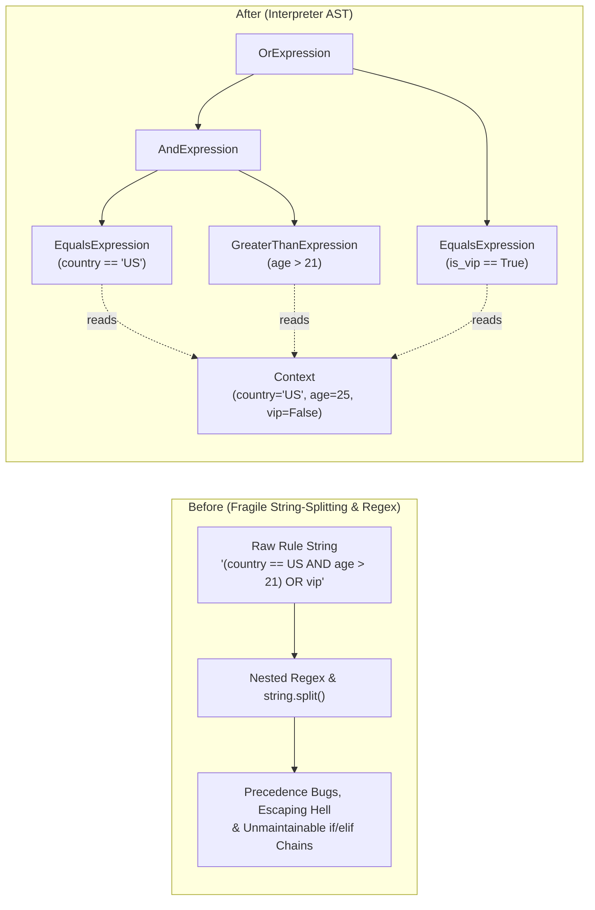
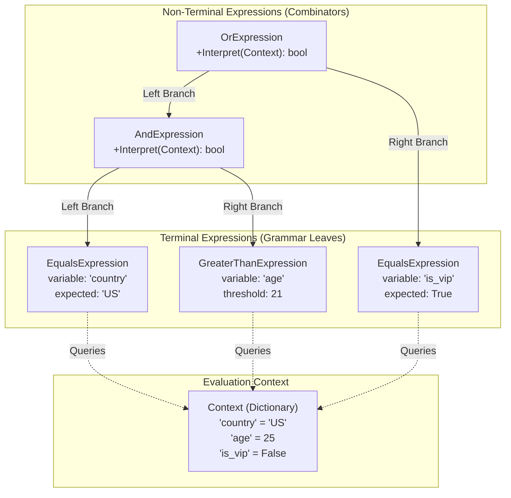

# Lesson 25: Interpreter

> **Prerequisites:** [Visitor](../24-visitor/README.md) and [Track 25 Overview](../README.md).  
> **Estimated Reading Time:** 17 minutes  
> **Target Audience:** Engineers preparing for LLD, OOP, C#, or Python technical screening and architecture rounds.

> [!NOTE]
> **In one line:** **Interpreter** represents a small language's grammar as a tree of expression objects, each with `interpret(context)` — great for tiny DSLs (rules, filters), wrong for real languages.

> [!TIP]
> **The One Rule of the Interpreter Pattern:** Model each grammar production rule as a distinct composite class containing an `Interpret(context)` method. Reserve the Interpreter pattern strictly for **tiny, well-defined Domain-Specific Languages (DSLs)** or rule engines with simple grammars (e.g., boolean filters, discount criteria, search query ASTs). If your grammar expands to include control flow loops, function closures, complex operator precedence, or deep nesting, abandon the Interpreter pattern immediately in favor of a parser generator (such as ANTLR) and a bytecode compiler.

---

## 1. Why This Matters: The Interview Trap

"What is the Interpreter pattern, and when should you use it?" is a classical design patterns question that doubles as a test of whether a candidate understands the boundary between software design patterns and compiler theory.

### The Interview Trap

Junior candidates often recite textbook definitions without understanding operational scale:
> *"The Interpreter pattern defines a grammatical representation for a language along with an interpreter to evaluate sentences in the language. You use it to build programming languages and execute scripts."*

A seasoned interviewer will immediately challenge:
*"If you were asked to implement Python, JavaScript, or a custom scripting language for our trading platform, would you use the Interpreter pattern? What happens to your class hierarchy when your language grammar has 150 production rules? How does a tree-walking interpreter perform compared to a bytecode virtual machine?"*

A senior engineer answers with clear architectural boundaries:

> *"The **Interpreter pattern** from the Gang of Four is fundamentally an application of the **Composite pattern** to formal grammars. It models each grammar symbol (terminal or non-terminal) as a class in an Abstract Syntax Tree (AST), where each node defines an `Interpret(context)` method that recursively evaluates itself and its children.*  
>  
> *It is **an excellent fit** for:*  
> 1. *Tiny, stable Domain-Specific Languages (DSLs) like boolean permission rules, search filter builders, or financial pricing formulas.*  
> 2. *Translating high-level domain queries into external target queries (e.g., LINQ expression trees turning into SQL).*  
>  
> *It is **a terrible fit** for general-purpose programming languages or complex grammars, for three critical reasons:*  
> 1. ***Grammar Explosion:*** *A language with 100 grammar rules requires 100 separate classes. Maintaining, refactoring, and verifying operator precedence across 100 classes becomes an unmaintainable nightmare.*  
> 2. ***The Parsing Void:*** *The GoF pattern defines how to **evaluate** an AST that is already constructed in memory. It provides zero guidance on lexical analysis (tokenizing) or syntactic parsing (converting a raw string like `"age > 21 AND vip"` into that AST).*  
> 3. ***Performance & Cache Inefficiency:*** *Recursive tree-walking requires excessive pointer chasing across scattered heap objects, resulting in CPU L1/L2 cache misses and call-stack overflow hazards. Production engines (Python CPython, Java JVM, .NET CLR, V8) compile ASTs into linear bytecode arrays executed via efficient loop-and-switch dispatch."*

---

## 1A. The Visual Story: Problem -> Analogy -> Solution

### The Problem (Why Naive Code Explodes)

Imagine you are building a feature-flag and pricing rule engine for an e-commerce checkout service. Product managers start with simple rules: `"country == 'US'"` and `"age > 21"`. You write a quick `if/elif` helper that splits strings on `"=="` and `">"`.

Next week, marketing asks for `"country == 'US' AND age > 21"`. A month later, finance wants `"(country == 'US' AND age > 21) OR (is_vip == True AND cart_total >= 500)"`, plus `NOT` clauses and parentheses. Your string-splitting code turns into a fragile pile of nested regexes, `split("AND")` hacks, and special-case precedence bugs where `"A OR B AND C"` evaluates in the wrong order or crashes whenever a user's country string happens to contain `"OR"`.

### Real-World Analogy

Think of **sheet music** or a **mathematical expression tree** (`(3 + 5) * 2`). A musician does not read raw prose describing how to vibrate air; they read standardized symbols (notes, rests, dynamics) arranged in a structured score. Similarly, a calculator does not regex-match `(3 + 5) * 2` repeatedly at runtime—it builds a tree where `+` and `*` are branch nodes and `3`, `5`, `2` are leaf nodes. Each node knows how to evaluate itself given the current inputs, and the whole tree collapses to a single answer.

### Visual Problem -> Solution Diagram



### Applicability & Pattern Relations

**Use when:**
- You have a **small, stable grammar** (boolean filters, authorization rules, discount criteria, search queries) where each rule maps cleanly to a class.
- Efficiency of raw CPU execution is **not** your primary bottleneck (tree-walking is fast enough for small rule trees).
- Rules need to be **composed dynamically** at runtime (e.g., from JSON configs or UI query builders) and evaluated against a shared `Context`.

**Relations with Other Patterns:**
- **Composite:** The Interpreter AST *is* a Composite tree—Terminal Expressions are Leaves and Non-Terminal Expressions are Composites.
- **Visitor:** Use Visitor when you want to add new operations (e.g., pretty-printing, SQL generation, type-checking) across an existing Interpreter AST without cluttering expression classes.
- **Flyweight:** Terminal symbols (like variable names or common constants) can be shared as Flyweights across large ASTs to save memory.

---

## 2. Visual Mental Model / Taxonomic Comparison

### Grammar Tree Interpretation

In the Interpreter pattern, grammar rules form a composite tree. Leaf nodes are **Terminal Expressions** (variables, constants, direct comparisons). Branch nodes are **Non-Terminal Expressions** (logical operators like `AND`, `OR`, `NOT`). The shared `Context` provides runtime variable state.



### Decision Matrix: Interpreter vs. Composite vs. Visitor vs. Parser Generator

| Architectural Dimension | Interpreter | Composite | Visitor | Parser Generator (ANTLR, Lex/Yacc) |
| :--- | :--- | :--- | :--- | :--- |
| **Primary Intent** | Represent a formal grammar and evaluate sentences | Treat individual objects and compositions uniformly | Add new operations to an existing object structure | Generate lexers and parsers from a formal BNF grammar file |
| **Grammar Role** | Each grammar production is a class with `Interpret()` | Hierarchical tree with uniform component interface | Traverses an existing tree via double dispatch | Compiles formal `.g4` grammar rules into parsing code |
| **Parsing Capability** | **None** (evaluates existing AST; parsing must be hand-rolled) | None | None | **Full** (converts raw source strings into parse trees) |
| **Sweet Spot** | Simple boolean rules, filter builders (< 10 rules) | UI widgets, file systems, organizational trees | Compilers with stable AST and many analysis passes | Complex domain languages, SQL dialects, programming languages |
| **Execution Speed** | Moderate to Slow (recursive tree-walking) | Fast | Fast to Moderate | High (compiles to bytecode or native code) |

---

## 3. Code Implementation: The Dynamic Rule Engine

Let us build an expression language for user filtering and authorization rules:
- **Grammar Rule:** `(country == 'US' AND age > 21) OR is_vip == True`
- **Context:** `Context` containing user profile key-value bindings.
- **Abstract Expression:** `Expression` (`IExpression`) defining `Interpret(context)`.
- **Terminal Expressions:** `EqualsExpression`, `GreaterThanExpression`.
- **Non-Terminal Expressions:** `AndExpression`, `OrExpression`, `NotExpression`.

````carousel
```python
from abc import ABC, abstractmethod
from typing import Any, Dict


# =====================================================================
# Context
# =====================================================================

class Context:
    """Holds runtime variable bindings and state during expression evaluation."""
    def __init__(self, data: Dict[str, Any]) -> None:
        self._data = data

    def get(self, variable_name: str) -> Any:
        return self._data.get(variable_name)


# =====================================================================
# Abstract Expression
# =====================================================================

class Expression(ABC):
    """Abstract Expression: Declares the interpret operation."""
    @abstractmethod
    def interpret(self, context: Context) -> bool:
        pass


# =====================================================================
# Terminal Expressions (Leaves of the grammar tree)
# =====================================================================

class EqualsExpression(Expression):
    """Terminal Expression: Evaluates var == expected."""
    def __init__(self, variable: str, expected: Any) -> None:
        self.variable = variable
        self.expected = expected

    def interpret(self, context: Context) -> bool:
        return context.get(self.variable) == self.expected


class GreaterThanExpression(Expression):
    """Terminal Expression: Evaluates var > threshold."""
    def __init__(self, variable: str, threshold: float) -> None:
        self.variable = variable
        self.threshold = threshold

    def interpret(self, context: Context) -> bool:
        val = context.get(self.variable)
        if val is None:
            return False
        return float(val) > self.threshold


# =====================================================================
# Non-Terminal Expressions (Combinators / Nodes of the grammar tree)
# =====================================================================

class AndExpression(Expression):
    """Non-Terminal Expression: Evaluates Left AND Right."""
    def __init__(self, left: Expression, right: Expression) -> None:
        self.left = left
        self.right = right

    def interpret(self, context: Context) -> bool:
        return self.left.interpret(context) and self.right.interpret(context)


class OrExpression(Expression):
    """Non-Terminal Expression: Evaluates Left OR Right."""
    def __init__(self, left: Expression, right: Expression) -> None:
        self.left = left
        self.right = right

    def interpret(self, context: Context) -> bool:
        return self.left.interpret(context) or self.right.interpret(context)


class NotExpression(Expression):
    """Non-Terminal Expression: Evaluates NOT Expr."""
    def __init__(self, expression: Expression) -> None:
        self.expression = expression

    def interpret(self, context: Context) -> bool:
        return not self.expression.interpret(context)


if __name__ == "__main__":
    # Grammar Rule: (country == 'US' AND age > 21) OR is_vip == True
    rule: Expression = OrExpression(
        AndExpression(
            EqualsExpression("country", "US"),
            GreaterThanExpression("age", 21)
        ),
        EqualsExpression("is_vip", True)
    )

    user1 = Context({"country": "US", "age": 25, "is_vip": False})
    user2 = Context({"country": "CA", "age": 19, "is_vip": True})
    user3 = Context({"country": "UK", "age": 30, "is_vip": False})

    print(f"User 1 (US, 25, non-vip) matches: {rule.interpret(user1)}")
    print(f"User 2 (CA, 19, vip)     matches: {rule.interpret(user2)}")
    print(f"User 3 (UK, 30, non-vip) matches: {rule.interpret(user3)}")
```
<!-- slide -->
```csharp
using System;
using System.Collections.Generic;

namespace InterpreterDemo;

// =====================================================================
// Context
// =====================================================================

public sealed class Context
{
    private readonly IReadOnlyDictionary<string, object> _data;

    public Context(IReadOnlyDictionary<string, object> data)
    {
        _data = data;
    }

    public object? Get(string variableName)
    {
        return _data.TryGetValue(variableName, out object? value) ? value : null;
    }
}

// =====================================================================
// Abstract Expression
// =====================================================================

public interface IExpression
{
    bool Interpret(Context context);
}

// =====================================================================
// Terminal Expressions (Leaves of the grammar tree)
// =====================================================================

public sealed class EqualsExpression : IExpression
{
    private readonly string _variable;
    private readonly object _expected;

    public EqualsExpression(string variable, object expected)
    {
        _variable = variable;
        _expected = expected;
    }

    public bool Interpret(Context context)
    {
        object? val = context.Get(_variable);
        return Equals(val, _expected);
    }
}

public sealed class GreaterThanExpression : IExpression
{
    private readonly string _variable;
    private readonly double _threshold;

    public GreaterThanExpression(string variable, double threshold)
    {
        _variable = variable;
        _threshold = threshold;
    }

    public bool Interpret(Context context)
    {
        object? val = context.Get(_variable);
        if (val == null)
        {
            return false;
        }

        double numericVal = Convert.ToDouble(val);
        return numericVal > _threshold;
    }
}

// =====================================================================
// Non-Terminal Expressions (Combinators / Nodes of the grammar tree)
// =====================================================================

public sealed class AndExpression : IExpression
{
    private readonly IExpression _left;
    private readonly IExpression _right;

    public AndExpression(IExpression left, IExpression right)
    {
        _left = left;
        _right = right;
    }

    public bool Interpret(Context context)
    {
        return _left.Interpret(context) && _right.Interpret(context);
    }
}

public sealed class OrExpression : IExpression
{
    private readonly IExpression _left;
    private readonly IExpression _right;

    public OrExpression(IExpression left, IExpression right)
    {
        _left = left;
        _right = right;
    }

    public bool Interpret(Context context)
    {
        return _left.Interpret(context) || _right.Interpret(context);
    }
}

public sealed class NotExpression : IExpression
{
    private readonly IExpression _expression;

    public NotExpression(IExpression expression)
    {
        _expression = expression;
    }

    public bool Interpret(Context context)
    {
        return !_expression.Interpret(context);
    }
}

public static class Program
{
    public static void Main()
    {
        // Grammar Rule: (country == 'US' AND age > 21) OR is_vip == True
        IExpression rule = new OrExpression(
            new AndExpression(
                new EqualsExpression("country", "US"),
                new GreaterThanExpression("age", 21)
            ),
            new EqualsExpression("is_vip", true)
        );

        var user1 = new Context(new Dictionary<string, object>
        {
            ["country"] = "US",
            ["age"] = 25,
            ["is_vip"] = false
        });

        var user2 = new Context(new Dictionary<string, object>
        {
            ["country"] = "CA",
            ["age"] = 19,
            ["is_vip"] = true
        });

        var user3 = new Context(new Dictionary<string, object>
        {
            ["country"] = "UK",
            ["age"] = 30,
            ["is_vip"] = false
        });

        Console.WriteLine($"User 1 (US, 25, non-vip) matches: {rule.Interpret(user1)}");
        Console.WriteLine($"User 2 (CA, 19, vip)     matches: {rule.Interpret(user2)}");
        Console.WriteLine($"User 3 (UK, 30, non-vip) matches: {rule.Interpret(user3)}");
    }
}
```
````

**Expected Output (Both Languages):**
```text
User 1 (US, 25, non-vip) matches: True
User 2 (CA, 19, vip)     matches: True
User 3 (UK, 30, non-vip) matches: False
```

---

## 3A. Where It Is Used, Why It Exists & Progressive Buildup

### Where It Is Used (Real-World Systems & LLD Interviews)

| Domain / Ecosystem | Concrete Real-World Usage | LLD Interview Problem Where You Use It |
| :--- | :--- | :--- |
| **.NET** | `System.Linq.Expressions` (EF Core translates `Expression<Func<T, bool>>` ASTs into SQL), Dynamic LINQ, `RulesEngine` | Dynamic Discount / Tax Rule Engine, Search Filter Builder |
| **Python** | Django `Q(...)` query trees (`&`, `\|`, `~`), SQLAlchemy `BinaryExpression` ASTs, `ast.parse` safe evaluators | Coupon & Promotion Eligibility Engine, Alerting Threshold DSL |
| **Go** | Prometheus PromQL AST, `go/ast`, OPA/Rego policy trees, `text/template/parse` | API Gateway Routing / Rate-Limit Rule Matcher, Log Query Engine |
| **TypeScript** | Prisma / MongoDB-style filter ASTs (`{ AND: [...], OR: [...] }`), TypeScript Compiler API, ESLint ASTs | Dynamic Form Validation Engine, RBAC Permission Policy Evaluator |

### Why It Is Used — The Step-by-Step Buildup (Before -> Pain -> Pattern)

Imagine you are building a promotion engine for an e-commerce checkout service.

#### Stage 0: Naive Code (Hardcoded Conditionals)

```python
def is_promo_eligible(user: dict, cart: dict) -> bool:
    if user["tier"] == "gold" and cart["total"] >= 100:
        return True
    return False
```

#### What Breaks as New Requirements Arrive

1. **Requirement 2 (Dynamic Rules from Admin UI):** Marketing wants to launch 15 different flash-sale rules per week without waiting for backend deployments—e.g. `(tier == 'gold' AND total >= 100) OR (country == 'US' AND items >= 3 AND NOT has_clearance)`. Hardcoded `if/elif` branches cannot be configured at runtime.
2. **Requirement 3 (Security & Auditability):** A junior engineer suggests storing Python strings in the database and running `eval(rule_str, {}, ctx)`. That immediately creates a **Remote Code Execution (RCE)** vulnerability (`__import__('os').system('rm -rf /')`) and gives zero structured way to validate field names or explain *why* a user passed/failed.

#### Step-by-Step Refactoring Into Interpreter

1. **Step 1 — Model Terminals:** Turn each atomic predicate (`tier == 'gold'`, `total >= 100`) into a small object implementing `interpret(ctx) -> bool`.
2. **Step 2 — Model Non-Terminals (Combinators):** Wrap `AND`, `OR`, and `NOT` as composite nodes that hold child expressions and delegate `interpret(ctx)` recursively.
3. **Step 3 — Build AST from Safe Data (JSON/Tokens):** Convert a safe JSON payload or token stream into the expression tree once at startup/cache load, then evaluate `root.interpret(ctx)` in microseconds with zero `eval()` risk.

```python
from abc import ABC, abstractmethod
from typing import Any, Dict


class Expr(ABC):
    @abstractmethod
    def interpret(self, ctx: Dict[str, Any]) -> bool:
        pass


class Eq(Expr):
    def __init__(self, field: str, expected: Any):
        self.field, self.expected = field, expected

    def interpret(self, ctx: Dict[str, Any]) -> bool:
        return ctx.get(self.field) == self.expected


class Gte(Expr):
    def __init__(self, field: str, threshold: float):
        self.field, self.threshold = field, threshold

    def interpret(self, ctx: Dict[str, Any]) -> bool:
        return ctx.get(self.field, 0) >= self.threshold


class And(Expr):
    def __init__(self, left: Expr, right: Expr):
        self.left, self.right = left, right

    def interpret(self, ctx: Dict[str, Any]) -> bool:
        return self.left.interpret(ctx) and self.right.interpret(ctx)


class Or(Expr):
    def __init__(self, left: Expr, right: Expr):
        self.left, self.right = left, right

    def interpret(self, ctx: Dict[str, Any]) -> bool:
        return self.left.interpret(ctx) or self.right.interpret(ctx)


class Not(Expr):
    def __init__(self, inner: Expr):
        self.inner = inner

    def interpret(self, ctx: Dict[str, Any]) -> bool:
        return not self.inner.interpret(ctx)


# Safe JSON-to-AST compiler (no eval(), only whitelisted operators)
def compile_ast(node: dict) -> Expr:
    if "eq" in node:
        return Eq(node["eq"][0], node["eq"][1])
    if "gte" in node:
        return Gte(node["gte"][0], node["gte"][1])
    if "and" in node:
        return And(compile_ast(node["and"][0]), compile_ast(node["and"][1]))
    if "or" in node:
        return Or(compile_ast(node["or"][0]), compile_ast(node["or"][1]))
    if "not" in node:
        return Not(compile_ast(node["not"]))
    raise ValueError(f"Unsupported AST operator: {list(node.keys())}")


rule_json = {
    "or": [
        {"and": [{"eq": ["tier", "gold"]}, {"gte": ["total", 100]}]},
        {"and": [{"eq": ["country", "US"]}, {"not": {"eq": ["has_clearance", True]}}]},
    ]
}
promo_ast = compile_ast(rule_json)
assert promo_ast.interpret({"tier": "gold", "total": 120, "country": "CA", "has_clearance": True}) is True
assert promo_ast.interpret({"tier": "silver", "total": 40, "country": "CA", "has_clearance": False}) is False
```

### Progressive Real-World Examples (More & More Typical Use Cases)

#### Example A (Simple Core): Arithmetic Pricing Formula Evaluator

A billing calculator evaluates dynamic fee formulas like `(base_price * quantity) - flat_discount` using numeric terminal/non-terminal nodes.

```python
from abc import ABC, abstractmethod
from typing import Dict


class NumExpr(ABC):
    @abstractmethod
    def evaluate(self, vars_ctx: Dict[str, float]) -> float:
        pass


class Const(NumExpr):
    def __init__(self, value: float):
        self.value = value

    def evaluate(self, vars_ctx: Dict[str, float]) -> float:
        return self.value


class Var(NumExpr):
    def __init__(self, name: str):
        self.name = name

    def evaluate(self, vars_ctx: Dict[str, float]) -> float:
        return vars_ctx[self.name]


class Mul(NumExpr):
    def __init__(self, left: NumExpr, right: NumExpr):
        self.left, self.right = left, right

    def evaluate(self, vars_ctx: Dict[str, float]) -> float:
        return self.left.evaluate(vars_ctx) * self.right.evaluate(vars_ctx)


class Sub(NumExpr):
    def __init__(self, left: NumExpr, right: NumExpr):
        self.left, self.right = left, right

    def evaluate(self, vars_ctx: Dict[str, float]) -> float:
        return self.left.evaluate(vars_ctx) - self.right.evaluate(vars_ctx)


# Formula: (base_price * quantity) - flat_discount
formula = Sub(Mul(Var("base_price"), Var("quantity")), Var("flat_discount"))
assert formula.evaluate({"base_price": 25.0, "quantity": 4, "flat_discount": 15.0}) == 85.0
```

#### Example B (Production Backend / Middleware): Feature Flag & RBAC Policy Evaluator

In production API gateways and feature-flag SDKs (like LaunchDarkly or OPA), requests are evaluated against a compact AST of membership (`In`), equality (`Eq`), and boolean combinators without hitting a database per request.

```python
from typing import Any, Dict, Iterable


class InSet(Expr):
    def __init__(self, field: str, allowed: Iterable[Any]):
        self.field = field
        self.allowed = frozenset(allowed)

    def interpret(self, ctx: Dict[str, Any]) -> bool:
        return ctx.get(self.field) in self.allowed


# Policy: (env == "prod" AND role IN {"admin", "sre"}) OR actor == "breakglass_bot"
deploy_policy = Or(
    And(Eq("env", "prod"), InSet("role", ["admin", "sre"])),
    Eq("actor", "breakglass_bot"),
)

assert deploy_policy.interpret({"env": "prod", "role": "sre", "actor": "alice"}) is True
assert deploy_policy.interpret({"env": "prod", "role": "viewer", "actor": "bob"}) is False
```

#### Example C (Classic LLD Interview Problem): E-Commerce Product Search Filter DSL

In an LLD interview ("Design an in-memory product catalog filter"), interviewers ask for composable queries like `(category == 'laptop' AND price <= 1500) OR brand == 'Apple'` that can be built programmatically and reused across endpoints.

```python
from dataclasses import dataclass
from typing import List


@dataclass(frozen=True)
class Product:
    sku: str
    category: str
    brand: str
    price: float
    in_stock: bool


class Lte(Expr):
    def __init__(self, field: str, limit: float):
        self.field, self.limit = field, limit

    def interpret(self, ctx: Dict[str, Any]) -> bool:
        return ctx.get(self.field, float("inf")) <= self.limit


def search_catalog(products: List[Product], query_ast: Expr) -> List[Product]:
    return [p for p in products if query_ast.interpret(p.__dict__)]


catalog = [
    Product("SKU-1", "laptop", "Dell", 1299.0, True),
    Product("SKU-2", "laptop", "Apple", 2199.0, True),
    Product("SKU-3", "phone", "Samsung", 899.0, False),
]

query = And(
    Eq("in_stock", True),
    Or(And(Eq("category", "laptop"), Lte("price", 1500)), Eq("brand", "Apple")),
)
matches = search_catalog(catalog, query)
assert [p.sku for p in matches] == ["SKU-1", "SKU-2"]
```

---

## 4. Where You Already Use It

Expression representations are ubiquitous across modern application frameworks.

### 1. Expression Trees in .NET (`System.Linq.Expressions`)
In C#, when you write `Expression<Func<T, bool>> filter = x => x.Price > 100;`, the C# compiler does not emit compiled IL instructions. Instead, it emits code that constructs an **AST expression tree in memory** using the Interpreter pattern:
- `BinaryExpression` (Non-Terminal: `>`)
- `MemberExpression` (Terminal: `x.Price`)
- `ConstantExpression` (Terminal: `100`)

Entity Framework Core takes this expression tree and interprets it into a SQL string:
```csharp
// Compile and interpret dynamically at runtime
Expression<Func<int, bool>> expr = x => x > 10;
Func<int, bool> compiled = expr.Compile(); // Compiles expression tree to IL delegate
Console.WriteLine(compiled(15)); // True
```

### 2. Django ORM `Q` Objects in Python
Django provides `Q` objects to build composable database query trees using overloaded bitwise operators (`&`, `|`, `~`):
```python
from django.db.models import Q

# Builds an AST of filter expressions
filter_rule = (Q(country="US") & Q(age__gt=21)) | Q(is_vip=True)
users = User.objects.filter(filter_rule)
```
The Django SQL compiler walks this `Q` object tree, interpreting each terminal node as a SQL predicate and non-terminal nodes as `AND` / `OR` clauses.

### 3. Regular Expression Engines
Under the hood, regular expression engines parse a regex string like `^[a-z]+@[a-z]+\.com$` into an AST of matchers:
- Terminal: `LiteralCharacterMatcher('a')`, `CharacterRangeMatcher('a'..'z')`
- Non-Terminal: `SequenceMatcher`, `AlternateMatcher` (`|`), `RepeatMatcher` (`+`, `*`)

---

## 5. Pitfalls and When Not to Use It

### 1. The Parsing Illusion
A common mistake in interviews is assuming that implementing the Interpreter pattern gives you a working language. It does not. The GoF pattern provides **zero parsing logic**. If a user enters `"age > 21 AND country == 'US'"` into a web UI, you still have to write a tokenizer (lexer) and a recursive descent parser to instantiate the `AndExpression` and `GreaterThanExpression` objects.

### 2. Stack Overflow on Deep Nesting
Because the classic Interpreter pattern relies on recursive method calls (`left.Interpret(ctx) && right.Interpret(ctx)`), deeply nested or recursive grammar sentences can blow through the thread call stack, throwing a fatal `StackOverflowException`. Production AST evaluators use explicit heap-allocated stacks or convert expressions to Polish/Reverse Polish Notation (RPN) evaluated with an iterative loop.

### 3. High Memory and Garbage Collection Churn
Every sub-expression, parenthesis, and literal is an allocated reference-type object on the managed heap. For high-frequency query evaluation (e.g., evaluating 50,000 streaming events per second against 10,000 alert rules), recursive object tree walking creates catastrophic GC pressure. Compiled delegates (`expr.Compile()` in .NET) or bytecode execution are vastly superior.

---

## 6. Exercises & Practical Drills

### Exercise 1: Identify Terminal vs. Non-Terminal Elements

In a mathematical calculation engine that evaluates expressions like `(price * 1.20) - discount`, classify each of the following expression elements as either **Terminal** or **Non-Terminal**:

1. `price` (Context Variable lookup)
2. `*` (Multiplication Operator)
3. `1.20` (Numeric Constant)
4. `-` (Subtraction Operator)
5. `discount` (Context Variable lookup)

<details>
<summary>Answer</summary>

- **Terminal Expressions (Leaves):**
  - **1. `price`:** Represents a leaf node that retrieves data directly from the context dictionary.
  - **3. `1.20`:** Represents a leaf node that returns a constant literal value.
  - **5. `discount`:** Context variable leaf node.
- **Non-Terminal Expressions (Combinators):**
  - **2. `*`:** Binary operator node that requires recursive evaluation of its left (`price`) and right (`1.20`) child expressions.
  - **4. `-`:** Binary operator node that requires recursive evaluation of its left and right subtrees.
</details>

### Exercise 2: When Should You Use ANTLR Instead?

Your team is asked to build a custom scripting language for end-users to automate customer support workflows. The requirements include:
- `IF / ELSE` conditionals
- `FOR` loops and array iteration
- User-defined functions with parameters
- String concatenation, math operators, and comparison operators

Would you implement this using the GoF Interpreter pattern? Justify your decision.

<details>
<summary>Answer</summary>

**Decision: Reject the GoF Interpreter pattern; use a Parser Generator (e.g., ANTLR) with a visitor or bytecode generator.**

**Justification:**
1. **Grammar Complexity:** Loops, function scopes, operator precedence (`*` before `+`), and control flow require a formal context-free grammar. Hand-coding an Interpreter class for every syntactic rule would produce hundreds of brittle classes.
2. **Lexing and Parsing:** The Interpreter pattern does not parse strings. Writing a hand-rolled recursive descent parser for loops and functions is error-prone. Tools like ANTLR automatically generate correct tokenizers and parse trees from a formal grammar file (`.g4`).
3. **Execution Model:** Tree-walking interpreters struggle with control flow like `break`, `continue`, and early `return`. Modern script engines compile the parse tree to bytecode or use ANTLR visitor listeners to execute commands cleanly.
</details>

---

## 7. Interview Questions & Model Answers

<details>
<summary><strong>1. What is the Interpreter pattern, and when is it a good fit? [BASIC]</strong></summary>

The Interpreter pattern is a Gang of Four behavioral design pattern that defines a class-based representation for a formal grammar, along with an interpreter that uses the representation to evaluate sentences in the language.

In this pattern, every grammar rule is modeled as a class:
- **Terminal expressions** represent the leaves of the grammar (literals, constants, variable lookups).
- **Non-terminal expressions** represent grammar combinators (operators, logical conjunctions) that recursively evaluate child expressions.

The Interpreter pattern is **a good fit** for:
1. Simple, well-defined Domain-Specific Languages (DSLs) where the grammar is small and stable (typically under 10–15 rules). Examples include boolean rule engines, search query builders, and discount criteria calculators.
2. Object hierarchies that need to be translated into another query language, such as LINQ Expression Trees translating into SQL in Entity Framework.

It is **not a good fit** for full programming languages with complex grammars, loops, or operator precedence, where parser generators (like ANTLR) and bytecode compilers are industry standard.

</details>

<details>
<summary><strong>2. What is the difference between Terminal and Non-Terminal expressions? [BASIC]</strong></summary>

The distinction stems directly from formal language theory:

1. **Terminal Expression:** Represents a leaf node in the Abstract Syntax Tree. It does not contain references to other expressions; it directly evaluates to a result using either fixed data or values extracted from the runtime `Context`. Examples include a numeric literal (`42`), a boolean constant (`true`), or a variable lookup (`context.Get('username')`).
2. **Non-Terminal Expression:** Represents an internal branch node in the Abstract Syntax Tree. It models grammar production rules that combine one or more child expressions. Its `Interpret()` method recursively invokes `Interpret()` on its child expressions and applies a transformation or logical operator to their results. Examples include `AndExpression(left, right)`, `AddExpression(left, right)`, or `NotExpression(inner)`.

</details>

<details>
<summary><strong>3. How does the Interpreter pattern compare to the Visitor pattern? [BASIC]</strong></summary>

While both patterns operate on tree structures:

1. **Interpreter** bakes the execution behavior directly into the tree nodes: each AST node owns its own `Interpret(context)` method. This follows standard object-oriented polymorphism where the behavior belongs to the data class.
2. **Visitor** separates the operations from the tree nodes: the AST nodes remain passive data holders that only provide an `Accept(visitor)` hook. Multiple distinct operations (such as type checking, SQL generation, pretty-printing, and evaluation) are encapsulated in separate Visitor classes.

When an AST is interpreted in multiple different ways, combining both patterns is common: the tree is structured as an AST, but instead of putting an `Interpret` method on every node, a `Visitor` walks the AST to evaluate or transform it.

</details>

<details>
<summary><strong>4. Business wants configurable discount rules ("cart > 100 AND coupon"). Interpreter or if/else? [SCENARIO]</strong></summary>

If rules change often and are non-developer-authored, a tiny rule grammar + Interpreter is reasonable (or an existing rules library). For a handful of fixed rules, plain code or Strategy is simpler.

</details>

<details>
<summary><strong>5. Why shouldn't you implement a rule engine with `eval()`? [TRICKY]</strong></summary>

It executes arbitrary code, a severe security hole, and gives no control over what is allowed. Parse into your own expression objects so only the grammar you define can run.

</details>

<details>
<summary><strong>6. Terminal vs non-terminal expression? [BASIC]</strong></summary>

Terminals are leaves that evaluate directly (a number, a variable); non-terminals combine other expressions (And, Add, Not) and recurse.

</details>

---

## Try it

Run this: a rule "age > 18 AND vip" as a tree of expression objects. Then redraw it in [LLD Studio](/tools/lld-studio/); the [track hub](../README.md) has the pattern-choice drills.

```python
class Var:
    def __init__(self, n): self.n = n
    def eval(self, ctx): return ctx[self.n]
class Gt:
    def __init__(self, l, v): self.l, self.v = l, v
    def eval(self, ctx): return self.l.eval(ctx) > self.v
class And:
    def __init__(self, a, b): self.a, self.b = a, b
    def eval(self, ctx): return self.a.eval(ctx) and self.b.eval(ctx)

rule = And(Gt(Var("age"), 18), Var("vip"))
assert rule.eval({"age": 30, "vip": True}) is True
assert rule.eval({"age": 10, "vip": True}) is False
```

---

## One-page cheat sheet

```text
INTERPRETER  Expression.interpret(ctx) ; Terminal (leaf) | NonTerminal (composes others)
Grammar rule -> class ; sentence -> object tree (a Composite)
Parser builds the tree; interpreter evaluates it
Good: small, stable DSLs (pricing rules, search filters, feature flags)
Bad: big/fast languages - use a parser generator, expression trees, or an embedded engine
.NET: Expression<T>, Roslyn | Py: ast, eval is NOT safe
Pair with Visitor when you need several operations over the tree
```

---

## 8. Sources & Further Reading

- Gamma, E., Helm, R., Johnson, R., & Vlissides, J. (1994). *Design Patterns: Elements of Reusable Object-Oriented Software*. Addison-Wesley.
- [Microsoft Learn: Expression Trees (C#)](https://learn.microsoft.com/en-us/dotnet/csharp/advanced-topics/expression-trees/)
- [Microsoft Learn: System.Linq.Expressions Namespace](https://learn.microsoft.com/en-us/dotnet/api/system.linq.expressions)
- [Django Documentation: Complex queries with Q objects](https://docs.djangoproject.com/en/stable/topics/db/queries/#complex-lookups-with-q-objects)
- [The ANTLR Project: Parser Generator](https://www.antlr.org/)
- [Refactoring.Guru: Interpreter Design Pattern](https://refactoring.guru/design-patterns/interpreter)

---

Previous: [Visitor](../24-visitor/README.md) · Next: [Dependency Injection and Inversion of Control](../26-dependency-injection-and-inversion-of-control/README.md)
