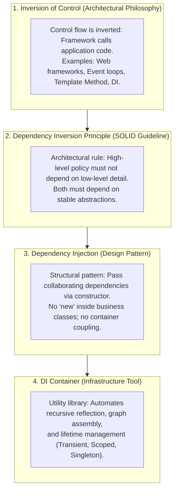
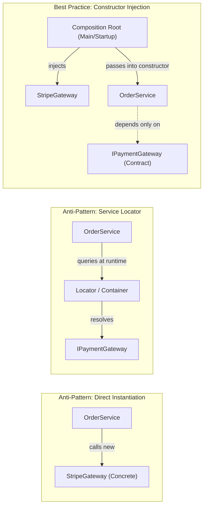

# Lesson 26: Dependency Injection and Inversion of Control

> **Prerequisites:** [Interpreter](../25-interpreter/README.md) and [Track 25 Overview](../README.md).  
> **Estimated Reading Time:** 18 minutes  
> **Target Audience:** Engineers preparing for LLD, OOP, C#, or Python technical screening and architecture rounds.

> [!TIP]
> **The One Rule of Dependency Injection:** Invert the control of dependency construction. A class should declare what abstractions it requires through its constructor and never instantiate its collaborators directly with `new` or call a global locator.

---

## 1. Why This Matters: The Interview Trap

"What is dependency injection, and why use it?" is one of the most frequently asked low-level design questions. Candidates fail not because they cannot write `@inject` or `builder.Services.AddScoped<T>()`, but because they conflate four distinct architectural concepts: **IoC**, **DIP**, **DI**, and **DI Containers**.

### The Interview Trap: Conflating Principle, Pattern, and Tool

When asked: *"What is the difference between Inversion of Control, the Dependency Inversion Principle, and Dependency Injection?"*

- **The Weak Junior Answer:**  
  *"Dependency injection is when you use a container like Spring or `IServiceCollection` to inject classes so you don't have to write `new`. IoC, DIP, and DI all mean the same thing: letting the framework manage your objects."*

- **Why the Interviewer Rejects It:**  
  This answer proves the candidate has only used framework magic without understanding object-oriented fundamentals. DI does not require a framework or container. Conflating a design principle (DIP) with an architectural technique (IoC) and a specific design pattern (DI) reveals a lack of architectural precision.

- **The Strong Senior Answer:**  
  *"These concepts form a hierarchy from philosophy to implementation:*
  1. ***Inversion of Control (IoC)*** is the broad architectural philosophy where the control of execution or flow is inverted—the 'Hollywood Principle' (*Don't call us, we'll call you*). Frameworks, GUI event loops, and template methods are all manifestations of IoC.
  2. ***Dependency Inversion Principle (DIP)*** is a SOLID architectural guideline stating that high-level modules should not depend on low-level modules; both should depend on abstractions.
  3. ***Dependency Injection (DI)*** is a specific design pattern that implements IoC to fulfill DIP. Dependencies are supplied to a client from the outside (typically via constructor injection) rather than constructed internally.
  4. ***DI Container*** is an optional software tool (such as `Microsoft.Extensions.DependencyInjection` or Python's `punq`/`injector`) that automates object graph construction, lifetime management, and dependency resolution."*

### Core Trade-Offs and Failure Modes

| Aspect | Direct Instantiation (`new`) | Service Locator Anti-Pattern | Dependency Injection |
| :--- | :--- | :--- | :--- |
| **Coupling** | Tightly coupled to concrete implementation | Coupled to the locator and container API | Coupled only to contract/interface |
| **Dependency Visibility** | Hidden inside constructor or methods | Hidden inside method bodies | Explicit in constructor signature |
| **Unit Testability** | Hard (requires monkey-patching or impossible) | Fragile (requires configuring global locator) | Trivial (pass mocks or stubs directly) |
| **Failure Detection** | Compile-time / Import-time | Runtime exceptions (missing key in registry) | Compile-time / Startup composition root validation |
| **Reusability** | Zero across different environments | Low | High across CLI, Web, and Unit Tests |

---

## 2. Visual Mental Model / Taxonomic Comparison

Understanding how IoC, DIP, DI, and DI Containers relate prevents confusing concepts during architectural evaluations:



### Constructor Injection vs. Service Locator vs. Direct Instantiation



### Comparison Matrix: DI Mechanics

| Injection Type | How It Works | When to Use | Trade-Off |
| :--- | :--- | :--- | :--- |
| **Constructor Injection** | Collaborators passed as parameters in class constructor | Default for **all mandatory dependencies** | Ensures object is never in an uninitialized state; constructor signature grows if class has too many responsibilities |
| **Method / Parameter Injection** | Collaborator passed directly to a single method invocation | Dependency needed for **only one action**, varies per call, or transient context | Keeps constructor clean; callers must pass the dependency on every method call |
| **Property / Setter Injection** | Collaborator assigned via public property/setter after instantiation | Optional dependencies with sensible default fallbacks | Temporal coupling: object may be invoked before property is populated |
| **Pure DI (Poor Man's DI)** | Constructing the entire dependency graph manually in `Main` | Small to mid-sized applications, microservices, high-performance paths | No framework overhead, 100% compile-time verified, but requires manual boilerplate for large graphs |

---

## 3. Code Implementation

The following example demonstrates:
1. **Contract Definitions (DIP):** `IPaymentGateway` and `INotificationService`.
2. **Concrete Implementations:** `StripePaymentGateway` and `EmailNotificationService`.
3. **Consumer Class:** `OrderProcessor` using constructor injection with zero reference to concrete classes or containers.
4. **Pure DI:** Manual composition root without any framework dependencies.
5. **Container Resolution:** Automated dependency graph resolution with lifecycle control.
6. **Isolated Unit Testing:** Effortless mocking with a test double (`FakePaymentGateway`).

````carousel
```python
from abc import ABC, abstractmethod
from typing import Any, Callable, Dict, Type


# ==========================================
# 1. Abstractions (DIP)
# ==========================================
class IPaymentGateway(ABC):

  @abstractmethod
  def charge(self, amount: float) -> str:
    pass


class INotificationService(ABC):

  @abstractmethod
  def send(self, recipient: str, message: str) -> str:
    pass


# ==========================================
# 2. Concretions
# ==========================================
class StripePaymentGateway(IPaymentGateway):

  def charge(self, amount: float) -> str:
    return f"Charged ${amount:.2f} via Stripe"


class EmailNotificationService(INotificationService):

  def send(self, recipient: str, message: str) -> str:
    return f"Sent email to {recipient}: {message}"


# Test Double (Mock) for isolated unit testing
class FakePaymentGateway(IPaymentGateway):

  def charge(self, amount: float) -> str:
    return f"[TEST MOCK] Simulated ${amount:.2f} charge"


# ==========================================
# 3. High-Level Consumer (Constructor Injection)
# ==========================================
class OrderProcessor:
  """High-level module depending strictly on abstractions.

  Notice: Zero reference to Stripe, Email, or any container.
  """

  def __init__(
      self, payment_gateway: IPaymentGateway, notifier: INotificationService
  ) -> None:
    self._payment_gateway = payment_gateway
    self._notifier = notifier

  def process_order(self, customer: str, amount: float) -> None:
    charge_msg = self._payment_gateway.charge(amount)
    notify_msg = self._notifier.send(customer, f"Receipt for ${amount:.2f}")
    print(f"{charge_msg} | {notify_msg}")


# ==========================================
# 4. Lightweight DI Container (Automated Assembly)
# ==========================================
class Container:
  """A clean, minimal DI container demonstrating service lifetimes."""

  def __init__(self) -> None:
    self._factories: Dict[Type, Callable[[], Any]] = {}
    self._singletons: Dict[Type, Any] = {}

  def register_transient(
      self, service_type: Type, factory: Callable[[], Any]
  ) -> None:
    self._factories[service_type] = factory

  def register_singleton(self, service_type: Type, instance: Any) -> None:
    self._singletons[service_type] = instance

  def resolve(self, service_type: Type) -> Any:
    if service_type in self._singletons:
      return self._singletons[service_type]
    if service_type in self._factories:
      return self._factories[service_type]()
    raise KeyError(f"Service '{service_type.__name__}' is not registered.")


# ==========================================
# 5. Composition Root / Execution
# ==========================================
if __name__ == "__main__":
  print("--- 1. Pure DI (Manual Composition) ---")
  # Pure DI: Assembling the graph by hand without any container library
  prod_gateway: IPaymentGateway = StripePaymentGateway()
  prod_notifier: INotificationService = EmailNotificationService()
  processor = OrderProcessor(prod_gateway, prod_notifier)
  processor.process_order("customer@example.com", 129.99)

  print("\n--- 2. Automated DI via Container ---")
  container = Container()
  container.register_singleton(IPaymentGateway, StripePaymentGateway())
  container.register_transient(
      INotificationService, lambda: EmailNotificationService()
  )
  container.register_transient(
      OrderProcessor,
      lambda: OrderProcessor(
          container.resolve(IPaymentGateway),
          container.resolve(INotificationService),
      ),
  )

  container_processor = container.resolve(OrderProcessor)
  container_processor.process_order("vip@example.com", 450.00)

  print("\n--- 3. Testing with Test Double (Mock) ---")
  # Unit testing requires no mocking libraries or container configurations
  test_processor = OrderProcessor(
      FakePaymentGateway(), EmailNotificationService()
  )
  test_processor.process_order("qa@example.com", 10.00)
```
<!-- slide -->
```csharp
using System;
using Microsoft.Extensions.DependencyInjection;

// ==========================================
// 1. Abstractions (DIP)
// ==========================================
public interface IPaymentGateway
{
    string Charge(decimal amount);
}

public interface INotificationService
{
    string Send(string recipient, string message);
}

// ==========================================
// 2. Concretions
// ==========================================
public class StripePaymentGateway : IPaymentGateway
{
    public string Charge(decimal amount) => $"Charged ${amount:F2} via Stripe";
}

public class EmailNotificationService : INotificationService
{
    public string Send(string recipient, string message) => $"Sent email to {recipient}: {message}";
}

// Test Double (Mock) for isolated unit testing
public class FakePaymentGateway : IPaymentGateway
{
    public string Charge(decimal amount) => $"[TEST MOCK] Simulated ${amount:F2} charge";
}

// ==========================================
// 3. High-Level Consumer (Constructor Injection)
// ==========================================
public class OrderProcessor
{
    private readonly IPaymentGateway _paymentGateway;
    private readonly INotificationService _notifier;

    // Mandatory dependencies explicitly declared in constructor
    public OrderProcessor(IPaymentGateway paymentGateway, INotificationService notifier)
    {
        _paymentGateway = paymentGateway ?? throw new ArgumentNullException(nameof(paymentGateway));
        _notifier = notifier ?? throw new ArgumentNullException(nameof(notifier));
    }

    public void ProcessOrder(string customer, decimal amount)
    {
        string chargeMsg = _paymentGateway.Charge(amount);
        string notifyMsg = _notifier.Send(customer, $"Receipt for ${amount:F2}");
        Console.WriteLine($"{chargeMsg} | {notifyMsg}");
    }
}

// ==========================================
// 4. Composition Root / Execution
// ==========================================
public class Program
{
    public static void Main()
    {
        Console.WriteLine("--- 1. Pure DI (Manual Composition) ---");
        // Pure DI: Direct constructor wiring without container overhead
        IPaymentGateway prodGateway = new StripePaymentGateway();
        INotificationService prodNotifier = new EmailNotificationService();
        var processor = new OrderProcessor(prodGateway, prodNotifier);
        processor.ProcessOrder("customer@example.com", 129.99m);

        Console.WriteLine("\n--- 2. Automated DI via Container ---");
        // Using standard Microsoft.Extensions.DependencyInjection container
        var services = new ServiceCollection();
        services.AddSingleton<IPaymentGateway, StripePaymentGateway>();
        services.AddTransient<INotificationService, EmailNotificationService>();
        services.AddTransient<OrderProcessor>();

        using (var provider = services.BuildServiceProvider())
        {
            var containerProcessor = provider.GetRequiredService<OrderProcessor>();
            containerProcessor.ProcessOrder("vip@example.com", 450.00m);
        }

        Console.WriteLine("\n--- 3. Testing with Test Double (Mock) ---");
        // Unit testing requires no container, reflection, or static state
        var testProcessor = new OrderProcessor(new FakePaymentGateway(), new EmailNotificationService());
        testProcessor.ProcessOrder("qa@example.com", 10.00m);
    }
}
```
````

**Expected Output (Both Languages):**

```text
--- 1. Pure DI (Manual Composition) ---
Charged $129.99 via Stripe | Sent email to customer@example.com: Receipt for $129.99

--- 2. Automated DI via Container ---
Charged $450.00 via Stripe | Sent email to vip@example.com: Receipt for $450.00

--- 3. Testing with Test Double (Mock) ---
[TEST MOCK] Simulated $10.00 charge | Sent email to qa@example.com: Receipt for $10.00
```

---

## 4. Where You Already Use It

Dependency injection is the bedrock of modern backend software design:

- **In .NET / ASP.NET Core:**
  - `Microsoft.Extensions.DependencyInjection`: The default IoC container built into .NET (`IServiceCollection` and `IServiceProvider`).
  - **Service Lifetimes:**
    - `AddTransient<T>()`: Created every time requested. Used for lightweight, stateless services.
    - `AddScoped<T>()`: Created once per client request (HTTP request scope). Standard for database contexts (`DbContext`).
    - `AddSingleton<T>()`: Created once on first resolution and cached for application lifetime. Used for in-memory caches and configuration objects.
  - **Controller and Minimal API Activation:** ASP.NET Core inspects controller constructors or endpoint delegates and automatically injects registered services from the current request scope.
  - `IHttpClientFactory`: Resolves managed `HttpClient` instances while handling transient HTTP message handler lifetimes and DNS caching.

- **In Python:**
  - `pytest` Fixtures: When a test function declares arguments (`def test_order(db_session, mock_gateway):`), `pytest` inspects parameter names, resolves their fixture dependencies recursively, and injects them. This is pure Inversion of Control and Dependency Injection in action.
  - **FastAPI `Depends()`:** Declaring parameters like `def get_user(db: Session = Depends(get_db))` injects request-scoped database sessions or authentication tokens into path operation functions.
  - **Libraries:** Packages like `punq`, `dependency-injector`, and `injector` provide formal IoC containers with type hint auto-wiring and lifecycle scoping in enterprise Python architectures.

---

## 5. Pitfalls and When Not to Use It

### 1. The Service Locator Anti-Pattern
Instead of injecting dependencies through the constructor, a class takes a reference to the container or locator and calls `locator.GetService<IPayment>()` directly inside its methods:
```csharp
// ANTI-PATTERN: Service Locator
public class BadOrderProcessor
{
    private readonly IServiceProvider _provider;
    public BadOrderProcessor(IServiceProvider provider) => _provider = provider;

    public void ProcessOrder(decimal amount)
    {
        // Dependencies are hidden! Calling code cannot see what this class needs to run.
        var gateway = _provider.GetRequiredService<IPaymentGateway>();
        gateway.Charge(amount);
    }
}
```
- **Why it is toxic:** It hides class dependencies. Looking at the constructor signature tells you nothing about what the class requires to function. It couples your business logic to a container interface, breaks runtime safety, and causes unexpected runtime exceptions during testing if a service was not registered.

### 2. Captive Dependencies (Scope Mismatch)
Occurs when a service with a longer lifetime holds onto a service with a shorter lifetime.
- **Example:** A `Singleton` service (application lifetime) receives a `Scoped` service (such as an EF Core `DbContext` tied to an HTTP request) via constructor injection.
- **The Consequence:** The `DbContext` is captured permanently by the Singleton, staying alive for the lifetime of the application. It never disposes, its change tracker grows infinitely causing memory leaks, and concurrent requests sharing the Singleton cause multi-threaded database access crashes.
- **ASP.NET Core Protection:** `BuildServiceProvider(validateScopes: true)` catches captive dependencies during application startup in development mode.

### 3. Constructor Over-Injection (SRP Violation)
When a class constructor requires 8, 10, or more parameters (`public OrderService(IUserRepo, IOrderRepo, IEmailer, IPayment, IInventory, IAuditLogger, IMetricCollector, ISmsSender)`), the problem is not DI. The problem is a blatant violation of the **Single Responsibility Principle**.
- **Fix:** Group cohesive behavior into facade services, domain services, or split the class using Command/Query Segregation (CQRS) or Mediators.

### 4. Over-Engineering with Containers for Trivial Scripts
In small scripts, command-line utilities, or simple Lambdas/Azure Functions, configuring a complete DI container with reflection and configuration scanning adds unnecessary cognitive overhead and startup latency. Prefer **Pure DI** (manual object instantiation in `Main`) whenever the dependency graph is small and static.

---

## 6. Exercises & Practical Drills

### Drill 1: Spot and Fix the Captive Dependency
Examine this ASP.NET Core startup registration:
```csharp
builder.Services.AddScoped<IUserRepository, SqlUserRepository>();
builder.Services.AddSingleton<UserActivityCache>();

public class UserActivityCache
{
    private readonly IUserRepository _userRepo;
    public UserActivityCache(IUserRepository userRepo)
    {
        _userRepo = userRepo;
    }
}
```
What will happen at runtime? How do you remediate it without changing `UserActivityCache` to Scoped?

<details>
<summary>Answer</summary>

**The Problem (Captive Scope):**  
`UserActivityCache` is a Singleton, but it injects `IUserRepository`, which is Scoped. The Singleton holds a single instance of `SqlUserRepository` forever, keeping any underlying database connection or `DbContext` alive for the process lifetime. This causes stale queries, memory growth, and concurrency exceptions when multiple HTTP threads access the cache simultaneously. In ASP.NET Core with `validateScopes: true`, the application will throw an `InvalidOperationException` on startup.

**Remediation:**  
Do not inject the scoped dependency directly into the Singleton's constructor. Instead, inject an `IServiceScopeFactory`, and create a short-lived scope only when an operation runs:

```csharp
public class UserActivityCache
{
    private readonly IServiceScopeFactory _scopeFactory;

    public UserActivityCache(IServiceScopeFactory scopeFactory)
    {
        _scopeFactory = scopeFactory;
    }

    public async Task RefreshUserAsync(int userId)
    {
        using var scope = _scopeFactory.CreateScope();
        var repo = scope.ServiceProvider.GetRequiredService<IUserRepository>();
        var user = await repo.GetByIdAsync(userId);
        // update cache...
    }
}
```
</details>

### Drill 2: Refactoring Service Locator to Pure Constructor Injection
You encounter this Python legacy class:
```python
class NotificationManager:

  def notify_user(self, user_id: str, message: str) -> None:
    # Anti-pattern: Service Locator lookup
    config = ServiceLocator.get("ConfigService")
    email_client = ServiceLocator.get("EmailClient")
    audit_log = ServiceLocator.get("AuditLog")

    if config.is_email_enabled():
      email_client.send(user_id, message)
      audit_log.record(f"Sent email to {user_id}")
```
Refactor this class to use proper Dependency Injection. Explain what improves.

<details>
<summary>Answer</summary>

**Refactored Implementation:**
```python
from typing import Protocol


class IConfigService(Protocol):

  def is_email_enabled(self) -> bool:
    ...


class IEmailClient(Protocol):

  def send(self, recipient: str, body: str) -> None:
    ...


class IAuditLog(Protocol):

  def record(self, message: str) -> None:
    ...


class NotificationManager:

  def __init__(
      self,
      config: IConfigService,
      email_client: IEmailClient,
      audit_log: IAuditLog,
  ) -> None:
    self._config = config
    self._email_client = email_client
    self._audit_log = audit_log

  def notify_user(self, user_id: str, message: str) -> None:
    if self._config.is_email_enabled():
      self._email_client.send(user_id, message)
      self._audit_log.record(f"Sent email to {user_id}")
```

**Improvements:**
1. **Explicit Contract:** Any developer (and static type checkers like `mypy`) can immediately see that `NotificationManager` requires three specific dependencies to function.
2. **Decoupled from Global State:** The class no longer depends on the static `ServiceLocator`.
3. **Effortless Unit Testing:** In tests, instantiate `NotificationManager(MockConfig(), MockEmailClient(), MockAuditLog())` directly without configuring global service locator registries.
</details>

---

## 7. Interview Questions & Model Answers

> [!interview]
> **Question 1: What is dependency injection, and why use it?**  
> **Strong Answer:**  
> "Dependency Injection (DI) is a structural design pattern in which an object receives its collaborators from an external provider rather than instantiating them itself. Instead of writing `_repo = new SqlRepository()` inside a service, the service declares `public OrderService(IRepository repo)` in its constructor.  
> 
> We use DI for three primary reasons:  
> 1. **Decoupling and Testability:** By depending on abstractions, we can substitute test doubles (mocks, stubs, or in-memory fakes) in unit tests without touching production code or hitting databases and network endpoints.  
> 2. **Single Responsibility and Separation of Concerns:** A business class focuses purely on its business logic; it is relieved of the responsibility of knowing how to configure, instantiate, or tear down complex collaborator graphs.  
> 3. **Centralized Lifecycle and Configuration Management:** Object creation and lifetimes (Transient, Scoped, Singleton) are managed centrally in a Composition Root, making configuration changes uniform across the entire application."

> [!interview]
> **Question 2: What is the difference between IoC, DI and DIP?**  
> **Strong Answer:**  
> "These three terms represent different conceptual levels of software architecture:  
> 
> - **Inversion of Control (IoC)** is a broad architectural design philosophy. In traditional programming, application code controls the flow and calls libraries. Under IoC, the framework controls the execution flow and calls custom application code (the Hollywood Principle: *'Don't call us, we'll call you'*). Examples include GUI event loops, web middleware pipelines, and template methods.  
> - **Dependency Inversion Principle (DIP)** is one of the five SOLID design principles. It states that high-level business policy modules should not depend on low-level implementation details; both must depend on stable abstractions (interfaces or abstract base classes).  
> - **Dependency Injection (DI)** is a specific design pattern used to achieve Inversion of Control in compliance with the Dependency Inversion Principle. It supplies instantiated concrete dependencies to a class through its constructor, method, or property from the outside.  
> 
> In summary: DIP is the **principle** (what to aim for), IoC is the **philosophy** (how control is inverted), and DI is the **concrete pattern** (how dependencies are passed)."

> [!interview]
> **Question 3: What is a DI container?**  
> **Strong Answer:**  
> "A DI Container (or IoC container) is an infrastructure library that automates dependency injection and lifetime management across an application's object graph.  
> 
> When an application bootstraps in its Composition Root, services and their interfaces are registered with the container alongside their intended lifetimes:  
> - **Transient:** A fresh instance is created on every resolution.  
> - **Scoped:** A single instance is shared within a logical boundary, such as an HTTP request.  
> - **Singleton:** Exactly one instance is created and shared across the entire application process.  
> 
> When the application resolves a root component (like an ASP.NET Core controller), the container uses reflection or source-generated factories to inspect constructor parameters, recursively resolves every prerequisite collaborator down the dependency tree, and instantiates the complete object graph automatically. Containers also track disposable objects (`IDisposable` / `IAsyncDisposable`) and trigger cleanup when their scope ends."

> [!interview]
> **Question 4: Why is the service locator called an anti-pattern?**  
> **Strong Answer:**  
> "The Service Locator is considered an anti-pattern because it achieves dependency lookup at the cost of breaking encapsulation, testability, and runtime safety:  
> 
> 1. **It Hides Class Dependencies:** When a class accepts an `IServiceProvider` or queries a global `ServiceLocator.Get<T>()`, its public constructor signature lies. A constructor with zero parameters or only a container parameter appears ready to use, but will crash at runtime with a `NullReferenceException` if an internal dependency was omitted from the registry.  
> 2. **It Couples Code to the Locator Infrastructure:** Classes become tightly coupled to a specific service locator library rather than relying solely on pure domain contracts.  
> 3. **It Impairs Unit Testing:** To test a class using a service locator, developers must set up, mock, and tear down the global locator's internal dictionary rather than simply passing mock instances directly into a constructor.  
> 4. **It Converts Compile-Time Checks into Runtime Crashes:** With Constructor Injection, missing a dependency causes a compile-time error. With a Service Locator, failures only surface when execution reaches that specific line of code at runtime."

---

## 8. Sources & Further Reading

- [Microsoft Learn: Dependency injection in ASP.NET Core](https://learn.microsoft.com/en-us/aspnet/core/fundamentals/dependency-injection)
- [Martin Fowler: Inversion of Control Containers and the Dependency Injection pattern](https://martinfowler.com/articles/injection.html)
- [Mark Seemann: Dependency Injection Principles, Practices, and Patterns](https://www.manning.com/books/dependency-injection-principles-practices-patterns)
- [PEP 544: Protocols: Structural subtyping (static duck typing)](https://peps.python.org/pep-0544/)
- [Microsoft Learn: Service Locator is an Anti-Pattern](https://blog.ploeh.dk/2010/02/03/ServiceLocatorIsAnAntiPattern/)

---

Previous: [Interpreter](../25-interpreter/README.md) · Next: [Repository and Unit of Work](../27-repository-and-unit-of-work/README.md)
