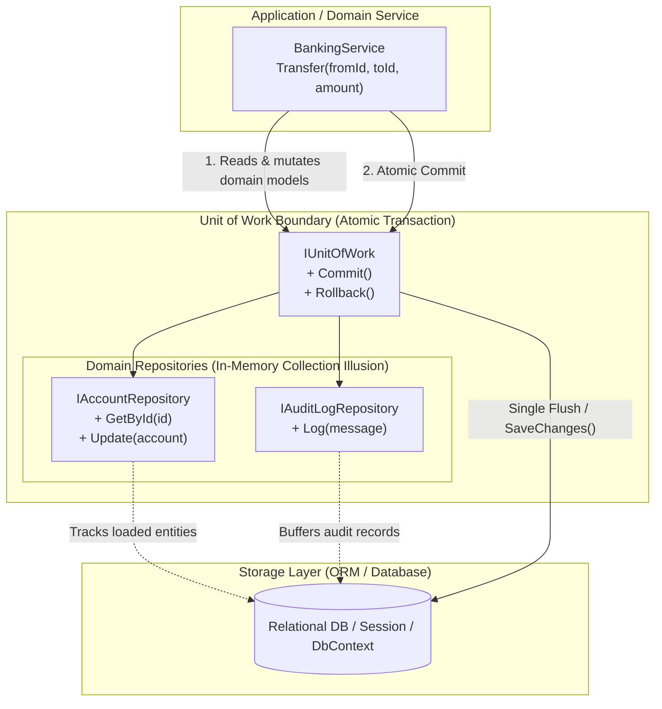

# Lesson 27: Repository and Unit of Work

> **Prerequisites:** [Dependency Injection and Inversion of Control](../26-dependency-injection-and-inversion-of-control/README.md) and [Track 25 Overview](../README.md).  
> **Estimated Reading Time:** 18 minutes  
> **Target Audience:** Engineers preparing for LLD, OOP, C#, or Python technical screening and architecture rounds.

> [!NOTE]
> **In one line:** **Repository** hides data access behind a collection-like interface for aggregates; **Unit of Work** tracks changes and commits them as one transaction.

> [!TIP]
> **The One Rule of Repository and Unit of Work:** The Repository pretends persistence is an in-memory collection of domain objects; the Unit of Work tracks every change across all repositories during a business transaction and commits or aborts them atomically.

---

## 1. Why This Matters: The Interview Trap

Few design patterns generate as much fierce debate in technical interviews as the **Repository** and **Unit of Work** patterns. Junior engineers memorize repository tutorials and reflexively wrap modern Object-Relational Mappers (ORMs) like EF Core or SQLAlchemy in generic `IRepository<T>` interfaces. 

Senior interviewers specifically look for candidates who understand **where abstractions help and where they turn into toxic boilerplate**.

### The Interview Trap: Cargo Culting the Generic Repository

When asked: *"Should you wrap Entity Framework Core (or SQLAlchemy) in a repository?"*

- **The Weak Junior Answer:**  
  *"Yes, always! You should create an `IRepository<T>` with `GetAll()`, `GetById()`, `Add()`, and `Delete()`. That way your controllers don't talk to the database, and if you ever switch from SQL Server to MongoDB or PostgreSQL, you only change the repository."*

- **Why the Interviewer Rejects It:**  
  1. **Ignoring the Existing Abstraction:** In EF Core, `DbSet<T>` is *already* an implementation of the Repository pattern, and `DbContext` is *already* an implementation of the Unit of Work pattern. Wrapping them naively creates an abstraction over an abstraction.
  2. **The Leaky Query Problem:** A generic `GetAll()` either loads the entire database table into memory, or it returns `IQueryable<T>`, which completely defeats the purpose of the repository by leaking SQL provider concerns (e.g., Linq-to-Entities limitations, execution plans) into the presentation layer.
  3. **The 'Switching Databases' Myth:** In production enterprise software, teams virtually never swap their core relational engine for a NoSQL store on a whim; when they do, query idioms, consistency models, and transaction semantics differ so drastically that a naive repository interface breaks anyway.

- **The Strong Senior Answer:**  
  *"In modern architectures, wrapping EF Core or SQLAlchemy is a deliberate architectural trade-off, not an automatic default:*
  - *If you build a CRUD application, wrapping `DbContext` in a generic repository adds pure boilerplate without value.*
  - *If you build Domain-Driven Design (DDD) or Clean Architecture, a **domain-specific repository** (`IOrderRepository`, not `IRepository<T>`) is valuable because it encapsulates complex database queries, enforces aggregate root consistency boundaries, hides ORM data mapping types from pure domain entities, and makes domain services trivially testable with in-memory collections.*
  - *Crucially, repositories should **never call `SaveChanges()` or `commit()`**. Committing is the sole responsibility of the **Unit of Work**, ensuring that multi-aggregate operations span an atomic transaction."*

### Core Definitions from Martin Fowler (PoEAA)

- **Repository:** *"Mediates between the domain and data mapping layers using a collection-like interface for accessing domain objects."* It gives developers the illusion that all domain objects reside in a giant in-memory `List<T>` or `set()`.
- **Unit of Work:** *"Maintains a list of objects affected by a business transaction and coordinates the writing out of changes and the resolution of concurrency problems."*

---

## 2. Visual Mental Model / Taxonomic Comparison

The relationship between the Domain Layer, Repositories, Unit of Work, and Underlying Persistence:



### Generic Repository vs. Domain Repository vs. Direct ORM

| Dimension | Generic Repository (`IRepository<T>`) | Domain-Specific Repository (`IOrderRepository`) | Direct ORM (`DbContext` / `Session`) |
| :--- | :--- | :--- | :--- |
| **API Shape** | Generic CRUD (`GetAll()`, `Add()`, `Delete()`) | Business-driven (`GetPendingOrdersWithItems()`) | Rich Linq / Expression API (`DbSet<T>`) |
| **Domain Isolation** | Poor; leaks persistence concerns or returns raw entities | High; returns domain aggregate roots | None; domain is coupled to ORM entities |
| **Transaction Control** | Often misplaces commit inside repository methods | Delegated to `IUnitOfWork` | Built into `DbContext.SaveChanges()` |
| **Query Flexibility** | Severe bottleneck or exposes leaky `IQueryable` | Optimal; handcrafted queries for specific use cases | Maximum; complete control over joins, projections, and SQL |
| **Testability** | Requires mocking generic methods | Trivial to mock using in-memory dictionary | Requires SQLite in-memory or mocking `DbSet` |

---

## 3. Code Implementation

The following implementation demonstrates:
1. **Domain Model:** An `Account` entity representing state and balance invariants.
2. **Domain-Specific Repositories:** `IAccountRepository` and `IAuditLogRepository` mimicking in-memory collections without raw persistence leaks.
3. **Unit of Work:** `IUnitOfWork` coordinating atomic transactions. Notice that repositories **never commit changes themselves**.
4. **Transaction Atomicity:** A simulated banking transfer where a failure rolls back both the debit, credit, and audit entries simultaneously.

````carousel
```python
from abc import ABC, abstractmethod
from typing import Dict, List, Optional


# ==========================================
# 1. Domain Entity
# ==========================================
class Account:

  def __init__(self, account_id: str, owner: str, balance: float) -> None:
    self.account_id = account_id
    self.owner = owner
    self.balance = balance

  def clone(self) -> "Account":
    return Account(self.account_id, self.owner, self.balance)


# ==========================================
# 2. Repository Interfaces (Collection Abstraction)
# ==========================================
class IAccountRepository(ABC):

  @abstractmethod
  def get_by_id(self, account_id: str) -> Optional[Account]:
    pass

  @abstractmethod
  def update(self, account: Account) -> None:
    pass


class IAuditLogRepository(ABC):

  @abstractmethod
  def log(self, message: str) -> None:
    pass

  @abstractmethod
  def count(self) -> int:
    pass


# ==========================================
# 3. Unit of Work Interface
# ==========================================
class IUnitOfWork(ABC):
  accounts: IAccountRepository
  audit_logs: IAuditLogRepository

  @abstractmethod
  def commit(self) -> None:
    """Flushes all changes across all repositories in one atomic transaction."""
    pass

  @abstractmethod
  def rollback(self) -> None:
    """Discards uncommitted changes made in the current transaction."""
    pass


# ==========================================
# 4. In-Memory Persistence Concretions
# ==========================================
class InMemoryAccountRepository(IAccountRepository):

  def __init__(self, storage: Dict[str, Account]) -> None:
    self._storage = storage

  def get_by_id(self, account_id: str) -> Optional[Account]:
    account = self._storage.get(account_id)
    return account.clone() if account else None

  def update(self, account: Account) -> None:
    self._storage[account.account_id] = account.clone()


class InMemoryAuditLogRepository(IAuditLogRepository):

  def __init__(self, logs: List[str]) -> None:
    self._logs = logs

  def log(self, message: str) -> None:
    self._logs.append(message)

  def count(self) -> int:
    return len(self._logs)


class InMemoryUnitOfWork(IUnitOfWork):
  """Coordinates atomic state transitions across in-memory repositories."""

  def __init__(self) -> None:
    # Stable committed database state
    self._committed_accounts: Dict[str, Account] = {
        "A1": Account("A1", "Alice", 250.00),
        "B2": Account("B2", "Bob", 100.00),
    }
    self._committed_logs: List[str] = []

    # Transaction workspace
    self._working_accounts: Dict[str, Account] = {}
    self._working_logs: List[str] = []
    self._reset_workspace()

  def _reset_workspace(self) -> None:
    self._working_accounts = {
        k: v.clone() for k, v in self._committed_accounts.items()
    }
    self._working_logs = list(self._committed_logs)
    self.accounts = InMemoryAccountRepository(self._working_accounts)
    self.audit_logs = InMemoryAuditLogRepository(self._working_logs)

  def commit(self) -> None:
    # Atomically apply all workspace mutations to committed storage
    self._committed_accounts = {
        k: v.clone() for k, v in self._working_accounts.items()
    }
    self._committed_logs = list(self._working_logs)
    print("Committed unit of work.")

  def rollback(self) -> None:
    # Discard uncommitted mutations
    self._reset_workspace()
    print("Rolled back unit of work.")

  def get_committed_account(self, account_id: str) -> Account:
    return self._committed_accounts[account_id]

  def committed_log_count(self) -> int:
    return len(self._committed_logs)


# ==========================================
# 5. Domain Service Orchestration
# ==========================================
class BankingService:

  def __init__(self, uow: IUnitOfWork) -> None:
    self._uow = uow

  def transfer(self, from_id: str, to_id: str, amount: float) -> bool:
    try:
      from_acc = self._uow.accounts.get_by_id(from_id)
      to_acc = self._uow.accounts.get_by_id(to_id)

      if not from_acc or not to_acc:
        raise ValueError("Account not found.")

      if from_acc.balance < amount:
        raise ValueError(
            f"Insufficient funds for transfer of ${amount:.2f}."
        )

      # Mutate state
      from_acc.balance -= amount
      to_acc.balance += amount

      self._uow.accounts.update(from_acc)
      self._uow.accounts.update(to_acc)
      self._uow.audit_logs.log(
          f"Transferred ${amount:.2f} from {from_acc.owner} to {to_acc.owner}"
      )

      print(
          f"Transfer completed: ${amount:.2f} from {from_acc.owner} to"
          f" {to_acc.owner}."
      )
      self._uow.commit()
      return True

    except Exception as ex:
      print(f"Transaction aborted: {ex}")
      self._uow.rollback()
      return False


# ==========================================
# 6. Execution / Demonstration
# ==========================================
if __name__ == "__main__":
  uow = InMemoryUnitOfWork()
  service = BankingService(uow)

  print("--- 1. Successful Transaction ---")
  service.transfer("A1", "B2", 100.00)
  alice = uow.get_committed_account("A1")
  bob = uow.get_committed_account("B2")
  print(
      f"Alice balance: ${alice.balance:.2f} | Bob balance: ${bob.balance:.2f} |"
      f" Audit logs: {uow.committed_log_count()}"
  )

  print("\n--- 2. Failed Transaction (Rollback on Error) ---")
  service.transfer("A1", "B2", 500.00)
  alice = uow.get_committed_account("A1")
  bob = uow.get_committed_account("B2")
  print(
      f"Alice balance: ${alice.balance:.2f} | Bob balance: ${bob.balance:.2f} |"
      f" Audit logs: {uow.committed_log_count()}"
  )
```
<!-- slide -->
```csharp
using System;
using System.Collections.Generic;
using System.Linq;

// ==========================================
// 1. Domain Entity
// ==========================================
public class Account
{
    public string AccountId { get; }
    public string Owner { get; }
    public decimal Balance { get; set; }

    public Account(string accountId, string owner, decimal balance)
    {
        AccountId = accountId;
        Owner = owner;
        Balance = balance;
    }

    public Account Clone() => new Account(AccountId, Owner, Balance);
}

// ==========================================
// 2. Repository Interfaces (Collection Abstraction)
// ==========================================
public interface IAccountRepository
{
    Account? GetById(string accountId);
    void Update(Account account);
}

public interface IAuditLogRepository
{
    void Log(string message);
    int Count();
}

// ==========================================
// 3. Unit of Work Interface
// ==========================================
public interface IUnitOfWork
{
    IAccountRepository Accounts { get; }
    IAuditLogRepository AuditLogs { get; }
    void Commit();
    void Rollback();
}

// ==========================================
// 4. In-Memory Persistence Concretions
// ==========================================
public class InMemoryAccountRepository : IAccountRepository
{
    private readonly Dictionary<string, Account> _storage;

    public InMemoryAccountRepository(Dictionary<string, Account> storage)
    {
        _storage = storage;
    }

    public Account? GetById(string accountId)
    {
        return _storage.TryGetValue(accountId, out var account) ? account.Clone() : null;
    }

    public void Update(Account account)
    {
        _storage[account.AccountId] = account.Clone();
    }
}

public class InMemoryAuditLogRepository : IAuditLogRepository
{
    private readonly List<string> _logs;

    public InMemoryAuditLogRepository(List<string> logs)
    {
        _logs = logs;
    }

    public void Log(string message) => _logs.Add(message);
    public int Count() => _logs.Count;
}

public class InMemoryUnitOfWork : IUnitOfWork
{
    private readonly Dictionary<string, Account> _committedAccounts = new()
    {
        ["A1"] = new Account("A1", "Alice", 250.00m),
        ["B2"] = new Account("B2", "Bob", 100.00m)
    };
    private readonly List<string> _committedLogs = new();

    private Dictionary<string, Account> _workingAccounts = new();
    private List<string> _workingLogs = new();

    public IAccountRepository Accounts { get; private set; } = null!;
    public IAuditLogRepository AuditLogs { get; private set; } = null!;

    public InMemoryUnitOfWork()
    {
        ResetWorkspace();
    }

    private void ResetWorkspace()
    {
        _workingAccounts = _committedAccounts.ToDictionary(k => k.Key, v => v.Value.Clone());
        _workingLogs = new List<string>(_committedLogs);
        Accounts = new InMemoryAccountRepository(_workingAccounts);
        AuditLogs = new InMemoryAuditLogRepository(_workingLogs);
    }

    public void Commit()
    {
        _committedAccounts.Clear();
        foreach (var pair in _workingAccounts)
        {
            _committedAccounts[pair.Key] = pair.Value.Clone();
        }
        _committedLogs.Clear();
        _committedLogs.AddRange(_workingLogs);
        Console.WriteLine("Committed unit of work.");
    }

    public void Rollback()
    {
        ResetWorkspace();
        Console.WriteLine("Rolled back unit of work.");
    }

    public Account GetCommittedAccount(string accountId) => _committedAccounts[accountId];
    public int CommittedLogCount => _committedLogs.Count;
}

// ==========================================
// 5. Domain Service Orchestration
// ==========================================
public class BankingService
{
    private readonly IUnitOfWork _uow;

    public BankingService(IUnitOfWork uow)
    {
        _uow = uow;
    }

    public bool Transfer(string fromId, string toId, decimal amount)
    {
        try
        {
            var fromAcc = _uow.Accounts.GetById(fromId);
            var toAcc = _uow.Accounts.GetById(toId);

            if (fromAcc == null || toAcc == null)
                throw new ArgumentException("Account not found.");

            if (fromAcc.Balance < amount)
                throw new InvalidOperationException($"Insufficient funds for transfer of ${amount:F2}.");

            fromAcc.Balance -= amount;
            toAcc.Balance += amount;

            _uow.Accounts.Update(fromAcc);
            _uow.Accounts.Update(toAcc);
            _uow.AuditLogs.Log($"Transferred ${amount:F2} from {fromAcc.Owner} to {toAcc.Owner}");

            Console.WriteLine($"Transfer completed: ${amount:F2} from {fromAcc.Owner} to {toAcc.Owner}.");
            _uow.Commit();
            return true;
        }
        catch (Exception ex)
        {
            Console.WriteLine($"Transaction aborted: {ex.Message}");
            _uow.Rollback();
            return false;
        }
    }
}

// ==========================================
// 6. Execution / Demonstration
// ==========================================
public class Program
{
    public static void Main()
    {
        var uow = new InMemoryUnitOfWork();
        var service = new BankingService(uow);

        Console.WriteLine("--- 1. Successful Transaction ---");
        service.Transfer("A1", "B2", 100.00m);
        var alice = uow.GetCommittedAccount("A1");
        var bob = uow.GetCommittedAccount("B2");
        Console.WriteLine($"Alice balance: ${alice.Balance:F2} | Bob balance: ${bob.Balance:F2} | Audit logs: {uow.CommittedLogCount}");

        Console.WriteLine("\n--- 2. Failed Transaction (Rollback on Error) ---");
        service.Transfer("A1", "B2", 500.00m);
        alice = uow.GetCommittedAccount("A1");
        bob = uow.GetCommittedAccount("B2");
        Console.WriteLine($"Alice balance: ${alice.Balance:F2} | Bob balance: ${bob.Balance:F2} | Audit logs: {uow.CommittedLogCount}");
    }
}
```
````

**Expected Output (Both Languages):**

```text
--- 1. Successful Transaction ---
Transfer completed: $100.00 from Alice to Bob.
Committed unit of work.
Alice balance: $150.00 | Bob balance: $200.00 | Audit logs: 1

--- 2. Failed Transaction (Rollback on Error) ---
Transaction aborted: Insufficient funds for transfer of $500.00.
Rolled back unit of work.
Alice balance: $150.00 | Bob balance: $200.00 | Audit logs: 1
```

---

## 4. Where You Already Use It

Modern backend frameworks and persistence tools implement these patterns out of the box:

- **In .NET / EF Core:**
  - `DbSet<T>` is Martin Fowler's **Repository pattern**: it provides `Find()`, `Add()`, `Remove()`, and Linq querying over an in-memory representation of database tables.
  - `DbContext` is Fowler's **Unit of Work pattern**: its internal **Change Tracker** monitors object state changes (Added, Modified, Deleted, Unchanged). When you call `await context.SaveChangesAsync()`, it generates an atomic SQL transaction with parameterization and concurrency token checks (`rowversion`).
  - `IDbContextTransaction`: Allows coordinating multiple operations or raw SQL queries within an explicit SQL transaction:
    ```csharp
    await using var tx = await context.Database.BeginTransactionAsync();
    // mutate repositories...
    await context.SaveChangesAsync();
    await tx.CommitAsync();
    ```

- **In Python:**
  - **SQLAlchemy `Session`:** The standard Python implementation of the Unit of Work pattern. It tracks domain instances via identity maps, records dirty attributes, and flushes mutations into an atomic transaction upon calling `session.commit()` or `session.rollback()`.
  - **Django ORM `QuerySet` and `models.Manager`:** Acts as a specialized Repository pattern. Calling `Book.objects.filter(author="Orwell")` provides a collection abstraction that evaluates lazily only when enumerated.
  - `transaction.atomic()` in Django: Context manager providing clean Unit of Work transaction boundaries.

---

## 5. Pitfalls and When Not to Use It

### 1. The Generic Repository Anti-Pattern (`IRepository<T>`)
Exposing methods like `IEnumerable<T> GetAll()` or `IQueryable<T> Query()` causes severe architectural degradation:
- `GetAll()` will execute `SELECT * FROM Table` without filtering or pagination, exhausting server memory in production.
- Exposing `IQueryable<T>` allows controller and view layers to append arbitrary `.Where(...)` and `.Include(...)` filters. This completely breaks encapsulation and leaks database provider mechanics across layer boundaries.
- **Rule:** Write **domain-specific repositories** (`IOrderRepository` with `GetPendingOrders(int page, int pageSize)`), never generic `IRepository<T>` bags.

### 2. The N+1 Query Cascade
When a repository abstracts away relational navigation properties, consuming code often retrieves a list of parent entities and subsequently iterates over them to call another repository method:
```csharp
// ANTI-PATTERN: N+1 queries triggered by naive repository getters
var orders = await orderRepo.GetAllAsync(); // 1 Query
foreach(var order in orders)
{
    var customer = await customerRepo.GetByIdAsync(order.CustomerId); // N Queries!
}
```
- **Fix:** Provide domain query methods that handle eager loading or projection explicitly: `IOrderRepository.GetRecentOrdersWithCustomerSummariesAsync()`.

### 3. Calling `SaveChanges()` / `commit()` Inside the Repository
A repository that calls `_context.SaveChanges()` inside `repo.Add(entity)` destroys transactional atomicity. If a use case involves debiting an account, crediting another, and saving an audit log, the first save commits immediately. If the second fails, the database is left in a corrupted, inconsistent state.
- **Rule:** Only the **Unit of Work** (or application service orchestrating it) may commit changes. Repositories only add, remove, and read entities from the transaction context.

---

## 6. Exercises & Practical Drills

### Drill 1: Identify the Partial Commit Bug
Review this service method:
```csharp
public class OrderService
{
    private readonly IOrderRepository _orderRepo;
    private readonly IInventoryRepository _inventoryRepo;

    public OrderService(IOrderRepository orderRepo, IInventoryRepository inventoryRepo)
    {
        _orderRepo = orderRepo;
        _inventoryRepo = inventoryRepo;
    }

    public async Task PlaceOrderAsync(Order order)
    {
        await _inventoryRepo.DeductStockAsync(order.Items);
        // DeductStockAsync calls _dbContext.SaveChangesAsync() internally!

        await _orderRepo.AddAsync(order);
        // If this throws an exception or network drops, what happens?
    }
}
```
What critical flaw exists in this design, and how does the Unit of Work pattern fix it?

<details>
<summary>Answer</summary>

**The Flaw (Partial Commit):**  
`_inventoryRepo.DeductStockAsync` commits changes directly to the database before the order is saved. If `_orderRepo.AddAsync(order)` fails (due to database constraint violation, network drop, or server crash), stock has been permanently deducted from inventory, but no corresponding order exists in the system. The database is in an inconsistent state.

**The Fix:**  
Remove `SaveChangesAsync()` from all repository methods. Repositories should only register modified entities with the Unit of Work. The application service orchestrates a single atomic commit at the very end:
```csharp
public async Task PlaceOrderAsync(Order order)
{
    await _inventoryRepo.DeductStockAsync(order.Items); // Marks stock as modified
    await _orderRepo.AddAsync(order);                   // Marks order as added
    await _unitOfWork.CommitAsync();                    // Single atomic commit!
}
```
</details>

### Drill 2: Refactoring a Leaky Generic Repository
A team created this generic repository interface:
```csharp
public interface IRepository<T>
{
    IQueryable<T> GetAll();
    void Save();
}
```
Explain why this interface defeats the purpose of the Repository pattern, and write a domain-specific replacement for an `Invoice` aggregate.

<details>
<summary>Answer</summary>

**Why it fails:**
1. Returning `IQueryable<T>` exposes internal database query expressions, Linq translation capabilities, and execution timing to external callers, destroying abstraction.
2. Having a `Save()` method on a single repository prevents coordinating multiple repositories within an atomic transaction.

**Domain-Specific Replacement:**
```csharp
public interface IInvoiceRepository
{
    Task<Invoice?> GetByIdAsync(Guid invoiceId, CancellationToken ct = default);
    Task<IReadOnlyList<Invoice>> GetOverdueInvoicesAsync(DateTime cutoffDate, int page, int pageSize, CancellationToken ct = default);
    Task AddAsync(Invoice invoice, CancellationToken ct = default);
    void Remove(Invoice invoice);
    // Notice: Zero IQueryable leaks, zero Save() methods.
}
```
</details>

---

## 7. Interview Questions & Model Answers

<details>
<summary><strong>1. What is the Repository pattern? [BASIC]</strong></summary>

The Repository pattern mediates between the domain and data mapping layers, exposing a collection-like interface for accessing domain objects. Its primary purpose is to decouple domain business logic from the specifics of persistence technologies, SQL queries, or ORM APIs.

Rather than letting controllers or domain services issue database queries directly, consumers interact with an abstraction (like `IOrderRepository`) that behaves as if all domain objects reside in an in-memory collection (`Add()`, `GetById()`, `Remove()`). This guarantees that persistence details remain encapsulated, aggregate root invariants are preserved, and business logic can be tested against in-memory doubles without a live database.

</details>

<details>
<summary><strong>2. What is a Unit of Work? [BASIC]</strong></summary>

A Unit of Work maintains a list of business objects affected by a business transaction and coordinates the writing out of changes and the resolution of concurrency problems.

During a business operation, multiple repositories may be queried and updated (for example, deducting customer balance, reserving inventory, and creating an order). Instead of each repository immediately writing to the database, they stage their modifications inside the Unit of Work. When the business transaction finishes successfully, the Unit of Work issues a single atomic commit (e.g., inside an ACID database transaction). If an error occurs, the Unit of Work rolls back all staged mutations, guaranteeing that the database never enters a partially updated or corrupted state.

</details>

<details>
<summary><strong>3. Should you wrap EF Core in a repository? [SCENARIO]</strong></summary>

In most typical applications, wrapping EF Core in a generic repository is an anti-pattern because EF Core's `DbSet<T>` already implements the Repository pattern and `DbContext` already implements the Unit of Work pattern. Wrapping it naively in `IRepository<T>` adds pointless boilerplate, inhibits EF Core's advanced capabilities (such as compiled queries, change tracker disabling, batch execution, and eager loading via `.Include()`), and either leaks `IQueryable` or causes massive N+1 query performance problems.

However, wrapping EF Core in **domain-specific repositories** (`IOrderRepository`, `ICustomerRepository`) is justified in **Domain-Driven Design (DDD)** or **Hexagonal / Clean Architecture**. In these architectures, the domain layer must remain pure and free from any external library dependencies. The domain-specific repository returns pure domain aggregate roots (mapping from internal EF Core persistence entities), encapsulates complex query specifications, and enables deterministic unit testing without spinning up relational databases.

</details>

<details>
<summary><strong>4. What is wrong with a generic repository? [TRICKY]</strong></summary>

A generic repository (`IRepository<T>` with `GetAll()`, `GetById()`, `Add()`, `Update()`, `Delete()`) introduces three major architectural pitfalls:
1. **It Exposes Raw CRUD Instead of Business Intent:** A domain model should be driven by business use cases (e.g., `GetOverdueInvoicesForCustomer()`), whereas a generic repository encourages anemic data models and pushes business logic out into controllers.
2. **The Leaky Query Dilemma:** If `GetAll()` returns `IEnumerable<T>`, it tempts developers to pull massive database tables into memory before filtering. If it returns `IQueryable<T>`, it is no longer an abstraction—callers now write Linq expressions that depend on EF Core's SQL translation mechanics, completely leaking persistence concerns into the caller.
3. **Performance Traps (N+1 Queries):** Generic repositories cannot anticipate what related child entities a specific use case needs. Callers fetch parents, loop through them, and make separate calls for child data, triggering catastrophic N+1 query cascades in production.

</details>

<details>
<summary><strong>5. Your team wraps EF Core in `IRepository<T>` with Add/Update/Delete/GetAll. Good idea? [SCENARIO]</strong></summary>

Usually not: `DbContext` is already a repository + unit of work, and a generic wrapper adds indirection and leaks. Prefer specific repositories per aggregate (or query handlers) exposing only the operations that aggregate allows.

</details>

<details>
<summary><strong>6. Why is returning `IQueryable` from a repository a smell? [TRICKY]</strong></summary>

Callers can add filters that run in the database, leaking persistence concerns, and queries execute in unpredictable places (after the context is gone). Return materialised results or dedicated query methods.

</details>

---

## Try it

Run this: business code talks to a repository interface, tests use the in-memory one. Then redraw it in [LLD Studio](/tools/lld-studio/); the [track hub](../README.md) has the pattern-choice drills.

```python
class InMemoryUsers:
    def __init__(self): self._d = {}
    def add(self, u): self._d[u["id"]] = u
    def get(self, id): return self._d.get(id)

class Signup:
    def __init__(self, repo): self.repo = repo
    def run(self, id): self.repo.add({"id": id}); return self.repo.get(id)

assert Signup(InMemoryUsers()).run(1) == {"id": 1}
```

---

## One-page cheat sheet

```text
REPOSITORY  collection-like API per AGGREGATE: add / get / find / remove
UNIT OF WORK  track changes -> commit() once (one transaction)  (EF DbContext IS one)
Benefit: swap storage, fake in tests, keep queries out of business code
EF Core already = Repository + UoW; wrapping it adds value only if you need to hide it
Generic IRepository<T> = leaky, anti-pattern (every entity gets Delete?)
Return domain objects, not IQueryable (leaks the ORM)
Use Specification / query objects for complex reads
```

---

## 8. Sources & Further Reading

- [Martin Fowler: Repository Pattern (PoEAA)](https://martinfowler.com/eaaCatalog/repository.html)
- [Martin Fowler: Unit of Work Pattern (PoEAA)](https://martinfowler.com/eaaCatalog/unitOfWork.html)
- [Microsoft Learn: Repository and Unit of Work Patterns in ASP.NET MVC / EF Core](https://learn.microsoft.com/en-us/aspnet/mvc/overview/older-versions/getting-started-with-ef-5-using-mvc-4/implementing-the-repository-and-unit-of-work-patterns-in-an-asp-net-mvc-application)
- [Cosmic Python: Repository and Unit of Work in Python (Architecture Patterns with Python)](https://www.cosmicpython.com/book/chapter_02_repository.html)
- [Vladimir Khorikov: Repository vs Unit of Work](https://enterprisecraftsmanship.com/posts/repository-pattern-make-sense/)

---

Previous: [Dependency Injection and Inversion of Control](../26-dependency-injection-and-inversion-of-control/README.md) · Next: [Null Object and Specification](../28-null-object-and-specification/README.md)
