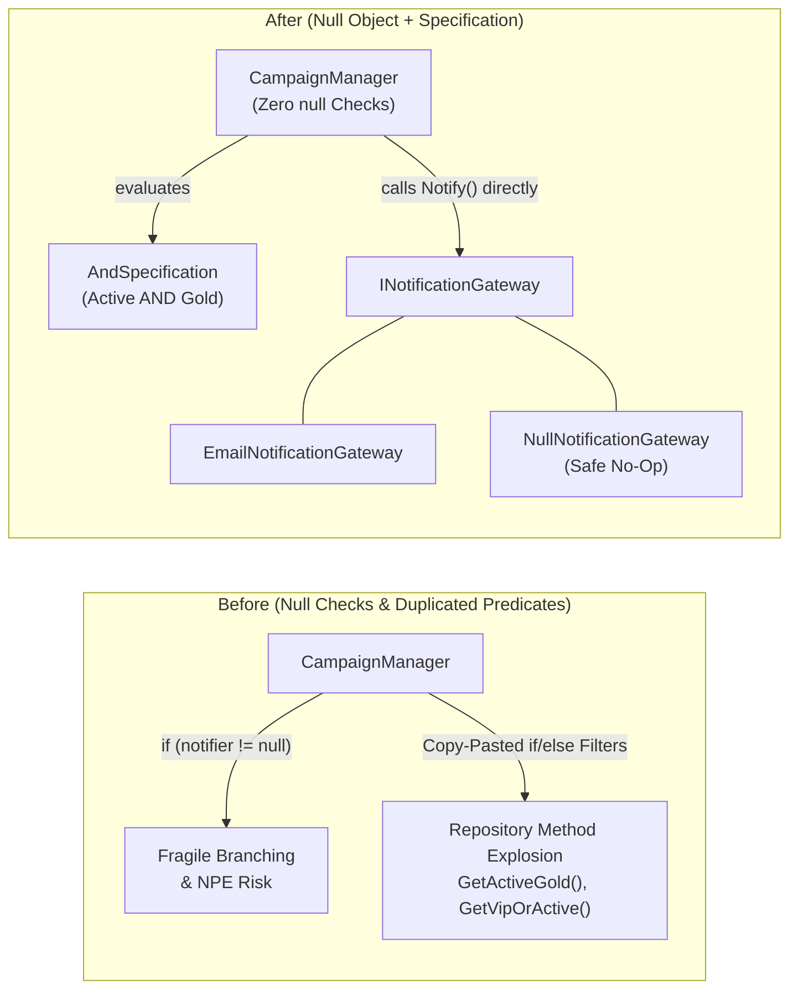
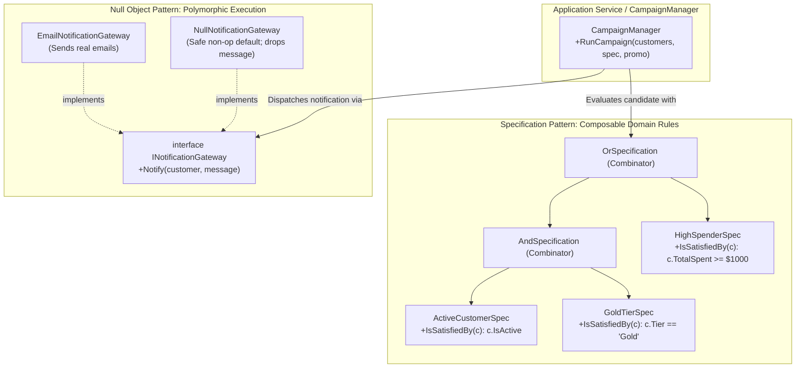

# Lesson 28: Null Object and Specification

> **Prerequisites:** [Repository and Unit of Work](../27-repository-and-unit-of-work/README.md) and [Track 25 Overview](../README.md).  
> **Estimated Reading Time:** 19 minutes  
> **Target Audience:** Engineers preparing for LLD, OOP, C#, or Python technical screening and architecture rounds.

> [!NOTE]
> **In one line:** **Null Object** replaces `null` with a do-nothing object that honours the interface; **Specification** wraps a business rule as a reusable, combinable object (`and`, `or`, `not`).

> [!TIP]
> **The One Rule of Null Object and Specification:** Eliminate defensive conditional checks by injecting a **Null Object** that polymorphically performs a safe, predictable non-op; encapsulate domain business rules into **Specifications** that compose logically (`And`, `Or`, `Not`) and evaluate against both in-memory entities and database queries. If a Null Object starts throwing exceptions or returning special error codes, or if a Specification starts mutating domain entities, encapsulation and intent are violated.

---

## 1. Why This Matters: The Interview Trap

"What are the Null Object and Specification patterns? Why would you use them instead of simple null checks and LINQ or SQL `WHERE` clauses?" is an advanced system design question that tests whether a candidate can design clean domain layers without leaky abstractions.

### The Interview Trap

Candidates often minimize these patterns as trivial wrappers:
> *"A Null Object is just returning an empty string or empty list instead of null. A Specification is just putting a WHERE clause into a separate class."*

The interviewer immediately exposes the shallow understanding:
1. *"If your code uses modern C# nullable reference types (`T?`) or Python `Optional[T]` and null-conditional operators (`?.`), is the Null Object pattern obsolete? When does a Null Object mask catastrophic production bugs?"*
2. *"If your repository has methods like `GetActiveGoldUsersWithOverdueInvoicesInRegion(...)`, what SOLID principles are being violated? How does the Specification pattern prevent repository interface explosion while allowing both in-memory validation and SQL translation?"*

A senior engineer answers with Domain-Driven Design (DDD) rigor:

> *"The **Null Object pattern** (a specialized form of Fowler's Special Case pattern) replaces defensive `if (service != null)` checks with a concrete object that conforms to the expected interface but executes safe, neutral behavior (such as no-op logging or default fallback values).*  
>  
> *It differs fundamentally from null-conditional operators (`?.`) and `Optional<T>`:*  
> - *`Optional<T>` forces callers to explicitly handle presence or absence at every call site, multiplying branching logic.*  
> - *A **Null Object** leverages **polymorphism**: the consumer treats the collaborator identically regardless of whether it is active or inactive, eliminating conditional branches entirely.*  
>  
> *The **Specification pattern** (formalized by Eric Evans and Martin Fowler) solves the **Repository Bloat antipattern**.*  
> *In naive architectures, repositories sprout dozens of ad-hoc query methods whenever business analysts invent a new rule. The Specification pattern extracts domain rules into first-class, composable boolean predicates that serve three distinct purposes:*  
> 1. ***Validation:*** *Checking if an existing in-memory domain entity satisfies business invariants (`spec.IsSatisfiedBy(order)`).*  
> 2. ***Querying:*** *Translating business rules into database query expressions (`spec.ToExpression()` for EF Core or SQLAlchemy) so filtering occurs on the database server.*  
> 3. ***Construction (Creational):*** *Specifying requirements for creating a new entity that matches exact domain criteria."*

---

## 1A. The Visual Story: Problem -> Analogy -> Solution

### The Problem (Why Naive Code Explodes)

Two classic plagues haunt growing codebases:
1. **The `null` Check Plague:** Every service method is littered with `if (notifier != null) { notifier.Send(...); }` or `if (discount != null)`. Miss a single check in one corner of the app, and production crashes with `NullReferenceException` / `AttributeError: 'NoneType'`.
2. **The Repository & Predicate Explosion:** Marketing asks for "active gold customers," then "active gold OR high-spending customers," then "active non-gold customers." You end up duplicating `c.IsActive && c.Tier == "Gold"` in three different services *and* writing twelve nearly identical repository methods (`GetActiveGold()`, `GetActiveGoldOrHighSpender()`, etc.).

### Real-World Analogy

- **Null Object** is like a **dummy load plug** (or a muted microphone) in an audio rack: it fits the exact same jack and obeys the exact same signal contract as a real speaker, but silently absorbs the output so the amplifier never shorts out when no speaker is attached.
- **Specification** is like **transparent boolean filter cards** you can stack on top of each other (`Active` AND `Gold`, or `NOT Gold`): each card represents one simple rule, and you can combine them in any order without reprinting new cards.

### Visual Problem -> Solution Diagram



### Applicability & Pattern Relations

**Use when:**
- **Null Object:** A collaborator is optional (e.g., logger, metrics sink, notification gateway, guest user) and its absence should behave as a **safe, silent no-op** rather than an error.
- **Specification:** Business eligibility rules are **reused across both in-memory validation and database queries**, or users/admins need to combine rules dynamically (`AND`, `OR`, `NOT`).

**Relations with Other Patterns:**
- **Strategy / State:** Null Object is effectively a special "do-nothing" Strategy implementation.
- **Composite:** `AndSpecification`, `OrSpecification`, and `NotSpecification` use the Composite pattern to build boolean rule trees.
- **Repository:** Specifications plug directly into `IRepository.Find(spec)` to keep repository interfaces small and expressive.

---

## 2. Visual Mental Model / Taxonomic Comparison

### Composable Specification & Polymorphic Null Object Architecture

In this architecture, business rules are composed dynamically using boolean logic combinators (`And`, `Or`, `Not`). When actions fire, the orchestrator invokes collaborators without any defensive `null` branching because inactive collaborators are represented by safe Null Objects.



### Decision Matrix: Null Handling & Query Encapsulation

| Architectural Pattern | Primary Intent | Client Complexity | Error Risk | Database Translation |
| :--- | :--- | :--- | :--- | :--- |
| **Null Object** | Provide safe, neutral polymorphic default behavior | **Zero branching** (client treats object normally) | Low (prevents `NullReferenceException`) | N/A (behavioral) |
| **Null-Conditional (`?.`)** | Short-circuit method execution if pointer is null | Low to Moderate (returns null silently) | Moderate (propagates null downstream) | Supported in some LINQ providers |
| **`Option<T>` / `Optional`** | Force caller to explicitly handle absent state | High (caller must unwrap or bind) | Low (type system enforces checking) | Requires custom mapping |
| **Specification** | Encapsulate composable business rules for validation & queries | **Low** (reusable boolean combinators) | Low (centralizes domain logic) | **Yes** (via AST / Expression Trees) |
| **Repository Ad-Hoc Method** | Execute specific SQL query | High (repo interface explodes with methods) | High (logic duplicated across repo methods) | Yes (direct LINQ/SQL) |

---

## 3. Code Implementation: The Customer Campaign & Notification Engine

Let us build an enterprise customer reward campaign system demonstrating both patterns:
- **Specification:** Composable customer eligibility criteria (`ActiveCustomerSpec`, `GoldTierSpec`, `HighSpenderSpec`, `AndSpecification`, `OrSpecification`, `NotSpecification`).
- **Null Object:** `NullNotificationGateway` allowing silent dry-run campaigns without modifying or checking for `null` in `CampaignManager`.

````carousel
```python
from abc import ABC, abstractmethod
from typing import List


# =====================================================================
# Domain Model
# =====================================================================

class Customer:
    def __init__(self, name: str, is_active: bool, tier: str, total_spent: float) -> None:
        self.name = name
        self.is_active = is_active
        self.tier = tier
        self.total_spent = total_spent

    def __repr__(self) -> str:
        return f"{self.name} (Active={self.is_active}, Tier={self.tier}, Spent=\${self.total_spent:.0f})"


# =====================================================================
# Pattern 1: Specification (Composable Domain Rules)
# =====================================================================

class Specification(ABC):
    @abstractmethod
    def is_satisfied_by(self, candidate: Customer) -> bool:
        pass

    def and_(self, other: "Specification") -> "Specification":
        return AndSpecification(self, other)

    def or_(self, other: "Specification") -> "Specification":
        return OrSpecification(self, other)

    def not_(self) -> "Specification":
        return NotSpecification(self)


class AndSpecification(Specification):
    def __init__(self, left: Specification, right: Specification) -> None:
        self._left = left
        self._right = right

    def is_satisfied_by(self, candidate: Customer) -> bool:
        return self._left.is_satisfied_by(candidate) and self._right.is_satisfied_by(candidate)


class OrSpecification(Specification):
    def __init__(self, left: Specification, right: Specification) -> None:
        self._left = left
        self._right = right

    def is_satisfied_by(self, candidate: Customer) -> bool:
        return self._left.is_satisfied_by(candidate) or self._right.is_satisfied_by(candidate)


class NotSpecification(Specification):
    def __init__(self, spec: Specification) -> None:
        self._spec = spec

    def is_satisfied_by(self, candidate: Customer) -> bool:
        return not self._spec.is_satisfied_by(candidate)


class ActiveCustomerSpec(Specification):
    def is_satisfied_by(self, candidate: Customer) -> bool:
        return candidate.is_active


class GoldTierSpec(Specification):
    def is_satisfied_by(self, candidate: Customer) -> bool:
        return candidate.tier == "Gold"


class HighSpenderSpec(Specification):
    def __init__(self, threshold: float) -> None:
        self._threshold = threshold

    def is_satisfied_by(self, candidate: Customer) -> bool:
        return candidate.total_spent >= self._threshold


# =====================================================================
# Pattern 2: Null Object (Polymorphic Non-Op Default)
# =====================================================================

class NotificationGateway(ABC):
    @abstractmethod
    def notify(self, customer: Customer, message: str) -> None:
        pass


class EmailNotificationGateway(NotificationGateway):
    def notify(self, customer: Customer, message: str) -> None:
        print(f"[Email Dispatch] Sending to {customer.name}: {message}")


class NullNotificationGateway(NotificationGateway):
    """Null Object: Performs a safe non-op; eliminates null checks."""
    def notify(self, customer: Customer, message: str) -> None:
        # Intentionally non-op; no-op logging or suppression
        pass


# =====================================================================
# Domain Service / Orchestrator
# =====================================================================

class CampaignManager:
    def __init__(self, notifier: NotificationGateway) -> None:
        # Zero defensive null-checks needed: notifier is guaranteed valid
        self._notifier = notifier

    def run_campaign(self, customers: List[Customer], criteria: Specification, promo: str) -> None:
        for customer in customers:
            if criteria.is_satisfied_by(customer):
                print(f"Qualified: {customer.name}")
                self._notifier.notify(customer, promo)
            else:
                print(f"Skipped:   {customer.name}")


if __name__ == "__main__":
    customers = [
        Customer("Alice", is_active=True, tier="Gold", total_spent=450.0),
        Customer("Bob", is_active=True, tier="Silver", total_spent=1200.0),
        Customer("Charlie", is_active=False, tier="Gold", total_spent=3000.0),
        Customer("Diana", is_active=True, tier="Bronze", total_spent=150.0),
    ]

    # Composed Rule: Active AND (Gold Tier OR Total Spent >= $1000)
    vip_promo_spec = ActiveCustomerSpec().and_(
        GoldTierSpec().or_(HighSpenderSpec(1000.0))
    )

    print("--- 1. Live Campaign with Real Email Gateway ---")
    live_manager = CampaignManager(EmailNotificationGateway())
    live_manager.run_campaign(customers, vip_promo_spec, "20% VIP Bonus Unlocked!")

    print("\n--- 2. Silent Dry-Run with Null Object Gateway ---")
    dry_run_manager = CampaignManager(NullNotificationGateway())
    dry_run_manager.run_campaign(customers, vip_promo_spec, "20% VIP Bonus Unlocked!")
```
<!-- slide -->
```csharp
using System;
using System.Collections.Generic;

namespace NullObjectAndSpecificationDemo;

// =====================================================================
// Domain Model
// =====================================================================

public sealed class Customer
{
    public string Name { get; }
    public bool IsActive { get; }
    public string Tier { get; }
    public double TotalSpent { get; }

    public Customer(string name, bool isActive, string tier, double totalSpent)
    {
        Name = name;
        IsActive = isActive;
        Tier = tier;
        TotalSpent = totalSpent;
    }

    public override string ToString()
    {
        return $"{Name} (Active={IsActive}, Tier={Tier}, Spent=\${TotalSpent:F0})";
    }
}

// =====================================================================
// Pattern 1: Specification (Composable Domain Rules)
// =====================================================================

public interface ISpecification<T>
{
    bool IsSatisfiedBy(T candidate);
    ISpecification<T> And(ISpecification<T> other);
    ISpecification<T> Or(ISpecification<T> other);
    ISpecification<T> Not();
}

public abstract class Specification<T> : ISpecification<T>
{
    public abstract bool IsSatisfiedBy(T candidate);

    public ISpecification<T> And(ISpecification<T> other)
    {
        return new AndSpecification<T>(this, other);
    }

    public ISpecification<T> Or(ISpecification<T> other)
    {
        return new OrSpecification<T>(this, other);
    }

    public ISpecification<T> Not()
    {
        return new NotSpecification<T>(this);
    }
}

public sealed class AndSpecification<T> : Specification<T>
{
    private readonly ISpecification<T> _left;
    private readonly ISpecification<T> _right;

    public AndSpecification(ISpecification<T> left, ISpecification<T> right)
    {
        _left = left;
        _right = right;
    }

    public override bool IsSatisfiedBy(T candidate)
    {
        return _left.IsSatisfiedBy(candidate) && _right.IsSatisfiedBy(candidate);
    }
}

public sealed class OrSpecification<T> : Specification<T>
{
    private readonly ISpecification<T> _left;
    private readonly ISpecification<T> _right;

    public OrSpecification(ISpecification<T> left, ISpecification<T> right)
    {
        _left = left;
        _right = right;
    }

    public override bool IsSatisfiedBy(T candidate)
    {
        return _left.IsSatisfiedBy(candidate) || _right.IsSatisfiedBy(candidate);
    }
}

public sealed class NotSpecification<T> : Specification<T>
{
    private readonly ISpecification<T> _inner;

    public NotSpecification(ISpecification<T> inner)
    {
        _inner = inner;
    }

    public override bool IsSatisfiedBy(T candidate)
    {
        return !_inner.IsSatisfiedBy(candidate);
    }
}

public sealed class ActiveCustomerSpec : Specification<Customer>
{
    public override bool IsSatisfiedBy(Customer candidate)
    {
        return candidate.IsActive;
    }
}

public sealed class GoldTierSpec : Specification<Customer>
{
    public override bool IsSatisfiedBy(Customer candidate)
    {
        return candidate.Tier == "Gold";
    }
}

public sealed class HighSpenderSpec : Specification<Customer>
{
    private readonly double _threshold;

    public HighSpenderSpec(double threshold)
    {
        _threshold = threshold;
    }

    public override bool IsSatisfiedBy(Customer candidate)
    {
        return candidate.TotalSpent >= _threshold;
    }
}

// =====================================================================
// Pattern 2: Null Object (Polymorphic Non-Op Default)
// =====================================================================

public interface INotificationGateway
{
    void Notify(Customer customer, string message);
}

public sealed class EmailNotificationGateway : INotificationGateway
{
    public void Notify(Customer customer, string message)
    {
        Console.WriteLine($"[Email Dispatch] Sending to {customer.Name}: {message}");
    }
}

public sealed class NullNotificationGateway : INotificationGateway
{
    // Intentionally non-op; no-op logging or suppression
    public void Notify(Customer customer, string message)
    {
        // Safe non-op
    }
}

// =====================================================================
// Domain Service / Orchestrator
// =====================================================================

public sealed class CampaignManager
{
    private readonly INotificationGateway _notifier;

    public CampaignManager(INotificationGateway notifier)
    {
        _notifier = notifier;
    }

    public void RunCampaign(IEnumerable<Customer> customers, ISpecification<Customer> criteria, string promo)
    {
        foreach (var customer in customers)
        {
            if (criteria.IsSatisfiedBy(customer))
            {
                Console.WriteLine($"Qualified: {customer.Name}");
                _notifier.Notify(customer, promo);
            }
            else
            {
                Console.WriteLine($"Skipped:   {customer.Name}");
            }
        }
    }
}

public static class Program
{
    public static void Main()
    {
        var customers = new List<Customer>
        {
            new("Alice", isActive: true, tier: "Gold", totalSpent: 450.0),
            new("Bob", isActive: true, tier: "Silver", totalSpent: 1200.0),
            new("Charlie", isActive: false, tier: "Gold", totalSpent: 3000.0),
            new("Diana", isActive: true, tier: "Bronze", totalSpent: 150.0)
        };

        // Composed Rule: Active AND (Gold Tier OR Total Spent >= $1000)
        ISpecification<Customer> vipPromoSpec = new ActiveCustomerSpec().And(
            new GoldTierSpec().Or(new HighSpenderSpec(1000.0))
        );

        Console.WriteLine("--- 1. Live Campaign with Real Email Gateway ---");
        var liveManager = new CampaignManager(new EmailNotificationGateway());
        liveManager.RunCampaign(customers, vipPromoSpec, "20% VIP Bonus Unlocked!");

        Console.WriteLine("\n--- 2. Silent Dry-Run with Null Object Gateway ---");
        var dryRunManager = new CampaignManager(new NullNotificationGateway());
        dryRunManager.RunCampaign(customers, vipPromoSpec, "20% VIP Bonus Unlocked!");
    }
}
```
````

**Expected Output (Both Languages):**
```text
--- 1. Live Campaign with Real Email Gateway ---
Qualified: Alice
[Email Dispatch] Sending to Alice: 20% VIP Bonus Unlocked!
Qualified: Bob
[Email Dispatch] Sending to Bob: 20% VIP Bonus Unlocked!
Skipped:   Charlie
Skipped:   Diana

--- 2. Silent Dry-Run with Null Object Gateway ---
Qualified: Alice
Qualified: Bob
Skipped:   Charlie
Skipped:   Diana
```

---

## 3A. Where It Is Used, Why It Exists & Progressive Buildup

### Where It Is Used (Real-World Systems & LLD Interviews)

| Domain / Ecosystem | Concrete Real-World Usage | LLD Interview Problem Where You Use It |
| :--- | :--- | :--- |
| **.NET** | **Null Object:** `NullLogger<T>.Instance`, `Stream.Null`, `CancellationToken.None`; **Specification:** `Ardalis.Specification`, EF Core `Expression<Func<T, bool>>` | E-Commerce Faceted Product Filter, Dry-Run Notification Pipeline |
| **Python** | **Null Object:** `logging.NullHandler()`, `contextlib.nullcontext()`; **Specification:** Django `Q()` (`&`, `\|`, `~`), SQLAlchemy `and_()` / `or_()` | Loan Underwriting & Fraud Rules, Feature Flag / Segment Matcher |
| **Go** | **Null Object:** `io.Discard`, `slog.DiscardHandler`, OpenTelemetry `noop.TracerProvider`; **Specification:** composable `func(T) bool` predicates | API Gateway Request Filter, Alert Routing & Escalation Engine |
| **TypeScript** | **Null Object:** No-op `AnalyticsSink` / `Logger` in SSR & tests; **Specification:** Prisma `WhereInput` builders & composable predicate classes | Dynamic Search & Discount Eligibility, Workflow Approval Rules |

### Why It Is Used — The Step-by-Step Buildup (Before -> Pain -> Pattern)

Imagine you are building an e-commerce catalog service with optional telemetry tracking.

#### Stage 0: Naive Code (Repository Method Explosion + Null Checks Everywhere)

```python
from dataclasses import dataclass
from typing import List, Optional


@dataclass
class Product:
    sku: str
    price: float
    in_stock: bool
    clearance: bool


class NaiveProductRepo:
    def __init__(self, items: List[Product], metrics: Optional[object] = None):
        self._items = items
        self._metrics = metrics  # Nullable collaborator!

    def find_in_stock_under_price(self, max_price: float) -> List[Product]:
        if self._metrics is not None:  # PAIN 1: Defensive null check repeated everywhere
            self._metrics.inc("query.in_stock_under_price")
        return [p for p in self._items if p.in_stock and p.price <= max_price]

    def find_in_stock_or_clearance_under_price(self, max_price: float) -> List[Product]:
        if self._metrics is not None:  # PAIN 1 again!
            self._metrics.inc("query.in_stock_or_clearance")
        return [p for p in self._items if (p.in_stock or p.clearance) and p.price <= max_price]
```

#### What Breaks as New Requirements Arrive

1. **Requirement 2 (Combinatorial Filter Explosion):** Product managers request 8 more filter combinations (`clearance AND NOT fragile`, `in_stock AND category == 'books' AND price < 25`). Creating a new repository method per combination causes **exponential method bloat** and duplicates business rules across endpoints.
2. **Requirement 3 (Scattered `None` Checks & Production `AttributeError`):** Every new query method or helper must remember `if self._metrics is not None:`. Forgetting a single `None` check in a rarely hit branch crashes the service with `AttributeError: 'NoneType' object has no attribute 'inc'`.

#### Step-by-Step Refactoring Into Null Object + Specification

1. **Step 1 — Introduce Null Object (`NullMetrics`):** Default `metrics` to `NullMetrics()` so `self._metrics.inc(...)` is always safe to call with **zero `if` branches**.
2. **Step 2 — Introduce Composable Specification (`Spec[T]`):** Replace all `find_X_and_Y()` methods with a single `find(spec: Spec[Product])` and overload `&`, `|`, `~` so rules compose cleanly.

```python
from abc import ABC, abstractmethod
from typing import Generic, List, Protocol, TypeVar

T = TypeVar("T")


class MetricsSink(Protocol):
    def inc(self, metric: str) -> None: ...


class NullMetricsSink:
    def inc(self, metric: str) -> None:
        pass  # Safe polymorphic no-op


class Spec(ABC, Generic[T]):
    @abstractmethod
    def is_satisfied_by(self, item: T) -> bool:
        pass

    def __and__(self, other: "Spec[T]") -> "Spec[T]":
        return AndSpec(self, other)

    def __or__(self, other: "Spec[T]") -> "Spec[T]":
        return OrSpec(self, other)

    def __invert__(self) -> "Spec[T]":
        return NotSpec(self)


class AndSpec(Spec[T]):
    def __init__(self, a: Spec[T], b: Spec[T]):
        self.a, self.b = a, b

    def is_satisfied_by(self, item: T) -> bool:
        return self.a.is_satisfied_by(item) and self.b.is_satisfied_by(item)


class OrSpec(Spec[T]):
    def __init__(self, a: Spec[T], b: Spec[T]):
        self.a, self.b = a, b

    def is_satisfied_by(self, item: T) -> bool:
        return self.a.is_satisfied_by(item) or self.b.is_satisfied_by(item)


class NotSpec(Spec[T]):
    def __init__(self, inner: Spec[T]):
        self.inner = inner

    def is_satisfied_by(self, item: T) -> bool:
        return not self.inner.is_satisfied_by(item)


class InStockSpec(Spec[Product]):
    def is_satisfied_by(self, item: Product) -> bool:
        return item.in_stock


class ClearanceSpec(Spec[Product]):
    def is_satisfied_by(self, item: Product) -> bool:
        return item.clearance


class MaxPriceSpec(Spec[Product]):
    def __init__(self, limit: float):
        self.limit = limit

    def is_satisfied_by(self, item: Product) -> bool:
        return item.price <= self.limit


class CleanProductRepo:
    def __init__(self, items: List[Product], metrics: Optional[MetricsSink] = None):
        self._items = items
        self._metrics = metrics or NullMetricsSink()

    def find(self, spec: Spec[Product]) -> List[Product]:
        self._metrics.inc("query.products")  # Zero null checks!
        return [p for p in self._items if spec.is_satisfied_by(p)]


repo = CleanProductRepo([
    Product("A", 20.0, in_stock=True, clearance=False),
    Product("B", 15.0, in_stock=False, clearance=True),
    Product("C", 90.0, in_stock=True, clearance=False),
])
deal_spec = (InStockSpec() | ClearanceSpec()) & MaxPriceSpec(25.0)
assert [p.sku for p in repo.find(deal_spec)] == ["A", "B"]
```

### Progressive Real-World Examples (More & More Typical Use Cases)

#### Example A (Simple Core): `NullLogger` Eliminating Defensive Checks

A background worker logs progress without ever checking `if self._logger is not None`.

```python
from typing import List, Protocol


class Logger(Protocol):
    def log(self, message: str) -> None: ...


class ListLogger:
    def __init__(self):
        self.entries: List[str] = []

    def log(self, message: str) -> None:
        self.entries.append(message)


class NullLogger:
    def log(self, message: str) -> None:
        pass


class BatchJob:
    def __init__(self, logger: Logger = NullLogger()):
        self._logger = logger

    def run(self, items: List[str]) -> int:
        self._logger.log(f"Starting batch of {len(items)}")
        processed = len(items)
        self._logger.log(f"Finished {processed}")
        return processed


silent_job = BatchJob()  # Uses NullLogger safely
assert silent_job.run(["x", "y"]) == 2

audited_log = ListLogger()
audited_job = BatchJob(logger=audited_log)
assert audited_job.run(["x"]) == 1
assert len(audited_log.entries) == 2
```

#### Example B (Production Backend / Middleware): Request Guard Specification + Null Tracer

API gateways compose security and throttling rules dynamically while falling back to a `NullTracer` when distributed tracing is disabled or sampled out.

```python
from dataclasses import dataclass
from typing import Protocol


@dataclass(frozen=True)
class HttpRequest:
    method: str
    is_authenticated: bool
    country: str
    requests_per_min: int


class Tracer(Protocol):
    def record_span(self, name: str) -> None: ...


class NullTracer:
    def record_span(self, name: str) -> None:
        pass


class AuthenticatedSpec(Spec[HttpRequest]):
    def is_satisfied_by(self, r: HttpRequest) -> bool:
        return r.is_authenticated


class AllowedCountrySpec(Spec[HttpRequest]):
    def __init__(self, blocked: set[str]):
        self._blocked = blocked

    def is_satisfied_by(self, r: HttpRequest) -> bool:
        return r.country not in self._blocked


class UnderRateLimitSpec(Spec[HttpRequest]):
    def __init__(self, max_rpm: int):
        self._max_rpm = max_rpm

    def is_satisfied_by(self, r: HttpRequest) -> bool:
        return r.requests_per_min <= self._max_rpm


gateway_policy = AuthenticatedSpec() & AllowedCountrySpec({"XX"}) & UnderRateLimitSpec(100)
tracer = NullTracer()
req = HttpRequest("POST", is_authenticated=True, country="US", requests_per_min=42)
tracer.record_span("auth_check")
assert gateway_policy.is_satisfied_by(req) is True
```

#### Example C (Classic LLD Interview Problem): Loan Underwriting & Fraud Screening Engine

In a fintech LLD interview ("Design a loan approval rule engine"), credit rules must be composable, auditable, and testable without triggering live credit-bureau webhooks in sandbox mode.

```python
from dataclasses import dataclass


@dataclass(frozen=True)
class LoanApplication:
    applicant_id: str
    credit_score: int
    debt_to_income: float
    is_sanctioned: bool


class FraudWebhook(Protocol):
    def notify_rejection(self, applicant_id: str) -> None: ...


class NullFraudWebhook:
    def notify_rejection(self, applicant_id: str) -> None:
        pass  # Sandbox / dry-run safe no-op


class MinCreditScoreSpec(Spec[LoanApplication]):
    def __init__(self, min_score: int):
        self.min_score = min_score

    def is_satisfied_by(self, app: LoanApplication) -> bool:
        return app.credit_score >= self.min_score


class MaxDebtRatioSpec(Spec[LoanApplication]):
    def __init__(self, max_dti: float):
        self.max_dti = max_dti

    def is_satisfied_by(self, app: LoanApplication) -> bool:
        return app.debt_to_income <= self.max_dti


class SanctionedSpec(Spec[LoanApplication]):
    def is_satisfied_by(self, app: LoanApplication) -> bool:
        return app.is_sanctioned


class UnderwritingEngine:
    def __init__(self, policy: Spec[LoanApplication], webhook: FraudWebhook = NullFraudWebhook()):
        self._policy = policy
        self._webhook = webhook

    def approve(self, app: LoanApplication) -> bool:
        if self._policy.is_satisfied_by(app):
            return True
        self._webhook.notify_rejection(app.applicant_id)
        return False


underwriting_policy = MinCreditScoreSpec(680) & MaxDebtRatioSpec(0.40) & (~SanctionedSpec())
engine = UnderwritingEngine(underwriting_policy)

assert engine.approve(LoanApplication("A1", credit_score=740, debt_to_income=0.25, is_sanctioned=False)) is True
assert engine.approve(LoanApplication("A2", credit_score=740, debt_to_income=0.25, is_sanctioned=True)) is False
```

---

## 4. Where You Already Use It

Modern frameworks provide Null Objects and Specifications out of the box.

### 1. .NET Standard Library Null Objects
- `Microsoft.Extensions.Logging.Abstractions.NullLogger<T>.Instance`: The standard null logger used across .NET libraries to ensure classes can log without checking `if (_logger != null)`.
- `System.IO.Stream.Null`: A stream that discards all writes and returns zero bytes on reads (equivalent to `/dev/null`).
- `System.IO.TextWriter.Null`: A `TextWriter` that swallows all written characters.
- `System.Threading.CancellationToken.None`: An uncancelable token representing a safe non-canceling default.

### 2. Python Standard Library `logging.NullHandler`
When writing a Python package or library that uses logging, PEP 282 recommends attaching a `NullHandler` to the library's top-level logger:
```python
import logging

# In your library's __init__.py
logger = logging.getLogger("mylibrary")
logger.addHandler(logging.NullHandler())
```
If an application consumes your library without configuring logging, Python does not print a warning like `"No handler found for logger mylibrary"`. The `NullHandler` safely swallows all log calls.

### 3. Specifications Translating to Database Queries (.NET EF Core & LINQ)
In enterprise .NET architecture, packages like `Ardalis.Specification` allow specifications to expose LINQ expressions (`Expression<Func<T, bool>>`):
```csharp
public class ActiveGoldCustomersSpec : Specification<Customer>
{
    public ActiveGoldCustomersSpec()
    {
        Query.Where(c => c.IsActive && c.Tier == "Gold")
             .OrderBy(c => c.Name);
    }
}

// Repository consumes specification and applies it to EF Core IQueryable
var customers = await repository.ListAsync(new ActiveGoldCustomersSpec());
```
This executes directly on the SQL database server as `SELECT ... WHERE IsActive = 1 AND Tier = 'Gold' ORDER BY Name`.

---

## 5. Pitfalls and When Not to Use It

### 1. Masking Critical Configuration Failures
A Null Object should represent a **valid domain condition of doing nothing** (e.g., opting out of marketing emails, or dry-run testing). It should **never** be used to mask a critical misconfiguration or missing dependency. If an application fails to provide a database connection string or authentication secret, injecting a "NullDatabase" or "NullAuthorizer" will silently corrupt data or introduce severe security vulnerabilities. In such cases, fast-failing via constructor argument validation (`ArgumentNullException.ThrowIfNull`) is required.

### 2. Specification Leaks (In-Memory vs. Database Mismatches)
A common trap occurs when developers attempt to reuse an in-memory specification inside an ORM query. If `IsSatisfiedBy` relies on a C# regex, an in-memory string manipulation (`string.Split`), or a local system clock call that cannot be translated into SQL by EF Core or SQLAlchemy, the query provider will either throw a runtime `InvalidOperationException` or silently trigger client-side evaluation (pulling the entire million-row table into RAM to filter in-memory).
> **Rule:** If a Specification is used for database queries, its criteria must be expressed strictly as an Abstract Syntax Tree (`Expression<Func<T, bool>>` in C# or SQLAlchemy binary expressions in Python).

### 3. Over-Engineering Trivial Logic
Creating 20 separate specification classes for trivial one-off queries (such as `FindByIdSpec`) adds unnecessary cognitive overhead and boilerplate. Use Specifications for **reusable, combinable business rules**, not for basic CRUD lookups.

---

## 6. Exercises & Practical Drills

### Exercise 1: Null Object or Fast-Fail Exception?

For each of the following three architectural scenarios, determine whether injecting a **Null Object** or throwing an **ArgumentNullException / ConfigurationException** is the proper engineering decision:

1. A background batch billing job is executed without providing an optional Prometheus metrics exporter.
2. An online checkout payment processing service is instantiated without a payment gateway provider (e.g., `StripePaymentGateway` is null).
3. A unit test runs a domain service that requires an `IAuditLogger`, but the test is only verifying inventory subtraction.

<details>
<summary>Answer</summary>

1. **Prometheus Metrics Exporter: Null Object (`NullMetricsSink`).**  
   Metrics collection is an optional non-functional observability concern. The core billing batch job can execute safely without metrics. A Null Object eliminates null checks across all billing steps.
2. **Payment Gateway: Fast-Fail Exception (`ArgumentNullException`).**  
   A checkout service cannot fulfill its core domain invariant without charging money. Injecting a `NullPaymentGateway` in production would allow customers to acquire orders for free! The constructor must immediately fail fast.
3. **Unit Test Audit Logger: Null Object (`NullAuditLogger`).**  
   The test is focused purely on inventory calculations. A Null Object provides a clean dummy collaborator without needing mocking libraries or causing null pointer exceptions.
</details>

### Exercise 2: Auditing Repository Bloat

Examine the following repository interface:

```csharp
public interface ICustomerRepository
{
    Customer GetById(int id);
    IEnumerable<Customer> GetActiveCustomers();
    IEnumerable<Customer> GetGoldTierCustomers();
    IEnumerable<Customer> GetActiveGoldTierCustomersOverdue();
    IEnumerable<Customer> GetActiveCustomersByRegion(string region);
    IEnumerable<Customer> GetActiveCustomersByRegionWithOverdueInvoices(string region);
}
```

Explain how the Specification pattern refactors this interface into a clean, closed contract that adheres to the Open-Closed Principle.

<details>
<summary>Answer</summary>

**Problem:**  
The repository violates the **Open-Closed Principle** and suffers from **Repository Bloat**. Every time business requirements introduce a new filter permutation (combining region, status, tier, or overdue debt), developers must add a new method to `ICustomerRepository`, forcing updates across all implementations and mocks.

**Refactoring with Specification:**  
Collapse the query methods into a single specification-driven method:
```csharp
public interface ICustomerRepository
{
    Customer GetById(int id);
    IEnumerable<Customer> Find(ISpecification<Customer> specification);
}
```
Now, new business requirements are satisfied by creating or composing specifications (`ActiveSpec.And(RegionSpec("EU")).And(OverdueSpec())`) without altering the repository interface or implementation.
</details>

---

## 7. Interview Questions & Model Answers

<details>
<summary><strong>1. What is the Null Object pattern? [BASIC]</strong></summary>

The Null Object pattern is a behavioral/structural pattern (classified by Martin Fowler as a Special Case pattern) where an object encapsulates the absence of a dependency by providing a neutral, non-op implementation of the expected interface.

Rather than passing `null` references and forcing every consuming method to write defensive `if (collaborator != null)` boilerplate, the caller injects a concrete Null Object (such as `NullLogger` or `NullNotificationGateway`). The consumer invokes methods on the collaborator polymorphically without branching logic.

It simplifies calling code, eliminates `NullReferenceException` risks, and is invaluable for unit testing, dry-run simulation modes, and optional plugins.

</details>

<details>
<summary><strong>2. What is the Specification pattern? [BASIC]</strong></summary>

The Specification pattern is a Domain-Driven Design pattern formalized by Eric Evans and Martin Fowler that encapsulates a business rule into an independent, reusable object.

A specification defines a method—typically `bool IsSatisfiedBy(T candidate)`—and provides logical combinators (`And`, `Or`, `Not`) to dynamically chain rules together without coupling them to specific services.

Furthermore, in modern enterprise architectures, specifications bridge domain logic and persistence: by exposing criteria as LINQ Expression Trees or AST predicates, a specification can evaluate an in-memory entity graph for domain validation AND translate directly into a database SQL `WHERE` clause inside an ORM repository, eliminating repository query method explosion.

</details>

<details>
<summary><strong>3. How does the Specification pattern prevent Repository bloat? [BASIC]</strong></summary>

Without the Specification pattern, repositories suffer from exponential method sprawl as domain filtering requirements evolve (e.g., `GetActiveUsers`, `GetActiveUsersInRegion`, `GetActiveUsersInRegionWithSubscriptions`). This pollutes the repository interface with dozens of brittle, single-use query methods and leaks query logic across the persistence layer.

The Specification pattern prevents this by decoupling **how to query** (the repository) from **what to query for** (the business rule). The repository exposes a single, generalized method: `IEnumerable<T> Find(ISpecification<T> spec)`.

When product requirements change, developers simply create a new Specification class or compose existing ones using boolean combinators, leaving the repository contract completely untouched and closed for modification (Open-Closed Principle).

</details>

<details>
<summary><strong>4. Does modern language support for nullability (like C# `?` or Python `Optional`) make the Null Object pattern obsolete? [TRICKY]</strong></summary>

No. Language-level nullability features (`T?`, `Optional[T]`, and the null-conditional operator `?.`) solve a different problem than the Null Object pattern:

1. **Null-Conditional (`?.`) and `Optional<T>`** treat absence as data. They force the consuming code to check, unwrap, or handle the `null` state, propagating branches and optional unwrapping across multiple layers of application logic.
2. **Null Object** treats absence as **behavior**. It leverages polymorphism so that the consuming code does not need to know or care whether a collaborator is performing real work or doing nothing. The consumer's code remains completely linear and branch-free.

Modern static analysis and nullability annotations actually complement the Null Object pattern: they encourage developers to eliminate nullable references entirely from domain services by guaranteeing that a valid collaborator (either real or Null Object) is always supplied.

</details>

<details>
<summary><strong>5. A `GetUser(id)` returns null for unknown users and callers keep crashing. Options? [SCENARIO]</strong></summary>

Return a `GuestUser` null object if guest behaviour is legitimate, return `Optional`/nullable and force callers to handle it, or throw `NotFound` if absence is an error. Pick based on the domain meaning of "missing".

</details>

<details>
<summary><strong>6. When is Null Object harmful? [TRICKY]</strong></summary>

When it hides bugs: a silent no-op for something required (like a payment gateway) lets failures pass unnoticed. Use it only where "do nothing" is a valid behaviour.

</details>

---

## Try it

Run this: no `if logger is None` checks, and rules that combine. Then redraw it in [LLD Studio](/tools/lld-studio/); the [track hub](../README.md) has the pattern-choice drills.

```python
class NullLogger:
    def log(self, m): pass                       # safe no-op

def work(logger=NullLogger()): logger.log("x"); return "done"
assert work() == "done"

class Spec:
    def __init__(self, f): self.f = f
    def __call__(self, x): return self.f(x)
    def __and__(self, o): return Spec(lambda x: self(x) and o(x))
    def __invert__(self): return Spec(lambda x: not self(x))

adult = Spec(lambda u: u["age"] >= 18)
vip = Spec(lambda u: u["vip"])
assert (adult & ~vip)({"age": 20, "vip": False})
```

---

## One-page cheat sheet

```text
NULL OBJECT  same interface, neutral behaviour (NullLogger, EmptyList, Guest user)
Removes scattered `if x is None`; callers just call
Don't hide real errors: a missing required thing should still fail
SPECIFICATION  is_satisfied_by(x) ; and / or / not combine rules
Reuse one rule for validation, filtering, and DB queries (expression trees)
Keeps Repository from growing find_by_a_and_b_and_c methods
Modern nullability (C# `?`, Optional) helps, but NO is still a design choice for behaviour
```

---

## 8. Sources & Further Reading

- Fowler, M. (1999). *Refactoring: Improving the Design of Existing Code* (Special Case / Null Object). Addison-Wesley.
- Evans, E. (2003). *Domain-Driven Design: Tackling Complexity in the Heart of Software* (Specification Pattern). Addison-Wesley.
- [Martin Fowler: Specification Pattern](https://martinfowler.com/apsupp/spec.pdf)
- [Microsoft Learn: NullLogger Class (Microsoft.Extensions.Logging.Abstractions)](https://learn.microsoft.com/en-us/dotnet/api/microsoft.extensions.logging.abstractions.nulllogger)
- [Microsoft Learn: Stream.Null Field (System.IO)](https://learn.microsoft.com/en-us/dotnet/api/system.io.stream.null)
- [Python 3 Documentation: logging.NullHandler](https://docs.python.org/3/library/logging.handlers.html#logging.NullHandler)
- [Ardalis.Specification: Specification Pattern in .NET EF Core](https://github.com/ardalis/Specification)

---

Previous: [Repository and Unit of Work](../27-repository-and-unit-of-work/README.md) · Next: [Pattern Comparison Drills](../29-pattern-comparison-drills/README.md)
