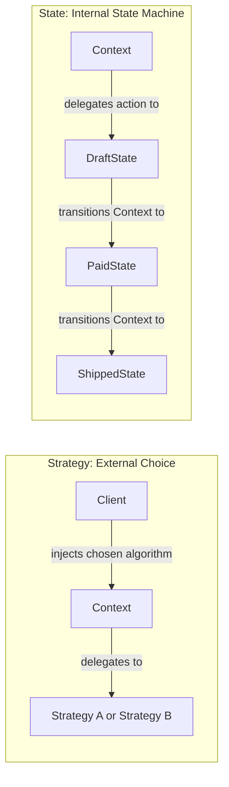
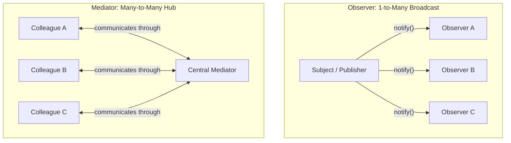

# Lesson 29: Pattern Comparison Drills

> **Prerequisites:** [Null Object and Specification](../28-null-object-and-specification/README.md) and [Track 25 Overview](../README.md).  
> **Estimated Reading Time:** 20 minutes  
> **Target Audience:** Engineers preparing for LLD, OOP, C#, or Python technical screening and architecture rounds.

> [!TIP]
> **The One Rule of Pattern Comparison:** Design patterns are defined by their **intent and architectural relationships**, never their class diagram. Two patterns can have identical UML structures yet solve opposing engineering problems. When asked to compare, start with the problem each was invented to solve.

---

## 1. Why This Matters: The Interview Trap

Technical screening rounds rarely ask candidates to define a design pattern in isolation. Instead, interviewers test architectural discernment by presenting pairs or triads of patterns that look structurally identical:
- *"Strategy or State?"*
- *"Decorator, Proxy, or Adapter?"*
- *"Factory Method, Abstract Factory, or Builder?"*
- *"Observer or Mediator?"*

### The Interview Trap: Superficial Feature Listing

When asked: *"What is the difference between Decorator and Proxy? They both implement the interface of the object they wrap."*

- **The Weak Junior Answer:**  
  *"A decorator decorates an object with more code. A proxy is a substitute that acts on behalf of something else, like a virtual proxy."*

- **Why the Interviewer Rejects It:**  
  The candidate uses circular definitions that recite pattern names without addressing mechanics, object lifecycles, composition chains, or intent.

- **The Strong Senior Answer:**  
  *"While Decorator and Proxy share the same structural signature—both wrap a target object and implement its exact interface—their architectural intent, lifecycle ownership, and composability are completely different:*
  - *A **Decorator** adds or enhances behavioral responsibilities dynamically. The client instantiates the target and chooses to wrap it in zero, one, or ten decorators at runtime (e.g., `BufferedStream(GZipStream(FileStream))`). Decorators compose in arbitrary chains.*
  - *A **Proxy** controls access, manages lazy instantiation lifecycle, handles permissions, or provides caching for the underlying subject. Crucially, the proxy typically manages the creation and lifetime of the real subject itself, and clients rarely compose multiple proxies in chains.*
  - *An **Adapter**, by contrast, wraps an object to convert an incompatible interface into one the client expects. Its interface never matches the wrapped adaptee."*

---

## 2. Visual Mental Model / Taxonomic Comparison

### Triad 1: The Wrapper Family (Decorator vs. Proxy vs. Adapter vs. Facade)

```mermaid
flowchart TD
    subgraph DecoratorPattern["Decorator: Add Responsibilities"]
        C1["Client"] --> D1["Decorator (implements IService)"]
        D1 -->|"delegates & enriches"| S1["RealService (implements IService)"]
    end

    subgraph ProxyPattern["Proxy: Control Access & Lifecycle"]
        C2["Client"] --> P2["Proxy (implements IService)"]
        P2 -->|"controls access / lazy loads"| S2["RealService (implements IService)"]
    end

    subgraph AdapterPattern["Adapter: Bridge Incompatible Interfaces"]
        C3["Client"] -->|"expects ITarget"| A3["Adapter (implements ITarget)"]
        A3 -->|"translates to"| S3["LegacyAdaptee (different interface)"]
    end

    subgraph FacadePattern["Facade: Simplify Subsystem"]
        C4["Client"] --> F4["Facade (Unified Simple API)"]
        F4 --> SubA["Subsystem Component A"]
        F4 --> SubB["Subsystem Component B"]
        F4 --> SubC["Subsystem Component C"]
    end
```



| Dimension | Decorator | Proxy | Adapter | Facade |
| :--- | :--- | :--- | :--- | :--- |
| **Intent** | Enrich / extend behavior | Control access, lifecycle, caching | Make incompatible interfaces work together | Provide a simplified high-level view of a complex subsystem |
| **Interface Parity** | Same as wrapped object | Same as wrapped object | Converts Adaptee interface to Target interface | New, simplified interface over many subsystems |
| **Who Creates Target?** | Injected by caller | Often created internally by the Proxy | Injected by caller or adapter factory | Facade creates or orchestrates internal subsystem |
| **Stackable?** | Yes, recursive chains | Rarely stacked | No | No |

---

### Comparison 2: Dynamic Behavioral Variation (Strategy vs. State vs. Template Method)



| Dimension | Strategy | State | Template Method |
| :--- | :--- | :--- | :--- |
| **Primary Intent** | Swap interchangeable algorithms independently from clients | Allow an object to alter its behavior when its internal state changes | Define the skeleton of an algorithm in a base class, deferring steps to subclasses |
| **Who Changes It?** | External client or DI configuration | The state objects themselves transition the context | Subclasses override abstract hooks at compile time |
| **Inter-state Knowledge** | Strategies know nothing of other strategies | States often know about sibling states and transition between them | Base class dictates the invariant execution order |
| **Mechanism** | Object Composition | Object Composition | Class Inheritance |

---

### Comparison 3: Decoupling Communication (Observer vs. Mediator)



| Dimension | Observer | Mediator |
| :--- | :--- | :--- |
| **Communication Flow** | 1-to-Many (One publisher broadcasts to multiple subscribers) | Many-to-Many (Multiple colleagues communicate indirectly through a centralized hub) |
| **Coupling Topology** | Publisher does not know concrete observers; observers observe publisher | Colleagues only know the mediator; mediator coordinates all colleague interactions |
| **Primary Problem Solved** | State synchronization and event notifications | Taming an $O(N^2)$ chaotic web of inter-object dependencies |
| **Directionality** | Unidirectional notification (push or pull) | Bidirectional coordination and dispatching |

---

## 3. Code Implementation

The following side-by-side drills contrast:
1. **Strategy vs. State:** External algorithm substitution vs. internal self-driving state machine.
2. **Decorator vs. Proxy vs. Adapter:** Enriching behavior vs. access protection vs. protocol adaptation.

````carousel
```python
from abc import ABC, abstractmethod


# ==========================================
# 1. STRATEGY vs STATE
# ==========================================


# Strategy: Client swaps algorithm; strategy knows nothing about transitions
class IPricingStrategy(ABC):

  @abstractmethod
  def calculate(self, base_price: float) -> float:
    pass


class RegularPricing(IPricingStrategy):

  def calculate(self, base_price: float) -> float:
    return base_price


class HolidayPricing(IPricingStrategy):

  def calculate(self, base_price: float) -> float:
    return base_price * 0.8


# State: Internal state machine; states trigger transitions on context
class IOrderState(ABC):

  @abstractmethod
  def proceed(self, context: "OrderContext") -> str:
    pass


class OrderContext:

  def __init__(self) -> None:
    self.state: IOrderState = DraftState()

  def proceed(self) -> str:
    return self.state.proceed(self)


class DraftState(IOrderState):

  def proceed(self, context: OrderContext) -> str:
    context.state = PaidState()
    return "Order transitioned: Draft -> Paid"


class PaidState(IOrderState):

  def proceed(self, context: OrderContext) -> str:
    context.state = ShippedState()
    return "Order transitioned: Paid -> Shipped"


class ShippedState(IOrderState):

  def proceed(self, context: OrderContext) -> str:
    return "Order is already Shipped. Terminal state."


# ==========================================
# 2. DECORATOR vs PROXY vs ADAPTER
# ==========================================
class IMessageSender(ABC):

  @abstractmethod
  def send(self, message: str) -> str:
    pass


class BasicSender(IMessageSender):

  def send(self, message: str) -> str:
    return f"Delivered: {message}"


# Decorator: Extends behavior, preserves exact same interface
class LoggingDecorator(IMessageSender):

  def __init__(self, inner: IMessageSender) -> None:
    self._inner = inner

  def send(self, message: str) -> str:
    return f"[LOG] Sending message... | {self._inner.send(message)}"


# Proxy: Controls access/lifecycle, preserves exact same interface
class SecurityProxy(IMessageSender):

  def __init__(self, inner: IMessageSender, is_admin: bool) -> None:
    self._inner = inner
    self._is_admin = is_admin

  def send(self, message: str) -> str:
    if not self._is_admin:
      return "Access Denied: Admin privileges required."
    return self._inner.send(message)


# Adapter: Translates incompatible third-party interface to target contract
class LegacyEmailService:

  def dispatch_raw(self, payload: dict) -> str:
    text = payload.get("text", "")
    return f"Legacy Mailer Sent: {text}"


class EmailAdapter(IMessageSender):

  def __init__(self, legacy: LegacyEmailService) -> None:
    self._legacy = legacy

  def send(self, message: str) -> str:
    return self._legacy.dispatch_raw({"text": message})


# ==========================================
# 3. Demonstration
# ==========================================
if __name__ == "__main__":
  print("--- Drill 1: Strategy vs State ---")
  strat: IPricingStrategy = HolidayPricing()
  print(f"Strategy (Holiday Discount): ${strat.calculate(100.00):.2f}")

  order = OrderContext()
  print(f"State 1: {order.proceed()}")
  print(f"State 2: {order.proceed()}")
  print(f"State 3: {order.proceed()}")

  print("\n--- Drill 2: Decorator vs Proxy vs Adapter ---")
  base = BasicSender()
  decorator = LoggingDecorator(base)
  print(f"Decorator: {decorator.send('Hello World')}")

  proxy_denied = SecurityProxy(base, is_admin=False)
  proxy_allowed = SecurityProxy(base, is_admin=True)
  print(f"Proxy (Unauthorized): {proxy_denied.send('Secret Data')}")
  print(f"Proxy (Authorized): {proxy_allowed.send('Secret Data')}")

  adapter = EmailAdapter(LegacyEmailService())
  print(f"Adapter: {adapter.send('Adapted Notice')}")
```
<!-- slide -->
```csharp
using System;
using System.Collections.Generic;

// ==========================================
// 1. STRATEGY vs STATE
// ==========================================

// Strategy: Client swaps algorithm; strategy knows nothing about transitions
public interface IPricingStrategy
{
    decimal Calculate(decimal basePrice);
}

public class RegularPricing : IPricingStrategy
{
    public decimal Calculate(decimal basePrice) => basePrice;
}

public class HolidayPricing : IPricingStrategy
{
    public decimal Calculate(decimal basePrice) => basePrice * 0.8m;
}

// State: Internal state machine; states trigger transitions on context
public interface IOrderState
{
    string Proceed(OrderContext context);
}

public class OrderContext
{
    public IOrderState State { get; set; } = new DraftState();
    public string Proceed() => State.Proceed(this);
}

public class DraftState : IOrderState
{
    public string Proceed(OrderContext context)
    {
        context.State = new PaidState();
        return "Order transitioned: Draft -> Paid";
    }
}

public class PaidState : IOrderState
{
    public string Proceed(OrderContext context)
    {
        context.State = new ShippedState();
        return "Order transitioned: Paid -> Shipped";
    }
}

public class ShippedState : IOrderState
{
    public string Proceed(OrderContext context) => "Order is already Shipped. Terminal state.";
}

// ==========================================
// 2. DECORATOR vs PROXY vs ADAPTER
// ==========================================
public interface IMessageSender
{
    string Send(string message);
}

public class BasicSender : IMessageSender
{
    public string Send(string message) => $"Delivered: {message}";
}

// Decorator: Extends behavior, preserves exact same interface
public class LoggingDecorator : IMessageSender
{
    private readonly IMessageSender _inner;
    public LoggingDecorator(IMessageSender inner) => _inner = inner;

    public string Send(string message) => $"[LOG] Sending message... | {_inner.Send(message)}";
}

// Proxy: Controls access/lifecycle, preserves exact same interface
public class SecurityProxy : IMessageSender
{
    private readonly IMessageSender _inner;
    private readonly bool _isAdmin;

    public SecurityProxy(IMessageSender inner, bool isAdmin)
    {
        _inner = inner;
        _isAdmin = isAdmin;
    }

    public string Send(string message)
    {
        if (!_isAdmin)
            return "Access Denied: Admin privileges required.";
        return _inner.Send(message);
    }
}

// Adapter: Translates incompatible third-party interface to target contract
public class LegacyEmailService
{
    public string DispatchRaw(Dictionary<string, string> payload) => $"Legacy Mailer Sent: {payload["text"]}";
}

public class EmailAdapter : IMessageSender
{
    private readonly LegacyEmailService _legacy;
    public EmailAdapter(LegacyEmailService legacy) => _legacy = legacy;

    public string Send(string message)
    {
        var payload = new Dictionary<string, string> { ["text"] = message };
        return _legacy.DispatchRaw(payload);
    }
}

// ==========================================
// 3. Demonstration
// ==========================================
public class Program
{
    public static void Main()
    {
        Console.WriteLine("--- Drill 1: Strategy vs State ---");
        IPricingStrategy strat = new HolidayPricing();
        Console.WriteLine($"Strategy (Holiday Discount): ${strat.Calculate(100.00m):F2}");

        var order = new OrderContext();
        Console.WriteLine($"State 1: {order.Proceed()}");
        Console.WriteLine($"State 2: {order.Proceed()}");
        Console.WriteLine($"State 3: {order.Proceed()}");

        Console.WriteLine("\n--- Drill 2: Decorator vs Proxy vs Adapter ---");
        IMessageSender baseSender = new BasicSender();
        var decorator = new LoggingDecorator(baseSender);
        Console.WriteLine($"Decorator: {decorator.Send("Hello World")}");

        var proxyDenied = new SecurityProxy(baseSender, isAdmin: false);
        var proxyAllowed = new SecurityProxy(baseSender, isAdmin: true);
        Console.WriteLine($"Proxy (Unauthorized): {proxyDenied.Send("Secret Data")}");
        Console.WriteLine($"Proxy (Authorized): {proxyAllowed.Send("Secret Data")}");

        var adapter = new EmailAdapter(new LegacyEmailService());
        Console.WriteLine($"Adapter: {adapter.Send("Adapted Notice")}");
    }
}
```
````

**Expected Output (Both Languages):**

```text
--- Drill 1: Strategy vs State ---
Strategy (Holiday Discount): $80.00
State 1: Order transitioned: Draft -> Paid
State 2: Order transitioned: Paid -> Shipped
State 3: Order is already Shipped. Terminal state.

--- Drill 2: Decorator vs Proxy vs Adapter ---
Decorator: [LOG] Sending message... | Delivered: Hello World
Proxy (Unauthorized): Access Denied: Admin privileges required.
Proxy (Authorized): Delivered: Secret Data
Adapter: Legacy Mailer Sent: Adapted Notice
```

---

## 4. Where You Already Use It

- **Strategy vs. State:**
  - *Strategy in .NET:* `IComparer<T>` passed to `List<T>.Sort()` determines sorting algorithm externally.
  - *State in .NET:* `Task` and `TaskCompletionSource` transition internally between `WaitingForActivation`, `Running`, `RanToCompletion`, and `Faulted`.
  - *Strategy in Python:* Sorting keys `sorted(data, key=lambda x: x.age)`.
  - *State in Python:* Connection state in websocket or socket libraries (`CONNECTING`, `OPEN`, `CLOSING`, `CLOSED`).

- **Decorator vs. Proxy vs. Adapter:**
  - *Decorator in .NET:* `CryptoStream(GZipStream(FileStream))` where streams layer cryptographic and compression logic dynamically over byte streams.
  - *Proxy in .NET:* EF Core Dynamic Proxies generating sub-classes at runtime to intercept navigation property calls and trigger lazy loading.
  - *Adapter in .NET:* `StreamAdapter` adapting raw byte arrays to reader interfaces.
  - *Proxy in Python:* `unittest.mock.MagicMock` acts as a dynamic proxy intercepting attribute access and calls.

- **Observer vs. Mediator:**
  - *Observer in .NET:* C# `event` and `EventHandler` syntax, `IObservable<T>` in Reactive Extensions.
  - *Mediator in .NET:* The `MediatR` library dispatching CQRS commands and queries through a single pipeline without sender knowing handler.

---

## 5. Pitfalls and When Not to Use It

1. **State Over-Engineering for Booleans:**
   - Writing 4 classes for an entity that simply toggles between `IsActive = true` and `IsActive = false`. If there are only 2 states and no distinct behavioral branches, a simple boolean property is vastly superior.
2. **The God Mediator:**
   - Centralizing all logic in a single Mediator until it grows into a 5,000-line God Object containing tight coupling to 40 distinct components. Keep mediators focused per feature or domain slice.
3. **Decorator Explosion:**
   - Wrapping an object in 10 layers of decorators without a factory or DI configuration. Stack traces become unreadable and tracking which layer failed becomes a debugging nightmare.
4. **Adapter Abuse when Source Code Can Be Refactored:**
   - Writing complex adapters for your own internal team codebase instead of simply refactoring the method signature to match the desired standard. Adapters are primarily meant for third-party libraries, legacy systems, or foreign service contracts.

---

## 6. Exercises & Practical Drills

### Drill 1: Choose the Pattern (State or Strategy?)
**Scenario:** You are building an approval workflow engine. A purchase request starts at `Submitted`, moves to `ManagerApproved` if under \$1,000, or requires `DirectorApproved` if over \$10,000. In each stage, the `Approve()` method validates different rules and transitions to the subsequent step.  
Which pattern should you choose, and why?

<details>
<summary>Answer</summary>

**Choose the State Pattern.**  
The purchase request undergoes distinct lifecycle transitions where the behavior of `Approve()` and `Reject()` changes depending on the current phase. Crucially, executing an action causes the object to advance to the next phase internally. If you used Strategy, the client would have to manually swap the strategy after every approval step, leaking workflow coordination logic across callers.
</details>

### Drill 2: Choose the Pattern (Decorator, Proxy, or Adapter?)
**Scenario:** You have a legacy Redis cache client with method `StoreValue(byte[] key, byte[] val)`. Your modern application requires an `ICacheService` interface with `Task SetAsync<T>(string key, T value)`. Furthermore, you need to automatically count cache hits and misses in Prometheus metrics without changing existing cache logic.  
What patterns are needed?

<details>
<summary>Answer</summary>

**You need an Adapter AND a Decorator:**
1. **Adapter:** Create a `RedisCacheAdapter` implementing `ICacheService` that serializes objects to JSON byte arrays and calls the legacy client's `StoreValue()`.
2. **Decorator:** Create a `MetricsCacheDecorator` implementing `ICacheService` that wraps any `ICacheService`, increments Prometheus counters, and delegates to the inner instance.

Structure:
`Client -> MetricsCacheDecorator (Decorator) -> RedisCacheAdapter (Adapter) -> Legacy Redis Client (Adaptee)`.
</details>

### Drill 3: Choose the Pattern (Observer or Mediator?)
**Scenario:** In an air traffic control system, 50 aircraft must avoid colliding with each other in the terminal airspace. Should airplanes observe each other directly (Observer), or coordinate through the Air Traffic Control Tower (Mediator)?

<details>
<summary>Answer</summary>

**Choose the Mediator Pattern.**  
If each aircraft observed every other aircraft directly (Observer), you would have an $O(N^2)$ communication mesh where 50 airplanes maintain 2,450 bilateral communication links. A single course correction would require notifying 49 other airplanes directly.  
With the **Mediator Pattern**, all 50 aircraft communicate solely with the Air Traffic Control Tower (the Mediator). The Tower evaluates airspace geometry centrally and issues directed altitude and heading clearances, reducing the communication complexity to $O(N)$ and preventing catastrophic collision coordination chaos.
</details>

---

## 7. Interview Questions & Model Answers

> [!interview]
> **Question 1: Strategy or State?**  
> **Strong Answer:**  
> "While Strategy and State share an almost identical UML class diagram—both compose a context class that delegates to an interface—their intent, ownership, and lifecycle are completely different:  
> 
> - **Strategy** is about **external variation of an algorithm**. The client chooses a strategy and injects it into the context (e.g., choosing `ZipCompression` vs. `TarCompression`, or `PaypalPayment` vs. `CreditCardPayment`). Strategies are typically stateless, independent of one another, and do not mutate or transition the context.  
> - **State** is about **internal behavioral variation driven by lifecycle transitions**. The context acts as a state machine. The concrete state objects know about sibling states and transition the context from one state to another (e.g., `Draft -> PendingReview -> Published`). The client does not manually swap states; the object's internal state machine drives itself in response to actions."

> [!interview]
> **Question 2: Decorator, Proxy or Adapter?**  
> **Strong Answer:**  
> "All three are structural wrappers that forward calls to an underlying object, but they differ fundamentally in intent and interface parity:  
> 
> - **Decorator** adds responsibilities or enhances behavior dynamically **without altering the interface**. Decorator implements `IService` and wraps `IService`. Multiple decorators can be stacked recursively in arbitrary chains (e.g., `LoggingDecorator(CachingDecorator(SqlService))`). The target instance is created externally and injected into the decorator.  
> - **Proxy** controls access, handles security, coordinates lazy initialization, or caches results **while maintaining the exact same interface**. Crucially, the proxy often manages the lifecycle of the real subject itself, and clients rarely stack multiple proxies. The client believes it is talking directly to the real service.  
> - **Adapter** converts an **incompatible interface** into a target contract that the client expects. Unlike Decorator and Proxy, an Adapter's interface is *different* from the adaptee's interface. It translates method calls, data types, and parameters between two disparate systems."

> [!interview]
> **Question 3: Factory, Abstract Factory or Builder?**  
> **Strong Answer:**  
> "These three creational patterns differ by scope, structure, and assembly complexity:  
> 
> - **Factory Method** uses inheritance to defer the creation of a **single product** to subclasses. It defines a method (e.g., `CreateLogger()`) that concrete creators override to return specific implementations (`FileLogger`, `ConsoleLogger`).  
> - **Abstract Factory** uses composition to produce **families of related or dependent products** without specifying their concrete classes. An `IUIFactory` produces matching buttons, scrollbars, and checkboxes for Windows, macOS, or Linux, ensuring visual consistency across the entire product suite.  
> - **Builder** separates the **step-by-step construction of a single complex object** from its final representation. It is used when an object requires numerous constructor parameters, optional configurations, or sequential multi-step assembly (e.g., `HttpRequestMessageBuilder` or `WebApplicationBuilder`), allowing fluent chaining and immutable final output."

> [!interview]
> **Question 4: Observer or Mediator?**  
> **Strong Answer:**  
> "Observer and Mediator both decouple senders and receivers, but they solve different topological communication problems:  
> 
> - **Observer** establishes a **one-to-many broadcast relationship**. A single Subject changes state and notifies a dynamic list of subscribers automatically. The communication is unidirectional (publisher to subscribers), and the publisher has no knowledge of how subscribers react.  
> - **Mediator** centralizes **complex many-to-many coordination** between diverse colleague components. Instead of dozens of components maintaining direct references to one another—forming a fragile $O(N^2)$ mesh—colleagues communicate exclusively through a central mediator hub. The mediator encapsulates the interaction policies, routing logic, and side effects across the entire subsystem."

---

## 8. Sources & Further Reading

- [Design Patterns: Elements of Reusable Object-Oriented Software (Gang of Four)](https://en.wikipedia.org/wiki/Design_Patterns)
- [Refactoring.Guru: Design Patterns Comparison](https://refactoring.guru/design-patterns)
- [Martin Fowler: Patterns of Enterprise Application Architecture](https://martinfowler.com/books/eaa.html)
- [Microsoft Learn: Architectural Design Patterns](https://learn.microsoft.com/en-us/dotnet/architecture/modern-web-apps-azure/common-web-application-architectures)

---

Previous: [Null Object and Specification](../28-null-object-and-specification/README.md) · Next: [Patterns Inside ASP.NET Core and Python](../30-patterns-inside-aspnet-core-and-python/README.md)
