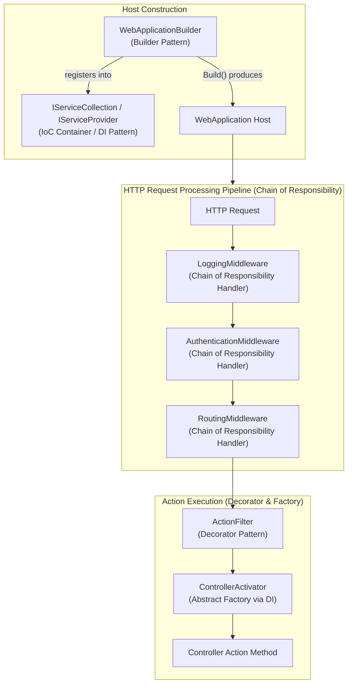

# Lesson 30: Patterns Inside ASP.NET Core and Python

> **Prerequisites:** [Pattern Comparison Drills](../29-pattern-comparison-drills/README.md) and [Track 25 Overview](../README.md).  
> **Estimated Reading Time:** 20 minutes  
> **Target Audience:** Engineers preparing for LLD, OOP, C#, or Python technical screening and architecture rounds.

> [!NOTE]
> **In one line:** You already use patterns daily: ASP.NET Core is full of **Chain (middleware), Builder, Factory, Strategy, Options, DI**, and the Python stdlib of **Iterator, Decorator, Context Manager, Strategy, Observer-ish signals**.

> [!TIP]
> **The One Rule of Framework Patterns:** Frameworks are not magic; they are composed of classical Gang of Four design patterns collaborating at scale. Being able to name the pattern behind a framework feature proves you understand *how* it works beneath the hood, not just *how to call it*.

---

## 1. Why This Matters: The Interview Trap

In senior system design and architecture interviews, interviewers frequently ask candidates to analyze the frameworks they use every day:
- *"Which design patterns does ASP.NET Core use to process an HTTP request?"*
- *"Where do you find classical Gang of Four patterns in Python's standard library?"*

### The Interview Trap: Memorizing API Syntax Without Architectural Vision

- **The Weak Junior Answer:**  
  *"ASP.NET Core uses dependency injection and middleware. You write `app.Use()` and `services.AddScoped()`. Python has `@property` and `with` statements, but those are just language keywords, not design patterns."*

- **Why the Interviewer Rejects It:**  
  This answer reveals that the candidate treats frameworks as black boxes. They know the syntactic incantations, but cannot deconstruct the underlying object-oriented architecture.

- **The Strong Senior Answer:**  
  *"Both ASP.NET Core and the Python standard library are masterclasses in classical Gang of Four design patterns:
  - In **ASP.NET Core**:
    - **Middleware** is a canonical **Chain of Responsibility** where delegates call `next(context)`.
    - `WebApplicationBuilder` is the **Builder** pattern separating configuration from immutable runtime host construction.
    - `IServiceProvider` is an **IoC Container** automating Dependency Injection.
    - **Controller Action Filters** implement the **Decorator** pattern to augment action execution without modifying controller code.
    - `IHttpClientFactory` combines the **Factory Method** and **Object Pool** patterns to manage socket exhaustion and DNS refresh lifetimes.
    - `IOptions<T>` implements the **Singleton / Factory** pattern for strongly typed configuration binding.
  - In **Python**:
    - Generators (`yield`) and `__iter__()` / `__next__()` implement the **Iterator** pattern directly in the runtime.
    - The `logging` module combines **Chain of Responsibility** (hierarchical logger inheritance) and **Observer** (broadcasting log records to attached handlers).
    - `@property` and descriptors implement the **Proxy / Virtual Proxy** pattern to intercept attribute reads, writes, and deletions.
    - `unittest.TestCase` uses the **Template Method** pattern (`setUp()`, `runTest()`, `tearDown()`).
    - Context managers (`with` / `__enter__` / `__exit__`) implement the **Command / Resource Acquisition Is Initialization (RAII)** pattern."*

---

## 2. Visual Mental Model / Taxonomic Comparison

### The ASP.NET Core Request Lifecycle as GoF Patterns



### The Master Framework Pattern Matrix

| Framework Feature | Gang of Four Pattern | Underlying Mechanics | Why Framework Designers Chose It |
| :--- | :--- | :--- | :--- |
| **ASP.NET Core Middleware** | **Chain of Responsibility** | Linked delegates `Func<RequestDelegate, RequestDelegate>` | Allows extensible, non-intrusive pre/post request interception and early short-circuiting. |
| **ASP.NET Core `WebApplicationBuilder`** | **Builder** | Step-by-step registration followed by immutable `builder.Build()` | Enforces clean separation between mutable configuration time and immutable runtime execution. |
| **ASP.NET Core Action Filters** | **Decorator** | Wraps controller execution with `OnActionExecuting` and `OnActionExecuted` | Augments cross-cutting concerns (audit, validation) without polluting domain controller actions. |
| **ASP.NET Core `IHttpClientFactory`** | **Factory Method + Flyweight / Pool** | Pools `HttpMessageHandler` instances while providing transient `HttpClient` wrappers | Prevents TCP socket exhaustion while respecting DNS change TTLs. |
| **ASP.NET Core `IOptions<T>`** | **Factory / Singleton** | Binds configuration subsections to strongly-typed POCOs | Decouples classes from raw configuration keys and enables dynamic hot-reloading (`IOptionsSnapshot`). |
| **Python Iterators & Generators** | **Iterator** | `__iter__()` returning object with `__next__()`, raising `StopIteration` | Enables lazy, constant-memory evaluation over infinite or massive data streams. |
| **Python `logging` Module** | **Chain of Responsibility + Observer** | Loggers propagate messages up hierarchical ancestor chains and dispatch to multiple `Handler` sinks | Decouples message origin from message rendering (file, console, network) and filtering. |
| **Python Descriptors (`@property`)** | **Proxy** | Intercepts `__get__`, `__set__`, and `__delete__` on attribute access | Provides transparent data validation, lazy loading, and caching with clean dot-syntax. |
| **Python `unittest.TestCase`** | **Template Method** | Base class defines test runner skeleton calling abstract hooks `setUp()` and `tearDown()` | Guarantees deterministic test isolation and cleanup without duplicating boilerplate. |
| **Python Context Managers (`with`)** | **Command / RAII** | Encapsulates setup in `__enter__` and guaranteed cleanup in `__exit__` | Guarantees deterministic resource cleanup (files, locks, connections) even during unhandled exceptions. |

---

## 3. Code Implementation

To demonstrate how modern frameworks leverage classical patterns, we implement the core architecture behind **ASP.NET Core Middleware and Python WSGI/ASGI**:
1. **The Builder Pattern (`PipelineBuilder`):** Fluently registers processing stages before freezing the immutable execution graph.
2. **The Chain of Responsibility Pattern (`Middleware`):** Each component inspects an incoming `HttpContext`, executes pre-processing, invokes `next(context)`, and executes post-processing.
3. **Short-Circuiting Mechanics:** An authorized request flows all the way to the terminal endpoint; an unauthorized request short-circuits the chain immediately.

````carousel
```python
from typing import Callable, List


# ==========================================
# 1. Pipeline Context
# ==========================================
class HttpContext:
  """Encapsulates the HTTP request and response state."""

  def __init__(self, path: str, token: str = "") -> None:
    self.path = path
    self.token = token
    self.user: str = "Anonymous"
    self.response: str = ""


# RequestDelegate: The function signature that processes an HTTP context
RequestDelegate = Callable[[HttpContext], None]

# Middleware: A component that takes HttpContext and the next delegate in chain
Middleware = Callable[[HttpContext, RequestDelegate], None]


# ==========================================
# 2. Builder Pattern (Pipeline Construction)
# ==========================================
class PipelineBuilder:
  """Implements the Builder pattern to assemble the execution pipeline."""

  def __init__(self) -> None:
    self._components: List[Middleware] = []

  def use(self, middleware: Middleware) -> "PipelineBuilder":
    self._components.append(middleware)
    return self

  def build(self, endpoint: RequestDelegate) -> RequestDelegate:
    """Builds the nested Chain of Responsibility in reverse order."""
    app: RequestDelegate = endpoint
    for middleware in reversed(self._components):
      current_middleware = middleware
      next_delegate = app
      app = (
          lambda ctx, m=current_middleware, n=next_delegate: m(ctx, n)  # type: ignore
      )
    return app


# ==========================================
# 3. Chain of Responsibility Middleware Components
# ==========================================
def logging_middleware(
    ctx: HttpContext, next_delegate: RequestDelegate
) -> None:
  print(f"[Log Start] Incoming request: {ctx.path}")
  next_delegate(ctx)
  print(f"[Log End] Status: Success | User: {ctx.user}")


def auth_middleware(ctx: HttpContext, next_delegate: RequestDelegate) -> None:
  if ctx.token == "bearer_secret_123":
    ctx.user = "AdminUser"
  else:
    ctx.user = "Guest"
  next_delegate(ctx)


# ==========================================
# 4. Terminal Endpoint Handler
# ==========================================
def endpoint_handler(ctx: HttpContext) -> None:
  ctx.response = f"200 OK: Processed {ctx.path} for {ctx.user}"
  print(f"-> Endpoint Executed: {ctx.response}")


# ==========================================
# 5. Demonstration
# ==========================================
if __name__ == "__main__":
  # Assembling via Builder
  pipeline = (
      PipelineBuilder()
      .use(logging_middleware)
      .use(auth_middleware)
      .build(endpoint_handler)
  )

  print("--- Executing HTTP Pipeline ---")
  context = HttpContext(path="/api/orders", token="bearer_secret_123")
  pipeline(context)
```
<!-- slide -->
```csharp
using System;
using System.Collections.Generic;

// ==========================================
// 1. Pipeline Context
// ==========================================
public class HttpContext
{
    public string Path { get; }
    public string Token { get; }
    public string User { get; set; } = "Anonymous";
    public string Response { get; set; } = string.Empty;

    public HttpContext(string path, string token = "")
    {
        Path = path;
        Token = token;
    }
}

// Delegate signatures matching ASP.NET Core RequestDelegate conventions
public delegate void RequestDelegate(HttpContext context);
public delegate void MiddlewareDelegate(HttpContext context, RequestDelegate next);

// ==========================================
// 2. Builder Pattern (Pipeline Construction)
// ==========================================
public class PipelineBuilder
{
    private readonly List<MiddlewareDelegate> _components = new();

    public PipelineBuilder Use(MiddlewareDelegate middleware)
    {
        _components.Add(middleware);
        return this;
    }

    public RequestDelegate Build(RequestDelegate endpoint)
    {
        // Builds the nested Chain of Responsibility in reverse order
        RequestDelegate app = endpoint;
        for (int i = _components.Count - 1; i >= 0; i--)
        {
            var middleware = _components[i];
            var next = app;
            app = context => middleware(context, next);
        }
        return app;
    }
}

// ==========================================
// 3. Chain of Responsibility Middleware Components
// ==========================================
public class Program
{
    public static void LoggingMiddleware(HttpContext ctx, RequestDelegate next)
    {
        Console.WriteLine($"[Log Start] Incoming request: {ctx.Path}");
        next(ctx);
        Console.WriteLine($"[Log End] Status: Success | User: {ctx.User}");
    }

    public static void AuthMiddleware(HttpContext ctx, RequestDelegate next)
    {
        if (ctx.Token == "bearer_secret_123")
            ctx.User = "AdminUser";
        else
            ctx.User = "Guest";
        next(ctx);
    }

    // Terminal Endpoint Handler
    public static void EndpointHandler(HttpContext ctx)
    {
        ctx.Response = $"200 OK: Processed {ctx.Path} for {ctx.User}";
        Console.WriteLine($"-> Endpoint Executed: {ctx.Response}");
    }

    // ==========================================
    // 4. Demonstration
    // ==========================================
    public static void Main()
    {
        // Assembling via Builder
        var pipeline = new PipelineBuilder()
            .Use(LoggingMiddleware)
            .Use(AuthMiddleware)
            .Build(EndpointHandler);

        Console.WriteLine("--- Executing HTTP Pipeline ---");
        var context = new HttpContext("/api/orders", "bearer_secret_123");
        pipeline(context);
    }
}
```
````

**Expected Output (Both Languages):**

```text
--- Executing HTTP Pipeline ---
[Log Start] Incoming request: /api/orders
-> Endpoint Executed: 200 OK: Processed /api/orders for AdminUser
[Log End] Status: Success | User: AdminUser
```

---

## 4. Where You Already Use It

### Deep Dive: Patterns in ASP.NET Core

1. **Chain of Responsibility:**
   - Every call to `app.UseCors()`, `app.UseAuthentication()`, `app.UseAuthorization()`, and `app.UseResponseCompression()` appends a link to the `RequestDelegate` chain. If authentication fails, the authentication middleware sets `context.Response.StatusCode = 401` and intentionally omits calling `next(context)`, short-circuiting downstream execution.
2. **Builder Pattern:**
   - `WebApplication.CreateBuilder(args)` constructs the mutable `WebApplicationBuilder`. You register configuration, logging, and services onto this builder. When you invoke `builder.Build()`, the builder locks configuration, validates DI scopes, and creates the immutable `WebApplication` host instance.
3. **Decorator Pattern:**
   - ASP.NET Core Action Filters (`IActionFilter`, `IAsyncActionFilter`) decorate controller action invocations. Custom attributes inheriting from `ActionFilterAttribute` wrap action execution with pre-processing (`OnActionExecuting`) and post-processing (`OnActionExecuted`), enabling caching, audit logging, and model validation.
4. **Factory Method + Object Pool:**
   - `IHttpClientFactory`: Directly instantiating `new HttpClient()` causes TCP socket exhaustion under heavy load because sockets remain in `TIME_WAIT` status after disposal. `IHttpClientFactory` pools underlying `HttpClientHandler` instances (Object Pool) and manufactures lightweight transient `HttpClient` instances with managed lifetimes.

### Deep Dive: Patterns in Python Standard Library

1. **Iterator Pattern:**
   - Python embeds the Iterator pattern directly into the grammar. Any object with an `__iter__()` method returning an object with `__next__()` satisfies the iterator protocol. The `yield` keyword compiles a generator function into a state machine that preserves execution frames across calls, enabling lazy stream evaluation with $O(1)$ memory.
2. **Chain of Responsibility + Observer (The `logging` Module):**
   - When you log a message with `logger = logging.getLogger("api.orders")`, the message traverses an ancestor chain of parent loggers (`api.orders` -> `api` -> `root`), which is the **Chain of Responsibility**. Each logger along the chain passes the `LogRecord` to its registered `Handler` sinks (FileHandler, StreamHandler, SysLogHandler), which is the **Observer** pattern.
3. **Proxy Pattern (Descriptors and `@property`):**
   - The descriptor protocol (`__get__`, `__set__`, `__delete__`) is a dynamic Proxy mechanism. When you access `user.full_name`, Python's bytecode looks up the class dictionary, identifies the descriptor, and proxies attribute access through the getter method without client awareness.
4. **Template Method Pattern (`unittest.TestCase`):**
   - The `unittest` framework defines an invariant test execution lifecycle:
     ```python
     def run(self):
       self.setUp()  # Abstract hook
       try:
         self.runTest()  # Concrete step
       finally:
         self.tearDown()  # Abstract hook
```
     Developers override `setUp()` and `tearDown()`, while the base class guarantees execution order and exception isolation.

---

## 5. Pitfalls and When Not to Use It

1. **Middleware Ordering Traps (Chain of Responsibility Ordering):**
   - In ASP.NET Core, middleware order is absolute. Placing `app.UseAuthorization()` *before* `app.UseAuthentication()` causes all authorization checks to run against an unauthenticated identity, granting or denying access erroneously. Placing `app.UseResponseCompression()` after `app.UseStaticFiles()` skips compression on static assets.
2. **Short-Circuiting Without Closing Scopes:**
   - If custom middleware short-circuits an HTTP request without invoking `next(context)`, it must ensure that any open response headers or scoped resources (e.g., database transactions) are completed properly.
3. **Python Descriptor Storage Leak:**
   - Descriptors are instantiated at the **class level**, not the instance level. Storing instance-specific values directly inside a descriptor attribute (`self.val = value`) shares that single variable across every instance of the host class. Always use `instance.__dict__[self.name] = value` or `WeakKeyDictionary`.
4. **Captive Dependencies in DI Builders:**
   - Attempting to resolve scoped services from root service providers during startup (`builder.Services.BuildServiceProvider().GetRequiredService<MyScopedDbContext>()`) creates an unmanaged singleton instance of a scoped context that will never be garbage-collected.

---

## 6. Exercises & Practical Drills

### Drill 1: Reverse-Engineer the Python `with` Statement
What design pattern underlies Python's `with` statement and C#'s `using` declaration? How does it differ from a simple `try-finally` block?

<details>
<summary>Answer</summary>

**Underlying Patterns: Command / RAII (Resource Acquisition Is Initialization).**  
The `with` statement in Python relies on the **Context Manager** protocol (`__enter__` and `__exit__`). In C#, `using` relies on `IDisposable` and `Dispose()`.  
Rather than forcing every client to duplicate error-prone `try-finally` scaffolding around resource allocation and deallocation, the pattern encapsulates resource lifetime inside a standardized object. `__enter__` acquires the resource, and `__exit__` guarantees release, handling exception suppression, log capture, and transaction rollback uniformly.
</details>

### Drill 2: Identify the Pattern in ASP.NET Core `IHttpClientFactory`
Why did Microsoft introduce `IHttpClientFactory` instead of letting developers register `HttpClient` as a Transient or Singleton dependency? Which patterns does it employ?

<details>
<summary>Answer</summary>

**Patterns Employed: Factory Method + Object Pool + Flyweight.**  
- If `HttpClient` is registered as **Transient**, high traffic creates thousands of instances. Disposing them closes the client, but the underlying socket remains in `TIME_WAIT` status, causing **socket exhaustion**.
- If `HttpClient` is registered as a **Singleton**, the socket never closes. However, it fails to detect **DNS updates**, routing traffic to stale IP addresses when external domains migrate.

**The Solution:**  
`IHttpClientFactory` pools `HttpMessageHandler` instances (Object Pool) with an active lifetime (default 2 minutes) to guarantee DNS refreshing, while manufacturing cheap, transient `HttpClient` wrappers (Factory Method) that point to the shared handler pool (Flyweight).
</details>

### Drill 3: Diagnose the Descriptor Bug
Review this Python descriptor:
```python
class ValidatedString:

  def __init__(self) -> None:
    self._value = ""

  def __get__(self, instance, owner):
    return self._value

  def __set__(self, instance, value):
    if not isinstance(value, str):
      raise ValueError("Must be a string")
    self._value = value


class User:
  name = ValidatedString()
```
If you run:
```python
u1 = User()
u2 = User()
u1.name = "Alice"
u2.name = "Bob"
print(u1.name)
```
What is printed, and why? How do you fix it?

<details>
<summary>Answer</summary>

**Output Printed:** `"Bob"`  
**The Flaw:**  
Descriptors are class attributes, meaning exactly **one instance** of `ValidatedString` exists on the `User` class object. By storing `self._value` on the descriptor instance, `u1` and `u2` share the exact same variable. Setting `u2.name = "Bob"` overwrites `u1.name`.

**The Remediation:**  
Store the state on the host `instance` itself using `__set_name__`:
```python
class ValidatedString:

  def __set_name__(self, owner, name):
    self.private_name = f"_{name}"

  def __get__(self, instance, owner):
    if instance is None:
      return self
    return getattr(instance, self.private_name, "")

  def __set__(self, instance, value):
    if not isinstance(value, str):
      raise ValueError("Must be a string")
    setattr(instance, self.private_name, value)
```
Now each `User` instance stores its own `_name` attribute in its own instance `__dict__`.
</details>

---

## 7. Interview Questions & Model Answers

<details>
<summary><strong>1. Which design patterns does ASP.NET Core use? [BASIC]</strong></summary>

ASP.NET Core is built on a foundation of Gang of Four design patterns:

1. **Chain of Responsibility (Middleware Pipeline):** The core request pipeline is formed by chained `RequestDelegate` functions. Each middleware handles incoming requests, calls `next(context)`, and processes outgoing responses, with the ability to short-circuit when necessary (e.g., authentication failure).
2. **Builder Pattern (`WebApplicationBuilder`):** ASP.NET Core uses the Builder pattern to fluently configure services, logging, and configuration sources during initialization, finalizing them into an immutable `WebApplication` host when `builder.Build()` is executed.
3. **Inversion of Control / Dependency Injection (`IServiceCollection`):** The built-in DI container manages object graph instantiation, recursive constructor resolution, and lifetime scopes (Transient, Scoped, Singleton).
4. **Decorator Pattern (Action Filters):** Attributes implementing `IActionFilter` wrap controller action execution, injecting cross-cutting logic like audit trails, performance timing, and validation without altering controller logic.
5. **Factory Method and Object Pool (`IHttpClientFactory`):** Manages `HttpMessageHandler` lifecycles to prevent TCP socket exhaustion while respecting DNS cache expiration.
6. **Options Pattern (`IOptions<T>`):** Combines the Factory and Singleton patterns to bind configuration sections to strongly typed POCO classes with support for reload tokens (`IOptionsSnapshot`).

</details>

<details>
<summary><strong>2. Which design patterns can you find in the Python standard library? [TRICKY]</strong></summary>

The Python language and standard library embed several classical design patterns:

1. **Iterator Pattern:** Python's iteration protocol (`__iter__()` and `__next__()`) and generator functions (`yield`) implement the Iterator pattern natively, enabling lazy, memory-efficient traversal over collections and infinite streams.
2. **Chain of Responsibility + Observer (`logging`):** The `logging` module dispatches log messages up a hierarchical parent-child logger chain (Chain of Responsibility) and broadcasts `LogRecord` instances to multiple configured `Handler` destinations like consoles, files, and sockets (Observer).
3. **Proxy Pattern (Descriptors and `@property`):** The descriptor protocol (`__get__`, `__set__`, `__delete__`) provides a Proxy mechanism that transparently intercepts attribute access, enabling lazy properties, type validation, and caching. The `unittest.mock.MagicMock` class is also a comprehensive dynamic proxy.
4. **Template Method (`unittest.TestCase`):** The base test class defines the algorithmic structure of a test execution, providing hooks like `setUp()` and `tearDown()` that derived test suites override.
5. **Command / RAII (Context Managers):** The `with` statement leverages `__enter__` and `__exit__` to encapsulate resource setup and deterministic cleanup, shielding client code from resource leaks during unexpected runtime exceptions.

</details>

<details>
<summary><strong>3. A colleague says "we don't use design patterns". How do you respond? [SCENARIO]</strong></summary>

You almost certainly do: DI, middleware, iterators, builders and events are all patterns baked into the framework. The point of learning them is shared vocabulary and recognising when a framework already provides one.

</details>

<details>
<summary><strong>4. Is ASP.NET Core middleware Chain of Responsibility or Decorator? [TRICKY]</strong></summary>

Both views fit. Each middleware wraps the next like a decorator (code before and after `next`), but it may also stop the chain and respond, which is Chain of Responsibility.

</details>

<details>
<summary><strong>5. Which pattern does `WebApplication.CreateBuilder(args)` demonstrate? [SCENARIO]</strong></summary>

Builder: it collects configuration, services and logging step by step and `Build()` produces the immutable `WebApplication`.

</details>

<details>
<summary><strong>6. Which Python features embody Iterator and Decorator? [SCENARIO]</strong></summary>

`for` loops, generators and `__iter__`/`__next__` are Iterator; `@decorator` syntax (function wrapping) and `functools.wraps` are Decorator-style wrapping.

</details>

---

## Try it

Open any `Program.cs` (or the minimal-API sample from track 26) and label every line with a pattern: `CreateBuilder` (Builder), `Use...` (Chain), `AddScoped` (DI/Factory). Then do the same for a Python script using `sorted(key=)`, `with`, and `@lru_cache`. Practice space: [LLD Studio](/tools/lld-studio/); full list in the [track hub](../README.md).

---

## One-page cheat sheet

```text
ASP.NET Core
  WebApplication.CreateBuilder   Builder        app.Use/Run/Map     Chain of Responsibility
  AddScoped/AddSingleton         DI + Factory   ILogger<T>          Facade + DI
  IOptions<T>                    Strategy-ish config  filters       Decorator/Chain
  IHttpClientFactory             Factory        MediatR             Mediator
Python stdlib
  for / generators   Iterator   @decorator  Decorator-like   with  Template/RAII
  sorted(key=)  Strategy        functools.singledispatch   Visitor-like
  logging handlers  Observer/Chain   copy.copy  Prototype   abc  Template Method
```

---

## 8. Sources & Further Reading

- [Microsoft Learn: ASP.NET Core Middleware](https://learn.microsoft.com/en-us/aspnet/core/fundamentals/middleware/)
- [Microsoft Learn: Dependency injection in ASP.NET Core](https://learn.microsoft.com/en-us/aspnet/core/fundamentals/dependency-injection)
- [Microsoft Learn: Options pattern in ASP.NET Core](https://learn.microsoft.com/en-us/aspnet/core/fundamentals/configuration/options)
- [Python Documentation: The Descriptor HowTo Guide](https://docs.python.org/3/howto/descriptor.html)
- [Python Documentation: Logging Architecture & Handlers](https://docs.python.org/3/library/logging.html)
- [PEP 343: The 'with' Statement](https://peps.python.org/pep-0343/)

---

Previous: [Pattern Comparison Drills](../29-pattern-comparison-drills/README.md) · Next: [Track 25 Overview](../README.md)
