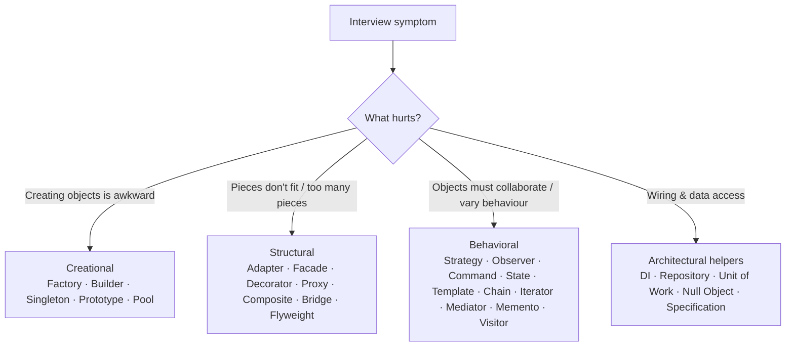

# Track 25: Design Patterns, One at a Time

> **Prerequisites:** [04 · SOLID](../04-solid-principles/README.md), [06 · Creational](../06-creational-patterns/README.md), [07 · Structural](../07-structural-patterns/README.md), [08 · Behavioral I](../08-behavioral-patterns-i/README.md) (the family surveys)  
> **Reading time:** ~15 minutes for this overview; ~15–20 minutes per pattern lesson  
> **Audience:** Candidates who get single-pattern questions ("Where would you use a Singleton? Make it thread-safe.") and need depth, not a catalogue

> [!NOTE]
> **In one line:** One lesson per pattern, in Python and C#: the symptom that calls for it, the smallest correct code, when **not** to use it, where the standard library and ASP.NET Core already use it, and the interview questions that follow.

> [!TIP]
> **Golden rule:** Start from the **symptom**, not the pattern name. "I keep adding `elif kind == …`" → Strategy / polymorphism. "Callers know too much about a subsystem" → Facade. Naming a pattern without the symptom sounds memorised; naming the symptom first sounds like experience.

> [!TIP]
> **Try it:** Run the symptom → pattern example in section 2, then open [LLD Studio](/tools/lld-studio/) and redraw it as Strategy. Do that once per lesson and the track sticks.

---

## 1. The smell: how pattern questions are asked

- **Direct:** "Explain the Decorator pattern." (needs intent + example + trade-off)
- **Symptom-based:** "Checkout has a growing `if payment_type == …`. How would you change it?"
- **Confusable pairs:** "Strategy vs State?" "Decorator vs Proxy?" "Factory Method vs Abstract Factory?"
- **Framework-spotting:** "Where is Chain of Responsibility in ASP.NET Core?"
- **Critique:** "Is Singleton an anti-pattern?"



---

## 2. The five-step answer, with a symptom → pattern example

Use the same five steps for every pattern (lesson 01 drills this):

1. **Intent** in one sentence.  
2. **Problem** (the symptom).  
3. **Structure** (say the two or three classes).  
4. **Example** (tiny, real).  
5. **Trade-off / when not to.**

Here are steps 2–4 for **Strategy**, start to finish:

````carousel
```python
from typing import Callable, Protocol


# Symptom: this grows a branch for every new payment type (violates Open/Closed)
def fee_bad(kind: str, cents: int) -> int:
    if kind == "card":
        return round(cents * 0.029) + 30
    elif kind == "upi":
        return 0
    raise ValueError(kind)


# Pattern: each algorithm is a class (or just a function); the caller picks one
class FeePolicy(Protocol):
    def fee(self, cents: int) -> int: ...


class CardFee:
    def fee(self, cents: int) -> int:
        return round(cents * 0.029) + 30


class UpiFee:
    def fee(self, cents: int) -> int:
        return 0


class Checkout:
    def __init__(self, policy: FeePolicy) -> None:
        self._policy = policy

    def total(self, cents: int) -> int:
        return cents + self._policy.fee(cents)


# In Python a "strategy" is often just a callable — the pattern is lighter than the Java/C# form
def flat_fee(cents: int) -> int:
    return 100


def total_with(fee: Callable[[int], int], cents: int) -> int:
    return cents + fee(cents)


if __name__ == "__main__":
    print(Checkout(CardFee()).total(10_000))   # 10320
    print(Checkout(UpiFee()).total(10_000))    # 10000
    print(total_with(flat_fee, 10_000))        # 10100
    print(fee_bad("card", 10_000))             # 320
```
<!-- slide -->
```csharp
public interface IFeePolicy { int Fee(int cents); }

public sealed class CardFee : IFeePolicy
{
    public int Fee(int cents) => (int)Math.Round(cents * 0.029) + 30;
}

public sealed class UpiFee : IFeePolicy
{
    public int Fee(int cents) => 0;
}

public sealed class Checkout(IFeePolicy policy)
{
    public int Total(int cents) => cents + policy.Fee(cents);
}

// Or, with delegates: Func<int,int> is already a strategy.
```
````

**Reading it like an interviewer:** the *symptom* is the `if/elif` on `kind`; the *pattern* moves each branch behind one interface; the *trade-off* is more types — worth it only when branches keep growing or need independent tests.

---

## 3. How this track works

- Every pattern lesson has the same sections: intent, the problem, when to use it, when not to, the structure as a diagram, the code in Python and in C#, where the frameworks already use it, variants and pitfalls, and the interview questions.
- Start with lesson 01: a template for answering any pattern question. Then Singleton, Factory, Strategy, Observer and Decorator — the five asked most often.
- Lesson 29 compares the patterns that are easy to confuse; lesson 30 maps the patterns inside ASP.NET Core and Python frameworks.
- Every example is written twice, in Python and in C#, as switchable tabs.
- The track has thirty lessons. Lessons whose text is not ready yet are marked *Soon* in the sidebar; their page already lists what they will cover and the questions they will answer.

### Suggested plans

| Time you have | Do this |
| :--- | :--- |
| **Night before** | 01, 02, 03, 15, 16, 11, then 29 (comparison drills) |
| **One week** | 01–09 (creational + structural) days 1–3, 10–19 days 4–6, 20–30 day 7 |
| **Deep prep** | One pattern a day; for each, code it from memory and name one framework that uses it |

---

## 4. Lessons

| # | Lesson | What you'll be able to do |
|---|--------|---------------------------|
| 01 | [How to Answer Any Design Pattern Question](01-how-to-answer-any-pattern-question/README.md) | Answer any pattern question with the same five steps, and pick a pattern from the symptom in front of you |
| 02 | [Singleton: Where to Use It, How, and When Not To](02-singleton/README.md) | Build a thread-safe Singleton in both languages, say where it fits (and where it does not), and prefer a DI singleton |
| 03 | [Factory Method and Simple Factory](03-factory-method-and-simple-factory/README.md) | Replace a type switch with a factory, and tell a simple factory from the Factory Method pattern |
| 04 | [Abstract Factory](04-abstract-factory/README.md) | Create families of related objects that must match, and explain how it differs from Factory Method |
| 05 | [Builder](05-builder/README.md) | Build complex objects step by step with a fluent builder, and recognise `WebApplicationBuilder` and `StringBuilder` as builders |
| 06 | [Prototype](06-prototype/README.md) | Clone objects safely, and explain shallow versus deep copy in both languages |
| 07 | [Object Pool](07-object-pool/README.md) | Reuse expensive objects with a pool, and recognise the pools .NET and Python already give you |
| 08 | [Adapter](08-adapter/README.md) | Wrap an incompatible interface so existing code can use it, for example a third-party payment SDK |
| 09 | [Bridge](09-bridge/README.md) | Separate an abstraction from its implementation so both can vary, and avoid a class explosion |
| 10 | [Composite](10-composite/README.md) | Treat single objects and groups the same way, for trees such as menus, file systems and org charts |
| 11 | [Decorator (and Why It Is Not the Same as a Python @decorator)](11-decorator/README.md) | Add behaviour to an object without changing its class, and explain how the pattern relates to Python decorators |
| 12 | [Facade](12-facade/README.md) | Give a complex subsystem one simple entry point, without hiding what callers still need |
| 13 | [Flyweight](13-flyweight/README.md) | Share common state between many small objects to save memory, and spot it in string interning |
| 14 | [Proxy](14-proxy/README.md) | Control access to an object with a proxy: lazy loading, caching, access checks, remote calls |
| 15 | [Strategy](15-strategy/README.md) | Replace a growing if/else on a type with interchangeable strategies, chosen at run time |
| 16 | [Observer (Events, Delegates and Callbacks)](16-observer/README.md) | Notify many listeners of a change without coupling to them, using C# events and Python callbacks |
| 17 | [Command](17-command/README.md) | Turn a request into an object so it can be queued, logged, retried or undone |
| 18 | [Template Method](18-template-method/README.md) | Fix the steps of an algorithm in a base class and let subclasses fill in the details |
| 19 | [State](19-state/README.md) | Model an object whose behaviour depends on its state, such as an order or a vending machine |
| 20 | [Chain of Responsibility and the Middleware Pipeline](20-chain-of-responsibility-and-middleware/README.md) | Pass a request along a chain of handlers, and see that ASP.NET Core middleware is exactly this pattern |
| 21 | [Iterator (IEnumerable and Generators)](21-iterator/README.md) | Walk a collection without exposing how it is stored, with `IEnumerable` and `yield return` in C# and generators in Python |
| 22 | [Mediator](22-mediator/README.md) | Make objects talk through a mediator instead of to each other, and explain what `MediatR` does |
| 23 | [Memento](23-memento/README.md) | Save and restore an object's state without breaking its encapsulation |
| 24 | [Visitor](24-visitor/README.md) | Add operations to a class hierarchy without changing it, and explain double dispatch |
| 25 | [Interpreter](25-interpreter/README.md) | Represent a small grammar as classes, and know when to reach for a parser library instead |
| 26 | [Dependency Injection and Inversion of Control](26-dependency-injection-and-inversion-of-control/README.md) | Explain DI, IoC and the dependency inversion principle as three different things, and wire DI by hand and with a container |
| 27 | [Repository and Unit of Work](27-repository-and-unit-of-work/README.md) | Put data access behind a repository, group changes in a unit of work, and argue whether EF Core already does both |
| 28 | [Null Object and Specification](28-null-object-and-specification/README.md) | Remove null checks with a Null Object, and compose business rules with specifications |
| 29 | [Pattern Comparison Drills](29-pattern-comparison-drills/README.md) | Tell apart the patterns interviewers like to confuse, with one sentence and one example each |
| 30 | [Patterns Inside ASP.NET Core and Python](30-patterns-inside-aspnet-core-and-python/README.md) | Point to the patterns inside the frameworks you use every day, the best way to show you understand them |

---

## 5. Symptom → pattern lookup (the fast table)

| You notice… | Reach for | Lesson |
| :--- | :--- | :--- |
| `if kind == …` ladder choosing an algorithm | Strategy | 15 |
| `if kind == …` ladder choosing *which object to build* | Factory Method / Simple Factory | 03 |
| Families of objects that must match (UI theme, DB vendor) | Abstract Factory | 04 |
| Constructor with eight optional parameters | Builder | 05 |
| One shared instance needed | Singleton (prefer DI lifetime) | 02 |
| Third-party API doesn't match my interface | Adapter | 08 |
| Subsystem too complex for callers | Facade | 12 |
| Add behaviour without subclassing | Decorator | 11 |
| Gate / cache / lazy-load an object | Proxy | 14 |
| Tree of parts and wholes | Composite | 10 |
| Notify many listeners | Observer | 16 |
| Undo / queue / retry an action | Command | 17 |
| Behaviour depends on lifecycle status | State | 19 |
| Steps fixed, details vary | Template Method | 18 |
| Request passes through ordered handlers | Chain of Responsibility | 20 |

---

## 6. Edges

- **Patterns are a vocabulary, not a goal.** Three classes and one call site don't need a `Factory`. Say "I'd wait for the second use."
- **Language features replace patterns.** Python callables replace many Strategy/Command classes; generators replace hand-written Iterators; `@decorator` is not the GoF Decorator; modules are already singletons.
- **Thread safety** is a recurring follow-up for Singleton, Object Pool, Flyweight caches and Observer — be ready to say what you'd lock.
- **Confusable pairs** (State/Strategy, Decorator/Proxy/Adapter, Factory Method/Abstract Factory) are judged on *intent*, not structure — the UML often looks identical.
- **Frameworks already did it:** if you can point at middleware (Chain), DI container (Factory + Registry), `IEnumerable` (Iterator), you show mastery.

---

## 7. What you'd say in two minutes (the meta-answer)

> "For any pattern I give five things: the intent in one line, the symptom that makes me reach for it, the two or three classes involved, a small example, and when I wouldn't use it. For Strategy: the symptom is an if/elif ladder choosing an algorithm; I move each branch behind an interface, inject the one I need, and the checkout never changes when a new fee rule appears. I wouldn't use it for two stable cases — a plain `if` is clearer — and in Python I'd often pass a function instead of a class. Then I'd mention where it already lives: `sorted(key=…)` is Strategy."

---

## 8. Anti-patterns when answering

| Mistake | Better |
| :--- | :--- |
| Reciting the GoF definition word for word | Intent in your own words + a concrete symptom |
| Forcing a pattern onto a trivial problem | "A plain function is enough here; if rules grow I'd extract a Strategy" |
| Calling every wrapper a Decorator | Say the *intent*: add behaviour (Decorator), control access (Proxy), convert interface (Adapter) |
| Singleton with a global mutable state and no thread safety | Prefer DI lifetime; if you must, show the thread-safe version |
| Ignoring language idioms | Mention callables, generators, context managers, events |

---

## 9. Interview questions

<details>
<summary><strong>1. Strategy vs State? [TRICKY]</strong></summary>

Same shape, different intent. Strategy: the **caller** chooses an algorithm, usually fixed for the request. State: the **object itself** transitions between behaviours as events occur. If the implementation flips on its own, it's State.

</details>

<details>
<summary><strong>2. Decorator vs Proxy vs Adapter? [TRICKY]</strong></summary>

All wrap an object. Decorator adds behaviour with the *same* interface; Proxy controls access (lazy, cache, auth) with the same interface; Adapter changes the interface to a different one.

</details>

<details>
<summary><strong>3. Factory Method vs Abstract Factory? [BASIC]</strong></summary>

Factory Method creates **one** product through an overridable method. Abstract Factory creates a **family** of related products that must be used together (e.g., `PostgresConnection` + `PostgresCommand`).

</details>

<details>
<summary><strong>4. Is Singleton an anti-pattern? [TRICKY]</strong></summary>

The *global mutable access* is the problem: hidden dependency, hard testing. A single instance is fine when it's created and injected by a container (DI singleton lifetime). In Python, a module-level object is the natural singleton.

</details>

<details>
<summary><strong>5. Name three patterns inside Python's standard library. [BASIC]</strong></summary>

Iterator (`iter`/`next`, generators), Strategy (`sorted(key=…)`), Decorator-ish wrappers (`functools.wraps`, `contextlib`), Observer (`signal`, `logging` handlers), Flyweight (interned small ints and strings), Template Method (`unittest.TestCase.setUp/tearDown`).

</details>

<details>
<summary><strong>6. A checkout has three `if payment == …` blocks across the code base. [SCENARIO]</strong></summary>

Extract a `PaymentMethod` interface with one class per type, build them in a factory (or registry), and have checkout call the interface. The three branches collapse to one polymorphic call; new payment = new class.

</details>

<details>
<summary><strong>7. When would you *not* use a pattern? [SCENARIO]</strong></summary>

When there's one implementation, no change pressure, and no test pain. Patterns trade simplicity for flexibility; pay only when the flexibility is likely to be used.

</details>

---

## 10. One-page cheat sheet

```text
CREATIONAL   Singleton(one) Factory(which) AbstractFactory(family) Builder(steps) Prototype(clone) Pool(reuse)
STRUCTURAL   Adapter(convert) Bridge(2 axes) Composite(tree) Decorator(add) Facade(simplify) Flyweight(share) Proxy(control)
BEHAVIORAL   Strategy(algo) Observer(notify) Command(act-as-object) State(mode) Template(skeleton) Chain(pipeline)
             Iterator(walk) Mediator(hub) Memento(snapshot) Visitor(new op) Interpreter(grammar)
HELPERS      DI/IoC  Repository  Unit of Work  Null Object  Specification

Answer shape   intent -> symptom -> structure -> tiny example -> when not
Confusables    Strategy/State (who flips?)  Decorator/Proxy/Adapter (add/control/convert)
Python hints   callables = Strategy/Command   generators = Iterator   module = Singleton
```

---

## Sources

- Gamma, Helm, Johnson, Vlissides: Design Patterns: Elements of Reusable Object-Oriented Software (Addison-Wesley, 1994)
- [Refactoring.Guru: the design pattern catalog](https://refactoring.guru/design-patterns/catalog)
- [Brandon Rhodes: Python Design Patterns](https://python-patterns.guide/)
- [Martin Fowler: Inversion of Control Containers and the Dependency Injection pattern](https://martinfowler.com/articles/injection.html)
- [Martin Fowler: Repository](https://martinfowler.com/eaaCatalog/repository.html)
- [Martin Fowler: Unit of Work](https://martinfowler.com/eaaCatalog/unitOfWork.html)
- [Microsoft Learn: ASP.NET Core middleware](https://learn.microsoft.com/en-us/aspnet/core/fundamentals/middleware/)

Start here → [01-how-to-answer-any-pattern-question/README.md](01-how-to-answer-any-pattern-question/README.md)

Back to the course index: [../README.md](../README.md)
