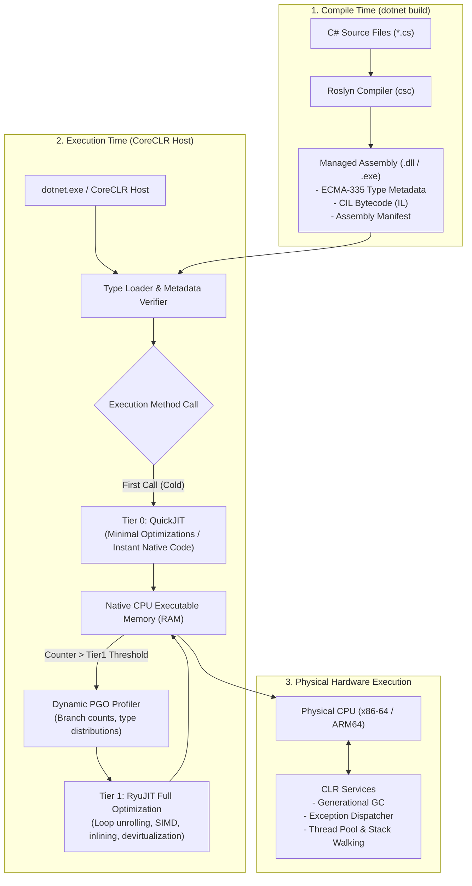

# Lesson 01: How .NET Runs Your Code: CLR, IL and JIT

> **Prerequisites:** [Track 26 Overview](../README.md) and [Low-Level Design Course Index](../../README.md).  
> **Estimated Reading Time:** 18 minutes  
> **Target Audience:** Engineers preparing for LLD, OOP, C#, or Python technical screening and architecture rounds.

> [!TIP]
> **The One Rule of the .NET Runtime:** C# compiles to processor-independent Intermediate Language (IL) stored in PE assemblies; at runtime, the CLR's JIT compiler translates IL into optimized native machine code on a method-by-method basis while providing memory safety, garbage collection, and type verification.

---

## 1. Why This Matters: The Interview Trap

In senior engineering interviews, interviewers frequently open with an innocent architectural question:  
*"What actually happens between the moment you type `dotnet run` or `dotnet build` and your code running on a physical CPU? Is C# compiled or interpreted?"*

Candidates often stumble into one of two traps:
1. **The Native Fallacy:** *"C# compiles to an `.exe` or `.dll` containing native x86/x64 instructions, just like C++ or Go."*
2. **The Pure Interpreter Fallacy:** *"C# runs inside an interpreter or virtual machine line-by-line, just like standard Python."*

Both answers are wrong. C# utilizes a **two-phase compilation architecture**. 

At compile time (`dotnet build`), the Roslyn compiler translates C# source code into **Common Intermediate Language (CIL/IL)** and rich type metadata, packaging them into an ECMA-335 Portable Executable (PE) assembly. 

At runtime (`dotnet run`), the **Common Language Runtime (CoreCLR)** takes ownership: its **Just-In-Time (JIT) compiler (RyuJIT)** translates that intermediate bytecode directly into native processor instructions on demand. Furthermore, modern .NET uses **tiered compilation** and **Dynamic Profile-Guided Optimization (PGO)**, initially generating fast, unoptimized machine code (Tier 0 QuickJIT), then recompiling frequently executed "hot" methods into aggressively vectorized machine code (Tier 1).

### Weak vs. Strong Answer

| Dimension | Weak Answer | Strong Senior Answer |
| :--- | :--- | :--- |
| **Execution Pipeline** | "C# code runs inside the .NET runtime which interprets your classes." | "C# undergoes a two-stage compilation. The Roslyn compiler emits Common Intermediate Language (CIL) and ECMA-335 metadata into a PE file. At execution, the CLR's execution engine loads the assembly, verifies type safety, and RyuJIT compiles method IL into native machine instructions on demand." |
| **JIT vs. AOT** | "JIT is inherently slower than ahead-of-time compiled C++ binaries." | "While JIT incurs a first-call warm-up penalty, modern RyuJIT with dynamic Tiered PGO can outperform static AOT in long-running services. The JIT leverages exact runtime CPU capabilities (AVX-512) and real-world execution profiles to optimize branch prediction and devirtualize calls." |
| **.NET Ecosystem Taxonomy** | ".NET Core is the new name for .NET Framework, and .NET Standard is another version." | ".NET Framework (1.0–4.8.1) is the legacy, Windows-only, monolithic runtime. Modern .NET (.NET 5–10) is a ground-up cross-platform, modular, open-source rewrite. .NET Standard is not an executable runtime; it is a formal API specification (an interface contract) ensuring multi-runtime compatibility." |
| **Managed Memory Scope** | "Managed code means it has no pointers and cannot leak memory." | "Managed code executes under the CLR's execution engine, which guarantees type safety, array bounds checking, and generational garbage collection. However, managed memory can still leak via retained object references, event handlers, and unbounded caches, and unmanaged memory (`Marshal.AllocHGlobal`) bypasses the GC entirely." |

---

## 2. Visual Mental Model / Taxonomic Comparison

### The End-to-End Execution Pipeline



### Architectural Comparison: .NET Runtimes and Alternative Engines

| Metric / Feature | Modern .NET (.NET 8/9/10) | .NET Framework (4.8) | .NET Standard (2.0/2.1) | Native C++ (Clang/MSVC) | CPython (3.11+) |
| :--- | :--- | :--- | :--- | :--- | :--- |
| **Target Platforms** | Cross-platform (Linux, Windows, macOS, Android, iOS) | Windows only | Specification only (N/A) | Cross-platform (recompiled per OS/CPU) | Cross-platform |
| **Execution Architecture** | CIL -> RyuJIT (Tier 0/1) / Native AOT | CIL -> Legacy JIT (CLR 4.0) | API Contract Specification | Machine binary directly | Bytecode interpreted in C evaluation loop |
| **Compilation Model** | Two-stage (Roslyn + JIT) or Ahead-of-Time | Two-stage (Roslyn + JIT) | Compile-time target reference | Single-stage AOT to machine code | Interpreted bytecode (adaptive specialization) |
| **Memory Management** | Generational GC (Gen 0, 1, 2, LOH, POH) | Generational GC (Gen 0, 1, 2, LOH) | Defined by implementing runtime | Manual (`malloc`/`free`, RAII smart pointers) | Reference counting + cyclic garbage collector |
| **Native AOT Support** | Supported (`PublishAot=true`) | No | N/A | Default | No (Requires PyPy or Nuitka) |
| **Primary Use Cases** | Microservices, Cloud APIs, High-throughput web | Legacy enterprise Windows applications | Reusable cross-runtime libraries (legacy) | Embedded, OS kernels, game engines | Data science, scripting, ML orchestration |

---

## 3. Code Implementation

The following carousel demonstrates how the runtime inspects and executes intermediate bytecode, verifies compilation to native code, and interacts between managed garbage-collected memory and unmanaged OS allocations.

````carousel
```csharp
// Slide 1: C# - Inspecting IL, Tiered JIT Execution, and Managed vs Unmanaged Memory
using System;
using System.Reflection;
using System.Runtime.CompilerServices;
using System.Runtime.InteropServices;

public class ExecutionEngineDemo
{
    [MethodImpl(MethodImplOptions.NoInlining)]
    public static int ComputeSum(int a, int b)
    {
        return a + b;
    }
}

public class Program
{
    public static void Main()
    {
        Console.WriteLine("=== 1. Runtime Environment ===");
        string framework = RuntimeInformation.FrameworkDescription;
        string arch = RuntimeInformation.ProcessArchitecture.ToString();
        Console.WriteLine($"Runtime Engine: CLR ({arch})");
        Console.WriteLine($"Framework Description: {framework.Split('+')[0].Trim()}");
        Console.WriteLine("Execution Mode: JIT Tiered Compilation");

        Console.WriteLine("\n=== 2. Intermediate Code & JIT Compilation ===");
        var method = typeof(ExecutionEngineDemo).GetMethod(nameof(ExecutionEngineDemo.ComputeSum))!;
        var body = method.GetMethodBody()!;
        byte[] ilBytes = body.GetILAsByteArray()!;
        
        Console.WriteLine($"Method Name: {method.Name}");
        Console.WriteLine($"Intermediate Code Size: {ilBytes.Length} bytes");
        Console.Write("IL OpCodes (Hex): ");
        foreach (byte b in ilBytes)
        {
            Console.Write($"{b:X2} ");
        }
        Console.WriteLine();

        // RuntimeHelpers forces JIT compilation from IL to native CPU instructions
        RuntimeHelpers.PrepareMethod(method.MethodHandle);
        IntPtr nativeCodePtr = method.MethodHandle.GetFunctionPointer();
        bool isNativeCompiled = nativeCodePtr != IntPtr.Zero;
        Console.WriteLine($"JIT Compiled to Native Machine Code: {isNativeCompiled}");

        Console.WriteLine("\n=== 3. Managed vs Unmanaged Memory ===");
        // Managed memory: allocated on the CLR GC heap, tracked by garbage collection
        string managedObj = "CLR Garbage-Collected String";
        Console.WriteLine($"Managed Object: {managedObj} (GC Tracked: True)");

        // Unmanaged memory: allocated directly on the OS heap via native allocator
        IntPtr unmanagedMemory = Marshal.AllocHGlobal(4);
        try
        {
            Marshal.WriteInt32(unmanagedMemory, 42);
            int value = Marshal.ReadInt32(unmanagedMemory);
            Console.WriteLine($"Unmanaged Memory Allocation: Value = {value} (Manual Free Required)");
        }
        finally
        {
            // Unmanaged memory MUST be explicitly released; GC cannot track it!
            Marshal.FreeHGlobal(unmanagedMemory);
        }
    }
}
```
<!-- slide -->
```python
# Slide 2: Python - Inspecting Bytecode, Virtual Machine Execution, and Memory
import ctypes
import platform
import sys


def compute_sum(a: int, b: int) -> int:
  return a + b


def main():
  print("=== 1. Runtime Environment ===")
  arch = "X64" if sys.maxsize > 2**32 else "X86"
  engine = platform.python_implementation()
  print(f"Runtime Engine: {engine} ({arch})")
  print(f"Framework Description: Python {platform.python_version()}")
  print("Execution Mode: Interpreted Bytecode Loop")

  print("\n=== 2. Intermediate Code & JIT Compilation ===")
  method_name = compute_sum.__name__
  bytecode = compute_sum.__code__.co_code
  print(f"Method Name: {method_name}")
  print(f"Intermediate Code Size: {len(bytecode)} bytes")
  print("Bytecode OpCodes (Hex): " + " ".join(f"{b:02X}" for b in bytecode))

  # Standard CPython does not compile to native machine code; it evaluates bytecode in ceval loop
  is_native_compiled = False
  print(f"JIT Compiled to Native Machine Code: {is_native_compiled}")

  print("\n=== 3. Managed vs Unmanaged Memory ===")
  # Managed memory: allocated on Python's private heap, managed by reference counting + cyclic GC
  managed_obj = "CPython Reference-Counted String"
  print(f"Managed Object: {managed_obj} (GC Tracked: True)")

  # Unmanaged memory: allocated via ctypes buffer simulating raw C memory allocation
  unmanaged_buffer = (ctypes.c_int32 * 1)()
  unmanaged_buffer[0] = 42
  value = unmanaged_buffer[0]
  print(f"Unmanaged Memory Allocation: Value = {value} (Manual Free Required)")


if __name__ == "__main__":
  main()
```
````

**Expected Output (Both Languages):**
```text
=== 1. Runtime Environment ===
Runtime Engine: CLR (X64)
Framework Description: .NET 10.0.11
Execution Mode: JIT Tiered Compilation
(Python: Runtime Engine: CPython (X64) / Execution Mode: Interpreted Bytecode Loop)

=== 2. Intermediate Code & JIT Compilation ===
Method Name: ComputeSum
Intermediate Code Size: 9 bytes
IL OpCodes (Hex): 00 02 03 58 0A 2B 00 06 2A 
JIT Compiled to Native Machine Code: True
(Python: Intermediate Code Size: 10 bytes / JIT Compiled to Native Machine Code: False)

=== 3. Managed vs Unmanaged Memory ===
Managed Object: CLR Garbage-Collected String (GC Tracked: True)
Unmanaged Memory Allocation: Value = 42 (Manual Free Required)
```

---

## 4. Where You Already Use It

- **In ASP.NET Core & Kestrel:**
  - Every HTTP endpoint compiled with Roslyn runs through RyuJIT's **Dynamic PGO** (Profile-Guided Optimization). The runtime counts how often specific routes are executed, inlines frequently used middleware delegates, and devirtualizes interface calls for zero-cost routing.
- **In High-Performance Data Access (Dapper & EF Core):**
  - Dapper dynamically generates IL at runtime using `System.Reflection.Emit.DynamicMethod` to map ADO.NET `IDataReader` columns to C# object properties at native compiled speeds, completely avoiding reflection overhead on every query.
- **In Container Images (ReadyToRun - R2R):**
  - Dockerized .NET microservices can be published with `<PublishReadyToRun>true</PublishReadyToRun>`. This pre-compiles IL into native code ahead of time while embedding the original IL, eliminating JIT cold-start latency when pods scale up in Kubernetes.
- **In Serverless Microservices (Native AOT):**
  - AWS Lambda functions and Azure Functions compiled with `<PublishAot>true</PublishAot>` compile C# directly into an OS-native executable. This achieves sub-15ms cold start times, drops container image sizes to under 30MB, and requires no CLR JIT runtime on the host machine.
- **In Python:**
  - CPython compiles `.py` source files to `.pyc` bytecode files cached in `__pycache__`.
  - Tools like PyPy employ a trace-based JIT compiler to generate machine code for hot loops, whereas CPython 3.11+ introduced a Tier 1 specializing adaptive interpreter.

---

## 5. Pitfalls and When Not to Use It

1. **JIT Cold Start Latency in Serverless Workloads:**
   - Because the JIT compiles methods upon their first invocation, the first request to an API endpoint bears the compilation overhead of hundreds of methods across ASP.NET Core, EF Core, and JSON serializers.
   - *Fix:* Use **ReadyToRun (R2R)** or **Native AOT** for serverless lambdas and CLI utilities where instantaneous invocation is mandatory.

2. **Reflection and Trimming Failures with Native AOT:**
   - Native AOT employs static analysis to remove unused IL from the final binary (trimming). Dynamic reflection calls (e.g., `Type.GetType(dynamicName)` or unconstrained JSON deserializers) break because the trimmer removes classes it cannot prove are referenced at compile time.
   - *Fix:* Use C# Source Generators (such as `System.Text.Json` source generation via `[JsonSerializable]`) which generate strongly typed serialization code at compile time.

3. **Leaking Unmanaged Memory via P/Invoke Interop:**
   - Calling native C/C++ libraries via `[DllImport]` or `[LibraryImport]` passes data across the managed-unmanaged boundary. If native buffers are allocated via `Marshal.AllocHGlobal` or C-library `malloc`, they exist outside the GC's awareness.
   - *Pitfall:* Forgetting to invoke `Marshal.FreeHGlobal` causes silent, permanent process memory leaks that memory profilers tracking the GC heap will never detect. Always encapsulate unmanaged pointers in a `SafeHandle` or `IDisposable` pattern.

4. **Targeting .NET Standard in New Applications:**
   - .NET Standard was created to bridge .NET Framework and .NET Core. Targeting `netstandard2.0` or `netstandard2.1` in modern greenfield libraries locks you out of modern C# language features, modern APIs (such as `Span<T>` optimizations, generic math, and modern crypto), and runtime optimizations.
   - *Rule:* Target `net8.0` or `net9.0` for all modern applications and libraries unless backward compatibility with legacy .NET Framework 4.8 is an explicit business requirement.

---

## 6. Exercises & Practical Drills

### Drill 1: Identifying JIT Optimization and Inlining
Review the following method:
```csharp
[MethodImpl(MethodImplOptions.AggressiveInlining)]
public static int Square(int x) => x * x;

public static int CalculateTotal(int[] numbers)
{
    int total = 0;
    for (int i = 0; i < numbers.Length; i++)
    {
        total += Square(numbers[i]);
    }
    return total;
}
```
What does RyuJIT do to the `Square` method call during Tier 1 compilation?

<details>
<summary>Answer</summary>

**RyuJIT inlines the method body directly into the loop.**  
Instead of setting up a method stack frame (pushing arguments, allocating a stack frame, jumping to `Square`, and returning), the JIT compiler replaces `total += Square(numbers[i]);` with:
```csharp
total += numbers[i] * numbers[i];
```
This eliminates all call-site overhead and allows the JIT compiler's loop vectorizer to employ SIMD registers (AVX/SSE) to compute squares for multiple array elements simultaneously.
</details>

### Drill 2: Resolving an AOT Trimming Warning
You compile an ASP.NET Core project with `<PublishAot>true</PublishAot>` and encounter warning:
`IL2026: Using member 'JsonSerializer.Deserialize(string, Type)' which has 'RequiresUnreferencedCodeAttribute' can break functionality when trimming.`
Why does this happen, and what is the proper fix?

<details>
<summary>Answer</summary>

**Why:**  
`JsonSerializer.Deserialize(string, Type)` uses runtime reflection to inspect property getters, setters, and constructors of the target type. Because Native AOT trims away metadata and types not explicitly referenced at compile time, the target type's properties may be stripped from the executable, causing serialization to fail at runtime.

**Fix:**  
Use compile-time System.Text.Json Source Generation:
```csharp
[JsonSerializable(typeof(UserProfile))]
public partial class AppJsonSerializerContext : JsonSerializerContext { }

// Deserialization with compile-time metadata:
var profile = JsonSerializer.Deserialize(jsonString, AppJsonSerializerContext.Default.UserProfile);
```
Source generators inspect types at compile time and emit C# serialization code, ensuring 100% trim safety and zero reflection.
</details>

---

## 7. Interview Questions & Model Answers

> [!interview]
> **Question 1: What is the CLR?**  
> **Strong Answer:**  
> "The CLR (Common Language Runtime) is the execution engine of the .NET platform. It acts as an abstraction layer between compiled .NET assemblies and the underlying operating system and hardware.  
> 
> Its primary responsibilities include:  
> 1. **Code Execution & JIT Compilation:** RyuJIT compiles processor-agnostic Common Intermediate Language (CIL) into native CPU instructions on demand using tiered compilation.  
> 2. **Memory Management:** The CLR provides automatic, generational garbage collection (allocating and reclaiming memory across Gen 0, Gen 1, Gen 2, the Large Object Heap, and the Pinned Object Heap).  
> 3. **Type Safety & Metadata Verification:** It validates ECMA-335 assembly metadata to ensure memory bounds, type safety, and access permissions before code executes.  
> 4. **Exception Handling & Thread Management:** It manages structured exception handling across language boundaries and schedules asynchronous tasks across an optimized OS thread pool.  
> 
> In modern .NET, the runtime is packaged as CoreCLR, which is modular, cross-platform, and fully open-source."

> [!interview]
> **Question 2: What is IL, and what does the JIT do?**  
> **Strong Answer:**  
> "IL (Intermediate Language), formally known as Common Intermediate Language (CIL) under ECMA-335, is a CPU-independent, stack-based bytecode emitted by .NET compilers like Roslyn when compiling C#, F#, or VB.NET. It contains instructions for loading values, arithmetic operations, object instantiations, and method dispatch.  
> 
> The JIT (Just-In-Time) compiler is the component of the CLR that converts this intermediate IL bytecode into physical machine code (x86, x64, or ARM64) at execution time. Rather than compiling an entire application at startup, JIT compiles individual methods on demand when they are first called.  
> 
> In modern .NET, RyuJIT uses **Tiered Compilation**:  
> - **Tier 0 (QuickJIT):** Compiles code with minimal optimizations to achieve near-instantaneous startup.  
> - **Tier 1:** If a method is called repeatedly (surpassing execution thresholds), RyuJIT recompiles it using advanced optimizations like aggressive method inlining, loop unrolling, SIMD vectorization, and Profile-Guided Optimization (PGO) derived from real-world runtime metrics."

> [!interview]
> **Question 3: What is the difference between .NET and .NET Framework?**  
> **Strong Answer:**  
> "The core differences span architecture, platform support, deployment, and performance:  
> 
> 1. **Platform Support:** .NET Framework (versions 1.0 through 4.8.1) is Windows-only and deeply integrated into the Windows OS. Modern .NET (formerly .NET Core, covering .NET 5 through .NET 10) is a completely redesigned cross-platform runtime running natively on Linux, macOS, Windows, and mobile platforms.  
> 2. **Installation & Deployment:** .NET Framework is an OS-level, machine-wide installation; upgrading it affects every application on the machine. Modern .NET supports self-contained deployments, where the application and its specific runtime version are bundled into a single folder or executable, eliminating machine-wide version conflicts.  
> 3. **Performance & Architecture:** Modern .NET is open-source, modular, and optimized for high-throughput cloud workloads. It features hardware-accelerated vectorization, `Span<T>` memory slicing, tiered JIT compilation, and Native AOT compilation, yielding orders of magnitude higher throughput than legacy .NET Framework.  
> 4. **Status:** .NET Framework 4.8.1 is in maintenance mode (serviced only for security and OS fixes), whereas modern .NET receives major feature, performance, and language releases every year."

> [!interview]
> **Question 4: What is managed code?**  
> **Strong Answer:**  
> "Managed code is code whose execution is strictly supervised and governed by the Common Language Runtime (CLR).  
> 
> When you write managed code in C#, it compiles to IL and type metadata. When executed, the CLR provides a managed execution environment that enforces:  
> 1. **Automatic Garbage Collection:** You allocate objects using `new`, but you never manually release memory. The GC tracks reference graphs and reclaims unreferenced objects.  
> 2. **Type Safety and Bounds Checking:** The CLR prevents buffer overflows, uninitialized pointer reads, and invalid memory casts by verifying metadata and enforcing array bounds.  
> 3. **Structured Exception Handling:** Exceptions propagate through stack frames safely, ensuring finally blocks execute and thread states remain coherent.  
> 
> In contrast, **unmanaged code** (such as standard C, C++, or raw assembly) compiles directly to machine instructions, executes directly on the operating system, and requires manual memory allocation (`malloc`/`free`) and manual pointer arithmetic without safety nets. C# can interoperate with unmanaged code via P/Invoke (`[LibraryImport]`) or inside `unsafe` blocks."

---

## 8. Sources & Further Reading

- [Microsoft Learn: Common Language Runtime (CLR) Overview](https://learn.microsoft.com/en-us/dotnet/standard/clr)
- [Microsoft Learn: Managed Execution Process](https://learn.microsoft.com/en-us/dotnet/standard/managed-execution-process)
- [Microsoft Learn: Tiered Compilation in .NET](https://learn.microsoft.com/en-us/dotnet/core/whats-new/dotnet-core-3-0#tiered-compilation)
- [Microsoft Learn: Native AOT Deployment](https://learn.microsoft.com/en-us/dotnet/core/deploying/native-aot/)
- [ECMA International: Standard ECMA-335 (Common Language Infrastructure)](https://www.ecma-international.org/publications-and-standards/standards/ecma-335/)

---

Track overview: [Track 26: C# and .NET Interview Questions](../README.md) · Next: [Value and Reference Types, Structs and Records](../02-value-and-reference-types-structs-records/README.md)
