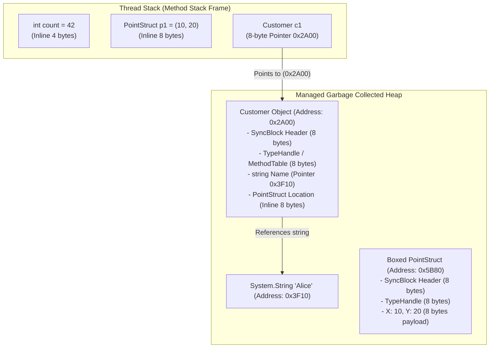

# Lesson 02: Value and Reference Types, Structs and Records

> **Prerequisites:** [How .NET Runs Your Code: CLR, IL and JIT](../01-how-dotnet-runs-your-code/README.md) and [Track 26 Overview](../README.md).  
> **Estimated Reading Time:** 18 minutes  
> **Target Audience:** Engineers preparing for LLD, OOP, C#, or Python technical screening and architecture rounds.

> [!NOTE]
> **In one line:** **Value types** (struct, enum) are copied on assignment; **reference types** (class, record) share one object — `record` gives value *equality* while remaining a reference type, and `?` means nullable.

> [!TIP]
> **The One Rule of Types in .NET:** Value types (`struct`) model *values* (identity is their content, copied on assignment, allocated inline wherever declared); reference types (`class`) model *entities with identity and mutable lifecycle* (allocated on the managed heap, copied by 64-bit reference pointer); records (`record class`, `record struct`) synthesize compiler-generated value semantics, immutability (`init`), and nondestructive mutation (`with`).

---

## 1. Why This Matters: The Interview Trap

The classic interview opener sounds deceptively simple:  
*"Where do value types live, and where do reference types live?"*

Nine out of ten candidates instantly blurt out:  
*"Value types live on the stack, and reference types live on the heap."*

**This is the interview trap.** It is demonstrably false and tells the interviewer you memorized a half-truth from a blog post without understanding the Common Language Runtime (CLR) memory model:

1. **A `struct` declared as a field inside a `class` lives on the managed heap**, directly embedded inside the heap object's memory footprint.
2. **A `struct` inside an array (`int[]` or `MyStruct[]`) lives on the managed heap**, because arrays are reference types.
3. **A `struct` captured by a lambda closure or an `async` state machine is lifted to a compiler-generated class on the managed heap.**
4. **Only local value type variables inside a synchronous method that are not captured live on the thread stack.**

### Weak vs. Strong Answer

| Dimension | Weak Answer | Strong Senior Answer |
| :--- | :--- | :--- |
| **Storage Location** | "Value types are on the stack, reference types are on the heap." | "Storage depends on **context of declaration**, not the type alone. Reference types are *always* allocated on the managed heap. Value types are allocated **inline wherever declared**: on the thread stack if they are uncaptured local variables, or embedded inside heap objects if they are fields of a class, elements of an array, or captured in a closure." |
| **Copy Semantics** | "Value types copy data, reference types copy pointers." | "Assignment of a value type performs a bitwise copy of its fields (by-value). Assignment of a reference type copies only the memory address (pointer) referencing the object on the heap; both references mutate the exact same object." |
| **GC Impact** | "Structs are faster because they skip garbage collection." | "Value types eliminate heap allocation overhead and Garbage Collector (GC) tracking. However, passing large structs (> 16-24 bytes) incurs severe copy overhead unless passed with `in` or `ref readonly`. If a struct is assigned to an `object` or interface, it undergoes **boxing**, allocating on the heap anyway and worsening GC pressure." |

---

## 2. Visual Mental Model / Taxonomic Comparison

### Memory Layout: Stack vs. Heap Allocation



### Type Taxonomy: Struct vs. Class vs. Record

| Feature | `class` | `struct` | `readonly struct` | `record class` | `record struct` |
| :--- | :--- | :--- | :--- | :--- | :--- |
| **Kind** | Reference type | Value type | Value type | Reference type | Value type |
| **Memory Location** | Heap | Inline (Stack or Heap) | Inline | Heap | Inline |
| **Default Equality** | Reference equality (`object.ReferenceEquals`) | Value equality (reflection-based `ValueType.Equals`) | Value equality | Synthesized value equality | Synthesized value equality |
| **Assignment** | Pointer copy (shared state) | Full bitwise copy of all fields | Full bitwise copy | Pointer copy | Full bitwise copy |
| **Inheritance** | Single class inheritance | Interfaces only | Interfaces only | Single record inheritance | Interfaces only |
| **`with` Expressions** | No (unless record) | C# 10+ (`with` copy) | C# 10+ (`with` copy) | Yes (nondestructive mutation) | Yes (nondestructive mutation) |
| **GC Pressure** | Generates GC churn on alloc | Zero GC pressure (unless boxed) | Zero GC pressure | Generates GC churn | Zero GC pressure |
| **Best Used For** | Domain entities, services, mutable lifecycles | Small primitives <= 16 bytes, high throughput | Small immutable primitives (vectors, coordinates) | Immutable DTOs, API contracts, domain events | High-frequency small DTOs, zero-alloc values |

---

## 3. Code Implementation

The following carousel compares C# memory semantics (struct copy, records with `with` expressions, boxing, and nullable annotations) with Python's object model (`dataclass(frozen=True)`, reference assignment, and `Optional`).

````carousel
```csharp
// Slide 1: C# - Value Types, Structs, Records, Boxing, and Nullability
using System;

// 1. MUTABLE STRUCT VS CLASS COPY SEMANTICS
public struct PointStruct
{
    public int X;
    public int Y;
    public PointStruct(int x, int y) { X = x; Y = y; }
}

public class PointClass
{
    public int X { get; set; }
    public int Y { get; set; }
    public PointClass(int x, int y) { X = x; Y = y; }
}

// 2. RECORD CLASS VS RECORD STRUCT
public record class MoneyRecord(decimal Amount, string Currency);
public readonly record struct GeoLocation(double Latitude, double Longitude);

public class Program
{
    public static void Main()
    {
        Console.WriteLine("=== 1. Copy Semantics: Struct vs Class ===");
        var s1 = new PointStruct(10, 20);
        var s2 = s1; // Bitwise deep copy of value
        s2.X = 99;
        Console.WriteLine($"Struct s1.X: {s1.X}, s2.X: {s2.X}"); // s1 remains 10

        var c1 = new PointClass(10, 20);
        var c2 = c1; // Reference copy (points to same heap object)
        c2.X = 99;
        Console.WriteLine($"Class c1.X: {c1.X}, c2.X: {c2.X}");   // c1 changed to 99

        Console.WriteLine("\n=== 2. Record Equality and 'with' Mutation ===");
        var m1 = new MoneyRecord(100.00m, "USD");
        var m2 = new MoneyRecord(100.00m, "USD");
        var m3 = m1 with { Amount = 250.00m }; // Nondestructive copy

        Console.WriteLine($"m1 == m2 (Value Equality): {m1 == m2}"); // True
        Console.WriteLine($"ReferenceEquals(m1, m2): {ReferenceEquals(m1, m2)}"); // False
        Console.WriteLine($"m3 with new amount: {m3.Amount} {m3.Currency}");

        var geo1 = new GeoLocation(37.7749, -122.4194);
        var geo2 = geo1 with { Latitude = 40.7128 }; // Stack-allocated struct mutation
        Console.WriteLine($"geo1 Lat: {geo1.Latitude}, geo2 Lat: {geo2.Latitude}");

        Console.WriteLine("\n=== 3. Boxing and Unboxing ===");
        int rawVal = 42;
        object boxed = rawVal;           // Boxing: allocates heap object wrapper
        int unboxed = (int)boxed;        // Unboxing: extracts value from heap
        Console.WriteLine($"Unboxed: {unboxed}, Type: {boxed.GetType().Name}");

        Console.WriteLine("\n=== 4. Nullable Types (Value vs Reference) ===");
        // Nullable Value Type: Nullable<int> struct wrapping int + bool HasValue
        int? nullableInt = null;
        Console.WriteLine($"nullableInt has value: {nullableInt.HasValue}");
        nullableInt = 100;
        Console.WriteLine($"nullableInt value: {nullableInt.GetValueOrDefault()}");

        // Nullable Reference Type: compile-time static flow analysis annotation
        #nullable enable
        string nonNullString = "Immutable";
        string? nullableString = null;
        Console.WriteLine($"nonNullString length: {nonNullString.Length}");
        Console.WriteLine($"nullableString length safely: {nullableString?.Length ?? 0}");
    }
}
```
<!-- slide -->
```python
# Slide 2: Python - Reference Semantics, Dataclasses, and Optional Types
from dataclasses import dataclass, replace
from typing import Optional


# 1. PYTHON CLASSES ARE ALWAYS REFERENCE TYPES
class PointClass:

  def __init__(self, x: int, y: int):
    self.x = x
    self.y = y


# In Python, everything is a heap-allocated PyObject*.
# To simulate value-like copy semantics, we must explicitly copy.
import copy


# 2. EQUIVALENT TO C# RECORDS: Frozen Dataclasses
@dataclass(frozen=True)
class MoneyRecord:
  amount: float
  currency: str


@dataclass(frozen=True)
class GeoLocation:
  latitude: float
  longitude: float


def main():
  print("=== 1. Copy Semantics: Struct vs Class ===")
  # Simulated struct copy using deepcopy
  s1 = PointClass(10, 20)
  s2 = copy.deepcopy(s1)  # Explicit copy simulates struct value copy
  s2.x = 99
  print(f"Struct s1.X: {s1.x}, s2.X: {s2.x}")

  # Default reference semantics
  c1 = PointClass(10, 20)
  c2 = c1  # Reference copy
  c2.x = 99
  print(f"Class c1.X: {c1.x}, c2.X: {c2.x}")

  print("\n=== 2. Record Equality and 'with' Mutation ===")
  m1 = MoneyRecord(100.00, "USD")
  m2 = MoneyRecord(100.00, "USD")
  # Nondestructive copy equivalent to C# 'with'
  m3 = replace(m1, amount=250.00)

  print(f"m1 == m2 (Value Equality): {m1 == m2}")
  print(f"ReferenceEquals(m1, m2): {m1 is m2}")
  print(f"m3 with new amount: {m3.amount} {m3.currency}")

  geo1 = GeoLocation(37.7749, -122.4194)
  geo2 = replace(geo1, latitude=40.7128)
  print(f"geo1 Lat: {geo1.latitude}, geo2 Lat: {geo2.latitude}")

  print("\n=== 3. Boxing and Unboxing ===")
  # In Python, all primitives (int, float) are ALREADY boxed heap objects
  raw_val = 42
  boxed = raw_val
  unboxed = int(boxed)
  print(f"Unboxed: {unboxed}, Type: {type(boxed).__name__}")

  print("\n=== 4. Nullable Types (Value vs Reference) ===")
  # Python uses None and typing.Optional
  nullable_int: Optional[int] = None
  print(f"nullableInt has value: {nullable_int is not None}")
  nullable_int = 100
  print(f"nullableInt value: {nullable_int if nullable_int is not None else 0}")

  non_null_string: str = "Immutable"
  nullable_string: Optional[str] = None
  print(f"nonNullString length: {len(non_null_string)}")
  print(
      "nullableString length safely:"
      f" {len(nullable_string) if nullable_string else 0}"
  )


if __name__ == "__main__":
  main()
```
````

**Expected Output (Both Languages):**
```text
=== 1. Copy Semantics: Struct vs Class ===
Struct s1.X: 10, s2.X: 99
Class c1.X: 99, c2.X: 99

=== 2. Record Equality and 'with' Mutation ===
m1 == m2 (Value Equality): True
ReferenceEquals(m1, m2): False
m3 with new amount: 250 USD
geo1 Lat: 37.7749, geo2 Lat: 40.7128

=== 3. Boxing and Unboxing ===
Unboxed: 42, Type: Int32
(Python: Type: int)

=== 4. Nullable Types (Value vs Reference) ===
nullableInt has value: False
nullableInt value: 100
nonNullString length: 9
nullableString length safely: 0
```

---

## 4. Where You Already Use It

- **In .NET / C#:**
  - `System.DateTime`, `System.TimeSpan`, `System.Guid`, and `System.Decimal` are all value types (`struct`). They have no identity beyond their data; allocating 1,000,000 dates creates zero heap objects.
  - `Nullable<T>` (`T?` where `T : struct`) is itself a `readonly struct` containing two fields: `private readonly bool hasValue;` and `internal T value;`. It avoids heap allocations entirely.
  - `ValueTask<T>`: A struct alternative to `Task<T>` that avoids heap allocation when an asynchronous operation completes synchronously (e.g., read from cache).
  - Modern ASP.NET Core request/response DTOs: Declared as `public record LoginRequest(string Email, string Password);`, giving automatic value-based equality in unit tests and concise immutability.
  - High-performance memory: `ReadOnlySpan<T>` and `Span<T>` are declared as `ref struct`, ensuring they can *never* escape to the managed heap or be boxed.

- **In Python:**
  - `dataclasses.dataclass(frozen=True)`: Replicates C# records with synthesized `__eq__`, `__hash__`, and `__repr__`.
  - `typing.NamedTuple`: Lightweight tuple subclass offering immutable record-like schemas.
  - `typing.Optional[T]`: Equivalent to nullable reference types in intent, though represented at runtime simply as `Union[T, None]`.

---

## 5. Pitfalls and When Not to Use It

1. **Mutable Structs and Defensive Copies:**
   - When a struct has mutable fields and is stored in a `readonly` field or passed to a method via `in`, the C# compiler silently creates a **defensive copy** before executing any property or method on it. Mutations are applied to the temporary copy and silently discarded!
   - *Rule:* Always declare structs as `readonly struct` unless writing low-level interop buffers.

2. **Accidental Boxing in Loops and Collections:**
   - Storing structs in non-generic collections (e.g., `ArrayList`), calling `ToString()` or `GetType()` on an unconstrained generic struct, or casting to an interface (`IComparable comp = myInt;`) causes **boxing**.
   - If done inside a loop of 1,000,000 iterations, it creates 1,000,000 temporary 24-byte heap objects, triggering Gen 0 GC pauses and tanking throughput.

3. **Large Struct Copy Overhead (The 16-Byte Threshold):**
   - Structs larger than 16 to 24 bytes (e.g., a struct containing 8 `decimal` fields = 128 bytes) cost significantly more to pass into methods by value than a 64-bit reference pointer. Bitwise copying 128 bytes on every method call destroys CPU L1/L2 cache efficiency.
   - *Fix:* Use a `class` or pass the struct using the `in` parameter modifier (`ref readonly`).

4. **Nullable Reference Types (NRT) False Security:**
   - In C# 8+, `string?` vs `string` is a **compiler-only annotation** backed by nullability attributes in IL metadata. At runtime, both are identical CLR pointers. A caller using reflection, deserialization, or `#nullable disable` can still pass `null` to a non-nullable parameter.
   - *Rule:* Never omit defensive argument checks (`ArgumentNullException.ThrowIfNull(arg)`) on public library boundaries solely because NRT is enabled.

---

## 6. Exercises & Practical Drills

### Drill 1: Spot the Boxing Allocation
Review this C# method:
```csharp
public static void LogValues(int count, DateTime timestamp)
{
    Console.WriteLine("Count: {0}, Time: {1}", count, timestamp);
}
```
Does this code cause boxing? If so, why, and how do you eliminate it?

<details>
<summary>Answer</summary>

**Yes, it boxes twice.**  
`Console.WriteLine(string, object, object)` accepts `object` parameters for its format arguments. Because `count` (`int`) and `timestamp` (`DateTime`) are value types, the CLR must allocate two heap objects to box them before calling the method.

**Remediation:**  
Use string interpolation with compile-time interpolated string handlers (C# 10+):
```csharp
Console.WriteLine($"Count: {count}, Time: {timestamp}");
```
The modern interpolated string handler avoids boxing for primitives and types implementing `ISpanFormattable`.
</details>

### Drill 2: Predict the Output of Struct Mutation
What does the following code print, and why?
```csharp
var list = new List<PointStruct> { new PointStruct(1, 2) };
// list[0].X = 10; // Compiler Error: Cannot modify the return value because it is not a variable!

PointStruct pt = list[0];
pt.X = 10;
Console.WriteLine(list[0].X);
```

<details>
<summary>Answer</summary>

It prints `1`.

**Why:**  
`list[0]` invokes the indexer `get_Item(0)`, which returns a **copy** of the struct stored in the internal array. When assigning `pt = list[0]`, `pt` receives another independent copy. Mutating `pt.X = 10` modifies only the local variable on the stack. The value type inside the list's internal array remains unchanged (`X = 1`).
</details>

---

## 7. Interview Questions & Model Answers

<details>
<summary><strong>1. What is the difference between a value type and a reference type? [BASIC]</strong></summary>

In .NET, the distinction lies in memory layout, copy semantics, and lifecycle management.

1. **Copy Semantics:** Value types have value semantics—assigning or passing a value type creates a full bitwise copy of its data. Reference types have identity semantics—assigning or passing copies only an 8-byte pointer (on 64-bit systems), with both references pointing to the exact same object instance on the heap.
2. **Memory Layout:** Reference types are *always* allocated on the managed garbage-collected heap and carry an object header consisting of an 8-byte SyncBlock index and an 8-byte MethodTable pointer. Value types are allocated **inline** wherever declared: directly on the thread stack for uncaptured local variables, or embedded within a heap object if declared as a field of a class or an element of an array.
3. **Garbage Collection:** Value types do not generate GC overhead when their containing context (stack frame or enclosing object) is reclaimed, whereas reference types must be tracked and collected across Gen 0, 1, or 2.

</details>

<details>
<summary><strong>2. When would you use a struct? [SCENARIO]</strong></summary>

You should use a `struct` (specifically a `readonly struct`) when four criteria are met:
1. It logically represents a single, atomic value rather than an entity with changing lifecycle (e.g., `Point`, `Money`, `DateTime`, `ComplexNumber`).
2. It has an instance size of **16 bytes or smaller** (e.g., two or three 32/64-bit primitives). Exceeding 24 bytes causes parameter-passing copy costs to outweigh heap allocation savings.
3. It is **immutable**. Mutable structs cause dangerous bugs with defensive copying and collection indexing.
4. It is created in high volumes where avoiding GC allocations and improving CPU cache locality provides measurable throughput gains.

If the type requires inheritance, holds reference identity, or needs frequent boxing, use a `class` or `record class` instead.

</details>

<details>
<summary><strong>3. What is boxing? [BASIC]</strong></summary>

Boxing is the implicit process of converting a value type to the type `object` or to any interface implemented by that value type.

When a value type is boxed, the CLR allocates a new object on the managed heap, prepends the standard object header (SyncBlock and MethodTable pointer), and copies the raw bytes of the value type into the heap object's payload.

Unboxing is the reverse explicit operation: extracting a pointer to the value type payload from the heap object (checked via type verification) followed by copying the data back to a local value type on the stack.

Boxing carries two major penalties: CPU overhead from memory allocation and copying, and GC pressure from littering short-lived objects across Gen 0. Generics in .NET 2.0 (`List<T>` instead of `ArrayList`) were introduced specifically to eliminate boxing.

</details>

<details>
<summary><strong>4. What is a record, and how is its equality different? [BASIC]</strong></summary>

Introduced in C# 9, a `record` is a reference type (`record class`) or value type (`record struct`, C# 10) where the compiler automatically synthesizes **value-based equality**, formatting (`ToString`), hashing (`GetHashCode`), and non-destructive mutation (`with` expressions).

By default, standard classes use **reference equality**: two distinct instances `c1` and `c2` with identical fields evaluate `c1 == c2` as `false` because their memory addresses differ. In contrast, records override `==`, `!=`, and `Equals()` to compare every declared property by value. If all corresponding properties match, two separate record instances evaluate as equal.

Records are ideal for Data Transfer Objects (DTOs), domain events, and value objects in DDD because they combine positional constructor syntax (`public record Money(decimal Amount, string Currency);`) with immutable `init`-only properties.

</details>

<details>
<summary><strong>5. What does the ? after a type mean? [BASIC]</strong></summary>

The meaning of `?` depends entirely on whether it decorates a value type or a reference type:

1. **On a Value Type (`int?`, `DateTime?`):** It is syntactic sugar for `Nullable<T>`, which is a concrete CLR `struct` containing two fields: `T value` and `bool hasValue`. It allows a value type that normally cannot be null to represent a missing or unassigned state without heap allocation.
2. **On a Reference Type (`string?`, `Customer?`):** Introduced with Nullable Reference Types (NRT) in C# 8, it does **not** alter the underlying CLR type at all. Both `string` and `string?` compile to standard heap references. Instead, it is a **compile-time compiler annotation** instructing the Roslyn analyzer to track nullability via static flow analysis, raising warnings (e.g., CS8602: Dereference of a possibly null reference) when accessing members without null-checking.

In short: on value types, `?` creates a new runtime wrapper struct; on reference types, `?` is pure compile-time static safety analysis.

</details>

<details>
<summary><strong>6. What does this print: `var s = new Point(1,1); var t = s; t.X = 5; Console.WriteLine(s.X);` for a struct vs a class? [TRICKY]</strong></summary>

Struct: `1`, because `t` is a copy. Class: `5`, because both names refer to the same object. This is why mutable structs are discouraged.

</details>

---

## Try it

Run this: Python lists behave like C# reference types, tuples like (immutable) value semantics. Same idea as the C# version; for the .NET run, use the sample in section 2 of the [track hub](../README.md) (`dotnet new web`, paste, `dotnet run`). Draw it in [LLD Studio](/tools/lld-studio/).

```python
a = [1]; b = a; b.append(2)
assert a == [1, 2]                  # shared reference (C# class)
t = (1, 2); u = t
u = u + (3,)
assert t == (1, 2)                  # unchanged (value-like)
```

---

## One-page cheat sheet

```text
struct/enum/int/bool = VALUE (copied)   class/string/array/record = REFERENCE
struct: small (<16B), immutable, no inheritance; `readonly struct` + `in`
record class: reference + value equality + `with` ; record struct: value + equality
Boxing: value -> object (heap alloc, copy); unboxing = cast back (avoid in hot loops)
Nullable value type: int? = Nullable<int> | reference: string? = annotation (NRT)
==  on class = reference (unless overloaded)  |  record/struct == compares fields
default(T): 0/false/null
```

---

## 8. Sources & Further Reading

- [Microsoft Learn: Value types (C# reference)](https://learn.microsoft.com/en-us/dotnet/csharp/language-reference/builtin-types/value-types)
- [Microsoft Learn: Reference types (C# reference)](https://learn.microsoft.com/en-us/dotnet/csharp/language-reference/keywords/reference-types)
- [Microsoft Learn: Structure types (C# reference)](https://learn.microsoft.com/en-us/dotnet/csharp/language-reference/builtin-types/struct)
- [Microsoft Learn: Records (C# reference)](https://learn.microsoft.com/en-us/dotnet/csharp/language-reference/builtin-types/record)
- [Microsoft Learn: Boxing and Unboxing (C# Programming Guide)](https://learn.microsoft.com/en-us/dotnet/csharp/programming-guide/types/boxing-and-unboxing)
- [Microsoft Learn: Nullable value types (C# reference)](https://learn.microsoft.com/en-us/dotnet/csharp/language-reference/builtin-types/nullable-value-types)

---

Previous: [How .NET Runs Your Code: CLR, IL and JIT](../01-how-dotnet-runs-your-code/README.md) · Next: [Strings, Constants and Immutability](../03-strings-constants-and-immutability/README.md)
