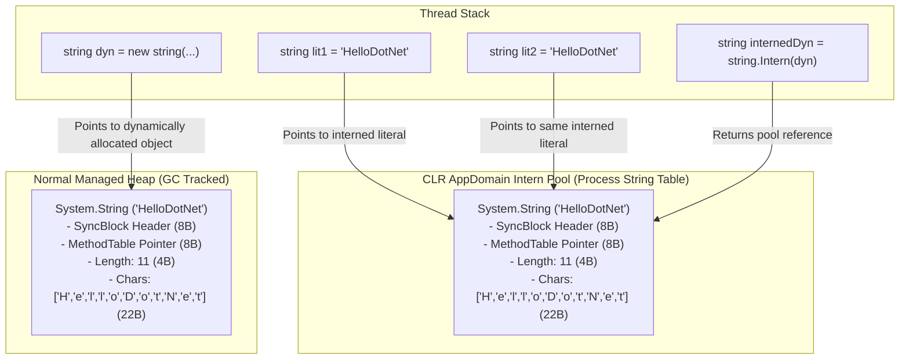

# Lesson 03: Strings, Constants and Immutability

> **Prerequisites:** [Value and Reference Types, Structs and Records](../02-value-and-reference-types-structs-records/README.md) and [Track 26 Overview](../README.md).  
> **Estimated Reading Time:** 18 minutes  
> **Target Audience:** Engineers preparing for LLD, OOP, C#, or Python technical screening and architecture rounds.

> [!NOTE]
> **In one line:** C# `string` is **immutable** (every "change" allocates a new string), so loops need `StringBuilder`; `const` is a compile-time literal while `readonly` is set at run time once.

> [!TIP]
> **The One Rule of Strings and Constants:** Strings in .NET are immutable reference types with value semantics, managed in an interned process-wide string pool; `const` values are baked directly into referencing call-sites at compile-time across assemblies, whereas `readonly` fields are evaluated dynamically at runtime and fixed for the object or type's lifecycle.

---

## 1. Why This Matters: The Interview Trap

Two deceptively simple questions reveal whether an engineer understands memory layouts and runtime binary contracts or merely writes syntax:

1. *"Why are strings immutable in C#, and what happens under the hood when you concatenate strings in a loop?"*
2. *"If you change a `public const int MaxRetries = 3;` to `5` in a shared NuGet library and deploy only that updated DLL without recompiling calling services, what happens?"*

Candidates often answer:
- *"Strings are immutable just so programmers can't accidentally mutate them."*
- *"The calling services will automatically pick up the new constant value 5 when the DLL loads."*

**Both answers fail the interview.**

Strings are immutable in .NET because immutability enables **thread-safety without locks**, guarantees **hash code stability** when strings serve as dictionary keys, permits **memory deduplication via string interning**, and ensures **security integrity** (preventing an attacker from altering a validated file path or SQL connection string).

Meanwhile, `const` fields are evaluated **at compile time**. The C# compiler (Roslyn) inlines literal `const` values directly into the calling assembly's CIL bytecode instructions (`ldc.i4.3`). If you swap the library DLL at runtime without recompiling dependent client assemblies, those clients continue executing with the old baked-in literal `3`! This is known as the **binary versioning hazard**.

### Weak vs. Strong Answer

| Dimension | Weak Answer | Strong Senior Answer |
| :--- | :--- | :--- |
| **String Immutability** | "Strings are immutable so methods don't change values unexpectedly." | "Immutability provides four architectural guarantees: **Thread Safety** (free concurrent reads across threads without synchronization), **Hash Stability** (cached hash codes never change, preventing lost keys in `Dictionary<string, T>`), **Memory Efficiency** (the CLR interning pool shares a single instance across identical literals), and **Security** (validated connection strings or authorization tokens cannot be mutated via aliasing)." |
| **`StringBuilder` vs Concatenation** | "Always use `StringBuilder` because the `+` operator is slow." | "Use `+` or interpolation for small, known quantities of strings (e.g., 3-4 parts); Roslyn optimizes this into a single `string.Concat` call or uses C# 10's zero-allocation `DefaultInterpolatedStringHandler`. Use `StringBuilder` when concatenating inside **unbounded loops** or building dynamic payloads, avoiding $O(N^2)$ memory churn caused by allocating intermediate heap strings." |
| **`const` vs `readonly`** | "`const` is for primitives, while `readonly` is for objects." | "`const` is a compile-time constant baked directly into referencing call-sites as literal IL; changing it requires recompiling all dependent assemblies. `readonly` (or `static readonly`) is evaluated at runtime during object or type initialization, stored in memory, and referenced by address, making it safe for cross-assembly versioning." |
| **`string` vs `String`** | "`string` is a primitive value type, whereas `String` is a reference class." | "`string` is simply a C# language keyword alias for the CLR type `System.String`. They emit identical CIL instructions. Both represent the same reference type allocated on the managed heap." |

---

## 2. Visual Mental Model / Taxonomic Comparison

### Memory Layout: String Intern Pool and Immutability



### Taxonomic Comparison: `const` vs `readonly` vs `static readonly` vs `init`

| Feature | `const` | `readonly` | `static readonly` | `init` property |
| :--- | :--- | :--- | :--- | :--- |
| **Evaluation Time** | Compile time | Runtime (instance construction) | Runtime (type initializer / `cctor`) | Runtime (object initialization) |
| **Memory Allocation** | None (inlined into IL) | Allocated in object instance payload | Allocated in type MethodTable / static block | Allocated in object instance payload |
| **Allowed Types** | Built-in primitives, enums, strings, null | Any type (primitives, structs, classes) | Any type | Any type |
| **Scope of Value** | Globally identical across all instances | Can vary per instance of the class | Globally identical across all instances | Can vary per instance of the class |
| **Assembly Versioning** | **Unsafe** (requires client recompile) | **Safe** (read dynamically at runtime) | **Safe** (read dynamically at runtime) | **Safe** |
| **Mutation Window** | Never | Constructor only (`.ctor`) | Static constructor only (`.cctor`) | Constructor or object initializer |

### String Comparison Matrix: Performance and Security

| Comparison Mode | Sensitivity | Speed | Use Case | Security Note |
| :--- | :--- | :--- | :--- | :--- |
| `StringComparison.Ordinal` | Exact byte comparison | **Fastest** | Internal hash maps, GUIDs, tokens, protocol identifiers | Safest for security tokens and internal routing |
| `StringComparison.OrdinalIgnoreCase` | Byte comparison with ASCII case-folding | **Very Fast** | Case-insensitive URLs, file paths, header keys | Standard choice for HTTP headers and file lookups |
| `StringComparison.InvariantCulture` | Linguistically invariant rules | Moderate | Persisted data displayed across multiple locales | Do not use for file paths (can produce unexpected ligatures) |
| `StringComparison.CurrentCulture` | Host OS user culture / locale | **Slowest** | UI sorting, human-facing textual lists | **Never use for security or paths** (e.g., Turkish 'i' trap) |

---

## 3. Code Implementation

The following carousel contrasts C# string immutability, interning, `StringBuilder`, and constant declarations with Python's string handling (`sys.intern`, list joining, and `typing.Final`).

````carousel
```csharp
// Slide 1: C# - Immutability, String Interning, StringBuilder, and Constant Types
using System;
using System.Text;

public class ConstantsDemo
{
    // 1. COMPILE-TIME CONSTANT: Inlined into calling CIL at compile time
    public const string CompileTimeConstant = "ALPHA_CONFIG";

    // 2. STATIC READONLY: Evaluated once at runtime when type is loaded; safe across assemblies
    public static readonly string RuntimeStaticReadOnly = "CONFIG_" + DateTime.UtcNow.Year;

    // 3. INSTANCE READONLY: Set during constructor invocation per instance
    public readonly string InstanceReadOnly;

    public ConstantsDemo(string env)
    {
        InstanceReadOnly = env;
    }
}

public class Program
{
    public static void Main()
    {
        Console.WriteLine("=== 1. String Immutability and Identity ===");
        string original = "Backend";
        // Concatenation does NOT mutate original; it creates a brand new string on the heap
        string modified = original + " Roadmap";
        Console.WriteLine($"original: '{original}'");
        Console.WriteLine($"modified: '{modified}'");
        Console.WriteLine($"ReferenceEquals(original, modified): {ReferenceEquals(original, modified)}");

        Console.WriteLine("\n=== 2. String Interning Pool ===");
        string lit1 = "HelloDotNet";
        string lit2 = "HelloDotNet";
        // Dynamically created string allocates new heap memory outside the intern pool
        string dyn = new string(new char[] { 'H', 'e', 'l', 'l', 'o', 'D', 'o', 't', 'N', 'e', 't' });

        Console.WriteLine($"Literal 1 == Literal 2: {lit1 == lit2} (Same Ref: {ReferenceEquals(lit1, lit2)})");
        Console.WriteLine($"Dynamic == Literal 1: {dyn == lit1} (Same Ref: {ReferenceEquals(dyn, lit1)})");
        
        // Explicitly retrieve or add string to the CLR process-wide intern pool
        string internedDyn = string.Intern(dyn);
        Console.WriteLine($"Interned Dynamic Same Ref: {ReferenceEquals(internedDyn, lit1)}");

        Console.WriteLine("\n=== 3. Efficient Concatenation: StringBuilder ===");
        // Pre-allocating capacity avoids internal array reallocation churn
        var sb = new StringBuilder(64);
        sb.Append("Iterative");
        sb.Append(" Data ");
        sb.Append(2026);
        string built = sb.ToString();
        Console.WriteLine($"Built String: '{built}'");

        Console.WriteLine("\n=== 4. Const vs Static Readonly ===");
        Console.WriteLine($"Const: {ConstantsDemo.CompileTimeConstant}");
        Console.WriteLine($"Static Readonly: {ConstantsDemo.RuntimeStaticReadOnly.Substring(0, 7)}****");
        var inst = new ConstantsDemo("Production");
        Console.WriteLine($"Instance Readonly: {inst.InstanceReadOnly}");

        Console.WriteLine("\n=== 5. String Comparisons: Ordinal vs Culture ===");
        string file1 = "FILE.TXT";
        string file2 = "file.txt";
        // Ordinal comparison avoids cultural linguistic table lookups and performs raw char comparisons
        bool ordinalMatch = string.Equals(file1, file2, StringComparison.OrdinalIgnoreCase);
        Console.WriteLine($"Ordinal Ignore Case Match: {ordinalMatch}");
    }
}
```
<!-- slide -->
```python
# Slide 2: Python - String Immutability, sys.intern, List Joining, and typing.Final
from datetime import datetime
import sys
from typing import Final


class ConstantsDemo:
  # 1. CONSTANT ANNOTATION: Python has no compile-time inlining; Final informs mypy/linters
  COMPILE_TIME_CONSTANT: Final[str] = "ALPHA_CONFIG"

  # 2. CLASS ATTRIBUTE: Evaluated once at module load time
  RUNTIME_STATIC_READONLY: Final[str] = f"CONFIG_{datetime.now().year}"

  def __init__(self, env: str):
    # 3. INSTANCE ATTRIBUTE: Initialized in constructor
    self._instance_readonly: Final[str] = env

  @property
  def instance_readonly(self) -> str:
    return self._instance_readonly


def main():
  print("=== 1. String Immutability and Identity ===")
  original = "Backend"
  modified = original + " Roadmap"
  print(f"original: '{original}'")
  print(f"modified: '{modified}'")
  print(f"ReferenceEquals(original, modified): {original is modified}")

  print("\n=== 2. String Interning Pool ===")
  lit1 = "HelloDotNet"
  lit2 = "HelloDotNet"
  # Construct dynamic string bypassing CPython literal interning
  dyn_non_interned = str(bytearray(b"HelloDotNet").decode("utf-8"))

  print(f"Literal 1 == Literal 2: {lit1 == lit2} (Same Ref: {lit1 is lit2})")
  print(
      f"Dynamic == Literal 1: {dyn_non_interned == lit1} (Same Ref:"
      f" {dyn_non_interned is lit1})"
  )

  # Python explicit string interning via sys.intern
  interned_dyn = sys.intern(dyn_non_interned)
  print(f"Interned Dynamic Same Ref: {interned_dyn is lit1}")

  print("\n=== 3. Efficient Concatenation: StringBuilder ===")
  # In Python, appending to a list and calling ''.join() is the idiomatic StringBuilder equivalent
  buffer = []
  buffer.append("Iterative")
  buffer.append(" Data ")
  buffer.append(str(2026))
  built = "".join(buffer)
  print(f"Built String: '{built}'")

  print("\n=== 4. Const vs Static Readonly ===")
  print(f"Const: {ConstantsDemo.COMPILE_TIME_CONSTANT}")
  print(f"Static Readonly: {ConstantsDemo.RUNTIME_STATIC_READONLY[:7]}****")
  inst = ConstantsDemo("Production")
  print(f"Instance Readonly: {inst.instance_readonly}")

  print("\n=== 5. String Comparisons: Ordinal vs Culture ===")
  file1 = "FILE.TXT"
  file2 = "file.txt"
  # casefold() provides Unicode-standard case-insensitive matching
  ordinal_match = file1.casefold() == file2.casefold()
  print(f"Ordinal Ignore Case Match: {ordinal_match}")


if __name__ == "__main__":
  main()
```
````

**Expected Output (Both Languages):**
```text
=== 1. String Immutability and Identity ===
original: 'Backend'
modified: 'Backend Roadmap'
ReferenceEquals(original, modified): False

=== 2. String Interning Pool ===
Literal 1 == Literal 2: True (Same Ref: True)
Dynamic == Literal 1: True (Same Ref: False)
Interned Dynamic Same Ref: True

=== 3. Efficient Concatenation: StringBuilder ===
Built String: 'Iterative Data 2026'

=== 4. Const vs Static Readonly ===
Const: ALPHA_CONFIG
Static Readonly: CONFIG_****
Instance Readonly: Production

=== 5. String Comparisons: Ordinal vs Culture ===
Ordinal Ignore Case Match: True
```

---

## 4. Where You Already Use It

- **In ASP.NET Core Routing and Headers:**
  - Kestrel matches route templates, query strings, and HTTP request headers using `StringComparison.OrdinalIgnoreCase`. Ordinal comparisons eliminate culture table lookups, preventing CPU spikes and avoiding security bypasses.
- **In C# 10 Interpolated String Handlers:**
  - In modern C#, `$"User: {user.Id}, Total: {total:C}"` does not invoke `string.Format` or box value types. The compiler routes the call to `DefaultInterpolatedStringHandler`, a `ref struct` that appends characters directly into a stack-allocated buffer, allocating a single string on the heap only at completion.
- **In JSON Serializers (`System.Text.Json`):**
  - High-performance serializers use `JsonEncodedText` and `ReadOnlySpan<byte>` with pre-computed UTF-8 byte arrays for property names, avoiding string allocation and interning completely during serialization.
- **In Python:**
  - Python dictionaries use string hashing for key lookups. Python automatically interns short strings and valid Python identifiers at compile time so that dictionary lookups can use ultra-fast pointer comparisons (`is`) before falling back to full string byte comparisons.

---

## 5. Pitfalls and When Not to Use It

1. **The `const` Binary Versioning Breaking Change:**
   - Defining a `public const string ApiVersion = "v1";` in a shared NuGet library bakes the literal `"v1"` into the CIL of all consuming assemblies. If you update the library to `"v2"` and deploy only the new DLL to production, existing consumers will still use `"v1"`.
   - *Rule:* Never expose `public const` across assembly boundaries. Use `public static readonly string ApiVersion = "v2";` so the value is resolved dynamically from the assembly at runtime.

2. **The Quadratic String Concatenation Loop:**
   - Writing `string result = ""; foreach(var item in list) result += item;` causes $O(N^2)$ memory allocations. For a loop of 10,000 iterations, this allocates approximately 50 MB of transient heap memory, saturating Gen 0 GC.
   - *Fix:* Use `StringBuilder` with an estimated capacity or `string.Join`.

3. **Memory Leaks via Unchecked `string.Intern()`:**
   - Interned strings are placed into a process-wide native lookup table in the CLR. Strings in the intern pool **are never collected by the Garbage Collector**; they persist for the lifetime of the process.
   - *Pitfall:* Interning unbounded user input (e.g., dynamically generated customer UUIDs or request IDs) causes a permanent process memory leak. Only intern small, bounded sets of repeatedly occurring strings.

4. **Security Vulnerabilities with Culture-Sensitive String Comparisons:**
   - Comparing file extensions or permission strings with `str.ToLower() == ".jpg"` or `string.Equals(a, b)` without specifying `StringComparison.OrdinalIgnoreCase` uses `CurrentCulture`. In Turkish (tr-TR), the uppercase `I` converts to `ı` (dotless lowercase i) rather than `i`, causing authentication or file extension checks to fail or be bypassed.
   - *Rule:* Always specify `StringComparison.Ordinal` or `StringComparison.OrdinalIgnoreCase` for programmatic, non-human-facing data (paths, URLs, JSON keys, tokens).

---

## 6. Exercises & Practical Drills

### Drill 1: The Assembly Versioning Hazard
Consider two assemblies:
```csharp
// Assembly: SharedConfig.dll
public class AppLimits
{
    public const int MaxConnections = 100;
    public static readonly int TimeoutSeconds = 30;
}

// Assembly: OrderService.dll (references SharedConfig.dll)
public class Worker
{
    public void Run() => Console.WriteLine($"{AppLimits.MaxConnections}:{AppLimits.TimeoutSeconds}");
}
```
If you change `MaxConnections = 200` and `TimeoutSeconds = 60` in `SharedConfig.dll`, recompile only `SharedConfig.dll`, and replace the DLL in the bin folder of `OrderService.dll`, what does `Worker.Run()` print?

<details>
<summary>Answer</summary>

It prints **`100:60`**.

**Why:**  
`MaxConnections` is a `const`. The compiler inlines the literal constant `100` into the CIL instructions of `OrderService.dll` during its compilation. Replacing `SharedConfig.dll` has no effect on `OrderService` because `OrderService` never queries the DLL for `MaxConnections` at runtime.  

In contrast, `TimeoutSeconds` is `static readonly`. The CIL in `OrderService` loads the value via `ldsfld AppLimits.TimeoutSeconds`, reading the live static field from `SharedConfig.dll` upon execution and picking up the updated value `60`.
</details>

### Drill 2: Comparing `string.Empty` vs `""`
Is there any runtime performance or memory difference between `string.Empty` and `""` in modern .NET?

<details>
<summary>Answer</summary>

**No functional or memory difference.**  
The empty string literal `""` is interned by the CLR at startup, and `string.Empty` simply points to that exact same interned empty string instance on the managed heap (`ReferenceEquals(string.Empty, "") == true`).  

However, `string.Empty` is often preferred in team style guides because it conveys clear programmer intent and avoids confusion with accidentally typing a space `" "`. In `const` declarations, only `""` is valid because `string.Empty` is a `static readonly` field, not a compile-time constant.
</details>

---

## 7. Interview Questions & Model Answers

<details>
<summary><strong>1. Why are strings immutable in C#? [BASIC]</strong></summary>

Strings are immutable in C# for four fundamental architectural reasons:

1. **Thread Safety:** Because a string's internal character array cannot be modified after construction, strings can be shared across multiple threads without locking, synchronization primitives, or race conditions.
2. **Hash Code Stability & Collection Integrity:** Strings are the most common keys in hash-based collections (`Dictionary<string, T>` and `HashSet<string>`). Because strings are immutable, their hash code is guaranteed never to change during the object's lifetime. If strings were mutable, altering a string after adding it to a dictionary would corrupt internal hash buckets, making the entry unretrievable.
3. **Memory Optimization via String Interning:** Immutability enables the CLR to maintain a process-wide String Intern Pool. Identical string literals across different classes or assemblies share the exact same heap memory address, saving substantial RAM.
4. **Security Integrity:** Critical system components—such as database connection strings, file paths, security tokens, and reflection identifiers—are passed as strings. If strings were mutable, an attacker could pass a security validation check and subsequently alter the string in another thread before execution (a Time-of-Check to Time-of-Use vulnerability).

</details>

<details>
<summary><strong>2. When should you use `StringBuilder`? [SCENARIO]</strong></summary>

You should use `StringBuilder` when you are concatenating strings in an **unbounded loop**, when the number of string operations is unknown at compile time, or when building large, dynamic text documents (such as CSV or XML exports).

In contrast, you should **not** use `StringBuilder` for simple concatenations of 2 to 4 strings (e.g., `var full = first + " " + last;`). The C# compiler optimizes simple concatenations into a single call to `string.Concat` which calculates the exact required buffer size and allocates the string on the heap once. Using a `StringBuilder` for small concatenations incurs unnecessary object allocations (the `StringBuilder` instance and its internal buffer).

When you do use `StringBuilder`, always specify an initial capacity (e.g., `new StringBuilder(1024)`) if the final size is predictable. Otherwise, `StringBuilder` must repeatedly allocate larger internal arrays and copy contents as it grows.

</details>

<details>
<summary><strong>3. What is the difference between `const` and `readonly`? [BASIC]</strong></summary>

The differences between `const` and `readonly` revolve around evaluation time, memory allocation, and binary versioning:

1. **Evaluation & Inlining:** `const` fields are evaluated at **compile time**. The compiler inlines the literal value directly into the calling assembly's CIL code. `readonly` fields are evaluated at **runtime** (either during instance construction for `readonly` or during static class initialization for `static readonly`).
2. **Allowed Types:** `const` can only be applied to primitive types (`int`, `double`, `bool`), enums, strings, or `null`. `readonly` can be applied to any C# type, including complex objects, collections, and structs.
3. **Binary Compatibility (The Versioning Trap):** If you define a `public const` in Assembly A and reference it in Assembly B, Assembly B embeds the literal value. If Assembly A is updated and redeployed without recompiling Assembly B, Assembly B continues executing with the old baked-in value. With `static readonly`, Assembly B reads the field dynamically at runtime from Assembly A, correctly receiving the updated value without needing recompilation.

</details>

<details>
<summary><strong>4. What is the difference between `string` and `String`? [BASIC]</strong></summary>

There is **no difference at runtime or in compiled CIL**.

`string` (lowercase) is a C# language keyword that acts as an alias for `System.String` (the Common Language Infrastructure type). They compile to the exact same IL instructions and refer to the exact same class on the managed heap.

By standard C# style convention (such as the Microsoft Framework Design Guidelines):
- Use `string` when declaring variables, method parameters, and return types (e.g., `string customerName;`).
- Use `String` when invoking static methods on the class (e.g., `String.IsNullOrEmpty()`, `String.Join()`, or `String.Compare()`), though `string.IsNullOrEmpty()` is equally accepted in modern C# codebases.

</details>

<details>
<summary><strong>5. Why can changing a `public const` in a library break consumers until they recompile? [TRICKY]</strong></summary>

`const` values are inlined into the consumer's IL at compile time. Updating the library DLL alone leaves the old value in callers. Use `static readonly` for values that may change.

</details>

<details>
<summary><strong>6. You build a 100k-line CSV string in a loop. What do you do? [SCENARIO]</strong></summary>

Use `StringBuilder` (or write straight to a `StreamWriter`/`TextWriter`). The naive `+=` re-allocates and copies the growing string every iteration.

</details>

---

## Try it

Run this: repeated `+=` creates garbage; `join` builds once. Same idea as the C# version; for the .NET run, use the sample in section 2 of the [track hub](../README.md) (`dotnet new web`, paste, `dotnet run`). Draw it in [LLD Studio](/tools/lld-studio/).

```python
parts = [str(i) for i in range(5)]
s = ""
for p in parts: s += p                          # new string each time (like C# +=)
assert s == "".join(parts) == "01234"
t = "abc"; u = t.upper()
assert t == "abc" and u == "ABC"                # immutable: original untouched
```

---

## One-page cheat sheet

```text
string immutable: Concat in a loop = O(n^2) allocs -> StringBuilder / string.Join / interpolation
Interning: identical literals share one object (string.Intern)
== on string compares VALUE (overloaded) ; ReferenceEquals compares identity
string = System.String (alias) ; prefer string in code, String for static (String.Join)
const: compile-time, baked into callers, primitives/strings only
readonly: runtime, set in ctor/initialiser, can be any type
static readonly = runtime constant (safe across assemblies)
Culture: use StringComparison.Ordinal / InvariantCulture for keys
```

---

## 8. Sources & Further Reading

- [Microsoft Learn: Strings (C# Programming Guide)](https://learn.microsoft.com/en-us/dotnet/csharp/programming-guide/strings/)
- [Microsoft Learn: const keyword (C# reference)](https://learn.microsoft.com/en-us/dotnet/csharp/language-reference/keywords/const)
- [Microsoft Learn: readonly keyword (C# reference)](https://learn.microsoft.com/en-us/dotnet/csharp/language-reference/keywords/readonly)
- [Microsoft Learn: Best Practices for Comparing Strings in .NET](https://learn.microsoft.com/en-us/dotnet/standard/base-types/best-practices-strings)
- [Microsoft Learn: String.Intern Method](https://learn.microsoft.com/en-us/dotnet/api/system.string.intern)
- [Microsoft Learn: String interpolation performance in C# 10](https://learn.microsoft.com/en-us/dotnet/csharp/whats-new/csharp-10#improved-interpolated-strings)

---

Previous: [Value and Reference Types, Structs and Records](../02-value-and-reference-types-structs-records/README.md) · Next: [Parameters: ref, out, in and params](../04-parameters-ref-out-in-and-params/README.md)
