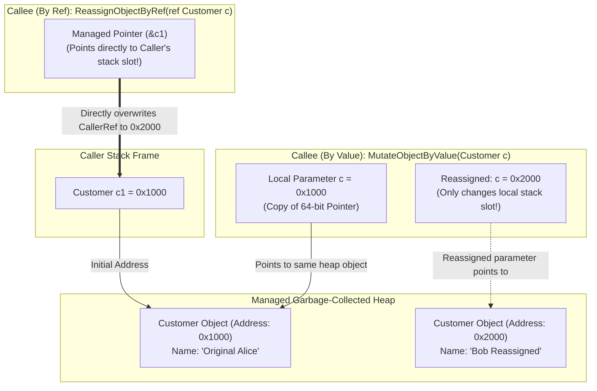

# Lesson 04: Parameters: ref, out, in and params

> **Prerequisites:** [Strings, Constants and Immutability](../03-strings-constants-and-immutability/README.md) and [Track 26 Overview](../README.md).  
> **Estimated Reading Time:** 18 minutes  
> **Target Audience:** Engineers preparing for LLD, OOP, C#, or Python technical screening and architecture rounds.

> [!NOTE]
> **In one line:** Arguments are **passed by value** by default (references are copied, not the object); `ref` passes a variable by reference, `out` requires the callee to assign it, and `in` is a read-only reference.

> [!TIP]
> **The One Rule of Method Parameters:** In C#, all arguments are passed by value by default—passing a reference type passes a *copy of the reference pointer*; using `ref`, `out`, or `in` passes a managed reference (pointer-to-storage-location) directly to the caller's variable on the stack, enabling caller variable reassignment or zero-copy readonly performance.

---

## 1. Why This Matters: The Interview Trap

The classic interview trick question catches even intermediate developers:

*"If you pass a reference type (like a `Customer` object) to a method without the `ref` keyword, and inside the method you execute `customer = new Customer("Alice");`, what happens to the caller's variable?"*

Nine out of ten candidates say:  
*"Classes are reference types, so passing them is pass-by-reference. The caller's variable will now point to Alice."*

**This is completely incorrect.**

In C#, **everything is passed by value by default**. When you pass an object to a method without `ref`, the runtime creates a **copy of the 64-bit reference pointer** on the callee's stack frame. Both the caller's pointer and the callee's pointer initially refer to the same object on the managed heap:
- Mutating an object property (`customer.Name = "Alice"`) mutates the shared heap object; the caller sees the change.
- Reassigning the parameter (`customer = new Customer("Alice")`) merely redirects the *callee's local stack copy* of the pointer to a new heap address. The caller's original reference variable remains completely untouched.

Only by explicitly applying the `ref` keyword does the caller pass the **memory address of its own stack variable**, allowing the callee to overwrite the caller's pointer.

### Weak vs. Strong Answer

| Dimension | Weak Answer | Strong Senior Answer |
| :--- | :--- | :--- |
| **Passing Reference Types** | "Classes are passed by reference, and structs are passed by value." | "In C#, all arguments are passed **by value** by default. For a reference type, the value being copied is the 8-byte pointer addressing the heap object. Mutating object state through the pointer affects the shared instance, but reassigning the parameter pointer itself does not overwrite the caller's variable unless the parameter is explicitly passed as `ref`." |
| **`ref` vs `out`** | "`ref` is for two-way communication; `out` is for returning extra data." | "At the CIL bytecode level, both emit a managed reference (`&`). The distinction is enforced by Roslyn compiler definite assignment rules: `ref` requires the caller to initialize the variable before invocation, and the callee may optionally read or write to it. `out` does not require caller initialization, but **demands that the callee assign a value** on all execution paths before returning." |
| **`in` Modifier** | "`in` is just const for method parameters." | "`in` instructs the compiler to pass an argument **by read-only reference** (`ref readonly`), eliminating the stack copy cost of large structs. However, if the struct is not declared as a `readonly struct`, the compiler silently emits **defensive copies** on every property or method access to guarantee immutability, negating any performance gain." |
| **`params` Arrays** | "`params` lets you pass an arbitrary list of parameters." | "`params` is compiler syntactic sugar. If passed individual arguments, the compiler emits instructions allocating a temporary heap array at the call site. In high-frequency hot paths, calling a `params` method causes continuous Gen 0 GC churn unless callers pass a pre-allocated array or leverage C# 13's `params ReadOnlySpan<T>`." |

---

## 2. Visual Mental Model / Taxonomic Comparison

### Stack Memory Layout: Passing Reference Types by Value vs. by `ref`



### Parameter Modifier Taxonomy: Matrix of Rules and Behaviors

| Modifier | Direction | Caller Initialized? | Callee Must Assign? | CIL Representation | Primary Use Case |
| :--- | :--- | :--- | :--- | :--- | :--- |
| **(None / By Value)** | In | Yes | No | Value or Pointer copy | Default invocation for 95% of methods |
| **`ref`** | In / Out | **Yes** (mandatory) | No (optional) | Managed pointer `T&` | In-place state machines, swapping, atomic operations (`Interlocked`) |
| **`out`** | Out | No (optional) | **Yes** (mandatory) | Managed pointer `T&` + `[Out]` attribute | Multiple return values, Try-Parse idiom (`int.TryParse`) |
| **`in`** | In | Yes | **No** (Compiler error if assigned) | Managed pointer `T&` + `[In]` / `[IsReadOnly]` | Zero-copy passing of large immutable structs (>16 bytes) |
| **`params`** | In | Yes | No | `T[]` array parameter + `[ParamArray]` | Flexible variable-length argument lists |

---

## 3. Code Implementation

The following carousel compares C# parameter semantics (`ref`, `out`, `in`, `params`, and reference reassignment) with Python's object model (pass-by-object-reference, tuple unpacking, mutable wrapper boxes, and `*args`).

````carousel
```csharp
// Slide 1: C# - ref, out, in, params, and Pass-by-Value vs Pass-by-Reference
using System;

public class Customer
{
    public string Name { get; set; }
    public Customer(string name) { Name = name; }
}

public readonly struct LargeMatrix
{
    public readonly double M11, M12, M21, M22;
    public LargeMatrix(double m11, double m12, double m21, double m22)
    {
        M11 = m11; M12 = m12; M21 = m21; M22 = m22;
    }
}

public class Program
{
    // 1. VALUE TYPE: By Value vs Ref
    public static void ModifyValue(int val) => val = 999;
    public static void ModifyRef(ref int val) => val = 999;

    // 2. REFERENCE TYPE: By Value vs Ref (The Interview Trap)
    public static void MutateObjectByValue(Customer c)
    {
        c.Name = "Alice In-Place"; // Mutates object on the heap
        c = new Customer("Ghost Customer"); // Rebinds local parameter only; caller is unchanged!
    }

    public static void ReassignObjectByRef(ref Customer c)
    {
        c = new Customer("Bob Reassigned"); // Overwrites caller's stack reference pointer directly
    }

    // 3. OUT PARAMETER: Callee must assign before returning
    public static bool TryComputeSqrt(double input, out double result)
    {
        if (input < 0)
        {
            result = 0;
            return false;
        }
        result = Math.Sqrt(input);
        return true;
    }

    // 4. IN PARAMETER: Zero-copy read-only reference for large structs
    public static double CalculateDeterminant(in LargeMatrix m)
    {
        // m.M11 = 5; // Compiler Error: Cannot assign to variable 'in LargeMatrix'
        return (m.M11 * m.M22) - (m.M12 * m.M21);
    }

    // 5. PARAMS ARRAY: Variable argument lists
    public static int SumAll(params int[] numbers)
    {
        int sum = 0;
        foreach (int n in numbers) sum += n;
        return sum;
    }

    public static void Main()
    {
        Console.WriteLine("=== 1. Value Type: Value vs Ref ===");
        int num = 10;
        ModifyValue(num);
        Console.WriteLine($"After ModifyValue: {num}");
        ModifyRef(ref num);
        Console.WriteLine($"After ModifyRef: {num}");

        Console.WriteLine("\n=== 2. Reference Type: Value vs Ref ===");
        var cust1 = new Customer("Original Alice");
        MutateObjectByValue(cust1);
        Console.WriteLine($"After MutateObjectByValue: {cust1.Name}");

        var cust2 = new Customer("Original Bob");
        ReassignObjectByRef(ref cust2);
        Console.WriteLine($"After ReassignObjectByRef: {cust2.Name}");

        Console.WriteLine("\n=== 3. Out Parameters ===");
        if (TryComputeSqrt(16.0, out double sqrtVal))
        {
            Console.WriteLine($"Sqrt Result: {sqrtVal}");
        }

        Console.WriteLine("\n=== 4. In Parameter (Zero-Copy Readonly) ===");
        var matrix = new LargeMatrix(2, 3, 4, 5);
        double det = CalculateDeterminant(in matrix);
        Console.WriteLine($"Determinant: {det}");

        Console.WriteLine("\n=== 5. Params Modifier ===");
        int total = SumAll(1, 2, 3, 4, 5);
        Console.WriteLine($"SumAll Total: {total}");
    }
}
```
<!-- slide -->
```python
# Slide 2: Python - Object References, Tuples for out, and *args for params
from dataclasses import dataclass
import math
from typing import Tuple


@dataclass
class Customer:
  name: str


@dataclass(frozen=True)
class LargeMatrix:
  m11: float
  m12: float
  m21: float
  m22: float


# 1. In Python, primitives are immutable. Local re-binding never mutates caller's integer.
def modify_value(val: int) -> None:
  val = 999  # Rebinds local variable name only


def modify_ref_simulated(box: list[int]) -> None:
  box[0] = 999  # Mutable container simulates a reference pointer


# 2. Reference Type: In-place mutation vs local re-binding
def mutate_object_by_value(c: Customer) -> None:
  c.name = "Alice In-Place"  # Mutates object on heap
  c = Customer("Ghost Customer")  # Rebinds local parameter name only!


def reassign_object_by_ref_simulated(box: list[Customer]) -> None:
  box[0] = Customer("Bob Reassigned")  # Replaces caller's reference


# 3. Python returns tuples instead of 'out' parameters
def try_compute_sqrt(val: float) -> Tuple[bool, float]:
  if val < 0:
    return False, 0.0
  return True, math.sqrt(val)


# 4. In Python, objects pass by pointer automatically (frozen dataclass enforces immutability)
def calculate_determinant(m: LargeMatrix) -> float:
  return (m.m11 * m.m22) - (m.m12 * m.m21)


# 5. Variable arguments in Python use *args (equivalent to C# params)
def sum_all(*numbers: int) -> int:
  return sum(numbers)


def main():
  print("=== 1. Value Type: Value vs Ref ===")
  num = 10
  modify_value(num)
  print(f"After ModifyValue: {num}")

  # Python simulates ref parameter via mutable single-element container
  box = [num]
  modify_ref_simulated(box)
  num = box[0]
  print(f"After ModifyRef: {num}")

  print("\n=== 2. Reference Type: Value vs Ref ===")
  cust1 = Customer("Original Alice")
  mutate_object_by_value(cust1)
  print(f"After MutateObjectByValue: {cust1.name}")

  cust2_box = [Customer("Original Bob")]
  reassign_object_by_ref_simulated(cust2_box)
  cust2 = cust2_box[0]
  print(f"After ReassignObjectByRef: {cust2.name}")

  print("\n=== 3. Out Parameters ===")
  success, sqrt_val = try_compute_sqrt(16.0)
  if success:
    val_str = int(sqrt_val) if sqrt_val.is_integer() else sqrt_val
    print(f"Sqrt Result: {val_str}")

  print("\n=== 4. In Parameter (Zero-Copy Readonly) ===")
  matrix = LargeMatrix(2, 3, 4, 5)
  det = calculate_determinant(matrix)
  det_str = int(det) if det.is_integer() else det
  print(f"Determinant: {det_str}")

  print("\n=== 5. Params Modifier ===")
  total = sum_all(1, 2, 3, 4, 5)
  print(f"SumAll Total: {total}")


if __name__ == "__main__":
  main()
```
````

**Expected Output (Both Languages):**
```text
=== 1. Value Type: Value vs Ref ===
After ModifyValue: 10
After ModifyRef: 999

=== 2. Reference Type: Value vs Ref ===
After MutateObjectByValue: Alice In-Place
After ReassignObjectByRef: Bob Reassigned

=== 3. Out Parameters ===
Sqrt Result: 4

=== 4. In Parameter (Zero-Copy Readonly) ===
Determinant: -2

=== 5. Params Modifier ===
SumAll Total: 15
```

---

## 4. Where You Already Use It

- **In the Standard Library Try-Pattern:**
  - `int.TryParse(input, out int result)`, `Dictionary<TKey, TValue>.TryGetValue(key, out var val)`, and `ConcurrentDictionary.TryRemove(key, out var val)` use `out` parameters to eliminate double-lookups (`ContainsKey` followed by indexer lookup) and avoid throwing exceptions on invalid input.
- **In Atomic Thread Synchronization:**
  - `Interlocked.Increment(ref int location)`, `Interlocked.Exchange(ref T location, T value)`, and `Interlocked.CompareExchange(ref T location, T value, T comparand)` require `ref` parameters to target the exact memory address of a field directly for hardware-enforced atomic CAS (Compare-And-Swap) operations.
- **In High-Throughput Memory Parsing (`Span<T>` and `ReadOnlySpan<T>`):**
  - Modern .NET string parsing APIs (like `int.Parse(ReadOnlySpan<char> s)`) accept data using `in` parameters or `ref struct` wrappers, allowing zero-allocation parsing of substrings without creating intermediate garbage-collected strings.
- **In Python:**
  - Standard library functions return tuples for compound status (`os.path.splitext()`, `divmod(x, y)`), while variadic `*args` powers decorators and flexible APIs (such as `print(*args, **kwargs)`).

---

## 5. Pitfalls and When Not to Use It

1. **The Defensive Copy Trap with `in`:**
   - When passing a `struct` via `in`, the compiler ensures it cannot be mutated. However, if the struct is declared as a normal `struct` (rather than a `readonly struct`), the Roslyn compiler cannot verify whether a property getter or method mutates state. To remain safe, **the compiler creates a hidden defensive copy on the stack before invoking any member**!
   - *Result:* Using `in` on a mutable struct can perform significantly *worse* than passing by value. Always ensure types passed with `in` are declared as `readonly struct`.

2. **The `params` Allocation Storm in Hot Loops:**
   - Calling `Logger.Log("Status: {0}", id)` where the method signature is `Log(string format, params object[] args)` creates a new `new object[1]` array on the managed heap on every invocation. In high-frequency hot paths (100,000 ops/sec), this floods Gen 0 GC.
   - *Fix:* In modern .NET (C# 13+), methods can accept `params ReadOnlySpan<T>`, which allocates the argument slice directly on the stack with zero GC allocations.

3. **Optional Parameter Versioning Breaking Changes:**
   - Defining a method with default parameter values (e.g., `public void Process(int timeoutMs = 5000)`) embeds the literal value `5000` into the calling assembly's CIL at compile time.
   - *Pitfall:* If you change the default value to `10000` in the library and replace only the library DLL, existing callers continue invoking the method passing `5000`. If you need cross-assembly version safety, use method overloads (`Process()` calling `Process(5000)`) instead of optional parameters.

4. **Using `ref`, `out`, or `in` in `async` Methods:**
   - C# forbids declaring `ref`, `out`, or `in` parameters in `async` methods or iterator blocks (`yield return`).
   - *Why:* An `async` method suspends execution across await points. Its local variables are lifted into fields of a compiler-generated heap-allocated state machine. Storing a managed pointer to a thread stack frame on a heap object that outlives the stack frame would corrupt memory.

---

## 6. Exercises & Practical Drills

### Drill 1: Predict the Stack Reassignment Behavior
Analyze the following C# code:
```csharp
public class Order
{
    public int OrderId { get; set; }
}

public static void ProcessOrder(Order order)
{
    order.OrderId = 200;
    order = new Order { OrderId = 500 };
}

public static void Main()
{
    var current = new Order { OrderId = 100 };
    ProcessOrder(current);
    Console.WriteLine(current.OrderId);
}
```
What does this program print, and why?

<details>
<summary>Answer</summary>

It prints **`200`**.

**Why:**  
`current` is passed by value. The parameter `order` receives a copy of the pointer targeting the heap object.  
1. `order.OrderId = 200;` mutates the property of the heap object that `current` also points to.  
2. `order = new Order { OrderId = 500 };` assigns a new heap object to the local variable `order`. This updates only the local parameter pointer on the callee stack frame.  
3. When `ProcessOrder` returns, its stack frame is popped. The caller's `current` variable still points to the original object whose `OrderId` was modified to `200`.
</details>

### Drill 2: Eliminating Heap Allocation with C# 13 `params ReadOnlySpan<T>`
Consider this performance-critical method:
```csharp
public static int CalculateMin(params int[] values)
{
    int min = int.MaxValue;
    for (int i = 0; i < values.Length; i++)
        if (values[i] < min) min = values[i];
    return min;
}
```
How can this be updated in modern C# to achieve zero heap allocations at call sites like `CalculateMin(10, 20, 5)`?

<details>
<summary>Answer</summary>

Change the signature to accept `params ReadOnlySpan<T>`:
```csharp
public static int CalculateMin(params ReadOnlySpan<int> values)
{
    int min = int.MaxValue;
    for (int i = 0; i < values.Length; i++)
        if (values[i] < min) min = values[i];
    return min;
}
```
The C# 13 compiler places the arguments `10, 20, 5` directly onto the caller's stack frame and constructs a `ReadOnlySpan<int>` referencing that stack memory. Zero heap objects are allocated.
</details>

---

## 7. Interview Questions & Model Answers

<details>
<summary><strong>1. What is the difference between `ref` and `out`? [BASIC]</strong></summary>

Both `ref` and `out` instruct the compiler to pass an argument by reference using a managed pointer (`T&` in CIL), meaning the callee operates directly on the caller's stack storage location rather than a copy.

The core differences are enforced at compile time through Roslyn's definite assignment rules:
1. **Caller Initialization:** For a `ref` parameter, the caller **must** initialize the variable before passing it into the method, because the method may read its initial value before modifying it. For an `out` parameter, the caller does **not** need to initialize the variable before calling.
2. **Callee Assignment:** A method accepting a `ref` parameter is not required to write to it; it can leave the value untouched. In contrast, a method accepting an `out` parameter **must assign a value** on every return path before returning control to the caller; failing to do so produces a compilation error.

In API design, `out` is the standard pattern for multiple return values or try-methods (e.g., `bool TryParse(string s, out int result)`), while `ref` is reserved for scenarios where the callee reads and mutates existing caller state in place (e.g., `Interlocked.Increment(ref count)` or array swapping).

</details>

<details>
<summary><strong>2. What does the `in` keyword do? [BASIC]</strong></summary>

Introduced in C# 7.2, the `in` modifier specifies that an argument is passed **by read-only reference** (`ref readonly`).

Its primary purpose is performance optimization for value types:
When passing a large value type (such as a 64-byte matrix or geometric struct) by value, the runtime must perform a bitwise copy of all 64 bytes onto the callee stack frame. Passing it with `in` passes a single 8-byte pointer instead, eliminating copy overhead while strictly forbidding the callee from modifying any of the struct's fields.

A critical performance caveat: If the struct being passed is not declared as a `readonly struct`, the compiler cannot prove that accessing a property or method won't mutate state. To guarantee read-only safety, the compiler emits a **defensive copy** of the struct on the stack prior to member invocation, which can destroy performance. Therefore, `in` should always be paired with `readonly struct` definitions.

</details>

<details>
<summary><strong>3. What happens when you pass an object to a method without `ref`? [SCENARIO]</strong></summary>

When you pass an object to a method without `ref`, the object is passed **by value of its reference pointer**.

Specifically:
1. The runtime copies the 8-byte reference address from the caller's stack variable into a new parameter variable on the callee's stack frame.
2. Both pointers now reference the exact same object on the managed heap. If the method mutates the object's properties or calls mutating methods (e.g., `user.Name = "Alice"` or `list.Add(42)`), the caller sees these mutations because the underlying heap object was altered.
3. However, if the method reassigns the parameter variable itself (e.g., `user = new User()`), it merely overwrites the local pointer copy on its own stack frame. The caller's original variable continues pointing to the original object on the heap.

To allow a method to replace the caller's pointer so that the caller references a completely new object, the parameter must be declared with `ref`.

</details>

<details>
<summary><strong>4. When would you choose a `TryParse(..., out var x)` signature over throwing? [SCENARIO]</strong></summary>

When failure is *expected and common* (user input): it avoids exception cost and keeps flow simple. Throw only for truly exceptional conditions.

</details>

<details>
<summary><strong>5. A method does `list = new List<int>()` on its parameter. Does the caller see the new list? [TRICKY]</strong></summary>

No. The reference was copied; reassigning the parameter only changes the local copy. With `ref List<int> list` the caller's variable would change. Mutating (`list.Add`) is visible either way.

</details>

<details>
<summary><strong>6. Why use `in` for large structs? [BASIC]</strong></summary>

It passes a read-only reference instead of copying the struct, saving copies, while the compiler guarantees the callee will not modify it.

</details>

---

## Try it

Use the minimal-API sample in section 2 of the [track hub](../README.md) (`dotnet new web`, paste, `dotnet run`). Add a small helper `static bool TryParseId(string s, out int id)` and call it from a route handler; then change it to `ref` and notice the compiler forcing you to initialise `id` first. Sketch the moving parts in [LLD Studio](/tools/lld-studio/) if you want a picture to narrate.

---

## One-page cheat sheet

```text
default: by VALUE (a reference type's reference is copied -> callee can mutate the object, not rebind yours)
ref   : caller initialises, callee may read+write the variable itself
out   : callee MUST assign before return (TryParse pattern, multiple returns)
in    : read-only by reference (avoid copying big structs)
params: variable-length args (array) ; optional args: name = default ; named args
ref return / ref local: return a reference into storage (advanced)
Prefer: tuples / records over out for new APIs; keep TryXxx(out) for hot paths
Python: everything passed by object reference; rebinding never affects caller
```

---

## 8. Sources & Further Reading

- [Microsoft Learn: Method Parameters (C# reference)](https://learn.microsoft.com/en-us/dotnet/csharp/language-reference/keywords/method-parameters)
- [Microsoft Learn: ref keyword (C# reference)](https://learn.microsoft.com/en-us/dotnet/csharp/language-reference/keywords/ref)
- [Microsoft Learn: out parameter modifier (C# reference)](https://learn.microsoft.com/en-us/dotnet/csharp/language-reference/keywords/out-parameter-modifier)
- [Microsoft Learn: in parameter modifier (C# reference)](https://learn.microsoft.com/en-us/dotnet/csharp/language-reference/keywords/in-parameter-modifier)
- [Microsoft Learn: Write safe and efficient C# code (Defensive copies)](https://learn.microsoft.com/en-us/dotnet/csharp/advanced-topics/performance/)
- [Microsoft Learn: params collection parameters in C# 13](https://learn.microsoft.com/en-us/dotnet/csharp/whats-new/csharp-13#params-collections)

---

Previous: [Strings, Constants and Immutability](../03-strings-constants-and-immutability/README.md) · Next: [Delegates, Events and Lambdas](../05-delegates-events-and-lambdas/README.md)
