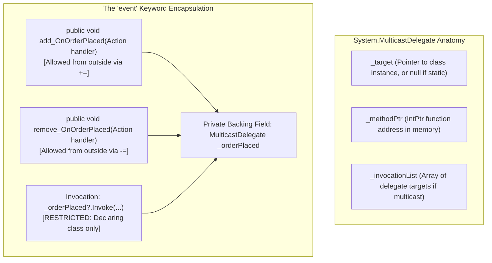

# Lesson 05: Delegates, Events and Lambdas

> **Prerequisites:** [Parameters: ref, out, in and params](../04-parameters-ref-out-in-and-params/README.md) and [Track 26 Overview](../README.md).  
> **Estimated Reading Time:** 18 minutes  
> **Target Audience:** Engineers preparing for LLD, OOP, C#, or Python technical screening and architecture rounds.

> [!TIP]
> **The One Rule of Callbacks in C#:** A `delegate` is a type-safe object-oriented function pointer (`_target` + `_methodPtr`); an `event` is a compiler-enforced access encapsulation restricting multicast delegate invocation strictly to the declaring class, preventing external callers from clearing subscribers (`= null`) or falsely raising the notification; a closure lifts captured local variables into fields of a compiler-generated heap class.

---

## 1. Why This Matters: The Interview Trap

A common senior C# interview question tests architectural boundaries:  
*"If an `event` is just a multicast delegate under the hood, why does C# have the `event` keyword at all? Why not just declare a `public Action<Order> OnOrderPlaced;` field?"*

Junior candidates usually answer:  
*"Events are for UI button clicks in WPF or WinForms, while delegates are for LINQ or passing callbacks."*

**This answer fails because it confuses an application domain with a language encapsulation mechanism.**

If you declare a raw public delegate field:
```csharp
public class OrderService
{
    public Action<Order>? OnOrderPlaced; // DANGEROUS!
}
```

Any rogue or accidental external code can do two catastrophic things:
1. **Wipe out all other listeners:** External code can write `orderService.OnOrderPlaced = myHandler;` using `=` instead of `+=`. This immediately overwrites and unregisters all other system components (email notifications, audit logs, inventory reservations) without warning.
2. **Invoke the event from the outside:** Any external class can write `orderService.OnOrderPlaced(fakeOrder);`, fabricating events that the `OrderService` never actually produced.

Applying the `event` keyword (`public event Action<Order>? OnOrderPlaced;`) changes the compiler-generated IL completely. The compiler creates a private backing delegate and exposes only two public methods: `add_OnOrderPlaced` and `remove_OnOrderPlaced`. Outside classes can **only** subscribe (`+=`) or unsubscribe (`-=`). Only the declaring class can invoke the delegate or clear it.

### Weak vs. Strong Answer

| Dimension | Weak Answer | Strong Senior Answer |
| :--- | :--- | :--- |
| **Delegate Definition** | "A delegate is a function pointer like in C++." | "A delegate is a **type-safe, object-oriented function pointer** inheriting from `System.MulticastDelegate`. Unlike a raw C/C++ function pointer, it encapsulates both an unmanaged method address (`_methodPtr`) and an optional target object reference (`_target`) for instance methods." |
| **Delegate vs Event** | "Events are for GUI notifications, delegates are for functional code." | "An event is an **encapsulation wrapper** around a multicast delegate, exactly as a C# property is an encapsulation wrapper around a private backing field. It exposes only `add` and `remove` accessors, strictly prohibiting external callers from invoking the delegate or overwriting subscriber chains." |
| **Closures** | "A closure is an anonymous lambda function." | "A closure occurs when a lambda or anonymous method references variables from its enclosing lexical scope. The compiler synthesizes a hidden display class on the managed heap, hoists the local variables into instance fields of that class, and turns the lambda into an instance method on that display class." |

---

## 2. Visual Mental Model / Taxonomic Comparison

### Delegate Internal Anatomy & Event Encapsulation



### Callback Types Comparison

| Type | Return Value | Parameters | Primary Purpose |
| :--- | :--- | :--- | :--- |
| `delegate TResult MyDelegate<T>(T a)` | Any | Custom named | Custom APIs requiring semantic parameter names or `ref`/`out` parameters |
| `Action<T1, T2, ...>` | `void` | 0 to 16 arguments | Side-effect operations, callbacks, logging, notifications |
| `Func<T1, T2, ..., TResult>` | `TResult` | 0 to 16 arguments + Return | Transformations, computations, LINQ projections, value retrieval |
| `Predicate<T>` | `bool` | Exactly 1 argument | Filtering conditions (legacy, functionally equivalent to `Func<T, bool>`) |
| `event EventHandler<TEventArgs>` | `void` | `(object? sender, TEventArgs e)` | Idiomatic .NET decoupled publisher-subscriber notification pattern |

---

## 3. Code Implementation

The following carousel demonstrates custom delegates, `Func`/`Action`, idiomatic events with encapsulation, and the infamous closure loop variable capture trap in C# and Python.

````carousel
```csharp
// Slide 1: C# - Delegates, Events, and Closure Scoping
using System;
using System.Collections.Generic;

// 1. CUSTOM DELEGATE VS BUILT-IN FUNC/ACTION
public delegate bool PriceFilter(decimal price);

public class OrderEventArgs : EventArgs
{
    public string OrderId { get; }
    public decimal Total { get; }
    public OrderEventArgs(string id, decimal total) { OrderId = id; Total = total; }
}

public class OrderProcessor
{
    // 2. EVENT ENCAPSULATION: Outside code can only += or -=
    public event EventHandler<OrderEventArgs>? OrderCompleted;

    public void CompleteOrder(string id, decimal total)
    {
        Console.WriteLine($"[OrderProcessor] Order {id} completed.");
        // Thread-safe null-conditional invocation
        OrderCompleted?.Invoke(this, new OrderEventArgs(id, total));
    }
}

public class Program
{
    public static void Main()
    {
        Console.WriteLine("=== 1. Delegates: Func, Action, Custom ===");
        // Func: returns value
        Func<int, int, int> add = (a, b) => a + b;
        Console.WriteLine($"Func Add(10, 20): {add(10, 20)}");

        // Action: returns void
        Action<string> logger = msg => Console.WriteLine($"[Log] {msg}");
        logger("Delegate invoked successfully.");

        // Custom delegate
        PriceFilter isExpensive = price => price > 100m;
        Console.WriteLine($"Is \$150 expensive? {isExpensive(150m)}");

        Console.WriteLine("\n=== 2. Event Publisher-Subscriber Pattern ===");
        var processor = new OrderProcessor();

        // Subscribe multiple listeners (Multicast)
        processor.OrderCompleted += (sender, e) =>
        {
            Console.WriteLine($"-> Audit Log: Order {e.OrderId} for \${e.Total}");
        };
        processor.OrderCompleted += (sender, e) =>
        {
            Console.WriteLine($"-> Email Service: Confirmation sent for {e.OrderId}");
        };

        // processor.OrderCompleted = null; // COMPILER ERROR: Event can only appear on += or -=
        // processor.OrderCompleted.Invoke(...); // COMPILER ERROR: Cannot be invoked from outside!

        processor.CompleteOrder("ORD-9841", 149.99m);

        Console.WriteLine("\n=== 3. Closures and Loop Variable Capture ===");
        var actions = new List<Action>();

        // Trap in C# 4 and older (and modern 'for' loops):
        // Capturing the loop variable 'i' captures the VARIABLE, not its value!
        for (int i = 0; i < 3; i++)
        {
            int loopCopy = i; // Fix: local variable inside loop body
            actions.Add(() => Console.WriteLine($"Captured: {loopCopy}"));
        }

        foreach (var act in actions)
        {
            act();
        }
    }
}
```
<!-- slide -->
```python
# Slide 2: Python - Callables, Custom Events, and Late-Binding Closures
from typing import Callable, List


# 1. CALLABLE TYPE ALIASES (Equivalents of Func, Action, Predicate)
PriceFilter = Callable[[float], bool]
ActionLogger = Callable[[str], None]
FuncAdd = Callable[[int, int], int]


class OrderEventArgs:

  def __init__(self, order_id: str, total: float):
    self.order_id = order_id
    self.total = total


# 2. EVENT SYSTEM IN PYTHON (Manual encapsulation)
class OrderProcessor:

  def __init__(self):
    # Private subscriber list to mimic C# event encapsulation
    self._subscribers: List[Callable[[object, OrderEventArgs], None]] = []

  def subscribe(
      self, handler: Callable[[object, OrderEventArgs], None]
  ) -> None:
    """Equivalent to C# +="""
    self._subscribers.append(handler)

  def unsubscribe(
      self, handler: Callable[[object, OrderEventArgs], None]
  ) -> None:
    """Equivalent to C# -="""
    self._subscribers.remove(handler)

  def complete_order(self, order_id: str, total: float) -> None:
    print(f"[OrderProcessor] Order {order_id} completed.")
    args = OrderEventArgs(order_id, total)
    for handler in self._subscribers:
      handler(self, args)


def main():
  print("=== 1. Delegates: Func, Action, Custom ===")
  add: FuncAdd = lambda a, b: a + b
  print(f"Func Add(10, 20): {add(10, 20)}")

  logger: ActionLogger = lambda msg: print(f"[Log] {msg}")
  logger("Delegate invoked successfully.")

  is_expensive: PriceFilter = lambda price: price > 100.0
  print(f"Is $150 expensive? {is_expensive(150.0)}")

  print("\n=== 2. Event Publisher-Subscriber Pattern ===")
  processor = OrderProcessor()

  processor.subscribe(
      lambda sender, e: print(
          f"-> Audit Log: Order {e.order_id} for ${e.total:.2f}"
      )
  )
  processor.subscribe(
      lambda sender, e: print(
          f"-> Email Service: Confirmation sent for {e.order_id}"
      )
  )

  processor.complete_order("ORD-9841", 149.99)

  print("\n=== 3. Closures and Loop Variable Capture ===")
  # Classic Python late-binding trap:
  # Lambdas look up 'i' at invocation time, not definition time!
  actions: List[Callable[[], None]] = []
  for i in range(3):
    # Fix: default argument captures current value at definition time
    actions.append(lambda val=i: print(f"Captured: {val}"))

  for act in actions:
    act()


if __name__ == "__main__":
  main()
```
````

**Expected Output (Both Languages):**
```text
=== 1. Delegates: Func, Action, Custom ===
Func Add(10, 20): 30
[Log] Delegate invoked successfully.
Is $150 expensive? True

=== 2. Event Publisher-Subscriber Pattern ===
[OrderProcessor] Order ORD-9841 completed.
-> Audit Log: Order ORD-9841 for $149.99
-> Email Service: Confirmation sent for ORD-9841

=== 3. Closures and Loop Variable Capture ===
Captured: 0
Captured: 1
Captured: 2
```

---

## 4. Where You Already Use It

- **In .NET / C#:**
  - `RequestDelegate` in ASP.NET Core: `public delegate Task RequestDelegate(HttpContext context);` forms the entire HTTP middleware pipeline.
  - LINQ Extension Methods: `Where(Func<T, bool>)`, `Select(Func<T, TResult>)`, `OrderBy(Func<T, TKey>)` are pure delegate consumers.
  - `CancellationToken.Register(Action callback)`: Triggers callbacks when an asynchronous token is cancelled.
  - `IProgress<T>`: Reports progress updates asynchronously via `Action<T>` callbacks back to the calling thread.
  - WinForms / WPF / MAUI: `button.Click += OnButtonClicked;` handles UI user interaction.

- **In Python:**
  - `functools.partial`: Binds parameters to a callable, similar to capturing variables in a delegate.
  - Decorators: Higher-order functions accepting and returning callables (`def my_decorator(fn: Callable) -> Callable`).
  - `builtins.map()` and `builtins.filter()`: Accept function callables for functional stream processing.

---

## 5. Pitfalls and When Not to Use It

1. **The Event Handler Memory Leak (Lapsed Listener Problem):**
   - When a short-lived subscriber registers an instance method with a long-lived publisher (`publisher.SomeEvent += subscriber.OnEvent`), the publisher's internal `_invocationList` retains a **strong reference** to the subscriber instance (`_target`).
   - Even if the application drops all other references to `subscriber`, the Garbage Collector cannot collect it because the publisher roots it!
   - *Fix:* Always unsubscribe (`-=`) when the subscriber is disposed (implement `IDisposable`), or use weak event patterns (`WeakEventManager`).

2. **Multicast Delegate Exception Swallowing:**
   - When calling `myMulticastDelegate?.Invoke()`, the runtime executes subscribers sequentially. If subscriber 1 throws an unhandled exception, execution halts immediately: **subscribers 2 and 3 are never called!**
   - *Fix:* When building mission-critical event publishers, iterate manually over `Delegate.GetInvocationList()` and invoke each subscriber inside an isolated `try-catch` block.

3. **Captured Variable Lifetime Extension:**
   - If a lambda captures a local variable that references a heavy 100MB byte array, that entire 100MB array is kept alive on the managed heap for as long as the delegate instance survives.
   - *Fix:* Use **static lambdas** (`static (x) => ...`, introduced in C# 9). If a static lambda accidentally attempts to capture a local variable, the compiler produces an error immediately.

4. **Thread-Safety in Event Raising:**
   - In multithreaded code, checking `if (MyEvent != null) MyEvent(this, e);` suffers from a race condition: a subscriber can unsubscribe on another thread between the `null` check and invocation, throwing a `NullReferenceException`.
   - *Fix:* Always use the null-conditional operator: `MyEvent?.Invoke(this, e);`. This copies the delegate reference to a local variable atomically before checking and invoking.

---

## 6. Exercises & Practical Drills

### Drill 1: The Loop Variable Capture Bug
What does this legacy C# snippet output, and why?
```csharp
var actions = new List<Action>();
for (int i = 0; i < 5; i++)
{
    actions.Add(() => Console.Write(i + " "));
}
foreach (var a in actions)
{
    a();
}
```

<details>
<summary>Answer</summary>

**Output:** `5 5 5 5 5 ` (not `0 1 2 3 4 `).

**Why:**  
In a standard `for` loop, the variable `i` is declared once outside the loop condition. The compiler creates a single display class instance on the heap holding field `i`. The lambdas do not capture the *value* of `i` at that instant; they capture the *variable reference*. By the time `foreach` runs, the loop has completed, and `i` has reached its final value of `5`.

*Note:* In C# 5+, the compiler changed `foreach` scoping so that the iteration variable in `foreach (var item in list)` is scoped per iteration. However, traditional `for` loops still share the variable across iterations!
</details>

### Drill 2: Robust Multicast Invocation
Given a multicast event where one subscriber might throw:
```csharp
public event Action<string>? ProcessingFailed;
```
How do you ensure that *all* subscribers are invoked even if one throws an exception?

<details>
<summary>Answer</summary>

Inspect the delegate's invocation list and invoke each target individually inside a `try-catch` block:

```csharp
public void RaiseProcessingFailed(string reason)
{
    var handlers = ProcessingFailed?.GetInvocationList();
    if (handlers == null) return;

    var exceptions = new List<Exception>();
    foreach (Action<string> handler in handlers)
    {
        try
        {
            handler(reason);
        }
        catch (Exception ex)
        {
            exceptions.Add(ex); // Collect failures without stopping other handlers
        }
    }

    if (exceptions.Count > 0)
    {
        throw new AggregateException("One or more event subscribers failed.", exceptions);
    }
}
```
</details>

---

## 7. Interview Questions & Model Answers

> [!interview]
> **Question 1: What is a delegate?**  
> **Strong Answer:**  
> "A delegate in C# is a **type-safe, object-oriented function pointer**. It inherits from `System.MulticastDelegate` (which inherits from `System.Delegate`).  
> 
> Unlike a raw C/C++ function pointer that holds only a memory address, a .NET delegate encapsulates two critical pieces of information:  
> 1. `_methodPtr`: An unmanaged pointer to the executable code of the method.  
> 2. `_target`: A reference to the specific object instance the method belongs to (or `null` if the target is a static method).  
> 
> Furthermore, all delegates in C# are **multicast**: they maintain an internal `_invocationList` array, allowing multiple callbacks to be chained together using the `+` or `+=` operators and invoked sequentially."

> [!interview]
> **Question 2: What is the difference between a delegate and an event?**  
> **Strong Answer:**  
> "A delegate is a **type** and an object representing a method signature and callable reference. An `event` is a **language keyword that provides access encapsulation** over a private multicast delegate.  
> 
> The relationship between an event and a delegate is identical to the relationship between a property and a private backing field:  
> - If you expose a public delegate field (`public Action MyAction;`), any external code can overwrite the delegate (`MyAction = null;`) or invoke it directly from outside (`MyAction();`).  
> - When you declare an event (`public event Action MyAction;`), the compiler generates a private backing delegate and exposes only two public accessors: `add_MyAction` and `remove_MyAction`.  
> 
> As a result, external classes are strictly restricted to subscribing (`+=`) and unsubscribing (`-=`). Only the declaring class has the authority to invoke the event or clear the invocation chain."

> [!interview]
> **Question 3: What are Func and Action?**  
> **Strong Answer:**  
> "`Func` and `Action` are standard generic delegates provided in the `System` namespace to avoid the boilerplate of declaring custom delegate types for every method signature.  
> 
> - **`Action<...>`**: Represents a method that accepts between 0 and 16 type parameters and returns **`void`**. It is used for operations with side effects, logging, and notifications.  
> - **`Func<..., TResult>`**: Represents a method that accepts between 0 and 16 input parameters and returns a value of type **`TResult`** (the last generic parameter). It is heavily used in LINQ for projections, transformations, and mathematical calculations.  
> - **`Predicate<T>`**: A legacy delegate equivalent to `Func<T, bool>`, used primarily in older collection methods like `Array.FindAll` or `List<T>.RemoveAll`.  
> 
> You only need to define a custom `delegate` if your signature requires `ref`, `out`, or `in` parameter modifiers, or when building public APIs where explicit domain parameter names are essential."

> [!interview]
> **Question 4: What is a closure?**  
> **Strong Answer:**  
> "A closure is a language construct where an anonymous method or lambda expression captures and binds variables from its surrounding lexical scope.  
> 
> Under the hood, the C# compiler handles closures by synthesizing a private hidden display class (commonly named `<>c__DisplayClass`) on the managed heap. The captured local variables are hoisted into **instance fields** of that display class, and the lambda body is compiled as an **instance method** on that same class.  
> 
> Two critical architectural consequences follow:  
> 1. **Heap Allocation:** Even if the captured variable was a stack-allocated value type (like an `int`), hoisting it to the display class forces a heap allocation, generating GC pressure.  
> 2. **Lifetime Extension:** The captured variables remain alive on the heap as long as the delegate reference exists, which can easily cause memory leaks if a short-lived variable is captured by a long-lived delegate."

---

## 8. Sources & Further Reading

- [Microsoft Learn: Delegates (C# Programming Guide)](https://learn.microsoft.com/en-us/dotnet/csharp/programming-guide/delegates/)
- [Microsoft Learn: Events (C# Programming Guide)](https://learn.microsoft.com/en-us/dotnet/csharp/programming-guide/events/)
- [Microsoft Learn: Lambda expressions and anonymous functions](https://learn.microsoft.com/en-us/dotnet/csharp/language-reference/operators/lambda-expressions)
- [Microsoft Learn: Standard .NET event patterns](https://learn.microsoft.com/en-us/dotnet/standard/events/)
- [Jon Skeet: The Beauty of Closures in C#](https://csharpindepth.com/Articles/Closures)

---

Previous: [Parameters: ref, out, in and params](../04-parameters-ref-out-in-and-params/README.md) · Next: [Generics, Constraints and Variance](../06-generics-constraints-and-variance/README.md)
