# Lesson 06: Generics, Constraints and Variance

> **Prerequisites:** [Delegates, Events and Lambdas](../05-delegates-events-and-lambdas/README.md) and [Track 26 Overview](../README.md).  
> **Estimated Reading Time:** 18 minutes  
> **Target Audience:** Engineers preparing for LLD, OOP, C#, or Python technical screening and architecture rounds.

> [!NOTE]
> **In one line:** **Generics** give type-safe reuse without boxing or casts; **constraints** (`where T : ...`) tell the compiler what T can do; **variance** (`out`/`in`) controls when `IEnumerable<Dog>` can stand in for `IEnumerable<Animal>`.

> [!TIP]
> **The One Rule of Generics and Variance:** Generics in .NET are reified at runtime with specialized machine code for value types and shared code for reference types; variance applies strictly to generic interfaces and delegates: use `out` (covariance) when a type parameter only comes *out* of operations, and `in` (contravariance) when a type parameter only goes *in*.

---

## 1. Why This Matters: The Interview Trap

Two signature questions distinguish senior architects from junior developers in .NET type system interviews:

1. *"Why can't you assign a `List<string>` to a `List<object>`, even though `string` derives from `object`?"*
2. *"How do .NET generics differ from Java generics (type erasure) or C++ templates?"*

Candidates often stumble by responding:  
*"It's just an arbitrary C# compiler restriction,"* or *"Generics in C# are just syntax sugar that gets wiped out into `object` by the compiler."*

**Both answers reveal a fundamental misunderstanding of type safety and runtime execution:**

1. **The Invariance Requirement:** If assigning `List<string>` to `List<object>` were allowed:
   ```csharp
   List<string> strings = new List<string>();
   List<object> objects = strings; // If this were legal...
   objects.Add(42);                // Adding an int to a list of strings!
   string item = strings[0];       // FATAL: CLR type violation!
   ```
   Allowing a mutable collection to be covariant would completely destroy type safety at runtime. Therefore, classes that allow both reading and writing **must be invariant**.

2. **Reification vs. Erasure:** Unlike Java (which erases generic types to `Object` at compile time and inserts runtime casts) and C++ (which duplicates template code at compile time for every single type), **.NET generics are reified at runtime by the CLR**:
   - The CLR preserves full type metadata in the assembly.
   - For **value types** (`List<int>`, `List<DateTime>`), RyuJIT compiles a dedicated, specialized machine code binary for each type, delivering **zero boxing, zero heap allocations, and direct CPU memory layout**.
   - For **reference types** (`List<string>`, `List<Customer>`), RyuJIT shares a single canonical pointer-sized implementation behind the scenes, saving code cache memory while enforcing static type safety.

### Weak vs. Strong Answer

| Dimension | Weak Answer | Strong Senior Answer |
| :--- | :--- | :--- |
| **Why Generics Matter** | "Generics let you reuse code without copy-pasting." | "Generics provide compile-time type safety, eliminate the performance and GC penalties of boxing value types, and allow the CLR to generate specialized machine code for struct instantiations while sharing code for reference types." |
| **Invariance of Collections** | "They have different names so the compiler forbids it." | "`List<T>` is invariant because it supports both input (`Add`) and output (indexer read) operations. Making mutable collections covariant would permit writing an incompatible type into the underlying storage, causing memory corruption or runtime type crashes." |
| **Covariance vs Contravariance** | "Covariance means polymorphism works on generics." | "Variance controls how subtyping of type arguments relates to subtyping of generic types. **Covariance (`out T`)** preserves subtyping (`IReadOnlyList<Dog>` is assignable to `IReadOnlyList<Animal>`) and is only valid when `T` appears in **output positions**. **Contravariance (`in T`)** reverses subtyping (`Action<Animal>` is assignable to `Action<Dog>`) and is only valid when `T` appears in **input positions**." |
| **Generic Constraints** | "Constraints restrict what types you can pass." | "Constraints instruct the compiler and JIT on the capabilities of `T`. They enable invoking methods on `T` (e.g., `where T : IComparable<T>`), allocating instances (`where T : new()`), preventing nulls (`where T : notnull`), or enforcing memory layouts (`where T : struct`, `unmanaged`, or C# 13's `allows ref struct`)." |

---

## 2. Visual Mental Model / Taxonomic Comparison

### Subtyping and Variance Directions

Given that `Dog` derives from `Animal`:

```mermaid
flowchart TD
    subgraph BaseHierarchy["Class Inheritance (Underlying Types)"]
        AnimalClass["Animal (Base Class)"]
        DogClass["Dog (Derived Class)"]
        DogClass -->|"inherits from"| AnimalClass
    end

    subgraph CovarianceFlow["Covariance (out T): Preserves Hierarchy"]
        ProducerDog["IProducer<Dog>"]
        ProducerAnimal["IProducer<Animal>"]
        ProducerDog -->|"assignable to (out T)"| ProducerAnimal
    end

    subgraph ContravarianceFlow["Contravariance (in T): Reverses Hierarchy"]
        ConsumerAnimal["IConsumer<Animal>"]
        ConsumerDog["IConsumer<Dog>"]
        ConsumerAnimal -->|"assignable to (in T)"| ConsumerDog
    end

    subgraph InvarianceFlow["Invariance: No Assignment Allowed"]
        ListDog["List<Dog>"]
        ListAnimal["List<Animal>"]
        ListDog -.->|"COMPILER ERROR: Invariant"| ListAnimal
    end
```



### Complete Generic Constraints Taxonomy

| Constraint Syntax | Meaning | Permitted Operations on `T` | Example Use Case |
| :--- | :--- | :--- | :--- |
| `where T : struct` | Must be a non-nullable value type | Allocate inline, value copy, default init | Primitive caches, geometric math |
| `where T : class` | Must be a reference type | Assign `null`, reference comparisons | Entity repositories, ORM models |
| `where T : notnull` | Must be non-nullable (value or ref) | Safe dereferencing, no null warnings | Dictionary keys, lookup maps |
| `where T : unmanaged` | Must be a struct with no reference fields | Pointer arithmetic, `sizeof(T)`, interop | High-performance buffers, SIMD |
| `where T : new()` | Must have a public parameterless constructor | Call `new T()` | Object factories, serializer contexts |
| `where T : BaseClass` | Must derive from `BaseClass` | Access `BaseClass` protected/public members | Domain entity managers |
| `where T : IInterface` | Must implement `IInterface` | Call interface methods with zero boxing | `IComparable<T>`, `IDisposable` |
| `where T : default` | Disambiguates unconstrained override | Standard default equality | Virtual method overrides |
| `where T : allows ref struct` | Anti-constraint: allows stack-only `ref struct` | Can pass `Span<T>` or `ReadOnlySpan<T>` | C# 13 high-performance pipelines |

---

## 3. Code Implementation

The following carousel demonstrates generic constraints, covariance (`out T`), contravariance (`in T`), and collection invariance in C#, with the equivalent implementation in Python using `typing.Generic`, `TypeVar(..., covariant=True)`, and `Protocol`.

````carousel
```csharp
// Slide 1: C# - Generic Constraints, Covariance (out), and Contravariance (in)
using System;
using System.Collections.Generic;

// 1. GENERIC CONSTRAINTS & TYPE SAFETY
public interface IIdentifiable
{
    int Id { get; }
}

public class User : IIdentifiable
{
    public int Id { get; set; }
    public string Name { get; set; }
    public User() { Name = "Default"; }
    public User(int id, string name) { Id = id; Name = name; }
}

// Constrains T to implement IIdentifiable and possess a public parameterless constructor
public class EntityFactory<T> where T : IIdentifiable, new()
{
    public T CreateDefault(int id)
    {
        T item = new T();
        return item;
    }
}

// 2. COVARIANCE (out T) AND CONTRAVARIANCE (in T)
public class Animal { public string Species { get; set; } = "Animal"; }
public class Dog : Animal { public Dog() { Species = "Dog"; } }

// Covariant Interface: T is strictly in OUTPUT positions
public interface IProducer<out T>
{
    T Produce();
}

public class DogProducer : IProducer<Dog>
{
    public Dog Produce() => new Dog();
}

// Contravariant Interface: T is strictly in INPUT positions
public interface IConsumer<in T>
{
    void Consume(T item);
}

public class AnimalConsumer : IConsumer<Animal>
{
    public void Consume(Animal item) => Console.WriteLine($"Consumed: {item.Species}");
}

public class Program
{
    public static void Main()
    {
        Console.WriteLine("=== 1. Generic Type Constraints ===");
        var factory = new EntityFactory<User>();
        User user = factory.CreateDefault(1);
        Console.WriteLine($"Created User: Name = {user.Name}, Type = {user.GetType().Name}");

        Console.WriteLine("\n=== 2. Covariance (out T) ===");
        // Dog derives from Animal. IProducer<out T> allows assigning IProducer<Dog> to IProducer<Animal>
        IProducer<Dog> dogProducer = new DogProducer();
        IProducer<Animal> animalProducer = dogProducer; // Covariance in action!
        Animal outputAnimal = animalProducer.Produce();
        Console.WriteLine($"Covariant Output: {outputAnimal.Species}");

        Console.WriteLine("\n=== 3. Contravariance (in T) ===");
        // AnimalConsumer can handle any Animal; therefore it safely acts as an IConsumer<Dog>
        IConsumer<Animal> animalConsumer = new AnimalConsumer();
        IConsumer<Dog> dogConsumer = animalConsumer; // Contravariance in action!
        dogConsumer.Consume(new Dog());

        Console.WriteLine("\n=== 4. Invariance of Mutable Collections ===");
        // List<Dog> cannot be cast to List<Animal> to protect type safety.
        List<Dog> dogList = new List<Dog> { new Dog() };
        // IEnumerable<T> is covariant (out T), so reading as Animal is completely safe:
        IEnumerable<Animal> animalSequence = dogList;
        foreach (var a in animalSequence)
        {
            Console.WriteLine($"Sequence Item: {a.Species}");
        }
    }
}
```
<!-- slide -->
```python
# Slide 2: Python - Generic Protocols, TypeVar Covariance, and Contravariance
from typing import Generic, List, Protocol, Sequence, TypeVar


# 1. GENERIC CONSTRAINTS & TYPE SAFETY
class IIdentifiable(Protocol):

  @property
  def id(self) -> int:
    ...


class User:

  def __init__(self, id: int = 0, name: str = "Default"):
    self.id = id
    self.name = name


# Bounding TypeVar equivalent to 'where T : IIdentifiable'
T_Entity = TypeVar("T_Entity", bound=IIdentifiable)


class EntityFactory(Generic[T_Entity]):

  def __init__(self, entity_cls: type[T_Entity]):
    self._entity_cls = entity_cls

  def create_default(self, id: int) -> T_Entity:
    return self._entity_cls()


# 2. COVARIANCE (out T) AND CONTRAVARIANCE (in T)
class Animal:

  def __init__(self):
    self.species = "Animal"


class Dog(Animal):

  def __init__(self):
    super().__init__()
    self.species = "Dog"


# Covariant TypeVar: equivalent to C# 'out T' (output positions only)
T_co = TypeVar("T_co", covariant=True)


class IProducer(Protocol[T_co]):

  def produce(self) -> T_co:
    ...


class DogProducer:

  def produce(self) -> Dog:
    return Dog()


# Contravariant TypeVar: equivalent to C# 'in T' (input positions only)
T_contra = TypeVar("T_contra", contravariant=True)


class IConsumer(Protocol[T_contra]):

  def consume(self, item: T_contra) -> None:
    ...


class AnimalConsumer:

  def consume(self, item: Animal) -> None:
    print(f"Consumed: {item.species}")


def main():
  print("=== 1. Generic Type Constraints ===")
  factory = EntityFactory(User)
  user = factory.create_default(1)
  print(f"Created User: Name = {user.name}, Type = {type(user).__name__}")

  print("\n=== 2. Covariance (out T) ===")
  # Dog is Animal. IProducer is covariant, so DogProducer satisfies IProducer[Animal]
  dog_producer: IProducer[Dog] = DogProducer()
  animal_producer: IProducer[Animal] = dog_producer
  output_animal: Animal = animal_producer.produce()
  print(f"Covariant Output: {output_animal.species}")

  print("\n=== 3. Contravariance (in T) ===")
  # AnimalConsumer can consume any Animal, therefore satisfies IConsumer[Dog]
  animal_consumer: IConsumer[Animal] = AnimalConsumer()
  dog_consumer: IConsumer[Dog] = animal_consumer
  dog_consumer.consume(Dog())

  print("\n=== 4. Invariance of Mutable Collections ===")
  # Mutable list is invariant; typing.Sequence is covariant (read-only)
  dog_list: List[Dog] = [Dog()]
  animal_sequence: Sequence[Animal] = dog_list
  for a in animal_sequence:
    print(f"Sequence Item: {a.species}")


if __name__ == "__main__":
  main()
```
````

**Expected Output (Both Languages):**
```text
=== 1. Generic Type Constraints ===
Created User: Name = Default, Type = User

=== 2. Covariance (out T) ===
Covariant Output: Dog

=== 3. Contravariance (in T) ===
Consumed: Dog

=== 4. Invariance of Mutable Collections ===
Sequence Item: Dog
```

---

## 4. Where You Already Use It

- **In the .NET Standard Library:**
  - `IEnumerable<out T>`, `IReadOnlyList<out T>`, and `IAsyncEnumerable<out T>` are declared with `out T`. Because they are read-only, you can pass an `IEnumerable<string>` to any method accepting `IEnumerable<object>`.
  - `Action<in T>`, `IComparer<in T>`, and `IEqualityComparer<in T>` are declared with `in T`. You can supply an `IComparer<Animal>` wherever an `IComparer<Dog>` is demanded.
- **In Entity Framework Core:**
  - `DbContext.Set<TEntity>() where TEntity : class` constrains models to reference types, ensuring that value types cannot be mapped as root database entities.
- **In ASP.NET Core Dependency Injection & Options Pattern:**
  - `IOptions<TOptions> where TOptions : class, new()` enforces that options configuration classes must be instantiable reference types.
- **In Python Typing:**
  - Python's `typing.Sequence[T]` and `typing.Mapping[KT, VT_co]` use covariant type variables to allow passing specialized collections to broader read-only interfaces in `mypy` and `pyright`.

---

## 5. Pitfalls and When Not to Use It

1. **The Legacy C# Array Covariance Bug:**
   - In C# 1.0 (before generics were introduced), arrays were made covariant: `string[]` can be implicitly assigned to `object[]`.
   - *The Danger:* The following compiles with zero warnings but crashes at runtime:
     ```csharp
     string[] strings = new string[2];
     object[] objects = strings; // Compiles due to legacy array covariance!
     objects[0] = 42;            // Throws ArrayTypeMismatchException at runtime!
     ```
   - *Rule:* Never rely on array covariance. Always use generic collections (`IReadOnlyList<T>` or `IEnumerable<T>`) for type-safe covariance.

2. **Variance Only Works on Reference Types:**
   - Covariance and contravariance apply **only when the type arguments are reference types**.
   - *Example:* While `IEnumerable<string>` can be cast to `IEnumerable<object>`, `IEnumerable<int>` **cannot** be cast to `IEnumerable<object>`. Structs have distinct machine memory representations; converting them would require boxing every element, breaking pointer-level assignment compatibility.

3. **Accidental Invariance by Violating Parameter Rules:**
   - Declaring an interface with `out T` when `T` appears as a parameter in any method (e.g., `void Add(T item);`) triggers compiler error **CS1961: Invalid variance: The type parameter must be contravariantly valid**. A type parameter marked `out` can only appear as a return type or a read-only property type.

4. **Over-Constraining Generic APIs:**
   - Adding unnecessary constraints (e.g., `where T : class, IComparable<T>, new()`) limits API reuse and prevents callers from using lightweight structs, records, or types initialized via dependency injection. Keep constraints to the absolute minimum required by the implementation.

---

## 6. Exercises & Practical Drills

### Drill 1: Identifying Variance Violations
Look at the following interface definition:
```csharp
public interface IDataChannel<out T>
{
    T Read();
    void Write(T data);
}
```
Does this compile? If not, why, and how should it be structured?

<details>
<summary>Answer</summary>

**It does not compile.**  
It produces compiler error **CS1961: Invalid variance: The type parameter 'T' must be contravariantly valid on 'IDataChannel<T>.Write(T)'. 'T' is covariant.**

**Why:**  
`T` is marked with `out` (covariance), meaning it is guaranteed to only be produced by the interface. However, `Write(T data)` accepts `T` as an input parameter (contravariant position). If this were allowed, a caller could cast `IDataChannel<Dog>` to `IDataChannel<Animal>` and attempt to write a `Cat` into a `Dog` channel!

**Remediation:**  
Either remove the `out` modifier (making the interface invariant), or split the interface into two segregated interfaces (Interface Segregation Principle):
```csharp
public interface IDataProducer<out T> { T Read(); }
public interface IDataConsumer<in T> { void Write(T data); }
```
</details>

### Drill 2: Predict Assignability with Contravariant Delegates
Given:
```csharp
Action<object> logObject = obj => Console.WriteLine(obj.ToString());
Action<string> logString = logObject; // Line A
logString("Hello Variance");           // Line B
```
Does Line A compile? What happens at runtime?

<details>
<summary>Answer</summary>

**Yes, Line A compiles and executes successfully.**

**Why:**  
`Action<in T>` is contravariant (`in T`). Since `string` derives from `object`, any method capable of processing *any* `object` can safely process a `string`. Contravariance reverses the assignment direction, allowing `Action<object>` to be assigned to `Action<string>`.
</details>

---

## 7. Interview Questions & Model Answers

<details>
<summary><strong>1. What are generics, and why use them? [BASIC]</strong></summary>

Generics allow developers to define classes, interfaces, delegates, and methods with type parameter placeholders, deferring type specification until the type is instantiated by client code.

We use them for three critical reasons:
1. **Compile-Time Type Safety:** Prior to generics (in .NET 1.1), collections used `ArrayList`, storing everything as `object`. Any type could be added, leading to subtle runtime `InvalidCastException` bugs. Generics catch type mismatches at compile time.
2. **Zero-Cost Abstraction & No Boxing:** With non-generic collections, storing value types (`int`, `DateTime`, custom structs) required boxing them onto the heap, creating severe memory churn and GC pressure. Generic collections store value types inline with zero boxing.
3. **Runtime Reification & JIT Specialization:** Unlike Java (which uses compile-time type erasure), .NET generics are fully reified at runtime. RyuJIT creates dedicated, highly optimized native machine code for each unique value type instantiation, while safely sharing a single code representation for reference types.

</details>

<details>
<summary><strong>2. What generic constraints does C# have? [BASIC]</strong></summary>

C# provides nine primary generic constraint forms:
1. **`where T : struct`:** Constrains `T` to be a non-nullable value type.
2. **`where T : class`:** Constrains `T` to be a reference type (classes, interfaces, delegates, arrays).
3. **`where T : notnull`:** Enforces that `T` cannot be a nullable type (`int?` or nullable reference type).
4. **`where T : unmanaged`:** Constrains `T` to be a struct containing only primitive fields without any reference types, allowing raw pointer manipulation and `sizeof(T)`.
5. **`where T : new()`:** Requires `T` to have a public, parameterless constructor, enabling `new T()` within the generic body.
6. **`where T : BaseClass`:** Requires `T` to be or derive from the specified base class.
7. **`where T : IInterface`:** Requires `T` to implement the specified interface, enabling polymorphic calls on `T` without boxing value types.
8. **`where T : default`:** Disambiguates unconstrained overrides when implementing generic interfaces.
9. **`where T : allows ref struct` (C# 13):** An anti-constraint that allows `T` to be a stack-only `ref struct` (like `Span<T>`), which standard generics normally disallow.

Multiple constraints can be combined, but class/struct/unmanaged must appear first, followed by interface constraints, and `new()` must appear last.

</details>

<details>
<summary><strong>3. What is covariance and contravariance? [BASIC]</strong></summary>

Variance refers to how the subtyping relationship of complex types relates to the subtyping relationship of their underlying type arguments. In C#, variance applies only to generic interfaces and delegates, and only for reference types:

1. **Covariance (`out T`):** Preserves assignment compatibility. If `Dog` derives from `Animal`, then `IProducer<Dog>` is assignable to `IProducer<Animal>`. The `out` keyword guarantees that `T` appears **only in output positions** (return types or read-only properties). A canonical example is `IEnumerable<out T>`.
2. **Contravariance (`in T`):** Reverses assignment compatibility. If `Dog` derives from `Animal`, then `IConsumer<Animal>` is assignable to `IConsumer<Dog>`. The `in` keyword guarantees that `T` appears **only in input positions** (method parameters). A canonical example is `Action<in T>` or `IComparer<in T>`.
3. **Invariance:** By default, types without `in` or `out` (and all generic classes, such as `List<T>`) are invariant. `List<Dog>` cannot be assigned to `List<Animal>` because allowing it would permit inserting non-dog animals into the list, corrupting type safety.

</details>

<details>
<summary><strong>4. When do you add a generic constraint? [SCENARIO]</strong></summary>

When the code needs a capability of T: `new()` to create it, an interface to call methods, `class`/`struct` to control null/value semantics. Add the minimum constraint that makes the body compile and states the contract.

</details>

<details>
<summary><strong>5. Why is `List<Dog>` not assignable to `List<Animal>` but `IEnumerable<Dog>` is? [TRICKY]</strong></summary>

`List<T>` both reads and writes T, so allowing it would let you add a `Cat` to a list of dogs. `IEnumerable<out T>` only produces T, so it is safe (covariant).

</details>

<details>
<summary><strong>6. What advantage do generics have over `object` collections? [BASIC]</strong></summary>

Compile-time type safety, no casts, and no boxing for value types, so they are both safer and faster than `ArrayList`-style code.

</details>

---

## Try it

Use the minimal-API sample in section 2 of the [track hub](../README.md) (`dotnet new web`, paste, `dotnet run`). Write a generic `static T Max<T>(IEnumerable<T> xs) where T : IComparable<T>`, call it with `int` and `string`, then try it with a type that does not implement `IComparable` and read the compiler error. Sketch the moving parts in [LLD Studio](/tools/lld-studio/) if you want a picture to narrate.

---

## One-page cheat sheet

```text
Generic = one definition, many types, compile-time safe, no boxing for value types (reified)
Constraints: where T : class | struct | new() | BaseClass | IFace | notnull | unmanaged
Covariance  out T : producers  IEnumerable<Dog> -> IEnumerable<Animal>
Contravariance in T: consumers  Action<Animal> -> Action<Dog>
Arrays are covariant (unsafely!) - List<T> is invariant
Generic methods infer T from args | static members are per closed type
default(T) | typeof(T) | open vs closed generic types
Python: typing.Generic / TypeVar (hints only, erased at runtime)
```

---

## 8. Sources & Further Reading

- [Microsoft Learn: Generics in .NET](https://learn.microsoft.com/en-us/dotnet/csharp/fundamentals/types/generics)
- [Microsoft Learn: Constraints on Type Parameters](https://learn.microsoft.com/en-us/dotnet/csharp/programming-guide/generics/constraints-on-type-parameters)
- [Microsoft Learn: Covariance and Contravariance in Generics](https://learn.microsoft.com/en-us/dotnet/standard/generics/covariance-and-contravariance)
- [Microsoft Learn: 'allows ref struct' Anti-Constraint in C# 13](https://learn.microsoft.com/en-us/dotnet/csharp/language-reference/keywords/where-generic-type-constraint#allows-ref-struct)
- [CLR via C# (Jeffrey Richter): Chapter on Generics](https://www.microsoftpressstore.com/store/clr-via-c-9780735667457)

---

Previous: [Delegates, Events and Lambdas](../05-delegates-events-and-lambdas/README.md) · Next: [Collections, LINQ and Deferred Execution](../07-collections-linq-and-deferred-execution/README.md)
