# Lesson 07: Collections, LINQ and Deferred Execution

> **Prerequisites:** [Generics, Constraints and Variance](../06-generics-constraints-and-variance/README.md) and [Track 26 Overview](../README.md).  
> **Estimated Reading Time:** 18 minutes  
> **Target Audience:** Engineers preparing for LLD, OOP, C#, or Python technical screening and architecture rounds.

> [!TIP]
> **The One Rule of LINQ & Collections:** Choose collection interfaces from weakest contract to strongest (`IEnumerable<T>` for pull-only streaming, `IReadOnlyList<T>` for indexed reads, `IList<T>` for mutable state); remember that LINQ operators never execute on definition—they build iterator pipelines executed lazily on enumeration. If you filter with `IEnumerable` across an ORM boundary, your database downloads entire tables into memory; if you filter with `IQueryable`, your query translates to SQL on the server.

---

## 1. Why This Matters: The Interview Trap

In almost every backend architecture interview involving .NET and Entity Framework Core, the interviewer presents this code snippet:

```csharp
public IEnumerable<User> GetActiveUsers()
{
    return _dbContext.Users.ToList().Where(u => u.IsActive);
}
```

And asks: *"What is wrong with this repository method, and how will it behave under a million users?"*

Junior candidates often say:  
*"It looks fine; it returns a list of active users filtered by the Where clause."*

**This is a disastrous performance bug.**  
Calling `.ToList()` immediately terminates the EF Core `IQueryable<T>` pipeline and brings the entire `Users` table—all 1,000,000 records, including usernames, password hashes, and audit timestamps—across the network into client RAM! Only then does C#'s in-memory `IEnumerable<T>` run its delegate to discard inactive users.

The correct code is:
```csharp
public IQueryable<User> GetActiveUsers()
{
    return _dbContext.Users.Where(u => u.IsActive);
}
```
With `IQueryable`, the `.Where()` call appends an expression node to an **Expression Tree**. EF Core translates the entire expression into a single SQL statement: `SELECT * FROM [Users] WHERE [IsActive] = 1`, running the filter directly inside the database engine and returning only the matching rows over the network.

### Weak vs. Strong Answer

| Dimension | Weak Answer | Strong Senior Answer |
| :--- | :--- | :--- |
| **IEnumerable vs IQueryable** | "IEnumerable is in memory, IQueryable is for databases." | "`IEnumerable<T>` operates on **in-memory collections** using compiled IL delegates (`Func<T, bool>`). `IQueryable<T>` operates on **external data sources** using **Expression Trees** (`Expression<Func<T, bool>>`). The LINQ provider (e.g., EF Core) inspects the expression tree AST at runtime and translates it into native query syntax (SQL, Cypher, HTTP queries) executed on the remote server." |
| **Deferred Execution** | "Deferred execution means LINQ runs slowly." | "Deferred execution means query creation is completely decoupled from query execution. LINQ operators (`Select`, `Where`, `Take`) do not produce data when called; they construct an iterator state machine. Execution occurs only when the sequence is enumerated (e.g., via `foreach`, `ToList()`, `First()`, or `Count()`)." |
| **Multiple Enumeration** | "Running foreach twice just iterates the list again." | "If the underlying `IEnumerable<T>` wraps an un-materialized generator (`yield return`), a remote database query, or an HTTP call, enumerating twice **re-executes the entire generator or database query twice**, doubling network I/O, causing concurrency bugs, or throwing if the stream is non-rewindable." |

---

## 2. Visual Mental Model / Taxonomic Comparison

### The IQueryable vs. IEnumerable Architectural Divide

```mermaid
flowchart TD
    subgraph QueryablePath["IQueryable<T> (Server-Side Execution)"]
        QDef["db.Users.Where(u => u.IsActive).Take(10)"]
        ExpTree["Builds Expression Tree (AST Data Structure)"]
        Provider["EF Core Query Provider translates AST to SQL"]
        SQLStmt["SELECT TOP 10 * FROM Users WHERE IsActive = 1"]
        DB[(SQL Database)]
        Network1["Network Payload: Exactly 10 matching records"]

        QDef --> ExpTree --> Provider --> SQLStmt --> DB --> Network1
    end

    subgraph EnumerablePath["IEnumerable<T> (Client-Side Memory Execution)"]
        EDef["db.Users.ToList().Where(u => u.IsActive).Take(10)"]
        FullSQL["SELECT * FROM Users (Table Scan)"]
        DB2[(SQL Database)]
        Network2["Network Payload: 1,000,000 records transferred"]
        RAM["Client RAM: 1M objects allocated on Managed Heap"]
        ILFilter["In-Memory Delegate: Func<User, bool> filters in C#"]

        EDef --> FullSQL --> DB2 --> Network2 --> RAM --> ILFilter
    end
```



### Collection Interface Hierarchy & Complexity Matrix

```
IEnumerable<T>  (Pull-based sequential forward iteration: GetEnumerator())
  └── IReadOnlyCollection<T>  (+ Count)
        └── IReadOnlyList<T>  (+ indexer this[int index])
  └── ICollection<T>  (+ Add, Remove, Clear, Contains, Count)
        └── IList<T>  (+ indexer this[int index], Insert, RemoveAt)
```

| Collection Type | Access by Index | Search by Key / Value | Insertion / Deletion | Memory Overhead / Notes |
| :--- | :--- | :--- | :--- | :--- |
| `List<T>` | $O(1)$ | $O(N)$ linear scan | $O(1)$ amortized append; $O(N)$ middle insert | Backed by internal array `T[]`. Resizes by doubling capacity. |
| `Dictionary<TKey, TValue>` | N/A (Key indexer $O(1)$) | $O(1)$ average; $O(N)$ worst | $O(1)$ average | Backed by hash buckets and entry array. Requires solid `GetHashCode()`. |
| `HashSet<T>` | N/A | $O(1)$ lookup (`Contains`) | $O(1)$ average | Unordered set of unique items using hash buckets. |
| `LinkedList<T>` | $O(N)$ traversal | $O(N)$ linear scan | $O(1)$ once node is located | Double-linked nodes. Heavy heap allocation (24 bytes overhead per node). |
| `Queue<T>` / `Stack<T>` | N/A | $O(N)$ | $O(1)$ Enqueue/Dequeue or Push/Pop | Circular array or array-backed. Minimal overhead. |
| `ReadOnlySpan<T>` | $O(1)$ | $O(N)$ | N/A (Read-only view) | Stack-allocated `ref struct`. Zero GC allocations. |

---

## 3. Code Implementation

The following carousel demonstrates deferred execution with `yield return`, the multiple enumeration pitfall, comparisons between `First`, `FirstOrDefault`, `Single`, and `SingleOrDefault`, and hash-based $O(1)$ lookups in both C# and Python.

````carousel
```csharp
// Slide 1: C# - LINQ Deferred Execution, Enumerators, and Hash Lookups
using System;
using System.Collections.Generic;
using System.Linq;

public class Program
{
    // 1. GENERATOR FUNCTION WITH DEFERRED EXECUTION
    public static IEnumerable<int> FetchNumbers(int count)
    {
        for (int i = 1; i <= count; i++)
        {
            Console.WriteLine($"[Generator] Yielding: {i}");
            yield return i; // Iterator state machine pauses here
        }
    }

    public static void Main()
    {
        Console.WriteLine("=== 1. Deferred Execution in LINQ ===");
        // Defining the query DOES NOT execute it!
        var query = FetchNumbers(3).Where(n => n % 2 != 0);
        Console.WriteLine("Query created. No generator logs yet!");

        Console.WriteLine("Now enumerating via foreach:");
        foreach (var item in query)
        {
            Console.WriteLine($"Received item: {item}");
        }

        Console.WriteLine("\n=== 2. Pitfall: Multiple Enumeration ===");
        var stream = FetchNumbers(2);
        // Bad Practice: Enumerating the generator twice
        int count = stream.Count(); // First enumeration: runs generator
        int firstVal = stream.First(); // Second enumeration: runs generator AGAIN!
        Console.WriteLine($"Count: {count}, First: {firstVal}");

        // Good Practice: Materialize into memory before multiple reads
        var materialized = FetchNumbers(2).ToList();
        Console.WriteLine($"Materialized Count: {materialized.Count}, First: {materialized[0]}");

        Console.WriteLine("\n=== 3. First vs FirstOrDefault vs Single ===");
        var emptyList = new List<int>();
        var singleItemList = new List<int> { 42 };
        var multiItemList = new List<int> { 10, 20, 30 };

        // FirstOrDefault on empty returns default(int) = 0
        Console.WriteLine($"Empty FirstOrDefault: {emptyList.FirstOrDefault()}");

        // First on empty throws InvalidOperationException
        try { emptyList.First(); }
        catch (InvalidOperationException) { Console.WriteLine("emptyList.First() threw InvalidOperationException as expected."); }

        // Single on single item succeeds
        Console.WriteLine($"Single on singleItemList: {singleItemList.Single()}");

        // Single on multiple items throws! (Expects EXACTLY one element)
        try { multiItemList.Single(); }
        catch (InvalidOperationException) { Console.WriteLine("multiItemList.Single() threw InvalidOperationException as expected."); }

        Console.WriteLine("\n=== 4. O(1) Lookup with Dictionary & HashSet ===");
        var lookup = new Dictionary<string, int>
        {
            ["Alice"] = 95,
            ["Bob"] = 88
        };
        if (lookup.TryGetValue("Alice", out int score))
        {
            Console.WriteLine($"Alice score (O(1) lookup): {score}");
        }

        var uniqueNames = new HashSet<string> { "Alpha", "Beta", "Gamma" };
        Console.WriteLine($"HashSet Contains 'Beta' (O(1)): {uniqueNames.Contains("Beta")}");
    }
}
```
<!-- slide -->
```python
# Slide 2: Python - Generators, Deferred Evaluation, and Hash Lookups
from typing import Generator, List, Optional


# 1. GENERATOR FUNCTION WITH DEFERRED EXECUTION
def fetch_numbers(count: int) -> Generator[int, None, None]:
  for i in range(1, count + 1):
    print(f"[Generator] Yielding: {i}")
    yield i  # Iterator pauses here


def main():
  print("=== 1. Deferred Execution in LINQ ===")
  # Python generator expression is deferred (lazy)
  numbers = fetch_numbers(3)
  query = (n for n in numbers if n % 2 != 0)
  print("Query created. No generator logs yet!")

  print("Now enumerating via foreach:")
  for item in query:
    print(f"Received item: {item}")

  print("\n=== 2. Pitfall: Multiple Enumeration ===")
  # In Python, once a generator is consumed, it is EXHAUSTED!
  stream = fetch_numbers(2)
  first_list = list(stream)  # Consumes generator
  count = len(first_list)
  first_val = first_list[0]
  print(f"Materialized Count: {count}, First: {first_val}")

  # Demonstrating generator exhaustion if not materialized:
  exhausted_gen = fetch_numbers(2)
  _ = sum(1 for _ in exhausted_gen)  # Consumed completely
  remaining = list(exhausted_gen)  # Returns []
  print(f"Exhausted generator remaining items: {len(remaining)}")

  print("\n=== 3. First vs FirstOrDefault vs Single ===")
  empty_list: List[int] = []
  single_item_list: List[int] = [42]
  multi_item_list: List[int] = [10, 20, 30]

  # FirstOrDefault equivalent
  first_or_default = next(iter(empty_list), 0)
  print(f"Empty FirstOrDefault: {first_or_default}")

  # First on empty throws StopIteration / IndexError
  try:
    _ = empty_list[0]
  except IndexError:
    print(
        "empty_list.First() threw IndexError (InvalidOperationException) as"
        " expected."
    )

  # Single equivalent: verify exactly one element
  def single(lst: List[int]) -> int:
    if len(lst) != 1:
      raise ValueError("Sequence contains more or fewer than one element")
    return lst[0]

  print(f"Single on singleItemList: {single(single_item_list)}")
  try:
    single(multi_item_list)
  except ValueError:
    print(
        "multiItemList.Single() threw ValueError (InvalidOperationException) as"
        " expected."
    )

  print("\n=== 4. O(1) Lookup with Dictionary & HashSet ===")
  lookup = {"Alice": 95, "Bob": 88}
  if "Alice" in lookup:
    print(f"Alice score (O(1) lookup): {lookup['Alice']}")

  unique_names = {"Alpha", "Beta", "Gamma"}
  print(f"HashSet Contains 'Beta' (O(1)): {'Beta' in unique_names}")


if __name__ == "__main__":
  main()
```
````

**Expected Output (Both Languages):**
```text
=== 1. Deferred Execution in LINQ ===
Query created. No generator logs yet!
Now enumerating via foreach:
[Generator] Yielding: 1
Received item: 1
[Generator] Yielding: 2
[Generator] Yielding: 3
Received item: 3

=== 2. Pitfall: Multiple Enumeration ===
[Generator] Yielding: 1
[Generator] Yielding: 2
(In C#: Generator re-runs for First(); in Python/Materialized: logged once)
Materialized Count: 2, First: 1

=== 3. First vs FirstOrDefault vs Single ===
Empty FirstOrDefault: 0
emptyList.First() threw InvalidOperationException as expected.
Single on singleItemList: 42
multiItemList.Single() threw InvalidOperationException as expected.

=== 4. O(1) Lookup with Dictionary & HashSet ===
Alice score (O(1) lookup): 95
HashSet Contains 'Beta' (O(1)): True
```

---

## 4. Where You Already Use It

- **In .NET / C#:**
  - `DbSet<T>` in EF Core: Implements `IQueryable<T>`, translating LINQ queries into database-specific SQL dialect.
  - ASP.NET Core Dependency Injection: `IEnumerable<IMyService>` is used to resolve all registered implementations of an interface dynamically.
  - `System.Collections.Concurrent.ConcurrentDictionary<TKey, TValue>`: High-concurrency thread-safe key-value store using fine-grained bucket striping.
  - Channels (`System.Threading.Channels`): Producer-consumer queues utilizing `IAsyncEnumerable<T>` for asynchronous non-blocking stream iteration.

- **In Python:**
  - `itertools.islice`, `itertools.chain`, `itertools.groupby`: Python's standard lazy iterator chaining library, conceptually identical to LINQ's `Take`, `Concat`, and `GroupBy`.
  - Built-in `dict` and `set`: Provide average $O(1)$ lookup via open addressing hash tables.

---

## 5. Pitfalls and When Not to Use It

1. **The Multiple Enumeration Trap:**
   - In C#, `IEnumerable<T>` is simply an object with a `GetEnumerator()` method. If that enumerable represents a database query, an HTTP paged reader, or a `yield return` generator, enumerating it twice (e.g., `if (items.Any()) return items.Count();`) performs two complete executions.
   - *Fix:* If you need to evaluate an enumerable multiple times, materialize it immediately with `.ToList()` or `.ToArray()`.

2. **The `Single()` vs `First()` Performance Penalty:**
   - Developers often write `.SingleOrDefault(u => u.Id == id)` assuming it has identical performance to `.FirstOrDefault()`.
   - It does not: `FirstOrDefault` emits `SELECT TOP 1` and terminates database/collection scanning as soon as the first match is found. `SingleOrDefault` emits `SELECT TOP 2` (or scans the entire collection to the very end) to verify that a second matching record does not exist. On an unindexed in-memory list of 1,000,000 items, `First` stops at index 0; `Single` always scans all 1,000,000 items.

3. **Collection Modification During Iteration:**
   - If you modify a collection (`list.Add(x)` or `list.Remove(x)`) while iterating over it via `foreach`, the enumerator's version check fails and throws `InvalidOperationException: Collection was modified; enumeration operation may not execute`.
   - *Fix:* Iterate over a copy (`foreach (var item in list.ToList())`) or collect items to remove in a separate collection.

4. **Accidental $O(N^2)$ with Nested `Contains()`:**
   - Writing `listA.Where(a => listB.Contains(a.Id))` when `listB` is a `List<int>` creates an $O(N \times M)$ nested loop.
   - *Fix:* Convert `listB` to a `HashSet<int>` first: `var setB = listB.ToHashSet(); listA.Where(a => setB.Contains(a.Id));` drops algorithmic complexity to $O(N + M)$.

---

## 6. Exercises & Practical Drills

### Drill 1: Spot the Accidental Materialization
Analyze this repository method:
```csharp
public async Task<List<ProductDto>> GetDiscountedElectronics(decimal minDiscount)
{
    var query = _context.Products
        .AsEnumerable()
        .Where(p => p.Category == "Electronics" && p.Discount >= minDiscount)
        .Select(p => new ProductDto(p.Id, p.Name, p.Price));

    return query.ToList();
}
```
What is the bug, and what is its performance impact?

<details>
<summary>Answer</summary>

**Bug:** Calling `.AsEnumerable()` casts the `IQueryable<Product>` to `IEnumerable<Product>`, forcing all subsequent operations (`Where` and `Select`) to execute **client-side in memory**.

**Impact:**  
EF Core issues `SELECT * FROM Products` without any `WHERE` clause. Every single product in the database is fetched over the network and materialized in client memory before the discount filter is applied.

**Fix:**  
Remove `.AsEnumerable()`. Keep the query as `IQueryable<Product>` until `.ToListAsync()` is called at the end:
```csharp
return await _context.Products
    .Where(p => p.Category == "Electronics" && p.Discount >= minDiscount)
    .Select(p => new ProductDto(p.Id, p.Name, p.Price))
    .ToListAsync();
```
</details>

### Drill 2: LINQ Terminal Operator Quiz
Which of the following LINQ operators trigger **immediate execution** (materialization), and which are **deferred**?
- `Where`
- `Count`
- `Select`
- `Any`
- `OrderBy`
- `ToDictionary`

<details>
<summary>Answer</summary>

- **Immediate Execution:** `Count`, `Any`, `ToDictionary`. These return scalar values or materialized collections and must consume the sequence immediately.
- **Deferred Execution:** `Where`, `Select`, `OrderBy`. (Note: `OrderBy` uses *deferred streaming with complete buffer*, meaning it doesn't run until enumerated, but once enumeration starts, it must read all elements into a temporary buffer before yielding the first sorted element).
</details>

---

## 7. Interview Questions & Model Answers

> [!interview]
> **Question 1: What is the difference between IEnumerable and IQueryable?**  
> **Strong Answer:**  
> "The primary difference lies in how queries are represented and executed:  
> 
> 1. **Execution Mechanics:** `IEnumerable<T>` represents an in-memory forward-only collection enumerated using compiled IL delegates (`Func<T, bool>`). Operations execute locally in application memory. `IQueryable<T>` inherits from `IEnumerable<T>` but represents an external data source query evaluated via **Expression Trees** (`Expression<Func<T, bool>>`).  
> 2. **Provider Translation:** In `IQueryable<T>`, the LINQ provider (such as EF Core) inspects the abstract syntax tree of the expression at runtime and translates it into the native query language of the underlying store (e.g., SQL for relational databases). Filtering, paging, and projections occur directly on the database engine.  
> 3. **Performance Impact:** Filtering with `IEnumerable` across an ORM boundary causes a table scan, pulling all records over the network into memory before filtering. Filtering with `IQueryable` ensures only the filtered result set is transmitted over the wire."

> [!interview]
> **Question 2: What is deferred execution in LINQ?**  
> **Strong Answer:**  
> "Deferred execution means that the evaluation of a LINQ expression is delayed until its resolved value is actually required by the program. Defining a LINQ query does not execute any filtering or projection; it simply creates an iterator state machine.  
> 
> Execution is triggered only when a terminal operation is called. These include:  
> 1. Iterating through a `foreach` loop.  
> 2. Materializing into a collection via `.ToList()`, `.ToArray()`, or `.ToDictionary()`.  
> 3. Calling scalar aggregation methods like `.Count()`, `.Sum()`, `.First()`, or `.Any()`.  
> 
> Deferred execution allows for query composition—you can append multiple conditional `.Where()` filters dynamically across different methods without querying the database until final materialization. The primary risk is **multiple enumeration**, where an unmaterialized query executes multiple times if evaluated in multiple places."

> [!interview]
> **Question 3: What is the difference between First, FirstOrDefault and Single?**  
> **Strong Answer:**  
> "These LINQ operators retrieve a single element from a sequence but differ in how they handle empty collections and multiple matches:  
> 
> - **`First()`**: Returns the first element of the sequence. If the sequence is empty, it throws an `InvalidOperationException`. In EF Core, it translates to `SELECT TOP 1`.  
> - **`FirstOrDefault()`**: Returns the first element of the sequence, or the type's default value (`null` for reference types, `0` for numeric types) if the sequence is empty. It stops reading as soon as the first match is encountered.  
> - **`Single()`**: Returns the single element of the sequence. It throws an `InvalidOperationException` if the sequence is empty **or if it contains more than one element**.  
> - **`SingleOrDefault()`**: Returns the single element, or `default` if the sequence is empty. However, **it still throws an exception if more than one matching element exists**. In EF Core, it translates to `SELECT TOP 2` to verify uniqueness.  
> 
> Use `First`/`FirstOrDefault` when you want the earliest element or know duplicates don't matter. Use `Single`/`SingleOrDefault` when finding more than one match represents a critical data corruption error (such as finding two users with the same unique email)."

> [!interview]
> **Question 4: Which collection gives O(1) lookup?**  
> **Strong Answer:**  
> "In .NET, **`Dictionary<TKey, TValue>`** and **`HashSet<T>`** provide average $O(1)$ constant time lookup, insertion, and deletion.  
> 
> They achieve this using a hash table implementation. When a key is queried:  
> 1. The collection calls `comparer.GetHashCode(key)` to generate a 32-bit integer hash code.  
> 2. It maps the hash code to a specific bucket index using a modulo operation against the internal bucket array size.  
> 3. It checks the linked bucket entries, using `comparer.Equals(key, entryKey)` to resolve any hash collisions.  
> 
> The lookup is $O(1)$ on average. In the pathological worst-case scenario where every key produces the identical hash code (a hash collision attack or poorly written `GetHashCode()`), lookup degrades to $O(N)$ linear search.  
> 
> For concurrent multithreaded scenarios, **`ConcurrentDictionary<TKey, TValue>`** provides thread-safe $O(1)$ reads and writes without locking the entire collection."

---

## 8. Sources & Further Reading

- [Microsoft Learn: Introduction to LINQ Queries](https://learn.microsoft.com/en-us/dotnet/csharp/linq/get-started/introduction-to-linq-queries)
- [Microsoft Learn: Querying Data with EF Core](https://learn.microsoft.com/en-us/ef/core/querying/)
- [Microsoft Learn: Generic Collections in .NET](https://learn.microsoft.com/en-us/dotnet/standard/collections/commonly-used-collection-types)
- [Jon Skeet: Edulinq (Reimplementing LINQ to Objects from Scratch)](https://codeblog.jonskeet.net/category/edulinq/)

---

Previous: [Generics, Constraints and Variance](../06-generics-constraints-and-variance/README.md) · Next: [Exceptions Done Right](../08-exceptions-done-right/README.md)
