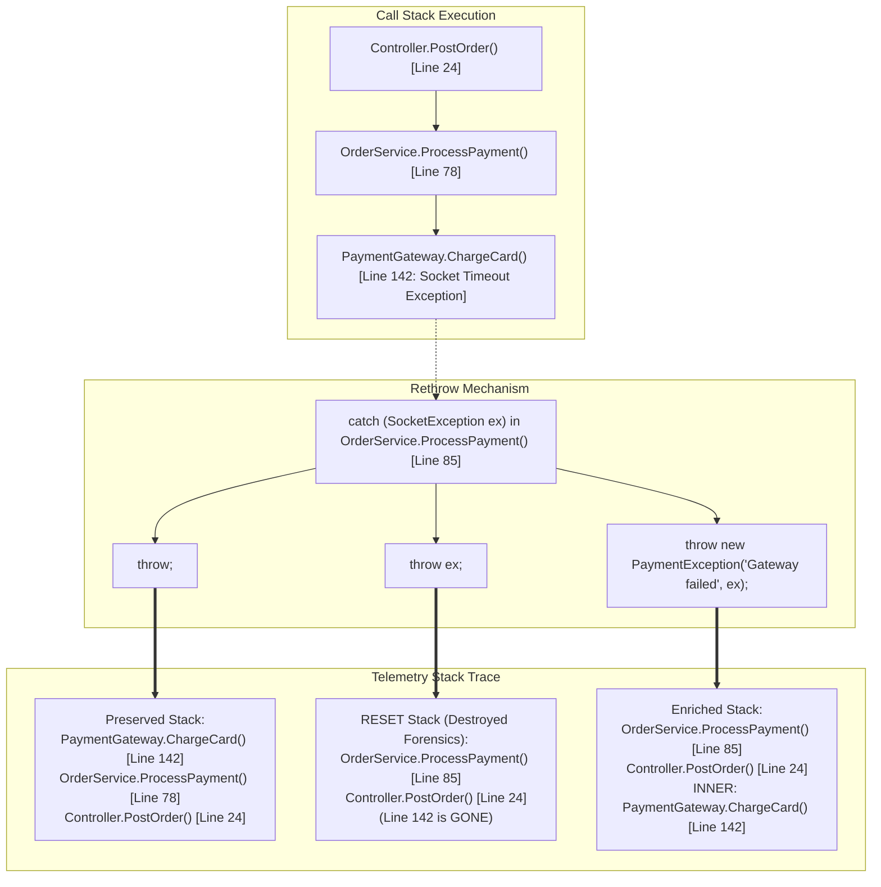
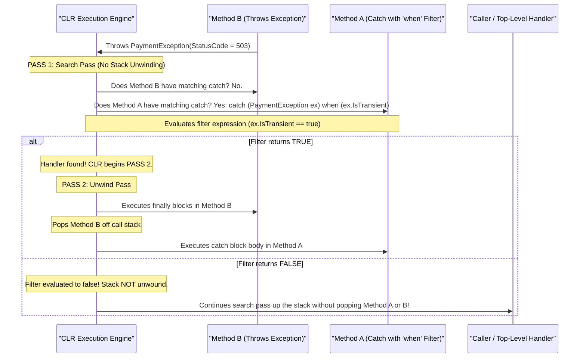

# Lesson 08: Exceptions Done Right

> **Prerequisites:** [Collections, LINQ and Deferred Execution](../07-collections-linq-and-deferred-execution/README.md) and [Track 26 Overview](../README.md).  
> **Estimated Reading Time:** 20 minutes  
> **Target Audience:** Engineers preparing for LLD, OOP, C#, or Python technical screening and architecture rounds.

> [!TIP]
> **The One Rule of Exceptions:** Exceptions represent exceptional, unrecoverable failures that prevent a method from fulfilling its contract—they are never an alternative to control flow. Never catch an exception you cannot meaningfully handle, never swallow exceptions silently, and preserve your stack traces using parameterless `throw;` or explicit inner exceptions (`throw new CustomException("...", ex)`). For expected domain validations, return typed Result objects (`Result<T>`) to avoid the steep runtime cost of OS thread stack walking.

---

## 1. Why This Matters: The Interview Trap

"What is the difference between `throw;` and `throw ex;`?" is a staple question in C# and .NET interviews. It separates candidates who merely write syntax from engineers who understand runtime internals, debugging forensics, and production incident triage.

A junior candidate often answers:
> *"Both rethrow the exception. `throw ex` is just more explicit because you specify the exception variable you caught."*

This is catastrophic in production. When you write `throw ex;`, the Common Language Runtime (CLR) treats the current catch block as the **origin point** of the exception. The CLR resets the stack trace property (`ex.StackTrace`), completely wiping out the method call history, line numbers, and file paths of the actual failure point. 

When an outage occurs at 3:00 AM, the log reports that the error occurred on line 84 inside your catch block—leaving you blind to which of the 15 nested helper methods or remote database calls actually failed.

A senior engineer explains the mechanics:
1. **`throw;` (Stack Preservation):** Performs a rethrow while preserving the original call stack and instruction pointer. The CLR continues unwinding the stack from the original throw site.
2. **`throw ex;` (Stack Reset):** Triggers a brand-new throw operation on the existing exception object. The stack trace is overwritten with the current frame, destroying upstream telemetry.
3. **`throw new CustomException("context", ex);` (Stack Enrichment):** Creates an enriched domain exception, preserving the original failure inside `InnerException`. This is the gold standard when transitioning across architectural boundaries (e.g., converting a raw `SqlException` into a domain `OrderRepositoryException`).
4. **Exception Filters (`when`):** Evaluates a boolean predicate during the CLR's **search pass** *before* the stack is unwound. If the filter condition is false, the stack frame is never popped, leaving memory state and locals fully intact for crash dumps.

### Exceptions vs. Control Flow: The Hidden Latency Tax

Another common failure mode is using exceptions for normal validation:

```csharp
// ANTI-PATTERN: Using exceptions for regular validation
try 
{
    var age = int.Parse(userInput);
}
catch (FormatException)
{
    return BadRequest("Invalid age format");
}
```

Throwing an exception in .NET is exceptionally expensive. When an exception is thrown, the CLR must:
- Allocate a managed `Exception` object on the heap.
- Invoke kernel routines to capture the entire OS thread call stack.
- Walk up each stack frame, inspecting metadata tokens to locate matching `catch` blocks.
- Perform stack unwinding and invoke intervening `finally` blocks.

In hot paths or high-concurrency microservices, throwing thousands of exceptions per second will saturate your CPU with stack-walking routines and trigger frequent Garbage Collection (GC) pauses. For expected conditional outcomes (user input errors, resource not found, business rule denials), use **Result Types** (`Result<T>`) or the `Try*` pattern (`int.TryParse`).

| Dimension | `throw;` | `throw ex;` | `throw new DomainEx("...", ex);` | `Result<T>` Pattern |
| :--- | :--- | :--- | :--- | :--- |
| **Stack Trace** | Preserves original call stack intact. | Overwrites stack trace; resets origin to current line. | Preserves original stack in `InnerException`; adds new frame. | N/A (no exception thrown). |
| **Use Case** | Catching to log, add telemetry, and re-propagate. | **Never.** (Anti-pattern in production code). | Encapsulating infrastructure errors into domain models. | Predictable domain failures (bad input, rule rejection). |
| **Performance Cost** | Unwinds stack; high CPU cost. | Unwinds stack; high CPU cost. | Allocates new exception + unwinds stack. | Zero stack-walk cost; minimal allocation (~24 bytes). |
| **API Contract** | Implicit failure (untyped in method signature). | Implicit failure. | Implicit failure. | Explicit failure stated in method signature. |

---

## 2. Visual Mental Model / Taxonomic Comparison

### Stack Unwinding: `throw;` vs. `throw ex;`

Understanding stack unwinding clarifies why `throw ex;` causes severe data loss:



### The CLR Two-Pass Exception Handling Mechanism

The CLR implements a **two-pass exception handling model** derived from Structured Exception Handling (SEH) in Windows. Understanding this model explains the power of exception filters (`when`):



> [!NOTE]
> Because exception filters execute during **Pass 1 (Search Pass)** before the stack unwinds, unhandled exceptions can be captured in Windows minidumps or crash debuggers with all local variables, heap references, and stack frames intact. If you catch and rethrow inside the body of a catch block, the stack has already partially unwound!

---

## 3. Code Implementation

Here is an architectural implementation of a resilient Payment and Order Processing Pipeline demonstrating:
1. The **Result Pattern** for expected domain validations (zero exceptions thrown).
2. A typed custom exception hierarchy (`PaymentGatewayException`, `OrderProcessingException`).
3. **Exception Filters** (`when`) targeting transient HTTP status codes.
4. Preserving the stack trace with `throw;` and chained `innerException`.
5. Guarantees provided by the `finally` block.

````carousel
```csharp
using System;

// 1. Result Pattern for Non-Exceptional Domain Validations
public sealed record Result<T>
{
    public bool IsSuccess { get; }
    public T? Value { get; }
    public string? Error { get; }

    private Result(bool isSuccess, T? value, string? error)
    {
        IsSuccess = isSuccess;
        Value = value;
        Error = error;
    }

    public static Result<T> Success(T value) => new(true, value, null);
    public static Result<T> Failure(string error) => new(false, default, error);
}

// 2. Custom Typed Exceptions
public class PaymentGatewayException : Exception
{
    public int StatusCode { get; }
    public bool IsTransient => StatusCode is 408 or 429 or 500 or 502 or 503 or 504;

    public PaymentGatewayException(string message, int statusCode, Exception? innerException = null)
        : base(message, innerException)
    {
        StatusCode = statusCode;
    }
}

public class OrderProcessingException : Exception
{
    public string OrderId { get; }

    public OrderProcessingException(string message, string orderId, Exception? innerException = null)
        : base(message, innerException)
    {
        OrderId = orderId;
    }
}

public class OrderService
{
    public Result<string> ValidateOrder(string orderId, decimal amount)
    {
        // Domain validation: expected, non-exceptional flow
        if (string.IsNullOrWhiteSpace(orderId))
            return Result<string>.Failure("Order ID cannot be empty.");
        if (amount <= 0)
            return Result<string>.Failure("Amount must be greater than zero.");

        return Result<string>.Success($"Order {orderId} valid for ${amount:F2}");
    }

    public void ChargeCreditCard(string orderId, decimal amount, int simulatedStatusCode)
    {
        try
        {
            if (simulatedStatusCode >= 400)
            {
                var networkEx = new TimeoutException("Socket timed out after 3000ms");
                throw new PaymentGatewayException(
                    $"Gateway rejected with status {simulatedStatusCode}",
                    simulatedStatusCode,
                    networkEx);
            }

            Console.WriteLine($"[PAYMENT] Successfully charged ${amount:F2} for order {orderId}");
        }
        // 3. Exception Filter: Only catches transient HTTP codes during CLR Pass 1
        catch (PaymentGatewayException ex) when (ex.IsTransient)
        {
            Console.WriteLine($"[FILTER CAUGHT] Transient error {ex.StatusCode}: {ex.Message}. Initiating retry...");
            // Parameterless throw: preserves full stack trace intact
            throw;
        }
    }

    public void ProcessPipeline(string orderId, decimal amount, int simulatedStatusCode)
    {
        Console.WriteLine($"--- Processing {orderId} ---");

        // Step 1: Expected validation via Result pattern (fast, no stack walk)
        var validation = ValidateOrder(orderId, amount);
        if (!validation.IsSuccess)
        {
            Console.WriteLine($"[DOMAIN REJECTION] {validation.Error}");
            return;
        }
        Console.WriteLine($"[VALIDATION] {validation.Value}");

        // Step 2: Exceptional flow with clean finally block
        bool auditLogged = false;
        try
        {
            ChargeCreditCard(orderId, amount, simulatedStatusCode);
        }
        catch (PaymentGatewayException ex)
        {
            // 4. Wrap with domain exception, preserving the original cause in innerException
            Console.WriteLine($"[RETHROW] Wrapping into OrderProcessingException: {ex.Message}");
            throw new OrderProcessingException($"Order pipeline halted for {orderId}", orderId, ex);
        }
        finally
        {
            // 5. Cleanup / Resource release: runs deterministically on success or failure
            auditLogged = true;
            Console.WriteLine($"[FINALLY] Audit record finalized for order {orderId}. (Audit recorded: {auditLogged})");
        }
    }
}

public static class Program
{
    public static void Main()
    {
        var service = new OrderService();

        // Scenario 1: Domain validation failure (clean return code, no exceptions)
        service.ProcessPipeline("", 0, 200);

        // Scenario 2: Successful execution through all stages
        service.ProcessPipeline("ORD-101", 150.00m, 200);

        // Scenario 3: Transient infrastructure failure handled by filter and wrapped
        try
        {
            service.ProcessPipeline("ORD-102", 275.50m, 503);
        }
        catch (OrderProcessingException ex)
        {
            Console.WriteLine($"[TOP-LEVEL CATCH] Caught: {ex.GetType().Name} -> {ex.Message}");
            Console.WriteLine($"  Root Cause: {ex.InnerException?.GetType().Name} (Status: {((PaymentGatewayException)ex.InnerException!).StatusCode})");
            Console.WriteLine($"  Deepest Cause: {ex.InnerException?.InnerException?.GetType().Name}: {ex.InnerException?.InnerException?.Message}");
        }
    }
}
```
<!-- slide -->
```python
from dataclasses import dataclass
from typing import Generic, Optional, TypeVar

T = TypeVar('T')

# 1. Result Pattern for Non-Exceptional Domain Validations
@dataclass(frozen=True)
class Result(Generic[T]):
    is_success: bool
    value: Optional[T] = None
    error: Optional[str] = None

    @classmethod
    def success(cls, value: T) -> "Result[T]":
        return cls(is_success=True, value=value, error=None)

    @classmethod
    def failure(cls, error: str) -> "Result[T]":
        return cls(is_success=False, value=None, error=error)


# Custom Timeout matching standard exception naming
class TimeoutException(Exception):
    pass


# 2. Custom Typed Exceptions
class PaymentGatewayException(Exception):
    def __init__(self, message: str, status_code: int):
        super().__init__(message)
        self.status_code = status_code

    @property
    def is_transient(self) -> bool:
        return self.status_code in {408, 429, 500, 502, 503, 504}


class OrderProcessingException(Exception):
    def __init__(self, message: str, order_id: str):
        super().__init__(message)
        self.order_id = order_id


class OrderService:
    def validate_order(self, order_id: str, amount: float) -> Result[str]:
        # Domain validation: expected, non-exceptional flow
        if not order_id.strip():
            return Result.failure("Order ID cannot be empty.")
        if amount <= 0:
            return Result.failure("Amount must be greater than zero.")
        return Result.success(f"Order {order_id} valid for ${amount:.2f}")

    def charge_credit_card(self, order_id: str, amount: float, simulated_status_code: int) -> None:
        try:
            if simulated_status_code >= 400:
                network_ex = TimeoutException("Socket timed out after 3000ms")
                # PEP 3134 Chained Exception: explicit cause preserved via 'from'
                raise PaymentGatewayException(
                    f"Gateway rejected with status {simulated_status_code}",
                    simulated_status_code
                ) from network_ex

            print(f"[PAYMENT] Successfully charged ${amount:.2f} for order {order_id}")
        except PaymentGatewayException as ex:
            # 3. Exception Filtering pattern in Python
            if ex.is_transient:
                print(f"[FILTER CAUGHT] Transient error {ex.status_code}: {ex}. Initiating retry...")
                # Bare 'raise' preserves the full call stack
                raise
            raise

    def process_pipeline(self, order_id: str, amount: float, simulated_status_code: int) -> None:
        print(f"--- Processing {order_id} ---")

        # Step 1: Expected validation via Result pattern
        validation = self.validate_order(order_id, amount)
        if not validation.is_success:
            print(f"[DOMAIN REJECTION] {validation.error}")
            return
        print(f"[VALIDATION] {validation.value}")

        # Step 2: Exceptional flow with clean finally block
        audit_logged = False
        try:
            self.charge_credit_card(order_id, amount, simulated_status_code)
        except PaymentGatewayException as ex:
            # 4. Wrap with domain exception, preserving cause via 'raise ... from ex'
            print(f"[RETHROW] Wrapping into OrderProcessingException: {ex}")
            raise OrderProcessingException(f"Order pipeline halted for {order_id}", order_id) from ex
        finally:
            # 5. Guaranteed cleanup execution
            audit_logged = True
            print(f"[FINALLY] Audit record finalized for order {order_id}. (Audit recorded: {audit_logged})")


def main() -> None:
    service = OrderService()

    # Scenario 1: Domain validation failure (clean return code, no exceptions)
    service.process_pipeline("", 0.0, 200)

    # Scenario 2: Successful execution through all stages
    service.process_pipeline("ORD-101", 150.00, 200)

    # Scenario 3: Transient infrastructure failure handled by filter and wrapped
    try:
        service.process_pipeline("ORD-102", 275.50, 503)
    except OrderProcessingException as ex:
        print(f"[TOP-LEVEL CATCH] Caught: {type(ex).__name__} -> {ex}")
        cause = ex.__cause__
        root_status = cause.status_code if isinstance(cause, PaymentGatewayException) else "N/A"
        print(f"  Root Cause: {type(cause).__name__} (Status: {root_status})")
        deepest = cause.__cause__ if cause else None
        print(f"  Deepest Cause: {type(deepest).__name__}: {deepest}")


if __name__ == "__main__":
    main()
```
````

**Expected Output (Both Languages):**
```text
--- Processing  ---
[DOMAIN REJECTION] Order ID cannot be empty.
--- Processing ORD-101 ---
[VALIDATION] Order ORD-101 valid for $150.00
[PAYMENT] Successfully charged $150.00 for order ORD-101
[FINALLY] Audit record finalized for order ORD-101. (Audit recorded: True)
--- Processing ORD-102 ---
[VALIDATION] Order ORD-102 valid for $275.50
[FILTER CAUGHT] Transient error 503: Gateway rejected with status 503. Initiating retry...
[RETHROW] Wrapping into OrderProcessingException: Gateway rejected with status 503
[FINALLY] Audit record finalized for order ORD-102. (Audit recorded: True)
[TOP-LEVEL CATCH] Caught: OrderProcessingException -> Order pipeline halted for ORD-102
  Root Cause: PaymentGatewayException (Status: 503)
  Deepest Cause: TimeoutException: Socket timed out after 3000ms
```

---

## 4. Where You Already Use It

Production libraries and enterprise frameworks rely extensively on these patterns:

- **.NET Base Class Library (BCL):**
  - `HttpRequestException` (in `System.Net.Http`): Exposes an `HttpRequestError` enum and nullable `StatusCode` property, allowing fine-grained exception filters: `catch (HttpRequestException ex) when (ex.StatusCode == HttpStatusCode.GatewayTimeout)`.
  - `DbUpdateConcurrencyException` (in EF Core): Thrown when an optimistic concurrency token mismatch occurs, carrying entries for conflicted entities.
  - `OperationCanceledException` and `TaskCanceledException`: Intercepted by task schedulers to gracefully terminate task chains without marking them as faulted.
  - `int.TryParse` vs. `int.Parse`: The canonical example of replacing costly exception-based parsing with boolean return codes.
- **ASP.NET Core:**
  - `IExceptionHandler` / `UseExceptionHandler`: Centralized error pipeline that intercepts uncaught exceptions, transforms them into standardized RFC 7807 `ProblemDetails` responses, and logs them without crashing Kestrel.
- **Python Standard Library & Ecosystem:**
  - `requests.exceptions.RequestException` and HTTP status helpers (`HTTPError`).
  - PEP 3134 (`raise ... from original_err`): Sets `__cause__` explicitly, preventing lost debug context.
  - Python 3.11 `ExceptionGroup` and `except*`: Designed for asynchronous fan-out (`asyncio.TaskGroup`), allowing callers to match and handle concurrent exceptions individually.

---

## 5. Pitfalls and When Not to Use It

### 1. Pokemon Exception Handling ("Gotta catch 'em all!")
Catching general `System.Exception` or Python's `Exception` at low architectural layers hides severe bugs:

```csharp
// FATAL ANTI-PATTERN
try {
    PersistUser(user);
} catch (Exception) {
    // Swallowed! OutOfMemoryException, NullReferenceException, and database outages silently ignored!
    return false;
}
```
*Correction:* Only catch specific, anticipated exceptions (`SqlException`, `IOException`). Allow unforeseen defects (`NullReferenceException`, `ArgumentNullException`) to bubble up to your global error handler so they appear in Sentry/Application Insights with full diagnostic alerts.

### 2. When `finally` Does NOT Run
Many developers assume `finally` is an inviolable mathematical guarantee. In reality, the CLR will **not** execute `finally` blocks in the following cases:
1. **`Environment.FailFast(string message)`:** Intentionally terminates the process immediately without running finalizers, `finally` blocks, or unwinding the stack (used when state corruption is detected).
2. **`Process.Kill()` or external SIGKILL (kill -9):** The OS kernel instantly tears down the process address space.
3. **`StackOverflowException`:** The execution stack has exceeded memory limits; the CLR cannot allocate a stack frame to execute the `finally` block, terminating the process immediately.
4. **Infinite Loops or Thread Deadlocks inside `try`:** If execution never reaches the end of the `try` block, `finally` never triggers.
5. **Sudden Power Loss / Hardware Failure:** Physical termination of host machine or container host eviction.

### 3. Destruction of Context via `throw ex;`
Never pass the caught variable to `throw`:
```csharp
catch (SqlException ex)
{
    _logger.LogError("Database failed");
    throw ex; // BUG: Stack trace reset! Originating line number wiped!
}
```
*Correction:* Use bare `throw;` to preserve the stack, or `throw new RepositoryException("Failed query", ex);` to add domain context.

### 4. Performance Degradation: Exceptions as Control Flow
Throwing an exception is roughly **1,000 to 5,000 times slower** than returning a struct or boolean. In a loop parsing 100,000 strings:
- `int.TryParse`: ~1.5 milliseconds, 0 bytes allocated.
- `try { int.Parse() } catch`: ~3,200 milliseconds, megabytes allocated in `Exception` objects and stack trace traces.

---

## 6. Exercises & Practical Drills

### Drill 1: The Disappearing Stack Trace
**Problem:** In the following snippet, the on-call engineer cannot find which database call failed because the stack trace points to line 11. Fix the method so the original call site is preserved, while adding a helpful error message for the payment service.

```csharp
public async Task ProcessOrderAsync(Order order)
{
    try
    {
        await _db.InsertOrderAsync(order);
        await _db.UpdateInventoryAsync(order.Items);
    }
    catch (DbException ex)
    {
        _logger.LogError(ex.Message);
        throw ex; // Problematic line
    }
}
```

<details>
<summary>Answer</summary>

```csharp
public async Task ProcessOrderAsync(Order order)
{
    try
    {
        await _db.InsertOrderAsync(order);
        await _db.UpdateInventoryAsync(order.Items);
    }
    catch (DbException ex)
    {
        _logger.LogError(ex, "Database persistence failed for Order {OrderId}", order.Id);
        // Option A: If callers understand DbException, rethrow preserving the stack
        throw;

        // Option B: If crossing an architectural boundary, wrap in a domain exception:
        // throw new OrderPersistenceException($"Failed to persist order {order.Id}", ex);
    }
}
```
*Why this works:* Using `throw;` preserves the exact line number inside `InsertOrderAsync` or `UpdateInventoryAsync`. Logging the exception object (`_logger.LogError(ex, ...)`) ensures structured loggers serialize the entire stack trace rather than just the message.
</details>

---

### Drill 2: Implementing Resilient Exception Filtering
**Problem:** You are integrating with a third-party billing API that throws `BillingApiException`. The API returns an HTTP integer `StatusCode`. You want to catch and retry **only** when the status code indicates a transient gateway problem (HTTP 429 Too Many Requests, 502 Bad Gateway, 503 Service Unavailable, 504 Gateway Timeout). You must let authorization failures (401, 403) or client errors (400, 404) bubble up immediately without retrying and without unwinding the stack.

<details>
<summary>Answer</summary>

```csharp
public async Task<Invoice> ChargeWithRetryAsync(BillingRequest request)
{
    const int maxRetries = 3;
    for (int attempt = 1; attempt <= maxRetries; attempt++)
    {
        try
        {
            return await _client.PostBillingAsync(request);
        }
        catch (BillingApiException ex) when (IsTransient(ex.StatusCode) && attempt < maxRetries)
        {
            _logger.LogWarning("Transient billing error {Code} on attempt {Attempt}. Retrying...", ex.StatusCode, attempt);
            await Task.Delay(TimeSpan.FromSeconds(Math.Pow(2, attempt)));
        }
    }
    throw new InvalidOperationException("Unreachable code.");
}

private static bool IsTransient(int statusCode) =>
    statusCode is 429 or 502 or 503 or 504;
```
*Why this works:* The exception filter (`when (...)`) checks both the status code and the remaining attempt count during CLR Pass 1. If an unrecoverable 401 Unauthorized occurs, the filter evaluates to `false`. The CLR immediately bypasses the catch block without unwinding, preserving original stack frames for logging.
</details>

---

## 7. Interview Questions & Model Answers

> [!interview]
> **Question 1: What is the difference between `throw` and `throw ex`?**  
> **Strong Answer:**  
> "The fundamental difference lies in how the CLR manages the exception's stack trace during unwinding.  
> 
> When you invoke bare `throw;`, the CLR rethrows the currently active exception while keeping its original stack trace completely intact. The stack trace continues to reflect the exact method, file, and line number where the exception was originally instantiated and thrown.  
> 
> When you invoke `throw ex;`, you are passing the exception reference to a new throw instruction. The CLR treats the current `catch` block as the brand-new origination point of the exception, overwriting `ex.StackTrace`. Any upstream call hierarchy prior to that catch block is eradicated from the trace. In production, this turns deep debugging into guesswork because loggers will point to the catch block instead of the failing line.  
> 
> Therefore, `throw ex;` is an anti-pattern. If you need to rethrow, always use bare `throw;` to preserve the stack, or wrap the caught exception as an `innerException` inside a new domain exception (`throw new OrderProcessingException("...", ex)`)."

---

> [!interview]
> **Question 2: Does `finally` always run?**  
> **Strong Answer:**  
> "In normal, managed application flow, yes: `finally` blocks are guaranteed to execute whether the `try` block completes normally, returns early, or exits via an unhandled exception. However, there are five critical scenarios where `finally` will **not** run:  
> 1. **`Environment.FailFast()`:** When this method is called, the CLR immediately terminates the process without unwinding the stack, executing `finally` blocks, or running finalizers. It is typically invoked when unrecoverable memory or application state corruption is detected.  
> 2. **OS Process Termination (`Process.Kill()` or SIGKILL):** If the host operating system terminates the process externally (e.g., via `kill -9` on Linux or Task Manager on Windows), the address space is reclaimed immediately.  
> 3. **`StackOverflowException`:** When the thread call stack overflows, the runtime cannot allocate the stack frame required to execute the `finally` block. In modern .NET, this causes immediate process termination.  
> 4. **Infinite Loops or Hangs inside `try`:** If execution enters an infinite `while(true)` loop or deadlocks on a thread lock inside the `try` block, execution never leaves the `try`, so `finally` never executes.  
> 5. **Host Eviction or Hardware Power Loss:** Sudden container eviction (OOM Killer) or server power failure."

---

> [!interview]
> **Question 3: When should you create a custom exception?**  
> **Strong Answer:**  
> "You should create a custom exception only when callers can programmatically handle the failure in a distinct, meaningful way, or when crossing an architectural boundary where implementation details must be abstracted into domain concepts.  
> 
> Valid reasons to create a custom exception:
> 1. **Caller Actionability:** The calling code needs to catch that specific failure to trigger distinct recovery logic (e.g., catching `InsufficientFundsException` to notify a user, versus catching `PaymentGatewayUnavailableException` to queue the transaction for background retry).
> 2. **Adding Structured Metadata:** Built-in exceptions only hold a string message. A custom exception can expose structured properties (e.g., `StatusCode`, `RetryAfter`, `CorrelationId`) that logging middleware and retry policies can inspect without fragile string parsing.
> 3. **Architectural Encapsulation:** In Clean or Hexagonal Architecture, infrastructure exceptions (like `SqlException` or `CosmosException`) should not leak into application use cases. Wrapping them in a domain-specific `RepositoryException` enforces modular decoupling.  
> 
> When creating custom exceptions in modern .NET:
> - Inherit from `System.Exception` (never `System.ApplicationException`, which Microsoft considers obsolete).
> - Provide the standard constructors: `()`, `(string message)`, and `(string message, Exception innerException)`.
> - Do not create custom exceptions for expected domain validation—use `Result<T>` instead."

---

> [!interview]
> **Question 4: What is an exception filter?**  
> **Strong Answer:**  
> "An exception filter is a C# language feature using the `when` keyword on a `catch` block that evaluates a boolean condition to decide whether that `catch` block should handle the exception.  
> 
> For example:
> ```csharp
> catch (HttpRequestException ex) when (ex.StatusCode == HttpStatusCode.ServiceUnavailable)
> ```
> 
> The architectural significance of exception filters lies in the **CLR's two-pass exception handling model**:
> 1. **Pass 1 (Search Pass):** The runtime traverses up the stack looking for a matching handler. When it encounters a catch block with a `when` clause, it executes the filter expression **without unwinding the stack**. If the expression returns `false`, the search continues upward. The stack frames above remain intact.
> 2. **Pass 2 (Unwind Pass):** Only once a filter returns `true` does the CLR begin unwinding the stack, executing intervening `finally` blocks, and popping stack frames down to the handler.  
> 
> By contrast, if you catch the exception unconditionally and rethrow with `if (!condition) throw;`, the stack has already been unwound to your catch block. Any crash dump, debugger attached at that moment, or Windows Error Reporting will have lost the original stack frames and local variables of the calling methods. Exception filters keep your call stack intact until a true match is confirmed."

---

## 8. Sources & Further Reading

- [Microsoft Learn: Best practices for exceptions in .NET](https://learn.microsoft.com/en-us/dotnet/standard/exceptions/best-practices-for-exceptions)
- [Microsoft Learn: Exception-handling statements - throw, try-catch, try-finally](https://learn.microsoft.com/en-us/dotnet/csharp/language-reference/statements/exception-handling-statements)
- [Jeffrey Richter: CLR via C# (4th Edition) - Chapter 20: Exceptions and State Management](https://www.microsoftpressstore.com/store/clr-via-c-sharp-9780735667457)
- [Python Documentation: Errors and Exceptions](https://docs.python.org/3/tutorial/errors.html)
- [PEP 3134: Exception Chaining and Embedded Tracebacks](https://peps.python.org/pep-3134/)

---

Previous: [Collections, LINQ and Deferred Execution](../07-collections-linq-and-deferred-execution/README.md) · Next: [Memory, Garbage Collection and IDisposable](../09-memory-garbage-collection-and-idisposable/README.md)
