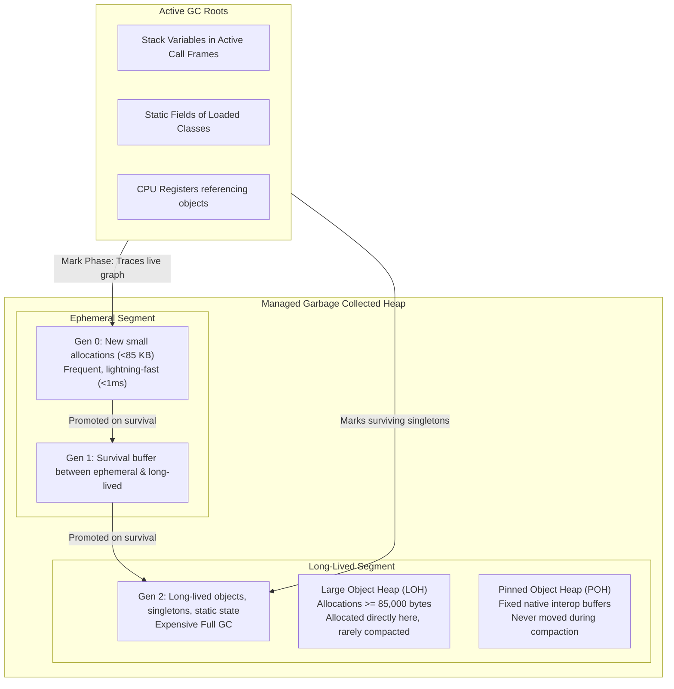
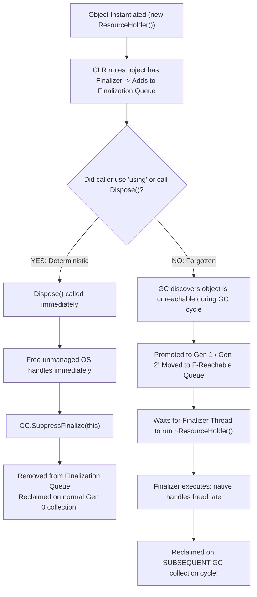

# Lesson 09: Memory, Garbage Collection and IDisposable

> **Prerequisites:** [Exceptions Done Right](../08-exceptions-done-right/README.md) and [Track 26 Overview](../README.md).  
> **Estimated Reading Time:** 19 minutes  
> **Target Audience:** Engineers preparing for LLD, OOP, C#, or Python technical screening and architecture rounds.

> [!TIP]
> **The One Rule of Memory in .NET:** Managed memory is reclaimed automatically by the generational Garbage Collector via mark-and-sweep, but unmanaged resources (OS file handles, database connections, sockets, native memory buffers) are **never** released by the GC—they require deterministic disposal via `IDisposable` and the `using` statement. If an object implements `IDisposable`, failure to dispose it leaks OS resources, not managed RAM.

---

## 1. Why This Matters: The Interview Trap

The classic interview opener in senior backend rounds is:  
*"Can you leak memory in a managed language like C# that has an automatic Garbage Collector?"*

Candidates without production debugging experience often reply:  
*"No, memory leaks are only possible in C or C++ where you have manual `malloc` and `free`. In C#, the Garbage Collector frees any object that is no longer needed."*

**This answer immediately signals a junior mindset.**

While .NET prevents *unreferenced memory leaks* (where a memory address is completely orphaned without a pointer to free it), it does **not** prevent **logical memory leaks** (where objects remain reachable in the GC root graph despite never being used again by the application).

In production .NET microservices, four memory leak patterns regularly cause Out-Of-Memory (`OutOfMemoryException`) crashes:
1. **Lapsed Listener (Event Handler Leaks):** Subscribing a short-lived service instance to an event on a singleton or long-lived publisher. The publisher's invocation list maintains a strong reference to the subscriber, preventing GC collection forever.
2. **Static Fields and Unbounded Caches:** Static collections (`static readonly List<T>` or `ConcurrentDictionary`) that append entries without eviction policies or time-to-live (TTL) limits.
3. **Improper Disposal of Native Wrappers:** Creating objects that wrap OS kernel handles (e.g., `FileStream`, `Socket`, `Bitmap`, unmanaged memory allocators) without calling `.Dispose()`. The managed wrapper may eventually be collected, but OS file handles or socket ports stay open, leading to operating system handle exhaustion (`TIME_WAIT` socket exhaustion).
4. **Pinned Objects Fragmenting the Heap:** Using `GCHandle.Alloc(obj, GCHandleType.Pinned)` or fixed pointers during native interop, preventing the GC from compacting adjacent memory segments and fragmenting the heap.

### Weak vs. Strong Answer

| Dimension | Weak Answer | Strong Senior Answer |
| :--- | :--- | :--- |
| **How GC Works** | "It counts references and deletes objects when the count hits zero." | "The .NET GC is a **tracing, generational mark-and-sweep collector**, not a reference counter. It operates on the **Weak Generational Hypothesis**: newer objects have shorter lifespans. It segments the heap into Generations 0, 1, 2, the Large Object Heap (LOH >= 85,000 bytes), and the Pinned Object Heap (POH). Collections start by inspecting GC Roots (stack frames, CPU registers, static fields), marking reachable objects, and sweeping/compacting unmarked survivors." |
| **Dispose vs Finalize** | "They both clean up objects." | "`Dispose()` is **deterministic, synchronous, and explicit**, invoked by application code (typically via `using`). It releases unmanaged resources immediately and cleans up managed dependencies. `Finalize()` (`~ClassName()`) is **non-deterministic and asynchronous**, executed by a dedicated GC finalizer thread as a safety net if caller code forgot to dispose. Objects with finalizers must survive at least one extra GC cycle, worsening memory pressure." |
| **`using` Statement** | "It imports namespaces at the top of the file." | "When used as a statement or declaration (`using var x = ...`), it compiles to a robust `try-finally` block. Regardless of whether the enclosed block finishes normally or throws an unhandled exception, `x.Dispose()` is guaranteed to execute in the `finally` block before the stack unwinds." |

---

## 2. Visual Mental Model / Taxonomic Comparison

### The .NET Generational Heap Architecture & GC Phases



### The IDisposable vs. Finalizer Lifecycle



### Resource Cleanup Comparison

| Feature | `Dispose()` (`IDisposable`) | `DisposeAsync()` (`IAsyncDisposable`) | Finalizer (`~ClassName()`) |
| :--- | :--- | :--- | :--- |
| **Invocation** | Explicit / Deterministic (`using`) | Explicit / Deterministic (`await using`) | Implicit / Non-deterministic (GC thread) |
| **Execution Timing** | Immediate when leaving scope | Immediate when leaving scope (non-blocking) | Delayed until GC discovers and finalizer thread wakes |
| **Cleans Managed Resources?** | Yes | Yes | **NO!** (Managed objects might already be finalized/collected) |
| **Cleans Unmanaged Resources?** | Yes | Yes | Yes (Fallback safety net) |
| **Performance Overhead** | Zero GC penalty (with `SuppressFinalize`) | Zero GC penalty | High (object promoted to Gen 2, delays collection by 1+ GC cycles) |
| **Async I/O Support** | No (synchronous only) | Yes (can await flushing streams/buffers) | No |

---

## 3. Code Implementation

The following carousel provides the canonical, production-grade **Standard Dispose Pattern** in C# alongside modern `using` declarations and `IAsyncDisposable`, followed by Python's equivalent context manager pattern (`__enter__`, `__exit__`, `__del__`, and `weakref`).

````carousel
```csharp
// Slide 1: C# - The Standard Dispose Pattern, Async Disposable, and Event Leaks
using System;
using System.IO;
using System.Runtime.InteropServices;
using System.Threading.Tasks;

// 1. CANONICAL STANDARD DISPOSE PATTERN
public class NativeResourceManager : IDisposable, IAsyncDisposable
{
    private IntPtr _unmanagedBuffer; // Simulated unmanaged native buffer
    private FileStream? _managedStream; // Managed disposable resource
    private bool _disposed = false;

    public NativeResourceManager(string tempFilePath)
    {
        // Allocate 1024 bytes of native unmanaged memory
        _unmanagedBuffer = Marshal.AllocHGlobal(1024);
        _managedStream = new FileStream(tempFilePath, FileMode.OpenOrCreate);
        Console.WriteLine("[Resource] Allocated native memory and opened file stream.");
    }

    // Public deterministic Dispose method
    public void Dispose()
    {
        Dispose(disposing: true);
        GC.SuppressFinalize(this); // Remove from finalizer queue to avoid Gen 2 promotion
    }

    // Protected virtual Dispose pattern method
    protected virtual void Dispose(bool disposing)
    {
        if (_disposed) return;

        if (disposing)
        {
            // Clean up MANAGED disposable objects
            if (_managedStream != null)
            {
                _managedStream.Dispose();
                _managedStream = null;
                Console.WriteLine("[Resource] Managed FileStream disposed.");
            }
        }

        // Clean up UNMANAGED resources (safe to call from finalizer)
        if (_unmanagedBuffer != IntPtr.Zero)
        {
            Marshal.FreeHGlobal(_unmanagedBuffer);
            _unmanagedBuffer = IntPtr.Zero;
            Console.WriteLine("[Resource] Unmanaged native memory freed.");
        }

        _disposed = true;
    }

    // C# 8+ Async Disposable for non-blocking I/O cleanup
    public async ValueTask DisposeAsync()
    {
        if (_disposed) return;

        if (_managedStream != null)
        {
            await _managedStream.DisposeAsync();
            _managedStream = null;
            Console.WriteLine("[Resource] Managed FileStream disposed asynchronously.");
        }

        Dispose(disposing: false); // Free unmanaged buffer
        GC.SuppressFinalize(this);
    }

    // Finalizer (safety net only if caller fails to call Dispose)
    ~NativeResourceManager()
    {
        Dispose(disposing: false);
    }
}

public class Program
{
    public static async Task Main()
    {
        string tempFile = Path.GetTempFileName();

        Console.WriteLine("=== 1. Deterministic Cleanup with 'using' Declaration ===");
        {
            using (var manager = new NativeResourceManager(tempFile))
            {
                Console.WriteLine("Inside using block: working with resources...");
            } // Compiler guarantees Dispose() is called here
        }

        Console.WriteLine("\n=== 2. Modern C# 8 'await using' Declaration ===");
        {
            await using var asyncManager = new NativeResourceManager(tempFile);
            Console.WriteLine("Inside async using block: flushing asynchronously...");
        } // DisposeAsync() called here

        Console.WriteLine("\n=== 3. Event Handler Leak Prevention ===");
        var publisher = new EventPublisher();
        var subscriber = new EventSubscriber(publisher);
        subscriber.Dispose(); // Properly detaches event to prevent memory leak
        publisher.Raise();

        // Clean up temp file
        if (File.Exists(tempFile)) File.Delete(tempFile);
    }
}

public class EventPublisher
{
    public event Action? OnSomethingHappened;
    public void Raise() => OnSomethingHappened?.Invoke();
}

public class EventSubscriber : IDisposable
{
    private readonly EventPublisher _publisher;
    public EventSubscriber(EventPublisher pub)
    {
        _publisher = pub;
        _publisher.OnSomethingHappened += HandleEvent;
    }

    private void HandleEvent() => Console.WriteLine("[Subscriber] Event received!");

    public void Dispose()
    {
        // Unsubscribe to sever strong reference from publisher
        _publisher.OnSomethingHappened -= HandleEvent;
        Console.WriteLine("[Subscriber] Successfully detached event handler.");
    }
}
```
<!-- slide -->
```python
# Slide 2: Python - Context Managers, Weak References, and Finalizers
import os
import tempfile
from typing import Optional
import weakref


# 1. CANONICAL CONTEXT MANAGER (Equivalent to IDisposable / using)
class NativeResourceManager:

  def __init__(self, temp_file_path: str):
    self.temp_file_path = temp_file_path
    self.file_handle = open(temp_file_path, "w+")
    self._disposed = False
    print("[Resource] Allocated native memory and opened file stream.")

  def __enter__(self):
    return self

  def __exit__(self, exc_type, exc_val, exc_tb):
    """Deterministic cleanup equivalent to C# Dispose()."""
    self.close()
    return False

  def close(self):
    if not self._disposed:
      if self.file_handle:
        self.file_handle.close()
        print("[Resource] Managed FileStream disposed.")
      print("[Resource] Unmanaged native memory freed.")
      self._disposed = True

  def __del__(self):
    """Python finalizer (safety net)."""
    if not self._disposed:
      self.close()


# 2. EVENT SYSTEM WITH WEAK REFERENCES TO PREVENT MEMORY LEAKS
class EventPublisher:

  def __init__(self):
    # Use WeakSet so subscribers can be garbage collected without explicit unsubscribe
    self._subscribers = weakref.WeakSet()

  def subscribe(self, subscriber):
    self._subscribers.add(subscriber)

  def raise_event(self):
    for sub in list(self._subscribers):
      sub.handle_event()


class EventSubscriber:

  def __init__(self, publisher: EventPublisher):
    self.publisher = publisher
    self.publisher.subscribe(self)

  def handle_event(self):
    print("[Subscriber] Event received!")

  def dispose(self):
    print("[Subscriber] Successfully detached event handler.")


def main():
  fd, temp_file = tempfile.mkstemp()
  os.close(fd)

  try:
    print("=== 1. Deterministic Cleanup with 'with' Statement ===")
    with NativeResourceManager(temp_file) as manager:
      print("Inside using block: working with resources...")

    print("\n=== 2. Event Handler Leak Prevention ===")
    publisher = EventPublisher()
    subscriber = EventSubscriber(publisher)
    subscriber.dispose()

  finally:
    if os.path.exists(temp_file):
      os.remove(temp_file)


if __name__ == "__main__":
  main()
```
````

**Expected Output (Both Languages):**
```text
=== 1. Deterministic Cleanup with 'using' Declaration ===
[Resource] Allocated native memory and opened file stream.
Inside using block: working with resources...
[Resource] Managed FileStream disposed.
[Resource] Unmanaged native memory freed.

=== 2. Modern C# 8 'await using' Declaration ===
(In C#):
[Resource] Allocated native memory and opened file stream.
Inside async using block: flushing asynchronously...
[Resource] Managed FileStream disposed asynchronously.
[Resource] Unmanaged native memory freed.

=== 3. Event Handler Leak Prevention ===
[Subscriber] Successfully detached event handler.
```

---

## 4. Where You Already Use It

- **In .NET / C#:**
  - `SqlConnection`, `NpgsqlConnection`: Wrap database connections. Disposing them returns the physical socket back to the ADO.NET connection pool.
  - `FileStream`, `StreamWriter`, `MemoryStream`: Wrap OS file descriptors and buffers; `using` flushes pending bytes to disk and closes OS handles.
  - `HttpClient`: Note that `HttpClient` implements `IDisposable`, but disposing it per-request is an antipattern (`TIME_WAIT` socket exhaustion). It is managed via `IHttpClientFactory`.
  - `CancellationTokenSource`: Contains an unmanaged OS wait handle; failure to dispose CTS instances in high-throughput timers leaks system handles.
  - ASP.NET Core Dependency Injection: When an HTTP request terminates, the ASP.NET Core scoped container automatically invokes `.Dispose()` or `.DisposeAsync()` on every registered `Scoped` and `Transient` service that implements `IDisposable`.

- **In Python:**
  - `with open(...) as f:`: Standard Python context manager ensuring the OS file descriptor is closed deterministically.
  - `sqlite3.connect()` / `psycopg2.connect()`: Database connection transactions committed or rolled back and sockets closed via context managers.
  - `threading.Lock()`: `with lock:` guarantees mutex release even if an unhandled exception occurs inside the critical section.

---

## 5. Pitfalls and When Not to Use It

1. **The `HttpClient` Socket Exhaustion Trap:**
   - Developers often wrap `HttpClient` in a `using` statement: `using var client = new HttpClient(); client.GetAsync(...);`.
   - Even after `Dispose()` is called, the underlying OS socket is not closed immediately; it lingers in the `TIME_WAIT` state for 120-240 seconds. Under heavy traffic (thousands of requests/sec), the operating system runs out of ephemeral ports, throwing `SocketException: Only one usage of each socket address is normally permitted`.
   - *Fix:* Register `HttpClient` as a singleton or use `IHttpClientFactory` via dependency injection.

2. **Writing Finalizers When You Do Not Own Raw Pointers:**
   - A finalizer (`~ClassName()`) is **only** required if your class directly owns an unmanaged pointer (`IntPtr`) allocated via `Marshal.AllocHGlobal`, `VirtualAlloc`, or a raw OS handle.
   - If your class only contains other managed disposable objects (e.g., `FileStream`, `HttpClient`), **do not write a finalizer!** Simply implement `IDisposable` and forward the call to their `Dispose()` methods. Adding an unnecessary finalizer forces the CLR to promote your object to Gen 2, delaying memory reclamation and causing GC pauses.

3. **Forgetting `GC.SuppressFinalize(this)`:**
   - In classes that implement both `Dispose()` and a finalizer, omitting `GC.SuppressFinalize(this)` in the `Dispose` method leaves the object in the finalization queue. Even though the resource was already cleaned up, the GC will promote the object to Gen 2 and execute the finalizer on the finalizer thread anyway!

4. **Async Disposable Sync-over-Async:**
   - If an object implements `IAsyncDisposable`, do not call `.DisposeAsync().GetAwaiter().GetResult()` inside a synchronous `Dispose()` method. Under ASP.NET synchronization contexts, this causes immediate thread-pool deadlocks. Implement both interfaces cleanly or enforce `await using`.

---

## 6. Exercises & Practical Drills

### Drill 1: Spot the Hidden Memory Leak
Examine this caching service:
```csharp
public class CacheService
{
    private static readonly Dictionary<string, byte[]> _cache = new();

    public void AddToCache(string key, byte[] data)
    {
        _cache[key] = data;
    }
}
```
Why is this a memory leak, and how do you remediate it?

<details>
<summary>Answer</summary>

**Why it leaks:**  
`_cache` is a `static` field. Static fields act as permanent **GC Roots** for the entire lifetime of the `AppDomain` (the process). Because entries are added but never evicted, expired, or trimmed, the byte arrays accumulate indefinitely until the CLR crashes with `OutOfMemoryException`.

**Remediation:**  
Use `IMemoryCache` (from `Microsoft.Extensions.Caching.Memory`) with sliding expiration, absolute expiration, and a configured `SizeLimit`:
```csharp
var cacheEntryOptions = new MemoryCacheEntryOptions()
    .SetSlidingExpiration(TimeSpan.FromMinutes(5))
    .SetSize(1);
_memoryCache.Set(key, data, cacheEntryOptions);
```
</details>

### Drill 2: Identify the Generation Promotion Bug
Why does creating objects that implement finalizers without calling `Dispose()` hurt GC throughput more than creating normal objects?

<details>
<summary>Answer</summary>

When an object has a finalizer:
1. At allocation time, a pointer to the object is placed on the CLR's **Finalization Queue**.
2. When the object becomes unreachable, the GC cannot reclaim its memory immediately during a Gen 0 collection because its finalizer hasn't run yet.
3. Instead, the GC **promotes the object to Generation 1 or 2** and moves its pointer to the **F-Reachable Queue**.
4. The dedicated GC Finalizer thread runs the finalizer asynchronously in the background.
5. Only in a **subsequent, much more expensive Gen 1 or Gen 2 collection** is the object's memory finally reclaimed.

If caller code deterministically calls `Dispose()`, `GC.SuppressFinalize(this)` removes the object from the finalization queue immediately, allowing it to be reclaimed in Gen 0 in a fraction of a millisecond.
</details>

---

## 7. Interview Questions & Model Answers

> [!interview]
> **Question 1: How does garbage collection work in .NET?**  
> **Strong Answer:**  
> "The .NET Garbage Collector is an automatic, generational, tracing mark-and-sweep collector. It operates based on the **Weak Generational Hypothesis**, which observes that newly allocated objects have very short lifetimes, while older surviving objects tend to remain alive much longer.  
> 
> The managed heap is split into three generations and two specialized heaps:  
> - **Generation 0:** Contains short-lived, newly allocated small objects (e.g., local variables, short strings). Collected frequently (sub-millisecond) with minimal CPU impact.  
> - **Generation 1:** Acts as a buffer between ephemeral and long-lived objects.  
> - **Generation 2:** Contains long-lived objects, singletons, static references, and objects surviving Gen 1. A collection here is a 'Full GC' and is significantly more expensive.  
> - **Large Object Heap (LOH):** Objects >= 85,000 bytes (such as large arrays) are allocated directly on the LOH to prevent high memory copy costs during compaction.  
> - **Pinned Object Heap (POH):** Introduced in .NET 5 to isolate pinned objects so they do not fragment Gen 0, 1, or 2.  
> 
> During a collection, the GC halts execution (or uses Background GC), identifies **GC Roots** (stack variables, CPU registers, static fields, GC handles), **marks** all reachable objects in the object graph, and **sweeps** unmarked dead objects, compacting surviving objects into contiguous memory to eliminate fragmentation."

> [!interview]
> **Question 2: What is the difference between Dispose and Finalize?**  
> **Strong Answer:**  
> "The core differences are determinism, timing, and performance:  
> 
> 1. **`Dispose()`:**  
>    - Part of the `IDisposable` interface.  
>    - **Deterministic and explicit:** Invoked directly by developer code or via the `using` statement the moment a resource is no longer needed.  
>    - Responsible for releasing unmanaged resources (file handles, database connections, sockets) and disposing child managed disposable dependencies.  
>    - Calls `GC.SuppressFinalize(this)` to ensure zero GC promotion penalties.  
> 
> 2. **`Finalize()` (`~ClassName()`):**  
>    - Implemented as a C# finalizer (destructor syntax).  
>    - **Non-deterministic and asynchronous:** Executed by the CLR's background finalizer thread at some unpredictable future time after the GC determines the object is unreachable.  
>    - Intended solely as an emergency fallback to prevent native memory leaks if a developer forgot to call `Dispose()`.  
>    - Can **only clean up unmanaged resources** because child managed objects may have already been collected or finalized.  
>    - Objects requiring finalization survive the initial GC cycle, get promoted to Gen 1 or Gen 2, and increase memory pressure significantly."

> [!interview]
> **Question 3: What does the using statement do?**  
> **Strong Answer:**  
> "The `using` statement (and modern C# 8+ `using` declaration) is syntactic sugar that guarantees the deterministic cleanup of types implementing `IDisposable`.  
> 
> Under the hood, the Roslyn compiler translates:  
> ```csharp
> using (var resource = new ResourceHolder())
> {
>     resource.DoWork();
> }
> ```  
> Into an exact `try-finally` block:  
> ```csharp
> var resource = new ResourceHolder();
> try
> {
>     resource.DoWork();
> }
> finally
> {
>     if (resource != null)
>     {
>         ((IDisposable)resource).Dispose();
>     }
> }
> ```  
> This ensures that `Dispose()` is executed 100% of the time, even if `DoWork()` throws an unhandled exception or exits early via `return` or `break`.  
> 
> In C# 8+, `await using` provides the asynchronous equivalent for `IAsyncDisposable`, awaiting `DisposeAsync()` to allow non-blocking asynchronous resource flushing."

> [!interview]
> **Question 4: Can you have a memory leak in .NET?**  
> **Strong Answer:**  
> "Yes, absolutely. While .NET prevents unreferenced dangling pointer leaks, it is very easy to cause **logical memory leaks**, where objects remain referenced by an active GC root despite never being used again by the application.  
> 
> The four most common production memory leaks are:  
> 1. **Lapsed Event Listeners:** Subscribing an instance method of a short-lived class to an event on a long-lived publisher (like a singleton or static event). The publisher's multicast delegate holds a strong reference (`_target`) to the subscriber, preventing it from ever being garbage collected until unsubscribed.  
> 2. **Unbounded Static Collections:** Storing objects in static lists or dictionaries without expiration, eviction policies, or maximum capacity limits.  
> 3. **Unmanaged Resource Leaks:** Forgetting to dispose types wrapping OS handles (`FileStream`, `Socket`, `GCHandle`). The managed objects may be small, but the operating system eventually runs out of file descriptors or ephemeral network ports.  
> 4. **Captured Closures and Timers:** Background workers or `System.Threading.Timer` instances capturing local variables inside lambda expressions, inadvertently keeping large object graphs rooted in memory."

---

## 8. Sources & Further Reading

- [Microsoft Learn: Fundamentals of Garbage Collection](https://learn.microsoft.com/en-us/dotnet/standard/garbage-collection/fundamentals)
- [Microsoft Learn: Standard Dispose Pattern](https://learn.microsoft.com/en-us/dotnet/standard/garbage-collection/implementing-dispose)
- [Microsoft Learn: Implement a DisposeAsync method](https://learn.microsoft.com/en-us/dotnet/standard/garbage-collection/implementing-disposeasync)
- [Microsoft Learn: Pinned Object Heap (POH)](https://learn.microsoft.com/en-us/dotnet/standard/garbage-collection/poh)
- [Maoni Stephens (Partner Architect, .NET GC): .NET Memory Management Overview](https://github.com/dotnet/performance/blob/main/docs/benchmarking-workflow-dotnet-runtime.md)

---

Previous: [Exceptions Done Right](../08-exceptions-done-right/README.md) · Next: [async/await, Tasks and the Deadlock Trap](../10-async-await-and-tasks/README.md)
