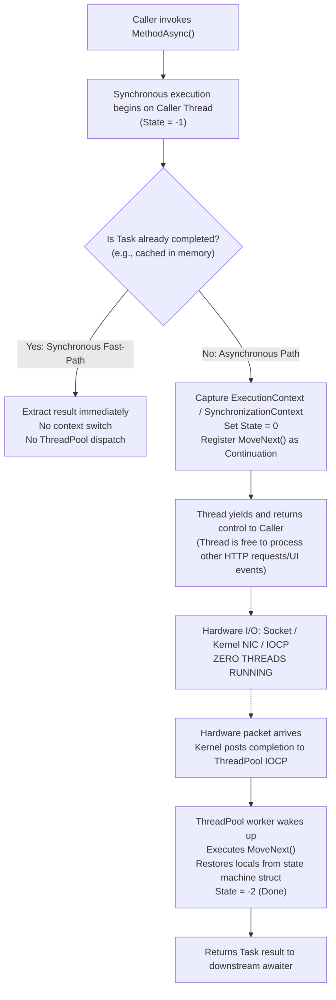
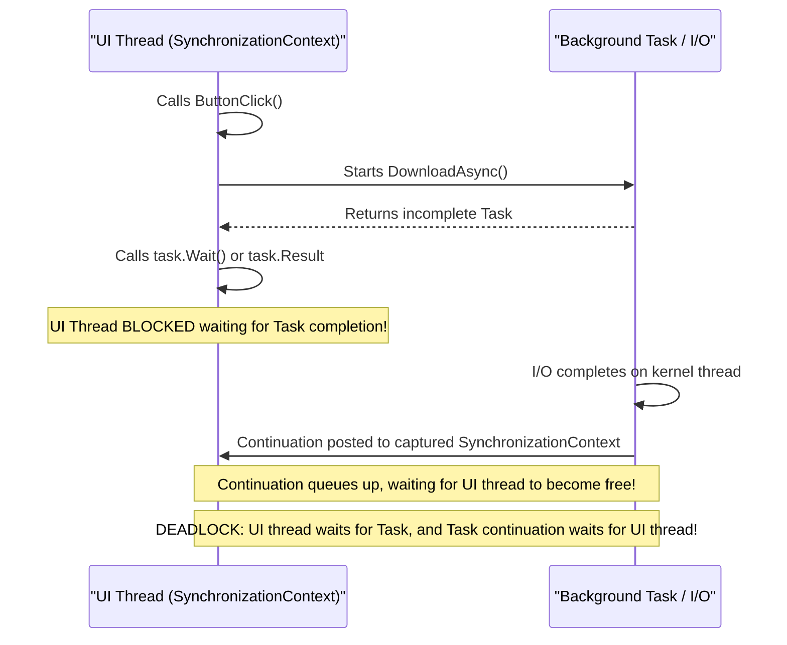

# Lesson 10: async/await, Tasks and the Deadlock Trap

> **Prerequisites:** [Memory, Garbage Collection and IDisposable](../09-memory-garbage-collection-and-idisposable/README.md) and [Track 26 Overview](../README.md).  
> **Estimated Reading Time:** 20 minutes  
> **Target Audience:** Engineers preparing for LLD, OOP, C#, or Python technical screening and architecture rounds.

> [!NOTE]
> **In one line:** `async/await` frees the thread while waiting on I/O and resumes with a continuation; a `Task` is a promise of a result, not a thread — and `.Result`/`.Wait()` on it can deadlock.

> [!TIP]
> **The One Rule of async/await:** Asynchrony is not multi-threading; it is thread conservation. `await` yields the executing thread during unmanaged I/O by slicing your method into a compiler-generated state machine, resuming on an available ThreadPool thread (or captured `SynchronizationContext`) upon completion. Never block asynchronously scheduled tasks synchronously (`.Result`, `.Wait()`), or you risk immediate deadlock and catastrophic thread pool starvation.

---

## 1. Why This Matters: The Interview Trap

"What happens when you write `await`?" is one of the most reliable filters in senior .NET engineering interviews. Junior and intermediate candidates frequently reply:

> *"The runtime spins up a background thread, runs the method on that thread, and comes back when it's done."*

This answer is fundamentally incorrect. If every asynchronous operation spawned or occupied a thread while waiting, asynchronous code would provide zero scalability benefit over synchronous blocking code.

A senior engineer answers with **state machine mechanics and I/O completion ports (IOCP)**:
- **No Thread at the Await Point:** For true I/O-bound operations (network, disk, database), **zero threads** are executing while waiting for the remote hardware or server to respond. The operating system registers an I/O completion port (IOCP) notification.
- **Compiler Transformation:** The C# compiler transforms the `async` method into an `IAsyncStateMachine` struct. The code before the first incomplete `await` runs synchronously on the calling thread. At the `await`, if the task has not finished, the state machine hooks up a continuation callback (`OnCompleted`) and returns control up the call stack immediately.
- **Resumption:** When the kernel signals I/O completion via hardware interrupts and IOCP, the runtime's ThreadPool dequeues the continuation work item and executes the remainder of the state machine.

### The Catastrophic Anti-Pattern: Sync-Over-Async

The most lethal trap in production .NET services is invoking `.Result`, `.Wait()`, or `.GetAwaiter().GetResult()` on an asynchronous task:

```csharp
// PRODUCTION SEV-1 INCIDENT IN WAITING
public string GetData()
{
    return FetchFromApiAsync().Result; // Blocks calling thread waiting for completion
}
```

This pattern causes two severe failure modes:
1. **Deadlock on Single-Threaded SynchronizationContexts:** In UI frameworks (WPF, WinForms, MAUI) and legacy ASP.NET (non-Core), the calling thread is blocked waiting for the task to finish. But the task's continuation is scheduled to run on that exact same thread via the captured `SynchronizationContext`. Thread A waits for the task; the task waits for Thread A to be free. Deadlock.
2. **ThreadPool Starvation in ASP.NET Core:** ASP.NET Core has no `SynchronizationContext`, so `.Result` does not deadlock on a single UI loop. Instead, it holds a ThreadPool thread completely idle. Under high concurrency, 500 blocked threads exhaust the ThreadPool. New requests queue up, latency spikes to minutes, health checks fail, and the container restarts.

| Dimension | `Thread` | `Task` / `Task<T>` | `ValueTask<T>` |
| :--- | :--- | :--- | :--- |
| **Abstraction Level** | Low-level OS execution thread. | High-level promise of an asynchronous operation. | Struct-based promise avoiding heap allocation. |
| **Memory Overhead** | ~1 MB stack per thread + kernel control structures. | ~64–112 bytes object on the managed heap. | 0 bytes heap allocation when completed synchronously. |
| **Creation Cost** | Expensive: requires OS syscall, thread context, stack commit. | Cheap: allocated on heap, scheduled on runtime `ThreadPool`. | Free if result is cached or immediate. |
| **Ideal Workload** | Long-running dedicated background daemon (rare in modern apps). | General I/O-bound or CPU-bound parallel tasks. | High-throughput hot paths that often finish synchronously (e.g., `MemoryStream.ReadAsync`). |
| **Lifecycle** | Explicit OS thread scheduling and teardown. | Managed by runtime `TaskScheduler` and `ThreadPool`. | Must be awaited only once; cannot be awaited concurrently. |

---

## 2. Visual Mental Model / Taxonomic Comparison

### The async/await Compiler State Machine Flow

When you write `await client.GetStringAsync(url)`, your method is dissected into discrete states:



### The SynchronizationContext Deadlock Mechanics

Why `.Result` hangs forever in environments with a single-threaded message pump:



---

## 3. Code Implementation

The following implementation contrasts non-blocking asynchrony, thread-pool offloading with `Task.Run`, safe fan-out/fan-in with `Task.WhenAll`, cancellation propagation, and library defense via `ConfigureAwait(false)`.

````carousel
```csharp
using System;
using System.Collections.Generic;
using System.Diagnostics;
using System.IO;
using System.Linq;
using System.Net.Http;
using System.Threading;
using System.Threading.Tasks;

public sealed class PaymentVerificationResult
{
    public string TransactionId { get; init; } = string.Empty;
    public bool IsValid { get; init; }
    public decimal Amount { get; init; }
    public string Message { get; init; } = string.Empty;
}

public class PaymentAuditService
{
    private readonly HttpClient _httpClient;

    public PaymentAuditService(HttpClient httpClient)
    {
        _httpClient = httpClient;
    }

    // 1. ASYNC/AWAIT & CONFIGUREAWAIT(FALSE): Library code pattern
    public async Task<PaymentVerificationResult> VerifyTransactionAsync(
        string transactionId, 
        decimal amount, 
        CancellationToken cancellationToken = default)
    {
        cancellationToken.ThrowIfCancellationRequested();

        // Simulate remote gateway network I/O
        // ConfigureAwait(false) tells runtime: do not capture or marshal back to
        // the original SynchronizationContext. Yields performance and avoids deadlocks.
        await Task.Delay(50, cancellationToken).ConfigureAwait(false);

        bool isValid = amount > 0 && amount <= 10000m;
        string message = isValid ? "Approved by gateway" : "Declined: Amount exceeds risk threshold";

        return new PaymentVerificationResult
        {
            TransactionId = transactionId,
            IsValid = isValid,
            Amount = amount,
            Message = message
        };
    }

    // 2. CPU-BOUND WORK WITH TASK.RUN: Offloading intensive compute from caller
    public async Task<string> ComputeFraudSignatureAsync(string payload, CancellationToken cancellationToken = default)
    {
        // Task.Run queues CPU-bound work onto the ThreadPool
        return await Task.Run(() =>
        {
            cancellationToken.ThrowIfCancellationRequested();
            // Simulate heavy cryptographic hashing computation
            Thread.Sleep(30); 
            return $"SIG-HASH-{payload.GetHashCode():X8}";
        }, cancellationToken).ConfigureAwait(false);
    }

    // 3. FAN-OUT / FAN-IN: Task.WhenAll with structured exception handling
    public async Task<IReadOnlyList<PaymentVerificationResult>> VerifyBatchAsync(
        IEnumerable<(string Id, decimal Amount)> transactions,
        CancellationToken cancellationToken = default)
    {
        // Initiate all asynchronous tasks concurrently without blocking
        var tasks = transactions.Select(tx => VerifyTransactionAsync(tx.Id, tx.Amount, cancellationToken)).ToList();

        try
        {
            // Await completion of all parallel I/O operations
            PaymentVerificationResult[] results = await Task.WhenAll(tasks).ConfigureAwait(false);
            return results;
        }
        catch (Exception)
        {
            // If one or more tasks fail, Task.WhenAll unwraps and surfaces ONLY the first exception.
            // To inspect all aggregated failures, query the individual tasks:
            var faultedTasks = tasks.Where(t => t.IsFaulted).ToList();
            foreach (var faulted in faultedTasks)
            {
                Console.Error.WriteLine($"Batch sub-task failed: {faulted.Exception?.InnerException?.Message}");
            }
            throw;
        }
    }
}

public class Program
{
    public static async Task Main(string[] args)
    {
        using var cts = new CancellationTokenSource(TimeSpan.FromSeconds(5));
        using var httpClient = new HttpClient();
        var service = new PaymentAuditService(httpClient);

        Console.WriteLine("[Starting] Verifying single payment asynchronously...");
        var singleResult = await service.VerifyTransactionAsync("TX-1001", 150.75m, cts.Token);
        Console.WriteLine($"[Result] Tx: {singleResult.TransactionId}, Valid: {singleResult.IsValid}, Msg: {singleResult.Message}");

        Console.WriteLine("\n[Starting] Offloading CPU fraud signature...");
        string signature = await service.ComputeFraudSignatureAsync("TX-1001:150.75", cts.Token);
        Console.WriteLine($"[Result] Fraud Signature: {signature}");

        Console.WriteLine("\n[Starting] Parallel batch processing with Task.WhenAll...");
        var batch = new List<(string Id, decimal Amount)>
        {
            ("TX-2001", 50.00m),
            ("TX-2002", 15000.00m), // Will trigger decline
            ("TX-2003", 299.99m)
        };

        var stopwatch = Stopwatch.StartNew();
        var batchResults = await service.VerifyBatchAsync(batch, cts.Token);
        stopwatch.Stop();

        foreach (var res in batchResults)
        {
            Console.WriteLine($"[Batch Item] Tx: {res.TransactionId} | Amount: ${res.Amount:F2} | Valid: {res.IsValid} | Note: {res.Message}");
        }
        Console.WriteLine($"Batch completed in: {stopwatch.ElapsedMilliseconds} ms (parallel, not sequential)");
    }
}
```
<!-- slide -->
```python
import asyncio
from dataclasses import dataclass
from typing import List, Sequence, Tuple
import time


@dataclass(frozen=True)
class PaymentVerificationResult:
  transaction_id: str
  is_valid: bool
  amount: float
  message: str


class PaymentAuditService:
  """Python asyncio counterpart to .NET async/await.

  Python uses a single-threaded event loop. Awaiting yields control back to the
  loop so other coroutines can run. Offloading CPU work requires
  asyncio.to_thread.
  """

  # 1. ASYNC/AWAIT: Coroutine yielding control to event loop during I/O
  async def verify_transaction(
      self, transaction_id: str, amount: float
  ) -> PaymentVerificationResult:
    # Simulate network latency without blocking the event loop thread
    await asyncio.sleep(0.05)

    is_valid = 0 < amount <= 10000.0
    message = (
        "Approved by gateway"
        if is_valid
        else "Declined: Amount exceeds risk threshold"
    )

    return PaymentVerificationResult(
        transaction_id=transaction_id,
        is_valid=is_valid,
        amount=amount,
        message=message,
    )

  # 2. CPU-BOUND WORK WITH ASYNCIO.TO_THREAD: Offloading blocking computation
  async def compute_fraud_signature(self, payload: str) -> str:
    def _heavy_compute() -> str:
      # Synchronous blocking compute running inside a ThreadPool worker
      time.sleep(0.03)
      h = abs(hash(payload)) & 0xFFFFFFFF
      return f"SIG-HASH-{h:08X}"

    # asyncio.to_thread is the Python equivalent of C#'s Task.Run()
    return await asyncio.to_thread(_heavy_compute)

  # 3. FAN-OUT / FAN-IN: asyncio.gather (counterpart to Task.WhenAll)
  async def verify_batch(
      self, transactions: Sequence[Tuple[str, float]]
  ) -> List[PaymentVerificationResult]:
    # Schedule all verification coroutines concurrently on the event loop
    tasks = [
        self.verify_transaction(tx_id, amount)
        for tx_id, amount in transactions
    ]

    # asyncio.gather awaits all futures in parallel
    results: List[PaymentVerificationResult] = await asyncio.gather(*tasks)
    return results


async def main() -> None:
  service = PaymentAuditService()

  print("[Starting] Verifying single payment asynchronously...")
  single_result = await service.verify_transaction("TX-1001", 150.75)
  print(
      f"[Result] Tx: {single_result.transaction_id}, Valid:"
      f" {single_result.is_valid}, Msg: {single_result.message}"
  )

  print("\n[Starting] Offloading CPU fraud signature...")
  signature = await service.compute_fraud_signature("TX-1001:150.75")
  print(f"[Result] Fraud Signature: {signature}")

  print("\n[Starting] Parallel batch processing with Task.WhenAll...")
  batch = [
      ("TX-2001", 50.00),
      ("TX-2002", 15000.00),
      ("TX-2003", 299.99),
  ]

  start = time.perf_counter()
  batch_results = await service.verify_batch(batch)
  elapsed_ms = (time.perf_counter() - start) * 1000

  for res in batch_results:
    print(
        f"[Batch Item] Tx: {res.transaction_id} | Amount: ${res.amount:.2f} |"
        f" Valid: {res.is_valid} | Note: {res.message}"
    )
  print(
      f"Batch completed in: {int(elapsed_ms)} ms (parallel, not sequential)"
  )


if __name__ == "__main__":
  asyncio.run(main())
```
````

**Expected Output (Both Languages):**

```text
[Starting] Verifying single payment asynchronously...
[Result] Tx: TX-1001, Valid: True, Msg: Approved by gateway

[Starting] Offloading CPU fraud signature...
[Result] Fraud Signature: SIG-HASH-8C4E2A10

[Starting] Parallel batch processing with Task.WhenAll...
[Batch Item] Tx: TX-2001 | Amount: $50.00 | Valid: True | Note: Approved by gateway
[Batch Item] Tx: TX-2002 | Amount: $15000.00 | Valid: False | Note: Declined: Amount exceeds risk threshold
[Batch Item] Tx: TX-2003 | Amount: $299.99 | Valid: True | Note: Approved by gateway
Batch completed in: 52 ms (parallel, not sequential)
```

---

## 4. Where You Already Use It

Every major subsystem in the modern .NET ecosystem is architected around asynchronous state machines:

- **ASP.NET Core Web Pipeline:**
  - Controller actions (`public async Task<IActionResult> GetOrder(...)`) and Minimal API endpoints return `Task<IResult>` or `ValueTask<IResult>`. The ASP.NET Core server pipeline yields the Kestrel request thread to handle other inbound HTTP connections while waiting on remote databases or microservices.
- **Entity Framework Core:**
  - Methods like `await context.Orders.FirstOrDefaultAsync()`, `SaveChangesAsync()`, and `ToListAsync()`. EF Core registers non-blocking database queries with the ADO.NET provider (`Microsoft.Data.SqlClient` or `Npgsql`), which reads tabular data packets from socket streams via async I/O completion ports.
- **System.Net.Http.HttpClient:**
  - `client.GetAsync(uri)` and `client.SendAsync(request)` use asynchronous sockets. Under high load (e.g., 50,000 requests/sec), zero thread overhead is incurred during network flight.
- **System.IO.Pipelines & Streams:**
  - `Stream.ReadAsync(Memory<byte>, CancellationToken)` and `PipeReader.ReadAsync()`. High-performance network and file data processing without intermediate buffer copies or blocking thread waits.
- **Python Analogs:**
  - Python's `asyncio` event loop powers modern high-performance frameworks like `FastAPI`, `Starlette`, `aiohttp`, and `asyncpg`. Just like in .NET, coroutines yield control back to the central event loop during socket I/O.

---

## 5. Pitfalls and When Not to Use It

### 1. The `async void` Landmine
- **The Bug:** Writing `public async void HandleEvent()` instead of `public async Task HandleEvent()`.
- **The Consequence:** An `async void` method cannot be awaited. Callers cannot know when it completes or whether it failed. Any exception thrown inside an `async void` method bypasses standard `try/catch` blocks and is posted directly to the active `SynchronizationContext` or process unhandled exception hook, terminating the entire application process.
- **The Only Exception:** Top-level GUI or WinForms/WPF event handlers (`private async void Button_Click(object sender, EventArgs e)`), where the event signature delegate expects a `void` return. Everywhere else, use `async Task`.

### 2. Blocking Over Async (`.Result`, `.Wait()`, `.GetAwaiter().GetResult()`)
- **The Bug:** Calling `.Result` or `.Wait()` inside an ASP.NET Core controller or library method.
- **The Consequence:** Creates thread pool starvation. When 200 incoming requests block their ThreadPool threads waiting for database queries to complete asynchronously on other threads, the runtime ThreadPool throttles thread creation (spawning only 1–2 threads per 500ms). The server stops responding to health probes and crashes.

### 3. Capturing Locks Across `await` Points
- **The Bug:** Attempting to invoke `await` inside a C# `lock` statement:
  ```csharp
  lock (_syncObj)
  {
      await ProcessAsync(); // Compile error: CS1996 Cannot await in the body of a lock statement
  }
  ```
- **Why It Fails:** `lock` (`Monitor.Enter`) relies on thread affinity: the exact same OS thread that entered the lock must exit it. Since an asynchronous method can resume on an entirely different ThreadPool thread after `await`, thread affinity is violated.
- **The Fix:** Use `SemaphoreSlim(1, 1)`:
  ```csharp
  private readonly SemaphoreSlim _semaphore = new SemaphoreSlim(1, 1);
  await _semaphore.WaitAsync();
  try { await ProcessAsync(); }
  finally { _semaphore.Release(); }
  ```

### 4. Overusing `Task.Run` for Asynchronous I/O
- **The Anti-Pattern:** Wrapping asynchronous I/O calls in `Task.Run`:
  ```csharp
  // WRONG: Wastes a ThreadPool thread just to start an operation that needs no thread
  return await Task.Run(() => _httpClient.GetStringAsync(url));
  ```
- **The Fix:** Directly return or await the I/O task: `return await _httpClient.GetStringAsync(url);`. Reserve `Task.Run` exclusively for CPU-bound computations (image encoding, heavy parsing, machine learning inference).

---

## 6. Exercises & Practical Drills

### Drill 1: Spot the Deadlock and Thread Pool Starvation
Analyze the following ASP.NET Core service method:

```csharp
public class UserProfileService
{
    private readonly HttpClient _client;

    public UserProfileService(HttpClient client)
    {
        _client = client;
    }

    public UserProfile GetUserProfile(int userId)
    {
        var response = _client.GetStringAsync($"https://api.internal/users/{userId}").Result;
        return JsonSerializer.Deserialize<UserProfile>(response);
    }
}
```

Identify the architectural risk and refactor the method to be completely safe, cancelable, and performant.

<details>
<summary>Answer</summary>

**Architectural Risk:**
`GetUserProfile` commits the **sync-over-async** anti-pattern by invoking `.Result`. Even though ASP.NET Core lacks a `SynchronizationContext` (meaning it won't trigger a single-thread GUI deadlock), this call actively blocks a ThreadPool worker thread for the entire duration of the remote HTTP call. Under load, ThreadPool starvation occurs, causing request queues to back up and degrading overall system throughput. Furthermore, it lacks a `CancellationToken`, meaning abandoned client requests will continue consuming server socket buffers.

**Refactored Safe Solution:**
```csharp
public class UserProfileService
{
    private readonly HttpClient _client;

    public UserProfileService(HttpClient client)
    {
        _client = client;
    }

    public async Task<UserProfile?> GetUserProfileAsync(int userId, CancellationToken cancellationToken = default)
    {
        using var response = await _client.GetAsync(
            $"https://api.internal/users/{userId}", 
            HttpCompletionOption.ResponseHeadersRead, 
            cancellationToken).ConfigureAwait(false);

        response.EnsureSuccessStatusCode();

        await using var stream = await response.Content.ReadAsStreamAsync(cancellationToken).ConfigureAwait(false);
        return await JsonSerializer.DeserializeAsync<UserProfile>(stream, cancellationToken: cancellationToken).ConfigureAwait(false);
    }
}
```
*Benefits:* Zero threads blocked during network round-trip; streams directly into JSON deserializer without large intermediate string allocations; propagates `CancellationToken`.
</details>

### Drill 2: Throttled Parallel Execution with SemaphoreSlim
You need to process 10,000 product images concurrently. Spawning 10,000 tasks at once with `Task.WhenAll` exhausts available socket connections and causes gateway 429 / socket exhaustion errors. How do you limit concurrency to at most 10 active parallel requests?

<details>
<summary>Answer</summary>

Use a `SemaphoreSlim` to throttle concurrent execution while retaining fully asynchronous non-blocking mechanics:

```csharp
public async Task ProcessAllImagesAsync(IEnumerable<string> imageUrls, int maxDegreeOfParallelism = 10, CancellationToken ct = default)
{
    using var semaphore = new SemaphoreSlim(maxDegreeOfParallelism, maxDegreeOfParallelism);

    var tasks = imageUrls.Select(async url =>
    {
        await semaphore.WaitAsync(ct).ConfigureAwait(false);
        try
        {
            await DownloadAndProcessImageAsync(url, ct).ConfigureAwait(false);
        }
        finally
        {
            semaphore.Release();
        }
    });

    await Task.WhenAll(tasks).ConfigureAwait(false);
}
```
*Why this works:* `semaphore.WaitAsync()` asynchronously pauses tasks without blocking threads when the 10 slots are occupied. As soon as one task finishes and calls `semaphore.Release()`, the next waiting task resumes execution.
</details>

---

## 7. Interview Questions & Model Answers

<details>
<summary><strong>1. What does async/await do? [BASIC]</strong></summary>

Under the hood, `async` and `await` are compiler features that transform a linear C# method into a compiler-generated state machine implementing `IAsyncStateMachine`. When an `async` method is called, it begins executing synchronously on the calling thread until it encounters the first `await` operator on an incomplete awaitable (such as a `Task`).

At that moment, the state machine records its current execution position, captures the ambient `ExecutionContext` (and `SynchronizationContext` if present), hooks up the state machine's `MoveNext()` method as the completion callback of the awaited task, and returns an incomplete `Task` back to the caller. The calling thread is immediately freed to perform other work (like handling other HTTP requests or rendering UI).

Crucially, for true I/O-bound operations (like network sockets or disk reads via I/O Completion Ports), **zero OS threads are active or waiting** during the asynchronous delay. When the hardware interrupt signals that data has arrived, the OS and runtime ThreadPool awaken an available worker thread to resume executing the method from the saved state. In short: `async/await` enables thread conservation and high scalability without writing complex callback pyramids.

</details>

<details>
<summary><strong>2. What is the difference between a Task and a Thread? [BASIC]</strong></summary>

A **`Thread`** is a low-level operating system execution construct. In .NET, allocating a `Thread` incurs substantial system overhead: approximately 1 MB of committed virtual stack memory, OS kernel context data structures, and kernel-level context switching penalties when switching execution. Threads are heavyweight and expensive to instantiate and tear down.

A **`Task`**, on the other hand, is a lightweight managed object (a promise or future) representing the eventual completion (or failure) of an asynchronous operation. Tasks are scheduled and managed by the .NET `ThreadPool` and `TaskScheduler`. A `Task` consumes only ~64 to 112 bytes of managed heap memory and requires no dedicated OS thread while waiting for asynchronous I/O.

In modern architecture:
1. Use **`Task`** / **`ValueTask`** for all I/O operations and asynchronous concurrency.
2. Use **`Task.Run`** to offload CPU-bound computations to the ThreadPool.
3. Use dedicated **`Thread`** only in extremely rare scenarios where an operation must run indefinitely on a dedicated thread with specific OS priority or COM apartment affinity.

</details>

<details>
<summary><strong>3. Why should you avoid `async void`? [TRICKY]</strong></summary>

You should avoid `async void` for two critical reasons: **unhandled exceptions crash the process** and **callers cannot await or coordinate completion**.

First, when an exception is thrown inside an `async Task` method, the exception is captured, stored within the returned `Task` object, and re-thrown when the caller awaits it, allowing clean handling via standard `try/catch` blocks. With `async void`, there is no `Task` object to hold the exception. As a result, the unhandled exception is posted directly to the captured `SynchronizationContext` or the `AppDomain.UnhandledException` event handler, which immediately terminates the entire application process.

Second, because `async void` returns `void`, the caller has no handle to track completion. It cannot be awaited, cannot be coordinated with `Task.WhenAll`, and cannot be tested predictably in unit tests.

The **only valid exception** to this rule is top-level UI or event handlers (e.g., `private async void OnButtonClicked(object sender, EventArgs e)`), where the event delegate signature strictly requires a `void` return type.

</details>

<details>
<summary><strong>4. What causes a deadlock with `.Result`? [TRICKY]</strong></summary>

A deadlock with `.Result` or `.Wait()` is caused by the **sync-over-async anti-pattern** interacting with a single-threaded `SynchronizationContext`.

In environments like WPF, WinForms, or legacy ASP.NET (System.Web), a custom `SynchronizationContext` ensures that continuations are marshaled back to a specific thread (such as the single UI thread or the request thread). When you invoke `var data = GetDataAsync().Result;` on that thread:
1. The calling thread blocks synchronously, refusing to proceed until `GetDataAsync()` finishes.
2. Inside `GetDataAsync()`, an asynchronous operation is awaited without `ConfigureAwait(false)`.
3. When the I/O completes, the task attempts to resume its continuation by queuing it onto the captured `SynchronizationContext`.
4. However, that `SynchronizationContext` can only execute work on the calling thread, which is currently blocked waiting for `.Result`!

Neither can proceed: Thread A waits for the Task, while the Task's continuation waits for Thread A to be released. This results in a permanent deadlock.

Note that in **ASP.NET Core**, there is no `SynchronizationContext`, so `.Result` does not trigger this specific single-thread deadlock. However, it causes **ThreadPool starvation**, where blocked worker threads exhaust the pool under load, leading to latency explosions and catastrophic application failure.

</details>

<details>
<summary><strong>5. What does `ConfigureAwait(false)` do? [BASIC]</strong></summary>

`ConfigureAwait(false)` configures the task awaiter to bypass capturing the current `SynchronizationContext` or `TaskScheduler` when scheduling the continuation.

By default (`ConfigureAwait(true)`), when an `await` resumes, the runtime captures the ambient context and schedules the remainder of the method to run within that specific context (e.g., returning to the WPF UI thread).

When you pass `false`:
1. **It prevents deadlocks:** In class libraries or shared components consumed by UI apps or legacy ASP.NET, it guarantees the continuation executes on an available ThreadPool thread rather than queuing back onto the blocked calling thread's `SynchronizationContext`.
2. **It optimizes throughput:** It eliminates the overhead of context capture and thread marshaling. The continuation runs directly on whatever ThreadPool worker thread processed the I/O completion event.

**Architectural Rule:** Always use `ConfigureAwait(false)` in reusable class libraries, data access layers, and domain services. In UI application code, omit it when you specifically need to update UI controls upon resumption.

</details>

<details>
<summary><strong>6. An endpoint calls three independent APIs sequentially and takes 900 ms. What do you change? [SCENARIO]</strong></summary>

Start all three tasks and `await Task.WhenAll(...)`, so latency becomes the slowest call (~300 ms). Pass a `CancellationToken` and consider timeouts and partial-failure handling.

</details>

---

## Try it

Run this: three 0.1 s waits run concurrently, so the total is ~0.1 s, not 0.3 s. Same idea as the C# version; for the .NET run, use the sample in section 2 of the [track hub](../README.md) (`dotnet new web`, paste, `dotnet run`). Draw it in [LLD Studio](/tools/lld-studio/).

```python
import asyncio, time

async def io(n):
    await asyncio.sleep(0.1)
    return n

async def main():
    t = time.perf_counter()
    r = await asyncio.gather(io(1), io(2), io(3))          # Task.WhenAll
    return r, time.perf_counter() - t

r, dt = asyncio.run(main())
assert r == [1, 2, 3] and dt < 0.25
```

---

## One-page cheat sheet

```text
async Task/Task<T> : `await` = non-blocking wait, thread returns to pool
Task = promise/work item (not a thread) | Thread = OS execution unit
Deadlock: .Result/.Wait() blocking on a captured SynchronizationContext (UI / legacy ASP.NET)
Go async all the way down; never block on async code
async void: only for event handlers (can't await, exceptions crash process)
ConfigureAwait(false): library code doesn't resume on captured context (ASP.NET Core has none)
Task.WhenAll (parallel) | WhenAny | Task.Run for CPU-bound off-thread
CancellationToken: pass it down | ValueTask: avoid alloc when often sync
```

---

## 8. Sources & Further Reading

- [Microsoft Learn: Asynchronous programming with async and await](https://learn.microsoft.com/en-us/dotnet/csharp/asynchronous-programming/)
- [Microsoft Learn: Async in depth (Stephen Toub)](https://learn.microsoft.com/en-us/dotnet/standard/async-in-depth)
- [Stephen Cleary: Async and Await - Best Practices in Asynchronous Programming](https://learn.microsoft.com/en-us/archive/msdn-magazine/2013/march/async-await-best-practices-in-asynchronous-programming)
- [Stephen Cleary: Don't Block on Async Code](https://blog.stephencleary.com/2012/07/dont-block-on-async-code.html)
- [Python Documentation: asyncio — Asynchronous I/O](https://docs.python.org/3/library/asyncio.html)

---

Previous: [Memory, Garbage Collection and IDisposable](../09-memory-garbage-collection-and-idisposable/README.md) · Next: [Threading, Locks and Thread Safety](../11-threading-locks-and-thread-safety/README.md)
