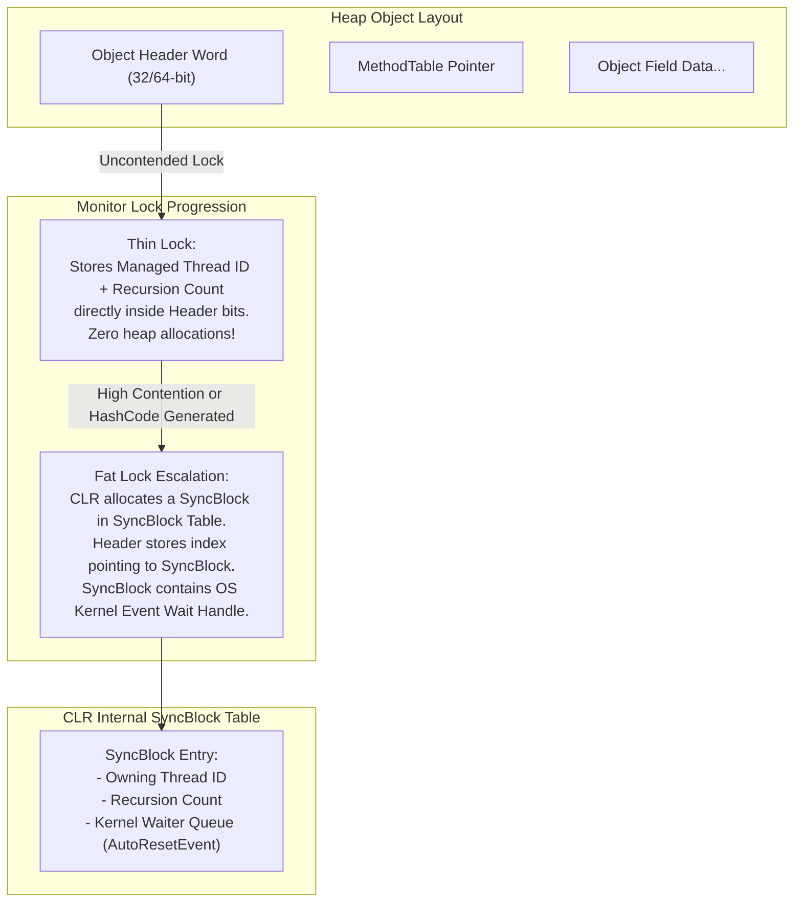
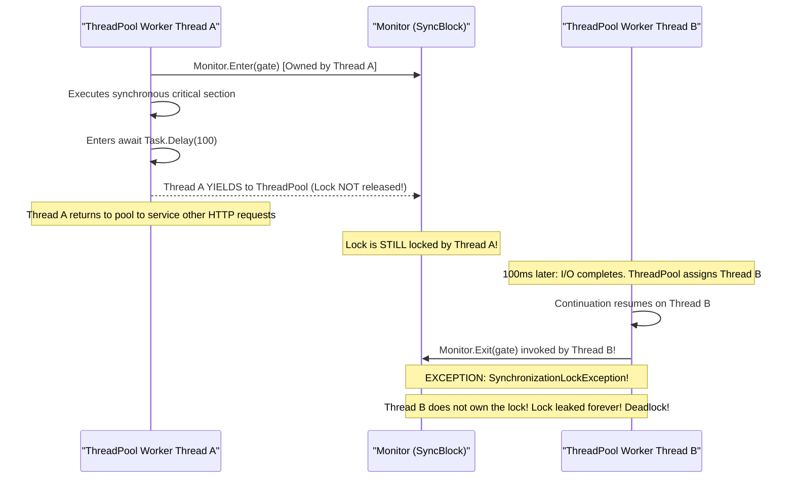

# Lesson 11: Threading, Locks and Thread Safety

> **Prerequisites:** [async/await, Tasks and the Deadlock Trap](../10-async-await-and-tasks/README.md) and [Track 26 Overview](../README.md).  
> **Estimated Reading Time:** 20 minutes  
> **Target Audience:** Engineers preparing for LLD, OOP, C#, or Python technical screening and architecture rounds.

> [!NOTE]
> **In one line:** A **race condition** is two threads reading and writing shared state without coordination; fix with `lock`/`Interlocked`/concurrent collections, or better, avoid shared mutable state.

> [!TIP]
> **The One Rule of Thread Safety:** Synchronization mechanisms must match your execution model: use `lock` (`Monitor`) for ultra-fast, non-yielding synchronous critical sections, atomic hardware primitives (`Interlocked`) for single memory locations, and asynchronous primitives (`SemaphoreSlim.WaitAsync`) when critical sections involve asynchronous I/O (`await`). Never attempt to `await` inside a thread-affine lock—because an `await` can resume on a different ThreadPool thread, violating mutual exclusion and crashing the runtime.

---

## 1. Why This Matters: The Interview Trap

"What actually happens under the hood when you use C#'s `lock` statement, and why does the C# compiler forbid `await` inside a `lock` block?" is one of the most reliable tests of senior-level systems knowledge.

A junior candidate typically answers:
> *"A lock stops multiple threads from accessing code at the same time. The compiler doesn't allow await inside lock because async runs in the background and confuses the lock."*

This response fails to address the underlying runtime mechanics. 

A senior engineer explains:
1. **The `lock` statement is syntactic sugar** for `Monitor.Enter(obj, ref lockTaken)` and `Monitor.Exit(obj)` inside a `try/finally` block.
2. **`Monitor` is strictly thread-affine:** A monitor tracks the specific managed thread ID of the OS thread that entered it. It supports re-entrancy (the *same* thread can enter multiple nested locks on the same object without self-deadlocking).
3. **The `await` discontinuity problem:** When an `async` method encounters an incomplete `await`, it yields its current thread back to the runtime ThreadPool. When the asynchronous operation finishes, the continuation may resume on a **completely different ThreadPool thread**. If `await` were permitted inside `lock`:
   - Thread A acquires `Monitor.Enter`.
   - Thread A yields at `await`.
   - Thread B resumes the continuation and hits `Monitor.Exit`.
   - Thread B throws a `SynchronizationLockException` because Thread B never acquired the lock!
   - Meanwhile, the lock is still permanently owned by Thread A, causing a catastrophic process deadlock.
4. The C# compiler explicitly prevents this bug at compile time with compiler error **`CS1996: Cannot await in the body of a lock statement`**. To coordinate asynchronous critical sections, you must use **`SemaphoreSlim(1, 1)`** with `await WaitAsync()`.

### The Two Faces of Race Conditions

A **race condition** occurs when the correctness of a program depends on the non-deterministic relative execution order or timing of multiple threads. Race conditions generally fall into two categories:

1. **Read-Modify-Write (Lost Updates):**
   ```csharp
   // NOT ATOMIC: count++ translates to three discrete CPU instructions:
   // 1. MOV EAX, [count]  (Read)
   // 2. INC EAX           (Modify)
   // 3. MOV [count], EAX  (Write)
   count++;
   ```
   If Thread 1 and Thread 2 read `count = 5` simultaneously, both increment to `6`, and both write `6` back to memory. One update is permanently erased.
2. **Check-Then-Act (Time-of-Check to Time-of-Use / TOCTOU):**
   ```csharp
   if (_balance >= withdrawalAmount) // Check
   {
       // Context switch here! Another thread withdraws the money.
       _balance -= withdrawalAmount; // Act on stale state -> Overdraft!
   }
   ```
   Even if reading and writing `_balance` were individually thread-safe, the gap between the *check* and the *act* is not atomic.

| Mechanism | Scope / Execution Model | Thread Affinity | Blocking Nature | Typical Latency / Cost |
| :--- | :--- | :--- | :--- | :--- |
| **`Interlocked`** | Single 32-bit or 64-bit value | None (Hardware CPU instruction) | Non-blocking lock-free (CPU bus lock / CAS) | ~5–15 ns (Fastest) |
| **`lock` (`Monitor`)** | Synchronous code block | **Strictly Thread-Affine** | Blocks OS thread (Kernel spin/wait) | ~20–40 ns uncontended; ~microseconds contended |
| **`SemaphoreSlim`** | Synchronous AND Asynchronous | None (Token/counter based) | Non-blocking via `WaitAsync()` or blocking via `Wait()` | ~100–300 ns |
| **`ReaderWriterLockSlim`** | Synchronous multiple-readers/single-writer | Thread-Affine on Writer | Blocks OS thread | ~50–100 ns |
| **`ConcurrentDictionary`** | Key-value store operations | None (Fine-grained striping) | Non-blocking for reads; lock-free or striped for writes | Minimal overhead per key bucket |

---

## 2. Visual Mental Model / Taxonomic Comparison

### The CLR Object Header and Thin vs. Fat Locks

In .NET, every heap object has two overhead words preceding its fields: the **MethodTable pointer** and the **Object Header word**:



### Why `await` Fails in a Thread-Affine Monitor



### Contrast: Asynchronous Coordination with `SemaphoreSlim`

Unlike `Monitor`, a `SemaphoreSlim` does not track thread ownership. It manages an internal count of available execution tokens. A semaphore can be entered by Thread A via `await WaitAsync()` and released by Thread B via `Release()`, making it 100% compatible with asynchronous state machines.

---

## 3. Code Implementation

The following architecture demonstrates thread safety across four paradigms:
1. Unsynchronized read-modify-write resulting in lost updates.
2. Lock-free atomic hardware primitives with `Interlocked`.
3. Synchronous exclusive locking via `lock` protecting check-then-act critical sections.
4. Asynchronous locking using `SemaphoreSlim.WaitAsync()`.
5. Safe caching and dictionary manipulation via `ConcurrentDictionary`.

````carousel
```csharp
using System;
using System.Collections.Concurrent;
using System.Collections.Generic;
using System.Threading;
using System.Threading.Tasks;

public sealed class BankAccount
{
    private readonly object _lockObj = new();
    private readonly SemaphoreSlim _asyncLock = new(1, 1);
    private readonly ConcurrentDictionary<string, decimal> _ledger = new();

    private long _rawBalance;
    private long _interlockedBalance;

    public long RawBalance => _rawBalance;
    public long InterlockedBalance => Interlocked.Read(ref _interlockedBalance);

    // 1. Race Condition Demonstration: Unsafe Read-Modify-Write
    public void DepositUnsafe(int amount)
    {
        _rawBalance += amount;
    }

    // 2. Lock-free Atomic Hardware Primitive: Interlocked Add (CPU Bus Lock / CAS)
    public void DepositInterlocked(int amount)
    {
        Interlocked.Add(ref _interlockedBalance, amount);
    }

    // 3. Synchronous In-Memory Critical Section: lock statement (Monitor)
    public bool TryTransferSync(string accountId, decimal amount)
    {
        lock (_lockObj)
        {
            // Atomically Check-Then-Act
            var current = _ledger.GetOrAdd(accountId, 1000m);
            if (current >= amount)
            {
                _ledger[accountId] = current - amount;
                return true;
            }
            return false;
        }
    }

    // 4. Thread-Safe Asynchronous Critical Section: SemaphoreSlim
    public async Task<bool> ProcessPaymentAsync(string transactionId, decimal amount)
    {
        // Asynchronously wait for token without blocking OS thread
        await _asyncLock.WaitAsync();
        try
        {
            // Safe non-blocking asynchronous I/O
            await Task.Delay(10);
            _ledger.AddOrUpdate(transactionId, amount, (_, old) => old + amount);
            return true;
        }
        finally
        {
            _asyncLock.Release();
        }
    }

    public decimal GetAccountBalance(string accountId) =>
        _ledger.TryGetValue(accountId, out var val) ? val : 0m;
}

public static class Program
{
    public static async Task Main()
    {
        Console.WriteLine("=== 1. Interlocked vs Unsafe Race Condition ===");
        var account = new BankAccount();
        var threads = new List<Thread>();
        const int iterations = 1000;

        for (int i = 0; i < 10; i++)
        {
            var t = new Thread(() =>
            {
                for (int j = 0; j < iterations; j++)
                {
                    account.DepositUnsafe(1);
                    account.DepositInterlocked(1);
                }
            });
            threads.Add(t);
            t.Start();
        }

        foreach (var t in threads)
        {
            t.Join();
        }

        Console.WriteLine($"Expected Total: {10 * iterations}");
        Console.WriteLine($"Interlocked Total: {account.InterlockedBalance} (Thread-Safe: {account.InterlockedBalance == 10 * iterations})");

        Console.WriteLine("\n=== 2. Synchronous Lock & ConcurrentDictionary ===");
        bool transfer1 = account.TryTransferSync("ACC-01", 400m);
        bool transfer2 = account.TryTransferSync("ACC-01", 700m);
        Console.WriteLine($"Transfer 1 ($400): {transfer1}");
        Console.WriteLine($"Transfer 2 ($700 - Insufficient): {transfer2}");
        Console.WriteLine($"ACC-01 Remaining Balance: ${account.GetAccountBalance("ACC-01"):F2}");

        Console.WriteLine("\n=== 3. Asynchronous Safe SemaphoreSlim ===");
        var tasks = new List<Task>();
        for (int i = 1; i <= 3; i++)
        {
            int index = i;
            tasks.Add(Task.Run(async () =>
            {
                await account.ProcessPaymentAsync("TX-GLOBAL", 50m * index);
            }));
        }

        await Task.WhenAll(tasks);
        Console.WriteLine($"Final Aggregated TX-GLOBAL: ${account.GetAccountBalance("TX-GLOBAL"):F2}");
    }
}
```
<!-- slide -->
```python
import asyncio
import threading
from typing import Dict

class BankAccount:
    def __init__(self) -> None:
        self._lock = threading.Lock()
        self._async_lock = asyncio.Lock()
        self._ledger: Dict[str, float] = {}
        self._raw_balance: int = 0
        self._interlocked_balance: int = 0
        self._atomic_lock = threading.Lock()

    @property
    def raw_balance(self) -> int:
        return self._raw_balance

    @property
    def interlocked_balance(self) -> int:
        with self._atomic_lock:
            return self._interlocked_balance

    # 1. Race Condition Demonstration: Unsafe Read-Modify-Write
    def deposit_unsafe(self, amount: int) -> None:
        self._raw_balance += amount

    # 2. Atomic increment (Simulating Interlocked.Add)
    def deposit_interlocked(self, amount: int) -> None:
        with self._atomic_lock:
            self._interlocked_balance += amount

    # 3. Synchronous In-Memory Critical Section
    def try_transfer_sync(self, account_id: str, amount: float) -> bool:
        with self._lock:
            # Atomically Check-Then-Act
            current = self._ledger.setdefault(account_id, 1000.0)
            if current >= amount:
                self._ledger[account_id] = current - amount
                return True
            return False

    # 4. Asynchronous Critical Section (asyncio.Lock)
    async def process_payment_async(self, transaction_id: str, amount: float) -> bool:
        async with self._async_lock:
            # Safe non-blocking asynchronous I/O
            await asyncio.sleep(0.01)
            current = self._ledger.get(transaction_id, 0.0)
            self._ledger[transaction_id] = current + amount
            return True

    def get_account_balance(self, account_id: str) -> float:
        with self._lock:
            return self._ledger.get(account_id, 0.0)


def run_threads(account: BankAccount, iterations: int) -> None:
    threads = []
    for _ in range(10):
        def worker():
            for _ in range(iterations):
                account.deposit_unsafe(1)
                account.deposit_interlocked(1)
        t = threading.Thread(target=worker)
        threads.append(t)
        t.start()

    for t in threads:
        t.join()


async def main() -> None:
    print("=== 1. Interlocked vs Unsafe Race Condition ===")
    account = BankAccount()
    iterations = 1000

    # Execute multi-threaded race condition
    await asyncio.to_thread(run_threads, account, iterations)

    expected = 10 * iterations
    print(f"Expected Total: {expected}")
    print(f"Interlocked Total: {account.interlocked_balance} (Thread-Safe: {account.interlocked_balance == expected})")

    print("\n=== 2. Synchronous Lock & ConcurrentDictionary ===")
    transfer1 = account.try_transfer_sync("ACC-01", 400.0)
    transfer2 = account.try_transfer_sync("ACC-01", 700.0)
    print(f"Transfer 1 ($400): {transfer1}")
    print(f"Transfer 2 ($700 - Insufficient): {transfer2}")
    print(f"ACC-01 Remaining Balance: ${account.get_account_balance('ACC-01'):.2f}")

    print("\n=== 3. Asynchronous Safe SemaphoreSlim ===")
    tasks = []
    for i in range(1, 4):
        tasks.append(account.process_payment_async("TX-GLOBAL", 50.0 * i))

    await asyncio.gather(*tasks)
    print(f"Final Aggregated TX-GLOBAL: ${account.get_account_balance('TX-GLOBAL'):.2f}")


if __name__ == "__main__":
    asyncio.run(main())
```
````

**Expected Output (Both Languages):**
```text
=== 1. Interlocked vs Unsafe Race Condition ===
Expected Total: 10000
Interlocked Total: 10000 (Thread-Safe: True)

=== 2. Synchronous Lock & ConcurrentDictionary ===
Transfer 1 ($400): True
Transfer 2 ($700 - Insufficient): False
ACC-01 Remaining Balance: $600.00

=== 3. Asynchronous Safe SemaphoreSlim ===
Final Aggregated TX-GLOBAL: $300.00
```

---

## 4. Where You Already Use It

- **`System.Threading.Interlocked`:** Found at the core of high-performance libraries. The runtime uses `Interlocked.Increment` for reference counts, sequence generation, and atomic state flags (`0 = idle`, `1 = running`).
- **`System.Collections.Concurrent.ConcurrentDictionary<TKey, TValue>`:** Employs internal bucket locking (lock-striping). Reading operations (`TryGetValue`, indexer read) are completely lock-free via memory barriers, while write operations (`TryAdd`, `TryUpdate`) lock only the specific hash bucket rather than the entire table.
- **`Lazy<T>` (`LazyThreadSafetyMode.ExecutionAndPublication`):** The standard .NET implementation for thread-safe Singleton instantiation. It guarantees that only a single thread can execute the factory delegate, publishing the result safely to all other threads.
- **`System.Threading.Channels`:** High-throughput, thread-safe Producer-Consumer queues that eliminate manual locking around queue buffers.
- **Python's `threading` vs. GIL Nuance:**
  - In Python (CPython), the **Global Interpreter Lock (GIL)** guarantees that internal CPython bytecode instructions run atomically. 
  - *The Trap:* The GIL does **not** make Python application code thread-safe! A check-then-act operation (e.g., `if key in dict: dict[key] += 1`) can be interrupted by the OS thread scheduler between bytecode instructions, causing catastrophic race conditions. Python applications still require `threading.Lock` or `asyncio.Lock`.

---

## 5. Pitfalls and When Not to Use It

### 1. The Catastrophic `lock (this)`, `lock (typeof(T))`, and `lock ("string")`
Never lock on objects accessible outside the scope of your class:
- **`lock (this)`:** External consumers of your class can also invoke `lock (instance)`, resulting in unpredictable deadlocks beyond your module's control.
- **`lock (typeof(MyClass))`:** The `Type` object is global to the entire `AppDomain`. Any code anywhere in the process locking on `typeof(MyClass)` competes for the same lock.
- **`lock ("ResourceKey")`:** Due to C# string interning, string literals are interned into a single global table across the CLR process. Locking on a string locks a globally shared object.
- **The Best Practice:** Always lock on a `private readonly object _gate = new();`.

### 2. The `ConcurrentDictionary.GetOrAdd` Factory Trap
A very common trap in high-concurrency systems:

```csharp
// FATAL FLAW: The factory delegate is NOT executed under a lock!
var user = _cache.GetOrAdd(userId, id => FetchUserFromDatabase(id));
```

If 100 concurrent requests arrive for a cold cache entry:
- All 100 threads invoke `FetchUserFromDatabase(userId)` simultaneously, causing a database connection stampede!
- Only one resulting object is added to the dictionary; the other 99 are discarded.
- *Solution:* Store `Lazy<Task<User>>` in the dictionary so that only the `Lazy` instantiation is raced (which is trivial and cheap), while the actual database fetch is executed once via `Lazy.Value`.

### 3. Lock Ordering Deadlocks
If Thread 1 locks Resource A and then Resource B:
```csharp
// Thread 1
lock (_lockA) {
    lock (_lockB) { ... }
}

// Thread 2
lock (_lockB) {
    lock (_lockA) { ... }
}
```
If Thread 1 acquires `_lockA` and Thread 2 acquires `_lockB` simultaneously, both threads wait forever.
*Rule:* Always acquire locks in a globally consistent hierarchical order (e.g., sorted by unique resource ID).

---

## 6. Exercises & Practical Drills

### Drill 1: Preventing Cache Stampede with `ConcurrentDictionary` and `Lazy<T>`
**Problem:** The following method suffers from cache stampede: when a key is absent, multiple threads invoke the expensive `ComputeExpensiveReportAsync` factory simultaneously. Refactor it using `ConcurrentDictionary` and `Lazy<Task<Report>>` so that the factory executes exactly once.

```csharp
public class ReportCache
{
    private readonly ConcurrentDictionary<string, Report> _cache = new();

    public async Task<Report> GetReportAsync(string id)
    {
        // BUG: Factory may run multiple times concurrently under load
        return _cache.GetOrAdd(id, key => FetchFromDatabase(key));
    }

    private Report FetchFromDatabase(string id) => new Report(id);
}
```

<details>
<summary>Answer</summary>

```csharp
public class ReportCache
{
    private readonly ConcurrentDictionary<string, Lazy<Task<Report>>> _cache = new();

    public async Task<Report> GetReportAsync(string id)
    {
        var lazyReport = _cache.GetOrAdd(id, key => 
            new Lazy<Task<Report>>(() => Task.Run(() => FetchFromDatabase(key)),
                LazyThreadSafetyMode.ExecutionAndPublication));

        // Only the winning Lazy<Task<Report>> will execute FetchFromDatabase
        return await lazyReport.Value;
    }

    private Report FetchFromDatabase(string id) => new Report(id);
}
```
*Why this works:* Constructing a `Lazy<Task<Report>>` is instantaneous and consumes negligible CPU. Even if multiple threads instantiate a `Lazy` object during a race, `GetOrAdd` returns the single winning instance, and `lazyReport.Value` executes the expensive workload exactly once.
</details>

---

### Drill 2: Deadlock Prevention via Consistent Lock Ordering
**Problem:** A banking system transfers funds between two `Account` objects. The existing code deadlocks when Account 1 transfers to Account 2 at the exact moment Account 2 transfers to Account 1. Fix the method.

```csharp
public void Transfer(Account from, Account to, decimal amount)
{
    lock (from.SyncLock)
    {
        lock (to.SyncLock)
        {
            from.Balance -= amount;
            to.Balance += amount;
        }
    }
}
```

<details>
<summary>Answer</summary>

```csharp
public void Transfer(Account from, Account to, decimal amount)
{
    if (from.Id == to.Id)
        throw new ArgumentException("Cannot transfer to the same account.");

    // Deterministic Lock Ordering by Account ID
    var firstLock = from.Id < to.Id ? from.SyncLock : to.SyncLock;
    var secondLock = from.Id < to.Id ? to.SyncLock : from.SyncLock;

    lock (firstLock)
    {
        lock (secondLock)
        {
            if (from.Balance < amount)
                throw new InvalidOperationException("Insufficient funds.");

            from.Balance -= amount;
            to.Balance += amount;
        }
    }
}
```
*Why this works:* By sorting the locks deterministically based on `AccountId`, both threads attempt to acquire the lower ID lock first. Circular wait is eliminated, mathematically preventing deadlocks.
</details>

---

## 7. Interview Questions & Model Answers

<details>
<summary><strong>1. What is a race condition? [BASIC]</strong></summary>

A race condition is a multi-threaded defect that occurs when the correctness and outcome of a program depend on the non-deterministic scheduling, relative timing, or interleaving of threads.

Race conditions manifest in two primary forms:
1. **Read-Modify-Write (Lost Update):** Occurs when multiple threads read a shared variable, calculate an updated value, and write it back without mutual exclusion. Operations like `count++` require three CPU instructions (read, modify, write); if interleaved, one or more updates are overwritten and lost.
2. **Check-Then-Act (Time-of-Check to Time-of-Use):** Occurs when a thread validates state (e.g., `if (balance >= amount)`) and acts upon that state (e.g., `balance -= amount`), but another thread mutates the state during the interval between the check and the act.

Race conditions are resolved by establishing mutual exclusion using hardware atomics (`Interlocked`), synchronized monitors (`lock`), asynchronous throttles (`SemaphoreSlim`), or concurrent collections.

</details>

<details>
<summary><strong>2. What does the `lock` keyword do? [BASIC]</strong></summary>

The C# `lock` keyword is language-level syntactic sugar for entering and exiting an exclusive monitor lock on a managed reference object. When the compiler encounters:
```csharp
lock (obj) { /* critical section */ }
```
It lowers the code into:
```csharp
bool lockTaken = false;
try {
    Monitor.Enter(obj, ref lockTaken);
    /* critical section */
}
finally {
    if (lockTaken) Monitor.Exit(obj);
}
```

Internally, the CLR leverages the target object's **Object Header word**:
1. In an uncontended state, the CLR acquires a lightweight **thin lock** by writing the current thread's managed thread ID directly into the header bits with zero heap allocation.
2. If contention arises (another thread requests the lock), the runtime escalates to a **fat lock**, allocating a `SyncBlock` in the CLR's SyncBlock Table that wraps an OS kernel synchronization primitive (an event wait handle) to block the contending thread.

The `lock` statement guarantees re-entrancy for the owning thread and guarantees lock release via the `finally` block even if exceptions occur inside the critical section.

</details>

<details>
<summary><strong>3. Why can you not use `await` inside a `lock`? [TRICKY]</strong></summary>

You cannot use `await` inside a `lock` because `Monitor` is **strictly thread-affine**, whereas asynchronous methods are designed to be **thread-agnostic**. The C# compiler explicitly disallows this with error `CS1996`.

When a thread acquires a lock via `Monitor.Enter(obj)`, the CLR records the entering OS thread's managed Thread ID. When the method reaches an incomplete `await`, it yields that OS thread back to the runtime ThreadPool. When the asynchronous operation finishes, the continuation is scheduled on an available ThreadPool worker, which frequently has a **different Thread ID** than the thread that entered the lock.

If `await` were permitted inside `lock`:
1. The resuming thread would attempt to execute `Monitor.Exit(obj)` in the `finally` block.
2. Because the resuming thread does not own the lock, the CLR immediately throws a `SynchronizationLockException`.
3. Worse, the original acquiring thread never released the lock, leaving the lock held indefinitely and permanently deadlocking any future threads that attempt to acquire it.

To protect asynchronous critical sections across `await` points, you must use **`SemaphoreSlim`** via `await semaphore.WaitAsync()` and `semaphore.Release()`, because semaphores manage token counts and are not bound to thread identity.

</details>

<details>
<summary><strong>4. When would you use `ConcurrentDictionary`? [SCENARIO]</strong></summary>

You should use `ConcurrentDictionary<TKey, TValue>` when you need a thread-safe key-value store accessed by multiple concurrent threads, particularly in **read-heavy or balanced read/write workloads**, without wrapping a standard `Dictionary` in a coarse-grained `lock`.

`ConcurrentDictionary` is architecturally superior to a manual `lock (dict)` for three reasons:
1. **Lock-Free Reads:** Read operations like `TryGetValue`, `ContainsKey`, and indexer lookups (`dict[key]`) are completely lock-free. They execute without acquiring any locks, using volatile memory reads and memory barriers for maximum throughput.
2. **Lock Striping on Writes:** Writes (`TryAdd`, `TryUpdate`, `TryRemove`) do not lock the entire collection. Instead, the dictionary divides its internal hash buckets across a striped array of lock objects (defaulting to the number of CPU cores). Two threads writing to different hash buckets can write simultaneously without blocking each other.
3. **Atomic Compound Operations:** It provides atomic operations like `AddOrUpdate` and `GetOrAdd` out of the box.

**When NOT to use it:**
- If the collection is populated once at startup and read-only thereafter, an immutable dictionary (`FrozenDictionary` or `ImmutableDictionary`) offers superior read performance and lower memory footprint.
- When multi-key transactions must be updated together atomically (e.g., updating two keys simultaneously requires an external transaction lock).

</details>

<details>
<summary><strong>5. Why is `lock(this)` or `lock(typeof(Foo))` dangerous? [TRICKY]</strong></summary>

Outside code can lock the same object and cause deadlocks or contention you cannot see. Lock a private, readonly object used only inside the class.

</details>

<details>
<summary><strong>6. You need an async-safe mutual exclusion around a cache refresh. What do you use? [SCENARIO]</strong></summary>

`SemaphoreSlim(1,1)` with `await sem.WaitAsync()` and `try/finally Release()`. `lock` cannot be held across an `await`.

</details>

---

## Try it

Run this: a lock makes the read-modify-write atomic. Same idea as the C# version; for the .NET run, use the sample in section 2 of the [track hub](../README.md) (`dotnet new web`, paste, `dotnet run`). Draw it in [LLD Studio](/tools/lld-studio/).

```python
import threading

count, lock = 0, threading.Lock()
def work():
    global count
    for _ in range(10_000):
        with lock:                                  # remove it and totals can drift
            count += 1

ts = [threading.Thread(target=work) for _ in range(4)]
[t.start() for t in ts]; [t.join() for t in ts]
assert count == 40_000
```

---

## One-page cheat sheet

```text
Race: shared mutable state + no sync -> lost updates
lock(obj) { }  : mutual exclusion; lock a PRIVATE readonly object, never `this`/typeof/string
Interlocked.Increment/CompareExchange: atomic single ops, no lock
Monitor, SemaphoreSlim (also async: WaitAsync), ReaderWriterLockSlim
Cannot `await` inside lock (thread-affine) -> SemaphoreSlim
Deadlock: lock ordering (A then B vs B then A) -> always same order, timeouts
ConcurrentDictionary: GetOrAdd factory may run twice | Concurrent*: thread-safe, not transactional
Immutability + message passing (Channel<T>) avoids locks
```

---

## 8. Sources & Further Reading

- [Microsoft Learn: Threading and Synchronization Primitives](https://learn.microsoft.com/en-us/dotnet/standard/threading/overview-of-synchronization-primitives)
- [Microsoft Learn: Monitor Class and lock statement](https://learn.microsoft.com/en-us/dotnet/csharp/language-reference/statements/lock)
- [Microsoft Learn: Concurrent Collections in .NET](https://learn.microsoft.com/en-us/dotnet/standard/collections/thread-safe/)
- [Stephen Toub: How SemaphoreSlim Works](https://devblogs.microsoft.com/pfxteam/building-an-async-semaphore/)
- [Jeffrey Richter: CLR via C# - Chapter 29: Hybrid Thread Synchronization Constructs](https://www.microsoftpressstore.com/store/clr-via-c-sharp-9780735667457)
- [Python Documentation: threading — Thread-based parallelism](https://docs.python.org/3/library/threading.html)

---

Previous: [async/await, Tasks and the Deadlock Trap](../10-async-await-and-tasks/README.md) · Next: [Extension Methods, Partial Classes, Attributes and Reflection](../12-extension-methods-attributes-and-reflection/README.md)
