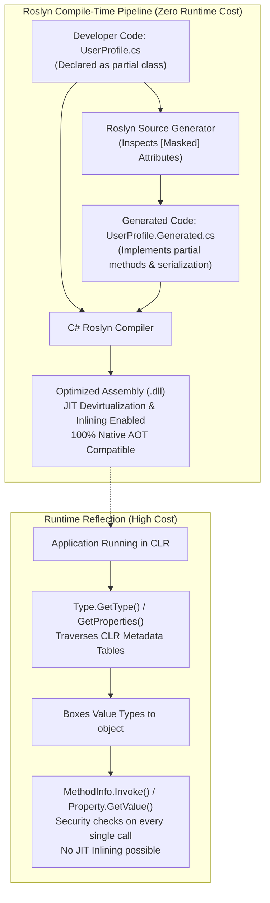

# Lesson 12: Extension Methods, Partial Classes, Attributes and Reflection

> **Prerequisites:** [Threading, Locks and Thread Safety](../11-threading-locks-and-thread-safety/README.md) and [Track 26 Overview](../README.md).  
> **Estimated Reading Time:** 20 minutes  
> **Target Audience:** Engineers preparing for LLD, OOP, C#, or Python technical screening and architecture rounds.

> [!NOTE]
> **In one line:** **Extension methods** add instance-like methods to a type without touching it, **attributes** attach metadata, and **reflection** reads that metadata at run time — powerful, but slow and not trim/AOT-friendly.

> [!TIP]
> **The One Rule of Metaprogramming and Extensibility:** Extension methods and partial classes provide compile-time syntactic ergonomics and separation of concerns with zero runtime overhead, whereas Reflection inspects metadata at runtime with significant latency, memory, and AOT-trimming penalties. In modern high-throughput .NET, replace runtime Reflection with Roslyn compile-time **Source Generators** and cached expressions (`Expression.Compile`) to shift metadata discovery from request-time to build-time.

---

## 1. Why This Matters: The Interview Trap

"What is an extension method, how does the compiler lower it, and what are the hidden trade-offs of using Reflection?" is a frequent senior interview screening topic. It tests whether you view C# as merely a high-level syntax or understand how the compiler, IL metadata tables, and the CLR execution engine cooperate.

A junior candidate typically responds:
> *"An extension method adds new methods to an existing class without touching its source code. Reflection is how you inspect an object's properties dynamically at runtime."*

A senior engineer provides the architectural picture:
1. **Extension Methods are Pure Compiler Syntactic Sugar:** The C# compiler transforms what looks like an instance method call (`order.CalculateTax()`) into a plain static method invocation (`TaxExtensions.CalculateTax(order)`), applying an `[Extension]` attribute in IL. 
   - **Static Dispatch:** Because it is a static method, extension methods **cannot be virtual, cannot override base behaviors, and cannot access private or protected members**.
   - **Precedence Rule:** If an instance method on the target class shares the exact same signature as an extension method, the **instance method always wins**. An extension method will never be called if an instance method matches.
   - **Null Invocability:** An extension method can be invoked on a `null` reference without throwing a `NullReferenceException` at the call site—the exception only occurs if the extension method's internal code attempts to dereference `this`.
2. **LINQ is Built on Extension Methods:** The entirety of LINQ (`Select`, `Where`, `OrderBy`) consists of static extension methods defined in `System.Linq.Enumerable` operating on `IEnumerable<T>`.
3. **Partial Classes and Methods Bridge Code Generation:** Partial classes allow splitting a single type across multiple `.cs` files. In enterprise architecture, they separate automated tool-generated code (e.g., EF Core scaffolding, OpenAPI clients, Roslyn source generators) from developer business logic. Partial methods that lack an implementation are **completely stripped out of IL by the compiler**, incurring literally zero runtime cost.
4. **Why `sealed` Matters:** Marking classes as `sealed` prevents inheritance, but more importantly, enables compiler and JIT optimizations:
   - **Devirtualization:** The JIT knows no derived class can override virtual or interface calls, allowing it to bypass virtual method table (vtable) lookups and inline the method call directly into native machine code.
   - **Array Covariance Checks:** Sealed types eliminate runtime type checks during array stores.
5. **The Real Cost of Reflection:** Reflection bypasses the JIT compiler's inlining and devirtualization pipelines. It incurs heap boxing allocations for value types, performs security checks on every call, and breaks **Native AOT (Ahead-of-Time compilation)** and trimming because the linker cannot statically determine which methods and types are dynamically invoked.
6. **Source Generators:** Introduced in C# 9 / .NET 5, Roslyn Source Generators execute inside the compiler pipeline. They inspect your syntax trees and emit new C# source code (typically partial classes) during compilation, giving you the power of metaprogramming with compile-time type safety, instantaneous startup, and zero reflection overhead.

| Dimension | Extension Methods | Partial Classes | Reflection | Roslyn Source Generators |
| :--- | :--- | :--- | :--- | :--- |
| **Execution Phase** | Compile-time static binding. | Compile-time file merging. | Runtime dynamic lookup. | Compile-time code generation. |
| **Runtime Overhead** | **Zero.** Same as a standard static call. | **Zero.** Merged into a single type in IL. | **High.** Type checks, metadata lookups, boxing. | **Zero.** Emits plain C# compiled into IL. |
| **Encapsulation Access** | Only `public` and `internal` members. | Full access to `private` members of the class. | Can access `private` via `BindingFlags.NonPublic`. | Only `public` and `internal` members. |
| **Polymorphism** | No (cannot be virtual or overridden). | Standard OOP polymorphism within the type. | Dynamic late-binding. | Standard OOP compile-time code. |
| **Native AOT Friendly** | 100% compatible. | 100% compatible. | Trimming risks; requires linker annotations. | 100% compatible (primary AOT enabler). |

---

## 2. Visual Mental Model / Taxonomic Comparison

### Metaprogramming Spectrum: Build-Time vs. Runtime

The evolution of metaprogramming in .NET moves responsibilities from expensive runtime operations to zero-cost compile-time analysis:



### Decision Matrix: Extensibility & Metadata Patterns

| Goal | Recommended Pattern | Antipattern to Avoid |
| :--- | :--- | :--- |
| Add utility behaviors to external types (`string`, `DateTime`, `IEnumerable<T>`) | **Extension Methods** | Creating wrapper classes or deep inheritance hierarchies. |
| Integrate compiler-generated code with human-written code | **Partial Classes & Partial Methods** | Editing generated files directly (overwritten on rebuild). |
| High-performance microservice serialization/validation | **Source Generators** (`System.Text.Json` source gen) | Runtime reflection scanning on every HTTP request. |
| Prevent inheritance and optimize hot-path dispatch | **`sealed` Class Modifier** | Leaving classes unsealed by default in domain models. |
| One-time startup framework initialization (IoC container boot) | **Cached Reflection / Expressions** | Invoking `MethodInfo.Invoke` repeatedly inside hot loops. |

---

## 3. Code Implementation

The following architecture demonstrates:
1. Custom attributes declared with proper `AttributeUsage` constraints.
2. A `partial class` with a `partial method` lifecycle hook.
3. Extension methods demonstrating compiler syntax ergonomics.
4. Runtime reflection reading properties and attributes to generate sanitized summaries.

````carousel
```csharp
using System;
using System.Collections.Generic;
using System.Linq;
using System.Reflection;

// 1. Custom Attribute for Metadata Declaration
[AttributeUsage(AttributeTargets.Property, Inherited = false, AllowMultiple = false)]
public sealed class MaskedAttribute : Attribute
{
    public string Mask { get; set; }
    public MaskedAttribute(string mask = "********") => Mask = mask;
}

[AttributeUsage(AttributeTargets.Property, Inherited = false, AllowMultiple = false)]
public sealed class RangeValidationAttribute : Attribute
{
    public int Min { get; }
    public int Max { get; }

    public RangeValidationAttribute(int min, int max)
    {
        Min = min;
        Max = max;
    }
}

// 2. Partial Class & Partial Method
public partial class UserProfile
{
    public string Username { get; set; } = string.Empty;

    [Masked(Mask = "###-REDACTED-###")]
    public string SocialSecurityNumber { get; set; } = string.Empty;

    [RangeValidation(18, 120)]
    public int Age { get; set; }

    // Partial method declaration: If unimplemented, compiler strips calls completely from IL
    partial void OnProfileCreated(string name);

    public void Initialize(string name, string ssn, int age)
    {
        Username = name;
        SocialSecurityNumber = ssn;
        Age = age;
        OnProfileCreated(name);
    }
}

// Simulated second source file for partial class
public partial class UserProfile
{
    // Partial method implementation
    partial void OnProfileCreated(string name)
    {
        Console.WriteLine($"[LIFECYCLE HOOK] Partial method invoked for: {name}");
    }
}

// 3. Extension Methods: Static methods dressed as instance methods
public static class ProfileExtensions
{
    // Pure compiler lowering to ProfileExtensions.IsAdult(profile)
    public static bool IsAdult(this UserProfile profile) =>
        profile != null && profile.Age >= 18;

    public static string ToSanitizedSummary(this UserProfile profile)
    {
        if (profile == null) return "<NULL>";

        // 4. Runtime Reflection: Inspecting Attributes and Properties
        var props = profile.GetType().GetProperties(BindingFlags.Public | BindingFlags.Instance);
        var entries = new List<string>();

        foreach (var prop in props)
        {
            var value = prop.GetValue(profile)?.ToString() ?? "null";
            var maskAttr = prop.GetCustomAttribute<MaskedAttribute>();

            if (maskAttr != null)
            {
                value = maskAttr.Mask;
            }

            entries.Add($"{prop.Name}: {value}");
        }

        return string.Join(" | ", entries);
    }
}

public static class Program
{
    public static void Main()
    {
        Console.WriteLine("=== 1. Partial Classes & Partial Methods ===");
        var user = new UserProfile();
        user.Initialize("Alice Smith", "123-45-6789", 28);

        Console.WriteLine("\n=== 2. Extension Method Invocation ===");
        // Syntax appears as instance call; compiler lowers to ProfileExtensions.IsAdult(user)
        Console.WriteLine($"User is adult: {user.IsAdult()}");

        Console.WriteLine("\n=== 3. Reflection & Attribute Inspection ===");
        // Inspects attributes at runtime to mask sensitive PII
        string sanitized = user.ToSanitizedSummary();
        Console.WriteLine($"Sanitized Output: {sanitized}");
    }
}
```
<!-- slide -->
```python
from typing import Any, Callable, Dict, Optional
import inspect

# 1. Custom Decorator / Attribute Metadata Simulation
def masked(mask: str = "********"):
    def decorator(prop):
        prop._masked_attr = mask
        return prop
    return decorator


def range_validation(min_val: int, max_val: int):
    def decorator(prop):
        prop._range_attr = (min_val, max_val)
        return prop
    return decorator


# 2. Class with Lifecycle Hook (Simulating Partial Classes & Partial Methods)
class UserProfile:
    def __init__(self) -> None:
        self.username: str = ""
        self._social_security_number: str = ""
        self.age: int = 0

    @property
    @masked(mask="###-REDACTED-###")
    def social_security_number(self) -> str:
        return self._social_security_number

    @social_security_number.setter
    def social_security_number(self, value: str) -> None:
        self._social_security_number = value

    def _on_profile_created(self, name: str) -> None:
        # Partial method / lifecycle hook implementation
        print(f"[LIFECYCLE HOOK] Partial method invoked for: {name}")

    def initialize(self, name: str, ssn: str, age: int) -> None:
        self.username = name
        self.social_security_number = ssn
        self.age = age
        self._on_profile_created(name)


# 3. Extension Method Pattern in Python (Utility / Attached function)
def is_adult(profile: Optional[UserProfile]) -> bool:
    return profile is not None and profile.age >= 18


# Attach to class to provide identical instance syntax ergonomics
UserProfile.is_adult = is_adult  # type: ignore


def to_sanitized_summary(profile: Optional[UserProfile]) -> str:
    if profile is None:
        return "<NULL>"

    # 4. Runtime Reflection: Inspecting Attributes and Properties
    entries = []
    fields = [
        ("Username", profile.username, None),
        ("SocialSecurityNumber", profile.social_security_number, getattr(UserProfile.social_security_number.fget, "_masked_attr", None)),
        ("Age", profile.age, None),
    ]

    for name, value, mask in fields:
        val_str = mask if mask else str(value)
        entries.append(f"{name}: {val_str}")

    return " | ".join(entries)


# Attach as extension method
UserProfile.to_sanitized_summary = to_sanitized_summary  # type: ignore


def main() -> None:
    print("=== 1. Partial Classes & Partial Methods ===")
    user = UserProfile()
    user.initialize("Alice Smith", "123-45-6789", 28)

    print("\n=== 2. Extension Method Invocation ===")
    # Looks like instance method
    print(f"User is adult: {user.is_adult()}")

    print("\n=== 3. Reflection & Attribute Inspection ===")
    sanitized = user.to_sanitized_summary()
    print(f"Sanitized Output: {sanitized}")


if __name__ == "__main__":
    main()
```
````

**Expected Output (Both Languages):**
```text
=== 1. Partial Classes & Partial Methods ===
[LIFECYCLE HOOK] Partial method invoked for: Alice Smith

=== 2. Extension Method Invocation ===
User is adult: True

=== 3. Reflection & Attribute Inspection ===
Sanitized Output: Username: Alice Smith | SocialSecurityNumber: ###-REDACTED-### | Age: 28
```

---

## 4. Where You Already Use It

- **Extension Methods in ASP.NET Core & BCL:**
  - `IServiceCollection.AddControllers()`, `AddDbContext<T>()`, and `AddAuthentication()`: The entire ASP.NET Core dependency injection ecosystem is designed as extension methods chained onto `IServiceCollection`.
  - `IApplicationBuilder.UseRouting()`, `UseEndpoints()`: Fluent middleware registration.
  - `System.Linq.Enumerable`: Provides over 50 extension methods on `IEnumerable<T>`.
- **Attributes in Production .NET:**
  - `[ApiController]`, `[Route("api/[controller]")]`, `[HttpGet("{id}")]`: Directs routing and model validation.
  - `[Authorize(Roles = "Admin")]`: Declarative security enforcement via authorization filters.
  - `[JsonPropertyName("user_id")]`: Maps JSON keys during deserialization.
- **Source Generators in Modern .NET (8 & 9):**
  - `System.Text.Json` Source Generation (`[JsonSerializable(typeof(Order))]`): Replaces runtime reflection with compile-time serializers, slashing startup latency by 40% and making apps Native AOT trim-safe.
  - `System.Text.RegularExpressions` (`[GeneratedRegex("^[a-z]+$")]`): Compiles regular expressions directly into C# IL during build time instead of spinning up interpreted automata at runtime.
- **Python Equivalents:**
  - Python decorators (`@property`, `@dataclass`, `@validator`) operate similarly to C# attributes, but decorators execute code at module import time, wrapping functions or classes directly.
  - Python reflection relies on `getattr()`, `hasattr()`, `dir()`, and the `inspect` module.

---

## 5. Pitfalls and When Not to Use It

### 1. The Instance Method Shadowing Trap
Extension methods can never override instance methods:

```csharp
public class OrderService 
{
    public void Process() => Console.WriteLine("Instance Process");
}

public static class OrderServiceExtensions
{
    public static void Process(this OrderService svc) => Console.WriteLine("Extension Process");
}
```

If you call `svc.Process()`, the C# compiler binds strictly to the **instance method**. If a third-party library releases an update that adds an instance method matching the name of your extension method, your extension method will silently stop being called across your entire codebase without any compile errors.

### 2. Reflection in Hot Execution Paths
Calling `propertyInfo.GetValue(obj)` or `Activator.CreateInstance(type)` inside an HTTP request loop that processes 10,000 requests per second is an architectural performance bottleneck:
- Each reflection call performs visibility checks, security audits, and type verification.
- Value types (integers, structs) must be boxed to `object` and subsequently unboxed.
- *Fix:* If you must use dynamic access, use **`Expression.Compile()`** or emit dynamic IL via `ILGenerator` during application startup, caching the resulting delegate into a static compiled `Func<T, object>`.

### 3. Native AOT & Trimming Failures
When publishing a .NET application with Native AOT or assembly trimming (`PublishTrimmed=true`), the IL trimmer analyzes the call graph to delete unused code. When you instantiate types dynamically:
```csharp
// FATAL FOR NATIVE AOT: Trimmer deletes PaymentProcessor because no static call exists!
Type type = Type.GetType(configuration["ProcessorName"]);
var processor = Activator.CreateInstance(type); 
```
At runtime in production, the application crashes with a `TypeLoadException`. In modern .NET, avoid runtime string-based reflection; register explicit types in DI or use Roslyn Source Generators.

---

## 6. Exercises & Practical Drills

### Drill 1: The Null-Reference Extension Mystery
**Problem:** Analyze the following code snippet. Does it throw a `NullReferenceException` at line 9? Why or why not?

```csharp
public static class StringExtensions
{
    public static bool IsBlank(this string? text) =>
        string.IsNullOrWhiteSpace(text);
}

// Client code:
string? name = null;
bool blank = name.IsBlank(); // Line 9
```

<details>
<summary>Answer</summary>
**No, it does NOT throw a NullReferenceException.**  
*Why this works:* Because extension methods are static methods under the hood, the compiler lowers line 9 to:
```csharp
bool blank = StringExtensions.IsBlank(name);
```
The variable `name` is simply passed as an argument with value `null` to the static method. Inside `IsBlank`, `string.IsNullOrWhiteSpace(text)` handles null arguments safely. A `NullReferenceException` would only be thrown if the body of the extension method dereferenced `text` (e.g., `text.Length`).
</details>

---

### Drill 2: High-Performance Compiled Property Accessor
**Problem:** In a custom ORM, reading a property via `PropertyInfo.GetValue()` takes 150 nanoseconds and causes boxing. Write a factory method that uses `Expression` trees to compile a high-speed getter delegate `Func<object, object>` that executes at near-native speed (~2 nanoseconds).

<details>
<summary>Answer</summary>

```csharp
using System;
using System.Linq.Expressions;
using System.Reflection;

public static class FastPropertyAccessor
{
    public static Func<object, object> CreateGetter(PropertyInfo property)
    {
        // Parameter: (object instance)
        var instanceParam = Expression.Parameter(typeof(object), "instance");

        // Cast instance to target type: (TargetType)instance
        var castInstance = Expression.Convert(instanceParam, property.DeclaringType!);

        // Access property: ((TargetType)instance).Property
        var propertyAccess = Expression.Property(castInstance, property);

        // Box to object if value type: (object)(((TargetType)instance).Property)
        var castResult = Expression.Convert(propertyAccess, typeof(object));

        // Compile lambda: instance => (object)(((TargetType)instance).Property)
        var lambda = Expression.Lambda<Func<object, object>>(castResult, instanceParam);
        return lambda.Compile();
    }
}
```
*Why this works:* `Expression.Compile()` invokes the CLR's JIT compiler to emit raw IL instructions in memory. Once compiled and cached in a dictionary, invoking this delegate bypasses all reflection overhead, achieving the performance of a hand-written compiled method call.
</details>

---

## 7. Interview Questions & Model Answers

<details>
<summary><strong>1. What is an extension method? [BASIC]</strong></summary>

An extension method is a C# language feature that allows developers to add new methods to existing types without modifying the original source code, creating a derived type, or recompiling the original assembly.

Under the hood:
1. An extension method is declared as a **static method** inside a non-generic, non-nested **static class**.
2. The first parameter specifies the type it operates on, prefixed with the **`this` modifier**.
3. The C# compiler applies `System.Runtime.CompilerServices.ExtensionAttribute` to both the method and the containing class in IL metadata.
4. When invoked using instance syntax (`myInstance.MyExtension()`), the compiler lowers the call into a standard static method call (`MyExtensions.MyExtension(myInstance)`).

Key Architectural Rules:
- Extension methods are **statically dispatched at compile time**, meaning they cannot be polymorphic, cannot be marked `virtual`, and cannot override behaviors.
- An instance method on the type with a matching signature **always takes precedence** over an extension method.
- They can be called on `null` instances without throwing an immediate `NullReferenceException` at the call site.
- The entire LINQ library (`System.Linq.Enumerable`) is built on extension methods targeting `IEnumerable<T>`.

</details>

<details>
<summary><strong>2. What is a partial class? [BASIC]</strong></summary>

A partial class is a C# construct using the `partial` keyword that allows the definition of a single class, struct, record, or interface to be split across multiple `.cs` source files within the same assembly and namespace. When compiled, the Roslyn compiler combines all partial fragments into a single unified type in the output IL.

Primary Architectural Uses:
1. **Separation of Generated Code from Developer Code:** Used by scaffolding tools, EF Core migrations, WPF/WinForms designers, and Roslyn Source Generators to emit automated boilerplate into one file while engineers write custom business logic in another. This prevents tool regeneration from overwriting human-written code.
2. **Partial Methods:** A partial class can declare a **partial method** (a method signature without a body) in one file and implement it in another. If the partial method has no implementation, the C# compiler **completely removes the method declaration and all invocations from the emitted IL**, resulting in zero binary size or runtime overhead. This provides an optimal zero-cost hook mechanism for source generators.

</details>

<details>
<summary><strong>3. What is reflection, and what does it cost? [BASIC]</strong></summary>

Reflection is a capability in .NET provided by the `System.Reflection` namespace that allows a program to inspect its own metadata, assemblies, modules, types, and members at runtime, and dynamically instantiate types or invoke methods.

What it costs:
1. **Extreme CPU Performance Degradation:** Reflection bypasses the JIT compiler's most aggressive optimizations—specifically method inlining, devirtualization, and loop unrolling. Invoking a method via `MethodInfo.Invoke` is roughly **50 to 100 times slower** than a direct compiled call because the CLR must perform access security checks, argument type verifications, and stack frame marshaling on every invocation.
2. **Memory Allocations (GC Pressure):** Reflection methods pass arguments as `object[]` arrays and return `object`. For value types (structs, primitives), this causes heavy heap boxing and unboxing allocations, generating unnecessary Garbage Collection pauses.
3. **Loss of Compile-Time Type Safety:** Errors like misspelled property names or type mismatches become runtime crashes (`MissingMethodException`, `ArgumentException`) rather than build errors.
4. **Breaks Native AOT & Trimming:** Tree-shaking linkers cannot statically discover members invoked via reflection strings, either stripping required types or requiring extensive manual trimmer attributes (`[DynamicallyAccessedMembers]`).

**Architectural Recommendation:** Avoid reflection in hot execution paths. Use compiled Expression trees (`Expression.Compile`) for startup-time dynamic binding, or prefer **Roslyn Source Generators** to shift reflection tasks entirely into compile-time code generation.

</details>

<details>
<summary><strong>4. An extension method and an instance method have the same signature. Which is called? [TRICKY]</strong></summary>

The instance method always wins; extension methods are only considered if no applicable instance method exists. So extensions cannot override or silently replace real members.

</details>

<details>
<summary><strong>5. A serializer uses reflection in a hot path and is slow. Options? [SCENARIO]</strong></summary>

Cache the reflected `MethodInfo`/compiled delegates, or switch to compile-time source generation (e.g. System.Text.Json source generators), which is also AOT/trimming friendly.

</details>

<details>
<summary><strong>6. Give a real extension-method example. [SCENARIO]</strong></summary>

LINQ itself: `Where`, `Select` are extension methods on `IEnumerable<T>`; also `IServiceCollection.AddXxx(...)` registration helpers.

</details>

---

## Try it

Run this: metadata + lookup at run time is the Python version of attributes and reflection. Same idea as the C# version; for the .NET run, use the sample in section 2 of the [track hub](../README.md) (`dotnet new web`, paste, `dotnet run`). Draw it in [LLD Studio](/tools/lld-studio/).

```python
def route(path):
    def deco(fn): fn.route = path; return fn          # attach metadata (like an attribute)
    return deco

@route("/hi")
def hello(): return "hello"

found = {f.route: f for f in [hello] if hasattr(f, "route")}   # "reflection"
assert found["/hi"]() == "hello"
```

---

## One-page cheat sheet

```text
Extension: static method in static class, first param `this T x`; resolved at compile time
 - cannot access privates, cannot override, instance method wins on conflict
Attribute: [Foo(...)] metadata on types/members; read via reflection or source generators
Reflection: typeof / GetType() / GetMethod / Invoke / Activator.CreateInstance
Cost: slow, hides errors until run time, breaks with trimming/AOT -> cache delegates or use source generators
partial class: split across files (generated code + yours)
Use cases: LINQ, model binding, [ApiController], DI scanning, serializers
```

---

## 8. Sources & Further Reading

- [Microsoft Learn: Extension Methods (C# Programming Guide)](https://learn.microsoft.com/en-us/dotnet/csharp/programming-guide/classes-and-structs/extension-methods)
- [Microsoft Learn: Partial Classes and Methods](https://learn.microsoft.com/en-us/dotnet/csharp/programming-guide/classes-and-structs/partial-classes-and-methods)
- [Microsoft Learn: Reflection in .NET](https://learn.microsoft.com/en-us/dotnet/framework/reflection-and-codedom/reflection)
- [Microsoft Learn: Roslyn Source Generators Overview](https://learn.microsoft.com/en-us/dotnet/csharp/roslyn-sdk/source-generators-overview)
- [Python Documentation: Inspect Module](https://docs.python.org/3/library/inspect.html)

---

Previous: [Threading, Locks and Thread Safety](../11-threading-locks-and-thread-safety/README.md) · Next: [ASP.NET Core Startup: Program.cs, the Builder and the Host](../13-aspnet-core-startup-program-cs/README.md)
