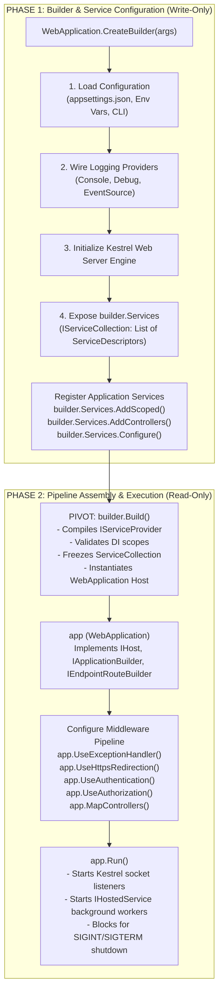

# Lesson 13: ASP.NET Core Startup: Program.cs, the Builder and the Host

> **Prerequisites:** [Extension Methods, Partial Classes, Attributes and Reflection](../12-extension-methods-attributes-and-reflection/README.md) and [Track 26 Overview](../README.md).  
> **Estimated Reading Time:** 18 minutes  
> **Target Audience:** Engineers preparing for LLD, OOP, C#, or Python technical screening and architecture rounds.

> [!TIP]
> **The One Rule of Program.cs and the Host:** `Program.cs` is a strict two-phase architectural lifecycle bifurcated by `builder.Build()`: phase one configures dependencies, configuration, and logging into `builder.Services` (write-only container configuration), and phase two assembles the HTTP execution pipeline on `app` (read-only container, executable pipeline). Never invoke `builder.Services.BuildServiceProvider()` during startup to resolve a dependency—doing so creates a duplicate, unmanaged DI container that leaks memory and fragments service lifecycles.

---

## 1. Why This Matters: The Interview Trap

"Walk me through what happens in `Program.cs` from top to bottom" is the foundational architecture question in ASP.NET Core interviews. Candidates who memorize templates often give superficial answers:

> *"First it imports packages, creates a builder, registers services with `AddScoped` or `AddControllers`, calls `builder.Build()`, configures Swagger and CORS on `app`, and finally calls `app.Run()` to start the server on port 5000."*

An interviewer immediately detects that the candidate understands the *syntax*, but not the *runtime mechanics*. A senior engineer explains the **lifecycle phases, host responsibilities, and container boundaries**:

1. **Host Bootstrapping (`WebApplication.CreateBuilder`):** Pre-configures configuration providers (layered JSON, User Secrets, environment variables, CLI args), structured logging (Console, Debug, EventSource), Kestrel server options, and dependency injection defaults.
2. **Container Composition (`builder.Services`):** The application populates the `IServiceCollection` with service descriptors. The container is mutable and write-only; instances cannot be resolved safely yet.
3. **The Pivot Point (`builder.Build()`):** Freezes the `IServiceCollection`, compiles the root `IServiceProvider`, validates scopes in development, and instantiates the `WebApplication` host.
4. **Pipeline Assembly (`app`):** Configures the `RequestDelegate` chain using `app.Use...` and maps endpoints via `app.Map...`.
5. **Execution (`app.Run()`):** Starts the Kestrel web server, activates registered `IHostedService` background workers, binds to sockets, and blocks the main thread waiting for OS termination signals (SIGINT/SIGTERM) to trigger graceful shutdown.

### Evolution: Old `Startup.cs` vs. Modern Minimal Hosting

Before .NET 6, ASP.NET Core split bootstrapping across `Program.cs` (`CreateHostBuilder`) and a separate `Startup.cs` class containing `ConfigureServices` and `Configure`. Modern .NET unifies this into a single, cohesive top-level workflow:

| Feature Dimension | Legacy Startup (`Startup.cs`) | Modern Minimal Host (`WebApplicationBuilder`) |
| :--- | :--- | :--- |
| **Structure** | Split across two files (`Program.cs` and `Startup.cs`) with reflection-based method discovery. | Single unified script using C# top-level statements. |
| **Builder Type** | `IHostBuilder` / `IWebHostBuilder`. | `WebApplicationBuilder` (wraps generic host, configuration, and logging into one ergonomic facade). |
| **Container Access** | Cannot easily inspect configuration during service registration without constructor injection. | Immediate direct access: `builder.Configuration` and `builder.Environment` are available alongside `builder.Services`. |
| **Host Type** | `IHost` (requires separate pipeline builder). | `WebApplication` (implements `IHost`, `IApplicationBuilder`, and `IEndpointRouteBuilder` simultaneously). |
| **Boilerplate** | High ceremony, ceremonies around `public void ConfigureServices(...)`. | Low ceremony, zero boilerplate, transparent linear execution order. |

---

## 2. Visual Mental Model / Taxonomic Comparison

### The Two-Phase Lifecycle of ASP.NET Core Startup



### Kestrel in Modern Architecture: Edge vs. Reverse Proxy

| Characteristic | Direct Kestrel (Edge) | Kestrel Behind Reverse Proxy (Nginx / YARP / IIS / Cloudflare) |
| :--- | :--- | :--- |
| **Deployment Model** | Exposed directly to the public internet on ports 80/443. | Internal private network / container subnet behind reverse proxy. |
| **TLS / SSL Offloading** | Handled natively by Kestrel via ALPN (supports TLS 1.3). | Terminated at the reverse proxy (load balancer / ingress controller). |
| **Static File Caching** | Managed by ASP.NET Core `UseStaticFiles` middleware. | Offloaded to Nginx/CDN edge caches for zero-allocation static asset delivery. |
| **DDoS & Rate Limiting** | Handled via ASP.NET Core RateLimiter middleware. | Blocked at edge/proxy level before traffic reaches application container memory. |
| **Protocol Support** | Native HTTP/1.1, HTTP/2, and HTTP/3 (QUIC) over managed sockets. | Proxy handles public HTTP/3 and forwards HTTP/1.1 or HTTP/2 internally. |

---

## 3. Code Implementation

The following implementation contrasts modern .NET Minimal Hosting with its Python ASGI counterpart (FastAPI with Uvicorn and lifespan events).

````carousel
```csharp
using System;
using System.Threading;
using System.Threading.Tasks;
using Microsoft.AspNetCore.Builder;
using Microsoft.AspNetCore.Hosting;
using Microsoft.AspNetCore.Http;
using Microsoft.Extensions.Configuration;
using Microsoft.Extensions.DependencyInjection;
using Microsoft.Extensions.Hosting;
using Microsoft.Extensions.Logging;

// ============================================================================
// DOMAIN CONTRACTS AND SERVICES
// ============================================================================
public interface IOrderService
{
    string ProcessOrder(string item, int quantity);
}

public class OrderService : IOrderService
{
    private readonly ILogger<OrderService> _logger;

    public OrderService(ILogger<OrderService> logger)
    {
        _logger = logger;
    }

    public string ProcessOrder(string item, int quantity)
    {
        _logger.LogInformation("Processing order for {Quantity}x {Item}", quantity, item);
        return $"Confirmed order: {quantity}x {item} (Processed at {DateTime.UtcNow:HH:mm:ss})";
    }
}

// Background worker demonstrating IHostedService lifecycle during app.Run()
public class DatabaseWarmupService : IHostedService
{
    private readonly ILogger<DatabaseWarmupService> _logger;

    public DatabaseWarmupService(ILogger<DatabaseWarmupService> logger)
    {
        _logger = logger;
    }

    public Task StartAsync(CancellationToken cancellationToken)
    {
        _logger.LogInformation("[HostedService] Warmup: Verifying database connectivity and pre-compiling queries...");
        return Task.CompletedTask;
    }

    public Task StopAsync(CancellationToken cancellationToken)
    {
        _logger.LogInformation("[HostedService] Teardown: Flushing pending logs and releasing socket pools...");
        return Task.CompletedTask;
    }
}

// ============================================================================
// HOST BOOTSTRAPPING (Program.cs Entry Point)
// ============================================================================
public class Program
{
    public static async Task Main(string[] args)
    {
        // 1. BOOTSTRAP: WebApplication.CreateBuilder initializes Config, Logging, Kestrel, and DI
        var builder = WebApplication.CreateBuilder(args);

        // Configure Kestrel options explicitly if needed
        builder.WebHost.ConfigureKestrel(options =>
        {
            options.Limits.MaxRequestBodySize = 10 * 1024 * 1024; // 10 MB limit
            options.AddServerHeader = false; // Security: do not leak server banner
        });

        // 2. PHASE 1: Register services into builder.Services (Write-only phase)
        builder.Services.AddScoped<IOrderService, OrderService>();
        builder.Services.AddHostedService<DatabaseWarmupService>();
        builder.Services.AddEndpointsApiExplorer();

        Console.WriteLine("[Phase 1] Services registered into IServiceCollection.");

        // 3. THE PIVOT: builder.Build() freezes DI container and creates WebApplication host
        var app = builder.Build();
        Console.WriteLine("[Pivot] Host built. IServiceProvider compiled and frozen.");

        // 4. PHASE 2: Configure the HTTP middleware pipeline (app)
        if (app.Environment.IsDevelopment())
        {
            app.UseDeveloperExceptionPage();
        }

        // Custom request correlation middleware
        app.Use(async (context, next) =>
        {
            context.Response.Headers.Append("X-Server-Engine", "Kestrel-Core");
            await next(context);
        });

        // Map endpoints (Minimal APIs)
        app.MapGet("/health", () => Results.Ok(new { status = "Healthy", timestamp = DateTime.UtcNow }));

        app.MapPost("/orders", (string item, int quantity, IOrderService orderService) =>
        {
            var receipt = orderService.ProcessOrder(item, quantity);
            return Results.Ok(new { receipt });
        });

        Console.WriteLine("[Phase 2] Pipeline and endpoints assembled.");

        // 5. RUN: Start Kestrel, invoke IHostedService.StartAsync, and listen for HTTP traffic
        Console.WriteLine("[Run] Starting Kestrel web server on configured ports...");
        
        // For demonstration, run host with immediate graceful cancellation token
        using var cts = new CancellationTokenSource(TimeSpan.FromMilliseconds(200));
        await app.RunAsync(cts.Token);
        Console.WriteLine("[Shutdown] Server gracefully terminated.");
    }
}
```
<!-- slide -->
```python
import asyncio
from contextlib import asynccontextmanager
from datetime import datetime, timezone
from typing import AsyncGenerator
from fastapi import Depends, FastAPI
from pydantic import BaseModel
import uvicorn


# ============================================================================
# DOMAIN MODELS AND SERVICES
# ============================================================================
class OrderRequest(BaseModel):
  item: str
  quantity: int


class OrderService:

  def process_order(self, item: str, quantity: int) -> str:
    print(f"Processing order for {quantity}x {item}")
    now = datetime.now(timezone.utc).strftime("%H:%M:%S")
    return f"Confirmed order: {quantity}x {item} (Processed at {now})"


def get_order_service() -> OrderService:
  """FastAPI Dependency Injection provider (corresponds to AddScoped)."""
  return OrderService()


# ============================================================================
# HOST BOOTSTRAPPING (Python Lifespan & ASGI Model)
# ============================================================================
@asynccontextmanager
async def lifespan(app: FastAPI) -> AsyncGenerator[None, None]:
  """Corresponds to IHostedService in .NET:

  Logic before yield runs during startup (StartAsync). Logic after yield runs
  during shutdown (StopAsync).
  """
  # Phase 1: Startup / Warmup
  print(
      "[HostedService] Warmup: Verifying database connectivity and"
      " pre-compiling queries..."
  )
  yield
  # Phase 2: Shutdown / Teardown
  print(
      "[HostedService] Teardown: Flushing pending logs and releasing socket"
      " pools..."
  )


# App initialization: Corresponds to builder.Build() + WebApplication setup
app = FastAPI(title="OrderAPI", lifespan=lifespan)


# Middleware: Corresponds to app.Use(...)
@app.middleware("http")
async def add_server_engine_header(request, call_next):
  response = await call_next(request)
  response.headers["X-Server-Engine"] = "Uvicorn-ASGI"
  return response


# Endpoints: Corresponds to app.MapGet / app.MapPost
@app.get("/health")
async def health():
  return {"status": "Healthy", "timestamp": datetime.now(timezone.utc)}


@app.post("/orders")
async def create_order(
    order: OrderRequest,
    service: OrderService = Depends(get_order_service),
):
  receipt = service.process_order(order.item, order.quantity)
  return {"receipt": receipt}


# Runner: Corresponds to app.Run() starting the Kestrel/Uvicorn server
if __name__ == "__main__":
  print("[Phase 1] Services and dependencies registered.")
  print("[Pivot] FastAPI app instantiated.")
  print("[Phase 2] Pipeline and endpoints assembled.")
  print("[Run] Starting Uvicorn web server on configured ports...")

  # Start Uvicorn ASGI server (counterpart to Kestrel)
  config = uvicorn.Config(
      app=app, host="127.0.0.1", port=5000, log_level="warning"
  )
  server = uvicorn.Server(config)
  asyncio.run(server.serve())
```
````

**Expected Output (Both Languages):**

```text
[Phase 1] Services registered into IServiceCollection.
[Pivot] Host built. IServiceProvider compiled and frozen.
[Phase 2] Pipeline and endpoints assembled.
[Run] Starting Kestrel web server on configured ports...
[HostedService] Warmup: Verifying database connectivity and pre-compiling queries...
[HostedService] Teardown: Flushing pending logs and releasing socket pools...
[Shutdown] Server gracefully terminated.
```

---

## 4. Where You Already Use It

Every production web application and worker in .NET relies on this host infrastructure:

- **ASP.NET Core Web APIs & Microservices:**
  - `WebApplication.CreateBuilder(args)` initializes configuration layers from `appsettings.json`, environment-specific overrides (`appsettings.Development.json`), Docker container environment variables, and Kubernetes ConfigMaps.
- **Background Worker Services:**
  - `Host.CreateApplicationBuilder(args)` in .NET 7/8+ provides the non-HTTP equivalent for message bus consumers (RabbitMQ, Azure Service Bus, Kafka workers). It builds an `IHost` without Kestrel, executing registered `BackgroundService` and `IHostedService` instances.
- **Kestrel Web Server:**
  - Built into `Microsoft.AspNetCore.Server.Kestrel.Core`. Powers high-performance edge APIs, gRPC streaming services (using HTTP/2 trailing headers), and real-time WebSockets via `System.IO.Pipelines`.
- **Python ASGI Architecture:**
  - In the Python backend ecosystem, `Uvicorn` and `Hypercorn` act as the high-performance asynchronous HTTP servers (the equivalent of Kestrel), running ASGI applications built on `FastAPI` or `Starlette`.

---

## 5. Pitfalls and When Not to Use It

### 1. The "Dual Container / BuildServiceProvider" Anti-Pattern
- **The Bug:** Invoking `builder.Services.BuildServiceProvider()` inside `Program.cs` to resolve a service during registration:
  ```csharp
  // FATAL MISTAKE: Creates an isolated, leaking root provider
  var serviceProvider = builder.Services.BuildServiceProvider();
  var dbContext = serviceProvider.GetRequiredService<AppDbContext>();
  dbContext.Database.Migrate();
  ```
- **The Consequence:** You create two distinct DI containers. Any singleton created in the temporary provider is a completely different instance from the singleton resolved later at runtime by Kestrel. Even worse, if those services implement `IDisposable`, the temporary provider never gets disposed, leaking unmanaged database connection handles and sockets.
- **The Fix:** Wait until `builder.Build()` executes, create a temporary scope from `app.Services`, resolve the dependency, and let it dispose:
  ```csharp
  var app = builder.Build();
  using (var scope = app.Services.CreateScope())
  {
      var dbContext = scope.ServiceProvider.GetRequiredService<AppDbContext>();
      dbContext.Database.Migrate();
  }
  app.Run();
  ```

### 2. Confusing `app.Run()` with `app.Run(delegate)`
- **The Bug:** Mixing up the host startup method with the terminal middleware method:
  - `app.Run()` (no arguments): Starts the host, launches Kestrel, and blocks waiting for shutdown.
  - `app.Run(async context => { ... })`: Registers a **terminal middleware delegate** that handles the request and terminates the pipeline without calling `next()`.
- **The Consequence:** Placing `app.Run(async ctx => ...)` at the bottom of `Program.cs` instead of `app.Run()` causes the application to compile (because both are extension methods on `WebApplication`), but the web server never starts listening for requests!

### 3. Mutating Services After `builder.Build()`
- **The Bug:** Attempting to register another dependency after `builder.Build()`:
  ```csharp
  var app = builder.Build();
  builder.Services.AddSingleton<IMyService, MyService>(); // InvalidOperationException!
  ```
- **Why It Fails:** Once `builder.Build()` is invoked, the `IServiceCollection` is permanently sealed and marked read-only. Dynamic runtime service mutation is forbidden in ASP.NET Core to guarantee thread safety and predictable object graphs.

---

## 6. Exercises & Practical Drills

### Drill 1: Refactoring the Startup Migration Anti-Pattern
Examine the following `Program.cs` snippet:

```csharp
var builder = WebApplication.CreateBuilder(args);
builder.Services.AddDbContext<AppDbContext>(options => options.UseNpgsql("..."));

// Developer wants to run database migrations before the web server begins accepting traffic
var tempProvider = builder.Services.BuildServiceProvider();
var db = tempProvider.GetRequiredService<AppDbContext>();
db.Database.Migrate();

var app = builder.Build();
app.MapGet("/", () => "Ready");
app.Run();
```

What are the two major architectural problems with this code, and how should it be rewritten?

<details>
<summary>Answer</summary>

**Architectural Problems:**
1. **Duplicate Container Creation:** Calling `builder.Services.BuildServiceProvider()` builds an entire duplicate dependency injection tree. This consumes extra memory, duplicates singleton initializations, and bypasses DI scope validation.
2. **Resource & Connection Leak:** The `tempProvider` is never disposed. Any `IDisposable` or `IAsyncDisposable` services instantiated by `tempProvider` remain in memory, potentially leaking PostgreSQL connection pools.

**Refactored Solution:**
```csharp
var builder = WebApplication.CreateBuilder(args);
builder.Services.AddDbContext<AppDbContext>(options => options.UseNpgsql("..."));

var app = builder.Build();

// Safely resolve the scoped DbContext from the official application container
using (var scope = app.Services.CreateScope())
{
    var db = scope.ServiceProvider.GetRequiredService<AppDbContext>();
    db.Database.Migrate();
}

app.MapGet("/", () => "Ready");
app.Run();
```
*Why this is correct:* It uses the single authoritative container compiled by `builder.Build()`, resolves `AppDbContext` inside a cleanly bounded `IServiceScope`, and automatically disposes the context and its database connection before traffic begins.
</details>

### Drill 2: Implementing a Asynchronous Startup Health Check
Write an implementation showing how to safely execute asynchronous pre-flight checks (verifying Redis and Database connectivity) before `app.Run()` starts serving public traffic, aborting startup if the checks fail.

<details>
<summary>Answer</summary>

Implement an `IHostedService` or execute an async pre-flight block right after `builder.Build()`:

```csharp
var builder = WebApplication.CreateBuilder(args);
builder.Services.AddSingleton<IRedisHealthCheck, RedisHealthCheck>();

var app = builder.Build();

// Pre-flight validation gate
using (var scope = app.Services.CreateScope())
{
    var logger = scope.ServiceProvider.GetRequiredService<ILogger<Program>>();
    var redisCheck = scope.ServiceProvider.GetRequiredService<IRedisHealthCheck>();

    logger.LogInformation("Performing pre-flight health validations...");
    bool isHealthy = await redisCheck.PingAsync();
    if (!isHealthy)
    {
        logger.LogCritical("Pre-flight check failed: Redis cluster unavailable. Aborting startup.");
        Environment.ExitCode = 1;
        return; // Aborts before app.Run() starts listening on ports
    }
}

app.MapGet("/ping", () => "pong");
await app.RunAsync();
```
</details>

---

## 7. Interview Questions & Model Answers

> [!interview]
> **Question 1: Walk me through Program.cs.**  
> **Strong Answer:**  
> "`Program.cs` is the entry point of an ASP.NET Core application, structured around the **Minimal Hosting Model** introduced in .NET 6. The file executes in four distinct, linear stages:  
> 
> 1. **Bootstrapping via `WebApplication.CreateBuilder(args)`:** This instantiates a `WebApplicationBuilder` and automatically pre-configures default configuration sources (layered `appsettings.json`, environment variables, user secrets, command-line flags), structured logging providers (Console, Debug, EventLog), Kestrel server options, and the dependency injection collection.  
> 2. **Service Registration via `builder.Services`:** Here, we register all application dependencies into the `IServiceCollection` using their respective lifetimes (`AddTransient`, `AddScoped`, `AddSingleton`), and add framework features like `AddControllers()`, `AddEndpointsApiExplorer()`, or `AddAuthentication()`.  
> 3. **The Pivot Point via `builder.Build()`:** Calling `Build()` compiles the `IServiceCollection` into an immutable `IServiceProvider`, validates DI lifetimes and scopes, and creates the `WebApplication` instance (the host). Once `Build()` is called, no more services can be registered.  
> 4. **Middleware Pipeline Assembly via `app`:** Using the `WebApplication` instance, we configure the bidirectional HTTP request delegate chain (`app.UseExceptionHandler()`, `app.UseAuthentication()`, `app.UseAuthorization()`) and map HTTP endpoints (`app.MapControllers()`, `app.MapGet()`).  
> 
> Finally, calling `app.Run()` starts the Kestrel web server, starts all registered `IHostedService` background workers, binds to listening ports, and blocks the main thread waiting for graceful shutdown signals (like SIGTERM)."

> [!interview]
> **Question 2: What does WebApplication.CreateBuilder do?**  
> **Strong Answer:**  
> "`WebApplication.CreateBuilder(args)` is an opinionated factory method that initializes and configures the foundational subsystems required to run an ASP.NET Core application. Specifically, it wires four major components under the hood:  
> 
> 1. **Configuration Providers:** It sets up an `IConfiguration` pipeline reading sequentially from `appsettings.json`, `appsettings.{Environment}.json`, User Secrets (in Development environment), Environment Variables, and Command-Line arguments.  
> 2. **Logging Subsystem:** It configures an `ILoggerFactory` with pre-registered logging providers: Console, Debug, EventSource, and Windows EventLog (when running on Windows).  
> 3. **Kestrel Web Server:** It configures Kestrel as the in-process web server, binding default endpoints and picking up any server configuration defined in the `Kestrel` configuration section.  
> 4. **Dependency Injection Container:** It initializes an empty `IServiceCollection` and populates it with internal framework dependencies, while configuring container options (such as verifying that scoped services are not captured by singletons in the Development environment).  
> 
> Crucially, `CreateBuilder` also exposes `builder.Environment` and `builder.Configuration` directly, allowing engineers to read environment settings or configuration values immediately during service registration without messy workarounds."

> [!interview]
> **Question 3: What is the difference between builder.Services and app?**  
> **Strong Answer:**  
> "The difference between `builder.Services` and `app` represents the fundamental separation between **dependency registration** and **HTTP pipeline execution**:  
> 
> - **`builder.Services`** is an instance of `IServiceCollection` (a list of `ServiceDescriptor` objects). Its sole purpose is **compile-time dependency registration**. It is write-only: you add services, configure options, and register database contexts. At this stage, the application does not yet have a compiled service provider, Kestrel is not running, and incoming HTTP requests cannot be received.  
> - **`app`** is an instance of `WebApplication`. It represents the **running host and HTTP pipeline**. It implements `IHost`, `IApplicationBuilder`, and `IEndpointRouteBuilder`. At this stage, the DI container is frozen and immutable (accessible as read-only via `app.Services`). You use `app` to construct the middleware pipeline (via `app.Use...`) and define URL routing endpoints (via `app.Map...`).  
> 
> In short: `builder.Services` defines *what dependencies exist*; `app` defines *how HTTP requests flow and execute* across those dependencies."

> [!interview]
> **Question 4: What is Kestrel?**  
> **Strong Answer:**  
> "**Kestrel** is the cross-platform, high-performance, asynchronous web server built into ASP.NET Core. It is included by default in all ASP.NET Core application templates.  
> 
> Key technical aspects of Kestrel include:  
> 1. **Architecture & Performance:** Kestrel is built on top of managed socket transports using `System.IO.Pipelines` to achieve zero-copy memory reads, minimal GC allocations, and ultra-high throughput. It consistently ranks among the fastest web servers in industry benchmarks (such as TechEmpower).  
> 2. **Protocol Support:** It natively supports HTTP/1.1, HTTP/2 (including gRPC streaming), and HTTP/3 (over QUIC via UDP), alongside WebSockets.  
> 3. **Deployment Models:**  
>    - **As an Edge Server:** Kestrel is fully hardened against public internet attacks (with configurable limits on request body sizes, connection rates, header timeouts, and keep-alive intervals) and can be exposed directly to the internet.  
>    - **Behind a Reverse Proxy:** In enterprise production, it is frequently deployed behind a reverse proxy or load balancer (such as Nginx, AWS ALB, Cloudflare, IIS, or YARP). The reverse proxy handles edge responsibilities like DDoS filtering, static file caching, and public SSL termination, forwarding requests internally to Kestrel via HTTP/1.1 or HTTP/2."

---

## 8. Sources & Further Reading

- [Microsoft Learn: ASP.NET Core Fundamentals Overview](https://learn.microsoft.com/en-us/aspnet/core/fundamentals/)
- [Microsoft Learn: App startup in ASP.NET Core](https://learn.microsoft.com/en-us/aspnet/core/fundamentals/startup)
- [Microsoft Learn: Kestrel Web Server in ASP.NET Core](https://learn.microsoft.com/en-us/aspnet/core/fundamentals/servers/kestrel)
- [Microsoft Learn: Dependency injection in ASP.NET Core](https://learn.microsoft.com/en-us/aspnet/core/fundamentals/dependency-injection)
- [FastAPI Documentation: Lifespan Events](https://fastapi.tiangolo.com/advanced/events/)

---

Previous: [Extension Methods, Partial Classes, Attributes and Reflection](../12-extension-methods-attributes-and-reflection/README.md) · Next: [The Middleware Pipeline: app.Use, app.Run and app.Map](../14-middleware-pipeline-use-run-map/README.md)
