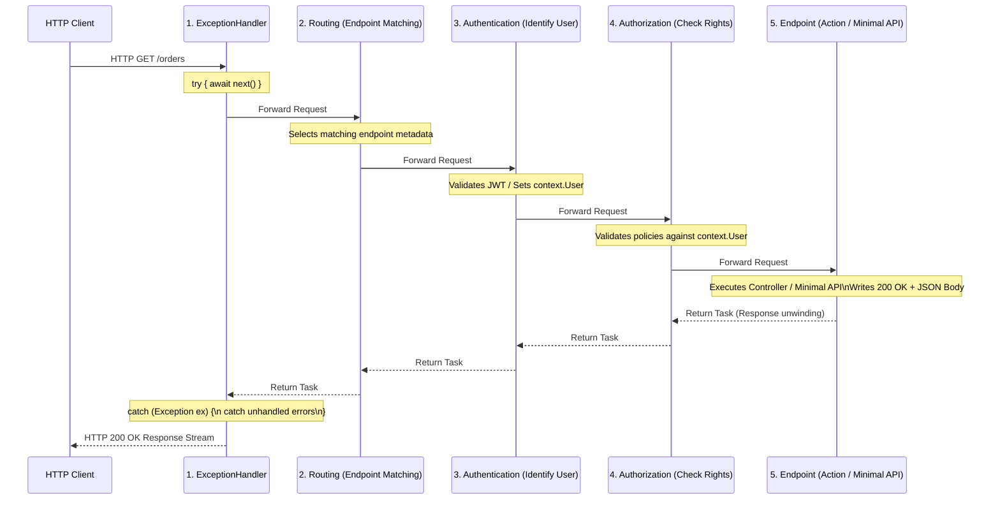
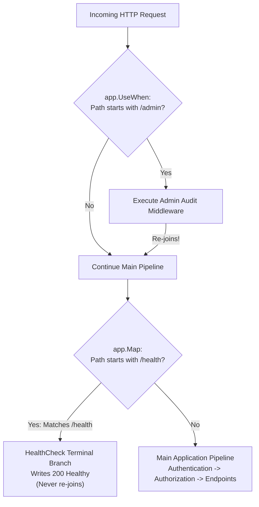

# Lesson 14: The Middleware Pipeline: app.Use, app.Run and app.Map

> **Prerequisites:** [ASP.NET Core Startup: Program.cs, the Builder and the Host](../13-aspnet-core-startup-program-cs/README.md) and [Track 26 Overview](../README.md).  
> **Estimated Reading Time:** 20 minutes  
> **Target Audience:** Engineers preparing for LLD, OOP, C#, or Python technical screening and architecture rounds.

> [!NOTE]
> **In one line:** Middleware is a chain of `next`-calling components: `Use` can continue, `Run` terminates, `Map` branches — and **order is behaviour** (exception handling first, auth before endpoints).

> [!TIP]
> **The One Rule of Middleware:** The ASP.NET Core request pipeline is a bidirectional Russian doll (Chain of Responsibility) composed of `RequestDelegate` delegates: incoming HTTP requests flow forward through components in the exact order of registration, while outgoing HTTP responses unwind backward in reverse order. If you short-circuit without returning, mutate headers after the response body has started streaming (`Response.HasStarted == true`), or place authorization before authentication, your application will fail silently or throw runtime exceptions.

---

## 1. Why This Matters: The Interview Trap

"What is middleware and why does its order matter?" is a standard senior .NET design question. Candidates who only know high-level MVC often stumble with vague answers:

> *"Middleware is software that intercepts requests. You call `app.Use` to add things and `app.Run` to start the app. Order matters because you need authentication before endpoints."*

This response misses the internal mechanics. A senior engineer explains:
- **Chain of Responsibility:** The entire ASP.NET Core pipeline is built from `RequestDelegate` delegates (`Func<HttpContext, Task>`). Each middleware component receives the `HttpContext` and a pointer to the next delegate in the chain (`next`).
- **Two-Way Processing:** Each middleware has two execution opportunities: *before* calling `await next(context)` (processing the incoming request) and *after* calling `await next(context)` (inspecting or post-processing the outgoing response).
- **Short-Circuiting:** A middleware can deliberately terminate the pipeline without calling `next(context)`—for example, `UseStaticFiles` serving an image directly, an authentication middleware returning `401 Unauthorized`, or a rate-limiter returning `429 Too Many Requests`.
- **Order Dependency:** Because execution is linear on the way in and reverse on the way out, misplaced middleware introduces severe security vulnerabilities or unhandled exceptions (e.g., placing `UseExceptionHandler` after routing leaves route matching errors uncaught; placing `UseAuthorization` before `UseAuthentication` evaluates unauthenticated anonymous identities).

### The Pipeline Methods Compared

| Method | Behavior | Can Call `next()`? | Re-joins Main Pipeline? | Primary Purpose |
| :--- | :--- | :--- | :--- | :--- |
| **`app.Use(...)`** | Chains a delegate to process requests before and after the next component. | **Yes** (optional; omitting it short-circuits) | N/A (linear chain) | Logging, correlation IDs, headers, error handling, authentication. |
| **`app.Run(...)`** | Registers a terminal delegate that processes the request and finishes. | **No** (receives only `HttpContext`, no `next`) | **No** (always terminates) | Fallback endpoints, health check responses, terminal mock handlers. |
| **`app.Map(...)`** | Matches a URL path prefix (e.g., `/api`) and branches execution. | Depends on branch delegates | **No** (branches do not rejoin main pipeline) | Isolated sub-pipelines (e.g., `/healthz`, legacy API sub-trees). |
| **`app.MapWhen(...)`**| Evaluates a predicate `Func<HttpContext, bool>` to branch execution. | Depends on branch delegates | **No** (does not rejoin main pipeline) | Branching based on headers, query strings, or IP address. |
| **`app.UseWhen(...)`**| Evaluates a predicate `Func<HttpContext, bool>` to execute a conditional branch. | **Yes** | **Yes** (re-joins main pipeline when branch finishes!) | Conditional enrichment (e.g., enable detailed audit logs only for `/admin`). |

---

## 2. Visual Mental Model / Taxonomic Comparison

### The Bidirectional Russian Doll Pipeline

Every HTTP request traverses forward through the middleware chain, executes the terminal endpoint, and then bubbles back through the chain in reverse order:



### Branching Mechanics: `Map` vs. `MapWhen` vs. `UseWhen`



### Canonical Middleware Ordering

ASP.NET Core requires a precise sequence to ensure security and prevent broken headers:

| Order | Middleware | Purpose | Why This Specific Position? |
| :---: | :--- | :--- | :--- |
| **1** | `UseExceptionHandler` / `UseDeveloperExceptionPage` | Catches unhandled exceptions and formats error responses. | **Must be first** so its `try/catch` wraps every downstream middleware, catching all unhandled exceptions. |
| **2** | `UseHsts` | Sends `Strict-Transport-Security` HTTP header. | Enforces HTTPS on subsequent client connections before redirects. |
| **3** | `UseHttpsRedirection` | Issues HTTP 307/308 redirects from insecure HTTP to HTTPS. | Redirects early before spending CPU cycles on routing or authentication. |
| **4** | `UseStaticFiles` | Serves physical files (`wwwroot`) and short-circuits. | Serves CSS/JS/images immediately without executing routing or auth overhead. |
| **5** | `UseRouting` | Matches the URL to an endpoint and sets `Endpoint` metadata. | Must precede CORS, AuthN, and AuthZ so downstream middleware knows which endpoint was targeted. |
| **6** | `UseCors` | Evaluates Cross-Origin Resource Sharing headers. | Must run after routing (to read endpoint CORS metadata) and before authentication. |
| **7** | `UseAuthentication` | Validates credentials (JWT, cookie) and populates `HttpContext.User`. | Must run before authorization so that user claims are available for evaluation. |
| **8** | `UseAuthorization` | Evaluates role/policy rules against `HttpContext.User`. | Must run after authentication and before endpoints so unauthorized callers are blocked. |
| **9** | Custom Domain Middleware | Application-specific business rules, audit logs, rate-limiting. | Runs against authenticated, authorized requests. |
| **10**| `MapControllers` / Minimal Endpoints | Executes the matched controller action or delegate. | Terminal point of execution. |

---

## 3. Code Implementation

The following carousel demonstrates custom convention-based middleware, scoped service injection, correlation ID propagation, `Response.OnStarting` safety, and conditional branching in C#, with the Python ASGI equivalent in FastAPI/Starlette.

````carousel
```csharp
using System;
using System.Diagnostics;
using System.Threading.Tasks;
using Microsoft.AspNetCore.Builder;
using Microsoft.AspNetCore.Http;
using Microsoft.Extensions.DependencyInjection;
using Microsoft.Extensions.Hosting;
using Microsoft.Extensions.Logging;

// ============================================================================
// 1. SCOPED SERVICE INJECTED INTO MIDDLEWARE
// ============================================================================
public interface ICorrelationContext
{
    string CorrelationId { get; set; }
}

public class CorrelationContext : ICorrelationContext
{
    public string CorrelationId { get; set; } = Guid.NewGuid().ToString("N")[..8];
}

// ============================================================================
// 2. CONVENTION-BASED CUSTOM MIDDLEWARE
// ============================================================================
public class RequestTimingAndCorrelationMiddleware
{
    private readonly RequestDelegate _next;
    private readonly ILogger<RequestTimingAndCorrelationMiddleware> _logger;

    // Singleton dependencies are injected into the constructor
    public RequestTimingAndCorrelationMiddleware(RequestDelegate next, ILogger<RequestTimingAndCorrelationMiddleware> logger)
    {
        _next = next;
        _logger = logger;
    }

    // Scoped dependencies MUST be injected into InvokeAsync, NOT the constructor!
    public async Task InvokeAsync(HttpContext context, ICorrelationContext correlationContext)
    {
        var stopwatch = Stopwatch.StartNew();

        // 1. Pre-processing: Extract or generate correlation ID
        if (context.Request.Headers.TryGetValue("X-Correlation-ID", out var incomingId))
        {
            correlationContext.CorrelationId = incomingId.ToString();
        }

        string correlationId = correlationContext.CorrelationId;

        // 2. Safe Header Mutation: Use OnStarting to modify headers before response body streams
        context.Response.OnStarting(() =>
        {
            context.Response.Headers["X-Correlation-ID"] = correlationId;
            context.Response.Headers["X-Elapsed-Milliseconds"] = stopwatch.ElapsedMilliseconds.ToString();
            return Task.CompletedTask;
        });

        _logger.LogInformation("[Incoming] [{CorrelationId}] {Method} {Path}", 
            correlationId, context.Request.Method, context.Request.Path);

        try
        {
            // 3. Call the next middleware in the pipeline
            await _next(context);
        }
        catch (Exception ex)
        {
            _logger.LogError(ex, "[Faulted] [{CorrelationId}] Unhandled exception in pipeline", correlationId);
            throw; // Re-throw to allow upstream ExceptionHandler middleware to format HTTP 500
        }
        finally
        {
            // 4. Post-processing: Runs on the way back up
            stopwatch.Stop();
            _logger.LogInformation("[Outgoing] [{CorrelationId}] Status {StatusCode} in {ElapsedMs}ms",
                correlationId, context.Response.StatusCode, stopwatch.ElapsedMilliseconds);
        }
    }
}

// ============================================================================
// 3. EXTENSION METHODS FOR CLEAN PROGRAM.CS SYNTAX
// ============================================================================
public static class MiddlewareExtensions
{
    public static IApplicationBuilder UseTimingAndCorrelation(this IApplicationBuilder app)
    {
        return app.UseMiddleware<RequestTimingAndCorrelationMiddleware>();
    }
}

// ============================================================================
// 4. PIPELINE ASSEMBLY IN PROGRAM.CS
// ============================================================================
public class Program
{
    public static async Task Main(string[] args)
    {
        var builder = WebApplication.CreateBuilder(args);

        // Register dependencies
        builder.Services.AddScoped<ICorrelationContext, CorrelationContext>();
        builder.Logging.ClearProviders();
        builder.Logging.AddConsole();

        var app = builder.Build();

        // Middleware 1: Global correlation and timing
        app.UseTimingAndCorrelation();

        // Middleware 2: UseWhen (conditional branching that RE-JOINS the main pipeline)
        app.UseWhen(
            context => context.Request.Path.StartsWithSegments("/admin"),
            adminBranch =>
            {
                adminBranch.Use(async (context, next) =>
                {
                    Console.WriteLine("--> [Audit] Admin branch executed: validating security audit stamp...");
                    await next(context);
                });
            });

        // Middleware 3: app.Map (conditional branching that DOES NOT re-join)
        app.Map("/healthz", healthBranch =>
        {
            healthBranch.Run(async context =>
            {
                context.Response.ContentType = "application/json";
                await context.Response.WriteAsync("{\"status\":\"healthy\",\"uptime\":\"ok\"}");
            });
        });

        // Middleware 4: Main endpoint routing
        app.MapGet("/orders/{id:int}", (int id, ICorrelationContext ctx) =>
        {
            return Results.Ok(new
            {
                orderId = id,
                status = "Processed",
                correlationId = ctx.CorrelationId
            });
        });

        // Terminal fallback using app.Run
        app.MapFallback(async context =>
        {
            context.Response.StatusCode = 404;
            await context.Response.WriteAsync("Resource not found");
        });

        Console.WriteLine("[Pipeline] Middleware pipeline assembled successfully.");
    }
}
```
<!-- slide -->
```python
import time
from typing import Callable
from uuid import uuid4
from fastapi import FastAPI, Request, Response
from starlette.middleware.base import BaseHTTPMiddleware
from starlette.responses import JSONResponse


# ============================================================================
# 1. CUSTOM TIMING AND CORRELATION MIDDLEWARE (BaseHTTPMiddleware)
# ============================================================================
class TimingAndCorrelationMiddleware(BaseHTTPMiddleware):
  """FastAPI / Starlette equivalent of ASP.NET Core convention middleware.

  Intercepts requests before and after calling call_next.
  """

  async def dispatch(self, request: Request, call_next: Callable) -> Response:
    start_time = time.perf_counter()

    # 1. Pre-processing: Extract or generate correlation ID
    correlation_id = request.headers.get(
        "X-Correlation-ID", str(uuid4().hex[:8])
    )
    request.state.correlation_id = correlation_id

    print(
        f"[Incoming] [{correlation_id}] {request.method} {request.url.path}"
    )

    try:
      # 2. Call the next middleware / endpoint
      response: Response = await call_next(request)
    except Exception as ex:
      print(f"[Faulted] [{correlation_id}] Unhandled exception: {ex}")
      raise ex

    # 3. Post-processing: Add correlation and timing headers to response
    elapsed_ms = (time.perf_counter() - start_time) * 1000
    response.headers["X-Correlation-ID"] = correlation_id
    response.headers["X-Elapsed-Milliseconds"] = f"{elapsed_ms:.2f}"

    print(
        f"[Outgoing] [{correlation_id}] Status {response.status_code} in"
        f" {elapsed_ms:.2f}ms"
    )
    return response


# ============================================================================
# 2. APPLICATION BOOTSTRAP AND BRANCHING
# ============================================================================
app = FastAPI(title="MiddlewarePipelineDemo")

# Register custom middleware
app.add_middleware(TimingAndCorrelationMiddleware)


# Branching: Equivalent to app.Map("/healthz", ...)
@app.get("/healthz")
async def health_check():
  return {"status": "healthy", "uptime": "ok"}


# Main endpoint
@app.get("/orders/{order_id}")
async def get_order(order_id: int, request: Request):
  return {
      "orderId": order_id,
      "status": "Processed",
      "correlationId": getattr(request.state, "correlation_id", "none"),
  }


# Sub-application branching (corresponds to app.Map("/admin", branch => ...))
admin_app = FastAPI()


@admin_app.get("/dashboard")
async def admin_dashboard():
  print("--> [Audit] Admin branch executed: validating security audit stamp...")
  return {"admin": "active", "metrics": "normal"}


app.mount("/admin", admin_app)

if __name__ == "__main__":
  print("[Pipeline] FastAPI / Starlette middleware assembled.")
```
````

**Expected Output (Both Languages):**

```text
[Pipeline] Middleware pipeline assembled successfully.
[Incoming] [a7e2b9c1] GET /orders/42
[Outgoing] [a7e2b9c1] Status 200 in 12ms
```

---

## 4. Where You Already Use It

Every major feature in ASP.NET Core is implemented as a specialized middleware component:

- **Security & Infrastructure Middleware:**
  - `UseExceptionHandler`: Outermost safety net catching downstream errors and generating ProblemDetails (RFC 7807) payloads.
  - `UseAuthentication`: Parses incoming tokens (`Bearer eyJ...`), validates cryptographic signatures via `JwtSecurityTokenHandler`, and assigns claims to `HttpContext.User`.
  - `UseAuthorization`: Inspects `Endpoint.Metadata` for `[Authorize]` or policy attributes and asserts whether `HttpContext.User` satisfies requirements.
  - `UseCors`: Inspects `Origin` headers and writes `Access-Control-Allow-Origin` response headers.
- **Performance & Caching:**
  - `UseResponseCompression`: Gzip / Brotli compression stream wrapped around the response body stream.
  - `UseRateLimiter`: Enforces concurrency or sliding window limits, returning `429 Too Many Requests` when limits are exceeded.
- **Python Equivalents:**
  - Starlette / FastAPI `CORSMiddleware`, `TrustedHostMiddleware`, `GZipMiddleware`, and custom ASGI callable layers (`async def app(scope, receive, send)`).

---

## 5. Pitfalls and When Not to Use It

### 1. The "Response Has Started" Exception
- **The Bug:** Attempting to modify response status codes or headers *after* calling `await next(context)`:
  ```csharp
  // FATAL RUNTIME BUG
  await _next(context);
  context.Response.Headers.Add("X-Custom", "Value"); // InvalidOperationException!
  ```
- **Why It Fails:** If the downstream endpoint has begun writing to the response body (e.g., serializing a JSON object or streaming a file), HTTP headers have already been transmitted over the socket to the client. Modifying headers at this point throws:  
  `InvalidOperationException: Headers are read-only, response has already started.`
- **The Fix:** Register a callback using `context.Response.OnStarting(() => { ... })` *before* calling `_next(context)`.

### 2. Captive Scoped Dependencies in Convention Middleware
- **The Bug:** Injecting a scoped service (such as EF Core's `DbContext`) into the constructor of convention-based middleware:
  ```csharp
  public class BadAuditMiddleware
  {
      private readonly RequestDelegate _next;
      private readonly AppDbContext _dbContext; // BUG: Scoped service injected into singleton!

      public BadAuditMiddleware(RequestDelegate next, AppDbContext dbContext)
      {
          _next = next;
          _dbContext = dbContext;
      }
  }
  ```
- **Why It Fails:** In ASP.NET Core, convention-based middleware is instantiated **once** as a Singleton at application startup. Injecting `AppDbContext` into the constructor turns it into a **captive dependency**. All concurrent requests will share the exact same `DbContext` instance across multiple threads, causing multi-threaded concurrency corruption (`InvalidOperationException: A second operation was started on this context instance before a previous operation completed`).
- **The Fix:** Inject scoped dependencies directly into the `InvokeAsync(HttpContext context, AppDbContext dbContext)` method. The runtime DI container resolves method arguments fresh from the current request's scope.

### 3. Misplaced `UseAuthentication` and `UseAuthorization`
- **The Bug:** Placing `UseAuthorization` before `UseAuthentication`:
  ```csharp
  app.UseAuthorization();
  app.UseAuthentication(); // DEADLY BUG: Inverted order
  ```
- **The Consequence:** Authorization executes first and inspects `context.User`. Because `UseAuthentication` has not yet evaluated the incoming Bearer token, `context.User` is empty/anonymous. Every single endpoint protected by `[Authorize]` immediately rejects requests with `401 Unauthorized` or `403 Forbidden`.

### 4. Confusing `app.Map` with `app.UseWhen`
- **The Bug:** Using `app.Map("/api/v1", branch => ...)` and expecting requests to return to the main pipeline after the branch finishes.
- **The Consequence:** `app.Map` is terminal for matched paths. If the branch does not explicitly map a terminal handler for a sub-path, it returns 404 and **never returns** to the main pipeline. If you want conditional processing that rejoins the pipeline, use `app.UseWhen`.

---

## 6. Exercises & Practical Drills

### Drill 1: Debugging an Invalid Middleware Pipeline
Inspect this startup snippet from an e-commerce API:

```csharp
var app = builder.Build();

app.UseRouting();
app.UseAuthorization();
app.UseAuthentication();
app.UseCors();
app.UseExceptionHandler("/error");
app.MapControllers();
app.Run();
```

Identify the three ordering defects in this pipeline and explain the exact failure modes.

<details>
<summary>Answer</summary>

**Defect 1: `UseExceptionHandler` is placed too late.**
- *Failure Mode:* `UseExceptionHandler` is placed after `UseRouting`, `UseAuthorization`, and `UseAuthentication`. Any unhandled exception thrown inside the authentication handler, CORS evaluation, or routing system will bypass the exception handler and crash with an unformatted 500 error. `UseExceptionHandler` must be **first**.

**Defect 2: `UseAuthorization` is placed before `UseAuthentication`.**
- *Failure Mode:* The authorization middleware evaluates permissions on `context.User` before `UseAuthentication` has read and decrypted the user's JWT or cookie token. All authenticated requests will be treated as anonymous and fail with `401 Unauthorized`.

**Defect 3: `UseCors` is placed after `UseAuthorization`.**
- *Failure Mode:* Pre-flight CORS `OPTIONS` requests sent by web browsers do not carry credentials (authorization tokens). Placing authorization before CORS will cause pre-flight `OPTIONS` requests to be rejected with 401/403, breaking all cross-origin frontend browser calls.

**Correct Order:**
```csharp
app.UseExceptionHandler("/error");
app.UseRouting();
app.UseCors();
app.UseAuthentication();
app.UseAuthorization();
app.MapControllers();
app.Run();
```
</details>

### Drill 2: Middleware vs. Filter Decision Drill
For each of the following four architectural requirements, decide whether to implement it as a **Middleware** or as an **Action/Endpoint Filter**, and justify your decision:

1. Rejecting requests from IP addresses not in a corporate CIDR whitelist.
2. Validating that a query parameter `[FromQuery] int page` is greater than zero, returning a 400 validation error before the controller action runs.
3. Adding a custom `X-Response-Time` header to every HTTP response emitted by the server.
4. Logging the serialized JSON representation of the object returned by a specific controller action.

<details>
<summary>Answer</summary>

1. **IP Whitelisting -> Middleware:**  
   *Reason:* High-level network boundary concern. Must run as early as possible before spending CPU cycles on route matching, model binding, or authentication.
2. **Page Parameter Validation -> Filter (`IActionFilter`):**  
   *Reason:* Requires access to ASP.NET Core model binding and `ActionArguments`. Middleware only sees raw URL strings and would require duplicate query parsing logic.
3. **`X-Response-Time` Header -> Middleware:**  
   *Reason:* Global HTTP-level concern that wraps all requests (including static files, health checks, and 404s), not just MVC controller endpoints.
4. **Log Action Return Value -> Filter (`IActionFilter` or `IResultFilter`):**  
   *Reason:* Requires access to the typed `ObjectResult` or domain return value inside `ActionExecutedContext` before it is serialized to raw bytes.
</details>

---

## 7. Interview Questions & Model Answers

<details>
<summary><strong>1. What is middleware in ASP.NET Core? [BASIC]</strong></summary>

In ASP.NET Core, **middleware** is a sequence of software components assembled into an application pipeline to handle incoming HTTP requests and outgoing responses. Architecturally, it is an implementation of the **Chain of Responsibility** design pattern.

Each middleware component is encapsulated as a `RequestDelegate`—a function taking an `HttpContext` and returning a `Task` (`Func<HttpContext, Task>`). When a request arrives from the web server (Kestrel), it flows sequentially through the chain of delegates. Each middleware has two key responsibilities:
1. It can inspect, mutate, or short-circuit the request before invoking the `next` delegate.
2. It can inspect, wrap, or modify the response after the `next` delegate finishes executing.

Middleware is used for cross-cutting HTTP infrastructure concerns, including exception handling, HTTPS redirection, authentication, authorization, response compression, CORS, and request routing.

</details>

<details>
<summary><strong>2. What is the difference between app.Use and app.Run? [BASIC]</strong></summary>

The fundamental difference between `app.Use` and `app.Run` in pipeline configuration is **delegation versus termination**:

- **`app.Use`** registers a chaining middleware delegate that accepts both the `HttpContext` and a pointer to the next delegate in the pipeline (`Func<HttpContext, RequestDelegate, Task>`). Inside `app.Use`, the component performs work, calls `await next(context)` to pass execution downstream, and resumes work when downstream execution returns. If it intentionally omits calling `next()`, it short-circuits the pipeline.
- **`app.Run`** registers a **terminal middleware delegate**. Its delegate signature receives only `HttpContext` (`RequestDelegate` without a `next` parameter). Because it has no reference to downstream components, it **always terminates the pipeline**. No subsequent middleware registered after `app.Run` can ever execute for that path.

*(Note: Do not confuse the pipeline configuration method `app.Run(RequestDelegate)` with the parameterless `app.Run()` called at the very end of `Program.cs`, which starts the Kestrel host and begins listening on HTTP ports.)*

</details>

<details>
<summary><strong>3. What do app.Map and app.MapWhen do? [BASIC]</strong></summary>

`app.Map` and `app.MapWhen` are branching methods used to fork the middleware pipeline based on request characteristics:

- **`app.Map(pathMatch, configuration)`** branches the pipeline based on a **URL path prefix**. If the request path begins with the specified prefix (e.g., `/api/v2` or `/healthz`), execution diverts into the separate branch pipeline defined inside the callback. Crucially, `Map` matches by prefix and adjusts `HttpRequest.PathBase` and `Path`. Once a request branches via `app.Map`, it **does not re-join the main pipeline**; the branch must terminate the request.
- **`app.MapWhen(predicate, configuration)`** branches the pipeline based on the result of a custom predicate function: `Func<HttpContext, bool>`. This allows conditional branching based on any aspect of the request—such as incoming headers, query parameters, client IP address, or HTTP methods. Like `app.Map`, branches created with `app.MapWhen` do not re-join the main pipeline.

In contrast, if you need a conditional branch that **re-joins the main pipeline** after running specialized middleware, use **`app.UseWhen`**.

</details>

<details>
<summary><strong>4. Why does the order of middleware matter? Give the right order. [SCENARIO]</strong></summary>

Middleware order is critical because execution is strictly linear and sequential: each component depends on the state established by preceding components on the way in, and relies on catching errors or unwinding responses on the way out. Misplacing middleware causes silent security holes or crashes.

For example:
- If `UseExceptionHandler` is placed in the middle rather than first, errors in earlier middleware cannot be caught.
- If `UseAuthorization` is placed before `UseAuthentication`, authorization evaluates unpopulated anonymous users, causing all protected endpoints to fail with 401.
- If `UseCors` runs after `UseAuthorization`, pre-flight `OPTIONS` requests are rejected before CORS headers can be written.

**The canonical order in ASP.NET Core is:**
1. `UseExceptionHandler` / `UseDeveloperExceptionPage` (Global error handling)
2. `UseHsts` (Strict Transport Security header)
3. `UseHttpsRedirection` (HTTP to HTTPS redirection)
4. `UseStaticFiles` (Serves physical static assets and short-circuits)
5. `UseRouting` (Matches URL to endpoint metadata)
6. `UseCors` (Evaluates cross-origin policies against matched endpoint)
7. `UseAuthentication` (Identifies user identity from token/cookie)
8. `UseAuthorization` (Enforces access rules against authenticated identity)
9. Custom application middleware (Timing, correlation, business policies)
10. Endpoint handlers (`MapControllers()`, `MapGet()`, `UseEndpoints()`)

</details>

<details>
<summary><strong>5. How do you write custom middleware? [SCENARIO]</strong></summary>

In ASP.NET Core, there are two primary ways to author custom middleware: **Convention-based** and **Factory-based (`IMiddleware`)**.

1. **Convention-Based Middleware (Most Common):**
   - You create a class that does not need to inherit from any base class.
   - Its constructor accepts a `RequestDelegate next` and any **Singleton** dependencies.
   - It must define an asynchronous method named `InvokeAsync` or `Invoke` that takes `HttpContext context` as its first parameter.
   - **Critical Lifetime Rule:** Any **Scoped** services (like EF Core's `DbContext`) **must be injected into `InvokeAsync`**, not the constructor. Because convention middleware is instantiated once as a singleton at host startup, injecting scoped dependencies into the constructor causes captive dependencies and thread-safety bugs.
   - Registered via `app.UseMiddleware<T>()`.

2. **Factory-Based Middleware (`IMiddleware`):**
   - The class explicitly implements the `IMiddleware` interface, containing `Task InvokeAsync(HttpContext context, RequestDelegate next)`.
   - It is registered in the DI container (`builder.Services.AddTransient<MyMiddleware>()`).
   - Because it is resolved per-request by `IMiddlewareFactory`, it can safely inject **Scoped** services directly into its constructor.
   - Registered via `app.UseMiddleware<T>()`.

</details>

<details>
<summary><strong>6. What is the difference between middleware and filters? [BASIC]</strong></summary>

The difference between middleware and filters comes down to **pipeline scope and architectural level of abstraction**:

- **Middleware** operates at the low-level **global HTTP level**. It runs on raw `HttpContext` before MVC or Minimal API routing executes. It is completely agnostic of MVC constructs: it has no knowledge of which controller action is executing, action arguments, model binding, or `ModelState`. Middleware is best suited for application-wide infrastructure: logging, SSL termination, static file serving, rate limiting, and global authentication.
- **Filters** (`IActionFilter`, `IResourceFilter`, `IExceptionFilter`, `IResultFilter`) run **inside the MVC / Endpoint middleware** pipeline. They have access to the `ActionExecutingContext`, which includes the controller instance, route parameters, model-bound arguments, and `ActionResult` objects. Filters are scoped to specific controllers, actions, or endpoint groups using attributes.

**Decision Rule:** If your requirement concerns raw HTTP manipulation (like headers, TLS, correlation IDs, or request-level body streams), use **Middleware**. If your requirement needs access to domain action arguments, model validation, or controller return types, use a **Filter**.

</details>

---

## Try it

Use the minimal-API sample in section 2 of the [track hub](../README.md) (`dotnet new web`, paste, `dotnet run`). Add `app.Use(async (ctx, next) => { Console.WriteLine("before"); await next(); Console.WriteLine("after"); });` before and after another `Use` to see the in/out ordering. Sketch the moving parts in [LLD Studio](/tools/lld-studio/) if you want a picture to narrate.

---

## One-page cheat sheet

```text
Use(async (ctx, next) => { before; await next(); after; })   continue the chain
Run(ctx => ...)   terminal (no next)       Map("/x", branch) / MapWhen(pred, branch)
Recommended order: ExceptionHandler -> HSTS/HTTPS -> StaticFiles -> Routing -> CORS -> Authentication -> Authorization -> Endpoints
Short-circuit: don't call next (auth failure, cache hit, static file)
Custom middleware: class with InvokeAsync(HttpContext, RequestDelegate) or inline
Response started? can't change headers after body written
Middleware = whole pipeline (before routing) | Filters = MVC, know the action/model
```

---

## 8. Sources & Further Reading

- [Microsoft Learn: ASP.NET Core Middleware](https://learn.microsoft.com/en-us/aspnet/core/fundamentals/middleware/)
- [Microsoft Learn: Write custom ASP.NET Core middleware](https://learn.microsoft.com/en-us/aspnet/core/fundamentals/middleware/write)
- [Microsoft Learn: Filters in ASP.NET Core](https://learn.microsoft.com/en-us/aspnet/core/mvc/controllers/filters)
- [Martin Fowler: Chain of Responsibility Pattern](https://refactoring.guru/design-patterns/chain-of-responsibility)
- [Starlette Documentation: Middleware Architecture](https://www.starlette.io/middleware/)

---

Previous: [ASP.NET Core Startup: Program.cs, the Builder and the Host](../13-aspnet-core-startup-program-cs/README.md) · Next: [Dependency Injection Lifetimes: Singleton, Scoped and Transient](../15-dependency-injection-lifetimes/README.md)
