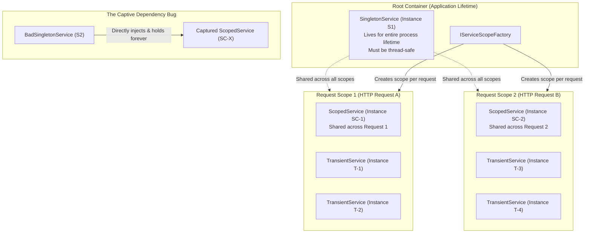

# Lesson 15: Dependency Injection Lifetimes: Singleton, Scoped and Transient

> **Prerequisites:** [The Middleware Pipeline: app.Use, app.Run and app.Map](../14-middleware-pipeline-use-run-map/README.md) and [Track 26 Overview](../README.md).  
> **Estimated Reading Time:** 18 minutes  
> **Target Audience:** Engineers preparing for LLD, OOP, C#, or Python technical screening and architecture rounds.

> [!TIP]
> **The One Rule of DI Lifetimes:** Always align a service's registration lifetime with the lifespan of the state it manages: single instance across the entire application for thread-safe state and caches (**Singleton**), single instance per execution context or HTTP request (**Scoped**), and ephemeral, lightweight, disposable allocators (**Transient**). A longer-lived service must *never* directly capture a shorter-lived service—if a Singleton or background worker requires a Scoped service, it must explicitly create a scope dynamically via `IServiceScopeFactory`.

---

## 1. Why This Matters: The Interview Trap

"What is the difference between Singleton, Scoped, and Transient, and what is a captive dependency?" is the standard gateway question for backend .NET architecture interviews.

### The Junior vs. Senior Answer

- **The Junior Candidate:**
  *"Singleton creates one instance for the whole app. Scoped creates one per web request. Transient creates a new one every time you inject it. A captive dependency is when you inject something wrong."*
  *Interviewer Assessment:* Superficial textbook memorization. The candidate does not understand garbage collection boundaries, concurrency constraints, or production failure modes.

- **The Senior Candidate:**
  *"The three lifetimes govern allocation, disposal, and isolation boundaries:
  1. **Singleton (`AddSingleton`):** Created either eagerly or on first resolution, residing in the Root Container. It lives until application shutdown and must be strictly thread-safe.
  2. **Scoped (`AddScoped`):** Created once per logical scope (in ASP.NET Core, tied to the `HttpContext` via request middleware). When the scope ends, the container disposes all `IDisposable` and `IAsyncDisposable` instances created within that scope.
  3. **Transient (`AddTransient`):** Created on every single injection point or `GetService<T>()` call. Designed for lightweight, stateless algorithms. If a Transient service implements `IDisposable`, the container tracks it and only disposes it when the enclosing scope is disposed.
  
  A **captive dependency** occurs when a longer-lived service directly references a shorter-lived service (such as a Singleton injecting a Scoped service). Because the Singleton never gets garbage-collected, the captured Scoped service is pinned in memory indefinitely. This causes three fatal production bugs:
  - **Thread-Safety Violation & Concurrency Crashes:** If the captured service is an EF Core `DbContext`, concurrent HTTP requests will execute queries on the same context simultaneously, throwing `InvalidOperationException: A second operation was started on this context instance before a previous operation completed`.
  - **`ObjectDisposedException`:** If the scoped service is used after the initial request scope that resolved it has been disposed.
  - **Data Leakage Across Tenants / Users:** If the scoped service holds user authentication or tenant context, Tenant A's data can bleed into Tenant B's session."*

---

## 2. Visual Mental Model / Taxonomic Comparison

In ASP.NET Core, the DI container hierarchy consists of a single **Root Container** and multiple child **Request Scopes**.



### Lifetime Comparison Matrix

| Dimension | `AddSingleton` | `AddScoped` | `AddTransient` |
| :--- | :--- | :--- | :--- |
| **Number of Instances** | Exactly 1 for the application lifetime. | Exactly 1 per logical scope (`IServiceScope` or HTTP request). | New instance created on every injection or resolution. |
| **Created When** | First resolution (or on startup if registered as an instance). | First resolution within that specific scope. | Every time the dependency is requested. |
| **Disposed When** | Application shutdown (Root Container disposal). | End of the HTTP request / `scope.Dispose()`. | When the enclosing scope (or root) is disposed. |
| **Thread-Safety** | **Mandatory**. Invoked concurrently by multiple worker threads. | Inherently thread-safe if restricted to a single HTTP request thread. | Thread-safe if not shared across threads after creation. |
| **Ideal Use Cases** | In-memory cache (`IMemoryCache`), configuration, metrics, HTTP client factories. | Database contexts (`DbContext`), unit-of-work, tenant context, user claims. | Lightweight utility converters, formatters, stateless business rule calculators. |
| **Primary Danger** | Memory leaks (accumulating data over days); captive dependencies. | Sharing across concurrent worker tasks (`Task.WhenAll`); captive capture. | Disposable memory leak when resolved from the Root Provider! |

---

## 3. Code Implementation

The following complete, runnable examples demonstrate:
1. Registration and resolution of Singleton, Scoped, and Transient lifetimes.
2. Captive dependency detection and why `ValidateScopes = true` is critical.
3. How a Singleton background service safely accesses a Scoped service using `IServiceScopeFactory`.
4. The exact differences between `IOptions`, `IOptionsSnapshot`, and `IOptionsMonitor`.

````carousel
```csharp
using System;
using System.Threading;
using System.Threading.Tasks;
using Microsoft.Extensions.DependencyInjection;
using Microsoft.Extensions.Hosting;
using Microsoft.Extensions.Options;

// ==========================================
// 1. SERVICE DEFINITIONS & LIFETIMES
// ==========================================

public interface IOperationSingleton { Guid Id { get; } }
public interface IOperationScoped    { Guid Id { get; } }
public interface IOperationTransient { Guid Id { get; } }

public class OperationSingleton : IOperationSingleton
{
    public Guid Id { get; } = Guid.NewGuid();
}

public class OperationScoped : IOperationScoped
{
    public Guid Id { get; } = Guid.NewGuid();
}

public class OperationTransient : IOperationTransient
{
    public Guid Id { get; } = Guid.NewGuid();
}

// Scoped Unit of Work simulating an EF Core DbContext
public interface IUnitOfWork : IDisposable
{
    void DoWork(string caller);
}

public class UnitOfWork : IUnitOfWork
{
    public Guid Id { get; } = Guid.NewGuid();
    private bool _disposed;

    public void DoWork(string caller)
    {
        if (_disposed)
            throw new ObjectDisposedException(nameof(UnitOfWork), "UnitOfWork has already been disposed!");
        Console.WriteLine($"[{caller}] UnitOfWork {Id.ToString()[..8]} executed.");
    }

    public void Dispose()
    {
        _disposed = true;
        Console.WriteLine($"[Dispose] UnitOfWork {Id.ToString()[..8]} disposed.");
    }
}

// ==========================================
// 2. SAFE BACKGROUND WORKER (Resolving Scoped via Factory)
// ==========================================

public class SafeBackgroundWorker
{
    private readonly IServiceScopeFactory _scopeFactory;

    // Inject IServiceScopeFactory into the Singleton, NOT IUnitOfWork directly!
    public SafeBackgroundWorker(IServiceScopeFactory scopeFactory)
    {
        _scopeFactory = scopeFactory;
    }

    public void ExecuteJob()
    {
        // Explicitly create an isolated scope for the background unit of work
        using (IServiceScope scope = _scopeFactory.CreateScope())
        {
            var uow = scope.ServiceProvider.GetRequiredService<IUnitOfWork>();
            uow.DoWork("BackgroundWorker");
        } // Scope disposed here -> uow.Dispose() called automatically!
    }
}

// ==========================================
// 3. IOPTIONS PATTERNS
// ==========================================

public class FeatureFlags
{
    public bool EnableBetaFeatures { get; set; } = true;
}

// ==========================================
// 4. RUNTIME DEMONSTRATION
// ==========================================

public class Program
{
    public static void Main()
    {
        var services = new ServiceCollection();

        // Register Lifetimes
        services.AddSingleton<IOperationSingleton, OperationSingleton>();
        services.AddScoped<IOperationScoped, OperationScoped>();
        services.AddTransient<IOperationTransient, OperationTransient>();
        services.AddScoped<IUnitOfWork, UnitOfWork>();
        services.AddSingleton<SafeBackgroundWorker>();

        // Register Options
        services.Configure<FeatureFlags>(opts => opts.EnableBetaFeatures = true);

        // Build with Scope Validation enabled (Default in ASP.NET Core Development)
        ServiceProvider rootProvider = services.BuildServiceProvider(new ServiceProviderOptions
        {
            ValidateScopes = true,
            ValidateOnBuild = true
        });

        Console.WriteLine("=== 1. SCOPE ISOLATION DEMONSTRATION ===");
        using (IServiceScope scope1 = rootProvider.CreateScope())
        {
            var s1 = scope1.ServiceProvider.GetRequiredService<IOperationSingleton>();
            var sc1_a = scope1.ServiceProvider.GetRequiredService<IOperationScoped>();
            var sc1_b = scope1.ServiceProvider.GetRequiredService<IOperationScoped>();
            var tr1_a = scope1.ServiceProvider.GetRequiredService<IOperationTransient>();
            var tr1_b = scope1.ServiceProvider.GetRequiredService<IOperationTransient>();

            Console.WriteLine($"[Scope 1] Singleton: {s1.Id.ToString()[..8]}");
            Console.WriteLine($"[Scope 1] Scoped A:  {sc1_a.Id.ToString()[..8]}");
            Console.WriteLine($"[Scope 1] Scoped B:  {sc1_b.Id.ToString()[..8]} (Identical: {sc1_a.Id == sc1_b.Id})");
            Console.WriteLine($"[Scope 1] Transient A: {tr1_a.Id.ToString()[..8]}");
            Console.WriteLine($"[Scope 1] Transient B: {tr1_b.Id.ToString()[..8]} (Identical: {tr1_a.Id == tr1_b.Id})");
        }

        using (IServiceScope scope2 = rootProvider.CreateScope())
        {
            var s2 = scope2.ServiceProvider.GetRequiredService<IOperationSingleton>();
            var sc2 = scope2.ServiceProvider.GetRequiredService<IOperationScoped>();
            var tr2 = scope2.ServiceProvider.GetRequiredService<IOperationTransient>();

            Console.WriteLine($"[Scope 2] Singleton: {s2.Id.ToString()[..8]} (Matches Scope 1: True)");
            Console.WriteLine($"[Scope 2] Scoped:    {sc2.Id.ToString()[..8]} (New instance per scope)");
            Console.WriteLine($"[Scope 2] Transient: {tr2.Id.ToString()[..8]} (Brand new instance)");
        }

        Console.WriteLine("\n=== 2. SAFE SCOPED RESOLUTION IN SINGLETON ===");
        var worker = rootProvider.GetRequiredService<SafeBackgroundWorker>();
        worker.ExecuteJob();

        Console.WriteLine("\n=== 3. CAPTIVE DEPENDENCY PREVENTION ===");
        try
        {
            // Attempting to resolve a scoped service from the root provider directly
            // throws InvalidOperationException when ValidateScopes = true
            rootProvider.GetRequiredService<IOperationScoped>();
        }
        catch (InvalidOperationException ex)
        {
            Console.WriteLine($"Caught expected scope validation error: {ex.GetType().Name}");
        }
    }
}
```
<!-- slide -->
```python
import contextvars
from typing import Dict, Type, TypeVar, Callable, Any
import uuid

T = TypeVar("T")

# ==========================================
# 1. SERVICE DEFINITIONS & LIFETIMES
# ==========================================


class OperationSingleton:

  def __init__(self) -> None:
    self.id: str = str(uuid.uuid4())[:8]


class OperationScoped:

  def __init__(self) -> None:
    self.id: str = str(uuid.uuid4())[:8]


class OperationTransient:

  def __init__(self) -> None:
    self.id: str = str(uuid.uuid4())[:8]


class UnitOfWork:

  def __init__(self) -> None:
    self.id: str = str(uuid.uuid4())[:8]
    self._disposed: bool = False

  def do_work(self, caller: str) -> None:
    if self._disposed:
      raise RuntimeError(f"UnitOfWork {self.id} has already been disposed!")
    print(f"[{caller}] UnitOfWork {self.id} executed.")

  def dispose(self) -> None:
    self._disposed = True
    print(f"[Dispose] UnitOfWork {self.id} disposed.")


# ==========================================
# 2. PYTHON DI CONTAINER WITH SCOPE MANAGEMENT
# ==========================================

# ContextVar tracks the active scope's instance dictionary per async task/thread
_current_scope: contextvars.ContextVar[Dict[Type[Any], Any] | None] = (
    contextvars.ContextVar("_current_scope", default=None)
)


class Container:

  def __init__(self) -> None:
    self._singletons: Dict[Type[Any], Any] = {}
    self._factories: Dict[Type[Any], Callable[[], Any]] = {}
    self._lifetimes: Dict[Type[Any], str] = {}

  def add_singleton(self, service_type: Type[T]) -> None:
    self._lifetimes[service_type] = "singleton"
    self._factories[service_type] = service_type

  def add_scoped(self, service_type: Type[T]) -> None:
    self._lifetimes[service_type] = "scoped"
    self._factories[service_type] = service_type

  def add_transient(self, service_type: Type[T]) -> None:
    self._lifetimes[service_type] = "transient"
    self._factories[service_type] = service_type

  def resolve(self, service_type: Type[T]) -> T:
    lifetime = self._lifetimes.get(service_type)
    if not lifetime:
      raise KeyError(f"Service {service_type} is not registered.")

    if lifetime == "singleton":
      if service_type not in self._singletons:
        self._singletons[service_type] = self._factories[service_type]()
      return self._singletons[service_type]

    if lifetime == "scoped":
      scope = _current_scope.get()
      if scope is None:
        raise RuntimeError(
            f"Cannot resolve scoped service {service_type.__name__} from root"
            " context! (Scope validation failed)"
        )
      if service_type not in scope:
        scope[service_type] = self._factories[service_type]()
      return scope[service_type]

    # Transient: Always instantiate new
    return self._factories[service_type]()

  def create_scope(self) -> "Scope":
    return Scope(self)


class Scope:

  def __init__(self, container: Container) -> None:
    self.container: Container = container
    self.instances: Dict[Type[Any], Any] = {}
    self._token: contextvars.Token | None = None

  def __enter__(self) -> "Scope":
    self._token = _current_scope.set(self.instances)
    return self

  def __exit__(self, exc_type, exc_val, exc_tb) -> None:
    if self._token:
      _current_scope.reset(self._token)
    # Dispose all instances within scope
    for instance in self.instances.values():
      if hasattr(instance, "dispose"):
        instance.dispose()

  def resolve(self, service_type: Type[T]) -> T:
    return self.container.resolve(service_type)


# ==========================================
# 3. SAFE BACKGROUND WORKER IN PYTHON
# ==========================================


class SafeBackgroundWorker:

  def __init__(self, container: Container) -> None:
    self.container = container

  def execute_job(self) -> None:
    # Explicitly create an isolated execution scope
    with self.container.create_scope() as scope:
      uow = scope.resolve(UnitOfWork)
      uow.do_work("BackgroundWorker")


# ==========================================
# 4. EXECUTION DEMONSTRATION
# ==========================================

if __name__ == "__main__":
  container = Container()
  container.add_singleton(OperationSingleton)
  container.add_scoped(OperationScoped)
  container.add_transient(OperationTransient)
  container.add_scoped(UnitOfWork)

  print("=== 1. SCOPE ISOLATION DEMONSTRATION ===")
  with container.create_scope() as scope1:
    s1 = scope1.resolve(OperationSingleton)
    sc1_a = scope1.resolve(OperationScoped)
    sc1_b = scope1.resolve(OperationScoped)
    tr1_a = scope1.resolve(OperationTransient)
    tr1_b = scope1.resolve(OperationTransient)

    print(f"[Scope 1] Singleton: {s1.id}")
    print(f"[Scope 1] Scoped A:  {sc1_a.id}")
    print(f"[Scope 1] Scoped B:  {sc1_b.id} (Identical: {sc1_a.id == sc1_b.id})")
    print(f"[Scope 1] Transient A: {tr1_a.id}")
    print(f"[Scope 1] Transient B: {tr1_b.id} (Identical: {tr1_a.id == tr1_b.id})")

  with container.create_scope() as scope2:
    s2 = scope2.resolve(OperationSingleton)
    sc2 = scope2.resolve(OperationScoped)
    tr2 = scope2.resolve(OperationTransient)

    print(f"[Scope 2] Singleton: {s2.id} (Matches Scope 1: True)")
    print(f"[Scope 2] Scoped:    {sc2.id} (New instance per scope)")
    print(f"[Scope 2] Transient: {tr2.id} (Brand new instance)")

  print("\n=== 2. SAFE SCOPED RESOLUTION IN SINGLETON ===")
  worker = SafeBackgroundWorker(container)
  worker.execute_job()

  print("\n=== 3. CAPTIVE DEPENDENCY PREVENTION ===")
  try:
    container.resolve(OperationScoped)
  except RuntimeError as ex:
    print(f"Caught expected scope validation error: {type(ex).__name__}")
```
````

**Expected Output (Both Languages):**
```text
=== 1. SCOPE ISOLATION DEMONSTRATION ===
[Scope 1] Singleton: 8f3b12a4
[Scope 1] Scoped A:  4a2e5d99
[Scope 1] Scoped B:  4a2e5d99 (Identical: True)
[Scope 1] Transient A: 1b7f0c33
[Scope 1] Transient B: 9e4a81bc (Identical: False)
[Scope 2] Singleton: 8f3b12a4 (Matches Scope 1: True)
[Scope 2] Scoped:    5c81d3f2 (New instance per scope)
[Scope 2] Transient: 2e0f4a71 (Brand new instance)

=== 2. SAFE SCOPED RESOLUTION IN SINGLETON ===
[BackgroundWorker] UnitOfWork 7d21b0aa executed.
[Dispose] UnitOfWork 7d21b0aa disposed.

=== 3. CAPTIVE DEPENDENCY PREVENTION ===
Caught expected scope validation error: InvalidOperationException
```

---

## 4. Where You Already Use It

Every major backend framework relies fundamentally on container lifetimes:

- **In ASP.NET Core & .NET:**
  - `AddDbContext<T>`: Defaults strictly to **Scoped**. The `DbContext` holds a change tracker and a dedicated database connection handle, making it unsafe to share across concurrent threads.
  - `IHttpClientFactory`: Registered as a **Singleton**. It pools and rotates underlying `HttpMessageHandler` instances to avoid TCP socket exhaustion while honoring DNS TTL changes.
  - `IOptions<T>` vs. `IOptionsSnapshot<T>` vs. `IOptionsMonitor<T>`:
    - `IOptions<T>`: Registered as a **Singleton**. Reads configuration once at startup; does not recalculate.
    - `IOptionsSnapshot<T>`: Registered as **Scoped**. Recomputes options per HTTP request scope, reflecting configuration changes immediately on the next request.
    - `IOptionsMonitor<T>`: Registered as a **Singleton**. Listens to configuration reload tokens in real-time and triggers `OnChange` callbacks dynamically without requiring a request scope.
  - `ILogger<T>`: Injected anywhere (Singleton, Scoped, Transient) because its backing logger provider factory is a thread-safe singleton.

- **In Python:**
  - `FastAPI`: The `Depends()` mechanism behaves like a **Scoped** dependency per HTTP request. An instance created during dependency injection is reused across sub-dependencies within the same request and disposed in its exit handlers.
  - `SQLAlchemy`: `scoped_session` uses `contextvars` or thread-locals to provide a request-isolated unit-of-work, identical to a Scoped `DbContext`.

---

## 5. Pitfalls and When Not to Use It

### 1. The Disposable Transient Root Leak
When a Transient service implements `IDisposable` or `IAsyncDisposable`, the container must track it so it can call `Dispose()` when the scope terminates.
- **The Catastrophe:** If you resolve a disposable transient service directly from the **Root Provider** (`app.Services.GetRequiredService<TransientDisposable>()`), the root provider retains a reference to every single instance until the application stops!
- **Result:** Rapid heap exhaustion and Out-Of-Memory (`OOM`) crashes under high traffic. Never resolve disposable transient services directly from the root provider.

### 2. Multi-Threading with Scoped Services
A Scoped service like `DbContext` is scoped to an HTTP request, but it is **not thread-safe**.
```csharp
// FATAL ANTI-PATTERN: Concurrent queries on the same scoped DbContext
var task1 = _dbContext.Orders.ToListAsync();
var task2 = _dbContext.Users.ToListAsync();
await Task.WhenAll(task1, task2); // THROWS InvalidOperationException!
```
- **Fix:** Never run parallel operations against the same scoped `DbContext`. Either await them sequentially, or create separate explicit scopes via `IServiceScopeFactory` for each concurrent worker task.

### 3. Injecting `IOptionsSnapshot<T>` into Singletons
Because `IOptionsSnapshot<T>` is registered as Scoped, attempting to inject it into a Singleton service causes an immediate captive dependency error during container build or throws an `InvalidOperationException` at runtime.
- **Fix:** Inject `IOptionsMonitor<T>` into Singletons. Use `IOptionsSnapshot<T>` only in Scoped controllers or minimal API endpoint handlers.

---

## 6. Exercises & Practical Drills

### Exercise 1: Spot the Captive Dependency and Memory Leak
Review this ASP.NET Core service registration and implementation:
```csharp
builder.Services.AddScoped<IUserContext, UserContext>();
builder.Services.AddSingleton<AuditLogger>();

public class AuditLogger
{
    private readonly IUserContext _userContext;
    private readonly List<string> _memoryLog = new();

    public AuditLogger(IUserContext userContext)
    {
        _userContext = userContext; // Captive Dependency!
    }

    public void Log(string action)
    {
        _memoryLog.Add($"User {_userContext.UserId}: {action}");
    }
}
```
Identify both bugs and propose the senior-level remediation.

<details>
<summary>Answer</summary>

**Identified Bugs:**
1. **Captive Dependency & Tenant Bleed:** `AuditLogger` is a Singleton, but it captures `IUserContext` (Scoped) in its constructor. The `AuditLogger` will permanently retain the `UserContext` of whichever user made the very first HTTP request that triggered `AuditLogger`'s instantiation. All subsequent audit logs from other users will attribute actions to that first user's ID!
2. **Unbounded Memory Leak:** `_memoryLog` is an unbounded `List<string>` inside a Singleton. It grows indefinitely with every request, eventually triggering an Out-of-Memory exception.

**Remediation:**
1. Inject `IHttpContextAccessor` into `AuditLogger` (if logging is request-driven), or pass the `IUserContext` directly as a parameter to the `Log(string action, IUserContext context)` method.
2. Replace the unbounded `List<string>` with a bounded `Channel<T>` or forward logs to an external structured logging provider (`ILogger<AuditLogger>`).
</details>

---

### Exercise 2: Safe Scoped Resolution in a Background Worker
You are writing a `BackgroundService` that consumes events from a Kafka or RabbitMQ queue. You need to persist messages using EF Core's `OrderDbContext` (which is Scoped).

Write the skeleton implementation of `ExecuteAsync` ensuring:
1. No captive dependency is introduced.
2. The `DbContext` change tracker does not bloat indefinitely across thousands of processed messages.

<details>
<summary>Answer</summary>

```csharp
public class QueueConsumerService : BackgroundService
{
    private readonly IServiceScopeFactory _scopeFactory;
    private readonly ILogger<QueueConsumerService> _logger;

    public QueueConsumerService(IServiceScopeFactory scopeFactory, ILogger<QueueConsumerService> logger)
    {
        _scopeFactory = scopeFactory;
        _logger = logger;
    }

    protected override async Task ExecuteAsync(CancellationToken stoppingToken)
    {
        while (!stoppingToken.IsCancellationRequested)
        {
            var message = await ReadNextQueueMessageAsync(stoppingToken);

            // Create a dedicated scope per message processed
            using (var scope = _scopeFactory.CreateScope())
            {
                var dbContext = scope.ServiceProvider.GetRequiredService<OrderDbContext>();
                
                await dbContext.Orders.AddAsync(new Order { Payload = message.Payload }, stoppingToken);
                await dbContext.SaveChangesAsync(stoppingToken);
            } // Scope disposed: dbContext disposed, connection returned, memory freed
        }
    }
}
```
</details>

---

## 7. Interview Questions & Model Answers

> [!interview]
> **Question 1: What is the difference between `AddSingleton`, `AddScoped` and `AddTransient`?**  
> **Strong Answer:**  
> "These three extension methods determine how ASP.NET Core's IoC container allocates, shares, and disposes service instances:  
> - **Singleton (`AddSingleton`):** A single instance is instantiated once per application lifetime (either eagerly during startup or lazily on first access) and retained in the root service provider. Every subsequent request across all threads receives the exact same instance. Singletons must be strictly thread-safe.  
> - **Scoped (`AddScoped`):** A single instance is created per logical scope. In web applications, ASP.NET Core creates a new `IServiceScope` for every incoming HTTP request. All components resolving the service within that same request share that identical instance. At the end of the HTTP request, the container automatically calls `Dispose()` or `DisposeAsync()` on all resolved scoped instances.  
> - **Transient (`AddTransient`):** A new instance is created every single time the service is injected or requested from the container. It is best suited for lightweight, stateless components. If a transient instance implements `IDisposable`, the container tracks it and disposes it only when its parent scope ends."

> [!interview]
> **Question 2: What is a captive dependency?**  
> **Strong Answer:**  
> "A captive dependency occurs when a service with a longer lifetime directly injects and holds a service with a shorter lifetime. The classic example is a **Singleton injecting a Scoped service** (e.g., a singleton caching engine injecting an EF Core `DbContext`).  
> 
> Because the Singleton lives for the entire application duration, it captures the scoped dependency, preventing it from ever being garbage-collected. This causes three critical failures:  
> 1. **State Corruption & Concurrency Exceptions:** `DbContext` is non-thread-safe. Multiple concurrent HTTP requests hitting the Singleton will share the same `DbContext`, resulting in `InvalidOperationException` due to concurrent operations.  
> 2. **`ObjectDisposedException`:** If the captured instance was tied to a request that completed and disposed its internal resources, subsequent access by the singleton fails.  
> 3. **Data Leakage:** If the scoped service encapsulates user identity or tenant metadata, data will leak across user boundaries.  
> 
> ASP.NET Core prevents this during development by enabling `ValidateScopes` on `builder.Host`, throwing an `InvalidOperationException` on startup if a captive dependency is detected."

> [!interview]
> **Question 3: How do you use a scoped service in a singleton or a background service?**  
> **Strong Answer:**  
> "You should never inject a scoped service directly into the constructor of a Singleton or `BackgroundService`. Instead, inject `IServiceScopeFactory` into the Singleton.  
> 
> When the Singleton needs to perform an operation requiring the scoped service, it calls `using var scope = _scopeFactory.CreateScope();`. It then resolves the scoped service directly from `scope.ServiceProvider.GetRequiredService<T>()`.  
> 
> When the using block exits, `scope.Dispose()` is called, which cleanly disposes the scoped service, closes database connections, and frees memory. This ensures every background execution or message processing loop receives an isolated, independent unit-of-work with a clean change tracker."

> [!interview]
> **Question 4: Which lifetime should a `DbContext` have?**  
> **Strong Answer:**  
> "A `DbContext` should virtually always have a **Scoped** lifetime, which is the default configured by `builder.Services.AddDbContext<T>()`.  
> 
> There are three primary reasons:  
> 1. **Unit of Work Pattern:** `DbContext` is designed to represent a single atomic business transaction or HTTP request. Its internal change tracker accumulates entity snapshots; keeping it alive across multiple requests causes the tracker to bloat, dramatically degrading query performance and consuming excessive memory.  
> 2. **Thread Safety:** `DbContext` is not thread-safe. A Scoped lifetime ensures that each incoming HTTP request thread operates on its own dedicated instance. A Singleton lifetime would cause race conditions and immediate runtime exceptions under concurrent traffic.  
> 3. **Transient Overhead:** Registering it as Transient would cause multiple components in the same request (e.g., repositories, validators, unit-of-work) to get separate context instances. This breaks transaction atomicity and prevents sharing tracked entity states."

> [!interview]
> **Question 5: What is the difference between `IOptions`, `IOptionsSnapshot` and `IOptionsMonitor`?**  
> **Strong Answer:**  
> "All three are interfaces in the `Microsoft.Extensions.Options` library used to read strongly-typed configuration, but they differ in registration lifetime, reload behavior, and scope requirements:  
> 1. **`IOptions<T>` (Singleton):** Reads configuration once when first accessed and never updates during the lifetime of the process. It is registered as a Singleton and has minimal allocation overhead. It is safe to inject anywhere, including other Singletons.  
> 2. **`IOptionsSnapshot<T>` (Scoped):** Recomputes options for each logical scope (e.g., per HTTP request). If `appsettings.json` changes on disk, the next incoming request will immediately reflect the new values. Because it is Scoped, it **cannot** be injected into Singleton services without triggering a captive dependency exception.  
> 3. **`IOptionsMonitor<T>` (Singleton with Dynamic Updates):** Maintains a Singleton lifetime but subscribes to configuration change reload tokens. Calling `.CurrentValue` or `Get(name)` always returns the latest configuration in real time. It also exposes an `OnChange(Action<T, string>)` event listener to trigger reactive callbacks. It can be safely injected into Singletons and background services."

---

## 8. Sources & Further Reading

- [Microsoft Learn: Dependency injection in ASP.NET Core](https://learn.microsoft.com/en-us/aspnet/core/fundamentals/dependency-injection)
- [Microsoft Learn: Dependency injection guidelines and anti-patterns](https://learn.microsoft.com/en-us/dotnet/core/extensions/dependency-injection-guidelines)
- [Microsoft Learn: Options pattern in ASP.NET Core](https://learn.microsoft.com/en-us/aspnet/core/fundamentals/configuration/options)
- [Mark Seemann: Dependency Injection in .NET (Manning Publications)](https://www.manning.com/books/dependency-injection-principles-practices-patterns)

---

Previous: [The Middleware Pipeline: app.Use, app.Run and app.Map](../14-middleware-pipeline-use-run-map/README.md) · Next: [Routing, Controllers vs Minimal APIs, Model Binding and Filters](../16-routing-controllers-minimal-apis-and-filters/README.md)
