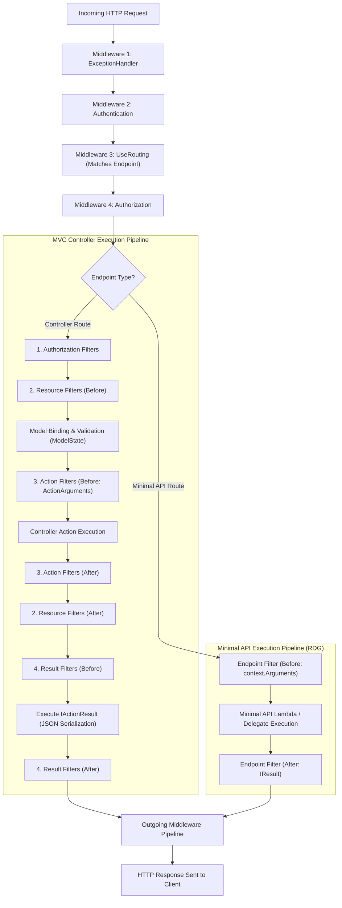
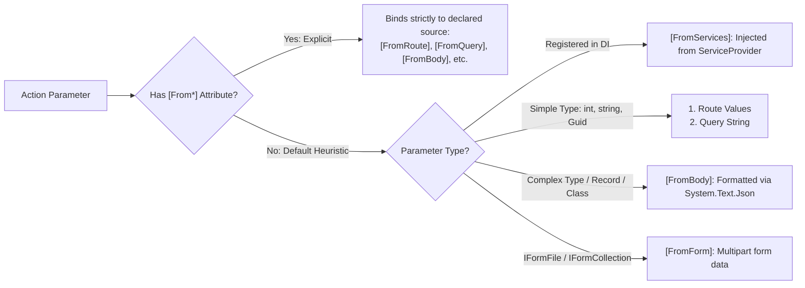

# Lesson 16: Routing, Controllers vs Minimal APIs, Model Binding and Filters

> **Prerequisites:** [Dependency Injection Lifetimes: Singleton, Scoped and Transient](../15-dependency-injection-lifetimes/README.md) and [Track 26 Overview](../README.md).  
> **Estimated Reading Time:** 20 minutes  
> **Target Audience:** Engineers preparing for LLD, OOP, C#, or Python technical screening and architecture rounds.

> [!TIP]
> **The One Rule of ASP.NET Core Request Processing:** Middleware operates globally on the raw `HttpContext` before routing and MVC contexts are established, whereas Filters and Endpoint Filters execute *inside* the endpoint execution pipeline with rich access to parsed action parameters, `ModelState`, and return results. Choose Minimal APIs with Endpoint Filters for high-performance, low-allocation microservices, and Controllers with Action Filters for complex enterprise applications requiring rich declarative conventions and cross-cutting view/action orchestration.

---

## 1. Why This Matters: The Interview Trap

"What is the difference between a Filter and a Middleware?" and "When should you choose Minimal APIs over Controllers?" are standard architecture questions in modern .NET interviews. Junior developers often confuse their scopes:

> *"Middleware runs on every request. Filters run on controllers. Minimal APIs are just for tiny toy projects or single-file microservices."*

This shallow explanation misses the core architectural differences:

1. **Pipeline Position & Context Awareness:**
   - **Middleware** runs in a bidirectional sequence around the raw HTTP connection. It operates purely on `HttpContext`. Unless placed strictly after `UseRouting()`, middleware has zero awareness of which controller, action, or endpoint will handle the request. It cannot inspect parsed action arguments, `ModelState`, or strongly-typed domain return objects.
   - **Filters** execute *inside* the MVC action invocation pipeline. They are invoked only after routing successfully resolves a matching endpoint. Filters have full access to `ActionExecutingContext`, `ActionArguments`, model validation dictionaries, and the resulting `IActionResult`.
2. **The 5 MVC Filter Types:**
   - **Authorization Filters:** Run first to confirm user identity and claims (`[Authorize]`).
   - **Resource Filters:** Wrap model binding and action execution. Ideal for caching: they can short-circuit the entire request *before* expensive model binding and JSON deserialization occur!
   - **Action Filters:** Wrap the execution of the action method itself. They can inspect, mutate, or validate action parameters before invocation and transform results after invocation.
   - **Exception Filters:** Catch unhandled exceptions originating within the action or action filters (though global middleware like `UseExceptionHandler` is preferred for unhandled app-wide exceptions).
   - **Result Filters:** Wrap the execution of the `IActionResult` (e.g., surrounding JSON serialization or adding response headers).
3. **Controllers vs. Minimal APIs:**
   - **Controllers:** Require the heavy `Microsoft.AspNetCore.Mvc` infrastructure. Each request instantiates a new controller class via DI, performs extensive reflection and action descriptor lookups, and runs through the 5-stage MVC filter pipeline. This provides rich conventions and scaffolding for large teams, but incurs measurable GC allocation and latency overhead.
   - **Minimal APIs:** Introduced in .NET 6 and supercharged with **Request Delegate Generators (RDG)** in .NET 8+, Minimal APIs map routes directly to lambdas or static methods via `app.MapGet()` / `app.MapPost()`. They bypass controller instantiation and the heavy MVC filter pipeline entirely, resulting in **30–40% higher throughput**, lower allocations, and seamless compatibility with **Native AOT (Ahead-of-Time compilation)**.
   - **Endpoint Filters:** Minimal APIs do *not* run MVC filters! Instead, they use `IEndpointFilter` / `AddEndpointFilter()`, providing a cleaner, async-interceptor pipeline scoped to specific routes or route groups.
4. **Model Binding Sources:**
   - ASP.NET Core binds parameters by evaluating specific source attributes: `[FromRoute]`, `[FromQuery]`, `[FromBody]`, `[FromHeader]`, `[FromForm]`, and `[FromServices]`.
   - By default, `[ApiController]` automatically verifies `ModelState.IsValid`. If validation attributes (`[Required]`, `[Range]`) fail, it immediately short-circuits with an RFC 7807 `400 Bad Request` (`ValidationProblemDetails`) without ever entering your action body.

| Dimension | Middleware | MVC Filters | Minimal API Endpoint Filters |
| :--- | :--- | :--- | :--- |
| **Pipeline Level** | Global HTTP pipeline. | Inside MVC Action Invocation pipeline. | Inside Endpoint Execution pipeline. |
| **Context Available** | `HttpContext` (Raw request/response streams). | `ActionExecutingContext` (`ActionArguments`, `ModelState`, `IActionResult`). | `EndpointFilterInvocationContext` (`Arguments`, `HttpContext`). |
| **Model Binding Access** | Runs *before* model binding occurs. | Can intercept *before* (Resource) or *after* (Action) binding. | Runs *after* Minimal API parameter binding. |
| **Target Compatibility** | All endpoints, static files, health checks. | Only Controller Actions. | Only Minimal API Endpoints / Route Groups. |
| **Native AOT Friendly** | Yes. | No (heavy reflection on controllers & filters). | **Yes** (compiles via Request Delegate Generator). |
| **Typical Use Cases** | CORS, Authentication, Response Compression, Rate Limiting. | Action auditing, Model validation logging, MVC Result wrapping. | Endpoint-specific parameter validation, microservice tenancy checks. |

---

## 2. Visual Mental Model / Taxonomic Comparison

### The ASP.NET Core Request Journey

The following diagram tracks an incoming HTTP request through Kestrel, the middleware pipeline, endpoint routing, and the specialized filter pipelines:



### Model Binding Source Resolution Hierarchy



---

## 3. Code Implementation

The following application compares:
1. A Controller using attribute routing, explicit model binding sources (`[FromRoute]`, `[FromQuery]`, `[FromBody]`), and an `IActionFilter` inspecting action arguments.
2. A Minimal API using route groups (`app.MapGroup`), typed parameter binding, and an `IEndpointFilter` validating inputs and short-circuiting with `400 Bad Request`.
3. Verified client requests testing both pipelines.

````carousel
```csharp
using System;
using System.ComponentModel.DataAnnotations;
using System.Net.Http;
using System.Net.Http.Json;
using System.Threading.Tasks;
using Microsoft.AspNetCore.Builder;
using Microsoft.AspNetCore.Http;
using Microsoft.AspNetCore.Mvc;
using Microsoft.AspNetCore.Mvc.Filters;
using Microsoft.Extensions.DependencyInjection;
using Microsoft.Extensions.Logging;

// ============================================================================
// 1. DATA TRANSFER OBJECT (DTO) WITH VALIDATION ATTRIBUTES
// ============================================================================
public class CreateOrderDto
{
    [Required]
    public string Item { get; set; } = string.Empty;

    [Range(1, 100)]
    public int Quantity { get; set; }
}

// ============================================================================
// 2. MVC ACTION FILTER (Inspects ActionArguments before/after execution)
// ============================================================================
public class ActionAuditFilter : IActionFilter
{
    public void OnActionExecuting(ActionExecutingContext context)
    {
        Console.WriteLine("[ACTION FILTER BEFORE] Inspecting Controller arguments...");
        foreach (var arg in context.ActionArguments)
        {
            if (arg.Value is CreateOrderDto dto)
                Console.WriteLine($"  -> Arg: {arg.Key} = (Item: {dto.Item}, Quantity: {dto.Quantity})");
            else
                Console.WriteLine($"  -> Arg: {arg.Key} = {arg.Value}");
        }
    }

    public void OnActionExecuted(ActionExecutedContext context)
    {
        var statusCode = context.Result is ObjectResult objRes ? objRes.StatusCode : 200;
        Console.WriteLine($"[ACTION FILTER AFTER] Completed. Status: {statusCode}");
    }
}

// ============================================================================
// 3. MVC CONTROLLER WITH ATTRIBUTE ROUTING AND MODEL BINDING
// ============================================================================
[ApiController]
[Route("api/v1/[controller]")]
public class OrdersController : ControllerBase
{
    [HttpPost("{id:int}")]
    [ServiceFilter(typeof(ActionAuditFilter))]
    public IActionResult CreateOrder(
        [FromRoute] int id,
        [FromQuery] bool priority,
        [FromBody] CreateOrderDto dto)
    {
        Console.WriteLine($"[CONTROLLER ACTION] Processed Order {id}: {dto.Quantity}x {dto.Item} (Priority: {priority})");
        return StatusCode(200, new { OrderId = id, Status = "Created" });
    }
}

// ============================================================================
// 4. MINIMAL API ENDPOINT FILTER (Lightweight async interceptor)
// ============================================================================
public class OrderValidationFilter : IEndpointFilter
{
    public async ValueTask<object?> InvokeAsync(EndpointFilterInvocationContext context, EndpointFilterDelegate next)
    {
        Console.WriteLine("[ENDPOINT FILTER BEFORE] Inspecting Minimal API arguments...");
        var id = context.GetArgument<int>(0);
        var dto = context.GetArgument<CreateOrderDto>(1);

        if (dto.Quantity <= 0)
        {
            Console.WriteLine($"[ENDPOINT FILTER SHORT-CIRCUIT] Validation failed for Order {id}: Quantity must be > 0");
            return Results.BadRequest("Quantity must be greater than zero.");
        }

        var result = await next(context);
        Console.WriteLine("[ENDPOINT FILTER AFTER] Minimal API completed.");
        return result;
    }
}

// ============================================================================
// 5. APPLICATION STARTUP & PIPELINE EXECUTION
// ============================================================================
public class Program
{
    public static async Task Main(string[] args)
    {
        var builder = WebApplication.CreateBuilder(args);
        builder.Logging.ClearProviders(); // Silence default HTTP request logs
        builder.Services.AddControllers();
        builder.Services.AddScoped<ActionAuditFilter>();

        var app = builder.Build();
        app.Urls.Add("http://127.0.0.1:5099");
        app.MapControllers();

        // Register Minimal API Route Group with Endpoint Filter
        var ordersGroup = app.MapGroup("/api/v2/orders");
        ordersGroup.MapPost("/{id:int}", (int id, CreateOrderDto dto) =>
        {
            Console.WriteLine($"[MINIMAL API HANDLER] Order {id} registered: {dto.Quantity}x {dto.Item}");
            return Results.Json(new { OrderId = id, Status = "Registered" }, statusCode: 201);
        }).AddEndpointFilter<OrderValidationFilter>();

        await app.StartAsync();

        using var client = new HttpClient { BaseAddress = new Uri("http://127.0.0.1:5099") };

        Console.WriteLine("=== 1. Controller Request with Action Filter & Model Binding ===");
        var res1 = await client.PostAsJsonAsync("/api/v1/orders/101?priority=true", new CreateOrderDto { Item = "Laptop", Quantity = 2 });
        Console.WriteLine($"Response Status: {(int)res1.StatusCode}");

        Console.WriteLine("\n=== 2. Minimal API Request with Endpoint Filter ===");
        var res2 = await client.PostAsJsonAsync("/api/v2/orders/202", new CreateOrderDto { Item = "Monitor", Quantity = 5 });
        Console.WriteLine($"Response Status: {(int)res2.StatusCode}");

        Console.WriteLine("\n=== 3. Minimal API Short-Circuit via Endpoint Filter ===");
        var res3 = await client.PostAsJsonAsync("/api/v2/orders/203", new CreateOrderDto { Item = "Mouse", Quantity = 0 });
        Console.WriteLine($"Response Status: {(int)res3.StatusCode}");

        await app.StopAsync();
    }
}
```
<!-- slide -->
```python
import asyncio
from typing import Optional
from fastapi import APIRouter, Depends, FastAPI, HTTPException, Path, Query, Request
from fastapi.responses import JSONResponse
from pydantic import BaseModel, Field
import httpx

# ============================================================================
# 1. DATA TRANSFER OBJECT (DTO) WITH VALIDATION ATTRIBUTES
# ============================================================================
class CreateOrderDto(BaseModel):
    Item: str
    Quantity: int = Field(..., ge=0, le=100)


# ============================================================================
# 2. CONTROLLER EQUIVALENT (APIRouter + Action Filter Dependency)
# ============================================================================
controller_router = APIRouter(prefix="/api/v1/orders")

async def action_audit_filter(
    id: int = Path(...),
    priority: bool = Query(...),
    dto: CreateOrderDto = ...
):
    print("[ACTION FILTER BEFORE] Inspecting Controller arguments...")
    print(f"  -> Arg: id = {id}")
    print(f"  -> Arg: priority = {priority}")
    print(f"  -> Arg: dto = (Item: {dto.Item}, Quantity: {dto.Quantity})")
    yield
    print("[ACTION FILTER AFTER] Completed. Status: 200")


@controller_router.post("/{id}", dependencies=[Depends(action_audit_filter)])
async def create_order_controller(
    id: int = Path(...),
    priority: bool = Query(...),
    dto: CreateOrderDto = ...
):
    print(f"[CONTROLLER ACTION] Processed Order {id}: {dto.Quantity}x {dto.Item} (Priority: {priority})")
    return JSONResponse(status_code=200, content={"OrderId": id, "Status": "Created"})


# ============================================================================
# 3. MINIMAL API EQUIVALENT (Route Group + Endpoint Filter Dependency)
# ============================================================================
minimal_router = APIRouter(prefix="/api/v2/orders")

async def order_validation_filter(id: int = Path(...), dto: CreateOrderDto = ...):
    print("[ENDPOINT FILTER BEFORE] Inspecting Minimal API arguments...")
    if dto.Quantity <= 0:
        print(f"[ENDPOINT FILTER SHORT-CIRCUIT] Validation failed for Order {id}: Quantity must be > 0")
        raise HTTPException(status_code=400, detail="Quantity must be greater than zero.")
    return dto


@minimal_router.post("/{id}")
async def create_order_minimal(id: int, dto: CreateOrderDto = Depends(order_validation_filter)):
    print(f"[MINIMAL API HANDLER] Order {id} registered: {dto.Quantity}x {dto.Item}")
    print("[ENDPOINT FILTER AFTER] Minimal API completed.")
    return JSONResponse(status_code=201, content={"OrderId": id, "Status": "Registered"})


app = FastAPI()
app.include_router(controller_router)
app.include_router(minimal_router)


# ============================================================================
# 4. PIPELINE EXECUTION DEMONSTRATION
# ============================================================================
async def main():
    async with httpx.AsyncClient(transport=httpx.ASGITransport(app=app), base_url="http://test") as client:
        print("=== 1. Controller Request with Action Filter & Model Binding ===")
        res1 = await client.post("/api/v1/orders/101?priority=true", json={"Item": "Laptop", "Quantity": 2})
        print(f"Response Status: {res1.status_code}")

        print("\n=== 2. Minimal API Request with Endpoint Filter ===")
        res2 = await client.post("/api/v2/orders/202", json={"Item": "Monitor", "Quantity": 5})
        print(f"Response Status: {res2.status_code}")

        print("\n=== 3. Minimal API Short-Circuit via Endpoint Filter ===")
        res3 = await client.post("/api/v2/orders/203", json={"Item": "Mouse", "Quantity": 0})
        print(f"Response Status: {res3.status_code}")


if __name__ == "__main__":
    asyncio.run(main())
```
````

**Expected Output (Both Languages):**
```text
=== 1. Controller Request with Action Filter & Model Binding ===
[ACTION FILTER BEFORE] Inspecting Controller arguments...
  -> Arg: id = 101
  -> Arg: priority = True
  -> Arg: dto = (Item: Laptop, Quantity: 2)
[CONTROLLER ACTION] Processed Order 101: 2x Laptop (Priority: True)
[ACTION FILTER AFTER] Completed. Status: 200
Response Status: 200

=== 2. Minimal API Request with Endpoint Filter ===
[ENDPOINT FILTER BEFORE] Inspecting Minimal API arguments...
[MINIMAL API HANDLER] Order 202 registered: 5x Monitor
[ENDPOINT FILTER AFTER] Minimal API completed.
Response Status: 201

=== 3. Minimal API Short-Circuit via Endpoint Filter ===
[ENDPOINT FILTER BEFORE] Inspecting Minimal API arguments...
[ENDPOINT FILTER SHORT-CIRCUIT] Validation failed for Order 203: Quantity must be > 0
Response Status: 400
```

---

## 4. Where You Already Use It

- **ASP.NET Core Production Microservices:**
  - `[ApiController]` attribute: Automatically applies model validation checks, infers binding source attributes (e.g., automatically assumes `[FromBody]` for complex types), and generates RFC 7807 Problem Details responses.
  - `MapGroup("/api/v1/users")`: Organizes Minimal API endpoints, enabling shared authorization policies, CORS rules, and endpoint filters across an entire API resource.
  - Swagger / OpenAPI Integration (`Swashbuckle` / `Microsoft.AspNetCore.OpenApi`): Scans controller action parameters and Minimal API metadata to generate OpenAPI 3.0 specifications.
- **ASP.NET Core Built-in Filters:**
  - `[Authorize]`: The canonical Authorization filter.
  - `[ResponseCache(Duration = 60)]`: The canonical Resource filter that caches responses before model binding occurs.
  - `[ValidateAntiForgeryToken]`: Action filter protecting against CSRF attacks in MVC and Razor Pages.
- **Python / FastAPI Equivalents:**
  - FastAPI path operations (`@app.get("/items/{id}")`) mirror Minimal APIs, using Python type hints to infer model binding (`Path()`, `Query()`, `Body()`).
  - FastAPI dependencies (`Depends()`) with `yield` behave identically to Action Filters, executing setup logic before the endpoint and teardown logic after completion.

---

## 5. Pitfalls and When Not to Use It

### 1. Assuming MVC Filters Run on Minimal APIs
A widespread bug in teams migrating from Controllers to Minimal APIs is expecting existing MVC Action Filters (`IActionFilter`) or Exception Filters (`IExceptionFilter`) to execute on `app.MapGet` or `app.MapPost`.  
**They do not.** Minimal APIs bypass the entire MVC action invoker pipeline. If you have security or logging logic in an `IActionFilter`, you must either rewrite it as an **`IEndpointFilter`** or convert it into a standard **Middleware**.

### 2. Relying on Exception Filters for Global Error Handling
Exception filters only catch exceptions thrown *inside* controller actions or action filters. They do **not** catch exceptions thrown by:
- Middleware preceding the MVC pipeline.
- Routing failures or authentication challenge errors.
- Output formatters serializing the response body after action execution.  
*Architectural Rule:* Always use **`UseExceptionHandler()`** middleware or .NET 8's **`IExceptionHandler`** for application-wide unhandled error handling, rather than relying on MVC exception filters.

### 3. Re-reading the Request Body Stream in Filters or Middleware
HTTP request streams in Kestrel are forward-only and non-rewindable by default. If a custom filter or middleware reads `context.Request.Body`, the stream position moves to the end. Subsequent model binding will receive an empty stream and fail with a deserialization error.
*Correction:* If you must read the stream multiple times (e.g., for HMAC body verification), call `context.Request.EnableBuffering()` first and reset `context.Request.Body.Position = 0;` after reading.

---

## 6. Exercises & Practical Drills

### Drill 1: Minimal API Endpoint Filter for API Key Authentication
**Problem:** Write an `IEndpointFilter` that inspects the incoming HTTP request headers for an `X-Api-Key` header. If the header is missing or does not equal `"SECRET-KEY-123"`, short-circuit the request immediately with an HTTP 401 Unauthorized result.

<details>
<summary>Answer</summary>

```csharp
public class ApiKeyEndpointFilter : IEndpointFilter
{
    private const string ApiKeyHeader = "X-Api-Key";
    private const string ValidKey = "SECRET-KEY-123";

    public async ValueTask<object?> InvokeAsync(EndpointFilterInvocationContext context, EndpointFilterDelegate next)
    {
        var httpContext = context.HttpContext;
        if (!httpContext.Request.Headers.TryGetValue(ApiKeyHeader, out var extractedKey) ||
            extractedKey != ValidKey)
        {
            return Results.Unauthorized();
        }

        return await next(context);
    }
}

// Registration:
app.MapGroup("/api/secure")
   .MapGet("/data", () => Results.Ok("Sensitive Data"))
   .AddEndpointFilter<ApiKeyEndpointFilter>();
```
*Why this works:* `EndpointFilterInvocationContext.HttpContext` provides direct access to request headers. Returning `Results.Unauthorized()` immediately halts the pipeline, preventing downstream handler execution without throwing an exception.
</details>

---

### Drill 2: Resolving Ambiguous Model Binding
**Problem:** In the following controller action, an incoming GET request is made to `/api/v1/users/42?id=99`. What value does the `id` parameter receive, and how do you explicitly enforce reading from the query string?

```csharp
[HttpGet("users/{id}")]
public IActionResult GetUser(int id)
{
    return Ok(id);
}
```

<details>
<summary>Answer</summary>
**It receives `42` (from the route).**  
By default, when parameter names collide between route data and query string, ASP.NET Core prioritizes **Route values** over Query strings.  

To explicitly force the parameter to bind to the query string, apply the **`[FromQuery]`** attribute and optionally disambiguate the route parameter:

```csharp
[HttpGet("users/{routeId}")]
public IActionResult GetUser([FromRoute] int routeId, [FromQuery(Name = "id")] int queryId)
{
    // routeId = 42, queryId = 99
    return Ok(new { routeId, queryId });
}
```
</details>

---

## 7. Interview Questions & Model Answers

> [!interview]
> **Question 1: What is the difference between controllers and minimal APIs?**  
> **Strong Answer:**  
> "The difference between controllers and Minimal APIs lies in architectural overhead, execution pipelines, and compilation mechanics:  
> 
> 1. **Underlying Infrastructure:** Controllers are part of the full ASP.NET Core MVC framework (`Microsoft.AspNetCore.Mvc`). They require class instantiation via DI per request, rely on action descriptors, and route through the five-stage MVC filter pipeline (Authorization, Resource, Action, Exception, Result filters). Minimal APIs, by contrast, map HTTP routes directly to lightweight delegate callbacks or static methods (`RequestDelegate`).  
> 2. **Performance & Allocations:** Minimal APIs yield approximately **30% to 40% higher throughput** and significantly lower GC heap allocations because they bypass controller activation, reflection-based action descriptor discovery, and MVC filter overhead. In .NET 8+, Minimal APIs utilize compile-time **Request Delegate Generators (RDG)** via Roslyn source generators.  
> 3. **Native AOT Compatibility:** Minimal APIs are fully trim-safe and Native AOT compatible out of the box. Traditional controllers rely heavily on runtime reflection for model binding and action parameter matching, which frequently breaks under IL trimming.  
> 4. **Filters:** Controllers use MVC Action Filters (`IActionFilter`), whereas Minimal APIs use lightweight Endpoint Filters (`IEndpointFilter`).  
> 
> **When to use which:** Use **Minimal APIs** for high-throughput microservices, serverless functions, or Native AOT targets. Use **Controllers** for large enterprise monoliths where standardized folder conventions, shared base controllers, and complex cross-cutting MVC filters provide better organizational structure."

---

> [!interview]
> **Question 2: How does model binding work?**  
> **Strong Answer:**  
> "Model binding is the ASP.NET Core process that extracts incoming HTTP request data (from URL segments, query strings, headers, form data, and JSON request bodies) and converts it into strongly typed C# objects passed as parameters to action methods or endpoint handlers.  
> 
> The model binding engine follows a systematic sequence:
> 1. **Source Identification:** It determines the data source using explicit binding attributes:
>    - `[FromRoute]`: Matches values from route templates (e.g., `{id}`).
>    - `[FromQuery]`: Extracts key-value pairs from the URL query string.
>    - `[FromBody]`: Deserializes the request body via configured input formatters (`System.Text.Json`).
>    - `[FromHeader]`: Extracts named HTTP request headers.
>    - `[FromServices]`: Injects dependencies directly from the DI container.
>    - `[FromForm]`: Parses multipart/form-data.
> 2. **Default Heuristics:** If attributes are omitted, simple types (`int`, `string`, `Guid`, `DateTime`) default to Route values followed by Query strings. Complex types default to `[FromBody]`. Types registered in the DI container are automatically resolved from services.
> 3. **Type Conversion & Validation:** The binder parses string values into target primitive types. Next, it evaluates data annotation attributes (`[Required]`, `[Range]`, `[EmailAddress]`). Any conversion or validation failures are recorded in the **`ModelState`** dictionary.
> 4. **Short-Circuiting:** In controllers marked with `[ApiController]`, the runtime automatically checks `ModelState.IsValid`. If `false`, it automatically short-circuits execution, returning an HTTP `400 Bad Request` with an RFC 7807 `ValidationProblemDetails` payload without executing the action."

---

> [!interview]
> **Question 3: What is the difference between a filter and a middleware?**  
> **Strong Answer:**  
> "The fundamental difference between a Filter and a Middleware is their **location in the request processing pipeline** and their **level of contextual awareness**:  
> 
> 1. **Middleware operates globally:** Middleware runs in the core ASP.NET Core pipeline around the raw `HttpContext`. It executes before endpoint routing takes place (unless placed after `UseRouting()`). It has no intrinsic knowledge of which action method or handler will execute. It deals strictly with raw request headers and network streams and cannot access action parameters, model validation dictionaries, or typed return objects.  
> 2. **Filters operate inside the MVC Action pipeline:** Filters execute *only after* routing has matched a specific controller action. They have access to the rich MVC execution context (`ActionExecutingContext`), including:
>    - The specific controller instance and method metadata (`ActionDescriptor`).
>    - The strongly typed arguments parsed by model binding (`ActionArguments`).
>    - The model validation state (`ModelState`).
>    - The final returned action result (`IActionResult`).  
> 
> **Architectural Rule of Thumb:** Use **Middleware** for cross-cutting HTTP concerns that apply to all incoming requests regardless of endpoint (e.g., CORS, authentication, global exception formatting, request logging, compression). Use **Filters** (or Minimal API Endpoint Filters) for logic that depends on the specific endpoint's parameters or results (e.g., action execution metrics, model validation overrides, custom result caching, transaction commit on 2xx responses)."

---

> [!interview]
> **Question 4: What are the kinds of filters in MVC?**  
> **Strong Answer:**  
> "ASP.NET Core MVC provides five distinct filter stages that execute in a defined order surrounding the action method:  
> 
> 1. **Authorization Filters (`IAuthorizationFilter` / `IAsyncAuthorizationFilter`):** Run first in the filter pipeline to determine whether the request is authorized. They inspect identity and claims. If unauthorized, they short-circuit the request immediately (`context.Result = new ForbidResult()`).
> 2. **Resource Filters (`IResourceFilter` / `IAsyncResourceFilter`):** Run second, wrapping the remainder of the pipeline (including model binding). Because they execute *before* model binding and JSON deserialization, they are optimal for caching: a cached response can be returned immediately, saving substantial CPU and allocation costs.
> 3. **Action Filters (`IActionFilter` / `IAsyncActionFilter`):** Wrap the execution of the action method itself. Their `OnActionExecuting` method can inspect and modify `context.ActionArguments` before the method runs; `OnActionExecuted` can inspect or alter the returned `IActionResult`.
> 4. **Exception Filters (`IExceptionFilter` / `IAsyncExceptionFilter`):** Executed when an unhandled exception occurs inside a controller action or action filter. They can set `context.ExceptionHandled = true` and return a custom error result.
> 5. **Result Filters (`IResultFilter` / `IAsyncResultFilter`):** Wrap the execution of the `IActionResult`. They execute immediately before and after the action result formats and writes to the HTTP response stream (e.g., useful for adding response headers specifically when a view or JSON result completes)."

---

## 8. Sources & Further Reading

- [Microsoft Learn: Routing to Controller Actions in ASP.NET Core](https://learn.microsoft.com/en-us/aspnet/core/mvc/controllers/routing)
- [Microsoft Learn: Minimal APIs overview](https://learn.microsoft.com/en-us/aspnet/core/fundamentals/minimal-apis/overview)
- [Microsoft Learn: Model Binding in ASP.NET Core](https://learn.microsoft.com/en-us/aspnet/core/mvc/models/model-binding)
- [Microsoft Learn: Filters in ASP.NET Core](https://learn.microsoft.com/en-us/aspnet/core/mvc/controllers/filters)
- [FastAPI Documentation: Path Parameters, Query Parameters, and Dependencies](https://fastapi.tiangolo.com/tutorial/)

---

Previous: [Dependency Injection Lifetimes: Singleton, Scoped and Transient](../15-dependency-injection-lifetimes/README.md) · Next: [Configuration, Logging and Environments](../17-configuration-logging-and-environments/README.md)
