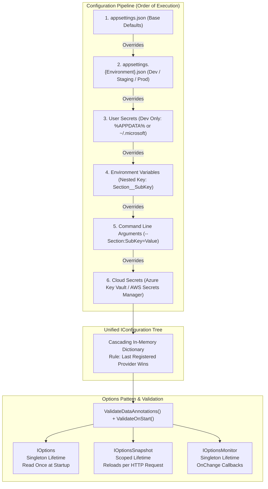

# Lesson 17: Configuration, Logging and Environments

> **Prerequisites:** [Routing, Controllers vs Minimal APIs, Model Binding and Filters](../16-routing-controllers-minimal-apis-and-filters/README.md) and [Track 26 Overview](../README.md).  
> **Estimated Reading Time:** 18 minutes  
> **Target Audience:** Engineers preparing for LLD, OOP, C#, or Python technical screening and architecture rounds.

> [!TIP]
> **The One Rule of Configuration & Logging:** Configuration in ASP.NET Core is an ordered, cascading dictionary where the **last registered provider wins**, strongly typed and validated at application boot via the Options pattern; while Logging must be strictly **structured and semantic** (never string-interpolated), preserving message templates and property payloads so log aggregators can index, filter, and trace across distributed systems with zero regex parsing overhead.

---

## 1. Why This Matters: The Interview Trap

"How does configuration work in ASP.NET Core, how do you prevent credential leakage across environments, and what is the difference between string interpolation and structured logging?" is a ubiquitous senior backend screening question.

### The Junior vs. Senior Answer

- **The Junior Candidate:**  
  *"ASP.NET Core reads configuration from `appsettings.json`. If you are in production, it automatically reads `appsettings.Production.json`. You use User Secrets for passwords so they don't go to Git. For logging, we use `ILogger` and write strings like `_logger.LogInformation($"Order {id} created")`."*  
  *Interviewer Assessment:* Superficial knowledge. The candidate does not understand provider resolution order, nested key delimiter transforms across container runtimes (`:` vs `__`), the options lifetime boundaries (`IOptions` vs `IOptionsSnapshot` vs `IOptionsMonitor`), or why string interpolation ruins distributed observability and degrades garbage collection.

- **The Senior Candidate:**  
  *"Configuration in ASP.NET Core is built from an ordered pipeline of `IConfigurationProvider` instances registered in `WebApplication.CreateBuilder(args)`. By default, the providers execute in strict cascading precedence:
  1. `appsettings.json` (base settings)
  2. `appsettings.{Environment}.json` (environment-specific overrides based on `ASPNETCORE_ENVIRONMENT`)
  3. User Secrets (only loaded when `EnvironmentName == "Development"`, stored outside the repository directory)
  4. Environment Variables (using `__` as the nested section delimiter for Linux/Docker compatibility)
  5. Command-line arguments (`--Key=Value`)
  6. External Secret Stores (Azure Key Vault, AWS Secrets Manager, or HashiCorp Vault, explicitly appended in production)
  
  Because providers layer sequentially into a unified key-value tree, **the last provider registered that contains a matching key wins**.
  
  To consume settings safely, we avoid injecting `IConfiguration` directly into business logic. Instead, we use the **Options Pattern** (`services.AddOptions<TOptions>().Bind(...).ValidateDataAnnotations().ValidateOnStart()`), ensuring invalid configurations fail at boot rather than throwing runtime exceptions during user traffic.
  
  For logging, writing `_logger.LogInformation($"Order {id} created")` is an active antipattern: it formats strings eagerly, forces heap allocations even when logging is disabled, strips parameter types, and forces log analyzers (like Datadog, Elasticsearch, or Loki) to run expensive regex parsers. **Structured logging** passes a message template alongside parameterized arguments (`_logger.LogInformation("Order {OrderId} created for user {UserId}", id, userId)`), preserving rich semantic fields in JSON sinks and allowing zero-allocation high-throughput logging via the `[LoggerMessage]` source generator."*

---

## 2. Visual Mental Model / Taxonomic Comparison

### Cascading Configuration Pipeline



### Configuration Source Precedence Matrix

| Provider Order | Provider Name | Typical Location | When Evaluated | Overridden By | Key Delimiter |
| :--- | :--- | :--- | :--- | :--- | :--- |
| **1 (Lowest)** | `appsettings.json` | Project root (checked in) | Always | Everything above | `:` or `__` |
| **2** | `appsettings.{Env}.json` | Project root (checked in) | Matching environment | Providers 3–6 | `:` or `__` |
| **3** | User Secrets | Local machine OS profile | Development only | Providers 4–6 | `:` or `__` |
| **4** | Environment Variables | OS / Docker / Kubernetes | Always | Providers 5–6 | `__` (double underscore) |
| **5** | Command-Line Args | Process startup arguments | Application launch | Provider 6 | `--Key=Val` or `/Key=Val` |
| **6 (Highest)** | Cloud Secret Vaults | Azure Key Vault / AWS Secrets | Explicitly chained | None | `--` or `__` |

### Options Pattern Lifetime Comparison

| Feature | `IOptions<T>` | `IOptionsSnapshot<T>` | `IOptionsMonitor<T>` |
| :--- | :--- | :--- | :--- |
| **DI Lifetime** | **Singleton** | **Scoped** | **Singleton** |
| **Reload on Change** | No (read once at boot) | Yes (recomputed per HTTP request) | Yes (immediate real-time update) |
| **Safe in Singletons?** | Yes | **NO (Captive dependency trap!)** | Yes |
| **Named Options Support** | No (default options only) | Yes (`Get(name)`) | Yes (`Get(name)`) |
| **Change Notifications** | None | None | `OnChange(opt => ...)` listener |
| **Performance Overhead** | Zero (cached reference) | Recomputes per request | Negligible (atomic reference swap) |

---

## 3. Code Implementation

The following complete, runnable code demonstrates:
1. Multi-source cascading configuration layering where later sources override earlier ones.
2. Strongly typed options binding with validation attributes and fail-fast startup checks.
3. Structured logging emitting semantic JSON tokens, correlation scopes, and preserved templates.

````carousel
```csharp
using System;
using System.Collections.Generic;
using System.ComponentModel.DataAnnotations;
using System.Text.Json;
using Microsoft.Extensions.Configuration;
using Microsoft.Extensions.DependencyInjection;
using Microsoft.Extensions.Logging;
using Microsoft.Extensions.Logging.Console;
using Microsoft.Extensions.Options;

// ========================================================
// 1. Strongly Typed Options with DataAnnotations Validation
// ========================================================
public sealed class PaymentGatewayOptions
{
    public const string SectionName = "PaymentGateway";

    [Required(ErrorMessage = "ApiKey is required")]
    [MinLength(8, ErrorMessage = "ApiKey must be at least 8 characters")]
    public string ApiKey { get; set; } = string.Empty;

    [Required]
    [Url(ErrorMessage = "BaseUrl must be a valid HTTP/HTTPS URL")]
    public string BaseUrl { get; set; } = string.Empty;

    [Range(1, 60, ErrorMessage = "TimeoutSeconds must be between 1 and 60")]
    public int TimeoutSeconds { get; set; } = 30;

    public bool EnableAuditLog { get; set; } = true;
}

// ========================================================
// 2. Service Consuming Options & Structured Logging
// ========================================================
public sealed class PaymentProcessor
{
    private readonly PaymentGatewayOptions _options;
    private readonly ILogger<PaymentProcessor> _logger;

    public PaymentProcessor(IOptions<PaymentGatewayOptions> options, ILogger<PaymentProcessor> logger)
    {
        _options = options.Value;
        _logger = logger;
    }

    public bool ProcessPayment(string transactionId, string customerId, decimal amount)
    {
        // BeginScope attaches ambient correlation context to all log events within this scope
        using (_logger.BeginScope(new Dictionary<string, object>
        {
            ["TransactionId"] = transactionId,
            ["CustomerId"] = customerId
        }))
        {
            // Structured logging: arguments are semantic named tokens, NOT string interpolation!
            _logger.LogInformation(
                "Connecting to {BaseUrl} (Timeout: {Timeout}s)",
                _options.BaseUrl,
                _options.TimeoutSeconds);

            _logger.LogInformation(
                "Payment of ${Amount:F2} processed successfully for customer {CustomerId}",
                amount,
                customerId);

            return true;
        }
    }
}

// ========================================================
// 3. Application Entrypoint Demonstrating Precedence
// ========================================================
public class Program
{
    public static void Main()
    {
        Console.OutputEncoding = System.Text.Encoding.UTF8;

        // Layer 1: appsettings.json (Base Defaults)
        var baseConfig = new Dictionary<string, string?>
        {
            ["PaymentGateway:ApiKey"] = "default-insecure-key",
            ["PaymentGateway:BaseUrl"] = "https://sandbox.payments.net/api",
            ["PaymentGateway:TimeoutSeconds"] = "15"
        };

        // Layer 2: appsettings.Production.json (Environment Override)
        var prodConfig = new Dictionary<string, string?>
        {
            ["PaymentGateway:BaseUrl"] = "https://api.payments.net/v1",
            ["PaymentGateway:TimeoutSeconds"] = "30"
        };

        // Layer 3: Environment Variables / Secrets (Highest Priority)
        // Note: In Docker/Linux, PaymentGateway__ApiKey overrides PaymentGateway:ApiKey
        var envVarConfig = new Dictionary<string, string?>
        {
            ["PaymentGateway:ApiKey"] = "prod_sec_999888777666"
        };

        // Build cascading configuration (last provider registered wins)
        var configuration = new ConfigurationBuilder()
            .AddInMemoryCollection(baseConfig)
            .AddInMemoryCollection(prodConfig)
            .AddInMemoryCollection(envVarConfig)
            .Build();

        var services = new ServiceCollection();

        // Configure structured JSON console logging with ambient scopes
        services.AddLogging(builder =>
        {
            builder.ClearProviders();
            builder.AddJsonConsole(opts =>
            {
                opts.IncludeScopes = true;
                opts.JsonWriterOptions = new JsonWriterOptions { Indented = false };
            });
            builder.SetMinimumLevel(LogLevel.Information);
        });

        // Register typed options with fail-fast startup validation
        services.AddOptions<PaymentGatewayOptions>()
            .Bind(configuration.GetSection(PaymentGatewayOptions.SectionName))
            .ValidateDataAnnotations()
            .ValidateOnStart();

        services.AddTransient<PaymentProcessor>();

        var provider = services.BuildServiceProvider();

        Console.WriteLine("--- 1. Configuration Layering Resolution ---");
        var resolvedOptions = provider.GetRequiredService<IOptions<PaymentGatewayOptions>>().Value;
        Console.WriteLine($"BaseUrl:        {resolvedOptions.BaseUrl} (from Prod config)");
        Console.WriteLine($"TimeoutSeconds: {resolvedOptions.TimeoutSeconds} (from Prod config)");
        Console.WriteLine($"ApiKey:         {resolvedOptions.ApiKey[..8]}*** (from Secrets/EnvVar)");

        Console.WriteLine("\n--- 2. Structured Logging Execution ---");
        var processor = provider.GetRequiredService<PaymentProcessor>();
        processor.ProcessPayment("TX-8842", "CUST-402", 150.00m);
    }
}
```
<!-- slide -->
```python
import sys
import json
import logging
from dataclasses import dataclass
from typing import Any, Dict
from contextvars import ContextVar

# Ambient correlation context (mimicking ILogger.BeginScope across async calls)
_log_scope: ContextVar[Dict[str, Any]] = ContextVar("log_scope", default={})

# ========================================================
# 1. Strongly Typed Options with Validation
# ========================================================
@dataclass
class PaymentGatewayOptions:
    api_key: str
    base_url: str
    timeout_seconds: int = 30
    enable_audit_log: bool = True

    def validate(self) -> None:
        """Fail-fast validation equivalent to ValidateDataAnnotations & ValidateOnStart."""
        if not self.api_key or len(self.api_key) < 8:
            raise ValueError("ApiKey is required and must be at least 8 characters")
        if not (self.base_url.startswith("http://") or self.base_url.startswith("https://")):
            raise ValueError("BaseUrl must be a valid HTTP/HTTPS URL")
        if not (1 <= self.timeout_seconds <= 60):
            raise ValueError("TimeoutSeconds must be between 1 and 60")

# ========================================================
# 2. Structured Logging with Ambient Scopes
# ========================================================
class JsonConsoleFormatter(logging.Formatter):
    """Formats log records matching ASP.NET Core AddJsonConsole structured output."""
    def format(self, record: logging.LogRecord) -> str:
        state = getattr(record, "props", {})
        payload = {
            "LogLevel": "Information" if record.levelno == logging.INFO else record.levelname,
            "Category": record.name,
            "Message": record.getMessage(),
            "State": state,
            "Scopes": [_log_scope.get()] if _log_scope.get() else []
        }
        return json.dumps(payload)

class StructuredLogger:
    def __init__(self, name: str):
        self.logger = logging.getLogger(name)
        self.logger.setLevel(logging.INFO)
        if not self.logger.handlers:
            handler = logging.StreamHandler(sys.stdout)
            handler.setFormatter(JsonConsoleFormatter())
            self.logger.addHandler(handler)
        self.logger.propagate = False

    def log_info(self, template: str, **kwargs: Any) -> None:
        # Structured logging: preserve semantic properties separately from message text
        formatted_msg = template
        for k, v in kwargs.items():
            formatted_msg = formatted_msg.replace("{" + k + "}", str(v))
        self.logger.info(formatted_msg, extra={"props": kwargs})

    def begin_scope(self, **kwargs: Any):
        class ScopeContext:
            def __enter__(self_inner):
                curr = dict(_log_scope.get())
                curr.update(kwargs)
                self_inner.token = _log_scope.set(curr)
                return self_inner
            def __exit__(self_inner, exc_type, exc_val, exc_tb):
                _log_scope.reset(self_inner.token)
        return ScopeContext()

# ========================================================
# 3. Service Consuming Options & Logger
# ========================================================
class PaymentProcessor:
    def __init__(self, options: PaymentGatewayOptions, logger: StructuredLogger):
        self._options = options
        self._logger = logger

    def process_payment(self, transaction_id: str, customer_id: str, amount: float) -> bool:
        with self._logger.begin_scope(TransactionId=transaction_id, CustomerId=customer_id):
            self._logger.log_info(
                "Connecting to {BaseUrl} (Timeout: {Timeout}s)",
                BaseUrl=self._options.base_url,
                Timeout=self._options.timeout_seconds
            )
            self._logger.log_info(
                "Payment of ${Amount} processed successfully for customer {CustomerId}",
                Amount=f"{amount:.2f}",
                CustomerId=customer_id
            )
            return True

def main():
    # Layer 1: Base Configuration (defaults)
    base_config = {
        "PaymentGateway:ApiKey": "default-insecure-key",
        "PaymentGateway:BaseUrl": "https://sandbox.payments.net/api",
        "PaymentGateway:TimeoutSeconds": "15"
    }

    # Layer 2: Environment Configuration (Production)
    prod_config = {
        "PaymentGateway:BaseUrl": "https://api.payments.net/v1",
        "PaymentGateway:TimeoutSeconds": "30"
    }

    # Layer 3: Secrets / Environment Variables (Highest Precedence)
    env_config = {
        "PaymentGateway:ApiKey": "prod_sec_999888777666"
    }

    # Cascading merge: Last registered dictionary source wins
    merged = dict(base_config)
    merged.update(prod_config)
    merged.update(env_config)

    # Bind strongly typed options and validate immediately
    options = PaymentGatewayOptions(
        api_key=merged["PaymentGateway:ApiKey"],
        base_url=merged["PaymentGateway:BaseUrl"],
        timeout_seconds=int(merged["PaymentGateway:TimeoutSeconds"])
    )
    options.validate()

    print("--- 1. Configuration Layering Resolution ---")
    print(f"BaseUrl:        {options.base_url} (from Prod config)")
    print(f"TimeoutSeconds: {options.timeout_seconds} (from Prod config)")
    print(f"ApiKey:         {options.api_key[:8]}*** (from Secrets/EnvVar)")

    print("\n--- 2. Structured Logging Execution ---")
    sys.stdout.flush()
    logger = StructuredLogger("PaymentProcessor")
    processor = PaymentProcessor(options, logger)
    processor.process_payment("TX-8842", "CUST-402", 150.00)

if __name__ == "__main__":
    main()
```
````

**Expected Output (Both Languages):**
```text
--- 1. Configuration Layering Resolution ---
BaseUrl:        https://api.payments.net/v1 (from Prod config)
TimeoutSeconds: 30 (from Prod config)
ApiKey:         prod_sec*** (from Secrets/EnvVar)

--- 2. Structured Logging Execution ---
{"LogLevel":"Information","Category":"PaymentProcessor","Message":"Connecting to https://api.payments.net/v1 (Timeout: 30s)","State":{"BaseUrl":"https://api.payments.net/v1","Timeout":30},"Scopes":[{"TransactionId":"TX-8842","CustomerId":"CUST-402"}]}
{"LogLevel":"Information","Category":"PaymentProcessor","Message":"Payment of $150.00 processed successfully for customer CUST-402","State":{"Amount":150.00,"CustomerId":"CUST-402"},"Scopes":[{"TransactionId":"TX-8842","CustomerId":"CUST-402"}]}
```

---

## 4. Where You Already Use It

1. **`Microsoft.Extensions.Configuration` (`IConfigurationRoot`, `IConfigurationSection`):**  
   Powers the central configuration subsystem in ASP.NET Core, worker services, and Azure Functions. It treats configuration as a flattened key-value dictionary where sections are indexed by `:` separators.
2. **`Microsoft.Extensions.Options` (`IOptions<T>`, `IOptionsSnapshot<T>`, `IOptionsMonitor<T>`):**  
   Powers all core framework settings (e.g., `KestrelServerOptions`, `RouteOptions`, `JwtBearerOptions`, `CookieAuthenticationOptions`).
3. **`Microsoft.Extensions.Logging` (`ILogger<T>`, `ILoggerFactory`):**  
   Integrated throughout ASP.NET Core middleware pipelines, Entity Framework Core query logging, and HttpClient logging handlers.
4. **Third-Party Sinks (Serilog, OpenTelemetry .NET SDK):**  
   Serilog enriches `ILogger` calls with structured properties, serializing parameters as native JSON payloads to Elasticsearch, Seq, Datadog, or Grafana Loki.
5. **Python Equivalents:**  
   - Configuration: `pydantic-settings` (`BaseSettings`) reads `.env` files and environment variables into typed models.
   - Structured Logging: `structlog` and `python-json-logger` format Python standard `logging` events into structured JSON with ambient `contextvars` context.

---

## 5. Pitfalls and When Not to Use It

### Pitfall 1: String Interpolation in `ILogger` Calls
```csharp
// FATAL ANTIPATTERN: Evaluates string immediately, destroys semantic structure
_logger.LogInformation($"User {userId} attempted login from IP {clientIp}");

// PRODUCTION GRADE: Preserves message template and indexed attributes
_logger.LogInformation("User {UserId} attempted login from IP {ClientIp}", userId, clientIp);
```
- **Consequences:**  
  1. Creates unnecessary heap string allocations even when the log level is disabled.
  2. Aggregators cannot group log events by template because every distinct ID creates a unique string.
  3. Security / PII risk: parameters cannot be masked or filtered by structured log enrichers.

### Pitfall 2: Injecting `IOptionsSnapshot<T>` into a Singleton
`IOptionsSnapshot<T>` is registered with a **Scoped** lifetime so it can re-read configuration changes on each HTTP request. If you inject `IOptionsSnapshot<T>` into a **Singleton** service (like a background worker or in-memory cache), you create a **captive dependency**.  
If DI scope validation is enabled (`ValidateScopes = true`), ASP.NET Core throws `InvalidOperationException` at startup. If disabled, the Singleton retains the snapshot taken on the first resolution forever, defeating hot-reloading.  
**Fix:** Inject `IOptionsMonitor<T>` into Singletons.

### Pitfall 3: Delimiter Mismatch on Linux / Docker (`:` vs `__`)
In standard JSON, configuration is nested:
```json
{
  "ConnectionStrings": {
    "DefaultConnection": "Server=...;"
  }
}
```
In C#, this is addressed as `ConnectionStrings:DefaultConnection`. However, Linux environments and Kubernetes ConfigMaps do not permit colons `:` in environment variable names.  
**Fix:** ASP.NET Core maps double-underscores `__` to colons `:`. Always configure environment variables as:
```bash
ConnectionStrings__DefaultConnection="Server=...;"
```

### Pitfall 4: Missing `ValidateOnStart()` (Runtime Discovery of Missing Config)
Binding an options class without `.ValidateOnStart()` causes configuration errors (e.g., missing API keys or invalid URLs) to remain hidden until the first user triggers that code path in production.  
**Fix:** Always chain `.ValidateDataAnnotations().ValidateOnStart()` during options registration.

---

## 6. Exercises & Practical Drills

### Drill 1: Tracing Configuration Resolution Precedence
Given the following configuration providers registered in this order:
1. `appsettings.json`: `{"Database": {"Timeout": 10, "Retries": 3}}`
2. `appsettings.Production.json`: `{"Database": {"Timeout": 30}}`
3. Environment Variable: `Database__Retries=5`
4. Command-Line Argument: `--Database:Timeout=45`

What are the final resolved values of `Database:Timeout` and `Database:Retries`?

<details>
<summary>Answer</summary>

- `Database:Timeout` = **45** (Command-line arguments are registered after `appsettings.Production.json` and take precedence).
- `Database:Retries` = **5** (The environment variable is registered after `appsettings.json` and overrides `3`; no command-line argument was supplied for `Retries`).
</details>

---

### Drill 2: Selecting the Correct Options Lifetime
You have three services:
1. `OrderController` (Scoped MVC controller handling web requests).
2. `CacheEvictionWorker` (Singleton `BackgroundService` executing every 5 minutes).
3. `TenantSettingsManager` (Service requiring real-time updates when an administrator patches an options file on disk).

Which Options interface should each service inject?

<details>
<summary>Answer</summary>

1. `OrderController`: Inject **`IOptionsSnapshot<TOptions>`** (re-evaluated cleanly for the request scope) or **`IOptions<TOptions>`** if reload is unnecessary.
2. `CacheEvictionWorker`: Inject **`IOptionsMonitor<TOptions>`** or **`IOptions<TOptions>`**. Never inject `IOptionsSnapshot<T>` into a Singleton.
3. `TenantSettingsManager`: Inject **`IOptionsMonitor<TOptions>`** (supports `CurrentValue` dynamic reads, named options via `.Get(tenantId)`, and `.OnChange()` callbacks).
</details>

---

### Drill 3: Zero-Allocation Structured Logging with Source Generators
Write a C# high-performance logging method using `[LoggerMessage]` for an `OrderDispatched` event that avoids boxing value types.

<details>
<summary>Answer</summary>

```csharp
public static partial class LogExtensions
{
    [LoggerMessage(
        EventId = 1001,
        Level = LogLevel.Information,
        Message = "Order {OrderId} dispatched to customer {CustomerId} at price ${Price:F2}")]
    public static partial void LogOrderDispatched(
        this ILogger logger,
        long orderId,
        string customerId,
        decimal price);
}
```
*Why this is senior-level:* The C# Roslyn source generator writes the boilerplate that checks `logger.IsEnabled(LogLevel.Information)` before executing, avoids allocating an object array `object[]` for arguments, and avoids boxing value types (`long`, `decimal`).
</details>

---

## 7. Interview Questions & Model Answers

> [!interview]
> **Question 1: How does configuration work in ASP.NET Core?**  
> **Strong Answer:**  
> "ASP.NET Core uses a layered, provider-based configuration architecture managed by `IConfiguration`. Configuration sources are registered sequentially in `WebApplicationBuilder.Configuration` or `IHostBuilder`. Each provider contributes key-value pairs into a single, unified hierarchical memory tree where sections are denoted by `:` delimiters.
>
> Rather than having components directly depend on `IConfiguration` as a service locator, ASP.NET Core relies on the **Options Pattern**. Configuration sections are strongly typed into plain C# classes (POCOs) using `services.AddOptions<TOptions>().Bind(config.GetSection(...))`. This enables compile-time type safety, DataAnnotations or FluentValidation rules, and automatic lifecycle management via `IOptions<T>`, `IOptionsSnapshot<T>`, and `IOptionsMonitor<T>`. Furthermore, chaining `.ValidateOnStart()` ensures fail-fast startup semantics if required environment variables or secrets are missing."

---

> [!interview]
> **Question 2: Which configuration source wins?**  
> **Strong Answer:**  
> "The **last registered configuration source wins**. By default, ASP.NET Core's default host builder registers configuration providers in the following specific order:
> 1. `appsettings.json`
> 2. `appsettings.{Environment}.json` (where environment is resolved from `ASPNETCORE_ENVIRONMENT` or `DOTNET_ENVIRONMENT`)
> 3. User Secrets (only when running in the `Development` environment)
> 4. Environment Variables
> 5. Command-line arguments
>
> If an application explicitly adds custom providers—such as Azure Key Vault or AWS Systems Manager Parameter Store—those are typically appended last in `Program.cs`, meaning cloud secrets override local files, environment variables, and CLI arguments. If multiple providers define the exact same nested path (e.g. `Logging:LogLevel:Default`), the provider that was registered latest in the pipeline replaces the previous value."

---

> [!interview]
> **Question 3: How do you keep secrets out of `appsettings.json`?**  
> **Strong Answer:**  
> "Keeping secrets out of `appsettings.json` is a foundational security requirement to prevent credentials from being committed into source control. We enforce this through environment-tiered isolation:
> 1. **Local Development:** We use the **Secret Manager tool** (`dotnet user-secrets init`, `dotnet user-secrets set "ApiKey" "secret"`). The resulting `secrets.json` file is stored outside the Git repository in the developer's local OS profile (`%APPDATA%\Microsoft\UserSecrets\<UserSecretsId>\` on Windows or `~/.microsoft/usersecrets/<UserSecretsId>/` on Linux/macOS). The runtime only loads User Secrets when `builder.Environment.IsDevelopment()` is true.
> 2. **CI/CD & Container Orchestration:** Production values are supplied as **Environment Variables** injected at runtime by Docker, Kubernetes Secrets, or CI/CD pipelines (e.g., GitHub Actions secrets). Because Linux and container runtimes prohibit `:` in variable names, we use double underscores `__` for nested keys (e.g., `Database__Password`).
> 3. **Cloud Production (Enterprise):** We integrate enterprise key vaults (such as Azure Key Vault or AWS Secrets Manager) using managed identities (IAM roles) without any static credentials in the application. The cloud provider SDK connects at startup and layers the secrets directly into `IConfiguration`."

---

> [!interview]
> **Question 4: What is structured logging?**  
> **Strong Answer:**  
> "Structured logging is a logging paradigm where log messages maintain their **semantic template and discrete parameter payload** separately, rather than flattening them into an opaque text string via string interpolation or concatenation.
> 
> When you execute `_logger.LogInformation("Order {OrderId} created for user {UserId}", orderId, userId)`, the logging subsystem sends three pieces of data to the sink:
> 1. The original unformatted message template (`"Order {OrderId} created for user {UserId}"`).
> 2. The rendered message string for human readers.
> 3. A structured dictionary of extracted attributes (`{"OrderId": 1234, "UserId": 5678}`).
> 
> This distinction is critical in production backend engineering for three reasons:
> - **Queryability & Observability:** Modern log management systems (Elasticsearch, Datadog, AWS CloudWatch, Splunk) index the discrete properties as native JSON fields. You can immediately filter queries like `@properties.OrderId: 1234` or build dashboards without writing brittle regular expressions.
> - **Event Aggregation:** Systems can group millions of distinct log lines by their identical message template to track error rates over time.
> - **Performance:** Unlike string interpolation, which allocates a heap string every single time regardless of whether the log level is enabled, structured logging evaluates parameters only if the target `LogLevel` is active. In high-throughput systems, using source-generated `[LoggerMessage]` provides zero-allocation logging."

---

## 8. Sources & Further Reading

- [Microsoft Learn: Configuration in ASP.NET Core](https://learn.microsoft.com/en-us/aspnet/core/fundamentals/configuration/)
- [Microsoft Learn: Options pattern in ASP.NET Core](https://learn.microsoft.com/en-us/aspnet/core/fundamentals/configuration/options)
- [Microsoft Learn: Logging in .NET and ASP.NET Core](https://learn.microsoft.com/en-us/dotnet/core/extensions/logging)
- [Microsoft Learn: Compile-time logging source generation](https://learn.microsoft.com/en-us/dotnet/core/extensions/logger-message-generator)
- [Microsoft Learn: Safe storage of app secrets in development](https://learn.microsoft.com/en-us/aspnet/core/security/app-secrets)
- [Python Documentation: Logging Facility](https://docs.python.org/3/library/logging.html)

---

Previous: [Routing, Controllers vs Minimal APIs, Model Binding and Filters](../16-routing-controllers-minimal-apis-and-filters/README.md) · Next: [Error Handling and ProblemDetails](../18-error-handling-and-problem-details/README.md)
