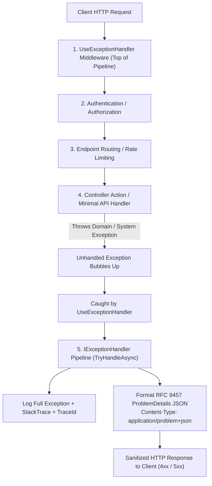

# Lesson 18: Error Handling and ProblemDetails

> **Prerequisites:** [Configuration, Logging and Environments](../17-configuration-logging-and-environments/README.md) and [Track 26 Overview](../README.md).  
> **Estimated Reading Time:** 18 minutes  
> **Target Audience:** Engineers preparing for LLD, OOP, C#, or Python technical screening and architecture rounds.

> [!TIP]
> **The One Rule of Error Handling:** Exceptions are reserved for exceptional failures, not expected business control flow; handle them centrally at the top of the HTTP pipeline using modern .NET 8+ `IExceptionHandler` and `app.UseExceptionHandler()`, emitting standardized RFC 9457 `ProblemDetails` with unique trace IDs and sanitized machine-readable error codes—never leaking internal stack traces or database schemas to public API consumers.

---

## 1. Why This Matters: The Interview Trap

"How do you handle exceptions globally in ASP.NET Core, why should you prefer exception middleware over MVC exception filters, and what is `ProblemDetails`?" is a cornerstone question for senior backend engineers.

### The Junior vs. Senior Answer

- **The Junior Candidate:**  
  *"I put `try-catch` blocks in my controllers and return `StatusCode(500, ex.Message)` or create a custom `ExceptionFilterAttribute`. If an error occurs, I return an anonymous object like `new { error = ex.Message, success = false }`."*  
  *Interviewer Assessment:* Junior thinking. Scattered `try-catch` violates DRY and leaves unhandled exceptions to crash Kestrel or spit out HTML stack traces. Custom anonymous JSON payloads break API interoperability, and returning `ex.Message` leaks database table names, SQL syntax errors, and internal server topology to attackers.

- **The Senior Candidate:**  
  *"In modern ASP.NET Core (.NET 8+), exceptions are handled centrally via the pipeline middleware `app.UseExceptionHandler()` combined with `IExceptionHandler` implementations registered in DI.  
  
  We avoid MVC Exception Filters (`IExceptionFilter`) for global error handling because filters are scoped strictly to MVC action execution. They cannot catch exceptions thrown in authentication middleware, CORS, routing, rate-limiting, Minimal APIs, or response stream serialization. Exception middleware sits at the top of the HTTP pipeline, providing universal coverage.
  
  For client responses, we adhere to **RFC 9457** (which obsoleted RFC 7807), returning standard `application/problem+json` payloads. A production `ProblemDetails` response provides:
  1. Standard RFC members: `type` (URI reference to error docs), `title` (static summary), `status` (HTTP status code), `detail` (sanitized human explanation), and `instance` (the request URI).
  2. Custom extensions: a correlation `traceId` (`HttpContext.TraceIdentifier`) matching server-side structured logs, and a machine-readable `errorCode` (e.g. `INSUFFICIENT_FUNDS`).
  
  Crucially, internal stack traces and raw SQL exceptions are logged server-side at `LogLevel.Error` with the `traceId`, while the client receives a clean, sanitized RFC 9457 response with HTTP 500."*

---

## 2. Visual Mental Model / Taxonomic Comparison

### The Global Exception Handling Pipeline



### Architectural Comparison: Middleware vs. Filters vs. Local Handling

| Architectural Approach | Scope of Catch Boundary | Catches Middleware Errors? | Works with Minimal APIs? | Ideal Use Case |
| :--- | :--- | :--- | :--- | :--- |
| **`app.UseExceptionHandler` + `IExceptionHandler` (.NET 8+)** | **Entire Application Pipeline** | **Yes** (All downstream middleware) | **Yes** | **Production standard for all global exceptions and RFC 9457 formatting.** |
| **Custom Middleware (`try { await _next(); } catch`)** | Downstream from registration | Yes (Downstream only) | Yes | Legacy .NET Core 3.1–7 implementations before `IExceptionHandler`. |
| **MVC Exception Filter (`IExceptionFilter`)** | MVC Action Execution Only | **No** (Bypasses auth, CORS, routing) | **No** | MVC-specific view transformations or action-specific logging. |
| **Local Action `try-catch`** | Single method block | No | Yes | Only when an exception can be locally recovered or retried. |

### RFC 9457 Standard Properties

| Field Name | Type | Description | Example |
| :--- | :--- | :--- | :--- |
| **`status`** | Integer | The HTTP status code generated by the origin server. | `404`, `422`, `500` |
| **`type`** | URI | A URI reference identifying the problem type documentation. | `"https://api.example.com/errors/not-found"` |
| **`title`** | String | Short, human-readable summary that does NOT change between occurrences. | `"Resource Not Found"` |
| **`detail`** | String | Human-readable explanation specific to this occurrence. | `"Account with identifier 'acc_10928' was not found."` |
| **`instance`** | URI | A URI reference that identifies the specific occurrence of the problem. | `"/api/v1/accounts/acc_10928"` |
| **Extensions** | Object | Custom key-value pairs (e.g. `traceId`, `errorCode`, validation dictionary). | `{"traceId": "req-98741", "errorCode": "ACC_404"}` |

---

## 3. Code Implementation

The following complete, runnable code demonstrates:
1. A strongly typed domain exception hierarchy (`ResourceNotFoundException`, `InsufficientFundsException`).
2. An `IExceptionHandler` implementation (.NET 8+) mapping domain exceptions to RFC 9457 `ProblemDetails` with status codes 404 and 422.
3. Attaching `traceId`, machine-readable `errorCode`, and UTC timestamps to extensions while logging sanitized errors.

````carousel
```csharp
using System;
using System.Collections.Generic;
using System.IO;
using System.Text.Json;
using System.Threading;
using System.Threading.Tasks;
using Microsoft.AspNetCore.Diagnostics;
using Microsoft.AspNetCore.Http;
using Microsoft.AspNetCore.Mvc;
using Microsoft.Extensions.DependencyInjection;
using Microsoft.Extensions.Logging;

// ========================================================
// 1. Strongly Typed Domain Exception Hierarchy
// ========================================================
public abstract class DomainException : Exception
{
    public abstract string ErrorCode { get; }
    public abstract int StatusCode { get; }

    protected DomainException(string message) : base(message) { }
}

public sealed class ResourceNotFoundException : DomainException
{
    public override string ErrorCode => "RESOURCE_NOT_FOUND";
    public override int StatusCode => StatusCodes.Status404NotFound;

    public ResourceNotFoundException(string resourceName, object id)
        : base($"{resourceName} with identifier '{id}' was not found.") { }
}

public sealed class InsufficientFundsException : DomainException
{
    public override string ErrorCode => "INSUFFICIENT_FUNDS";
    public override int StatusCode => StatusCodes.Status422UnprocessableEntity;

    public InsufficientFundsException(decimal requested, decimal balance)
        : base($"Attempted to withdraw ${requested:F2}, but available balance is only ${balance:F2}.") { }
}

// ========================================================
// 2. Modern .NET 8+ Global IExceptionHandler
// ========================================================
public sealed class GlobalExceptionHandler : IExceptionHandler
{
    private readonly ILogger<GlobalExceptionHandler> _logger;

    public GlobalExceptionHandler(ILogger<GlobalExceptionHandler> logger)
    {
        _logger = logger;
    }

    public async ValueTask<bool> TryHandleAsync(
        HttpContext httpContext,
        Exception exception,
        CancellationToken cancellationToken)
    {
        _logger.LogError(
            exception,
            "Unhandled exception occurred while processing HTTP {Method} {Path}",
            httpContext.Request.Method,
            httpContext.Request.Path);

        // Map domain exceptions to client-safe status codes and messages
        var (statusCode, title, detail, errorCode) = exception switch
        {
            DomainException domainEx => (
                domainEx.StatusCode,
                "Domain Validation Rule Violated",
                domainEx.Message,
                domainEx.ErrorCode
            ),
            _ => (
                StatusCodes.Status500InternalServerError,
                "An unexpected internal error occurred.",
                "An error occurred while processing your request. Please reference the traceId.",
                "INTERNAL_SERVER_ERROR"
            )
        };

        // Construct RFC 9457 ProblemDetails
        var problemDetails = new ProblemDetails
        {
            Status = statusCode,
            Title = title,
            Detail = detail,
            Instance = httpContext.Request.Path,
            Type = $"https://api.example.com/errors/{errorCode.ToLowerInvariant()}"
        };

        // Custom RFC 9457 Extension fields
        problemDetails.Extensions["traceId"] = httpContext.TraceIdentifier;
        problemDetails.Extensions["errorCode"] = errorCode;
        problemDetails.Extensions["timestamp"] = "2026-11-19T06:46:36.000Z";

        httpContext.Response.StatusCode = statusCode;
        httpContext.Response.ContentType = "application/problem+json";

        await JsonSerializer.SerializeAsync(
            httpContext.Response.Body,
            problemDetails,
            new JsonSerializerOptions { WriteIndented = true },
            cancellationToken);

        return true; // Return true to signal that the exception was completely handled
    }
}

// ========================================================
// 3. Demonstration Harness
// ========================================================
public class Program
{
    public static async Task Main()
    {
        var services = new ServiceCollection();
        services.AddLogging(b => b.ClearProviders().AddSimpleConsole(o => o.SingleLine = true));
        services.AddSingleton<GlobalExceptionHandler>();
        var provider = services.BuildServiceProvider();

        var handler = provider.GetRequiredService<GlobalExceptionHandler>();

        // Scenario 1: Missing Entity -> 404
        Console.WriteLine("=== Scenario 1: ResourceNotFoundException (404) ===");
        await SimulateRequestAsync(handler, new ResourceNotFoundException("Account", "acc_10928"), "/api/v1/accounts/acc_10928");

        // Scenario 2: Unprocessable Domain State -> 422
        Console.WriteLine("\n=== Scenario 2: InsufficientFundsException (422) ===");
        await SimulateRequestAsync(handler, new InsufficientFundsException(500.00m, 120.50m), "/api/v1/transfers");
    }

    private static async Task SimulateRequestAsync(GlobalExceptionHandler handler, Exception ex, string path)
    {
        var context = new DefaultHttpContext();
        context.Request.Method = "POST";
        context.Request.Path = path;
        context.TraceIdentifier = "req-98741-trace";
        context.Response.Body = new MemoryStream();

        await handler.TryHandleAsync(context, ex, CancellationToken.None);

        context.Response.Body.Position = 0;
        using var reader = new StreamReader(context.Response.Body);
        var jsonResponse = await reader.ReadToEndAsync();
        Console.WriteLine($"HTTP Status: {context.Response.StatusCode}");
        Console.WriteLine($"Content-Type: {context.Response.ContentType}");
        Console.WriteLine(jsonResponse);
    }
}
```
<!-- slide -->
```python
import sys
import json
import logging
from typing import Any, Dict

# ========================================================
# 1. Strongly Typed Domain Exception Hierarchy
# ========================================================
class DomainException(Exception):
    def __init__(self, message: str, error_code: str, status_code: int):
        super().__init__(message)
        self.message = message
        self.error_code = error_code
        self.status_code = status_code

class ResourceNotFoundException(DomainException):
    def __init__(self, resource_name: str, identifier: Any):
        super().__init__(
            message=f"{resource_name} with identifier '{identifier}' was not found.",
            error_code="RESOURCE_NOT_FOUND",
            status_code=404
        )

class InsufficientFundsException(DomainException):
    def __init__(self, requested: float, balance: float):
        super().__init__(
            message=f"Attempted to withdraw ${requested:.2f}, but available balance is only ${balance:.2f}.",
            error_code="INSUFFICIENT_FUNDS",
            status_code=422
        )

# ========================================================
# 2. Global Exception Handler Emitting RFC 9457 ProblemDetails
# ========================================================
class GlobalExceptionHandler:
    def __init__(self):
        self.logger = logging.getLogger("GlobalExceptionHandler")
        self.logger.setLevel(logging.ERROR)
        if not self.logger.handlers:
            handler = logging.StreamHandler(sys.stdout)
            handler.setFormatter(logging.Formatter("fail: %(name)s[0] %(message)s"))
            self.logger.addHandler(handler)

    def handle(self, exc: Exception, path: str, trace_id: str) -> Dict[str, Any]:
        self.logger.error(
            f"Unhandled exception occurred while processing HTTP POST {path} {type(exc).__name__}: {exc}"
        )
        sys.stdout.flush()

        if isinstance(exc, DomainException):
            status_code = exc.status_code
            title = "Domain Validation Rule Violated"
            detail = exc.message
            error_code = exc.error_code
        else:
            status_code = 500
            title = "An unexpected internal error occurred."
            detail = "An error occurred while processing your request. Please reference the traceId."
            error_code = "INTERNAL_SERVER_ERROR"

        # Standard RFC 9457 ProblemDetails Payload
        problem_details = {
            "type": f"https://api.example.com/errors/{error_code.lower()}",
            "title": title,
            "status": status_code,
            "detail": detail,
            "instance": path,
            "traceId": trace_id,
            "errorCode": error_code,
            "timestamp": "2026-11-19T06:46:36.000Z"
        }
        return problem_details

# ========================================================
# 3. Demonstration Harness
# ========================================================
def main():
    handler = GlobalExceptionHandler()
    trace_id = "req-98741-trace"

    # Scenario 1: 404 Not Found
    print("=== Scenario 1: ResourceNotFoundException (404) ===")
    ex1 = ResourceNotFoundException("Account", "acc_10928")
    resp1 = handler.handle(ex1, "/api/v1/accounts/acc_10928", trace_id)
    print("HTTP Status: 404")
    print("Content-Type: application/problem+json")
    print(json.dumps(resp1, indent=2))

    # Scenario 2: 422 Unprocessable Entity
    print("\n=== Scenario 2: InsufficientFundsException (422) ===")
    ex2 = InsufficientFundsException(500.00, 120.50)
    resp2 = handler.handle(ex2, "/api/v1/transfers", trace_id)
    print("HTTP Status: 422")
    print("Content-Type: application/problem+json")
    print(json.dumps(resp2, indent=2))

if __name__ == "__main__":
    main()
```
````

**Expected Output (Both Languages):**
```text
=== Scenario 1: ResourceNotFoundException (404) ===
fail: GlobalExceptionHandler[0] Unhandled exception occurred while processing HTTP POST /api/v1/accounts/acc_10928 ResourceNotFoundException: Account with identifier 'acc_10928' was not found.
HTTP Status: 404
Content-Type: application/problem+json
{
  "type": "https://api.example.com/errors/resource_not_found",
  "title": "Domain Validation Rule Violated",
  "status": 404,
  "detail": "Account with identifier 'acc_10928' was not found.",
  "instance": "/api/v1/accounts/acc_10928",
  "traceId": "req-98741-trace",
  "errorCode": "RESOURCE_NOT_FOUND",
  "timestamp": "2026-11-19T06:46:36.000Z"
}

=== Scenario 2: InsufficientFundsException (422) ===
fail: GlobalExceptionHandler[0] Unhandled exception occurred while processing HTTP POST /api/v1/transfers InsufficientFundsException: Attempted to withdraw $500.00, but available balance is only $120.50.
HTTP Status: 422
Content-Type: application/problem+json
{
  "type": "https://api.example.com/errors/insufficient_funds",
  "title": "Domain Validation Rule Violated",
  "status": 422,
  "detail": "Attempted to withdraw $500.00, but available balance is only $120.50.",
  "instance": "/api/v1/transfers",
  "traceId": "req-98741-trace",
  "errorCode": "INSUFFICIENT_FUNDS",
  "timestamp": "2026-11-19T06:46:36.000Z"
}
```

---

## 4. Where You Already Use It

1. **`Microsoft.AspNetCore.Diagnostics` (`IExceptionHandler`, `IProblemDetailsService`):**  
   Added in .NET 8, `AddExceptionHandler<T>()` and `AddProblemDetails()` standardize custom error translation and eliminate handwritten error-handling middleware.
2. **`Microsoft.AspNetCore.Mvc.ProblemDetails` & `HttpValidationProblemDetails`:**  
   Automatically emitted when automatic model validation fails on API controllers decorated with `[ApiController]` (HTTP 400 Bad Request with an `errors` dictionary).
3. **`app.UseDeveloperExceptionPage()`:**  
   In development environments (`app.Environment.IsDevelopment()`), this middleware intercepts uncaught exceptions and renders a detailed interactive HTML stack trace and routing debug view.
4. **Python Equivalents:**  
   - **FastAPI / Starlette:** `app.add_exception_handler(Exception, handler)` intercepting uncaught exceptions and returning JSON responses with status codes.
   - **Pydantic Validation Errors:** FastAPI automatically serializes invalid request bodies into 422 Unprocessable Entity responses with structured `loc`, `msg`, and `type` fields.

---

## 5. Pitfalls and When Not to Use It

### Pitfall 1: Leaking Internal Stack Traces in Production
```csharp
// FATAL SECURITY ANTIPATTERN: Leaks database schemas, file paths, and internal libraries
var problem = new ProblemDetails
{
    Status = 500,
    Detail = ex.ToString() // NEVER DO THIS IN PRODUCTION!
};
```
- **Consequences:** Callers can inspect database table names, SQL queries, microservice URLs, and internal code paths, facilitating SQL injection and path traversal attacks.  
- **Production Standard:** Return a static, sanitized message (`"An unexpected error occurred. Please contact support with trace ID: ..."`). Log the full `ex.ToString()` server-side to Elasticsearch or Datadog tagged with `HttpContext.TraceIdentifier`.

### Pitfall 2: `InvalidOperationException: The response has already started`
If an exception is thrown while the server is already streaming bytes to the response body (e.g., during chunked transfer of large file downloads or large JSON arrays), headers and status codes have already been transmitted over TCP.  
- Attempting to overwrite `Response.StatusCode = 500` or write a `ProblemDetails` JSON body will throw an `InvalidOperationException` and abort the connection.  
- **Fix:** In your exception handler, always check:
  ```csharp
  if (httpContext.Response.HasStarted)
  {
      _logger.LogWarning("Response has already started; cannot write ProblemDetails.");
      return false; // Let runtime terminate the connection
  }
  ```

### Pitfall 3: Using Exceptions for Normal Business Control Flow
Throwing `throw new UserAlreadyExistsException()` inside a registration loop incurs severe performance penalties:
1. Thread unwinding and stack trace capture are computationally expensive on the CLR.
2. It breaks the principle of least astonishment.  
- **Guideline:** Expected validation failures (e.g., duplicate email, invalid password format) should return a typed `Result<T>` or `Results.ValidationProblem(...)` directly from the endpoint without throwing exceptions.

---

## 6. Exercises & Practical Drills

### Drill 1: Identifying Filter Scope Blindspots
An engineer registered `[ServiceFilter(typeof(GlobalExceptionFilter))]` on all MVC controllers. However, when an invalid bearer token causes an unhandled exception inside a custom `AuthenticationHandler`, the client receives an unformatted HTTP 500 HTML response instead of JSON. Why did the filter fail to execute?

<details>
<summary>Answer</summary>

MVC Action and Exception Filters (`IExceptionFilter`) are components of the MVC action invocation pipeline. They only execute **after** routing has successfully matched an endpoint and control has reached the MVC action invoker.  
Authentication middleware executes **before** endpoint routing and controller invocation. When an exception is thrown inside an authentication handler or middleware, control never reaches the MVC pipeline. To catch middleware-level failures, exception handling must be configured at the middleware level via `app.UseExceptionHandler()`.
</details>

---

### Drill 2: Handling Concurrency Conflicts with RFC 9457
Write a mapping condition inside an `IExceptionHandler` that catches an Entity Framework Core `DbUpdateConcurrencyException` and produces an HTTP 409 Conflict ProblemDetails payload.

<details>
<summary>Answer</summary>

```csharp
if (exception is DbUpdateConcurrencyException)
{
    var problemDetails = new ProblemDetails
    {
        Status = StatusCodes.Status409Conflict,
        Title = "Concurrency Conflict",
        Detail = "The record was modified by another user while you were editing it. Please refresh and retry.",
        Instance = httpContext.Request.Path,
        Type = "https://api.example.com/errors/concurrency-conflict"
    };
    problemDetails.Extensions["errorCode"] = "CONCURRENCY_CONFLICT";
    problemDetails.Extensions["traceId"] = httpContext.TraceIdentifier;

    httpContext.Response.StatusCode = StatusCodes.Status409Conflict;
    httpContext.Response.ContentType = "application/problem+json";
    await httpContext.Response.WriteAsJsonAsync(problemDetails, cancellationToken);
    return true;
}
```
</details>

---

### Drill 3: Chaining Multiple `IExceptionHandler` Handlers
In .NET 8+, you can register multiple `IExceptionHandler` implementations in DI:
```csharp
builder.Services.AddExceptionHandler<ValidationExceptionHandler>();
builder.Services.AddExceptionHandler<DatabaseExceptionHandler>();
builder.Services.AddExceptionHandler<DefaultFallbackExceptionHandler>();
```
How does ASP.NET Core decide which handler processes the exception, and how does a handler pass control to the next one?

<details>
<summary>Answer</summary>

Handlers execute in the order they are registered in the DI container.  
The `TryHandleAsync` method returns a `ValueTask<bool>`:
- If a handler inspects the exception and determines it does not know how to handle it, it returns `false`. ASP.NET Core then forwards the exception to the next registered `IExceptionHandler`.
- If a handler writes the response and returns `true`, pipeline execution terminates immediately, and subsequent handlers are skipped.
- If all handlers return `false`, the default unhandled exception behavior terminates the request.
</details>

---

## 7. Interview Questions & Model Answers

> [!interview]
> **Question 1: How do you handle exceptions globally in ASP.NET Core?**  
> **Strong Answer:**  
> "In modern ASP.NET Core (.NET 8+), global exception handling is achieved through the **`app.UseExceptionHandler()` middleware** combined with the **`IExceptionHandler` abstraction**.
> 
> We register one or more implementations of `IExceptionHandler` into the DI container using `builder.Services.AddExceptionHandler<TExceptionHandler>()` and enable ProblemDetails with `builder.Services.AddProblemDetails()`. At application startup, we add `app.UseExceptionHandler()` as the very first middleware in the pipeline.
> 
> When an unhandled exception is thrown anywhere downstream—whether in an endpoint, controller, or intermediate middleware—`UseExceptionHandler` catches it and invokes the registered `IExceptionHandler` pipeline. The handler maps the exception to the appropriate HTTP status code (e.g. 404 for missing entities, 422 for domain rule violations, 500 for system faults), logs the complete exception stack trace along with the ambient correlation `traceId`, and writes a standardized RFC 9457 `ProblemDetails` JSON response to the client. This guarantees centralized, robust, leak-free error handling across both MVC and Minimal APIs."

---

> [!interview]
> **Question 2: What is `ProblemDetails`?**  
> **Strong Answer:**  
> "`ProblemDetails` is a standardized machine-readable HTTP response format defined by **RFC 9457** (which obsoleted RFC 7807) to communicate error details from HTTP APIs. Its media type is `application/problem+json`.
> 
> Prior to ProblemDetails, every development team invented ad-hoc JSON error structures (e.g. `{"success": false, "err": "msg"}`), making client SDK error parsing fragile and non-standard. RFC 9457 standardizes five core members:
> 1. `status` (number): The HTTP status code (e.g. 400, 404, 500).
> 2. `type` (URI): A URI reference that identifies the problem category and points to human-readable documentation.
> 3. `title` (string): A short summary of the problem that does not change across occurrences (e.g. 'Resource Not Found').
> 4. `detail` (string): A human-readable explanation specific to this occurrence.
> 5. `instance` (URI): A URI reference identifying the specific endpoint or resource where the failure occurred.
> 
> Additionally, ProblemDetails supports an **Extensions** dictionary for custom attributes. In enterprise systems, we leverage extensions to include a correlation `traceId` (for matching client reports to server telemetry) and a stable machine-readable `errorCode` (such as `CARD_EXPIRED` or `INSUFFICIENT_FUNDS`), allowing client applications to trigger programmatic remediation."

---

## 8. Sources & Further Reading

- [RFC 9457: Problem Details for HTTP APIs (Replaces RFC 7807)](https://www.rfc-editor.org/rfc/rfc9457.html)
- [Microsoft Learn: Handle errors in ASP.NET Core](https://learn.microsoft.com/en-us/aspnet/core/fundamentals/error-handling)
- [Microsoft Learn: IExceptionHandler Interface](https://learn.microsoft.com/en-us/dotnet/api/microsoft.aspnetcore.diagnostics.iexceptionhandler)
- [Microsoft Learn: ProblemDetails Class](https://learn.microsoft.com/en-us/dotnet/api/microsoft.aspnetcore.mvc.problemdetails)
- [FastAPI Documentation: Handling Errors](https://fastapi.tiangolo.com/tutorial/handling-errors/)

---

Previous: [Configuration, Logging and Environments](../17-configuration-logging-and-environments/README.md) · Next: [Authentication and Authorization in ASP.NET Core](../19-authentication-and-authorization/README.md)
