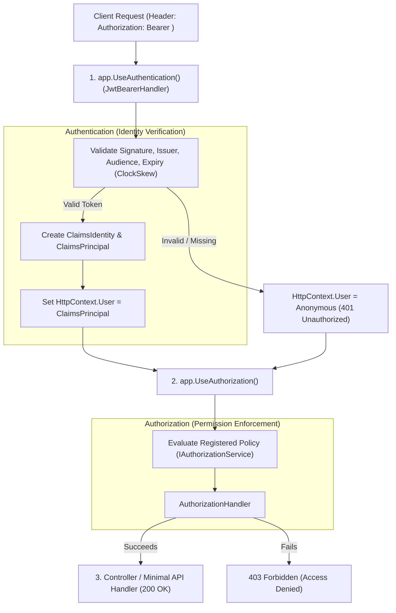

# Lesson 19: Authentication and Authorization in ASP.NET Core

> **Prerequisites:** [Error Handling and ProblemDetails](../18-error-handling-and-problem-details/README.md) and [Track 26 Overview](../README.md).  
> **Estimated Reading Time:** 18 minutes  
> **Target Audience:** Engineers preparing for LLD, OOP, C#, or Python technical screening and architecture rounds.

> [!NOTE]
> **In one line:** **Authentication** proves who you are (JWT, cookies); **authorization** decides what you may do (roles, claims, policies) — 401 means *unauthenticated*, 403 means *forbidden*.

> [!TIP]
> **The One Rule of Auth:** Authentication establishes **who you are** by cryptographically verifying credentials and populating `HttpContext.User` with a `ClaimsPrincipal`; Authorization determines **what you are allowed to do** by evaluating policies against claims and resource state. In the middleware pipeline, `app.UseAuthentication()` must strictly precede `app.UseAuthorization()`, or every authorization check will evaluate against an anonymous user.

---

## 1. Why This Matters: The Interview Trap

"What is the difference between authentication and authorization, why does middleware ordering matter, and why should you use policy-based authorization over role-based authorization?" is asked in nearly every senior .NET system design interview.

### The Junior vs. Senior Answer

- **The Junior Candidate:**  
  *"Authentication is logging in, authorization is checking if someone is an Admin. In ASP.NET Core you put `[Authorize(Roles = "Admin")]` on your controller methods. JWT is a token passed in the header that has the user's role."*  
  *Interviewer Assessment:* Junior textbook answer. The candidate treats auth as a binary role check, does not understand the pipeline lifecycle (`ClaimsPrincipal` hydration), fails to recognize why hard-coded roles cause maintenance nightmares, and cannot explain token signature verification or resource-level security.

- **The Senior Candidate:**  
  *"Authentication (`IAuthenticationService`) is identity verification: it inspects incoming request tokens or cookies, validates cryptographic signatures, checks expiration, and constructs a `ClaimsPrincipal` attached to `HttpContext.User`. If authentication fails or is missing, the response is **401 Unauthorized**.
  
  Authorization (`IAuthorizationService`) is access control: it evaluates whether the authenticated `ClaimsPrincipal` meets the requirements defined for the targeted endpoint or resource. If authorization fails, the response is **403 Forbidden**.
  
  In `Program.cs`, middleware order is strictly enforced:
  ```csharp
  app.UseAuthentication(); // 1. Hydrates HttpContext.User
  app.UseAuthorization();  // 2. Evaluates policies against HttpContext.User
  ```
  If reversed, `UseAuthorization` executes while `HttpContext.User` is still anonymous, immediately rejecting every protected endpoint.
  
  Furthermore, senior architectures avoid hard-coded roles (`[Authorize(Roles = "Manager")]`) because roles create tight coupling between business logic and static string definitions. Instead, we use **Policy-Based and Resource-Based Authorization**. Requirements (`IAuthorizationRequirement`) and handlers (`AuthorizationHandler<TRequirement, TResource>`) decouple business rules (e.g. 'Must be document author', 'Must have paid tier', 'Can edit only unlocked entities') into testable, composable classes."*

---

## 2. Visual Mental Model / Taxonomic Comparison

### Authentication & Authorization Pipeline Lifecycle



### Authentication vs. Authorization

| Dimension | Authentication (`AuthN`) | Authorization (`AuthZ`) |
| :--- | :--- | :--- |
| **Core Question** | *"Who are you?"* | *"What are you permitted to do?"* |
| **Pipeline Interface** | `IAuthenticationService` (`JwtBearerHandler`, `CookieHandler`) | `IAuthorizationService` (`DefaultAuthorizationService`) |
| **Data Produced** | Populates `HttpContext.User` with `ClaimsPrincipal` | Evaluates `AuthorizationResult` (`Succeeded` or `Failed`) |
| **Middleware Method** | `app.UseAuthentication()` | `app.UseAuthorization()` |
| **Failure HTTP Status** | **401 Unauthorized** (Client must authenticate) | **403 Forbidden** (Authenticated, but rights insufficient) |
| **Config Location** | `builder.Services.AddAuthentication(...)` | `builder.Services.AddAuthorization(...)` |

### Cookies vs. JWT Bearer Tokens

| Metric | Cookie Authentication | JWT Bearer Authentication |
| :--- | :--- | :--- |
| **Storage Location** | Browser Cookie Jar (`HttpOnly`, `SameSite`, `Secure`) | Client Memory / Secure Storage (Sent via `Authorization` header) |
| **Server State** | Often stateful (Session store, distributed cache) | **Stateless** (Self-contained signed JSON payload) |
| **CSRF Vulnerability** | **High** (Browser attaches automatically; requires CSRF tokens) | **Immune** to classical CSRF (explicitly attached by JavaScript) |
| **Cross-Domain / APIs** | Difficult across different subdomains / mobile apps | **Native** across mobile apps, SPAs, and microservices |
| **Revocation** | Trivial (Delete session key in Redis/database) | Complex (Requires token blacklists, short TTLs, or refresh tokens) |

---

## 3. Code Implementation

The following complete, runnable code demonstrates:
1. Creating a `ClaimsPrincipal` with identity claims and roles.
2. Building a **Resource-Based Policy Authorization Handler** (`AuthorizationHandler<EditDocumentRequirement, Document>`).
3. Enforcing dynamic business rules:
   - Locked documents can never be edited.
   - Admins can edit any unlocked document.
   - Authors can edit their own unlocked documents.
   - Non-authors are forbidden.

````carousel
```csharp
using System;
using System.Security.Claims;
using System.Threading.Tasks;
using Microsoft.AspNetCore.Authorization;
using Microsoft.Extensions.DependencyInjection;
using Microsoft.Extensions.Logging;

// ========================================================
// 1. Domain Resource
// ========================================================
public sealed record Document(string Id, string AuthorId, string Title, bool IsLocked);

// ========================================================
// 2. Authorization Requirement
// ========================================================
public sealed class EditDocumentRequirement : IAuthorizationRequirement { }

// ========================================================
// 3. Resource-Based Authorization Handler
// ========================================================
public sealed class DocumentAuthorizationHandler : AuthorizationHandler<EditDocumentRequirement, Document>
{
    protected override Task HandleRequirementAsync(
        AuthorizationHandlerContext context,
        EditDocumentRequirement requirement,
        Document resource)
    {
        // Business Rule 1: Locked documents cannot be edited by anyone
        if (resource.IsLocked)
        {
            return Task.CompletedTask; // Does not call context.Succeed; evaluation fails
        }

        // Business Rule 2: Admins can edit any unlocked document
        if (context.User.IsInRole("Admin"))
        {
            context.Succeed(requirement);
            return Task.CompletedTask;
        }

        // Business Rule 3: Authors can edit their own unlocked documents
        var userId = context.User.FindFirst(ClaimTypes.NameIdentifier)?.Value;
        if (userId != null && userId == resource.AuthorId)
        {
            context.Succeed(requirement);
        }

        return Task.CompletedTask;
    }
}

// ========================================================
// 4. Demonstration Harness
// ========================================================
public class Program
{
    public static async Task Main()
    {
        var services = new ServiceCollection();
        services.AddLogging();
        services.AddAuthorizationCore(options =>
        {
            options.AddPolicy("CanEditDocument", policy =>
                policy.Requirements.Add(new EditDocumentRequirement()));
        });
        services.AddSingleton<IAuthorizationHandler, DocumentAuthorizationHandler>();

        var provider = services.BuildServiceProvider();
        var authService = provider.GetRequiredService<IAuthorizationService>();

        // Sample documents
        var doc1 = new Document("doc-1", "user-alice", "Microservices Architecture", IsLocked: false);
        var lockedDoc = new Document("doc-2", "user-alice", "Q4 Financials", IsLocked: true);

        // Security Principals (Simulating authenticated JWT claims)
        var alice = CreatePrincipal("user-alice", "Editor");
        var bob = CreatePrincipal("user-bob", "Editor");
        var admin = CreatePrincipal("user-charlie", "Admin");

        Console.WriteLine("=== Resource-Based Policy Authorization Evaluation ===");

        // Test 1: Alice editing her own document
        await EvaluateAsync(authService, alice, doc1, "Alice -> doc1 (Author)");

        // Test 2: Bob editing Alice's document
        await EvaluateAsync(authService, bob, doc1, "Bob   -> doc1 (Non-author)");

        // Test 3: Admin editing Alice's document
        await EvaluateAsync(authService, admin, doc1, "Admin -> doc1 (Role override)");

        // Test 4: Alice editing her own locked document
        await EvaluateAsync(authService, alice, lockedDoc, "Alice -> lockedDoc (Locked entity)");
    }

    private static ClaimsPrincipal CreatePrincipal(string userId, string role)
    {
        var identity = new ClaimsIdentity(new[]
        {
            new Claim(ClaimTypes.NameIdentifier, userId),
            new Claim(ClaimTypes.Role, role)
        }, "TestJwtAuthentication");
        return new ClaimsPrincipal(identity);
    }

    private static async Task EvaluateAsync(
        IAuthorizationService authService,
        ClaimsPrincipal user,
        Document document,
        string scenario)
    {
        var result = await authService.AuthorizeAsync(user, document, "CanEditDocument");
        var status = result.Succeeded ? "200 OK (Authorized)" : "403 Forbidden (Denied)";
        Console.WriteLine($"[{scenario,-35}] => {status}");
    }
}
```
<!-- slide -->
```python
from dataclasses import dataclass
from typing import List, Optional

# ========================================================
# 1. Domain Resource
# ========================================================
@dataclass
class Document:
    id: str
    author_id: str
    title: str
    is_locked: bool

# ========================================================
# 2. Security Principal (User with Claims / Roles)
# ========================================================
@dataclass
class Principal:
    user_id: str
    roles: List[str]

    def has_role(self, role: str) -> bool:
        return role in self.roles

# ========================================================
# 3. Resource-Based Authorization Policy Handler
# ========================================================
class DocumentAuthorizationHandler:
    def can_edit(self, user: Principal, resource: Document) -> bool:
        # Rule 1: Locked documents cannot be edited by anyone
        if resource.is_locked:
            return False

        # Rule 2: Admins can edit any unlocked document
        if user.has_role("Admin"):
            return True

        # Rule 3: Authors can edit their own unlocked documents
        if user.user_id == resource.author_id:
            return True

        return False

# ========================================================
# 4. Demonstration Harness
# ========================================================
def evaluate(handler: DocumentAuthorizationHandler, user: Principal, doc: Document, scenario: str) -> None:
    allowed = handler.can_edit(user, doc)
    status = "200 OK (Authorized)" if allowed else "403 Forbidden (Denied)"
    print(f"[{scenario:<35}] => {status}")

def main():
    handler = DocumentAuthorizationHandler()

    doc1 = Document("doc-1", "user-alice", "Microservices Architecture", is_locked=False)
    locked_doc = Document("doc-2", "user-alice", "Q4 Financials", is_locked=True)

    alice = Principal("user-alice", ["Editor"])
    bob = Principal("user-bob", ["Editor"])
    admin = Principal("user-charlie", ["Admin"])

    print("=== Resource-Based Policy Authorization Evaluation ===")
    evaluate(handler, alice, doc1, "Alice -> doc1 (Author)")
    evaluate(handler, bob, doc1, "Bob   -> doc1 (Non-author)")
    evaluate(handler, admin, doc1, "Admin -> doc1 (Role override)")
    evaluate(handler, alice, locked_doc, "Alice -> lockedDoc (Locked entity)")

if __name__ == "__main__":
    main()
```
````

**Expected Output (Both Languages):**
```text
=== Resource-Based Policy Authorization Evaluation ===
[Alice -> doc1 (Author)             ] => 200 OK (Authorized)
[Bob   -> doc1 (Non-author)         ] => 403 Forbidden (Denied)
[Admin -> doc1 (Role override)      ] => 200 OK (Authorized)
[Alice -> lockedDoc (Locked entity) ] => 403 Forbidden (Denied)
```

---

## 4. Where You Already Use It

1. **`Microsoft.AspNetCore.Authentication.JwtBearer`:**  
   The standard NuGet package providing `AddJwtBearer(...)`. It transparently intercepts incoming `Bearer <token>` HTTP headers, parses the compact JWT, validates cryptographic signatures via RSA or HMAC, checks expiry, and maps claims to `ClaimsPrincipal`.
2. **`Microsoft.AspNetCore.Authorization` (`[Authorize]`, `IAuthorizationService`):**  
   Underpins declarative authorization in controllers (`[Authorize(Policy = "CanEditDocument")]`) and Minimal APIs (`app.MapPost("/docs", ...).RequireAuthorization("CanEditDocument")`).
3. **`System.Security.Claims` (`ClaimsPrincipal`, `ClaimsIdentity`, `Claim`):**  
   The underlying .NET identity primitive. An HTTP request's `HttpContext.User` is a `ClaimsPrincipal`.
4. **Python Equivalents:**  
   - **FastAPI:** `Depends(oauth2_scheme)` and `Security(scopes=[...])` extract bearer tokens, decode claims using `PyJWT` or `python-jose`, and inject validated user models.
   - **Casbin / OPA (Open Policy Agent):** Externalized policy engines for fine-grained Attribute-Based Access Control (ABAC).

---

## 5. Pitfalls and When Not to Use It

### Pitfall 1: Inverted Middleware Ordering
```csharp
// FATAL BUG: Authorization executes before Authentication!
app.UseAuthorization();
app.UseAuthentication();
```
- **Consequence:** `UseAuthorization` inspects `HttpContext.User` before `UseAuthentication` has read and verified the bearer token. Because `HttpContext.User` is still anonymous, every endpoint protected with `[Authorize]` immediately rejects the request with HTTP 401 or 403, regardless of how valid the JWT is!  
- **Rule:** `UseAuthentication()` MUST always precede `UseAuthorization()`.

### Pitfall 2: Treating JWT Payloads as Encrypted Secrets
A JSON Web Token consists of three base64url-encoded parts separated by periods: `Header.Payload.Signature`.  
- The payload is **signed**, NOT encrypted. Anyone who intercepts the token can decode the payload with `Convert.FromBase64String` and read every claim.  
- **Rule:** Never place database connection strings, passwords, social security numbers, or sensitive PII inside JWT claims. For sensitive payloads, use JWE (JSON Web Encryption).

### Pitfall 3: Ignoring the 5-Minute Default Clock Skew
By default, `TokenValidationParameters.ClockSkew` is set to **5 minutes** (`TimeSpan.FromMinutes(5)`).  
- If a token expired 4 minutes ago, ASP.NET Core will still accept it as valid to account for server clock drift.  
- In high-security banking or trading APIs, this can allow replay attacks after logout or token revocation.  
- **Fix:** Explicitly configure `ClockSkew = TimeSpan.Zero` for exact expiration enforcement:
  ```csharp
  options.TokenValidationParameters = new TokenValidationParameters
  {
      ValidateLifetime = true,
      ClockSkew = TimeSpan.Zero
  };
  ```

### Pitfall 4: Calling `context.Fail()` Prematurely in Handlers
In ASP.NET Core, multiple `IAuthorizationHandler` instances can be registered for the same requirement.  
- Calling `context.Succeed(requirement)` marks the requirement as met.
- Calling `context.Fail()` **explicitly and permanently fails** authorization, overriding any other handler that might succeed!  
- If a handler simply does not apply to a request, return `Task.CompletedTask` without calling `context.Fail()`.

---

## 6. Exercises & Practical Drills

### Drill 1: Debugging an Intermittent 401 Unauthorized
A mobile client reports that tokens expiring at `12:00:00 UTC` are rejected immediately on Server A, but continue to be accepted until `12:04:30 UTC` on Server B. What is the root cause?

<details>
<summary>Answer</summary>

Server B has the default `ClockSkew` of 5 minutes enabled in its `TokenValidationParameters`, allowing tokens to remain valid up to 5 minutes past their `exp` timestamp. Server A explicitly set `ClockSkew = TimeSpan.Zero`.  
To ensure uniform behavior across your server fleet, configure `ClockSkew = TimeSpan.Zero` (or a standardized 30-second window) across all clusters and ensure host clocks are synchronized via NTP.
</details>

---

### Drill 2: Writing a Custom Age Requirement
Implement a policy requiring a user to be at least 21 years old based on their `ClaimTypes.DateOfBirth`.

<details>
<summary>Answer</summary>

```csharp
public class MinimumAgeRequirement : IAuthorizationRequirement
{
    public int MinimumAge { get; }
    public MinimumAgeRequirement(int minimumAge) => MinimumAge = minimumAge;
}

public class MinimumAgeHandler : AuthorizationHandler<MinimumAgeRequirement>
{
    protected override Task HandleRequirementAsync(
        AuthorizationHandlerContext context,
        MinimumAgeRequirement requirement)
    {
        var dobClaim = context.User.FindFirst(ClaimTypes.DateOfBirth);
        if (dobClaim != null && DateTime.TryParse(dobClaim.Value, out var dob))
        {
            var age = DateTime.Today.Year - dob.Year;
            if (dob.Date > DateTime.Today.AddYears(-age)) age--;

            if (age >= requirement.MinimumAge)
            {
                context.Succeed(requirement);
            }
        }
        return Task.CompletedTask;
    }
}
```
</details>

---

### Drill 3: Selecting Auth Strategies for an Enterprise B2B SaaS
You are designing an application that has:
1. A public single-page web app (React SPA).
2. A public API for third-party automated partner integrations.

Which authentication mechanisms should you choose for each?

<details>
<summary>Answer</summary>

1. **SPA Web App:** Use **BFF (Backend for Frontend) Pattern with Secure HttpOnly SameSite Cookies**. The browser never touches raw JWT tokens, shielding the session from XSS token theft. The BFF converts the cookie into a short-lived access token before calling downstream APIs.
2. **Third-Party Partner APIs:** Use **OAuth 2.0 Client Credentials Grant with JWT Bearer Tokens or mTLS (Mutual TLS)**. Partners authenticate with their Client ID and Client Secret, receiving a scoped, signed JWT bearer token passed via the `Authorization: Bearer` header.
</details>

---

## 7. Interview Questions & Model Answers

<details>
<summary><strong>1. What is the difference between authentication and authorization? [BASIC]</strong></summary>

Authentication and authorization represent two distinct security phases in the request lifecycle:
- **Authentication (AuthN):** Determines **identity** ('Who are you?'). In ASP.NET Core, authentication handlers inspect incoming credentials (cookies, JWT bearer headers, mTLS certificates), validate cryptographic signatures, and construct a `ClaimsPrincipal` attached to `HttpContext.User`. If authentication fails or credentials are omitted, the server returns **HTTP 401 Unauthorized**.
- **Authorization (AuthZ):** Determines **permissions** ('What are you permitted to do?'). Once the user's identity is established, authorization checks whether the caller's claims satisfy the policies, roles, or resource rules required for that endpoint. If authorization fails, the server returns **HTTP 403 Forbidden**.

In ASP.NET Core's pipeline, `app.UseAuthentication()` must be positioned strictly before `app.UseAuthorization()`. If the order is reversed, `UseAuthorization` executes while `HttpContext.User` is still unauthenticated (anonymous), immediately rejecting all protected endpoints.

</details>

<details>
<summary><strong>2. How does JWT authentication work in ASP.NET Core? [BASIC]</strong></summary>

JWT (JSON Web Token) authentication in ASP.NET Core operates statelessly via the `Microsoft.AspNetCore.Authentication.JwtBearer` package:
1. **Client Header:** The client makes an HTTP request with the header `Authorization: Bearer <jwt-token>`.
2. **Token Structure:** The token consists of three Base64URL-encoded parts: Header (`alg`, `typ`), Payload (standard claims like `iss`, `aud`, `exp`, `sub`, plus custom claims), and the Cryptographic Signature.
3. **Validation Pipeline:** The `JwtBearerHandler` intercepts the request and validates the token using configured `TokenValidationParameters`:
   - **Signature Verification:** Validates the signature against the server's symmetric secret key (HMAC SHA-256) or the identity provider's public key (RSA SHA-256 obtained via OpenID Connect JWKS).
   - **Issuer & Audience:** Confirms that `ValidIssuer` and `ValidAudience` match the token's `iss` and `aud` claims.
   - **Lifetime & Skew:** Validates that `DateTime.UtcNow` falls between `nbf` (not before) and `exp` (expires), factoring in `ClockSkew`.
4. **Principal Construction:** If valid, the handler translates the JWT claims into `Claim` objects, populates a `ClaimsIdentity`, and sets `HttpContext.User = new ClaimsPrincipal(identity)`. Downstream controllers and endpoints can now read `User.Identity.Name`, `User.Claims`, or use `[Authorize]`.

</details>

<details>
<summary><strong>3. What is policy-based authorization? [BASIC]</strong></summary>

Policy-based authorization in ASP.NET Core is a decoupled, extensible authorization model that replaces rigid, hard-coded roles with composable business requirements.

Under Role-Based Authorization (`[Authorize(Roles = "Admin,Manager")]`), authorization logic is tightly coupled to string role names scattered across controllers, making testing difficult and making it impossible to handle dynamic conditions.

Policy-based authorization splits the problem into three decoupled parts:
1. **Policy Registration:** Configured in `Program.cs` via `options.AddPolicy("CanApproveRefund", policy => policy.RequireClaim("Department", "Billing").Requirements.Add(new MinimumLimitRequirement(5000)))`.
2. **Requirements:** POCO classes implementing `IAuthorizationRequirement` representing the business rule.
3. **Handlers:** Classes inheriting `AuthorizationHandler<TRequirement>` (or `AuthorizationHandler<TRequirement, TResource>` for **Resource-Based Authorization**). Handlers inject dependencies (like databases or remote APIs) and evaluate the requirement against the `ClaimsPrincipal` and the specific resource being accessed.

This approach supports **Resource-Based Authorization** (`_authService.AuthorizeAsync(User, document, "EditPolicy")`), allowing rules such as 'A user can only edit this document if they are the original author and the document is not locked'—something traditional role attributes cannot accomplish.

</details>

<details>
<summary><strong>4. Why should JWTs have short lifetimes and what about revocation? [TRICKY]</strong></summary>

A JWT is valid until it expires and is self-contained, so you can't easily revoke it. Use short access tokens (minutes) with refresh tokens you can revoke, or keep a deny-list for critical cases.

</details>

<details>
<summary><strong>5. A user may edit only their own orders. Role-based auth isn't enough. What now? [SCENARIO]</strong></summary>

Use resource-based authorization: load the order, call `IAuthorizationService.AuthorizeAsync(User, order, "OwnerOnly")` with a handler that compares the claim's user id to `order.OwnerId`.

</details>

<details>
<summary><strong>6. What's the difference between a role and a policy? [BASIC]</strong></summary>

A role is one kind of claim. A policy is a named set of requirements (role, claim, age, custom handler), so it can express richer rules and is the preferred approach.

</details>

---

## Try it

Use the minimal-API sample in section 2 of the [track hub](../README.md) (`dotnet new web`, paste, `dotnet run`). Add `AddAuthentication().AddJwtBearer()` + `AddAuthorization(o => o.AddPolicy("Admin", p => p.RequireRole("admin")))`, protect an endpoint with `.RequireAuthorization("Admin")`, and call it with no token (401) and a token without the role (403). Sketch the moving parts in [LLD Studio](/tools/lld-studio/) if you want a picture to narrate.

---

## One-page cheat sheet

```text
401 Unauthorized = not authenticated | 403 Forbidden = authenticated but not allowed
AuthN: who are you? (JWT bearer, cookies, OIDC) | AuthZ: what can you do?
Order: UseAuthentication() BEFORE UseAuthorization()
JWT: header.payload.signature, validated by issuer, audience, lifetime, signing key; stateless
Claims -> ClaimsPrincipal | roles are claims | policies = named requirements (+ handlers)
[Authorize] / [AllowAnonymous] / .RequireAuthorization("policy")
Resource-based: IAuthorizationService.AuthorizeAsync(user, resource, policy)
Never put secrets in JWT payload (it's only signed) | short expiry + refresh tokens
```

---

## 8. Sources & Further Reading

- [Microsoft Learn: Overview of ASP.NET Core Authentication](https://learn.microsoft.com/en-us/aspnet/core/security/authentication/)
- [Microsoft Learn: Policy-based authorization in ASP.NET Core](https://learn.microsoft.com/en-us/aspnet/core/security/authorization/policies)
- [Microsoft Learn: Resource-based authorization in ASP.NET Core](https://learn.microsoft.com/en-us/aspnet/core/security/authorization/resourcebased)
- [RFC 7519: JSON Web Token (JWT)](https://www.rfc-editor.org/rfc/rfc7519.html)
- [FastAPI Documentation: Security and OAuth2](https://fastapi.tiangolo.com/tutorial/security/)

---

Previous: [Error Handling and ProblemDetails](../18-error-handling-and-problem-details/README.md) · Next: [EF Core Interview Questions](../20-ef-core-interview-questions/README.md)
