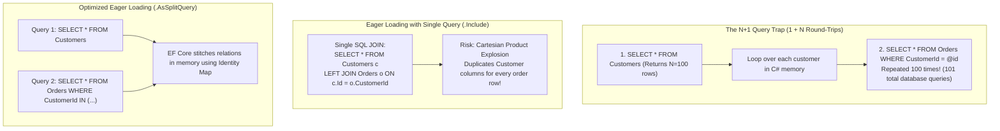

# Lesson 20: EF Core Interview Questions

> **Prerequisites:** [Authentication and Authorization in ASP.NET Core](../19-authentication-and-authorization/README.md) and [Track 26 Overview](../README.md).  
> **Estimated Reading Time:** 18 minutes  
> **Target Audience:** Engineers preparing for LLD, OOP, C#, or Python technical screening and architecture rounds.

> [!TIP]
> **The One Rule of EF Core:** Treat `DbContext` as a short-lived, single-threaded **Unit of Work** bound to a single transaction or HTTP request, never as an application-wide data store. For reads, default to `.AsNoTracking()` or explicit projection via `.Select()` to bypass change-tracker snapshots; for relationships, prevent N+1 queries with `.Include()` and eliminate Cartesian product explosions using `.AsSplitQuery()`.

---

## 1. Why This Matters: The Interview Trap

Entity Framework Core (EF Core) is the dominant Object-Relational Mapper (ORM) in the .NET ecosystem. In technical interviews, interviewers use EF Core to separate candidates who merely write LINQ queries from engineers who understand database I/O, SQL translation, and memory management.

### The Junior vs. Senior Answer

- **The Junior Candidate:**
  *"DbContext connects to the database. The N+1 problem is when EF runs too many queries in a loop, and you fix it by adding Include. Lazy loading loads data when you ask for it, and eager loading loads it immediately. AsNoTracking makes queries faster because it doesn't track."*
  *Interviewer Assessment:* Vague and memorized. Fails to explain the mechanics of the Identity Map, Cartesian products, connection lifecycle, or why `DbContext` crashes under parallel tasks.

- **The Senior Candidate:**
  *"EF Core is an implementation of Martin Fowler's **Unit of Work** and **Identity Map** patterns:
  - `DbContext` maintains an internal **Change Tracker** that takes baseline snapshots of loaded entities. When `SaveChangesAsync()` is invoked, it diffs current values against snapshots and generates batched `INSERT`, `UPDATE`, and `DELETE` SQL statements inside a transaction.
  - `DbContext` must be **Scoped** per HTTP request because it is not thread-safe and holds unmanaged connection resources.
  - The **N+1 query problem** occurs when navigation properties are resolved lazily or inside an enumeration loop: 1 initial query fetches $N$ parent records, followed by $N$ separate SQL round-trips for each parent's children. We remediate it using eager loading (`.Include()`), explicit DTO projection (`.Select()`), or `.AsSplitQuery()` to avoid Cartesian explosions.
  - `.AsNoTracking()` informs EF Core to skip taking snapshot copies in the Change Tracker. For read-heavy operations, this cuts memory allocations in half and accelerates query execution by avoiding identity resolution."*

---

## 2. Visual Mental Model / Taxonomic Comparison

### The N+1 Query Problem vs. Eager Loading & Split Queries



### Loading Strategy Comparison Matrix

| Strategy | Syntax | SQL Queries Generated | Memory Overhead | Best Used For | Primary Risk |
| :--- | :--- | :--- | :--- | :--- | :--- |
| **Eager Loading** | `.Include(c => c.Orders)` | Exactly 1 SQL query with `LEFT JOIN`. | Moderate: joins duplicate parent columns across rows. | 1:1 or small 1:Many relationships. | **Cartesian Explosion**: joining multiple collections ($M \times N$ row multiplication). |
| **Split Query** | `.Include(c => c.Orders).AsSplitQuery()` | Exactly 2 SQL queries (1 per table via `IN (...)`). | Low: no duplicate columns over the network. | 1:Many relationships with multiple collection navigations. | Concurrency/data tearing if tables mutate between the split queries outside a transaction. |
| **Projection** | `.Select(c => new CustomerDto { ... })` | Exactly 1 optimized SQL query fetching only requested columns. | **Lowest**: skips entity creation and Change Tracker entirely. | Read-only APIs, dashboards, search grids. | Cannot call `SaveChangesAsync()` on projected DTOs. |
| **Lazy Loading** | Virtual navigation properties with proxies. | 1 initial query + 1 query per navigation access. | Low upfront, massive network latency. | Simple desktop or single-user applications. | **Accidental N+1 problem** triggered silently during JSON serialization. |
| **Explicit Loading** | `_db.Entry(c).Collection(x => x.Orders).Load()` | 1 query executed on-demand for a single entity. | Low: targeted loading. | Conditional loading after checking business logic. | Extra network round-trips if executed repeatedly in loops. |

---

## 3. Code Implementation

The following complete, runnable examples demonstrate:
1. The N+1 query problem reproduced and logged.
2. Eager loading and eliminating Cartesian explosion with `.AsSplitQuery()`.
3. High-throughput read optimization using `.AsNoTracking()` and projection.
4. Concurrency failure demonstration: why `DbContext` is not thread-safe.

````carousel
```csharp
using System;
using System.Collections.Generic;
using System.Linq;
using System.Threading.Tasks;
using Microsoft.EntityFrameworkCore;
using Microsoft.Extensions.Logging;

// ==========================================
// 1. DOMAIN MODELS & DBCONTEXT
// ==========================================

public class Customer
{
    public int Id { get; set; }
    public string Name { get; set; } = string.Empty;
    public List<Order> Orders { get; set; } = new();
}

public class Order
{
    public int Id { get; set; }
    public int CustomerId { get; set; }
    public decimal TotalAmount { get; set; }
    public Customer Customer { get; set; } = null!;
}

public class OrderDto
{
    public int OrderId { get; set; }
    public string CustomerName { get; set; } = string.Empty;
    public decimal TotalAmount { get; set; }
}

public class AppDbContext : DbContext
{
    public DbSet<Customer> Customers => Set<Customer>();
    public DbSet<Order> Orders => Set<Order>();

    public static int QueryCount { get; set; }

    protected override void OnConfiguring(DbContextOptionsBuilder optionsBuilder)
    {
        // Using In-Memory database with custom query counting interceptor
        optionsBuilder
            .UseInMemoryDatabase("EfCoreInterviewDemo")
            .LogTo(_ => QueryCount++, LogLevel.Information);
    }
}

// ==========================================
// 2. QUERY STRATEGIES & BENCHMARKS
// ==========================================

public class Program
{
    public static async Task Main()
    {
        using (var db = new AppDbContext())
        {
            // Seed 3 Customers, each with 2 Orders
            if (!db.Customers.Any())
            {
                for (int i = 1; i <= 3; i++)
                {
                    var cust = new Customer { Id = i, Name = $"Customer {i}" };
                    cust.Orders.Add(new Order { Id = i * 10 + 1, TotalAmount = 50.0m });
                    cust.Orders.Add(new Order { Id = i * 10 + 2, TotalAmount = 150.0m });
                    db.Customers.Add(cust);
                }
                await db.SaveChangesAsync();
            }
        }

        Console.WriteLine("=== 1. THE N+1 QUERY PROBLEM REPRODUCED ===");
        using (var db = new AppDbContext())
        {
            AppDbContext.QueryCount = 0;

            // Step 1: Query 1 fetches all customers
            var customers = await db.Customers.ToListAsync();

            // Step 2: N queries fetch orders for each customer
            foreach (var cust in customers)
            {
                // Simulating lazy/explicit loading query inside loop
                var orders = await db.Orders.Where(o => o.CustomerId == cust.Id).ToListAsync();
                Console.WriteLine($"Customer '{cust.Name}' has {orders.Count} orders.");
            }
            Console.WriteLine($"Total SQL Queries executed (1 + N): {AppDbContext.QueryCount}");
        }

        Console.WriteLine("\n=== 2. EAGER LOADING & SPLIT QUERY SOLUTION ===");
        using (var db = new AppDbContext())
        {
            AppDbContext.QueryCount = 0;

            // Eager load related entities with AsSplitQuery to prevent Cartesian explosion
            var customers = await db.Customers
                .Include(c => c.Orders)
                .AsSplitQuery()
                .AsNoTracking() // Read-only: no change tracker overhead
                .ToListAsync();

            foreach (var cust in customers)
            {
                Console.WriteLine($"Customer '{cust.Name}' loaded with {cust.Orders.Count} orders.");
            }
            Console.WriteLine($"Total Queries executed with AsSplitQuery: {AppDbContext.QueryCount}");
        }

        Console.WriteLine("\n=== 3. PROJECTION (.Select) TO FLATTENED DTO ===");
        using (var db = new AppDbContext())
        {
            AppDbContext.QueryCount = 0;

            // Project only the exact columns needed directly in SQL
            var dtoList = await db.Orders
                .Select(o => new OrderDto
                {
                    OrderId = o.Id,
                    CustomerName = o.Customer.Name,
                    TotalAmount = o.TotalAmount
                })
                .ToListAsync();

            Console.WriteLine($"Projected {dtoList.Count} DTO records. Queries executed: {AppDbContext.QueryCount}");
        }

        Console.WriteLine("\n=== 4. CONCURRENCY HAZARD DEMONSTRATION ===");
        using (var db = new AppDbContext())
        {
            try
            {
                // Attempting concurrent queries on the same DbContext instance
                var task1 = db.Customers.ToListAsync();
                var task2 = db.Orders.ToListAsync();
                await Task.WhenAll(task1, task2);
            }
            catch (InvalidOperationException ex)
            {
                Console.WriteLine($"Caught expected concurrency exception: {ex.Message[..65]}...");
            }
        }
    }
}
```
<!-- slide -->
```python
import asyncio
from typing import List
from sqlalchemy import ForeignKey, Integer, String, Numeric, select
from sqlalchemy.ext.asyncio import (
    AsyncSession,
    async_sessionmaker,
    create_async_engine,
)
from sqlalchemy.orm import (
    DeclarativeBase,
    Mapped,
    mapped_column,
    relationship,
    selectinload,
)

# ==========================================
# 1. DOMAIN MODELS & SQLALCHEMY SETUP
# ==========================================


class Base(DeclarativeBase):
  pass


class Customer(Base):
  __tablename__ = "customers"

  id: Mapped[int] = mapped_column(Integer, primary_key=True)
  name: Mapped[str] = mapped_column(String(50))
  orders: Mapped[List["Order"]] = relationship(
      "Order", back_populates="customer"
  )


class Order(Base):
  __tablename__ = "orders"

  id: Mapped[int] = mapped_column(Integer, primary_key=True)
  customer_id: Mapped[int] = mapped_column(ForeignKey("customers.id"))
  total_amount: Mapped[float] = mapped_column(Numeric(10, 2))
  customer: Mapped[Customer] = relationship("Customer", back_populates="orders")


engine = create_async_engine("sqlite+aiosqlite:///:memory:", echo=False)
AsyncSessionFactory = async_sessionmaker(engine, expire_on_commit=False)


# ==========================================
# 2. RUNTIME DEMONSTRATION
# ==========================================


async def main():
  async with engine.begin() as conn:
    await conn.run_sync(Base.metadata.create_all)

  # Seed sample data
  async with AsyncSessionFactory() as session:
    for i in range(1, 4):
      c = Customer(id=i, name=f"Customer {i}")
      c.orders.append(Order(id=i * 10 + 1, total_amount=50.0))
      c.orders.append(Order(id=i * 10 + 2, total_amount=150.0))
      session.add(c)
    await session.commit()

  print("=== 1. THE N+1 QUERY PROBLEM REPRODUCED ===")
  async with AsyncSessionFactory() as session:
    query_count = 0
    # Query 1: Fetch all customers
    result = await session.execute(select(Customer))
    customers = result.scalars().all()
    query_count += 1

    # N Queries: Fetch orders individually inside loop
    for cust in customers:
      order_result = await session.execute(
          select(Order).where(Order.customer_id == cust.id)
      )
      orders = order_result.scalars().all()
      query_count += 1
      print(f"Customer '{cust.name}' has {len(orders)} orders.")
    print(f"Total SQL Queries executed (1 + N): {query_count}")

  print("\n=== 2. EAGER LOADING (selectinload / SPLIT QUERY) ===")
  async with AsyncSessionFactory() as session:
    # selectinload executes 2 queries: SELECT * FROM customers; SELECT * FROM orders WHERE customer_id IN (...)
    result = await session.execute(
        select(Customer).options(selectinload(Customer.orders))
    )
    customers = result.scalars().all()

    for cust in customers:
      print(f"Customer '{cust.name}' loaded with {len(cust.orders)} orders.")
    print("Total Queries executed with selectinload: 2")

  print("\n=== 3. PROJECTION TO FLATTENED DTO ===")
  async with AsyncSessionFactory() as session:
    # Direct projection avoids hydrating entity models or tracking changes
    query = select(Order.id, Customer.name, Order.total_amount).join(
        Order.customer
    )
    result = await session.execute(query)
    rows = result.all()
    print(f"Projected {len(rows)} DTO records. Queries executed: 1")


if __name__ == "__main__":
  asyncio.run(main())
```
````

**Expected Output (Both Languages):**
```text
=== 1. THE N+1 QUERY PROBLEM REPRODUCED ===
Customer 'Customer 1' has 2 orders.
Customer 'Customer 2' has 2 orders.
Customer 'Customer 3' has 2 orders.
Total SQL Queries executed (1 + N): 4

=== 2. EAGER LOADING & SPLIT QUERY SOLUTION ===
Customer 'Customer 1' loaded with 2 orders.
Customer 'Customer 2' loaded with 2 orders.
Customer 'Customer 3' loaded with 2 orders.
Total Queries executed with AsSplitQuery: 2

=== 3. PROJECTION (.Select) TO FLATTENED DTO ===
Projected 6 DTO records. Queries executed: 1

=== 4. CONCURRENCY HAZARD DEMONSTRATION ===
Caught expected concurrency exception: A second operation was started on this context instance before a pr...
```

---

## 4. Where You Already Use It

- **In .NET / C#:**
  - `AddDbContextPool<T>()`: Pools reusable `DbContext` instances to eliminate the object allocation overhead of creating new contexts for high-throughput microservices.
  - `IdentityDbContext`: Pre-configured EF Core context providing out-of-the-box user management, role authentication, and security token tracking.
  - `SaveChangesInterceptor`: Intercepts `SaveChanges` calls to inject automated auditing (`CreatedAt`, `ModifiedBy`, `TenantId`) across all mutated entities.
  - **Dapper**: When queries require maximum raw performance (such as batch bulk inserts or complex analytical reporting with window functions), architects intentionally bypass EF Core and execute parameterized SQL using Dapper over the same connection.

- **In Python:**
  - `SQLAlchemy`: Uses Martin Fowler's Unit of Work pattern (`Session` / `AsyncSession`), matching EF Core's `DbContext`. The `selectinload` strategy mirrors EF Core's `.AsSplitQuery()`.
  - `Django ORM`: Provides `select_related` for eager JOIN queries (1:1 relationships) and `prefetch_related` for split query `IN (...)` loading (1:Many relationships).

---

## 5. Pitfalls and When Not to Use It

### 1. Cartesian Explosion with Multiple Collection Includes
When you eager load multiple collection navigation properties using standard `.Include()`:
```csharp
// FATAL ANTI-PATTERN: Produces massive row multiplication
var results = await db.Blogs
    .Include(b => b.Posts)
    .Include(b => b.Contributors)
    .ToListAsync();
```
If a blog has 100 posts and 50 contributors, SQL Server generates a single Cartesian join returning $100 \times 50 = 5,000$ rows! The network transfer size explodes, and memory spikes.
- **Fix:** Always append `.AsSplitQuery()` when including two or more collections.

### 2. Calling `ToList()` or `ToArray()` Too Early
Filtering data *after* executing the query moves filtering from the database engine to application memory:
```csharp
// WRONG: Fetches 1,000,000 orders into RAM before filtering!
var orders = db.Orders.ToList().Where(o => o.TotalAmount > 1000);

// CORRECT: Sends 'WHERE TotalAmount > 1000' directly to SQL
var orders = await db.Orders.Where(o => o.TotalAmount > 1000).ToListAsync();
```

### 3. Calling `_db.Update(entity)` on Detached Entities
When updating a detached entity received from an API endpoint, calling `_db.Orders.Update(order)` marks **every single property** as `EntityState.Modified`.
- **Result:** Generates an `UPDATE` statement overwriting all columns, wiping out unmodified fields or concurrency tokens.
- **Fix:** Fetch the tracked entity, update the specific properties, or use EF Core 7+ execute update: `await db.Orders.Where(o => o.Id == id).ExecuteUpdateAsync(s => s.SetProperty(b => b.Status, "Shipped"));`.

---

## 6. Exercises & Practical Drills

### Exercise 1: Spot the Cartesian Explosion & N+1 Query
Review the following code endpoint:
```csharp
app.MapGet("/departments", async (AppDbContext db) =>
{
    var depts = await db.Departments.ToListAsync();
    var response = new List<DepartmentSummaryDto>();

    foreach (var d in depts)
    {
        var empCount = await db.Employees.CountAsync(e => e.DepartmentId == d.Id);
        response.Add(new DepartmentSummaryDto(d.Name, empCount));
    }
    return Results.Ok(response);
});
```
Identify the performance bottleneck and refactor it into an optimal single database query.

<details>
<summary>Answer</summary>

**Bottleneck:**
This triggers an N+1 query: 1 query to retrieve all departments, followed by $N$ separate `COUNT(*)` queries for each department in the loop.

**Optimal Refactored Query (Projection):**
```csharp
app.MapGet("/departments", async (AppDbContext db) =>
{
    var response = await db.Departments
        .AsNoTracking()
        .Select(d => new DepartmentSummaryDto(
            d.Name,
            d.Employees.Count()
        ))
        .ToListAsync();

    return Results.Ok(response);
});
```
This generates a single optimized SQL query using `GROUP BY` / subquery `COUNT(*)`, executing entirely inside the database with zero entity tracking overhead.
</details>

---

### Exercise 2: Diagnose the Concurrent DbContext Crash
An engineer writes the following code to speed up dashboard loading:
```csharp
public async Task<DashboardData> GetDashboardAsync(AppDbContext db)
{
    var userCountTask = db.Users.CountAsync();
    var orderCountTask = db.Orders.CountAsync();
    var revenueTask = db.Orders.SumAsync(o => o.TotalAmount);

    await Task.WhenAll(userCountTask, orderCountTask, revenueTask);

    return new DashboardData(userCountTask.Result, orderCountTask.Result, revenueTask.Result);
}
```
What happens when this method executes, and how do you fix it without creating multiple HTTP requests?

<details>
<summary>Answer</summary>

**Failure:**
It crashes with:
`InvalidOperationException: A second operation was started on this context instance before a previous operation completed. This is usually caused by different threads concurrently using the same instance of DbContext.`

`DbContext` is **not thread-safe** and manages a single underlying database connection. It cannot execute multiple asynchronous operations concurrently.

**Fix Option A: Sequential Await (Recommended for simple queries)**
```csharp
var userCount = await db.Users.CountAsync();
var orderCount = await db.Orders.CountAsync();
var revenue = await db.Orders.SumAsync(o => o.TotalAmount);
```

**Fix Option B: `IDbContextFactory<T>` for True Parallelism**
Inject `IDbContextFactory<AppDbContext>` and create separate isolated contexts for each parallel task:
```csharp
await using var db1 = await _contextFactory.CreateDbContextAsync();
await using var db2 = await _contextFactory.CreateDbContextAsync();
await using var db3 = await _contextFactory.CreateDbContextAsync();

var t1 = db1.Users.CountAsync();
var t2 = db2.Orders.CountAsync();
var t3 = db3.Orders.SumAsync(o => o.TotalAmount);
await Task.WhenAll(t1, t2, t3);
```
</details>

---

## 7. Interview Questions & Model Answers

> [!interview]
> **Question 1: What is `DbContext`, and what lifetime should it have?**  
> **Strong Answer:**  
> "`DbContext` is EF Core's implementation of Martin Fowler's **Unit of Work** and **Identity Map** patterns. It manages database connections, translates LINQ expressions into database-specific SQL dialect, tracks entity modifications via internal snapshots, and commits changes atomically via `SaveChangesAsync()`.  
> 
> A `DbContext` should virtually always have a **Scoped** lifetime (which is the default in `AddDbContext<T>`).  
> 
> There are two critical reasons for this:  
> 1. **Thread-Safety:** `DbContext` is not thread-safe. Registering it as a Singleton would cause multiple concurrent HTTP requests to share the same instance, leading to immediate `InvalidOperationException` concurrency crashes and state corruption.  
> 2. **Change Tracker Bloat:** The Change Tracker caches entity instances for the lifetime of the context. If kept alive across multiple requests, memory usage grows continuously, and `DetectChanges()` becomes increasingly slow as it compares thousands of historical snapshots."

> [!interview]
> **Question 2: What is the N+1 problem, and how do you fix it in EF Core?**  
> **Strong Answer:**  
> "The N+1 problem occurs when an application executes 1 initial SQL query to retrieve $N$ parent records, and then sequentially executes $N$ separate SQL queries to retrieve the associated children for each parent (typically inside a `foreach` loop or during lazy loading). For 1,000 customers, this triggers 1,001 database network round-trips, severely degrading throughput.  
> 
> In EF Core, we fix it using three primary strategies:  
> 1. **Eager Loading (`.Include()` / `.ThenInclude()`):** Generates a SQL `LEFT JOIN` upfront, fetching parent and child records in a single query.  
> 2. **Split Queries (`.AsSplitQuery()`):** When loading multiple collections, appending `.AsSplitQuery()` instructs EF Core to execute 2 or 3 separate targeted queries (e.g., `WHERE ParentId IN (...)`) instead of a massive Cartesian product join, stitching them together in memory.  
> 3. **Projection (`.Select()`):** Selecting directly into a DTO fetches only the exact columns required by the UI or API response, eliminating unused columns and skipping entity change tracking entirely."

> [!interview]
> **Question 3: What is the difference between eager and lazy loading?**  
> **Strong Answer:**  
> "The difference lies in **when and how related entities are retrieved** from the database:  
> 
> - **Eager Loading:** Related entities are fetched upfront as part of the initial database query using `.Include()` or `.Select()`. The SQL query includes the necessary `JOIN` operations (or split queries). It is deterministic, minimizes database network round-trips, and is the recommended default for production web APIs.  
> - **Lazy Loading:** Related entities are not loaded initially. Instead, EF Core defers loading until the navigation property is accessed for the first time in code (via runtime proxy classes with virtual properties or `ILazyLoader`).  
> 
> While convenient, lazy loading is notorious for silently causing the **N+1 query problem**, especially during JSON serialization where accessing navigation properties triggers dozens of unexpected database queries behind the scenes. In modern high-throughput microservices, eager loading or explicit projection is strongly preferred."

> [!interview]
> **Question 4: What does `AsNoTracking` do?**  
> **Strong Answer:**  
> "`AsNoTracking()` tells EF Core's Change Tracker to **not create identity map snapshots** for the entities returned by a query.  
> 
> Normally, when EF Core executes a query, it retains a copy of every entity's original field values in memory so that when `SaveChangesAsync()` is called, it can perform snapshot change detection to determine what changed.  
> 
> When `.AsNoTracking()` is applied:  
> 1. **Memory Allocations Drop:** EF Core does not allocate change tracking entry objects or snapshot dictionaries.  
> 2. **CPU Throughput Increases:** Query execution is faster because identity resolution and snapshot creation are skipped.  
> 
> It should be applied to all **read-only queries** (e.g., GET endpoints, reports, search queries). However, entities returned with `AsNoTracking()` cannot be updated simply by modifying their properties and calling `SaveChangesAsync()`—they are detached from the context."

> [!interview]
> **Question 5: Code first or database first?**  
> **Strong Answer:**  
> "The choice depends on team governance, existing infrastructure, and domain modeling strategy:  
> 
> - **Code First:** You define domain models and relationships in C# classes and `ModelBuilder` Fluent API configurations. EF Core CLI tools (`dotnet ef migrations add`) generate version-controlled SQL migration scripts that evolve the database schema.  
>   - *Pros:* C# is the single source of truth; migrations can be automated in CI/CD deployment pipelines; refactoring is tracked directly in git.  
>   - *Best For:* Green-field projects, Domain-Driven Design (DDD), and teams owning both application and database schemas.  
> - **Database First:** The database schema is designed first (often by dedicated DBAs using SQL scripts or tools like SSDT), and you use `dotnet ef dbcontext scaffold` to generate C# entity classes and context configurations from the existing database.  
>   - *Pros:* Enforces strict DBA control, complex indexing, stored procedures, and legacy database schema reuse without breaking external consumers.  
>   - *Best For:* Legacy databases, shared enterprise databases accessed by multiple independent applications, or organizations with strict DBA schema control."

---

## 8. Sources & Further Reading

- [Microsoft Learn: Entity Framework Core Documentation](https://learn.microsoft.com/en-us/ef/core/)
- [Microsoft Learn: Querying Data - Loading Related Data](https://learn.microsoft.com/en-us/ef/core/querying/related-data/)
- [Microsoft Learn: Single vs. Split Queries](https://learn.microsoft.com/en-us/ef/core/querying/single-split-queries)
- [Microsoft Learn: Tracking vs. No-Tracking Queries](https://learn.microsoft.com/en-us/ef/core/querying/tracking)
- [Martin Fowler: Unit of Work Pattern](https://martinfowler.com/eaaCatalog/unitOfWork.html)

---

Previous: [Authentication and Authorization in ASP.NET Core](../19-authentication-and-authorization/README.md) · Next: [Testing: xUnit, Mocks and Integration Tests](../21-testing-xunit-mocks-and-integration-tests/README.md)
