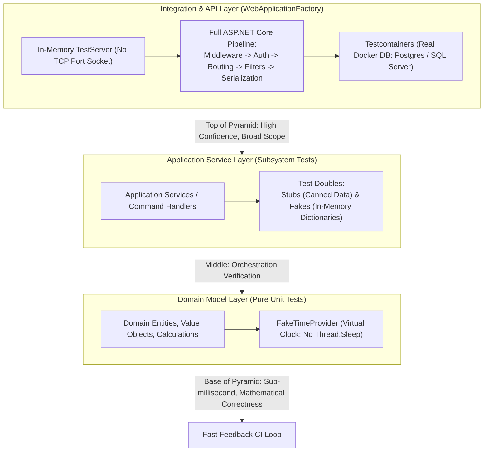

# Lesson 21: Testing: xUnit, Mocks and Integration Tests

> **Prerequisites:** [EF Core Interview Questions](../20-ef-core-interview-questions/README.md) and [Track 26 Overview](../README.md).  
> **Estimated Reading Time:** 18 minutes  
> **Target Audience:** Engineers preparing for LLD, OOP, C#, or Python technical screening and architecture rounds.

> [!TIP]
> **The One Rule of Backend Testing:** Unit test domain rules and business calculations with lightweight test doubles (favoring stubs and fakes over brittle interaction mocks); and test the HTTP pipeline, authorization, and data persistence using `WebApplicationFactory` paired with real database containers via **Testcontainers**—never mock `DbContext` or query providers.

---

## 1. Why This Matters: The Interview Trap

"How do you test a class that depends on a database, what is the exact difference between a mock and a stub, and how do you integration-test an ASP.NET Core API with `WebApplicationFactory`?" separates developers who copy-paste test boilerplate from engineers who build maintainable, regression-proof test suites.

### The Junior vs. Senior Answer

- **The Junior Candidate:**  
  *"To test a service with a database, I use Moq to mock `DbContext` and set up `DbSet<T>`. A mock is something you create with a mocking library like Moq or NSubstitute. An integration test is when you launch the API, open Postman or Swagger on `localhost:5001`, and click send."*  
  *Interviewer Assessment:* Red flag. Mocking EF Core's `DbContext` and `IQueryable` is a well-documented antipattern: it does not validate SQL translation, table constraints, triggers, or transactions. The tests pass with 100% green checkmarks while production crashes on invalid SQL syntax. Furthermore, manual Postman clicking is not automated integration testing.

- **The Senior Candidate:**  
  *"We address testing through architectural boundaries:
  1. **Domain Logic Isolation:** We isolate business rules inside domain entities or services that do not depend on databases. These are unit tested with xUnit (`[Fact]` and `[Theory]`), executing in sub-milliseconds.
  2. **Application Orchestration:** When testing service orchestration, we inject repository or gateway abstractions, supplying **Stubs** (for state verification) or **Fakes** (such as an in-memory repository). We strictly avoid mocking `DbContext` directly.
  3. **Data Access & Persistence Testing:** We verify EF Core queries, migrations, and transactions against a real database instance using **Testcontainers** (Docker-managed PostgreSQL/SQL Server instances spun up during test runs).
  4. **API Integration Testing:** We use `WebApplicationFactory<Program>` from `Microsoft.AspNetCore.Mvc.Testing`. It spins up an in-memory `TestServer` executing the full ASP.NET Core pipeline (middleware, routing, authentication, model binding, and exception handling) without binding to a physical TCP port. Dependencies on external third-party payment gateways or SMS providers are cleanly substituted via `ConfigureTestServices`.
  
  Regarding test doubles, we distinguish between **Stubs** (providing canned indirect inputs for **state verification**) and **Mocks** (pre-programmed with expectations to verify **behavior/interaction**). Overusing mocks couples tests to internal implementation details, causing tests to break whenever private methods or call sequences are refactored."*

---

## 2. Visual Mental Model / Taxonomic Comparison

### The Modern .NET Testing Strategy



### The Test Double Taxonomy (Gerard Meszaros)

| Test Double | Primary Purpose | Verification Method | Example Use Case |
| :--- | :--- | :--- | :--- |
| **Dummy** | Passed to satisfy method signatures; never accessed or inspected. | None | Supplying an unused `ILogger` or placeholder parameter. |
| **Stub** | Provides **canned answers** to calls made during the test. | **State Verification** (Assert return value or final state) | Returning a hard-coded exchange rate from `ICurrencyConverter`. |
| **Spy** | A stub that also silently records calls and parameters for later inspection. | State & History Verification | Verifying how many times an email dispatch method was invoked. |
| **Mock** | Pre-programmed with expected calls, parameter matchers, and call counts. | **Behavior Verification** (Asserts *how* work was done) | `mock.Verify(x => x.Charge("user", 50), Times.Once)`. |
| **Fake** | Working implementation with a shortcut making it unsuitable for production. | State Verification | An in-memory hash map implementing `IOrderRepository`. |

### Test Scope Comparison

| Metric | Unit Test (`xUnit`) | Integration Test (`WebApplicationFactory`) | End-to-End (E2E) Test |
| :--- | :--- | :--- | :--- |
| **Execution Speed** | `< 5 ms` per test | `50 - 200 ms` per test | `1 - 10 s` per test |
| **Target Boundary** | Single class / method / entity | Full HTTP pipeline + real database | Deployed cluster / browser / gateway |
| **Network & Socket** | In-memory only | In-memory `TestServer` (Zero TCP overhead) | Real network sockets & DNS |
| **External Services** | Substituted with Stubs / Mocks | Substituted via `ConfigureTestServices` | Real sandbox environments |
| **Primary Failure Root** | Logic error or invalid calculation | Pipeline bug, DB constraint, auth rule | Network timeout, deployment mismatch |

---

## 3. Code Implementation

The following complete, runnable code demonstrates:
1. A domain service (`FlashSaleOrderService`) requiring external payment charging and time evaluation.
2. Parameterized xUnit-style **Theory** tests using a **Stub** for state verification.
3. A **Mock** verifying that the charging contract was called exactly once with the discounted price.
4. Deterministic time advancement using .NET's `TimeProvider` / `FakeTimeProvider` without blocking threads via `Thread.Sleep()`.

````carousel
```csharp
using System;
using System.Collections.Generic;
using Microsoft.Extensions.Time.Testing;

// ========================================================
// 1. System Under Test (SUT) & Dependencies
// ========================================================
public interface IPaymentGateway
{
    bool Charge(string customerId, decimal amount);
}

public sealed record OrderResult(bool Success, decimal ChargedAmount, string Reason);

public sealed class FlashSaleOrderService
{
    private readonly IPaymentGateway _paymentGateway;
    private readonly TimeProvider _timeProvider;
    private readonly DateTimeOffset _saleStart;
    private readonly DateTimeOffset _saleEnd;

    public FlashSaleOrderService(
        IPaymentGateway paymentGateway,
        TimeProvider timeProvider,
        DateTimeOffset saleStart,
        DateTimeOffset saleEnd)
    {
        _paymentGateway = paymentGateway;
        _timeProvider = timeProvider;
        _saleStart = saleStart;
        _saleEnd = saleEnd;
    }

    public OrderResult PlaceOrder(string customerId, decimal originalPrice)
    {
        var now = _timeProvider.GetUtcNow();

        // Business Rule: Flash sale provides 50% discount strictly during sale window
        decimal finalPrice = originalPrice;
        if (now >= _saleStart && now <= _saleEnd)
        {
            finalPrice = originalPrice * 0.50m;
        }

        var charged = _paymentGateway.Charge(customerId, finalPrice);
        if (!charged)
        {
            return new OrderResult(false, 0m, "Payment Failed");
        }

        return new OrderResult(true, finalPrice, "Order Placed Successfully");
    }
}

// ========================================================
// 2. Test Doubles: Stub vs. Mock
// ========================================================

// STUB: Provides canned answers for state verification
public sealed class PaymentGatewayStub : IPaymentGateway
{
    public bool ShouldSucceed { get; set; } = true;
    public bool Charge(string customerId, decimal amount) => ShouldSucceed;
}

// MOCK: Records interactions for behavior verification (asserting invocations)
public sealed class PaymentGatewayMock : IPaymentGateway
{
    public readonly List<(string CustomerId, decimal Amount)> Invocations = new();
    public bool ReturnValue { get; set; } = true;

    public bool Charge(string customerId, decimal amount)
    {
        Invocations.Add((customerId, amount));
        return ReturnValue;
    }

    public void VerifyChargedOnceWithAmount(decimal expectedAmount)
    {
        if (Invocations.Count != 1)
            throw new InvalidOperationException($"Expected 1 call but received {Invocations.Count}");
        if (Invocations[0].Amount != expectedAmount)
            throw new InvalidOperationException($"Expected amount {expectedAmount} but was {Invocations[0].Amount}");
    }
}

// ========================================================
// 3. Test Runner Simulating xUnit Theories & FakeTimeProvider
// ========================================================
public class Program
{
    public static void Main()
    {
        var baseTime = new DateTimeOffset(2026, 11, 19, 10, 0, 0, TimeSpan.Zero);
        var saleStart = baseTime;
        var saleEnd = baseTime.AddHours(2); // 10:00 to 12:00

        Console.WriteLine("=== 1. xUnit Theory: Discount Calculation via Stub ===");
        // Simulating xUnit [Theory] with [InlineData]
        var testCases = new[]
        {
            (MinutesOffset: -10, Price: 100m, ExpectedCharged: 100m, Description: "Before Sale Window"),
            (MinutesOffset: 30,  Price: 100m, ExpectedCharged: 50m,  Description: "During Flash Sale (50% Off)"),
            (MinutesOffset: 150, Price: 100m, ExpectedCharged: 100m, Description: "After Sale Window")
        };

        var stub = new PaymentGatewayStub { ShouldSucceed = true };

        foreach (var tc in testCases)
        {
            var fakeTime = new FakeTimeProvider(baseTime.AddMinutes(tc.MinutesOffset));
            var service = new FlashSaleOrderService(stub, fakeTime, saleStart, saleEnd);

            var result = service.PlaceOrder("cust-123", tc.Price);
            var pass = result.ChargedAmount == tc.ExpectedCharged ? "PASSED" : "FAILED";
            Console.WriteLine($"[TEST] {tc.Description,-32} -> {pass} (Charged: ${result.ChargedAmount:F2})");
        }

        Console.WriteLine("\n=== 2. Mock Behavior Verification (Calls & Arguments) ===");
        var mock = new PaymentGatewayMock { ReturnValue = true };
        var activeTime = new FakeTimeProvider(baseTime.AddMinutes(30)); // Inside sale
        var mockService = new FlashSaleOrderService(mock, activeTime, saleStart, saleEnd);

        mockService.PlaceOrder("cust-premium", 200m);
        mock.VerifyChargedOnceWithAmount(100m);
        Console.WriteLine("[MOCK] Charge called exactly 1 time with discounted amount $100.00: VERIFIED");

        Console.WriteLine("\n=== 3. Virtual Time Advancement (Zero Sleep Latency) ===");
        var timeProvider = new FakeTimeProvider(saleStart.AddMinutes(50)); // Inside sale
        var timeService = new FlashSaleOrderService(stub, timeProvider, saleStart, saleEnd);

        var r1 = timeService.PlaceOrder("cust-fast", 80m);
        Console.WriteLine($"At T+50m (Inside Sale):  Charged ${r1.ChargedAmount:F2}");

        // Advance virtual time by 90 minutes instantaneously
        timeProvider.Advance(TimeSpan.FromMinutes(90)); // Now T+140m (Past 12:00)

        var r2 = timeService.PlaceOrder("cust-fast", 80m);
        Console.WriteLine($"At T+140m (Sale Expired): Charged ${r2.ChargedAmount:F2}");
    }
}
```
<!-- slide -->
```python
from datetime import datetime, timedelta, timezone
from dataclasses import dataclass
from typing import List
from unittest.mock import Mock

# ========================================================
# 1. System Under Test (SUT) & Dependencies
# ========================================================
class PaymentGateway:
    def charge(self, customer_id: str, amount: float) -> bool:
        raise NotImplementedError

@dataclass
class OrderResult:
    success: bool
    charged_amount: float
    reason: str

class FakeTimeProvider:
    """Controllable virtual clock equivalent to .NET FakeTimeProvider."""
    def __init__(self, initial_time: datetime):
        self.current_time = initial_time

    def get_utc_now(self) -> datetime:
        return self.current_time

    def advance(self, delta: timedelta) -> None:
        self.current_time += delta

class FlashSaleOrderService:
    def __init__(
        self,
        payment_gateway: PaymentGateway,
        time_provider: FakeTimeProvider,
        sale_start: datetime,
        sale_end: datetime
    ):
        self._payment_gateway = payment_gateway
        self._time_provider = time_provider
        self._sale_start = sale_start
        self._sale_end = sale_end

    def place_order(self, customer_id: str, original_price: float) -> OrderResult:
        now = self._time_provider.get_utc_now()

        # Business Rule: Flash sale provides 50% discount strictly during sale window
        final_price = original_price
        if self._sale_start <= now <= self._sale_end:
            final_price = original_price * 0.50

        charged = self._payment_gateway.charge(customer_id, final_price)
        if not charged:
            return OrderResult(False, 0.0, "Payment Failed")

        return OrderResult(True, final_price, "Order Placed Successfully")

# ========================================================
# 2. Test Doubles: Stub vs. Mock
# ========================================================
class PaymentGatewayStub(PaymentGateway):
    """Stub providing canned answer for state verification."""
    def __init__(self, should_succeed: bool = True):
        self.should_succeed = should_succeed

    def charge(self, customer_id: str, amount: float) -> bool:
        return self.should_succeed

# ========================================================
# 3. Test Runner Simulating pytest Parametrize & Mocks
# ========================================================
def main():
    base_time = datetime(2026, 11, 19, 10, 0, 0, tzinfo=timezone.utc)
    sale_start = base_time
    sale_end = base_time + timedelta(hours=2) # 10:00 to 12:00

    print("=== 1. xUnit Theory: Discount Calculation via Stub ===")
    test_cases = [
        (-10, 100.0, 100.0, "Before Sale Window"),
        (30,  100.0, 50.0,  "During Flash Sale (50% Off)"),
        (150, 100.0, 100.0, "After Sale Window")
    ]

    stub = PaymentGatewayStub(should_succeed=True)

    for minutes_offset, price, expected_charged, description in test_cases:
        fake_time = FakeTimeProvider(base_time + timedelta(minutes=minutes_offset))
        service = FlashSaleOrderService(stub, fake_time, sale_start, sale_end)

        result = service.place_order("cust-123", price)
        passed = "PASSED" if result.charged_amount == expected_charged else "FAILED"
        print(f"[TEST] {description:<32} -> {passed} (Charged: ${result.charged_amount:.2f})")

    print("\n=== 2. Mock Behavior Verification (Calls & Arguments) ===")
    mock_gateway = Mock(spec=PaymentGateway)
    mock_gateway.charge.return_value = True

    active_time = FakeTimeProvider(base_time + timedelta(minutes=30))
    mock_service = FlashSaleOrderService(mock_gateway, active_time, sale_start, sale_end)

    mock_service.place_order("cust-premium", 200.0)
    mock_gateway.charge.assert_called_once_with("cust-premium", 100.0)
    print("[MOCK] Charge called exactly 1 time with discounted amount $100.00: VERIFIED")

    print("\n=== 3. Virtual Time Advancement (Zero Sleep Latency) ===")
    time_provider = FakeTimeProvider(sale_start + timedelta(minutes=50))
    time_service = FlashSaleOrderService(stub, time_provider, sale_start, sale_end)

    r1 = time_service.place_order("cust-fast", 80.0)
    print(f"At T+50m (Inside Sale):  Charged ${r1.charged_amount:.2f}")

    # Advance time 90 minutes forward with zero latency
    time_provider.advance(timedelta(minutes=90))

    r2 = time_service.place_order("cust-fast", 80.0)
    print(f"At T+140m (Sale Expired): Charged ${r2.charged_amount:.2f}")

if __name__ == "__main__":
    main()
```
````

**Expected Output (Both Languages):**
```text
=== 1. xUnit Theory: Discount Calculation via Stub ===
[TEST] Before Sale Window               -> PASSED (Charged: $100.00)
[TEST] During Flash Sale (50% Off)      -> PASSED (Charged: $50.00)
[TEST] After Sale Window                -> PASSED (Charged: $100.00)

=== 2. Mock Behavior Verification (Calls & Arguments) ===
[MOCK] Charge called exactly 1 time with discounted amount $100.00: VERIFIED

=== 3. Virtual Time Advancement (Zero Sleep Latency) ===
At T+50m (Inside Sale):  Charged $40.00
At T+140m (Sale Expired): Charged $80.00
```

---

## 4. Where You Already Use It

1. **`Microsoft.AspNetCore.Mvc.Testing` (`WebApplicationFactory<TProgram>`):**  
   Standard integration testing harness that creates an in-memory `TestServer`. Automatically discovers `Program.cs` and exposes `HttpClient` via `factory.CreateClient()`.
2. **`xUnit.net` (`[Fact]`, `[Theory]`, `[InlineData]`, `IClassFixture<T>`):**  
   The primary test runner for modern .NET. Unlike NUnit or MSTest, xUnit instantiates a **new instance of the test class for every single test execution**, guaranteeing test isolation.
3. **`System.TimeProvider` & `Microsoft.Extensions.TimeProvider.Testing`:**  
   Introduced in .NET 8 to standardize testable time, replacing ad-hoc `IDateTimeService` interfaces with framework-level virtual clocks (`FakeTimeProvider`).
4. **`Testcontainers.MsSql` / `Testcontainers.PostgreSql`:**  
   Spins up temporary, isolated Docker containers on-the-fly during test suite execution, executing real SQL queries against real database engines.
5. **Python Equivalents:**  
   - **`pytest`:** Parameterized testing via `@pytest.mark.parametrize` and fixtures via `@pytest.fixture`.
   - **`starlette.testclient.TestClient` / `httpx.AsyncClient`:** In-memory ASGI test client for FastAPI.
   - **`unittest.mock`:** Python standard library `Mock` and `MagicMock`.

---

## 5. Pitfalls and When Not to Use It

### Pitfall 1: Mocking EF Core `DbContext` or `DbSet<T>`
```csharp
// FATAL ANTIPATTERN: Attempting to mock DbContext with Moq
var mockSet = new Mock<DbSet<Order>>();
var mockContext = new Mock<AppDbContext>();
mockContext.Setup(c => c.Orders).Returns(mockSet.Object);
```
- **Consequences:** Mocking `IQueryable` does not evaluate LINQ provider expressions against database engines. Queries with unmapped properties, client evaluation bugs, or complex joins pass unit tests cleanly but throw `InvalidOperationException` in production.
- **Production Standard:** Test database queries against real databases via **Testcontainers**.

### Pitfall 2: Over-Mocking Internal Implementation Details
Setting expectations on internal private method orchestrations (`mock.Verify(x => x.LogStep1(), Times.Once)`) turns tests into mirrors of the implementation.  
- Any refactoring that changes the internal execution path without altering the output breaks the tests.  
- **Rule:** Test **behaviors and outcomes**, not implementation details. Prefer Stubs and state assertions.

### Pitfall 3: Using `Thread.Sleep()` in Tests for Asynchronous / Time Logic
```csharp
// FATAL FLAW: Slows CI/CD builds, causes flaky test failures under CPU load
await service.ScheduleTaskAsync();
Thread.Sleep(5000); // Wait 5 seconds for background execution
```
- **Fix:** Inject .NET 8's `TimeProvider` and use `fakeTimeProvider.Advance(TimeSpan.FromSeconds(5))`. Virtual time advances instantly with zero CPU latency.

### Pitfall 4: Sharing Mutable State Across Parallel Tests in xUnit
xUnit runs test classes in parallel by default. If your tests mutate static singletons, environment variables, or shared database tables without unique IDs, tests will pass when run individually but fail randomly in CI.  
- **Fix:** Keep tests completely isolated. Use `IClassFixture<T>` for shared read-only resources, or assign unique GUID prefixes to entity records per test run.

---

## 6. Exercises & Practical Drills

### Drill 1: Refactoring an Interaction Mock into a State Stub
Consider this brittle mock verification:
```csharp
var mockRepo = new Mock<IUserRepository>();
mockRepo.Setup(r => r.GetById(1)).Returns(new User { Id = 1, Balance = 100 });
var service = new UserService(mockRepo.Object);

service.ApplyBonus(1, 20);

// Brittle interaction verification:
mockRepo.Verify(r => r.Save(It.Is<User>(u => u.Balance == 120)), Times.Once);
```
Why is this brittle, and how does a Fake/Stub improve refactoring safety?

<details>
<summary>Answer</summary>

The test tightly couples to the exact method call `r.Save(...)`. If the developer refactors the persistence layer to use `r.Update(...)`, a Unit of Work `uow.Commit()`, or an event-driven `Publish(new UserBonusApplied(...))`, the test fails even though business logic is completely intact.  
By using an in-memory **Fake** (`FakeUserRepository` storing entities in a dictionary), the test inspects state:
```csharp
var fakeRepo = new FakeUserRepository();
fakeRepo.Seed(new User { Id = 1, Balance = 100 });
var service = new UserService(fakeRepo);

service.ApplyBonus(1, 20);

var updatedUser = await fakeRepo.GetById(1);
Assert.Equal(120, updatedUser.Balance);
```
Now internal persistence mechanisms can be refactored freely without breaking the test.
</details>

---

### Drill 2: Overriding Services in `WebApplicationFactory`
Write the C# test setup to replace a live `IEmailSender` with a test fake inside `WebApplicationFactory<Program>`.

<details>
<summary>Answer</summary>

```csharp
public class CustomApiFactory : WebApplicationFactory<Program>
{
    protected override void ConfigureWebHost(IWebHostBuilder builder)
    {
        builder.ConfigureTestServices(services =>
        {
            // Remove existing registration
            var descriptor = services.SingleOrDefault(
                d => d.ServiceType == typeof(IEmailSender));
            if (descriptor != null) services.Remove(descriptor);

            // Register fake test double
            services.AddSingleton<IEmailSender, FakeEmailSender>();
        });
    }
}
```
</details>

---

### Drill 3: xUnit Test Class Lifecycle
If a test class in xUnit contains 5 `[Fact]` methods, how many times will the test class constructor and `Dispose()` methods be called?

<details>
<summary>Answer</summary>

**Exactly 5 times.**  
Unlike NUnit or MSTest (which reuse a single test class instance across all test methods), xUnit instantiates a brand new instance of the test class for every individual test method executed, invoking the constructor before and `Dispose()` after each test. This enforces test independence and prevents state leakage between tests.
</details>

---

## 7. Interview Questions & Model Answers

> [!interview]
> **Question 1: How do you unit test a class that depends on a database?**  
> **Strong Answer:**  
> "Testing a class that depends on a database requires separating architectural concerns rather than attempting to mock database engines:
> 1. **Domain Model Isolation:** We separate pure business logic from persistence. Domain entities, state machines, and calculations should reside in the domain layer without any database dependencies, tested via ultra-fast xUnit unit tests.
> 2. **Application Orchestration:** If testing application services that coordinate workflows, we depend on repository or unit-of-work abstractions (e.g. `IOrderRepository`), substituting them with in-memory **Fakes** or **Stubs**.
> 3. **Never Mock DbContext:** We strictly avoid mocking Entity Framework Core's `DbContext` or `DbSet<T>` using Moq. Mocking query providers does not validate LINQ-to-Entities SQL generation, foreign key constraints, column data types, or database transactions.
> 4. **Integration Testing with Real Engines:** To test data access logic and queries, we write integration tests against real database engines using **Testcontainers**. Testcontainers automatically spins up a real PostgreSQL or SQL Server Docker container during test runs, executes migrations, runs queries, and disposes of the container when tests finish, providing 100% fidelity with production."

---

> [!interview]
> **Question 2: What is the difference between a mock and a stub?**  
> **Strong Answer:**  
> "The distinction between a mock and a stub lies in the **direction of communication and the verification strategy** (as formalized by Gerard Meszaros and Martin Fowler):
> - **A Stub** provides **indirect inputs** to the System Under Test (SUT). It returns canned, pre-configured responses to method calls made during execution (e.g., returning a hard-coded `$100` balance). Tests that use stubs rely on **State Verification**—they invoke the SUT and assert on the final returned value or resulting state. Stubs do not care if unexpected methods are called.
> - **A Mock** verifies **indirect outputs**. It is pre-programmed with expectations about which specific methods must be invoked, what exact arguments must be supplied, how many times they should be called, and in what order. Tests that use mocks rely on **Behavior Verification** (`mock.Verify(x => x.DispatchPayment(...), Times.Once)`).
> 
> In production architectures, senior engineers favor stubs and state verification over mocks whenever possible. Over-mocking couples tests directly to internal call paths, resulting in brittle tests that break every time code is refactored, even when the external behavior is completely correct."

---

> [!interview]
> **Question 3: How do you integration test an ASP.NET Core API?**  
> **Strong Answer:**  
> "We integration test ASP.NET Core APIs using the **`WebApplicationFactory<TProgram>`** harness from `Microsoft.AspNetCore.Mvc.Testing`:
> 1. **In-Memory TestServer:** `WebApplicationFactory` bootstraps the complete application hosting environment using an in-memory `TestServer`. It does not bind to an external TCP socket or open physical network ports, making it extremely fast, resilient against port collisions in CI pipelines, and capable of executing hundreds of API tests in seconds.
> 2. **Full Pipeline Coverage:** Requests sent via `factory.CreateClient()` pass through the authentic ASP.NET Core pipeline—including routing, custom middleware, authentication, model validation, exception handling, and JSON serialization.
> 3. **Dependency Substitution:** We customize the test environment by overriding `ConfigureWebHost` and calling `builder.ConfigureTestServices(services => ...)` to replace third-party external integrations (such as payment providers or third-party webhooks) with test doubles.
> 4. **Infrastructure Integration:** For databases, caches, and message brokers, we combine `WebApplicationFactory` with **Testcontainers** (or override connection strings to point to test instances), validating end-to-end HTTP request and response contracts against real infrastructure."

---

## 8. Sources & Further Reading

- [Microsoft Learn: Integration tests in ASP.NET Core](https://learn.microsoft.com/en-us/aspnet/core/test/integration-tests)
- [Martin Fowler: Mocks Aren't Stubs](https://martinfowler.com/articles/mocksArentStubs.html)
- [Microsoft Learn: TimeProvider and FakeTimeProvider](https://learn.microsoft.com/en-us/dotnet/standard/datetime/timeprovider-overview)
- [xUnit.net Documentation: Shared Context between Tests](https://xunit.net/docs/shared-context)
- [Testcontainers for .NET](https://dotnet.testcontainers.org/)
- [Pytest Documentation](https://docs.pytest.org/en/stable/)

---

Previous: [EF Core Interview Questions](../20-ef-core-interview-questions/README.md) · Next: [Rapid Fire: the C# and .NET Revision Sheet](../22-rapid-fire-csharp-and-dotnet/README.md)
