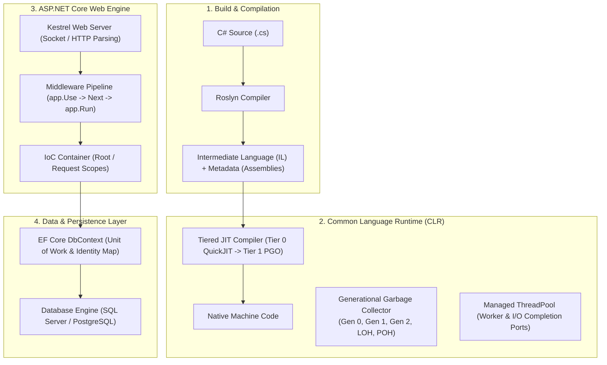

# Lesson 22: Rapid Fire: the C# and .NET Revision Sheet

> **Prerequisites:** [Testing: xUnit, Mocks and Integration Tests](../21-testing-xunit-mocks-and-integration-tests/README.md) and [Track 26 Overview](../README.md).  
> **Estimated Reading Time:** 20 minutes  
> **Target Audience:** Engineers preparing for LLD, OOP, C#, or Python technical screening and architecture rounds.

> [!NOTE]
> **In one line:** A **rapid-fire revision sheet** for C# and .NET: ~80 questions grouped by area — answer each in one or two sentences out loud the night before.

> [!TIP]
> **The One Rule of Rapid-Fire .NET Interviews:** Never answer a conceptual question with vague theory when you can state the **underlying CLR mechanism, the runtime consequence, and the single keyword or pattern that solves it** in two punchy sentences. Deliver the punchline first, then offer to dive into the IL or memory internals.

---

## 1. Why This Matters: The Interview Trap

The rapid-fire round is a deliberate stress test used by engineering leads and principal architects. Within a 15-minute window, the interviewer fires 10 to 15 fundamental C# and .NET questions across the runtime, memory management, concurrency, ASP.NET Core pipeline, and Entity Framework Core.

### The Junior vs. Senior Answer

- **The Junior Candidate:**
  Rambles, gives circular definitions (*"A value type is a type that holds a value, while a reference type holds a reference"*), or confuses C# syntactic sugar with CLR runtime mechanics. When asked about `lock`, they fail to mention `Monitor.Enter` or thread affinity.
- **The Senior Candidate:**
  Delivers crisp, 15-to-30-second high-density answers that demonstrate mastery of the CLR, memory allocation semantics, thread safety, and web request lifecycles. They use precise terminology: *stack vs. heap allocation boundaries, method table pointers, gen 0/1/2 GC ephemerality, synchronization blocks, state machines, and captive dependencies.*

This revision sheet is designed as the ultimate night-before revision guide, crystallizing every key topic across Track 26 into punchy, interview-ready answers.

---

## 2. Visual Mental Model / Taxonomic Comparison

The entire .NET application architecture flows from source compilation down through the CLR and up through the ASP.NET Core hosting pipeline:



### The Executive .NET Pitfall Cheatsheet

| Area | The Rookie Instinct | The Production Failure | The Senior Pattern |
| :--- | :--- | :--- | :--- |
| **Memory** | "Value types are always on the stack." | Misses struct fields inside heap-allocated classes. | "Value types live inline wherever their container is allocated." |
| **Async** | `Task.Result` or `.Wait()` | ThreadPool starvation and sync-over-async deadlock. | Always `await` asynchronously all the way up. |
| **Exceptions** | `catch (Exception ex) { throw ex; }` | Erases original call stack frames and line numbers. | Always use bare `throw;` or `throw new MyEx("msg", ex);`. |
| **DI** | Singleton injecting Scoped `DbContext`. | `InvalidOperationException` or state bleed across users. | Inject `IServiceScopeFactory` and create explicit scope. |
| **EF Core** | Querying in a `foreach` loop without `.Include`. | N+1 database queries triggering latency spikes. | Eager load with `.Include()`, `.AsSplitQuery()`, or `.Select()`. |
| **Collections** | Using `List<T>` for membership checks. | $O(N)$ full table scans in memory. | Use `HashSet<T>` or `Dictionary<TKey, TValue>` for $O(1)$ lookups. |

---

## 3. Code Implementation

A compact Rosetta Stone demonstrating 4 core C# interview mechanics and their Python equivalents:

````carousel
```csharp
using System;
using System.Collections.Concurrent;
using System.Threading;
using System.Threading.Tasks;

// ==========================================
// 1. VALUE TYPES VS RECORDS (Immutability & Equality)
// ==========================================
public record MoneyRecord(decimal Amount, string Currency);

// ==========================================
// 2. CONCURRENCY: Interlocked vs Lock
// ==========================================
public class ConcurrencyDemo
{
    private int _counter;
    private readonly SemaphoreSlim _semaphore = new(1, 1);

    public void SafeIncrement() => Interlocked.Increment(ref _counter);
    public int Counter => _counter;

    public async Task SafeAsyncOperationAsync()
    {
        // SemaphoreSlim is async-safe; 'lock' cannot be used across await!
        await _semaphore.WaitAsync();
        try
        {
            await Task.Delay(10);
        }
        finally
        {
            _semaphore.Release();
        }
    }
}

// ==========================================
// 3. EXECUTION DEMO
// ==========================================
public class Program
{
    public static async Task Main()
    {
        // Record value equality & non-destructive mutation
        var m1 = new MoneyRecord(100.0m, "USD");
        var m2 = new MoneyRecord(100.0m, "USD");
        var m3 = m1 with { Amount = 200.0m };

        Console.WriteLine($"Record Equality: {m1 == m2}"); // True (Value-based)
        Console.WriteLine($"Record With-Copy: {m3.Amount} {m3.Currency}"); // 200.0 USD

        // Atomic lock-free counter
        var demo = new ConcurrencyDemo();
        Parallel.For(0, 100, _ => demo.SafeIncrement());
        Console.WriteLine($"Interlocked Counter: {demo.Counter}"); // Exactly 100

        // Async coordination
        await demo.SafeAsyncOperationAsync();
        Console.WriteLine("Async coordination completed safely.");
    }
}
```
<!-- slide -->
```python
import asyncio
from dataclasses import dataclass, replace
import threading


# ==========================================
# 1. VALUE EQUALITY & IMMUTABILITY (Python Dataclass)
# ==========================================
@dataclass(frozen=True)
class MoneyRecord:
  amount: float
  currency: str


# ==========================================
# 2. CONCURRENCY (Lock vs Asyncio Lock)
# ==========================================
class ConcurrencyDemo:

  def __init__(self) -> None:
    self._counter: int = 0
    self._lock: threading.Lock = threading.Lock()
    self._async_semaphore: asyncio.Semaphore = asyncio.Semaphore(1)

  def safe_increment(self) -> None:
    with self._lock:
      self._counter += 1

  @property
  def counter(self) -> int:
    return self._counter

  async def safe_async_operation(self) -> None:
    async with self._async_semaphore:
      await asyncio.sleep(0.01)


# ==========================================
# 3. EXECUTION DEMO
# ==========================================
async def main() -> None:
  m1 = MoneyRecord(100.0, "USD")
  m2 = MoneyRecord(100.0, "USD")
  m3 = replace(m1, amount=200.0)

  print(f"Record Equality: {m1 == m2}")  # True
  print(f"Record With-Copy: {m3.amount} {m3.currency}")  # 200.0 USD

  demo = ConcurrencyDemo()
  threads = [threading.Thread(target=demo.safe_increment) for _ in range(100)]
  for t in threads:
    t.start()
  for t in threads:
    t.join()

  print(f"Interlocked Counter: {demo.counter}")  # Exactly 100

  await demo.safe_async_operation()
  print("Async coordination completed safely.")


if __name__ == "__main__":
  asyncio.run(main())
```
````

**Expected Output (Both Languages):**
```text
Record Equality: True
Record With-Copy: 200.0 USD
Interlocked Counter: 100
Async coordination completed safely.
```

---

## 4. Where You Already Use It

- **High-Performance .NET Runtimes:** ASP.NET Core uses `Span<T>` and `MemoryPool<T>` in Kestrel to parse HTTP requests without allocating strings on the GC heap.
- **Enterprise Microservices:** Clean Architecture templates inject `DbContext` as Scoped, `IMemoryCache` as Singleton, and background queue processors using `IServiceScopeFactory`.
- **Modern Asynchrony:** Non-allocating `ValueTask<T>` in `IAsyncEnumerator<T>` and socket reads avoiding thousands of `Task` allocations per second under high network load.

---

## 5. Pitfalls and When Not to Use It

1. **The "Stack vs Heap" Myth:** Never state that "Value types always live on the stack." A struct declared as a field inside a class (or captured inside a lambda closure) lives directly on the **managed heap** inside the enclosing object.
2. **`async void` Catastrophe:** Never use `async void` outside UI event handlers. Any unhandled exception terminates the entire process because it cannot be caught or tracked by a caller.
3. **`throw ex` vs `throw`:** Calling `throw ex;` re-initializes the stack trace to that catch block, obliterating the root cause line number. Always use bare `throw;`.
4. **Captive Dependency:** Registering a Singleton that takes a Scoped service in its constructor leads to thread-safety crashes and `ObjectDisposedException`.
5. **Over-Mocking in Tests:** Mocking `DbContext` or raw database connections with mock frameworks produces fragile, non-representative unit tests. Use test containers or integration tests with `WebApplicationFactory`.

---

## 6. Exercises & Practical Drills

### Drill 1: Rapid Diagnostics
Explain in one sentence what is wrong with each snippet:
1. `public async void ProcessPayment(Order o) => await _gateway.PayAsync(o);`
2. `public class CacheManager { public CacheManager(AppDbContext db) { ... } }` (CacheManager is Singleton)
3. `catch (SqlException ex) { _logger.LogError(ex.Message); throw ex; }`

<details>
<summary>Answer</summary>

1. **`async void` cannot be awaited:** Unhandled exceptions bypass caller catch blocks and crash the process immediately.
2. **Captive Dependency:** Singleton `CacheManager` captures Scoped `AppDbContext`, causing concurrent multi-thread crashes and memory leaks.
3. **Stack Trace Obliteration:** `throw ex;` resets the exception stack trace to the catch statement, erasing the originating file and line number.
</details>

---

### Drill 2: 10-Second Flashcard Challenge
Answer within 10 seconds: *Why can you not put an `await` statement inside a C# `lock (obj)` block?*

<details>
<summary>Answer</summary>

The C# `lock` statement translates to `Monitor.Enter` and `Monitor.Exit`, which enforce **thread affinity** (the exact same operating system thread that acquires the lock must release it). An `await` expression can pause execution and resume on a completely different ThreadPool thread, which would cause `Monitor.Exit` to throw a `SynchronizationLockException`. Use `SemaphoreSlim.WaitAsync()` instead.
</details>

---

## 7. Interview Questions & Model Answers

### 1. CLR, JIT & Memory Architecture

> [!interview]
> **Question 1: What is the CLR?**  
> **Strong Answer:**  
> "The Common Language Runtime (CLR) is .NET's execution engine that manages running applications. It provides essential low-level services including just-in-time (JIT) compilation, automatic garbage collection, thread pool management, type safety verification, and exception handling."

> [!interview]
> **Question 2: What is IL, and what does the JIT do?**  
> **Strong Answer:**  
> "Intermediate Language (IL) is the CPU-independent, bytecode instruction set that Roslyn compiles C# into. The Just-In-Time (JIT) compiler converts this IL into native machine instructions at runtime, using tiered compilation to compile quickly at startup (Tier 0) and optimize hot methods with profile-guided optimizations (Tier 1)."

> [!interview]
> **Question 3: What is the difference between .NET and .NET Framework?**  
> **Strong Answer:**  
> ".NET Framework (versions 1.0 through 4.8) is the legacy, Windows-only, monolithic runtime tied to the Windows OS. Modern .NET (.NET Core and .NET 5/6/7/8/9+) is the unified, cross-platform, modular, open-source, and high-performance runtime designed for modern cloud services and microservices."

> [!interview]
> **Question 4: What is managed code?**  
> **Strong Answer:**  
> "Managed code is code written in a language targeting .NET whose execution lifecycle is completely governed by the CLR. The runtime manages its memory allocation, garbage collection, type safety, and array bounds checking, unlike unmanaged code (such as C/C++) which manages raw memory and pointers directly."

> [!interview]
> **Question 5: What is reflection, and what does it cost?**  
> **Strong Answer:**  
> "Reflection is the CLR mechanism that allows code to inspect assembly metadata and dynamically instantiate types or invoke methods at runtime via `System.Reflection`. Its cost is substantial: it bypasses compiler optimizations, incurs high CPU latency due to late-bound member lookups, and allocates heap memory, which is why modern .NET heavily favors compile-time C# Source Generators."

> [!interview]
> **Question 6: What is an extension method?**  
> **Strong Answer:**  
> "An extension method is a static method in a static class with the `this` keyword on its first parameter, allowing developers to syntactically invoke it as if it were an instance method on the extended type. It is purely compile-time syntactic sugar that compiles down to a standard static method call."

> [!interview]
> **Question 7: What is a partial class?**  
> **Strong Answer:**  
> "A partial class splits a single class definition across multiple `.cs` source files using the `partial` keyword. The Roslyn compiler merges them into a single unified type during compilation, a feature heavily utilized by source generators, code generators, and designer tools."

---

### 2. Value Types, Reference Types, Structs & Records

> [!interview]
> **Question 8: What is the difference between a value type and a reference type?**  
> **Strong Answer:**  
> "Value types (`struct`, `enum`, primitives) hold their actual data directly and are copied by value during assignment, living inline wherever declared (on the stack for local variables, or on the heap inside enclosing classes). Reference types (`class`, `record`, `interface`, strings) allocate memory on the managed heap, and variables hold an address pointer to the object on the heap."

> [!interview]
> **Question 9: When would you use a struct?**  
> **Strong Answer:**  
> "You should use a `struct` when modeling small, immutable, logically atomic data structures (typically under 16 bytes, such as `Point`, `Money`, or `DateTime`) that have high allocation frequencies. Structs avoid GC heap pressure by allocating inline, provided they are not boxed or passed by copy excessively."

> [!interview]
> **Question 10: What is boxing?**  
> **Strong Answer:**  
> "Boxing is the implicit conversion of a value type to type `object` or to an implemented interface, which allocates an object on the managed heap and copies the value into it. Unboxing extracts the value type back out via an explicit cast, incurring both heap allocation and CPU copying penalties."

> [!interview]
> **Question 11: What is a `record`, and how is its equality different?**  
> **Strong Answer:**  
> "A `record` (class or struct) is a reference or value type optimized for immutable data modeling that provides compiler-synthesized **value-based equality** instead of reference identity equality. Two distinct record instances with identical property values evaluate to `true` on `==` and `.Equals()`, and they natively support non-destructive mutation via `with` expressions."

> [!interview]
> **Question 12: What does the `?` after a type mean?**  
> **Strong Answer:**  
> "For value types (`int?`), it is syntactic sugar for `Nullable<T>`, a struct that can represent `null` via a boolean flag. For reference types (`string?`), it denotes Nullable Reference Types (NRT), a compile-time static analysis feature that generates warnings when null safety contracts are violated without changing runtime behavior."

> [!interview]
> **Question 13: Why are strings immutable in C#?**  
> **Strong Answer:**  
> "Strings are immutable for thread safety, security, and runtime optimization. Immutability guarantees that string references cannot be modified concurrently across threads, enables string interning (sharing identical string literals in a global pool), and ensures security tokens or dictionary keys cannot change their hash code after insertion."

> [!interview]
> **Question 14: When should you use `StringBuilder`?**  
> **Strong Answer:**  
> "Use `StringBuilder` when concatenating strings inside loops, dynamic query builders, or when the number of string concatenations is unknown at compile time. It uses an internal expandable buffer that avoids allocating intermediate GC garbage strings on every concatenation operation."

> [!interview]
> **Question 15: What is the difference between `const` and `readonly`?**  
> **Strong Answer:**  
> "`const` is evaluated at compile time, must be initialized on declaration, and its literal value is hard-coded into consuming assemblies (requiring recompilation of callers if changed). `readonly` is evaluated at runtime, can be initialized in constructors, and supports complex object instances without inlining."

> [!interview]
> **Question 16: What is the difference between `string` and `String`?**  
> **Strong Answer:**  
> "There is no functional or runtime difference: `string` is a C# language keyword, while `String` (or `System.String`) is the underlying .NET BCL framework type. Best practice is to use `string` for variable declarations and `String` when invoking static methods like `String.Join()`."

> [!interview]
> **Question 17: What is the difference between `ref` and `out`?**  
> **Strong Answer:**  
> "Both pass a variable by reference rather than by value, allowing a method to mutate the caller's variable directly. However, `ref` requires the caller to initialize the variable before passing it in, whereas `out` does not require caller initialization but guarantees that the called method must assign a value before returning."

> [!interview]
> **Question 18: What does the `in` keyword do?**  
> **Strong Answer:**  
> "The `in` parameter modifier passes a value type by reference to eliminate copy overhead for large structs, while enforcing read-only semantics to ensure the called method cannot modify the original variable's state."

> [!interview]
> **Question 19: What happens when you pass an object to a method without `ref`?**  
> **Strong Answer:**  
> "The reference pointer itself is passed **by value**. The called method can freely mutate the internal state or properties of the referenced object, but reassigning the parameter variable to a new instance (`obj = new Other()`) only reassigns the local pointer copy, leaving the caller's reference unchanged."

---

### 3. Delegates, Events, Lambdas & LINQ

> [!interview]
> **Question 20: What is a delegate?**  
> **Strong Answer:**  
> "A delegate is a type-safe, object-oriented function pointer in .NET that encapsulates a method signature and a reference to a target object instance. It enables methods to be passed as parameters, stored in variables, and invoked dynamically."

> [!interview]
> **Question 21: What is the difference between a delegate and an event?**  
> **Strong Answer:**  
> "An event is a publisher-subscriber encapsulation wrapper around a multicast delegate that restricts external invocation. Outside classes can only subscribe (`+=`) or unsubscribe (`-=`), preventing external consumers from invoking the event directly or wiping out other subscribers with assignment (`=`)."

> [!interview]
> **Question 22: What are `Func` and `Action`?**  
> **Strong Answer:**  
> "They are generic built-in delegate types provided by the BCL to eliminate writing custom `delegate` declarations. `Action<...>` encapsulates a method that returns `void` (0 to 16 parameters), while `Func<..., TResult>` encapsulates a method that takes 0 to 16 input parameters and returns a value of type `TResult`."

> [!interview]
> **Question 23: What is a closure?**  
> **Strong Answer:**  
> "A closure is an anonymous function (lambda) that references ('captures') local variables from its enclosing lexical scope. The C# compiler creates a hidden class containing the captured variables as fields, extending their lifetime to match the lifetime of the delegate instance."

> [!interview]
> **Question 24: What are generics, and why use them?**  
> **Strong Answer:**  
> "Generics allow classes, interfaces, and methods to be defined with type parameters (`List<T>`). They provide compile-time type safety, eliminate the runtime casting and boxing overhead associated with `object`, and promote code reuse."

> [!interview]
> **Question 25: What generic constraints does C# have?**  
> **Strong Answer:**  
> "C# provides `where T : struct` (value type), `where T : class` (reference type), `where T : notnull`, `where T : new()` (parameterless constructor), `where T : BaseClass`, `where T : IInterface`, and unmanaged constraints to restrict permitted type arguments."

> [!interview]
> **Question 26: What is covariance and contravariance?**  
> **Strong Answer:**  
> "Variance governs polymorphic assignment compatibility for generic interfaces and delegates: **Covariance (`out T`)** allows returning a more derived type than requested (e.g., `IEnumerable<string>` to `IEnumerable<object>`), while **Contravariance (`in T`)** allows accepting a more general parameter type (e.g., `Action<object>` to `Action<string>`)."

> [!interview]
> **Question 27: What is the difference between `IEnumerable` and `IQueryable`?**  
> **Strong Answer:**  
> "`IEnumerable` executes in-memory using LINQ-to-Objects via delegates (`Func<T, bool>`), loading data into memory before filtering. `IQueryable` executes out-of-process against data providers (like EF Core) using Expression Trees (`Expression<Func<T, bool>>`), allowing SQL engines to translate filters into native database queries before returning data."

> [!interview]
> **Question 28: What is deferred execution in LINQ?**  
> **Strong Answer:**  
> "Deferred execution means a LINQ query is not executed when defined; it merely builds an iterator state machine or expression pipeline. Execution is deferred until the data is actually enumerated, such as inside a `foreach` loop or when calling materialization operators like `.ToList()`, `.ToArray()`, or `.Count()`."

> [!interview]
> **Question 29: What is the difference between `First`, `FirstOrDefault` and `Single`?**  
> **Strong Answer:**  
> "`First` returns the first matching element or throws an `InvalidOperationException` if empty; `FirstOrDefault` returns the first match or default (e.g., `null`/`0`) if empty. `Single` asserts that **exactly one** matching element exists, throwing an exception if the sequence is empty or contains more than one matching element."

> [!interview]
> **Question 30: Which collection gives O(1) lookup?**  
> **Strong Answer:**  
> "`Dictionary<TKey, TValue>` and `HashSet<T>` provide average-case $O(1)$ constant time lookup, insertion, and deletion by computing hash codes and mapping items to internal hash buckets."

---

### 4. Garbage Collection, IDisposable & Resource Management

> [!interview]
> **Question 31: How does garbage collection work in .NET?**  
> **Strong Answer:**  
> ".NET uses a tracing, generational, compacting garbage collector that partitions objects into three generations: **Gen 0** (short-lived ephemerals), **Gen 1** (buffers), and **Gen 2** (long-lived state), plus dedicated heaps for large objects (LOH $\ge$ 85KB) and pinned objects (POH). Collections sweep roots, mark live objects, and compact surviving memory into older generations."

> [!interview]
> **Question 32: What is the difference between Dispose and Finalize?**  
> **Strong Answer:**  
> "`Dispose` (`IDisposable`) is invoked deterministically by application code to immediately release unmanaged resources (file handles, database connections) and unhook events. `Finalize` (destructor `~MyClass()`) is non-deterministic, invoked as a fallback by the CLR finalizer thread only during GC, requiring at least two collection cycles to reclaim the object's memory."

> [!interview]
> **Question 33: What does the `using` statement do?**  
> **Strong Answer:**  
> "The `using` statement (or `using` declaration) is syntactic sugar that compiles into a `try-finally` block, guaranteeing that `Dispose()` or `DisposeAsync()` is called on the target resource immediately when execution exits the lexical scope, even if an unhandled exception occurs."

> [!interview]
> **Question 34: Can you have a memory leak in .NET?**  
> **Strong Answer:**  
> "Yes. Although the GC prevents dangling pointer bugs, memory leaks occur via **unintended object retention**, where live GC roots inadvertently hold references to unused objects. Common causes include unhooked static events, captive DI dependencies, unbounded static collections, and long-lived timers."

> [!interview]
> **Question 35: What is the difference between `throw` and `throw ex`?**  
> **Strong Answer:**  
> "A bare `throw;` preserves the entire original call stack and line numbers, rethrowing the exception intact. Calling `throw ex;` resets the stack trace to that catch block, wiping out the upstream originating stack frames and making debugging production errors extraordinarily difficult."

> [!interview]
> **Question 36: Does `finally` always run?**  
> **Strong Answer:**  
> "`finally` runs in almost all normal execution paths and exceptions, but it does **not** run if the process terminates abnormally via `Environment.FailFast()`, an unhandled `StackOverflowException`, an OutOfMemory panic, or if the process is killed externally via SIGKILL/Task Manager."

> [!interview]
> **Question 37: When should you create a custom exception?**  
> **Strong Answer:**  
> "Create a custom exception only when callers need to catch and handle that specific domain error distinct from other system errors (e.g., `PaymentDeclinedException`), or when attaching specialized domain properties (e.g., `ErrorCode`, `RetryAfter`). Never create custom exceptions for standard input errors where `ArgumentNullException` or `InvalidOperationException` suffice."

> [!interview]
> **Question 38: What is an exception filter?**  
> **Strong Answer:**  
> "An exception filter uses the `catch (ExType ex) when (condition)` syntax to inspect an exception before unwinding the stack. If the condition evaluates to `false`, the catch block is skipped without unwinding, preserving original stack state for crash dump diagnostics."

---

### 5. async/await, Task, Threading & Concurrency

> [!interview]
> **Question 39: What does async/await do?**  
> **Strong Answer:**  
> "`async` and `await` instruct the Roslyn compiler to transform an asynchronous method into a state machine implementing `IAsyncStateMachine`. When an uncompleted task is awaited, the method yields the thread back to the ThreadPool and registers a continuation to resume execution on an available thread when the I/O operation completes."

> [!interview]
> **Question 40: What is the difference between a Task and a Thread?**  
> **Strong Answer:**  
> "A `Thread` is a low-level OS execution context with its own allocated 1MB stack and kernel overhead. A `Task` is a higher-level abstraction representing an asynchronous unit of work managed by the .NET ThreadPool, multiplexing thousands of concurrent asynchronous tasks onto a small pool of reuseable threads."

> [!interview]
> **Question 41: Why should you avoid `async void`?**  
> **Strong Answer:**  
> "You must avoid `async void` (except in UI event handlers) because callers cannot `await` it, cannot track its completion status, and cannot catch exceptions thrown within it. Any unhandled exception thrown in an `async void` method bubbles directly to the `SynchronizationContext` or ThreadPool, crashing the entire application process."

> [!interview]
> **Question 42: What causes a deadlock with `.Result`?**  
> **Strong Answer:**  
> "Calling `.Result` or `.Wait()` blocks the calling thread synchronously while waiting for an asynchronous task to finish (sync-over-async). In environments with a single-threaded `SynchronizationContext` (like legacy ASP.NET or WPF), the task continuation requires the original thread to complete, but that thread is permanently blocked waiting for the task, resulting in a classic deadlock."

> [!interview]
> **Question 43: What does `ConfigureAwait(false)` do?**  
> **Strong Answer:**  
> "`ConfigureAwait(false)` instructs the task awaiter to resume execution on any available ThreadPool thread rather than capturing and marshaling back to the original `SynchronizationContext`. It improves performance and eliminates deadlock risks in non-UI libraries (though modern ASP.NET Core has no `SynchronizationContext`, making it less critical there)."

> [!interview]
> **Question 44: What is a race condition?**  
> **Strong Answer:**  
> "A race condition occurs when multiple concurrent threads access shared mutable state without proper synchronization, and the final program outcome depends on the non-deterministic scheduling order of thread execution."

> [!interview]
> **Question 45: What does the `lock` keyword do?**  
> **Strong Answer:**  
> "The `lock` keyword is syntactic sugar for `Monitor.Enter(obj)` and `Monitor.Exit(obj)` wrapped in a `try-finally` block. It uses the sync block index in the target object's header to ensure only one thread executes that critical section at a time."

> [!interview]
> **Question 46: Why can you not use `await` inside a `lock`?**  
> **Strong Answer:**  
> "Because C# `lock` relies on `Monitor.Enter`, which requires thread affinity (the exact same thread that acquires the lock must release it). An `await` expression can yield its thread and resume on a different ThreadPool thread, which would cause `Monitor.Exit` to fail and throw `SynchronizationLockException`. Use `SemaphoreSlim.WaitAsync()` instead."

> [!interview]
> **Question 47: When would you use `ConcurrentDictionary`?**  
> **Strong Answer:**  
> "Use `ConcurrentDictionary<TKey, TValue>` when multiple threads must read, add, or update key-value pairs concurrently without manual coarse-grained locks. It utilizes fine-grained internal bucket locking and atomic methods like `GetOrAdd` and `TryUpdate` to maximize concurrent throughput."

---

### 6. ASP.NET Core Startup, Pipeline & Middleware

> [!interview]
> **Question 48: Walk me through `Program.cs`.**  
> **Strong Answer:**  
> "`Program.cs` is the entry point of an ASP.NET Core application with two distinct phases:  
> 1. **Configuration and Service Registration:** `WebApplication.CreateBuilder(args)` initializes logging, configuration, and registers dependencies into `builder.Services`.  
> 2. **Pipeline Construction and Execution:** `builder.Build()` compiles the IoC container and returns the `WebApplication`, where middleware components are registered in sequence (`app.Use...`), ending with `app.Run()` to start Kestrel."

> [!interview]
> **Question 49: What does `WebApplication.CreateBuilder` do?**  
> **Strong Answer:**  
> "It sets up the default host environment: loads configuration sources (`appsettings.json`, environment variables, user secrets), configures console/debug logging providers, registers Kestrel as the web server, and configures the DI container with scope validation enabled in Development mode."

> [!interview]
> **Question 50: What is the difference between `builder.Services` and `app`?**  
> **Strong Answer:**  
> "`builder.Services` is an `IServiceCollection` used before application build to define and register dependencies and lifetimes. `app` is the compiled `WebApplication` used after `Build()` to configure HTTP middleware routing, map endpoints, and launch the server."

> [!interview]
> **Question 51: What is Kestrel?**  
> **Strong Answer:**  
> "Kestrel is ASP.NET Core's cross-platform, event-driven, high-performance HTTP web server built on libuv/managed sockets. It handles socket connections, TLS termination, and HTTP/1.1, HTTP/2, and HTTP/3 protocol parsing before passing requests into the middleware pipeline."

> [!interview]
> **Question 52: What is middleware in ASP.NET Core?**  
> **Strong Answer:**  
> "Middleware is software assembled into the application's HTTP pipeline using the Chain of Responsibility pattern. Each component inspects or mutates incoming requests, can short-circuit the pipeline, calls `next()` to invoke downstream middleware, and performs response logic on the return path."

> [!interview]
> **Question 53: What is the difference between `app.Use` and `app.Run`?**  
> **Strong Answer:**  
> "`app.Use` takes a delegate with `HttpContext` and a `RequestDelegate next`, allowing it to process the request and pass execution down the chain. `app.Run` takes only `HttpContext` and acts as a **terminal middleware** that never calls `next()`, immediately returning the response."

> [!interview]
> **Question 54: What do `app.Map` and `app.MapWhen` do?**  
> **Strong Answer:**  
> "Both branch the middleware pipeline. `app.Map` branches execution based on a URL path prefix (e.g., `/api`), while `app.MapWhen` branches based on any custom predicate evaluating the `HttpContext` (e.g., checking query parameters or headers). Branched pipelines do not rejoin the main pipeline."

> [!interview]
> **Question 55: Why does the order of middleware matter? Give the right order.**  
> **Strong Answer:**  
> "Order matters because middleware executes sequentially on the way in and in reverse order on the way out. The canonical order is: Exception Handling $\to$ HTTPS Redirection $\to$ Static Files $\to$ Routing $\to$ CORS $\to$ Authentication $\to$ Authorization $\to$ Custom Middlewares $\to$ Endpoints. Placing authorization before authentication, for instance, checks user permissions before identifying who the user is."

> [!interview]
> **Question 56: How do you write custom middleware?**  
> **Strong Answer:**  
> "You can write it inline via `app.Use(async (context, next) => { ... await next(); })`, or by authoring a conventional middleware class with a constructor accepting `RequestDelegate next` and an `InvokeAsync(HttpContext context)` method, typically registered via an extension method using `app.UseMiddleware<T>()`."

> [!interview]
> **Question 57: What is the difference between middleware and filters?**  
> **Strong Answer:**  
> "Middleware operates globally at the raw HTTP pipeline level with access only to `HttpContext`. Filters operate within the MVC / Endpoint routing subsystem, giving them rich access to MVC abstractions like `ActionDescriptor`, model state validation, model binding, and action return results."

> [!interview]
> **Question 58: What is the difference between controllers and minimal APIs?**  
> **Strong Answer:**  
> "Controllers use reflection-heavy MVC machinery (`ControllerBase`), filter pipelines, and action discoverability, which is well-suited for large monolithic codebases. Minimal APIs use lightweight direct lambda-to-endpoint mappings (`app.MapGet`), producing faster startup times, higher request throughput, and significantly lower memory overhead."

> [!interview]
> **Question 59: How does model binding work?**  
> **Strong Answer:**  
> "Model binding retrieves data from HTTP requests (route values, query strings, headers, form data, and JSON request bodies) and automatically converts and maps them into strongly-typed C# method parameters or DTO objects, validating data annotations along the way."

> [!interview]
> **Question 60: What are the kinds of filters in MVC?**  
> **Strong Answer:**  
> "The 5 filter types execute in order: **Authorization Filters** (check access) $\to$ **Resource Filters** (caching/short-circuiting) $\to$ **Action Filters** (wrap action execution and inspect arguments) $\to$ **Exception Filters** (handle unhandled action exceptions) $\to$ **Result Filters** (wrap response result execution)."

> [!interview]
> **Question 61: How does configuration work in ASP.NET Core, and which source wins?**  
> **Strong Answer:**  
> "Configuration is loaded hierarchically from multiple providers where the last registered provider wins. The standard order is: `appsettings.json` $\to$ `appsettings.{Environment}.json` $\to$ User Secrets (in Development) $\to$ Environment Variables $\to$ Command Line Arguments (Command Line always wins)."

> [!interview]
> **Question 62: How do you keep secrets out of `appsettings.json`?**  
> **Strong Answer:**  
> "Use the Secret Manager tool (`dotnet user-secrets`) during local development, which stores keys outside the project tree in the developer profile folder. In staging and production environments, inject secrets via environment variables or cloud key vaults (Azure Key Vault, AWS Secrets Manager)."

> [!interview]
> **Question 63: What is structured logging?**  
> **Strong Answer:**  
> "Structured logging formats log events with message templates containing named placeholders (`_logger.LogInformation(\"Order {OrderId} processed for {Amount}\", id, amount)`) rather than raw string interpolation. This preserves properties as queryable JSON/metadata in centralized log aggregators like Seq or OpenTelemetry."

> [!interview]
> **Question 64: How do you handle exceptions globally in ASP.NET Core?**  
> **Strong Answer:**  
> "In modern .NET 8+, register the built-in exception handling middleware using `app.UseExceptionHandler()` and implement `IExceptionHandler` classes. This captures unhandled exceptions across the entire pipeline, logs them, and formats standardized HTTP problem responses."

> [!interview]
> **Question 65: What is `ProblemDetails`?**  
> **Strong Answer:**  
> "`ProblemDetails` is an RFC 7807/9457 compliant standardized machine-readable JSON specification for HTTP API error responses. It includes uniform fields such as `type`, `title`, `status`, `detail`, and `instance` to provide consistent error diagnostics across microservices."

> [!interview]
> **Question 66: What is the difference between authentication and authorization?**  
> **Strong Answer:**  
> "Authentication answers *'Who are you?'* by verifying user credentials (JWT, cookie, certificate). Authorization answers *'What are you permitted to do?'* by checking user roles, claims, or policies against the requested resource."

> [!interview]
> **Question 67: How does JWT authentication work in ASP.NET Core?**  
> **Strong Answer:**  
> "Clients send an encoded JSON Web Token in the `Authorization: Bearer <token>` header. The `JwtBearerHandler` middleware validates the cryptographic digital signature using the secret signing key, validates issuer, audience, and expiration lifetime, and populates `HttpContext.User` with a `ClaimsPrincipal`."

> [!interview]
> **Question 68: What is policy-based authorization?**  
> **Strong Answer:**  
> "Policy-based authorization decouples authorization logic from roles by defining requirements and handlers using `AuthorizationPolicyBuilder`. Policies evaluate complex business rules against user claims (e.g., checking minimum age or department membership) using `[Authorize(Policy = \"MinAge\")]`."

> [!interview]
> **Question 69: How do you unit test a class that depends on a database?**  
> **Strong Answer:**  
> "Abstract the persistence operations behind a repository interface or clean service boundary and mock that interface using a mocking library like NSubstitute or Moq. Avoid mocking raw `DbContext` or using the In-Memory provider for unit tests, reserving actual database queries for integration tests against real containerized test databases."

> [!interview]
> **Question 70: What is the difference between a mock and a stub?**  
> **Strong Answer:**  
> "A **stub** provides predetermined canned responses to method calls to satisfy test dependencies without tracking interactions. A **mock** verifies behavioral interactions by asserting that specific methods were invoked with exact parameters a specific number of times."

> [!interview]
> **Question 71: How do you integration test an ASP.NET Core API?**  
> **Strong Answer:**  
> "Use `Microsoft.AspNetCore.Mvc.Testing` and `WebApplicationFactory<Program>` to bootstrap the API in an in-memory `TestServer`. This spins up the full middleware and DI pipeline, allows swapping dependencies (such as databases via Testcontainers) in `ConfigureTestServices`, and provides an `HttpClient` to assert on actual HTTP status codes and payloads."

---

### 7. Dependency Injection & Service Lifetimes

> [!interview]
> **Question 72: What is the difference between `AddSingleton`, `AddScoped` and `AddTransient`?**  
> **Strong Answer:**  
> "`AddSingleton` creates exactly one instance for the entire application lifetime, requiring thread safety. `AddScoped` creates one instance per logical scope or HTTP request, disposing it at request completion. `AddTransient` creates a brand-new instance on every injection point or resolution call."

> [!interview]
> **Question 73: What is a captive dependency?**  
> **Strong Answer:**  
> "A captive dependency occurs when a longer-lived service (such as a Singleton) directly injects a shorter-lived service (such as a Scoped `DbContext`). The Singleton pins the scoped service in memory forever, triggering concurrency exceptions, memory leaks, or `ObjectDisposedException`."

> [!interview]
> **Question 74: How do you use a scoped service in a singleton or a background service?**  
> **Strong Answer:**  
> "Inject `IServiceScopeFactory` into the Singleton or `BackgroundService`. When the scoped service is needed, call `using var scope = _scopeFactory.CreateScope();` and resolve the scoped dependency from `scope.ServiceProvider.GetRequiredService<T>()`, ensuring clean disposal when the scope exits."

> [!interview]
> **Question 75: Which lifetime should a `DbContext` have?**  
> **Strong Answer:**  
> "A `DbContext` should virtually always have a **Scoped** lifetime because it is a stateful Unit of Work that is not thread-safe and accumulates entity snapshots in its Change Tracker. Scoped ensures clean isolation per HTTP request without cross-thread concurrency crashes."

> [!interview]
> **Question 76: What is the difference between `IOptions`, `IOptionsSnapshot` and `IOptionsMonitor`?**  
> **Strong Answer:**  
> "`IOptions<T>` is a Singleton that reads configuration once on startup. `IOptionsSnapshot<T>` is a Scoped service that reloads configuration values per HTTP request scope. `IOptionsMonitor<T>` is a Singleton that listens for real-time configuration changes dynamically and provides `OnChange` callbacks."

---

### 8. Entity Framework Core & Data Access

> [!interview]
> **Question 77: What is `DbContext`, and what lifetime should it have?**  
> **Strong Answer:**  
> "`DbContext` is EF Core's Unit of Work and Identity Map pattern implementation that manages database connections, query translation, and change tracking snapshots. It must have a **Scoped** lifetime to prevent multi-threaded race conditions and avoid Change Tracker memory bloat."

> [!interview]
> **Question 78: What is the N+1 problem, and how do you fix it in EF Core?**  
> **Strong Answer:**  
> "The N+1 problem occurs when executing 1 query for parents followed by $N$ separate queries in a loop for related children. Fix it by eager loading with `.Include()`, splitting joins with `.AsSplitQuery()`, or projecting only necessary columns via `.Select()` into a DTO."

> [!interview]
> **Question 79: What is the difference between eager and lazy loading?**  
> **Strong Answer:**  
> "Eager loading retrieves parent and related entities upfront in a single SQL join or split query using `.Include()`. Lazy loading defers retrieval until the navigation property is accessed in code via proxies, which frequently triggers hidden N+1 queries."

> [!interview]
> **Question 80: What does `AsNoTracking` do?**  
> **Strong Answer:**  
> "`AsNoTracking()` bypasses Change Tracker snapshot caching and identity map resolution. For read-only queries, this cuts memory allocations significantly and accelerates query execution throughput."

> [!interview]
> **Question 81: Code first or database first?**  
> **Strong Answer:**  
> "Code First drives database schema changes from C# entity classes and version-controlled EF Core migrations, ideal for greenfield DDD projects. Database First reverse-engineers C# classes from an existing database schema using `dotnet ef dbcontext scaffold`, ideal for legacy databases or strict DBA governance."

### Top 6 drills (tagged)

<details>
<summary><strong>1. Value type vs reference type? [BASIC]</strong></summary>

Value types are copied on assignment (struct/enum); reference types share one heap object (class/record). Records add value-based equality but are still references.

</details>

<details>
<summary><strong>2. Singleton, scoped, transient? [BASIC]</strong></summary>

One instance per app / one per request scope / a new instance every resolve. Never inject a shorter-lived service into a longer-lived one.

</details>

<details>
<summary><strong>3. Where do you handle errors in an ASP.NET Core API? [SCENARIO]</strong></summary>

Once, centrally: exception-handling middleware (`IExceptionHandler`) returning `ProblemDetails`; controllers throw domain exceptions or return typed results.

</details>

<details>
<summary><strong>4. How do you speed up an endpoint doing three independent HTTP calls? [SCENARIO]</strong></summary>

`await Task.WhenAll(...)` with a `CancellationToken`: total latency becomes the slowest call instead of the sum.

</details>

<details>
<summary><strong>5. Why does `.Result` deadlock in some apps? [TRICKY]</strong></summary>

It blocks the thread the async continuation needs to resume on (a captured synchronization context in UI/legacy ASP.NET). Use `await` all the way; avoid blocking on tasks.

</details>

<details>
<summary><strong>6. `throw;` vs `throw ex;`? [TRICKY]</strong></summary>

`throw;` rethrows preserving the original stack trace; `throw ex;` resets it to the current line, destroying the evidence of where the error started.

</details>

---

## Try it

Set a 10-minute timer, pick five random questions from section 7, and answer them aloud with one *run-time detail* each (what the CLR/GC/pipeline actually does). Review misses in the matching lesson via the [track hub](../README.md), then label the flow in [LLD Studio](/tools/lld-studio/).

---

## 8. Sources & Further Reading

- [Microsoft Learn: .NET Architecture Guides & Fundamentals](https://learn.microsoft.com/en-us/dotnet/core/)
- [Microsoft Learn: C# Language Documentation](https://learn.microsoft.com/en-us/dotnet/csharp/)
- [Microsoft Learn: ASP.NET Core Fundamentals](https://learn.microsoft.com/en-us/aspnet/core/fundamentals/)
- [Microsoft Learn: Entity Framework Core Documentation](https://learn.microsoft.com/en-us/ef/core/)

---

Previous: [Testing: xUnit, Mocks and Integration Tests](../21-testing-xunit-mocks-and-integration-tests/README.md) · Next: [Track 26 Overview](../README.md)
