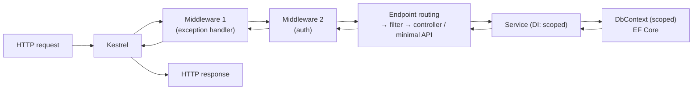

# Track 26: C# and .NET Interview Questions

> **Prerequisites:** [00 · Programming Basics](../00-programming-basics-python-and-csharp/README.md), [01 · Classes & Objects](../01-classes-objects-and-oop-building-blocks/README.md), [24 · OOP Interview Questions](../24-oop-interview-questions/README.md)  
> **Reading time:** ~15 minutes for this overview; ~20–25 minutes per lesson  
> **Audience:** .NET backend candidates (and Python developers moving to .NET) preparing for C#, ASP.NET Core and EF Core rounds

> [!NOTE]
> **In one line:** The C#, .NET and ASP.NET Core questions interviewers actually ask — type system, `async/await`, the garbage collector, DI lifetimes, the middleware pipeline (`app.Use`, `app.Run`, `app.Map`) — each as a short spoken answer backed by code you can run.

> [!TIP]
> **Golden rule:** For every .NET answer, say **what happens at run time**. "`await` doesn't block the thread; it registers a continuation and returns the thread to the pool" beats "`await` waits for the task". The runtime detail is what separates a senior answer from a tutorial answer.

> [!TIP]
> **Try it:** Run the minimal-API example in section 2 (`dotnet new web`, paste, `dotnet run`), then hit `/` and `/slow` and read the order of the console lines. That one program touches DI, middleware order, and `async`.

---

## 1. The smell: how .NET interviews are structured

Most .NET loops have three blocks:

1. **Language & runtime (30%)** — value vs reference types, boxing, `string` immutability, delegates/events, generics and variance, LINQ deferred execution, exceptions, GC and `IDisposable`.
2. **Concurrency (20%)** — `async/await`, `Task`, deadlocks (`.Result`), `lock`, `Interlocked`, `ConcurrentDictionary`.
3. **ASP.NET Core & data (50%)** — startup (`Program.cs`), middleware order, DI lifetimes, filters vs middleware, configuration, `ProblemDetails`, auth, EF Core (tracking, N+1), testing with `WebApplicationFactory`.



The pipeline is a Russian doll: each middleware runs code *before* `next()`, then again *after* it returns. Order is behaviour.

---

## 2. A 30-line program that touches half the track

````carousel
```csharp
// dotnet new web -n Demo && replace Program.cs with this
var builder = WebApplication.CreateBuilder(args);

builder.Services.AddSingleton<IClock, SystemClock>();          // DI lifetimes (lesson 15)
builder.Services.AddScoped<OrderService>();

var app = builder.Build();

app.Use(async (ctx, next) =>                                    // middleware (lesson 14)
{
    Console.WriteLine($"-> {ctx.Request.Path}");
    await next();                                               // async/await (lesson 10)
    Console.WriteLine($"<- {ctx.Response.StatusCode}");
});

app.MapGet("/", (OrderService svc) => svc.Describe());          // minimal API + DI (lesson 16)
app.MapGet("/slow", async (IClock clock) =>
{
    await Task.Delay(100);                                      // thread is NOT blocked
    return Results.Ok(new { at = clock.UtcNow });
});

app.Run();                                                      // terminal: starts Kestrel (lesson 13)

public interface IClock { DateTime UtcNow { get; } }
public sealed class SystemClock : IClock { public DateTime UtcNow => DateTime.UtcNow; }
public sealed class OrderService(IClock clock)
{
    public string Describe() => $"Order service at {clock.UtcNow:O}";
}
```
<!-- slide -->
```python
# The same shape in FastAPI (see Track 27, lesson 18)
import datetime as dt
from fastapi import Depends, FastAPI, Request

app = FastAPI()


def clock() -> dt.datetime:                       # Depends = DI
    return dt.datetime.now(dt.timezone.utc)


@app.middleware("http")                           # middleware order matters here too
async def log(request: Request, call_next):
    print("->", request.url.path)
    response = await call_next(request)
    print("<-", response.status_code)
    return response


@app.get("/")
async def root(now: dt.datetime = Depends(clock)):
    return {"at": now.isoformat()}
```
````

Console order for `GET /`: `-> /` then `<- 200`. Code *after* `await next()` runs on the way back out.

---

## 3. How this track works

- Lessons 01 to 12 are the language and runtime; lessons 13 to 21 are ASP.NET Core and EF Core; lesson 22 is the revision sheet.
- Every code sample targets current .NET and runs as a console app or a minimal API, so you can check each answer yourself.
- If you have an interview this week: lessons 02, 05, 09, 10, 14, 15 and 22 first.
- The examples are in C#. Where Python does the same thing differently and the comparison helps, a second tab shows the Python way.
- The track has twenty-two lessons. Lessons whose text is not ready yet are marked *Soon* in the sidebar; their page already lists what they will cover and the questions they will answer.

### Suggested plans

| Time you have | Do this |
| :--- | :--- |
| **Night before** | 22 (rapid fire), then re-read 15 (DI lifetimes) and 14 (middleware) |
| **One week** | 01–06 (language) days 1–2, 07–12 days 3–4, 13–19 days 5–6, 20–22 day 7 |
| **Senior loop** | Add 09 (GC/`IDisposable`), 10 (async deadlocks), 20 (EF Core), and rehearse each aloud |

---

## 4. Lessons

| # | Lesson | What you'll be able to do |
|---|--------|---------------------------|
| 01 | [How .NET Runs Your Code: CLR, IL and JIT](01-how-dotnet-runs-your-code/README.md) | Explain what happens between `dotnet build` and your code running: IL, the CLR, JIT, assemblies |
| 02 | [Value and Reference Types, Structs and Records](02-value-and-reference-types-structs-records/README.md) | Explain the stack and the heap honestly, choose `struct`, `class` or `record`, and spot boxing |
| 03 | [Strings, Constants and Immutability](03-strings-constants-and-immutability/README.md) | Explain why strings are immutable, when to use `StringBuilder`, and `const` versus `readonly` versus `static readonly` |
| 04 | [Parameters: ref, out, in and params](04-parameters-ref-out-in-and-params/README.md) | Use `ref`, `out`, `in`, `params`, optional and named arguments, and say what each does to the caller's variable |
| 05 | [Delegates, Events and Lambdas](05-delegates-events-and-lambdas/README.md) | Explain delegates, `Func`, `Action` and `Predicate`, events, and lambdas with captured variables |
| 06 | [Generics, Constraints and Variance](06-generics-constraints-and-variance/README.md) | Write generic types with constraints, and explain covariance and contravariance (`in` and `out`) |
| 07 | [Collections, LINQ and Deferred Execution](07-collections-linq-and-deferred-execution/README.md) | Choose the right collection interface, and explain deferred execution and `IEnumerable` versus `IQueryable` |
| 08 | [Exceptions Done Right](08-exceptions-done-right/README.md) | Handle, rethrow and design exceptions correctly, including `throw` versus `throw ex` |
| 09 | [Memory, Garbage Collection and IDisposable](09-memory-garbage-collection-and-idisposable/README.md) | Explain the generational GC, implement `IDisposable` correctly, and find a .NET memory leak |
| 10 | [async/await, Tasks and the Deadlock Trap](10-async-await-and-tasks/README.md) | Explain what await does, avoid `async void` and `.Result` deadlocks, and run work in parallel safely |
| 11 | [Threading, Locks and Thread Safety](11-threading-locks-and-thread-safety/README.md) | Make code thread-safe with `lock`, `Interlocked`, `SemaphoreSlim` and concurrent collections |
| 12 | [Extension Methods, Partial Classes, Attributes and Reflection](12-extension-methods-attributes-and-reflection/README.md) | Write extension methods, read and define attributes, and say when reflection is worth its cost |
| 13 | [ASP.NET Core Startup: Program.cs, the Builder and the Host](13-aspnet-core-startup-program-cs/README.md) | Read a `Program.cs` line by line: CreateBuilder, `builder.Services`, Build, the pipeline, `app.Run` |
| 14 | [The Middleware Pipeline: app.Use, app.Run and app.Map](14-middleware-pipeline-use-run-map/README.md) | Explain the request pipeline, the difference between `app.Use`, `app.Run`, `app.Map`, `MapWhen` and `UseWhen`, and why order matters |
| 15 | [Dependency Injection Lifetimes: Singleton, Scoped and Transient](15-dependency-injection-lifetimes/README.md) | Choose `AddSingleton`, `AddScoped` or `AddTransient` correctly, and spot a captive dependency |
| 16 | [Routing, Controllers vs Minimal APIs, Model Binding and Filters](16-routing-controllers-minimal-apis-and-filters/README.md) | Build endpoints both ways, explain model binding and validation, and choose between filters and middleware |
| 17 | [Configuration, Logging and Environments](17-configuration-logging-and-environments/README.md) | Explain how appsettings, environment variables and secrets layer, and log with ILogger properly |
| 18 | [Error Handling and ProblemDetails](18-error-handling-and-problem-details/README.md) | Handle errors globally with `UseExceptionHandler`, `IExceptionHandler` and `ProblemDetails` |
| 19 | [Authentication and Authorization in ASP.NET Core](19-authentication-and-authorization/README.md) | Explain authentication versus authorization, configure JWT bearer auth, and write a policy |
| 20 | [EF Core Interview Questions](20-ef-core-interview-questions/README.md) | Answer the EF Core questions that always come up: `DbContext` lifetime, tracking, loading strategies, N+1, migrations |
| 21 | [Testing: xUnit, Mocks and Integration Tests](21-testing-xunit-mocks-and-integration-tests/README.md) | Unit test with xUnit and a mocking library, and integration test an API with `WebApplicationFactory` |
| 22 | [Rapid Fire: the C# and .NET Revision Sheet](22-rapid-fire-csharp-and-dotnet/README.md) | Answer about eighty C# and .NET questions in one or two sentences each |

---

## 5. Edges: the traps interviewers set

- **`async` deadlock.** Calling `.Result` / `.Wait()` on an async method in a context with a synchronization context (classic ASP.NET, UI) blocks the thread the continuation needs. ASP.NET Core has no such context, but thread-pool starvation is still real. Fix: `await` all the way up.
- **`async void`** is for event handlers only; exceptions escape to the process.
- **Captive dependency.** A singleton holding a scoped service (e.g., `DbContext`) keeps one request's instance forever and isn't thread-safe.
- **Deferred execution.** `var q = list.Where(...)` runs nothing until enumerated; enumerating twice runs twice, and the source may have changed in between.
- **`string` is immutable**; `+=` in a loop allocates O(n²) — use `StringBuilder`.
- **`throw;` vs `throw ex;`** — the second resets the stack trace.
- **Struct boxing** — casting a struct to `object`/interface allocates; mutable structs behave unexpectedly when copied.
- **Middleware order** — `UseAuthentication` before `UseAuthorization`; exception handler first; `app.Run` terminates the pipeline.
- **EF Core N+1** — lazy loading or a query per row; fix with `Include`, projection, or split queries.

---

## 6. What you'd say in two minutes (the meta-answer)

> "For a .NET question I give the definition, then what the runtime does, then the trap. For `async/await`: the compiler turns the method into a state machine; at the first incomplete `await` it returns a `Task` and frees the thread; when the awaited work finishes the continuation resumes on a pool thread. The trap is blocking on `.Result`, which can deadlock under a synchronization context or starve the pool; I avoid it by going async all the way and passing a `CancellationToken`. For DI I'd name the three lifetimes — singleton per app, scoped per request, transient per resolution — and the captive-dependency rule: never inject a shorter-lived service into a longer-lived one."

---

## 7. Anti-patterns when answering

| Weak answer | Why it scores low | Better |
| :--- | :--- | :--- |
| "`await` waits for the task" | Describes the syntax, not the mechanism | State machine + continuation + thread released |
| "Structs live on the stack" | Often false (fields in a class, boxed, captured) | "Value semantics; stored inline where declared" |
| "Use `IDisposable` to free memory" | Confuses GC with unmanaged resources | `Dispose` releases *unmanaged/scarce* resources deterministically |
| "Singleton for everything, it's faster" | Hidden shared state | Lifetime by state: stateless → singleton, per-request → scoped |
| Reciting LINQ operators | Doesn't show understanding | Explain deferred execution and `IQueryable` translation |

---

## 8. Interview questions

<details>
<summary><strong>1. What does `await` actually do? [BASIC]</strong></summary>

The compiler rewrites the method into a state machine. At an `await` on an incomplete task, the method returns a `Task` to its caller and the thread goes back to the pool; when the task completes, the state machine resumes (on the captured context if any, otherwise a pool thread).

</details>

<details>
<summary><strong>2. `app.Use` vs `app.Run` vs `app.Map`? [BASIC]</strong></summary>

`Use` adds middleware that can call `next`; `Run` adds a **terminal** middleware that never calls `next`; `Map` branches the pipeline by path prefix. `MapWhen`/`UseWhen` branch on an arbitrary predicate (`UseWhen` rejoins the main pipeline).

</details>

<details>
<summary><strong>3. Singleton vs Scoped vs Transient? [BASIC]</strong></summary>

Singleton: one instance for the app's lifetime. Scoped: one per scope (per HTTP request). Transient: a new instance each resolution. Rule: don't inject shorter-lived into longer-lived services.

</details>

<details>
<summary><strong>4. Why can `.Result` deadlock? [TRICKY]</strong></summary>

With a synchronization context the continuation must run on the same (now blocked) thread. Even without one, blocking pool threads can starve the pool under load. Use `await`, and `ConfigureAwait(false)` in library code.

</details>

<details>
<summary><strong>5. Your API returns stale data after you inject `DbContext` into a singleton. [SCENARIO]</strong></summary>

Captive dependency: the singleton keeps one `DbContext` (with its change tracker) forever and isn't thread-safe. Register the consumer as scoped, or inject `IServiceScopeFactory` / `IDbContextFactory<T>` and create a context per operation.

</details>

<details>
<summary><strong>6. `IEnumerable` vs `IQueryable`? [TRICKY]</strong></summary>

`IEnumerable` runs LINQ in memory using delegates. `IQueryable` builds an expression tree the provider (EF Core) translates to SQL. Calling `.AsEnumerable()` or `.ToList()` too early pulls everything to memory before filtering.

</details>

<details>
<summary><strong>7. Middleware or filter for logging request bodies? [SCENARIO]</strong></summary>

Middleware sees every request (static files, 404s) and the raw HTTP stream; filters run inside MVC/minimal-API routing and see model-binding results, action arguments and the selected endpoint. Cross-cutting HTTP concerns → middleware; action-aware concerns → filter.

</details>

<details>
<summary><strong>8. `class` vs `struct` vs `record`? [BASIC]</strong></summary>

`class`: reference type, identity. `struct`: value type, copied, best for small immutable data. `record` (class) / `record struct`: value-based equality and `with` expressions — ideal for DTOs and value objects.

</details>

---

## 9. One-page cheat sheet

```text
Runtime     C# -> IL -> JIT -> machine code; assemblies; CLR manages GC, type safety
Types       class=ref, struct=value (copy), record=value equality; boxing = struct -> object
Async       await = state machine + continuation; never .Result/.Wait; async all the way; CancellationToken
GC          generations 0/1/2 + LOH; IDisposable for scarce resources; using / await using
DI          Singleton(app) Scoped(request) Transient(each); no captive deps
Middleware  Use(next) Run(terminal) Map(branch); order = behaviour: exception -> https -> auth -> authz -> endpoints
LINQ        deferred; IEnumerable (memory) vs IQueryable (SQL); materialise once
EF Core     tracking vs AsNoTracking; Include/projection vs N+1; DbContext = scoped
Errors      throw; (not throw ex;)  ProblemDetails  IExceptionHandler
Tests       xUnit + fakes; WebApplicationFactory for integration

Night-before: lesson 22. This week: 02, 05, 09, 10, 14, 15.
```

---

## Sources

- [Microsoft Learn: C# documentation](https://learn.microsoft.com/en-us/dotnet/csharp/)
- [Microsoft Learn: ASP.NET Core middleware](https://learn.microsoft.com/en-us/aspnet/core/fundamentals/middleware/)
- [Microsoft Learn: write custom ASP.NET Core middleware](https://learn.microsoft.com/en-us/aspnet/core/fundamentals/middleware/write)
- [Microsoft Learn: dependency injection in ASP.NET Core](https://learn.microsoft.com/en-us/aspnet/core/fundamentals/dependency-injection)
- [Microsoft Learn: dependency injection guidelines](https://learn.microsoft.com/en-us/dotnet/core/extensions/dependency-injection-guidelines)
- [Microsoft Learn: the options pattern](https://learn.microsoft.com/en-us/aspnet/core/fundamentals/configuration/options)
- [Microsoft Learn: implement a Dispose method](https://learn.microsoft.com/en-us/dotnet/standard/garbage-collection/implementing-dispose)
- [Microsoft Learn: asynchronous programming with async and await](https://learn.microsoft.com/en-us/dotnet/csharp/asynchronous-programming/)
- [Microsoft Learn: Entity Framework Core](https://learn.microsoft.com/en-us/ef/core/)

Start here → [01-how-dotnet-runs-your-code/README.md](01-how-dotnet-runs-your-code/README.md)

Back to the course index: [../README.md](../README.md)
