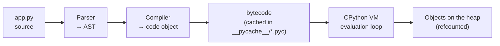
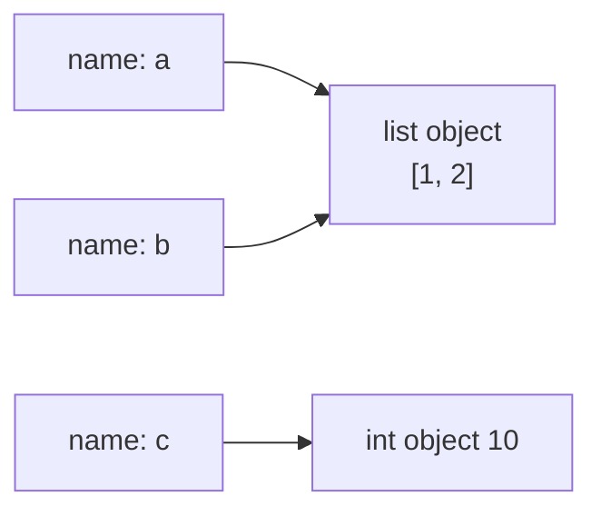

# Lesson 01: How Python Runs Your Code — Objects, Names and Bytecode

> **Prerequisites:** [Python Refresher: names, references and mutability](../../../learn/00-python-refresher/06-names-references-and-mutability/README.md) · [Track 27 overview](../README.md)  
> **Reading time:** ~20 minutes  
> **Audience:** Candidates who get "what happens when you run `python app.py`?" or "is Python compiled or interpreted?"

> [!NOTE]
> **In one line:** CPython compiles your source to **bytecode**, a virtual machine runs it, and at run time everything — numbers, functions, classes, modules — is an **object**, with variables being just **names bound to objects**.

> [!TIP]
> **Golden rule:** Say "compiled to bytecode, then interpreted by a VM" — never just "interpreted." And say "names bound to objects" — never "variables are boxes holding values." Those two phrases fix 80% of Python-internals questions.

> [!TIP]
> **Try it:** Run the example below, then run the four-probe lab in section 4 (small-int identity, `LOAD_FAST` vs `LOAD_GLOBAL`, import caching, constant folding). Disassemble your own function with `python -m dis yourfile.py`. For the LLD side, sketch `Name → Object → Type` in [LLD Studio](/tools/lld-studio/).

---

## 1. The smell: how this gets asked

- *"Is Python compiled or interpreted?"* (both, and the question is a bit loose)
- *"What's in a `.pyc` file? Why is there a `__pycache__`?"*
- *"What's the difference between a variable in Python and in C?"*
- *"Why is a local variable faster than a global one?"*
- *"What does `import` do the first time, and the second time?"*

The weak answer is a one-word label ("interpreted"). The strong answer walks the pipeline and mentions the object model.



Names are *labels* stuck onto objects:



`a` and `b` are two names for the **same** list; `c` points to an int. Assignment never copies; it only attaches a label.

---

## 2. The model in a table

| Question | Answer |
| :--- | :--- |
| What runs my code? | **CPython** (the reference implementation, in C). PyPy, Jython and others differ. |
| Compiled or interpreted? | Compiled to **bytecode** (a code object), then **interpreted** by the VM. |
| What is `__pycache__`? | Cached bytecode of *imported* modules, keyed by source mtime/hash and Python version. The script you run directly isn't cached. |
| What is a variable? | A **name** in a namespace (a dict) that refers to an object. |
| What is an object? | Identity (`id`), type (`type`), value, and a reference count in CPython. |
| What is a function? | An object (a `function` with a `__code__`). `def` is an *executable statement* that creates it. |
| What is a module? | An object, created on first import, cached in `sys.modules`. |

| Property | `id(x)` | `type(x)` | `x == y` | `x is y` |
| :--- | :--- | :--- | :--- | :--- |
| Meaning | identity (address in CPython) | the class | equal values (`__eq__`) | same object |

---

## 3. Walkthrough: from `python app.py` to output

1. **Start-up:** the interpreter initialises built-in types, `sys`, `sys.path`.
2. **Compile:** the file is tokenised, parsed into an **AST**, and compiled to a **code object** (bytecode + constants + names).
3. **Execute the module body** top to bottom in a fresh namespace (`__main__`). Each `def` and `class` statement runs *now*, creating function/class objects and binding names.
4. **Calls** push a **frame**; the VM executes bytecode instructions (`LOAD_FAST`, `CALL`, …).
5. **Imports** look in `sys.modules`; on a miss they find the file, compile (or load `.pyc`), execute the module body once, and cache the module object.

Why locals are faster: locals live in a fixed array in the frame (`LOAD_FAST`, index lookup); globals/builtins are dictionary lookups (`LOAD_GLOBAL`). Hot loops sometimes copy a global into a local for exactly this reason.

````carousel
```python
import dis
import sys


def area(width, height):
    scale = 2
    return width * height * scale


def main() -> None:
    # 1) Everything is an object
    for thing in (42, "hi", [1], area, sys, int):
        print(f"{type(thing).__name__:<10} -> has attributes: {len(dir(thing)) > 5}")

    # 2) Names are labels: assignment never copies
    a = [1, 2]
    b = a
    b.append(3)
    print("a:", a, "| same object:", a is b)

    # 3) Rebinding vs mutation
    n = 10
    m = n
    n += 1                      # ints are immutable: n is rebound to a NEW object
    print("n, m:", n, m)

    # 4) A function is an object with a code object
    print("name:", area.__name__, "| args:", area.__code__.co_varnames)

    # 5) Reference counts (CPython detail; getrefcount adds one temporary reference)
    lst = []
    before = sys.getrefcount(lst)
    alias = lst
    print("refcount grew by:", sys.getrefcount(lst) - before)
    del alias

    # 6) Bytecode: locals use LOAD_FAST
    ops = [i.opname for i in dis.get_instructions(area)]
    print("uses LOAD_FAST:", any(o.startswith("LOAD_FAST") for o in ops))

    # 7) def runs at definition time: the default is built ONCE
    def f(x=print("default evaluated")):
        return x
    print("defined, not yet called")
    f()


if __name__ == "__main__":
    main()
```
<!-- slide -->
```csharp
// C#: a variable IS a storage location with a static type.
int x = 10;           // the box holds the value 10
int y = x;            // copies the value
x++;                  // y is still 10

var list = new List<int> { 1, 2 };
var alias = list;     // copies the *reference* (like Python names)
alias.Add(3);
Console.WriteLine(list.Count);  // 3

// Compile step: C# -> IL (assembly) -> JIT -> machine code (see Track 26, lesson 01)
```
````

Expected output (the refcount line and ordering are CPython-specific):

```text
int        -> has attributes: True
str        -> has attributes: True
list       -> has attributes: True
function   -> has attributes: True
module     -> has attributes: True
type       -> has attributes: True
a: [1, 2, 3] | same object: True
n, m: 11 10
name: area | args: ('width', 'height', 'scale')
refcount grew by: 1
uses LOAD_FAST: True
default evaluated
defined, not yet called
```

The key lines: `n, m: 11 10` (rebinding), `same object: True` (aliasing), and `default evaluated` printing **before** `defined, not yet called` — `def` runs a default-argument expression at definition time.

---

## 4. Edges and traps

- **Small-integer and string interning.** `a = 256; b = 256; a is b` is `True` in CPython (cached small ints, −5…256), but `1000 is 1000` may be `False`. It's an implementation detail — never use `is` for values.
- **Compile-time constant folding.** `x = "a" + "b"` may be folded and interned, so `is` results vary between REPL and script.
- **`.pyc` files don't make scripts faster at runtime** — only import/start-up. The main script is recompiled every run.
- **"Interpreted" ≠ "no compile errors."** Syntax errors surface at compile time, before any code runs; name errors only when the line executes.
- **Import side effects.** A module body runs at first import; a second `import` is a dict lookup. Heavy top-level work slows start-up, so keep it in functions.
- **Reference counting is CPython-specific.** PyPy uses a tracing GC; don't rely on `__del__` timing.
- **`id()` is "address" only in CPython.** In an interview, say "identity".
- **Threads and the GIL** come from the same implementation (lesson 14) — they are not part of the *language*.

### Try it — four probes (runnable)

Save as `runs_your_code.py`. Each probe backs one answer from section 7, and each `assert` fails loudly if your mental model is wrong.

```python
import dis
import importlib
import sys
import types

# 1) Small-int caching: build the ints at run time so constant folding cannot interfere
a, b = int("256"), int("256")
c, d = int("1000"), int("1000")
print("256 is 256 ->", a is b)                     # True  (cached singleton in CPython)
print("1000 is 1000 ->", c is d, "| ==", c == d)   # False | True

# 2) LOAD_FAST (local) vs LOAD_GLOBAL (global): the same loop, two different opcodes
LIMIT = 3


def uses_global():
    total = 0
    for _ in range(1000):
        total += LIMIT            # global: dictionary lookup on every iteration
    return total


def uses_local(limit=LIMIT):      # default evaluated ONCE at def time -> becomes a local
    total = 0
    for _ in range(1000):
        total += limit            # local: slot in the frame's array
    return total


def count(fn, prefix):
    return sum(1 for ins in dis.get_instructions(fn) if ins.opname.startswith(prefix))


g_global, g_local = count(uses_global, "LOAD_GLOBAL"), count(uses_local, "LOAD_GLOBAL")
print("LOAD_GLOBAL in uses_global:", g_global, "| in uses_local:", g_local)   # 2 | 1
assert g_global > g_local and uses_global() == uses_local()

# 3) A module body runs once; the second import is a sys.modules lookup
mod = types.ModuleType("demo_mod")
exec("print('demo_mod body ran'); VALUE = 41", mod.__dict__)
sys.modules["demo_mod"] = mod
first = importlib.import_module("demo_mod")
second = importlib.import_module("demo_mod")
assert first is second is mod                      # the body does not run a second time

# 4) The compile step is visible: source -> code object -> exec
code = compile("answer = 6 * 7", "<demo>", "exec")
print("constants in the code object:", code.co_consts)   # 42 is already folded in
ns: dict = {}
exec(code, ns)
assert ns["answer"] == 42
print("ok")
```

Expected output:

```text
256 is 256 -> True
1000 is 1000 -> False | == True
LOAD_GLOBAL in uses_global: 2 | in uses_local: 1
demo_mod body ran
constants in the code object: (42, None)
ok
```

What to notice and try next:

1. **Why `int("1000")` and not `1000`?** The compiler folds identical constants inside one code object, so `x = 1000; y = 1000; x is y` can be `True` in a script and `False` in the REPL. Building the values at run time removes that noise.
2. **`LOAD_GLOBAL` count 2 vs 1.** The first is `range`; the second is `LIMIT` read on *every* iteration. Run `python -m dis` on each function and find `LOAD_FAST` in the second. Then time both with `timeit` — expect a modest gain, not a rewrite-worthy one (3.11+ caches global lookups).
3. **`co_consts` is `(42, None)`.** `6 * 7` was computed at compile time. Change it to `a * b` with names and watch `42` vanish from the constants.
4. **Delete the `sys.modules[...] = mod` line** and the lookup fails with `ModuleNotFoundError`; that dict *is* the import cache.

---

## 5. What you'd say in two minutes

> "CPython first compiles source into bytecode — an AST becomes a code object — and caches imported modules as `.pyc` in `__pycache__`. A virtual machine then interprets that bytecode, so it's both compiled and interpreted. At run time everything is an object with an identity, a type and a value; a variable isn't a box but a name bound to an object, which is why `b = a` makes an alias and why mutating through one name is visible through the other. `def` and `class` are executable statements that run when the module body runs, which is why default arguments are evaluated once, at definition time. Locals are array slots (`LOAD_FAST`) and globals are dict lookups, so local access is faster. Imports are cached in `sys.modules`, so a module body runs once."

---

## 6. Anti-patterns

| Anti-pattern | Why it fails | Better |
| :--- | :--- | :--- |
| `if x is 1000:` | Depends on caching; `SyntaxWarning` since 3.8 | `==` |
| Doing heavy work at import time | Slows start-up, hidden side effects, breaks tests | Put it in a function / lazy init |
| Relying on `__del__` for cleanup | Timing is implementation-defined | `with` / `try-finally` |
| Treating `id()` as meaningful data | Reused after objects die | Use your own IDs |
| "It's interpreted, so it's slow" | Imprecise | Profile; use the right tool (C extensions, asyncio, processes) |

---

## 7. Interview questions

<details>
<summary><strong>1. Is Python compiled or interpreted? [BASIC]</strong></summary>

Both. CPython compiles source to bytecode (a code object), and a virtual machine interprets that bytecode. `.pyc` files cache the bytecode for imported modules.

</details>

<details>
<summary><strong>2. What is a variable in Python? [BASIC]</strong></summary>

A name in a namespace bound to an object. Assignment binds (or rebinds) the name; it doesn't copy the object. Types belong to objects, not names.

</details>

<details>
<summary><strong>3. What's in `__pycache__`? [BASIC]</strong></summary>

Compiled bytecode for imported modules, named like `module.cpython-313.pyc`, validated against the source's timestamp/hash. It speeds up *loading*, not execution.

</details>

<details>
<summary><strong>4. Why is `def f(x=[])` dangerous? [TRICKY]</strong></summary>

`def` executes when the module body runs, evaluating the default **once**; every call without `x` shares that one list. Use `None` and create a new list inside the function.

</details>

<details>
<summary><strong>5. What happens on the second `import foo`? [BASIC]</strong></summary>

Python finds `foo` in `sys.modules` and returns the cached module object; the module body doesn't run again. `importlib.reload` forces re-execution.

</details>

<details>
<summary><strong>6. Why is accessing a local faster than a global? [TRICKY]</strong></summary>

Locals compile to `LOAD_FAST`, an index into the frame's array. Globals and builtins compile to `LOAD_GLOBAL`, which does dictionary lookups (with caching in newer versions, but still more work).

</details>

<details>
<summary><strong>7. `a = 256; b = 256; a is b` → True, but with 1000 → maybe False. Why? [TRICKY]</strong></summary>

CPython preallocates small ints (−5…256) as singletons. Larger ints are separate objects unless the compiler folds identical constants in one code object. It's an implementation detail — compare with `==`.

</details>

---

## 8. One-page cheat sheet

```text
Pipeline   source -> AST -> code object (bytecode) -> VM loop       (.pyc cache for imports)
Object     identity (id) + type + value (+ refcount in CPython)
Variable   name -> object. Assignment = bind, never copy.
Function   object; `def` executes at definition time (defaults evaluated once)
Module     object; body runs once; cached in sys.modules
Fast/slow  LOAD_FAST (local) < LOAD_GLOBAL (global/builtin)
Tools      dis.dis(f), sys.getrefcount(x), id(x), python -X importtime
Say        "compiled to bytecode, interpreted by a VM"; "names bound to objects"
Never      use `is` to compare values (only None/singletons)
```

---

## Further reading

- [Python reference: execution model](https://docs.python.org/3/reference/executionmodel.html)
- [`dis` — disassembler for Python bytecode](https://docs.python.org/3/library/dis.html)
- [Ned Batchelder — Facts and myths about Python names and values](https://nedbatchelder.com/text/names.html)

Next: [Mutability, Identity and Copying](../02-mutability-identity-and-copying/README.md)
