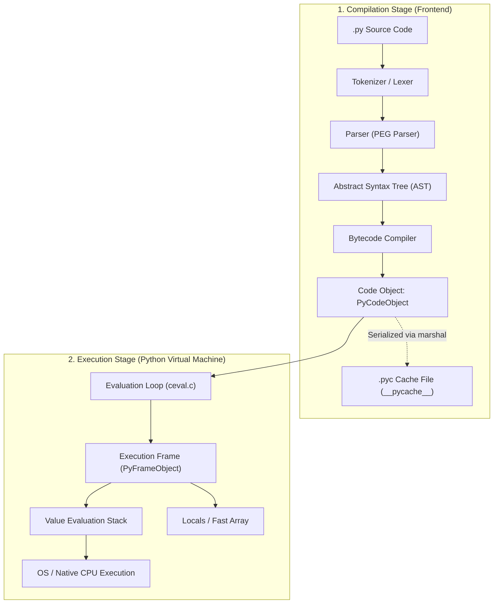
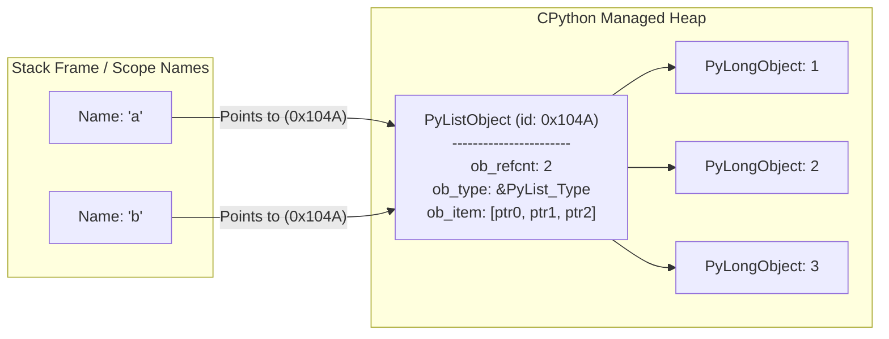

# Lesson 01: How Python Runs Your Code: Objects, Names and Bytecode

> **Prerequisites:** [Track 27 Overview](../README.md) and [Low-Level Design Track](../../README.md).  
> **Estimated Reading Time:** 18 minutes  
> **Target Audience:** Engineers preparing for LLD, OOP, C#, or Python technical screening and architecture rounds.

> [!TIP]
> **The One Rule of Python's Execution Model:** Python is **compiled to bytecode first**, then interpreted by a stack-based virtual machine (`ceval.c`). In this runtime, **variables are not memory buckets that hold values; they are names bound to heap-allocated `PyObject` instances**. Assignment (`a = b`) never copies data; it binds a new name to an existing object pointer.

---

## 1. Why This Matters: The Interview Trap

"Is Python interpreted or compiled, and what actually happens in memory when you assign `a = b`?" is the single most common warm-up question in Python technical interviews. Candidates who answer casually immediately reveal whether their mental model stops at scripting syntax or extends to systems-level runtime architecture.

### The Weak Answer
> *"Python is an interpreted language. It reads your `.py` script line by line from top to bottom and runs it directly on the CPU without compiling. When you write `a = b`, Python copies the value of `b` into a new variable `a` so you can use it."*

### The Senior Strong Answer
> *"CPython is neither a pure interpreter nor an AOT native compiler: it is a **bytecode-compiled, virtual-machine-interpreted** language. 
> 
> When you invoke `python app.py`, CPython executes a multi-stage pipeline:
> 1. **Tokenization and Parsing:** The source code is parsed into an Abstract Syntax Tree (AST).
> 2. **Bytecode Compilation:** The AST compiler emits platform-independent Python bytecode instructions packed into a `codeobject` (and cached as `.pyc` files in `__pycache__`).
> 3. **Virtual Machine Evaluation:** The bytecode is evaluated inside CPython's evaluation loop (`ceval.c` / Python 3.11+ specializing adaptive interpreter), which simulates a stack-based machine executing opcodes like `LOAD_FAST`, `BINARY_OP`, and `STORE_FAST`.
> 
> Furthermore, in CPython, **everything is a heap-allocated `PyObject`**. Variables are merely string names stored in symbol tables (such as a frame's `f_locals` or a module's `__dict__`) pointing to these objects. When you write `a = b`, Python does **not copy data**; it reads the memory pointer bound to name `b`, increments that `PyObject`'s reference counter (`ob_refcnt`), and binds name `a` to that same pointer."*

### Execution Model Taxonomy

| Dimension | CPython (Standard Python) | PyPy (JIT Python) | C# (.NET CLR) | C / C++ |
| :--- | :--- | :--- | :--- | :--- |
| **Source to Intermediate** | Compiles `.py` to Python Bytecode (`.pyc`) | Compiles `.py` to Bytecode | Compiles `.cs` to Common Intermediate Language (CIL) | None (compiles direct to native object code) |
| **Intermediate to Machine** | VM loop interprets bytecode opcodes (`ceval.c`) | Tracing JIT compiles hot loops to native x86/ARM | RyuJIT compiles CIL to native machine code at startup/tiering | Direct AOT native compilation via LLVM/GCC/MSVC |
| **Variable Model** | Names bound to heap `PyObject*` pointers | Names bound to optimized RPython objects | Value types on stack/inline; reference types on managed heap | Typed memory addresses (stack, heap, static) |
| **Type Checking** | Purely dynamic at runtime per opcode dispatch | Dynamic at runtime with speculative JIT guards | Static at compile time; runtime type metadata | Static at compile time; erased at runtime |

---

## 2. Visual Mental Model / Taxonomic Comparison

### The CPython Execution Pipeline

When you run a Python program, source code never executes directly. It traverses lexing, parsing, code object generation, and virtual machine execution:



### The PyObject Anatomy and Name Binding

Every Python entity—from an integer `42` to a class or module—is represented internally as a C struct derived from `PyObject`:

```text
typedef struct _object {
    _PyObject_HEAD_EXTRA // Double-linked list pointers for GC tracking
    Py_ssize_t ob_refcnt; // Reference counter for automatic memory management
    struct _typeobject *ob_type; // Pointer to the type object (e.g., &PyLong_Type)
} PyObject;
```

When you write `a = [1, 2, 3]` followed by `b = a`:



### CPython vs C# .NET CLR Comparison Matrix

| Runtime Concept | Python (CPython) | C# (.NET CLR) |
| :--- | :--- | :--- |
| **Intermediate Representation** | Python Bytecode (e.g., `LOAD_FAST`, `BINARY_OP`) | Common Intermediate Language (CIL, e.g., `ldarg.0`, `add`) |
| **Execution Engine** | Stack-based C interpreter (`ceval.c`) | Stack-based VM with JIT compilation (RyuJIT) to native machine code |
| **Object Header Overhead** | Standard 16 bytes on 64-bit (`ob_refcnt` 8B + `ob_type` 8B) | Standard 16 bytes on 64-bit (`SyncBlockIndex` 8B + `TypeHandle` 8B) |
| **Primitive Representation** | Boxed on the heap as `PyLongObject`, `PyFloatObject` | Primitive unboxed value types (`int`, `double`) allocated on stack/inline |
| **Variable Binding** | Assignment binds a string symbol to a pointer | Assignment copies value bits (value types) or copies reference pointer (reference types) |
| **Code Representation** | `types.CodeType` (`func.__code__`) | `System.Reflection.MethodBody` / IL byte array |

---

## 3. Code Implementation

The following carousel provides twin demonstrations in Python and C#. Both examples inspect:
1. Object identity and verifying that assignment binds names rather than copying data.
2. The foundational principle that primitive values, functions, and types are all first-class objects.
3. Introspection into bytecode instructions, parameter counts, and compiled metadata.

````carousel
```python
import dis
from typing import List


def add(x: int, y: int) -> int:
    """A simple binary addition function."""
    return x + y


def run_demonstration() -> None:
    # 1. Object Identity & Name Binding
    print("1. Object Identity & Name Binding:")
    a: List[int] = [1, 2, 3]
    b: List[int] = a  # Assignment binds name b to the same heap object
    b.append(4)       # Mutating b affects a because both names point to the same object
    print(f"Same object after mutation: {a is b}, a contents: {a}")

    b = [99]          # Rebinding b creates a new object; a remains unchanged
    print(f"Same object after rebind: {a is b}, a contents: {a}")

    # 2. Everything is an Object
    print("2. Everything is an Object:")
    print(f"int is object: {isinstance(42, object)}")
    print(f"function is object: {isinstance(add, object)}")
    print(f"type is object: {isinstance(int, object)}")

    # 3. Code Introspection & Execution Model
    print("3. Code Introspection & Execution Model:")
    code_obj = add.__code__
    instructions = list(dis.get_instructions(add))
    print(f"Code Unit: {code_obj.co_name}")
    print(f"Parameter Count: {code_obj.co_argcount}")
    print(f"Instructions Present: {len(instructions) > 0}")
    print(f"Execution Result (10 + 20): {add(10, 20)}")


if __name__ == "__main__":
    run_demonstration()
```
<!-- slide -->
```csharp
using System;
using System.Collections.Generic;
using System.Reflection;

public class Program
{
    // A simple binary addition function
    public static int Add(int x, int y)
    {
        return x + y;
    }

    public static void Main()
    {
        // 1. Object Identity & Name Binding
        Console.WriteLine("1. Object Identity & Name Binding:");
        var a = new List<int> { 1, 2, 3 };
        var b = a;  // Copies reference; b points to the exact same list instance on the heap
        b.Add(4);   // Mutating b affects a
        Console.WriteLine($"Same object after mutation: {object.ReferenceEquals(a, b)}, a contents: [{string.Join(", ", a)}]");

        b = new List<int> { 99 };  // Rebinding b re-points local pointer; a remains untouched
        Console.WriteLine($"Same object after rebind: {object.ReferenceEquals(a, b)}, a contents: [{string.Join(", ", a)}]");

        // 2. Everything is an Object
        Console.WriteLine("2. Everything is an Object:");
        Console.WriteLine($"int is object: {42 is object}");
        Func<int, int, int> addFunc = Add;
        Console.WriteLine($"function is object: {addFunc is object}");
        Console.WriteLine($"type is object: {typeof(int) is object}");

        // 3. Code Introspection & Execution Model
        Console.WriteLine("3. Code Introspection & Execution Model:");
        MethodInfo method = typeof(Program).GetMethod(nameof(Add), BindingFlags.Public | BindingFlags.Static)!;
        byte[]? ilBytes = method.GetMethodBody()?.GetILAsByteArray();
        Console.WriteLine($"Code Unit: {method.Name.ToLower()}");
        Console.WriteLine($"Parameter Count: {method.GetParameters().Length}");
        Console.WriteLine($"Instructions Present: {ilBytes != null && ilBytes.Length > 0}");
        Console.WriteLine($"Execution Result (10 + 20): {Add(10, 20)}");
    }
}
```
````

**Expected Output (Both Languages):**

```text
1. Object Identity & Name Binding:
Same object after mutation: True, a contents: [1, 2, 3, 4]
Same object after rebind: False, a contents: [1, 2, 3, 4]
2. Everything is an Object:
int is object: True
function is object: True
type is object: True
3. Code Introspection & Execution Model:
Code Unit: add
Parameter Count: 2
Instructions Present: True
Execution Result (10 + 20): 30
```

---

## 4. Where You Already Use It

- **In Python:**
  - **`dis` Module:** The standard library disassembler converts Python bytecode inside code objects into human-readable opcode listings. Profilers and debuggers (e.g., `cProfile`, `pdb`) inspect frame execution states via bytecode offsets.
  - **`__pycache__` and `.pyc` Compilation:** Every imported module is automatically parsed and compiled to bytecode on disk, prefixed with magic numbers indicating Python version compatibility (e.g., `cpython-313.pyc`). On subsequent executions, CPython skips tokenizing and parsing if source modification timestamps or hashes match (PEP 552).
  - **`sys.getrefcount()`:** Used to audit garbage collector references and detect circular leaks by inspecting the underlying `ob_refcnt`.
  - **Dynamic Code Generation (`ast`, `compile`, `eval`):** Metaprogramming libraries like Pydantic, SQLAlchemy, and Pytest manipulate Abstract Syntax Trees at runtime, compiling custom validator and assertion functions directly to bytecode via Python's built-in `compile()` function.

- **In C# / .NET:**
  - **CIL (Common Intermediate Language):** When `dotnet build` executes, Roslyn compiles C# code to CIL assemblies (`.dll`), containing metadata tables and MSIL instructions.
  - **`System.Reflection.Emit`:** Dynamic serializers (like protobuf-net and Dapper) generate CIL opcodes on the fly at runtime to bypass reflection overhead for high-performance object mapping.
  - **RyuJIT Tiered Compilation:** The .NET runtime monitors method invocation frequency; cold methods are JITted quickly with minimal optimization, while hot methods are re-JITted into heavily optimized machine code.

---

## 5. Pitfalls and When Not to Use It

1. **The "Assignment Copies Objects" Fallacy:**
   - Writing `config_copy = active_config` does not create a backup. Any mutation on `config_copy["timeout"] = 50` modifies the production configuration dictionary immediately.
   - *Fix:* Explicitly construct a shallow copy (`dict(active_config)` or `list.copy()`) or a deep copy (`copy.deepcopy()`).

2. **The "Interpreted Means No Compilation" Myth:**
   - Syntax errors in Python are detected **before a single line of code runs**. When you execute `python script.py`, the entire file is tokenized and parsed into an AST. If line 500 contains a `SyntaxError`, line 1 never executes. Only runtime errors (such as `TypeError` or `NameError`) occur during virtual machine opcode dispatch.

3. **`sys.getrefcount()` Reading Trap:**
   - Passing an object to `sys.getrefcount(x)` temporarily creates a new local reference inside the function parameter frame. Therefore, `sys.getrefcount(x)` always returns a value that is **at least 1 higher** than the real reference count in your calling scope.

4. **Assuming Small Integer Interning Applies Universally:**
   - In CPython, small integers in the range `[-5, 256]` are pre-allocated global singletons. Evaluating `a = 100; b = 100; a is b` yields `True`. However, `a = 1000; b = 1000; a is b` may yield `False` depending on whether code runs in an interactive REPL or is compiled together in a single code object block. Never use `is` to check numerical equality.

5. **Confusing Bytecode (`.pyc`) with Native Binaries:**
   - A `.pyc` file cannot execute independently on an operating system CPU. It is a marshaled representation of Python's virtual machine instructions. Running it requires the CPython runtime binary matching the bytecode format.

---

## 6. Exercises & Practical Drills

### Exercise 1: Bytecode Reverse Engineering
Inspect the following bytecode disassembled output from `dis.dis(mystery_func)`. What Python code produced this bytecode, and what does the function do?

```text
  2           0 LOAD_FAST                0 (items)
              2 LOAD_CONST               1 (0)
              4 BINARY_SUBSCR
              6 LOAD_CONST               2 (2)
              8 BINARY_OP                5 (*)
             10 RETURN_VALUE
```

<details>
<summary>Answer</summary>

**Equivalent Python Code:**
```python
def mystery_func(items):
    return items[0] * 2
```

**Step-by-Step Bytecode Trace:**
1. `LOAD_FAST 0 (items)`: Pushes the local variable `items` onto the evaluation stack.
2. `LOAD_CONST 1 (0)`: Pushes constant `0` onto the stack.
3. `BINARY_SUBSCR`: Pops index `0` and container `items`, resolves `items[0]`, and pushes the result onto the stack.
4. `LOAD_CONST 2 (2)`: Pushes constant `2` onto the stack.
5. `BINARY_OP 5 (*)`: Pops the two top values, multiplies them, and pushes the product.
6. `RETURN_VALUE`: Pops the product and returns it to the caller frame.
</details>

### Exercise 2: Name Binding vs Object Mutation
Predict the printed output of this script:
```python
x = [10, 20]
y = x
x = x + [30]
y += [40]

print("x:", x)
print("y:", y)
```

<details>
<summary>Answer</summary>

**Output:**
```text
x: [10, 20, 30]
y: [10, 20, 40]
```

**Explanation:**  
1. `x = [10, 20]`: Heap list `L1` created; `x` points to `L1`.
2. `y = x`: `y` points to `L1` (refcount = 2).
3. `x = x + [30]`: The binary `+` operator on lists creates a **brand-new list object** `L2` containing `[10, 20, 30]`. `x` is rebound to `L2`. `y` remains bound to `L1`.
4. `y += [40]`: The augmented assignment operator `+=` on a mutable list calls `y.extend([40])`, mutating `L1` in place.
5. Therefore, `x` is `[10, 20, 30]` and `y` is `[10, 20, 40]`.
</details>

### Exercise 3: Reference Count Calculations
Given the code below, what is the expected reference count of the list `data` reported at step A?
```python
import sys

data = ["alpha", "beta"]
alias = data
holder = [data, data]
# Step A:
count = sys.getrefcount(data)
```

<details>
<summary>Answer</summary>

**Expected Result:** `5`

**Reference Breakdown:**
1. `data = ...`: Global name `data` holds 1 reference.
2. `alias = data`: Name `alias` holds 1 reference (total = 2).
3. `holder = [data, data]`: List `holder` contains two elements pointing to the list (total = 4).
4. `sys.getrefcount(data)`: Passing `data` as an argument to the function temporarily binds the parameter inside the function frame (total = 5).
</details>

---

## 7. Interview Questions & Model Answers

> [!interview]
> **Question 1: Is Python interpreted or compiled?**  
> **Strong Answer:**  
> "Python is both: it is **compiled to bytecode and then executed by an interpreter**.  
> 
> When source code is executed, CPython does not run it line by line directly on the CPU. First, a frontend compiler lexes, parses, and converts the Python syntax into an Abstract Syntax Tree (AST), which is then compiled into a sequence of bytecode instructions encapsulated within a code object (`PyCodeObject`). These compiled bytecode artifacts are cached on disk as `.pyc` files in the `__pycache__` directory to accelerate subsequent imports.  
> 
> Second, CPython's virtual machine—a stack-based interpreter implemented in C (`ceval.c`)—iterates through the bytecode instructions in an evaluation loop, executing operations by manipulating a value stack and frame locals. In Python 3.11+, this includes a specializing adaptive interpreter that optimizes common opcode patterns at runtime. Alternative implementations like PyPy take this a step further by using a Just-In-Time (JIT) compiler to compile hot bytecode loops directly into native machine instructions."

> [!interview]
> **Question 2: What does "everything is an object" mean?**  
> **Strong Answer:**  
> "In Python, 'everything is an object' means that every entity in the language—including primitive integers, floating-point numbers, strings, boolean values, functions, class definitions, modules, and even the `object` type itself—is a **first-class heap object** derived from the C-level `PyObject` structure.  
> 
> Every object possesses three fundamental invariants:
> 1. An **Identity** (`id(x)`): Representing its unique memory address on the heap.
> 2. A **Type** (`type(x)`): A pointer to its type object (e.g., `PyLong_Type`, `PyFunction_Type`), which defines its attributes, methods, and memory layout.
> 3. A **Value**: The underlying data payload stored in memory (e.g., an array of digits for integers, or an array of pointers for lists).
> 
> Because everything is a first-class object, functions and classes can be assigned to variables, passed as arguments to other functions, stored in data structures, and introspected dynamically at runtime. This contrasts with languages like C++ or Java, where primitive types (such as `int` or `char`) are raw stack-allocated memory bits that do not possess object headers, method tables, or dynamic dispatch."

> [!interview]
> **Question 3: What happens when you write a = b?**  
> **Strong Answer:**  
> "When you execute `a = b` in Python:
> 
> 1. The runtime evaluates the right-hand side expression `b`. It resolves the symbol `b` in the current namespace (e.g., local frame or global dictionary) to retrieve the pointer to the underlying heap-allocated `PyObject`.
> 2. It increments that object's internal reference count (`Py_INCREF(obj)` or atomic equivalent).
> 3. It binds the name `a` in the current namespace dictionary or fast locals array to that exact same memory pointer.
> 4. If the name `a` was previously bound to another object, that prior object's reference counter is decremented (`Py_DECREF`), potentially triggering garbage collection if its count reaches zero.
> 
> Crucially, `a = b` **never creates a copy of the object**. It simply establishes an additional name alias pointing to the existing object. If the referenced object is mutable (such as a `list` or `dict`) and modified in place via either name, the changes are visible through all aliases."

> [!interview]
> **Question 4: What is a .pyc file, and what triggers its invalidation or recompilation?**  
> **Strong Answer:**  
> "A `.pyc` file is a compiled bytecode cache file generated automatically by CPython when a module is imported. It contains a 16-byte header followed by the serialized `PyCodeObject` marshaled to disk.
> 
> The header contains:
> 1. A 4-byte magic number representing the exact CPython compiler version.
> 2. A bit field indicating the validation mode (timestamp-based or hash-based).
> 3. Validation metadata: either the source file's last modified timestamp and size, or a cryptographic SIPHASH-2-4 hash of the source code (introduced in PEP 552).
> 
> CPython recompiles the source file and updates the `.pyc` file whenever:
> - The source file's modification timestamp or size has changed relative to the header.
> - The source file hash does not match the cached hash.
> - The Python interpreter version has changed (the magic number does not match).
> - The `.pyc` file is missing or corrupted."

---

## 8. Sources & Further Reading

- [CPython Internal Execution Model (Python 3 Documentation)](https://docs.python.org/3/reference/executionmodel.html)
- [Python Data Model (Python 3 Documentation)](https://docs.python.org/3/reference/datamodel.html)
- [Python `dis` Module - Disassembler for Python Bytecode](https://docs.python.org/3/library/dis.html)
- [PEP 552: Deterministic pycs](https://peps.python.org/pep-0552/)
- [Microsoft Learn: Common Language Runtime (CLR) Architecture and Execution Overview](https://learn.microsoft.com/en-us/dotnet/standard/clr)
- [Inside the Python Virtual Machine by Obi Ike-Nwosu](https://leanpub.com/insidethepythonvirtualmachine)

---

Track overview: [Track 27: Python Interview Questions](../README.md) · Next: [Mutability, Identity and Copying](../02-mutability-identity-and-copying/README.md)
